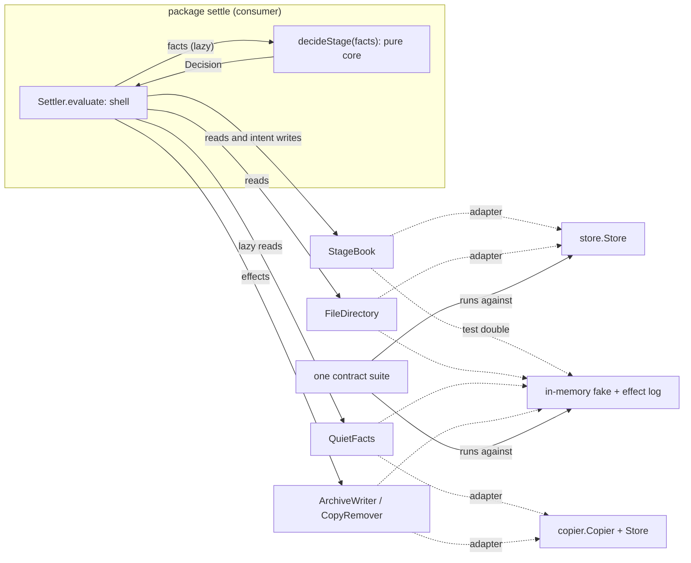
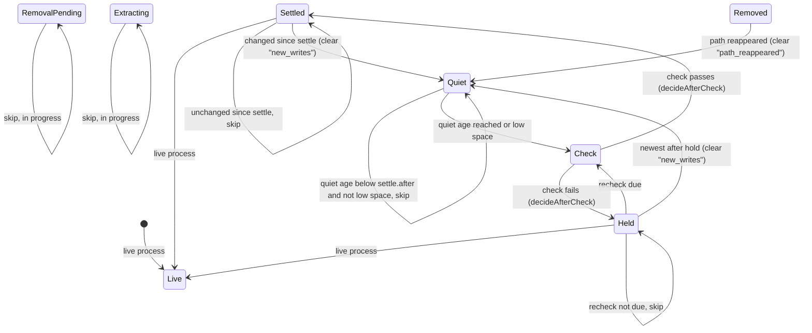
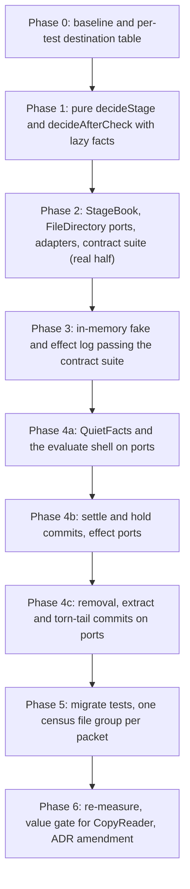

# Settle behind consumer-side ports and fakes, so only a few tests need the real harness

Status: proposed, awaiting operator approval. Package:
`packages/pg-claude-code-recorder/internal/settle`. Follows
`docs/superpowers/plans/2026-11-10-settle-split.md` and the rule in
`docs/adr/0123-recorder-settle-is-split-into-components-behind-consumer-side-interfaces-and-proven-by-crash-injection.md`
(a fake store MUST pass a contract suite that is also run against the real store). Nothing in this
plan is implemented yet.

## Why

The operator ruled on 2026-11-13 (Phillip, verbatim): "2) max extraction. i would expect that only a
few tests must remain which require a real harness and those should only be there to verify that the
real system behaves as we expect. the business logic should be contained such that most of the
interactions can be done via mocks/fakes."

Today `Settler` holds a concrete `*store.Store` and a concrete `*copier.Copier` (`Config.Store`,
`Config.Copier`). Reading the non-test sources of the package as they are now:

- the settle, remove, extract, wake, where, dirty and counts code call about 45 distinct `Store`
  methods (`Stage`, `Stages`, `SettledOf`, `Generation`, `Generations`, `CopyOffsets`, `OpenPointer`,
  `CopyPath`, `CommitCtx`, `CommitFullCtx`, `ReadTxCtx`, `Read` (raw SQL), `TornTailOf` and more) and
  9 `Copier` methods (`WithLock`, `CloneMode`, `ReadOriginalPath`, `NewGenerationLocked`,
  `ReclaimLocked`, `ReplaceCopyLocked`, `ClonePolicy`, `SetOnFileChange`);
- every durable write goes through one wide `Commit(*store.Rec)` whose `Rec.T` discriminates the
  meaning (stage clear, held, settled, removed), so a test cannot assert the intent, only the row;
- the stage machine, `Settler.evaluate`, interleaves reads, decisions and commits in one method. The
  pure predicates `quietAgeReached`, `heldHasNewWrites` and `heldRecheckNotDue` already live in
  `check_pure.go`, but the transition table itself (which stage goes to which, and which side effect
  follows) is not pure and has no table test;
- the package has 179 `Test` functions in 44 test files (measured: a count of `func Test` over
  `*_test.go`). The bead that requested this plan states that about 147 of them build a real SQLite
  store, a real copier and a real parser through `newEnv` and `newRemoveEnv` (`env_test.go`), and
  that about 130 also run `invariants.Check` at cleanup. Phase 0 below re-measures that number with a
  mechanical method, because "builds a real store" was counted by hand and MUST be reproducible
  before it is used as a baseline. The wall times quoted by the previous plan are 18.6 s plain and
  64.7 s with `-race`, measured on a quiet host.

The goal is that business logic (the transition table, ordering of effects, which reads are needed
when) is tested against plain values and fakes in milliseconds, and the real store, copier and file
system are exercised only where their own semantics are the thing under test.

## Goals

- The transition decisions of the stage machine MUST be one pure function, `decideStage`, with a table
  test and no store, copier or clock.
- `Settler` MUST depend on small consumer-side ports declared in package `settle`, not on
  `*store.Store` or `*copier.Copier` for the decisions and effects listed below. The concrete types
  stay as the production adapters and the daemon wiring stays unchanged.
- Every fake MUST pass the contract suite that also runs against the real store (ADR 0123).
- The number of settle tests that need a real store, copier or parser MUST fall from the baseline to
  the short list in "What stays real", and that number MUST be reported per phase.
- Behavior MUST NOT change: the write order of byte and clone mode, `Recover` under the run lock, the
  removal order, lock order (run lock, then copier lock), the six `Hooks`, and the 15 `faults.At`
  points all stay as the previous plan lists them.

## Patterns

Ports and Adapters, declared consumer-side as `settle.Parser` and `settle.FreeSpace` already are;
Functional Core with an Imperative Shell (`decideStage` is the core; `Settler.evaluate` becomes the
shell that gathers facts, calls the core and performs the returned effect); Interface Segregation
(four small ports, not one mirror of the store); a Test Double (a hand-written in-memory Fake plus a
recording Spy, the effect log) admitted only through a Contract Test, which is ADR 0123's rule;
Lazy Evaluation of facts (a fact is a function, so a branch that does not need it never pays for it).

## Design

### Where the ports sit



Each port is declared in a new non-test file in `internal/settle` (`ports.go`), so the consumer owns
the shape. The adapters (`ports_store.go`) are thin forwarding types over `*store.Store` and
`*copier.Copier`. Ports return plain values (structs, slices, bools), never a `ReadTx` closure, a
`*sql.Rows`, a `*store.Pointer` or a store handle: a port that hands out a handle forces the fake to
implement the store's lifetime rules.

### The ports

The signatures below are the design to approve; names MAY be adjusted in review but the size limits
in "Risks" MUST hold.

```go
// StageBook is the stage and settle ledger: what stage a session is in and what was settled.
type StageBook interface {
	// Reads (8).
	Stage(session string) (StageRow, bool, error)
	Stages(stages ...string) ([]StageRow, error)
	SettledOf(session string) (SettledRow, bool, error)
	AllSettled() (map[string]SettledRow, error)
	CopyOffsets() (map[FileGen]int64, error)
	Generation(file int64, gen int) (GenRow, error) // ErrNotFound (settle's own sentinel) when absent
	TornTailOf(file int64, gen int) (TornRow, bool, error)
	ArchivedTo(session string) (int64, error)

	// Intent-level writes (8). Each names its durability class; the adapter maps it to
	// store.CommitCtx (journal) or store.CommitFullCtx (full flush) exactly as the call site does today.
	ClearStage(ctx context.Context, session, reason string, at time.Time, d Durability) error
	CommitHeld(ctx context.Context, session string, since time.Time, reason string, failures []Failure) error
	CommitExtracting(ctx context.Context, session string, at time.Time, plan []byte) error // full
	CommitRemovalPending(ctx context.Context, session string, at time.Time, pending []byte, d Durability) error
	CommitSettled(ctx context.Context, s SettledCommit) error // full flush: manifest, ranges, method
	CommitRemoved(ctx context.Context, r RemovedCommit) error // full flush: pending list plus the path-close records, atomically
	CommitTornReset(ctx context.Context, file int64, gen int, at time.Time) error
	CommitTornFact(ctx context.Context, file int64, gen int, from, to int64, at time.Time) error
}

// FileDirectory answers "what files does this session have, where, in which mode".
type FileDirectory interface {
	FilesOf(session string) ([]FileRow, error) // id, current path, mode, current generation, last size
	SessionsOfFile(file int64) ([]string, error)
}

// QuietFacts are the facts about quietness, each read on demand.
type QuietFacts interface {
	// Newest is the original's mtime, else the last time the recorder saw the file change.
	// Two adapters exist: one reading the per-tick seen cache under the run lock (settle), one
	// reading through the store without it (doctor), as lastSeen and lastSeenFromStore do today.
	Newest(ctx context.Context, files []FileRow) time.Time
	OriginalSize(f FileRow) (int64, bool)
	TailMatches(f FileRow, copyOffset int64) bool
}

// ArchiveWriter and CopyRemover are the effect port: the file-system side effects only.
// Both are the *Locked operations: the SHELL owns Copier.WithLock; adapters never take it.
type ArchiveWriter interface {
	// WriteArchive writes and verifies the archive segment (byte mode) or the temporary clone
	// (clone mode) and returns what the commit needs. It does NOT commit and does NOT delete.
	WriteArchive(ctx context.Context, c ConvFiles, mode SettleMode) (SettledCommit, error)
	NewGeneration(f FileRow, reason string) error // copier.NewGenerationLocked
	ReplaceCopy(f FileRow) error                  // copier.ReplaceCopyLocked, clone mode
}
type CopyRemover interface {
	// RemoveCopies deletes (byte mode) or reclaims (copier.ReclaimLocked) the copy bytes the
	// committed settle covers. The shell calls it AFTER CommitSettled.
	RemoveCopies(ctx context.Context, session string, covered []FileGen) error
}
```

`ConvFiles` (the session's `FileRow`s and the per-file relative paths), `SettleMode` (`Bytes` or
`Clone`), `Durability` (`Journal` or `Full`), `StageRow`, `SettledRow`, `GenRow`, `TornRow`,
`SettledCommit` and `RemovedCommit` are plain value types in `ports.go`, owned by `settle`. This is
the full method list: `StageBook` has 16 methods, and each is named by a current call site in
`evaluate`, `hold`, `settleBytes`, `settleClone`, `check`, `Remove`, `Extract` or `Wake`. The
`restore_conflict` hold in removal is a `CommitHeld`.

Decisions that the design settles:

- `StageBook` is the only port that persists decisions. Its writes are intent-named (`CommitHeld`,
  `CommitSettled`, `CommitRemoved`, `ClearStage`) so a test asserts "held, with reason X, since T",
  not "a `Rec` with `T == TStage` and `State == "held"`". The adapter owns the `store.Rec` encoding,
  including `At: since` for an unchanged hold and the `Val` JSON of the failures, exactly as `hold`
  builds it today.
- `ClearStage` MUST be idempotent: clearing a session with no row is a no-op that returns nil. This is
  a contract-suite case. Its `reason` is not persisted by the real store (the stage row is deleted),
  so the contract cannot read it back; it is carried so the shell's `setReason` and the effect log see
  it. `Durability` is an argument because the same clear is journal-only in `evaluate` and a full
  flush after an extract.
- `FileDirectory` exposes `FileRow` as a small value type owned by `settle` (not `store.File`), so a
  test builds a file in one literal. The adapter converts from `store.File`.
- `QuietFacts` is the only lazy-read port: `Newest` is called only on the branches that need it
  (see below), and `TailMatches` only when sizes agree and a tail exists, as `appendOriginalFailure`
  already takes a function for that reason.
- The effect port is split in two (`ArchiveWriter`, `CopyRemover`) so the removal path, which never
  archives, does not depend on archive writing. Lock ownership stays where it is today: the shell
  (`evaluate`, `Remove`, `Extract`) calls `Copier.WithLock`, and `settleLocked`, `settleBytes` and
  `settleClone` run inside it. The effect-port adapters are the `*Locked` copier operations and MUST NOT
  take the lock again; the pure core and the fakes never see the lock. The shell, not an adapter, calls
  `CommitSettled` between `WriteArchive` and `RemoveCopies`, so "archive, then commit, then remove" is
  a sequence of shell calls the effect log can assert. `WriteArchive` includes the manifest build and
  the ranges (the work of `manifest`, `Snapshots` and `registryVersions`), which is why those raw-SQL
  reads stay behind it in the real adapter; the fake returns a canned `SettledCommit`, so the fake
  proves ordering and the shell's decisions, not the archive's content (the real tier does).
- The raw-SQL reads in `settle.go` (`parsedState`, `registryVersions`, the `Read()` queries) and the
  byte-level `OpenPointer` reads in `check` and `extract` are NOT ported in phase 1 to 3. They are
  the largest remaining real-store dependency, and whether a `CopyReader` port is worth it is
  decided at the value gate (phase 6) from measured numbers, not by default.

### `decideStage` and lazy facts

`decideStage` holds the transition table that `evaluate` carries today and returns a `Decision`
value; it performs no read and no write.

```go
// StageFacts is everything evaluate may need. Each field that costs a read is a function.
type StageFacts struct {
	Live      bool
	Row       *StageRow         // nil when the session has no stage row
	Changed   func() bool       // changedSinceSettle: only read for a settled row
	Newest    func() time.Time  // QuietFacts.Newest: only read when the table needs quietness
	LowSpace  func() bool       // s.LowSpace(): only called after the quiet-age gate fails
	CheckedAt time.Time         // the shell's checkedAt[session] (stays in Settler, guarded by s.mu)
	Force     bool
	Now       time.Time
	After     time.Duration     // settle.after
	Recheck   time.Duration     // held.recheck
}

type Decision struct {
	Clear   string // reason to ClearStage first ("process", "path_reappeared", "new_writes"), "" for none
	Stage   string // stage to report
	Skip    string // text for Outcome.Skipped, "" when the session proceeds to the check
	Reason  string // Outcome.Reason: the held row's reason on "held, recheck not due"
	Proceed bool   // run the settle check under the copier lock
	WasHeld bool   // the check starts from a held row (a pass then clears with "check_passed")
}

func decideStage(f StageFacts) Decision
```

What stays in the shell (`Settler.evaluate`), unchanged and in this order: reading the row and
building the facts' closures; performing `Clear` through `ClearStage`, with its `setReason` side
effect; recording `checkedAt[session] = now` under `s.mu` when `Proceed` is true; calling
`Parser.Drain`; taking `Copier.WithLock`; and calling `settleLocked`. A "process" clear happens only
when `Row` is non-nil, which a table row pins.

There are two pure functions, not one. `decideStage` covers `evaluate` up to "run the check". The
second, `decideAfterCheck(CheckFacts) CheckDecision`, covers what `settleLocked` and `hold` decide
once the check has run: failures present means hold, and the hold is a no-op that keeps the old
`since` when reason and detail are unchanged; regenerations present means start a new generation and
stay Quiet; a held row that now passes means clear with "check_passed"; otherwise settle in the mode
the copier reports. `settleLocked` recomputes `newest` and `LowSpace` for the check's `quiet`
argument; that second read belongs to the shell and is passed in `CheckFacts`, and `decideStage` does
not own it. The keep-since and no-op-hold logic is therefore tested as a table, not as a contract case.

The transition table that `decideStage` MUST reproduce (it is the one in `evaluate`, nothing new):



The second function's types, in the same style:

```go
type CheckFacts struct {
	Row      *StageRow  // the current stage row (nil when none): hold reads Stage, Reason, Detail, SinceNS
	Fails     []Failure // from check; FailsJSON is its marshalled form
	FailsJSON string
	Regen    []FileRow  // files whose full hash differs from the original's (clone mode)
	WasHeld  bool
	Clone    bool       // Copier.CloneMode()
	Now      time.Time
}

type CheckDecision struct {
	Action     string    // "hold", "regen", "settle-bytes", "settle-clone"
	ClearFirst string    // "check_passed" when a held row now passes, else ""
	CommitHold bool      // false for a no-op hold (same reason and detail)
	Since      time.Time // the hold's since: the old row's when it was already held, else Now
	Reason     string    // the first failure's reason, for the Outcome
}
```

`hold` stays a read-modify-write on the `StageBook` (`Stage`, then `CommitHeld`); it is not atomic
across the two calls, as today, and the run lock covers it.

The two `Check` edges belong to `decideAfterCheck`; every other edge belongs to `decideStage`.

Laziness is part of the contract of `decideStage`, and it is testable: a table row for a settled,
unchanged session supplies a `Newest` that fails the test if called, because the real `newest` costs
one `stat` per file. The shell supplies facts as closures over the ports; the fake supplies counters.
After `decideStage` returns, the shell acts on the `Decision` as described above.

### The shared effect-log fake

One in-memory world implements the ports and appends every call that changes state or has an
effect to a single ordered log, so cross-port order can be asserted without a real store.

```go
type EffectLog struct{ Calls []Call } // Call{Port, Method, Session, Detail}
type FakeWorld struct{ Log *EffectLog; /* maps for stage rows, settled rows, files */ }
```

What it is for: asserting "ClearStage(new_writes) happens before the check, the archive is written
before `CommitSettled`, copies are removed after `CommitSettled`" as an ordered slice. That ordering
is the crash-safety order the package comment states, and it is exactly what today's tests check by
building a real store and a recorder.

What it is NOT for: it does not model the journal, the database, fsync, or a crash. A write to the
fake is atomic and instantly durable. See Risks.

### The contract suite

One suite, `RunStageBookContract(t, factory)`, lives in a package `internal/settle/settletest`
together with the fake and the effect log. `settletest` imports `settle` for the port and value types,
and only test files import `settletest` (nothing in production does). Tests that use the fake and are
written as in-package tests today (`package settle`) MUST move to an external `settle_test` package
to import it; that move is mechanical and belongs to phase 5. The suite runs twice:

- `TestStageBookContract_Real` builds a real `store.Store` in a `t.TempDir()` behind the adapter;
- `TestStageBookContract_Fake` builds the in-memory fake.

The cases (each MUST pass on both):

1. commit then read round trip: `CommitHeld`, `CommitSettled` and `CommitRemoved` are each visible to
   `Stage`, `Stages` and `SettledOf` exactly as written (reason, since, failures, manifest, ranges);
2. `ClearStage` is idempotent and leaves no row; clearing after `CommitSettled` keeps the settled
   record readable through `SettledOf` where the real store keeps it, and the suite pins whichever
   the real store does;
3. a second `CommitHeld` with a later `since` overwrites `since` (the store upserts; keeping the old
   `since` is the shell's job, tested in `decideAfterCheck`, not here);
4. `AllSettled` and `CopyOffsets` agree with the per-session readers (`SettledOf`, `Generation`) for
   the same data;
5. the manifest bytes round trip unchanged through `CommitSettled` and `SettledOf` (how a corrupt
   manifest is judged is `changedAgainst`, shell code, with its own pure test);
6. `Generation` of an absent file and generation returns the port's `ErrNotFound` (a `settle`
   sentinel; the store adapter maps `store.ErrNotFound` to it, and `changedAgainst`'s caller follows
   in phase 4), and `Stage` of an absent session returns `ok == false`, not an
   error.

7. `CommitExtracting` and `CommitRemovalPending` round trip through `Stage` (stage, plan or pending
   bytes); `CommitTornReset` and `CommitTornFact` round trip through `TornTailOf`; `ArchivedTo` agrees
   with the ranges written by `CommitSettled`.

Seeding. Files, paths and generations are created by the ingest and copier paths, not by any port,
so the suite cannot create them through a port. The `factory` therefore returns two values,
`factory(t) (world World, seed Seeder)`, where `Seeder` is test scaffolding in `settletest`:
`PlaceFile(session string, f FileRow)` and `PutGeneration(g GenRow)`. The real backend implements it by
committing `store.Rec`s (file, path-close and generation records) through `CommitFullCtx`; the fake
writes its maps. `Seeder` is not a port: it is exempt from the 16-method limit and from "no fake method
without a contract case". The real-store seeding is what keeps the fake honest, because the contract
proves the fake reads what the real store holds after the same seed. `PutGeneration` MUST be called
after `PlaceFile` for the same file on both backends (a generation belongs to a file). `ArchivedTo` is
checked against ranges written only through `CommitSettled`, never through the `Seeder`. Cases 4, 6 and 7 and the
`FileDirectory` suite use it.

`FileDirectory` has its own suite, `RunFileDirectoryContract`, run the same two ways: `FilesOf`
returns the files placed in a session with their path, mode, generation and last size, and
`SessionsOfFile` returns every session a file is placed in, and an unknown id or session returns an
empty list, not an error.

Admission rule by port. `StageBook` and `FileDirectory` carry state, so each fake method MUST have a
contract case, and the fake is extended in the same commit as the suite. `QuietFacts`, `ArchiveWriter`
and `CopyRemover` have no ledger state: their fakes are stateless recorders that return canned values
and append to the effect log, so there is nothing to contract-test; their real adapters are covered by
the real tier (the thin end-to-end settles, the removal real-OS tests). A fake of these three MUST NOT
hold state beyond the canned answers and the log. Phase 3 builds the `StageBook` and `FileDirectory`
fakes; phase 4a builds the `QuietFacts` recorder, 4b the effect-port recorders.

The adapters are exported through constructors, `settle.NewStoreStageBook(*store.Store) StageBook`
and `settle.NewStoreFileDirectory(*store.Store) FileDirectory`, because `TestStageBookContract_Real`
lives in the external `settle_test` package (it must import both `settle` and `settletest`). Phase 2
therefore introduces the external test package; phase 5 only moves the other tests into it.

## What stays real

Only tests where the real system's own semantics are the thing under test keep a real store, copier,
parser or file system. These are the real tier; they are expected to be a short list (the target is
at most 25 tests, which phase 0's classification MAY revise by a plan amendment, down from about 147):

- Durability and crash-reopen: any test that closes and reopens the store, depends on journal versus
  database durability, or checks `invariants.Check` over a real database. This includes the
  `crashsweep`-tagged crash injection (`crashsweep_test.go`, `crashsweep_fs_test.go`, scenarios stop
  after file-system operation i, reopen, `Recover`, `invariants.Check`) and the `faults.At` tests.
- The rapid model-based sequence test (`model_sequence_test.go`, `crashsweep` tag).
- Real OS semantics: hard links, `EXDEV`, real `clonefile` on darwin
  (`clone_darwin_integration_test.go`), the real `lsof` probes in removal, quarantine rename,
  and `oracle_integration_test.go`.
- The contract suite's real half, and one thin end-to-end settle per mode (byte and clone) through
  the real store, copier and parser, to prove the adapters wire up.
- `lockorder` (`go-deadlock`) and the `soak` and `integration` tagged tests, unchanged.

Everything else (the stage transition cases, held rechecks, rate limits, ordering of writes and
removals, wake work sets, counts and gauges that read only through the ports) MUST move to the pure
core and the fake. A test moves; it is not duplicated, so the baseline falls rather than grows.

## Risks

1. **A fake that models durability gives a false green.** If the fake simulated the journal, the
   database, flush or a crash, the crash-safety claim would be proven against the fake's model of the
   store rather than the store. Mitigation: the fake MUST be scoped to read facts (what the ledger
   returns) and effect order (the call log). It MUST NOT implement a journal, fsync, torn write,
   reopen or crash. Every test about durability, crash, reopen or `Recover` MUST stay on the real
   store, and the `crashsweep`, `faults` and rapid tests MUST NOT be moved onto the fake. The
   contract suite MUST NOT assert durability properties, because the fake cannot have them; those
   stay in `internal/store`'s own tests. A review check for each phase: the fake contains no journal,
   flush, reopen, recover or crash construct (a grep for `journal`, `flush`, `Sync`, `Recover` and
   `crash` is a review aid, not a gate).
2. **Ports that mirror the store.** The package uses about 45 distinct store methods; a port that copies them
   makes the fake a second store and moves the cost without removing it. Mitigation: ports are
   intent-level and small. Limits: `StageBook` at most 16 methods (the list above), `FileDirectory` at most 4,
   `QuietFacts` at most 4, the effect port at most 4 per interface; a method is added only for a
   named test or production caller, not "for completeness". A port MUST NOT return a `ReadTx`
   closure, a handle or a `*sql.Rows`. Adding a method over the limit needs a plan amendment.
3. **Behavior drift in the move.** The write order is the safety order. Mitigation: each phase is
   behavior preserving; the unmoved real tier (above) plus the crash-injection tier run unchanged in
   every phase; moves are mechanical and test edits that a move forces go in a separate commit, as
   in the previous plan.
4. **Lock order.** The shell keeps `Copier.WithLock` and the run lock; the adapters are the `*Locked`
   operations and MUST NOT take either; the pure core and the fakes MUST NOT take the run lock or the
   copier lock. `Dirty` and `LiveChanged` stay lock-free as ADR 0123 requires,
   and the `lockorder` tier runs after every phase that touches the adapters.

## Phases

Each phase is one commit group that passes its own validation and MAY land on its own, because each
is behavior preserving (the previous plan landed as one set; this one does not need to, since the
ports are additive until phase 4a, where `Settler` starts consuming them with the real adapters as the
default). Order follows dependency, not value.



### Phase 0: baseline and classification (no production change)

- Add a test-helper census (a script or a `go test -list` plus an `rg` count kept in
  `packages/pg-claude-code-recorder/docs/` or the plan's measurement section) that classifies each of
  the 179 settle tests as real (builds `newEnv`, `newRemoveEnv`, `store.Open` or a real copier or
  parser) or not, reproducibly.
- Record the baseline: `go test -list '.*' ./internal/settle` count, the real count (bead's 147),
  and wall time, plain and `-race`.
- The census MUST output a per-test destination table (file, test name, destination: stays real,
  moves to core table, moves to fake, or already pure). That table is the input of phase 5: phase 5
  packets are defined as "one census-listed file group each".
- Acceptance: the census is committed and reproducible by one command; the baseline table is filled
  in; every settle test appears in the destination table exactly once.

### Phase 1: pure `decideStage` and `decideAfterCheck`

- Extract `decideStage(StageFacts) Decision` and `decideAfterCheck(CheckFacts) CheckDecision` into
  `decide.go`; `evaluate`, `settleLocked` and `hold` become shells over them. Reuse `quietAgeReached`,
  `heldHasNewWrites`, `heldRecheckNotDue`. The shell keeps `setReason`, `checkedAt`, `Drain` and the
  lock, as in "The ports".
- Table tests covering every edge of the diagram above (the `Check` edges against
  `decideAfterCheck`, the rest against `decideStage`), the "process clear only with a row" case, the
  `Outcome.Reason` on a recheck skip, the keep-since no-op hold, and laziness cases (`Newest`,
  `Changed` and `LowSpace` not called when not needed). No store, no clock, no copier.
- Acceptance: observable behavior is unchanged (the existing stage tests pass untouched); at least
  one table row per diagram edge; tests that only exercised the transition table through a real store
  are moved (not copied) to the table tests, and the moved count is recorded.

### Phase 2: `StageBook` and `FileDirectory`, adapters, contract suite

- Add `ports.go` (interfaces and value types) and `ports_store.go` (adapters over `*store.Store`).
  `Settler` is not yet switched; the adapters are used only by the contract suite.
- Add `RunStageBookContract`, `RunFileDirectoryContract`, the `Seeder` and their real-store run. The
  external `settle_test` package cannot reach the unexported helpers of `package settle`
  (`newEnv` and others); the contract test builds its own store, and phase 5 MUST export or duplicate
  the helpers it needs for moved tests.
- Acceptance: the contract suite passes against the real store; the interface size limits in Risks
  hold; no production caller changed, and each adapter has a compile-time assertion
  (`var _ StageBook = (*storeBook)(nil)`) behind the exported constructors; the real-half contract run
  is in the external `settle_test` package.

### Phase 3: in-memory fake and the shared effect log

- Add the fake for `StageBook` and `FileDirectory` (with its `Seeder`) and the `EffectLog`; run
  `RunStageBookContract` and `RunFileDirectoryContract` against it.
- Acceptance: both suites pass against the real store and the fake; the fake contains none of the forbidden
  durability constructs (the grep check in Risks); the fake has no method without a contract case.

### Phase 4: `Settler` on ports (three packets, in order)

`Config.Store` and `Config.Copier` stay as the production wiring, so `serve` and `cmd` are unchanged;
`Config` gains optional port overrides for tests. Every sub-phase has the same acceptance base: all
existing tests pass without edits (the real adapters are the default); the `faults`, `crashsweep` and
`lockorder` tiers pass unchanged; the operation list recorded by `fsx.Recorder` for a byte settle and
a clone settle (and, from 4c, a removal and an extract) is identical before and after the sub-phase.

- **4a, `QuietFacts` and the evaluate shell.** Add `QuietFacts` (both `Newest` adapters) and the
  `StageBook`/`FileDirectory` reads and `ClearStage` in `evaluate`, `wake` and `where`. The two
  `Newest` adapters get distinct constructors (a run-lock one over the `seen` cache, a store-only one
  for the doctor, which MUST NOT take the run lock). Where `wake` and the counts read per-session
  ledger data in one read transaction today, this packet MUST either keep a batch read on `StageBook`
  (for example `SettledAndOffsets(sessions)`, added by plan amendment against the 16-method limit) or
  show by measurement that per-call reads do not regress the pass.
- **4b, settle and hold.** Add `ArchiveWriter` and `CopyRemover` and their adapters; move
  `settleLocked`, `settleBytes`, `settleClone`, `hold` and the torn-tail commits onto `CommitHeld`,
  `CommitSettled`, `CommitTornReset`, `CommitTornFact`, `WriteArchive`, `RemoveCopies`. The shell keeps
  the order and the lock.
- **4c, removal and extract.** Move `Remove` and `Extract` onto `CommitRemovalPending`,
  `CommitRemoved`, `CommitExtracting`, the `restore_conflict` `CommitHeld` and `ClearStage` with the
  right `Durability`.

### Phase 5: migrate tests to the fake

- Move tests from the real harness to the fake plus effect log, one census-listed file group per
  packet, each packet a commit group: stage transitions through the table tests, ordering through the
  effect log, removal sequencing, wake and counts that need only ledger reads. Tests on the real-tier
  list stay. In-package tests that adopt `settletest` move to the external `settle_test` package (a
  mechanical move, in its own commit).
- Acceptance: each packet states its before and after counts from the census; no test is deleted
  without a stated replacement; tests that move keep their intent and name or are renamed in a
  separate commit.

### Phase 6: re-measure, value gate, record

- Re-run the census and timing. Decide from the numbers whether a `CopyReader` port (for `check`,
  `extract`, `hashCopy`) is worth adding; if so it is a separate follow-up plan, not part of this one.
- Update the `settle` package comment and amend ADR 0123's "No such fake exists yet" sentence to
  point at the first fake, in one commit.
- Acceptance: the final measurement table is filled in; the ADR text is accurate.

## Measurement per phase

Method (the same in every phase, so the numbers are comparable to the baseline):

- Count: `cd packages/pg-claude-code-recorder && go test -list '.*' ./internal/settle | rg -c '^Test'`
  for total tests, and the phase 0 census command for real-harness tests. Report both, plus the
  per-destination breakdown (real, core table, fake).
- Wall time: from `packages/pg-claude-code-recorder`, `nice -n 10 go test -p 4 -count=1
./internal/settle/...`, plain and `-race`, each run once at a time and in the background
  (`bgrun`, `bgwait`), with a private `GOCACHE`. Record the 1-minute load average at the start of each
  run, as the previous plan did, and write down the package time and the per-test sum.
- Because host load changed measured times by 2 to 3 times in the previous plan, a phase result
  MUST be reported as a ratio against a baseline re-run on the same host at the same session
  ("baseline, then phase, back to back"), not against the historical 18.6 s and 64.7 s alone. The
  historical numbers are only context.
- The count is the primary measure (it does not depend on load); wall time is secondary and a wall
  time that is inside the load noise MUST be reported as "no change shown", not as a win.

Every phase reports plain and `-race` times (the validation requires both), each run alone, the
baseline re-run immediately before it. The agent that finishes the phase records the "before" values
(from the previous phase's report, re-run on the day) and the "after" values.

| Phase | Count reported                                                                | Expected direction                                    |
| ----- | ----------------------------------------------------------------------------- | ----------------------------------------------------- |
| 0     | 179 total, real count by census (bead says about 147)                         | baseline, no change                                   |
| 1     | table rows added; `real_after = real_before - moved`                          | real count falls by exactly the moved tests           |
| 2     | contract cases (real half)                                                    | total up by the suite only; real count up by the same |
| 3     | contract cases (real plus fake)                                               | total up slightly; real count unchanged               |
| 4a-4c | real count unchanged (no test edits); recorded operation list identical       | no change; the order check is exact                   |
| 5     | per packet `real_after = real_before - moved`; final count against the target | falls packet by packet                                |
| 6     | final census, final times, ratio to the same-day baseline                     | at most 25 real tests, or an amendment                |

## Validation per phase

From `packages/pg-claude-code-recorder`, niced and in the background:
`go test -p 4 ./internal/settle/... ./internal/serve/... ./internal/store/... ./internal/copier/...`,
the same with `-race`, `go vet ./...`, `go vet -tags integration ./...`, and the tagged tiers
(`faults`, `crashsweep`, `lockorder`) after each of phases 2, 4a, 4b, 4c and 5. Pre-commit hooks pass on the changed
files. The tagged tiers MUST NOT be pulled into the unit gate.

## Invariants every phase MUST preserve

The list in the previous plan, unchanged: byte-mode and clone-mode write order, `Recover` under the
run lock, lock order (run lock, then copier lock; `Dirty` and `LiveChanged` never take the run lock),
removal order, the six `Hooks` and the 15 `faults.At` points. In addition: no port method takes or
returns a store handle, and the fake never claims a durability property.

## Out of scope

Changes to `internal/store` or `internal/copier` internals; a `CopyReader` port (decided at phase 6);
moving the exported types that `serve` and `cmd` import; the doctor's own dependencies (`DoctorDeps`
already exists); mutation testing.

## Approval

On approval, the operator unblocks running `plan-decompose` on this plan, one packet group per
phase, and wiring the resulting docket as a blocker of the settle maximum-extraction feature work.
