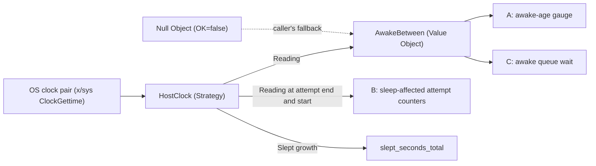

# pg-router: alerts and latency metrics that account for host sleep — design

- **Status**: Draft 6 for operator review, after four independent review rounds and five research passes (the last two settled the previously unverified items).
  Nothing here is implemented. No implementation bead is filed.
- **Date**: 2026-10-12
- **Bead**: `pg2-9uvm5` (this design); `pg2-ez292` (the root-cause diagnosis of the false
  persistent-failure alert; option A is its fix and `pg2-ez292` closes with it)
- **Builds on**: `packages/pg-router/docs/decisions/observability.md` (`DEC-OBS-4`, `DEC-OBS-8`);
  `packages/pg-router/grafana/alerting/alerts.yaml`; the host-activity power collector design
  (`docs/superpowers/specs/host-activity/07-power-presence.md` in the support-apps repository)
- **Related beads**: `pg2-5q16r`, `pg2-8zqrs`, `pg2-gp50o`, `pg2-lxnia`, `pg2-xdjrv`, `pg2-pkwkr`,
  `pg2-6o4mu`, `pg2-4zous`, `pg2-p63ot`, `pg2-nlkt7`; epic `pg2-kftf9`

The key words MUST, MUST NOT, SHOULD, SHOULD NOT and MAY in this document are to be read as in RFC 2119.

This repository is public. The document names no employer, workspace, channel or person. Bead ids
(`pg2-...`) are this repository's own tracker ids.

## 0. Summary

| Question                         | Short answer                                                                                                                                                                                                                                                                                                                                                                                                         |
| -------------------------------- | -------------------------------------------------------------------------------------------------------------------------------------------------------------------------------------------------------------------------------------------------------------------------------------------------------------------------------------------------------------------------------------------------------------------- |
| What is wrong?                   | pg-router schedules in **awake time**. The `pg-router-source-persistent-failure` alert measures **wall-clock** age, so a long sleep fires it with nothing failed. That is the one confirmed defect.                                                                                                                                                                                                                  |
| What is NOT wrong?               | Run time is already awake time in every case. Queue wait is awake time for 72.7% of dispatches. Failures that start just after a wake are 2.0% to 2.9% of all source failures over the last week. The first draft overstated all three.                                                                                                                                                                              |
| Can sleep be prevented?          | No (operator ruling R-1). `caffeinate` is best effort.                                                                                                                                                                                                                                                                                                                                                               |
| What does this design build?     | **Core**: a small host clock (awake and slept time). **A**: an awake-age gauge and the alert on it. **C (narrowed)**: an awake queue-wait histogram, because 27.3% of dispatches (source-stamped events such as `desk-pr` and `desk-issue`, plus events restored after a restart) carry wall-clock waits today. **B (instrumentation only)**: count sleep-affected attempts, so the alert change is decided on data. |
| What is deferred, with evidence? | **B alert change** and **E** (escalation grouping, retry windows). The measured post-wake share is below the spec's own 25% threshold. Revival criteria are in sections 7 and 9.                                                                                                                                                                                                                                     |
| Does it depend on host-activity? | No. The router reads the same OS clock pair itself. Option D (optional, separate repository) adds a cross-check and a dashboard overlay.                                                                                                                                                                                                                                                                             |

## 1. Inputs and rulings

| ID  | Ruling or input                                                                                                                                                | Source                                   |
| --- | -------------------------------------------------------------------------------------------------------------------------------------------------------------- | ---------------------------------------- |
| R-1 | The laptop cannot be kept awake. `caffeinate` keeps it awake when it can, so awake time is not guaranteed and MUST be accounted for.                           | Operator, 2026-10-12, this design thread |
| R-2 | A sleep signal already exists (host-activity's `power` collector). The design MUST NOT invent a competing sleep state machine. It MAY read the same OS clocks. | Operator, 2026-10-12, this design thread |
| R-3 | Options A to E are in scope for the spec. The spec orders, narrows or defers them on evidence, and the operator approves that disposition (section 12).        | Operator, 2026-10-12, this design thread |
| R-4 | The plan MUST be ready for drain agents to resolve: self-contained work packets with acceptance criteria and validation commands (section 12).                 | Operator, 2026-10-12, this design thread |

## 2. Facts this design rests on

Each fact names where it was read. A reader MUST re-verify a fact against the current source before
acting on it. "Verified" means read or measured on 2026-10-12.

| ID   | Fact                                                                                                                                                                                                                                                                                                                                                                                                                                                                                                                                                                                                                                                                                                                                                                                                                                                                                                                                                                                                                                             | Where                                                                                                                                                                                                                   |
| ---- | ------------------------------------------------------------------------------------------------------------------------------------------------------------------------------------------------------------------------------------------------------------------------------------------------------------------------------------------------------------------------------------------------------------------------------------------------------------------------------------------------------------------------------------------------------------------------------------------------------------------------------------------------------------------------------------------------------------------------------------------------------------------------------------------------------------------------------------------------------------------------------------------------------------------------------------------------------------------------------------------------------------------------------------------------ | ----------------------------------------------------------------------------------------------------------------------------------------------------------------------------------------------------------------------- |
| F-1  | A period source is due when `!nowT.Before(last.Add(period))`. `last` is assigned from `time.Now()` at attempt start, copied by value into `Orchestrator.lastTick`, and keeps Go's monotonic reading. `lastTick` is never persisted, so a restart makes every period source due on the first pass.                                                                                                                                                                                                                                                                                                                                                                                                                                                                                                                                                                                                                                                                                                                                                | `internal/discover/discover.go:432,582`; `internal/orchestrator/orchestrator.go:214`. Verified.                                                                                                                         |
| F-2  | On macOS Go's monotonic clock is `mach_absolute_time`, which excludes sleep (Go 1.25.9). On Linux it is `CLOCK_MONOTONIC`, which excludes suspend. A JSON round trip of a `time.Time` drops the monotonic reading. Verified empirically: one dispatch with a wall wait of 11,641.761 s was recorded by the histogram as 80.5 s.                                                                                                                                                                                                                                                                                                                                                                                                                                                                                                                                                                                                                                                                                                                  | `runtime/sys_darwin_arm64.s:147`, `runtime/sys_linux_arm64.s:341`, `time/time.go:61-68`. Verified.                                                                                                                      |
| F-3  | `pg-router-source-persistent-failure` evaluates `time() - pg_router_source_last_success_timestamp_seconds > on(source) clamp_min(3 * pg_router_source_expected_interval_seconds, 1800)`, `for: 5m`, `noDataState: OK`. `time()` is wall-clock.                                                                                                                                                                                                                                                                                                                                                                                                                                                                                                                                                                                                                                                                                                                                                                                                   | `grafana/alerting/alerts.yaml:809`. Verified.                                                                                                                                                                           |
| F-4  | The last-success gauge reads `Emitter.srcLastSuccess`, seeded at construction and advanced by `OnSourceSucceeded` and `OnSourcePaused` with `e.now()`. It exports wall time (`at.UnixNano()`). A failed pass never advances it.                                                                                                                                                                                                                                                                                                                                                                                                                                                                                                                                                                                                                                                                                                                                                                                                                  | `internal/metrics/metrics.go:1322-1380`. Verified.                                                                                                                                                                      |
| F-5  | `DispatchTiming.Wait()` is `StartedAt.Sub(EnqueuedAt)` and `Run()` is `SettledAt.Sub(StartedAt)`, both floored at zero. `EnqueuedAt` is the resolved `Event.At`. `StartedAt` and `SettledAt` come from the queue clock `q.now()`. `DispatchTiming` is built at `queue.go:1327` from `p.evt.At` and `p.startedAt`.                                                                                                                                                                                                                                                                                                                                                                                                                                                                                                                                                                                                                                                                                                                                | `internal/eventqueue/queue.go:185-203,750-751,1201,1311,1327`. Verified.                                                                                                                                                |
| F-6  | Consequence of F-2 and F-5: **run time is awake time in every case.** Queue wait is awake time when `At` was stamped at ingest in the running process, and wall time when `At` was source-stamped (parsed from the source, no monotonic reading) or the event was restored from `queue.jsonl`.                                                                                                                                                                                                                                                                                                                                                                                                                                                                                                                                                                                                                                                                                                                                                   | Derived; measured in section 2.1.                                                                                                                                                                                       |
| F-7  | The persisted enqueue record carries `at` and `enqueuedAt` as JSON times (`omitzero`). `Record` is one struct shared by enqueue, accept and gate records; compaction appends the whole enqueue record (`compact.go:305`). The in-memory `entry` holds only `evt` (`queue.go:247-263`): `newEntry(r.event())` drops `Record.EnqueuedAt` on replay.                                                                                                                                                                                                                                                                                                                                                                                                                                                                                                                                                                                                                                                                                                | `internal/eventqueue/store.go:73-75`; `queue.go:247-263,653`; `compact_test.go:193`. Verified.                                                                                                                          |
| F-8  | `pg-router-source-failure-rate` is a 1 h ratio `increase(source_failures_total[1h]) / increase(source_duration_seconds_count[1h])` with a `>= 3` guard, `for: 15m`. Its condition node uses `params: [0.5]`, so `check-alert-rules.sh` (which requires `gt [0]`) cannot wrap it unchanged. The persistent-failure rule uses refIds A, B, C and `gt [0]`, so it can be added to `rule_uids` unchanged.                                                                                                                                                                                                                                                                                                                                                                                                                                                                                                                                                                                                                                            | `alerts.yaml:750,792,833`; `source_failure_rate_test.go:36`; `check-alert-rules.sh`. Verified.                                                                                                                          |
| F-9  | Prometheus (30 s scrape of `127.0.0.1:9820`) and Grafana (rule group `pg-router-alerts`, 60 s interval) run on the same laptop and sleep with it. Grafana compares `result.EvaluatedAt - state.StartsAt >= rule.For` using scheduler tick LABELS (`state.go` `resultAlerting`; `schedule/alert_rule.go` `Evaluate(ctx, scheduledAt)`), and its ticker never drops ticks but replays every missed minute label after a wake (`schedule/ticker/ticker.go`; observed: a tick stamped 10:59:00 EDT evaluated at 12:30:46 EDT), though the scheduler may drop individual queued labels (`schedule.go:443`). The `for` period therefore runs on label time, not wall-clock now: it can elapse across a sleep for an instance already Pending before the sleep, or for consecutive true catch-up labels that still have data. A first true evaluation from Normal only enters Pending. Prometheus's 5-minute staleness lookback may leave catch-up labels without data, which with `noDataState: OK` resets Pending (inference, checked live by SA-V2). | Prometheus `/api/v1/targets`; Grafana provisioning API; `grafana.log:79282-80579`; Grafana source (`state.go`, `schedule/`). Verified from source and logs; the documentation is silent on missed evaluations.          |
| F-10 | `pg_router_liveness` is a constant 1 (`isLive` returns `true`); it has no wall-age term. `pg-router-liveness-down` has `noDataState: Alerting`, `for: 5m`.                                                                                                                                                                                                                                                                                                                                                                                                                                                                                                                                                                                                                                                                                                                                                                                                                                                                                       | `cmd/pg-router/run.go:280-307`; `metrics.go:778-792`. Verified.                                                                                                                                                         |
| F-11 | host-activity's `host_power_last_sleep_duration_seconds` measures a sleep SESSION (leaving full wake to the next full wake) and is **awake time inside the session** (both ends carry a monotonic reading), not slept time. Dark wakes inside a session count as asleep. The `Slept` value is carried on native events but is neither logged nor exported.                                                                                                                                                                                                                                                                                                                                                                                                                                                                                                                                                                                                                                                                                       | `07-power-presence.md` "Phases"; `internal/collect/power_machine.go:309-322`; `power.go:229-261`. Verified.                                                                                                             |
| F-12 | `x/sys/unix.ClockGettime` is available with no cgo (`golang.org/x/sys` v0.47.0 is already in `go.mod` as `// indirect` and in `gomod2nix.toml:82`). `CLOCK_UPTIME_RAW` is documented as identical to `mach_absolute_time()`. Libc's `clock_gettime_nsec_np` (`gen/clock_gettime.c`, apple-oss-distributions/Libc) implements `CLOCK_UPTIME_RAW` as `mach_absolute_time()` and `CLOCK_MONOTONIC_RAW` as `mach_continuous_time()`, so `Slept = MONOTONIC_RAW - UPTIME_RAW` is by construction `mach_continuous_time - mach_absolute_time`. Twenty paired back-to-back reads on this host agree with the two Mach calls to 1.2 to 5.9 microseconds of call latency. `CLOCK_MONOTONIC` is a different clock (`gettimeofday - kern.boottime`, microsecond resolution, 10.88 s below the continuous clock on this host). The continuous clock started about 10.88 s before the `kern.boottime` instant, so `Slept` since boot can include up to 10.88 s that was not sleep; deltas, which this design uses, are unaffected.                            | SDK `man clock_gettime`; `_time.h:157-185`; Libc `gen/clock_gettime.c`; module cache `x/sys@v0.47.0`. Verified.                                                                                                         |
| F-13 | `kern.bootsessionuuid` is filled once per boot by `IOPMrootDomain::initializeBootSessionUUID` through `uuid_generate`, which reads the kernel RNG (xnu-12377.121.6), and is a read-only string. On this host the same value appears in every report and log record of the current boot (Oct 5 to Oct 12) and four different values appear across four boots (Jan, Apr, Aug and the current Sep 14 boot). `kern.bootuuid` is returned by `IOGetBootUUID` and equals `kern.apfsprebootuuid` (the boot volume). `kern.boottime` returns `clock_boottime`, which `clock_set_calendar_microtime` adjusts whenever the wall clock is stepped.                                                                                                                                                                                                                                                                                                                                                                                                          | xnu `IOPMrootDomain.cpp`, `kern_sysctl.c`, `osfmk/kern/clock.c`; `sysctl` and crash-report boot session ids on this host. Verified from source and host evidence; a regeneration across a live reboot was not observed. |
| F-14 | The metrics emitter implements `discover.SourceFailureObserver` (`OnSourceAttemptStart(source)`, `OnSourceAttemptEnd(source, elapsed, shutdown)`, `OnSourceFailure`, `OnSourceSucceeded`; `discover.go:137-166`, `metrics.go:1424-1445`). `OnSourceFetchStart`/`OnSourceFetchEnd` belong to a different interface, `SourceActivityObserver` (`discover.go:180-188`), which the emitter does not implement. Per attempt `OnSourceAttemptStart` fires at `discover.go:596` and `OnSourceAttemptEnd` at `:606`, before the outcome is known; a failed attempt then fires `OnSourceFailure` at `:642` (give-up, then return) or `:655` (retry, then backoff). Each retry is its own start, end, failure triple. `OnSourceSucceeded` fires once per pass, at `:690`. `shutdown` is true only when the attempt failed and the context is cancelled, and then no failure or success follows.                                                                                                                                                            | `internal/discover/discover.go`; `internal/metrics/metrics.go`. Verified.                                                                                                                                               |
| F-15 | `newEntry` is the only entry constructor and has four call sites: `queue.go:785` and `queue.go:800` (Enqueue), `queue.go:653` (replay) and `gate.go:362` (`addEventLocked`). There are also four `recordFromEvent` call sites that build the persisted record: `queue.go:752` (Enqueue) and `gate.go:387,424,465` (`SetGate`, `ClearGate`, `expireGatesLocked`). `Offering` literals are built at `queue.go:1424` (Dispatch) and `queue.go:1523` (Kick); `pendingOffer` has one constructor, at `queue.go:1201`. The offer start instant is `now = q.now()` inside `snapshotLocked` under `q.mu` (`queue.go:1160,1201`). `expireGatesLocked` runs inside `Expire` under the lock (`queue.go:1688`).                                                                                                                                                                                                                                                                                                                                              | `internal/eventqueue/queue.go`, `gate.go`. Verified.                                                                                                                                                                    |
| F-16 | The module has no YAML dependency (`go.sum` lists `go.yaml.in/yaml/*` only). Alert-rule tests scan text: `ruleBlock` splits on `"\n      - uid:"` (`internal/alertrules/failure_rate_split_test.go:20-35`). The `deleteRules` entries (`alerts.yaml:41-42`) are indented differently and never match. `docs/` is excluded from the nix test source (`flake.nix:5624`).                                                                                                                                                                                                                                                                                                                                                                                                                                                                                                                                                                                                                                                                           | `go.mod`; `internal/alertrules/failure_rate_split_test.go`; `flake.nix`. Verified.                                                                                                                                      |
| F-17 | The nix test check `pg-router-go-tests` runs `go test -coverprofile=cover.out -covermode=atomic -short -race ./...` with `CGO_ENABLED=1` from the module root, under a load-bounded wrapper that adds `-p=4` and `nice -n 10`. Every test MUST therefore be race-clean, and a test that skips under `testing.Short()` is skipped there. This host builds with `sandbox = false`; the darwin sandbox profile (read from nix 2.34.8) allows `sysctl-read` unconditionally and has no rule restricting clock reads, so `unix.Sysctl("kern.bootsessionuuid")` and `unix.ClockGettime` are expected to work in the check (inferred from the profile text and an unsandboxed probe; no sandboxed run was observed). pg-router has no in-process config reload or SIGHUP handler: `config.Load` and the one long-lived `Orchestrator` are created once per process, signals are SIGINT and SIGTERM only, and a config change takes effect through a launchd restart, so `lastTick` is empty and every period source is due on the first pass.           | `go-builders.nix:604-652` (in the repo-base flake); `flake.nix:135-151,5630-5648`; `cmd/pg-router/run.go:1133,1164,1404,1590`. Verified by reading; sandbox behaviour inferred.                                         |

### 2.1 Evidence from 2026-10-12 and the preceding week

All times UTC. Every figure shows its calculation.

**The confirmed defect (option A).**

| Observation                                                                                                                                                                                                                                                                                                                                                                                                          | Calculation                                                                               |
| -------------------------------------------------------------------------------------------------------------------------------------------------------------------------------------------------------------------------------------------------------------------------------------------------------------------------------------------------------------------------------------------------------------------- | ----------------------------------------------------------------------------------------- |
| `pg-router-probe-tick` (period 30 m = 1,800 s) succeeded at 09:06:01.852 and 17:01:06.934 (gauge values 1791795961.85 and 1791824466.93). Wall gap 28,505 s.                                                                                                                                                                                                                                                         | 1791824466.9335 - 1791795961.8519 = 28,505.08 s                                           |
| host-activity's notify-to-notify awake intervals between those two successes sum to 1,767 s at second precision (1,767.98 s with fractional times). That is a **lower bound** of CPU-running time: each of 67 transition edges lands about 1.62 s inside the awake span. The router's awake time was therefore about 1,877 s, above the 1,800 s period, which is why the cadence gate had already released the tick. | 138 + 829 + 800 = 1,767 s; skew 67 edges x 1.62 s = 108.5 s; 1,767.98 + 108.5 = 1,876.5 s |
| The alert's age at 16:30:44Z was about 26,682 s against a threshold of 5,400 s.                                                                                                                                                                                                                                                                                                                                      | 16:30:44 - 09:06:01.85 = 7 h 24 m 42.15 s = 26,682 s; threshold 3 x 1,800 = 5,400 s       |
| `work-report-pull` (3,600 s period) corroborates: awake 116 + 829 + 2,595 s = 3,540 s against the 3,600 s period (also a lower bound).                                                                                                                                                                                                                                                                               | 116 + 829 + 2,595 = 3,540                                                                 |
| Six escalation beads were filed in 16 s (17:01:38 to 17:01:54). All six sources had recovered with no action. Three of them were filed about 40 s after their source had ticked.                                                                                                                                                                                                                                     | `pg2-ez292`                                                                               |
| Sleep volume. Local day 2026-10-12: 120 `power_*` lines = 60 sleep/wake cycles; local day 2026-10-11: 74 lines = 37 cycles. On the UTC day 2026-10-12 host-activity logs 76 `power_sleep` and 76 `power_wake` lines. The two bases differ because the days differ.                                                                                                                                                   | host-activity `events.jsonl`; `pmset` counts in `pg2-9uvm5`, restated as cycles           |
| `pg-router-probe-tick` and `desk-reconcile` had no tick for 28.8 h (`pg2-6o4mu`). That gap was a `LOW_DISK_USAGE` gate held until 08:28:57Z, **not** sleep, and MUST NOT be cited as sleep evidence.                                                                                                                                                                                                                 | `queue.jsonl`: 174 `gate_set`, one `gate_cleared` at 2026-10-12T08:28:57Z                 |

**Queue wait and run time (option C).** Measured against the live Prometheus histograms, the
2026-10-12 UTC day, by comparing each role's histogram increase with the wall waits in `events.jsonl`.

| Observation                                                                                                                                                                                                                                                          | Calculation                                                                                         |
| -------------------------------------------------------------------------------------------------------------------------------------------------------------------------------------------------------------------------------------------------------------------- | --------------------------------------------------------------------------------------------------- |
| Ingest-stamped, in-process: one `pg-router-probe` event waited 11,641.761 s of wall time and the histogram recorded 80.479 s. Its run was 3,280.631 s of wall time and the histogram recorded 28.598 s.                                                              | wait 12:20:03.607 - 09:06:01.846 = 11,641.761 s; histogram sum 235.203 - 154.724 = 80.479 s         |
| Source-stamped: one `desk-pr` `pr.changed` waited 7,176.063 s of wall time and the histogram recorded 7,176.063 s (its run recorded 59.869 s against 7,208.710 s of wall run).                                                                                       | histogram sum 57,084.915 - 49,908.852 = 7,176.063 s                                                 |
| Across all roles the histogram holds 0.665 of the wall seconds on 2026-10-12.                                                                                                                                                                                        | 662,130 s / 995,790 s = 0.665 over 831 observations                                                 |
| Seven-day split of 14,057 dispatches with timing fields: 10,219 ingest-stamped in-process (72.7%, awake), 744 restored after a restart (5.3%, wall), 3,094 source-stamped (22.0%, wall). The wall-based classes are 27.3% of observations and 49.5% of wall seconds. | 10,219 + 744 + 3,094 = 14,057; 3,838 / 14,057 = 27.3%; (4,398,305 + 4,739,184) / 18,443,451 = 49.5% |
| On 2026-10-12 alone, source-stamped dispatches (`desk-pr`, `desk-issue`) are 59% of observations. The source-stamped class is those two roles; not every `desk-pr` dispatch is source-stamped.                                                                       | 492 / 831 = 59.2%                                                                                   |
| The source-stamped `at` and the ingest instant differ by 0 to 1 s in all 674 source-stamped records in `queue.jsonl` (maximum 1 s).                                                                                                                                  | `queue.jsonl`: 158 `issue.changed`, 516 `pr.changed`                                                |
| The histogram's top finite bucket is 7,200 s, so a wall wait above 2 h lands in `+Inf` and quantiles cannot show it. Use the count above 7,200 s as the tail test.                                                                                                   | `internal/metrics/metrics.go` `timingBuckets`                                                       |

**Failures near a wake (option B and E).**

| Observation                                                                                                                                                                                                                                                                                                                     | Calculation                                        |
| ------------------------------------------------------------------------------------------------------------------------------------------------------------------------------------------------------------------------------------------------------------------------------------------------------------------------------- | -------------------------------------------------- |
| 2026-10-05T21:50Z to 2026-10-12: 1,161 source failures. 34 began within 600 s of awake time after any wake and 23 after a full wake.                                                                                                                                                                                            | 34 / 1,161 = 2.93%; 23 / 1,161 = 1.98%             |
| 2026-10-12 alone: 15 of 45 within 600 s after any wake and 6 of 45 after a full wake. 73 of that day's 76 awake segments were shorter than 600 s.                                                                                                                                                                               | 15 / 45 = 33.3%; 6 / 45 = 13.3%                    |
| The 2026-10-11 burst (156 failures between 14:00 and 16:00 local, 163 for the day) happened **before** a sleep, inside one 24 h awake segment (2026-10-10T19:45:51Z to 2026-10-11T19:42:59Z); the last failure was at 19:42:48Z. It is not a post-wake effect, so `pg2-9uvm5`'s "sleep-correlated" label for it is unsupported. | host-activity `events.jsonl`; `launchd-stderr.log` |

**Corrections to figures quoted in `pg2-9uvm5`.** The 482 min maximum is the `review` role's, not
`desk-pr`'s; current `events.jsonl` gives a `review` maximum of 535 min (32,122 s / 60) and a
`desk-pr` maximum of 179 min. The `desk-pr` median wall wait per UTC day for 10-07 to 10-12 is 31,
34, 43, 10, 6 and 18 min (six values; the bead listed five).

## 3. Problem and goals

### 3.1 Problem

The router's scheduling clock stops during sleep. The persistent-failure alert uses a clock that does
not. After a long sleep every pull source looks stale, the alert fires, and the escalation role files
one bead per source, each costing a triage session. The same mismatch makes the queue-wait histogram
a mixture: awake for events stamped at ingest, wall for source-stamped and restored events (F-6), so
the series cannot be read as one thing.

### 3.2 Goals

| ID  | Goal                                                                                                                                 |
| --- | ------------------------------------------------------------------------------------------------------------------------------------ |
| G-1 | A sleep of any length MUST NOT, by itself, fire `pg-router-source-persistent-failure`.                                               |
| G-2 | A real stall MUST still fire it in awake time, no later than the same threshold plus `for` as today.                                 |
| G-3 | Queue wait MUST be available as one consistently awake series next to the existing one.                                              |
| G-4 | Whether sleep distorts the failure-ratio alert MUST be decided on measured data, without changing that alert before the data exists. |
| G-5 | The mechanism MUST degrade without errors or missing metrics where the OS clock pair is unavailable.                                 |

### 3.3 Non-goals

- Preventing, delaying or scheduling sleep (R-1).
- Re-implementing host-activity's power state machine (R-2).
- Changing the router's scheduling (already awake time, F-1).
- Changing run-time measurement (already awake time, F-6).

## 4. Design: the host clock

A **Strategy** supplies one reading of the host's clocks. A **Value Object** turns two readings into
an awake duration. A **Null Object** keeps every caller total when the OS pair is unavailable.

```go
// Package hostclock. It MUST NOT import eventqueue or metrics.

// Reading is one observation of the host clocks. Awake excludes system sleep and
// includes dark wake (the CPU is running). Slept is the cumulative system sleep
// since boot. Both are measured within the boot named by Boot.
type Reading struct {
	Awake time.Duration
	Slept time.Duration
	Boot  string // empty when unknown
	OK    bool   // false from the Null Object
}

// HostClock is the Strategy: one place that knows how this OS reports sleep.
// Read is a leaf: it takes no lock, calls nothing outside the package, starts no
// goroutine and makes no sysctl call (Boot is read once, at construction).
type HostClock interface {
	Read() Reading
}

// New returns the real clock for this OS, or the Null Object when the OS clocks
// cannot be read. Default is the clock constructors use when no option injects
// one; tests MAY replace it.
func New() HostClock
var Default HostClock = New()

// AwakeBetween is the Value Object operation. It returns the awake time from a to
// b when both readings are OK, share a non-empty Boot, and b.Awake >= a.Awake.
// Otherwise it returns fallback. The result is never negative: a negative result
// or fallback is returned as zero. The caller chooses the fallback that is honest
// for its case (sections 5 and 6) and reports whether the fallback was used.
func AwakeBetween(a, b Reading, fallback time.Duration) (d time.Duration, fromClock bool)
```



Package layout (P1 creates it): `internal/hostclock/hostclock.go` (types, `AwakeBetween`, `Default`),
`darwin.go` (`//go:build darwin`), `linux.go` (`//go:build linux`), `other.go`
(`//go:build !darwin && !linux`, returns the Null Object), and `fake.go` (an exported, non-test
`Fake` type, because the `metrics` and `eventqueue` tests import it). `Fake` MUST be goroutine-safe,
since the OpenTelemetry reader goroutine calls `Read` while a test mutates it: mutation goes through
mutex-guarded setters (`Set(awake, slept)`, `SetBoot`, `SetOK`) and `Reads` is a method `Reads() int64` over an atomic counter.
`Default` is read once at construction by the constructors; a test that replaces it MUST restore it in
`t.Cleanup` and MUST NOT run in parallel with another test that reads it. Importing the package
makes one `sysctl` call in `New` (at package init through `Default`), which is accepted. Each OS file keeps its clock calls and sysctl behind two unexported
function variables (`clockFn`, `sysctlFn`) that in-package tests replace.

| ID    | Requirement                                                                                                                                                                                                                                                                                                                                                                                                                                                                                                                                                                                                                                                                                                                                                                                                                                                                                                                                      |
| ----- | ------------------------------------------------------------------------------------------------------------------------------------------------------------------------------------------------------------------------------------------------------------------------------------------------------------------------------------------------------------------------------------------------------------------------------------------------------------------------------------------------------------------------------------------------------------------------------------------------------------------------------------------------------------------------------------------------------------------------------------------------------------------------------------------------------------------------------------------------------------------------------------------------------------------------------------------------ |
| SA-C1 | The router MUST obtain host readings only through `HostClock`, which lives in `internal/hostclock`. No non-test file outside that package MUST use `unix.ClockGettime`, `unix.Sysctl` or a `syscall.Clock*` function.                                                                                                                                                                                                                                                                                                                                                                                                                                                                                                                                                                                                                                                                                                                            |
| SA-C2 | `Awake` MUST exclude system sleep and MUST include dark wake and transitional time (the CPU is running). `Slept` MUST equal the continuous clock minus the awake clock, with the awake clock read FIRST and `Slept` clamped at zero, so syscall jitter between the two reads can never make it negative. The router's awake time is the figure to use; host-activity's notify-to-notify sums are a lower bound (F-11, section 2.1).                                                                                                                                                                                                                                                                                                                                                                                                                                                                                                              |
| SA-C3 | On macOS the implementation MUST read `unix.ClockGettime(unix.CLOCK_UPTIME_RAW)` for `Awake` and `unix.ClockGettime(unix.CLOCK_MONOTONIC_RAW)` for the continuous clock. It MUST NOT use `CLOCK_MONOTONIC`, which is `gettimeofday - kern.boottime` and so follows wall-clock steps (F-12). On Linux it MUST read `CLOCK_MONOTONIC` (awake) and `CLOCK_BOOTTIME` (continuous). No cgo; `golang.org/x/sys` becomes a direct requirement (F-12).                                                                                                                                                                                                                                                                                                                                                                                                                                                                                                   |
| SA-C4 | `Boot` MUST be `kern.bootsessionuuid` (read with `unix.Sysctl`) on macOS and the contents of `/proc/sys/kernel/random/boot_id` on Linux (trailing newline trimmed), read once at construction. It MUST NOT be `kern.bootuuid` or `kern.boottime` (F-13). An unreadable key yields an empty `Boot`, which makes `AwakeBetween` return its fallback.                                                                                                                                                                                                                                                                                                                                                                                                                                                                                                                                                                                               |
| SA-C5 | When the OS clocks cannot be read, `HostClock` MUST return `Reading{OK: false}` (Null Object), MUST log the reason once, from `New` (the constructor probes the clocks and `Boot` once), and MUST NOT return an error or panic. `Read` MUST NOT log.                                                                                                                                                                                                                                                                                                                                                                                                                                                                                                                                                                                                                                                                                             |
| SA-C6 | `AwakeBetween` MUST be total and MUST report `fromClock=false` with the (non-negative) fallback when readings differ in `Boot`, `Boot` is empty, either is `!OK`, or `b.Awake < a.Awake`. The `Boot` check matters only for persisted stamps (option C); in-memory comparisons cannot span a boot.                                                                                                                                                                                                                                                                                                                                                                                                                                                                                                                                                                                                                                               |
| SA-C7 | The emitter MUST export `pg_router_host_slept_seconds_total` (observable counter, instrument `MetricHostSlept = "pg_router_host_slept"`, unit `s`): `Slept` at collection time minus `Slept` at construction, made monotonic: the callback keeps a high-water mark and observes `max(previous, value)`, because a Prometheus counter that decreases is read as a reset and would add the whole value to `increase()`. It MUST be absent, not zero, when the clock is the Null Object. From P2 on, the age gauge (SA-A2) and this counter MUST be observed from one `Reading` per collection through one `Meter.RegisterCallback` over both instruments (valid in the repository's `otel/sdk/metric` v1.46.0, `meter.go:485`; the repository has no `RegisterCallback` today, every gauge uses `WithFloat64Callback`). P1 gives the counter its own callback; P2a MUST recreate it without `WithFloat64Callback`, otherwise it is observed twice. |
| SA-C8 | Construction MUST accept an injected `HostClock` (`metrics.WithHostClock`, and from P3a `eventqueue.WithHostClock`), defaulting to `hostclock.Default`. A test that injects a fake wall clock (`WithClock`) and asserts an awake series MUST also inject a fake `HostClock`. `cmd/pg-router/metrics_http_test.go` MUST pass `metrics.WithHostClock(fake)` so the new series are present on any host.                                                                                                                                                                                                                                                                                                                                                                                                                                                                                                                                             |
| SA-C9 | `Read` MUST be a leaf (see the interface comment). It MAY therefore be called while `Emitter.srcMu` or `Queue.mu` is held; no read-outside-the-lock discipline is required. It MUST NOT call `sysctl` or any code that takes a lock; the test `Fake` is exempt (it takes its own mutex). If only `Boot` is unreadable while the clocks work, `New` logs once and returns a working clock with an empty `Boot`.                                                                                                                                                                                                                                                                                                                                                                                                                                                                                                                                   |

## 5. Option A: awake-age staleness alert (the confirmed defect)

The alert measures how long a source has gone without success **in awake time**. This is the fix
`pg2-ez292` recommended (its option d), made explicit through `HostClock` rather than left to Go's
implicit monotonic reading. The reason: the implicit reading cannot be unit-tested to exclude sleep,
is dropped silently by `Round(0)`, a JSON round trip or a `time.Unix` construction, and its fallback
is not wall time. An explicit `Reading` is testable with a fake.

Instrument constants (in `internal/metrics/metrics.go`, next to the others; the `_seconds` suffix is
added by the exporter for unit `s`, per the comment at about lines 207-208):
`MetricSourceAwakeAge = "pg_router_source_awake_age"` (gauge, unit `s`).

| ID    | Requirement                                                                                                                                                                                                                                                                                                                                                                                                                                                  |
| ----- | ------------------------------------------------------------------------------------------------------------------------------------------------------------------------------------------------------------------------------------------------------------------------------------------------------------------------------------------------------------------------------------------------------------------------------------------------------------ |
| SA-A1 | `srcLastSuccess` MUST store, with each source's last-success `time.Time`, the `Reading` taken for that success. `advanceSource` MUST take it for both success and pause, exactly where it takes `e.now()` today. A failed pass MUST NOT change the stored reading.                                                                                                                                                                                           |
| SA-A2 | The emitter MUST export `pg_router_source_awake_age_seconds{source}` for the same source set as `pg_router_source_last_success_timestamp_seconds`: `AwakeBetween(stored, current, e.now().Sub(stored time))`. The fallback is the monotonic difference, which is awake time on macOS and Linux (F-2) and never worse than today.                                                                                                                             |
| SA-A3 | The initial reading MUST be taken at construction so a restart resets the age as it resets the timestamp (`DEC-OBS-4` restart semantics, unchanged).                                                                                                                                                                                                                                                                                                         |
| SA-A4 | The rule expression MUST become `pg_router_source_awake_age_seconds > on(source) clamp_min(3 * pg_router_source_expected_interval_seconds, 1800)`. Threshold, `for: 5m`, `noDataState: OK`, `execErrState: Error`, severity, uid and `params: [0]` MUST be unchanged. The alert instance's label set MUST be unchanged, because it feeds the escalation fingerprint (`packages/pg-router-probe/cmd/pg-router-probe/fingerprint.go`: uid plus sorted labels). |
| SA-A5 | `pg_router_source_last_success_timestamp_seconds` MUST remain exported with its current meaning (wall time of the last success, `UnixNano` of `e.now()`).                                                                                                                                                                                                                                                                                                    |
| SA-A6 | The rule annotation (`alerts.yaml` lines 799-800) MUST say the age is awake time and MUST keep its two inspection commands and static-safe interpolation (only the source label and the age). The header comments at `alerts.yaml` lines 762-789 MUST be updated.                                                                                                                                                                                            |
| SA-A7 | `DEC-OBS-4` MUST be amended to record the awake-time basis and the Grafana/Prometheus-on-the-laptop fact (F-9). The amendment changes an approved decision; this spec's approval by the operator is the approval, and the amendment MUST cite it.                                                                                                                                                                                                            |
| SA-A8 | Every live rule in `alerts.yaml` MUST be classified in `internal/alertrules/testdata/rule_sleep_classification.txt` (format in section 10). The file MUST NOT live under `docs/` (excluded from the nix test source, F-16). The test collects uids with the regular expression `^      - uid: (\S+)$` applied line by line, as `ruleBlock` does, and adds no module dependency.                                                                              |
| SA-A9 | The rule MUST NOT be applied before the binary that exports SA-A2: a rule that reads an absent series never fires (`noDataState: OK`), so a rule applied first silently drops the alert. The binary landing first is safe (the gauge is new and unread), so P2a and P2b MAY land separately in that order.                                                                                                                                                   |

Why this also closes G-2: awake age grows only while the CPU runs, so a source that really stopped
succeeding reaches `max(3 x period, 30 m)` of awake time and fires after `for: 5m`, as before. The
lead time in wall terms is longer by the sleep it slept through, which is the intended behaviour.

## 6. Option C (narrowed): one consistently awake queue-wait series

The first draft claimed queue wait and run time are both inflated. The measurement (section 2.1)
shows run time is already awake time, and queue wait is awake time for 72.7% of dispatches. What
remains is real: 27.3% of dispatches carry wall waits, and the source-stamped class (`desk-pr`,
`desk-issue`) is the one that motivated the bead. So option C is narrowed to queue wait, with no
run-time series.

Instrument constants: `MetricQueueWaitAwake = "pg_router_queue_wait_awake"` (histogram, unit `s`) and
`MetricQueueWaitAwakeFallback = "pg_router_queue_wait_awake_fallback"` (counter, unit `{event}`).

| ID     | Requirement                                                                                                                                                                                                                                                                                                                                                                                                                                                                                                                                                                                                                                                                                                                                                                                                                                                          |
| ------ | -------------------------------------------------------------------------------------------------------------------------------------------------------------------------------------------------------------------------------------------------------------------------------------------------------------------------------------------------------------------------------------------------------------------------------------------------------------------------------------------------------------------------------------------------------------------------------------------------------------------------------------------------------------------------------------------------------------------------------------------------------------------------------------------------------------------------------------------------------------------- |
| SA-L1  | `entry` MUST gain two fields: `enqueuedAt time.Time` (the ingest instant) and `stamp hostclock.Reading`. One helper MUST set both at all four `newEntry` call sites (F-15). The stamp is read beside the existing `now` in Enqueue, `SetGate`, `ClearGate` and the expiry sweep (a leaf `Read` under `q.mu` is allowed, SA-C9); `addEventLocked` gains the parameters `(evt, enqueuedAt, stamp)`; `recordFromEvent` keeps its signature (existing tests call it) and the stamp fields are set on the returned record afterwards. On replay the helper MUST restore `enqueuedAt` from `Record.EnqueuedAt` (falling back to `evt.At` when it is zero) and `stamp` from the persisted fields below.                                                                                                                                                                     |
| SA-L2  | The enqueue `Record` MUST gain optional fields `awakeNs` and `boot` (`omitzero`), written from the entry's stamp. A record without them MUST remain valid and replay without error. Compaction MUST preserve them (it appends the whole record, F-7). A pre-change record yields a zero stamp (`OK: false`); a replayed record's `OK` is `boot != ""`. Each enqueue record grows by about 70 bytes (`awakeNs` plus a 36-character `boot`), which is within the log-size limit regime.                                                                                                                                                                                                                                                                                                                                                                                |
| SA-L3  | When an offer is created (in `snapshotLocked`, where `now = q.now()` is taken and the entry is in hand) the queue MUST take a `Reading` and compute the awake wait as `AwakeBetween(entry.stamp, reading, now.Sub(entry.enqueuedAt))`. The fallback deliberately uses plain `Sub` with no `Round(0)`: an in-process entry keeps its monotonic reading, so the fallback is still awake time; a restored entry has lost it, so the fallback is wall time, which is correct for an event that was restored from disk.                                                                                                                                                                                                                                                                                                                                                   |
| SA-L4  | The awake wait MUST reach the emitter and the log row through one chain: `pendingOffer` (new `waitAwake` and `awakeKind`, set at its one constructor, `queue.go:1201`) forks to two consumers. `DispatchTiming` is filled from `p`, the `pendingOffer` (`queue.go:1327`), not from `Offering`. `eventqueue.Offering` (`queue.go:39-49`, built at `:1424` and `:1523`) gains the EXPORTED fields `WaitAwake time.Duration` and `AwakeKind AwakeKind` (the enum type is declared in package `eventqueue`; other packages write `eventqueue.AwakeKind`), so the `orchestrator` package can read them; then `dispatchMeta` gains the same two fields and `addTo` (`internal/orchestrator/orchestrator.go:355-382`) emits `wait_awake_ms` only when `AwakeKind != AwakeAbsent`. The non-listener path (`orchestrator.go:266`) has no `Offering`; its row omits the field. |
| SA-L5  | `DispatchTiming` MUST gain `WaitAwake time.Duration` and `AwakeKind` (an enum: `AwakeAbsent` = the zero value, `AwakeFromClock`, `AwakeFallback`). The emitter MUST record `WaitAwake` into the awake histogram for `AwakeFromClock` and `AwakeFallback`, and `Wait()` for `AwakeAbsent` (a hand-built timing), and MUST increment the fallback counter for both `AwakeFallback` and `AwakeAbsent`. The counter therefore means "the awake value did not come from the host clock"; the value may still be awake time (an in-process entry under the Null Object).                                                                                                                                                                                                                                                                                                   |
| SA-L6  | The emitter MUST export `pg_router_queue_wait_awake_seconds` with the same labels (`role`, `type`) and the same `timingBuckets` as `pg_router_queue_wait_seconds`, and `pg_router_queue_wait_awake_fallback_total`. After a reboot every restored event falls back to wall (its `Boot` differs); that is correct (the event did wait that long) and is counted.                                                                                                                                                                                                                                                                                                                                                                                                                                                                                                      |
| SA-L7  | The origin of the awake wait is the ingest instant, not the resolved `At`. The two differ by at most 1 s (section 2.1). The metric description MUST say "since ingest".                                                                                                                                                                                                                                                                                                                                                                                                                                                                                                                                                                                                                                                                                              |
| SA-L8  | `pg_router_queue_wait_seconds` and `pg_router_run_seconds` MUST NOT change name, labels or buckets. The pre-existing wait description (`metrics.go:169-171` and `metrics.go:624`, "from its enqueue ...") MUST be amended to state its mixed basis: awake for an event stamped at ingest in the running process, wall for a source-stamped or restored event. The `queue_wait` definition at `docs/behavior/interfaces.md` lines about 544-555 MUST be amended the same way.                                                                                                                                                                                                                                                                                                                                                                                         |
| SA-L9  | The `events.jsonl` dispatch row SHOULD gain `wait_awake_ms` next to the existing wall `started_at`/`enqueued_at`, because a single row today mixes a wall wait with an awake `duration_ms`.                                                                                                                                                                                                                                                                                                                                                                                                                                                                                                                                                                                                                                                                          |
| SA-L10 | There MUST be no `pg_router_run_awake_seconds`. Run time is awake time already (F-6); a second series would be a duplicate.                                                                                                                                                                                                                                                                                                                                                                                                                                                                                                                                                                                                                                                                                                                                          |

## 7. Option B (instrumentation only): which attempts did sleep touch?

The first draft proposed an `after_wake` label and a changed failure-ratio rule. The data does not
support changing the rule: 2.0% to 2.9% of failures over a week began within 600 s of a wake, below the
spec's own 25% threshold (section 9.2), and the largest burst on record (2026-10-11) was **before** a
sleep. A fixed post-wake window is also a poor model: 73 of 76 awake segments on 2026-10-12 were
shorter than 600 s, so a 600 s window would classify every attempt in a short segment as post-wake
and could blind the rule during a real outage.

Two deterministic quantities replace the window, both from the host clock:

- **after_gap**: the attempt began after the host slept since this source's previous attempt ended. This
  is the quantity the 2.9% measurement approximates, and the one most likely to matter (a fetch begun
  right after a wake, while the network reconnects).
- **straddled**: the host slept between the attempt's start and its end. Such an attempt is expected to
  time out or reset, but it is rare (an attempt lasts about 1.5 s to 30 s).

Instrument constant: `MetricSourceSleepAffectedAttempts = "pg_router_source_sleep_affected_attempts"`
(counter, unit `{attempt}`).

| ID    | Requirement                                                                                                                                                                                                                                                                                                                                                                                                                                                                                                                                                                                                                                                                                                                                                                                                                                                                                                                                                                                                                                                                                                                                                                                                                                                                                                                                                                                                     |
| ----- | --------------------------------------------------------------------------------------------------------------------------------------------------------------------------------------------------------------------------------------------------------------------------------------------------------------------------------------------------------------------------------------------------------------------------------------------------------------------------------------------------------------------------------------------------------------------------------------------------------------------------------------------------------------------------------------------------------------------------------------------------------------------------------------------------------------------------------------------------------------------------------------------------------------------------------------------------------------------------------------------------------------------------------------------------------------------------------------------------------------------------------------------------------------------------------------------------------------------------------------------------------------------------------------------------------------------------------------------------------------------------------------------------------------- |
| SA-B1 | The emitter MAY export `pg_router_source_sleep_affected_attempts_total{source,kind,outcome}`, `kind` in `after_gap`, `straddled`, `outcome` in `success`, `failure`. An attempt counts once per applicable kind. The sleep threshold is `Slept` growth of at least 30 s (inclusive), a named constant, not configuration. A failed `Boot` read (empty `Boot`) MUST NOT disable this counting, because the comparison is in-process.                                                                                                                                                                                                                                                                                                                                                                                                                                                                                                                                                                                                                                                                                                                                                                                                                                                                                                                                                                             |
| SA-B2 | The emitter MUST take the readings in the `SourceFailureObserver` hooks it already implements (F-14): at `OnSourceAttemptStart(source)` it records the start reading and computes `after_gap` against the source's previous attempt-end reading; at `OnSourceAttemptEnd(source, elapsed, shutdown)` it records the end reading and the `straddled` decision per source (dropped when `shutdown` is true); at `OnSourceFailure` or `OnSourceSucceeded` it consumes that decision and increments the counter with the outcome. The per-source state (start reading, previous attempt-end reading, pending decision) lives in a `map[string]attemptState` under `srcMu`, keyed by source name and bounded by the configured sources. `OnSourceFailure` and `OnSourceSucceeded` with no stashed decision MUST be a no-op for the B counters (existing tests call them without `OnSourceAttemptStart`). `OnSourcePaused` MUST NOT read or change the B state or counters; it keeps advancing the last-success reading (SA-A1). Sleep growth is `end.Slept - start.Slept` for `straddled` and `start.Slept - previous end.Slept` for `after_gap`, computed in-process and ignoring `Boot`. Each failed attempt calls `OnSourceFailure`, so a retry sequence fail, fail, succeed counts failure twice and success once. It MUST NOT use `OnSourceFetchStart`/`OnSourceFetchEnd`, which the emitter does not implement. |
| SA-B3 | The first attempt of a source after process start has no previous attempt-end reading and MUST NOT count as `after_gap`.                                                                                                                                                                                                                                                                                                                                                                                                                                                                                                                                                                                                                                                                                                                                                                                                                                                                                                                                                                                                                                                                                                                                                                                                                                                                                        |
| SA-B4 | `pg_router_source_failures_total`, its labels, `pg-router-source-failure-rate` and every other existing series and rule MUST NOT change in this spec.                                                                                                                                                                                                                                                                                                                                                                                                                                                                                                                                                                                                                                                                                                                                                                                                                                                                                                                                                                                                                                                                                                                                                                                                                                                           |
| SA-B5 | Revival criterion: if over seven days of data `sum(increase(pg_router_source_sleep_affected_attempts_total{outcome="failure"}[7d])) / sum(increase(pg_router_source_failures_total[7d]))` is at least 0.25, a follow-up design SHOULD exclude those failures from the rule's numerator. The sum is an upper bound (an attempt that is both kinds counts twice), and `after_gap` counts any sleep of 30 s or more since the source's previous attempt, which is far broader than the "within 600 s of awake time after a wake" measurement behind the 2.9%. The 0.25 threshold is therefore a trigger to investigate, not a finding comparable to that measurement; the follow-up MUST re-measure with the union and an awake-time qualifier before acting.                                                                                                                                                                                                                                                                                                                                                                                                                                                                                                                                                                                                                                                      |

If revived, the follow-up MUST NOT use an `after_wake="false"` matcher: it does not match series that
lack the label (pre-upgrade series still inside the 1 h window, series from an older binary). Use a
negated matcher (`!="true"`), pin the rule-versus-binary rollout order as SA-A9 does, and note that
`increase()` ignores a new series' first increment (the failure counter is created lazily).

## 8. Option D: host-activity cross-check (optional, separate repository)

Not required for A, B or C (R-2). It gives a dashboard a second, independent sleep measurement.

| ID    | Requirement                                                                                                                                                                                                                                                                                                                                                                                                                                                                                                                                                                                                                                                                                                                                                                                                                                                                                                                                                                                                                                                                                                                      |
| ----- | -------------------------------------------------------------------------------------------------------------------------------------------------------------------------------------------------------------------------------------------------------------------------------------------------------------------------------------------------------------------------------------------------------------------------------------------------------------------------------------------------------------------------------------------------------------------------------------------------------------------------------------------------------------------------------------------------------------------------------------------------------------------------------------------------------------------------------------------------------------------------------------------------------------------------------------------------------------------------------------------------------------------------------------------------------------------------------------------------------------------------------- |
| SA-H1 | host-activity SHOULD export `host_power_slept_seconds_total` (counter), computed from the `Slept` value its native events already carry but do not log (F-11). This is a change in the support-apps repository and MUST be its own bead there.                                                                                                                                                                                                                                                                                                                                                                                                                                                                                                                                                                                                                                                                                                                                                                                                                                                                                   |
| SA-H2 | The pg-router dashboard MAY shade sleep intervals from `rate(pg_router_host_slept_seconds_total[...]) > 0`, with host-activity's transitions as an optional overlay. If host-activity series are absent the panel MUST render without the overlay. The dashboard JSON is not in this repository; this item is filed where the dashboard lives.                                                                                                                                                                                                                                                                                                                                                                                                                                                                                                                                                                                                                                                                                                                                                                                   |
| SA-H3 | The cross-check MUST NOT compare router slept time with `host_power_last_sleep_duration_seconds`: that gauge is awake time inside a session (F-11). The valid comparison is the sum, over host-activity `power_sleep` to next `power_wake` pairs in a window, of the wall interval, against `increase(pg_router_host_slept_seconds_total[window])`, within 5 s of mean skew per transition, with hibernate pairs (powerd "Low Power Sleep" to "Wake from Hibernate") excluded and reported separately. Measured once on 2026-10-12 over a 3.3-day window of 98 transitions (2026-10-09 08:17:10 to 2026-10-12 14:34:57 EDT): the clock-domain `Slept` increase was 90,351.6 s against 90,859 s from `pmset -g log` and 90,945.3 s from host-activity. Ordinary transitions (94) skewed by a median of 3.14 s (maximum 6.1 s, 7 above 4 s), which matches two edges at about 1.62 s (2 x 1.62 = 3.24 s); the two hibernate transitions skewed by 102.7 s and 108.6 s (the CPU stays up while the hibernation image is written, not measured). Per-transition limits would fail on both groups, so the criterion is a window mean. |

## 9. Option E: escalation grouping and retry windows (deferred, with evidence)

### 9.1 Escalation grouping and stale-on-arrival filing

After option A the sleep-driven multi-source page should not occur, so grouping has nothing to group.
The filer, `pg-router-probe`, is **in this repository**
(`packages/pg-router-probe/cmd/pg-router-probe/{fingerprint,dedup,grafana}.go`); only the rule
registration list is deployment-side. Two observations from `pg2-ez292` stay on the record: three of
the six beads were filed about 40 s after their source had ticked, and `pg2-whdkr` recorded the same
shape.

| ID    | Requirement                                                                                                                                                                                                                                                                                      |
| ----- | ------------------------------------------------------------------------------------------------------------------------------------------------------------------------------------------------------------------------------------------------------------------------------------------------ |
| SA-E1 | No change to `pg-router-probe` is made by this spec.                                                                                                                                                                                                                                             |
| SA-E2 | Revival criterion: if, after option A has run for 14 days, a rule fires for two or more sources within one wake and files multiple beads, a follow-up SHOULD add either grouping by `pg_router_host_slept_seconds_total` change or a confirm-on-second-read before filing, in `pg-router-probe`. |

### 9.2 Retry windows

The first draft planned to measure the post-wake failure share and act at 25% or more. The
measurement is done (section 2.1): 2.0% after a full wake and 2.9% after any wake over seven days,
33% on one sleep-heavy day.

| ID    | Requirement                                                                                                                                    |
| ----- | ---------------------------------------------------------------------------------------------------------------------------------------------- |
| SA-E3 | Because 2.9% is below the 25% threshold, no post-wake delay or network-readiness check is added, and the `retry-window` budgets are unchanged. |
| SA-E4 | Revival criterion: SA-B5's ratio at or above 0.25, or a measured weekly post-wake share at or above 0.25, reopens this item.                   |

## 10. Sleep-sensitivity audit of the live alert rules

Fourteen live rules (`pg-router-backlog-growing` was deleted; its uid sits in `deleteRules`).
"Verified" means the expression and its metric definition were read.

Classification file (SA-A8): `internal/alertrules/testdata/rule_sleep_classification.txt`, one line per
live uid, format `uid | basis | sensitivity | evidence`, where `sensitivity` is one of `sensitive`,
`insensitive`, `unexamined`. Lines starting with `#` are comments.

| Rule uid                                                                                                                                | Time basis in the expression                     | Sleep sensitivity                                                                                                                                              | Status                       |
| --------------------------------------------------------------------------------------------------------------------------------------- | ------------------------------------------------ | -------------------------------------------------------------------------------------------------------------------------------------------------------------- | ---------------------------- |
| `pg-router-source-persistent-failure`                                                                                                   | `time() - last_success_timestamp`                | **Sensitive**: age grows through sleep. Fixed by option A.                                                                                                     | Verified (F-3)               |
| `pg-router-liveness-down`                                                                                                               | `pg_router_liveness`, a constant 1               | Insensitive: no wall-age term. `noDataState: Alerting` plus scrape gaps is a separate question, and no liveness notification fired 2026-10-09 to 10-12.        | Verified (F-10)              |
| `pg-router-source-failure-rate`                                                                                                         | 1 h `increase` ratio                             | Not shown sensitive: post-wake failures are 2.0% to 2.9% of failures over a week. Unchanged by this spec (SA-B4).                                              | Verified by measurement      |
| `pg-router-queue-stalled`                                                                                                               | `min_over_time` 30 m, `count_over_time >= 54`    | False-positive-insensitive: the sample-count guard needs 54 samples, and sleep gaps remove samples. It can only be delayed. The scrape interval is 30 s (F-9). | Verified by reading          |
| `pg-router-queue-depth-growing`                                                                                                         | `delta` windows with the same sample-count guard | Insensitive by the same guard.                                                                                                                                 | Read by a reviewer; confirm  |
| `pg-router-failure-rate`                                                                                                                | `rate(...[10m])` on failure counters             | Insensitive to gaps: counters do not grow while asleep and `rate` uses the actual sample span.                                                                 | Verified by reading          |
| `pg-router-upstream-killed`, `pg-router-origin-unavailable`, `pg-router-triager-failures`                                               | counter `increase`/`rate`                        | No wall-age term. Possible correlation of the failures themselves with network loss is not examined here.                                                      | `unexamined` beyond the term |
| `pg-router-log-limit`, `pg-router-budget-stops`, `pg-router-pool-full-idle`, `pg-router-ccpool-dead-needs-input`, `pg-router-gate-held` | counters, gauges or state                        | Expected insensitive (no wall-age term).                                                                                                                       | `unexamined`                 |

Grafana's `for` timer elapses across a sleep (F-9). That affects only rules whose input is wall-based;
after option A the persistent-failure rule's input is awake-based.

## 11. Compatibility, documentation and consumers

### 11.1 New series

| Series                                                                | Type               | New or changed | Option |
| --------------------------------------------------------------------- | ------------------ | -------------- | ------ |
| `pg_router_host_slept_seconds_total`                                  | observable counter | new            | core   |
| `pg_router_source_awake_age_seconds{source}`                          | gauge              | new            | A      |
| `pg_router_queue_wait_awake_seconds{role,type}`                       | histogram          | new            | C      |
| `pg_router_queue_wait_awake_fallback_total`                           | counter            | new            | C      |
| `pg_router_source_sleep_affected_attempts_total{source,kind,outcome}` | counter            | new (optional) | B      |

No existing series changes name, label set or meaning. The mixed basis of `pg_router_queue_wait_seconds`
is documented (SA-L8), not altered.

### 11.2 Documents and tests that MUST change with the code

| Item                                                                                                                       | Change                                                                                     |
| -------------------------------------------------------------------------------------------------------------------------- | ------------------------------------------------------------------------------------------ |
| `docs/behavior/interfaces.md` (INTF-MON catalog, near the `source_last_success_timestamp` entries) and the member count    | Add the new series; amend the `queue_wait` definition (SA-L8).                             |
| `docs/decisions/observability.md`                                                                                          | `DEC-OBS-4` amendment (SA-A7).                                                             |
| `internal/metrics/metrics.go` header comment, `alerts.yaml` header comments at 762-789 and the annotation at 799-800       | Awake-time wording.                                                                        |
| `cmd/pg-router/metrics_http_test.go` (pins the scrape series list near line 150)                                           | Add the new series; construct with `metrics.WithHostClock(fake)`.                          |
| Tests that touch `srcLastSuccess`: `internal/metrics/source_liveness_test.go`, `cmd/pg-router/source_liveness_test.go:115` | Keep passing; extend with the stored reading.                                              |
| `README.md` observability section                                                                                          | One line per new series.                                                                   |
| Status surface (`pg-router status --json`)                                                                                 | No change required; the annotation's inspection command reads `.sources[]...failure` only. |

## 12. Work packets (for operator approval, then plan-decompose)

Each packet is self-contained: its requirement ids (text in the section named), its test rows
(section 13, `Packet` column), its files, and its acceptance. A drain agent sees the packet, this
spec's text for those ids, and the repository.

**Validation, for every packet.** Go commands run in `packages/pg-router`, the module root (there is
no `go.mod` or `go.work` above it, so `go test ./packages/pg-router/...` from the repository root
fails). A direct `go test` MUST run as `cd packages/pg-router && nice -n 10 go test -p 4 ./...` (or
the package under change) and, because it can outlast two minutes, through `bgrun`/`bgcheck` or the
harness's background run. Nix commands run from the repository root, MUST go through
`pg-nix-log-wrapped`, and MUST run in the background or with an explicit timeout:
`pg-nix-log-wrapped nix build .#checks.aarch64-darwin.pg-router-go-tests` (this also runs the
per-package coverage gate in `packages/pg-router/tests/coverage-thresholds.txt`: `internal/eventqueue`
90, `internal/metrics` 80, which MUST still pass) and, for P2b,
`pg-nix-log-wrapped nix build .#checks.aarch64-darwin.test-pg-router-alert-rules`. `git add` new files
before `pg-hooks run pre-commit <changed files>`, and the hooks MUST pass.

| Packet | Content (size)                                                                                                                                                                                                                                                                                                                        | Requirements                                                                  | Depends on                                  |
| ------ | ------------------------------------------------------------------------------------------------------------------------------------------------------------------------------------------------------------------------------------------------------------------------------------------------------------------------------------- | ----------------------------------------------------------------------------- | ------------------------------------------- |
| P1     | `internal/hostclock` package (layout in section 4); `go.mod` makes `golang.org/x/sys` direct; `metrics.WithHostClock`; `MetricHostSlept` counter with its own callback (S to M)                                                                                                                                                       | SA-C1 to SA-C7 (own callback), SA-C8 (metrics), SA-C9                         | none                                        |
| P2a    | Option A, binary half: the stored reading in `srcLastSuccess`, the `MetricSourceAwakeAge` gauge, one `RegisterCallback` for the age gauge and the slept counter (recreate the counter without its own callback), the `metrics_http_test.go` pins (age gauge and slept counter), the `docs/behavior/interfaces.md` catalog entries (M) | SA-A1 to SA-A3, SA-A5, SA-A9 (pins), SA-C5 (emitter), SA-C7 (single callback) | P1                                          |
| P2b    | Option A, rule half: the rule expression, annotation and header comments, the `DEC-OBS-4` amendment, the classification file and its test, the replay model and fixture, the promtool test; closes `pg2-ez292` (M)                                                                                                                    | SA-A4, SA-A6 to SA-A9                                                         | P2a                                         |
| P3a    | Option C, eventqueue half: `entry` fields and the one stamping helper at all four `newEntry` call sites, `Record` fields, replay, offer-time awake wait, `Offering`, `pendingOffer`, `DispatchTiming` fields, `eventqueue.WithHostClock` (M)                                                                                          | SA-L1 to SA-L5 (queue side), SA-L7 (origin), SA-C8 (queue)                    | P1                                          |
| P3b    | Option C, metrics half: histogram, fallback counter, `dispatchMeta`/`addTo` row field, description and catalog amendments (M)                                                                                                                                                                                                         | SA-L5 (emitter side) to SA-L10                                                | P3a, and after P2a (both edit `metrics.go`) |
| P4     | Option B instrumentation (optional): the counter and the `OnSourceAttemptStart`, `OnSourceAttemptEnd`, `OnSourceFailure` and `OnSourceSucceeded` hooks (S to M)                                                                                                                                                                       | SA-B1 to SA-B5                                                                | P1, after P3b                               |
| P5     | Option D in the support-apps repository and the dashboard (S). Filed in that repository's tracker; linked from P1 by a `discovered-from` note, not a gating edge                                                                                                                                                                      | SA-H1, SA-H2                                                                  | none                                        |
| P6b    | Live checks V2 and V3 (a sleep longer than 90 minutes, then a day of data)                                                                                                                                                                                                                                                            | SA-V2, SA-V3                                                                  | P2b and P3b applied (gate)                  |
| P6c    | Live check V4 (needs P5)                                                                                                                                                                                                                                                                                                              | SA-V4                                                                         | P1 applied and P5                           |

The `blocks` edges MUST be real `bd` edges, not prose, and `bd dep list` MUST confirm each direction.
P2b is additionally gated on `pn:applied` of P2a (the same gate pattern as P6, `pb:pb-gate-lifecycle`),
because SA-A9 forbids applying the rule before the binary that exports the series it reads. P2b MAY be
implemented and landed before the gate clears; only the apply is gated.

**Packet acceptance.**

| Packet   | Done when                                                                                                                                                                                                                                                                                                                                                                                                                                                                                                                                                                                                                                                                                                                             |
| -------- | ------------------------------------------------------------------------------------------------------------------------------------------------------------------------------------------------------------------------------------------------------------------------------------------------------------------------------------------------------------------------------------------------------------------------------------------------------------------------------------------------------------------------------------------------------------------------------------------------------------------------------------------------------------------------------------------------------------------------------------- |
| P1       | All `P1` rows of section 13 pass. `GOOS=linux CGO_ENABLED=0 go vet ./internal/hostclock/` and `GOOS=darwin CGO_ENABLED=0 go vet ./internal/hostclock/` are clean (run in `packages/pg-router`). `CGO_ENABLED=0 go build ./...` succeeds. `go.mod` lists `golang.org/x/sys` without `// indirect` and nothing else changes in `go.mod`/`gomod2nix.toml` (run `go mod tidy` only if the toolchain requires it, and report the diff). `pg-router-go-tests` builds, and its result under `--option sandbox true` is recorded on the bead (F-17; run it in the background with an explicit timeout; if the sandboxed build fails for an unrelated reason, record that instead). Every P1 test is race-clean (the check runs with `-race`). |
| P2a      | All `P2a` rows pass. `metrics_http_test.go` pins the age gauge and the slept counter and constructs with `metrics.WithHostClock(fake)`. `docs/behavior/interfaces.md` lists the new series. The slept counter is observed once per collection (the `Reads` delta across one collection is 1). `internal/metrics/source_liveness_test.go` and `cmd/pg-router/source_liveness_test.go` still pass. The `internal/metrics` coverage gate (80) passes.                                                                                                                                                                                                                                                                                    |
| P2b      | All `P2b` rows pass. The pin test `TestPersistentFailureRule` fails on the old expression, and replay case (a) fails on the wall model and passes on the awake model. `test-pg-router-alert-rules` builds with the rule added to `rule_uids`. The alert instance label set is unchanged (assert with the promtool `exp_labels`). The rule is not applied before P2a's binary (SA-A9). `pg2-ez292` is closed with a pointer to this bead.                                                                                                                                                                                                                                                                                              |
| P3a      | All `P3a` rows pass. A pre-change fixture record replays unchanged; compaction then replay keeps the stamp. The perf and allocation gates pass: `TestEnqueueAllocBudget`, `TestDispatchAllocBudget`, and `TestDispatchOverheadUnderRingReader` run directly without `-short` (the nix check skips it). The `internal/eventqueue` coverage gate (90) passes. Existing `DispatchTiming` literals (`cmd/pg-router/timing_wiring_test.go:72`, `internal/metrics/timing_metrics_test.go:170`) compile unedited.                                                                                                                                                                                                                            |
| P3b      | All `P3b` rows pass. The existing `timing_metrics_test.go`, `timing_wiring_test.go`, `dispatch_row_test.go` pass unedited. The interfaces catalog and the amended descriptions are in.                                                                                                                                                                                                                                                                                                                                                                                                                                                                                                                                                |
| P4       | All `P4` rows pass; no existing metric or rule test changes.                                                                                                                                                                                                                                                                                                                                                                                                                                                                                                                                                                                                                                                                          |
| P5       | The support-apps repository's own tests pass; the series appears in `/status.json` and `/metrics`; documented in its README.                                                                                                                                                                                                                                                                                                                                                                                                                                                                                                                                                                                                          |
| P6b, P6c | Each V item in section 14 has its evidence recorded on the bead. A verification bead cites the unit test that already proves the logic, and tests only what a test cannot prove.                                                                                                                                                                                                                                                                                                                                                                                                                                                                                                                                                      |

## 13. Test plan

The repository's alert-rule tests model each rule in Go and pin the expression text (F-8). Anything
clock-dependent MUST be tested against a fake `HostClock`, never against a real sleep. Tests that need
a real sleep are labelled live (section 14), not unit. "Wrong implementation" names a plausible mistake
the row MUST catch.

| Packet | ID     | Test and the wrong implementation it catches                                                                                                                                                                                                                                                                                                                                                                                                                                                                                                                                                                                                                                                                                                                                                                                                                                                                                                                                                                                                                                                                                                                                                                                                                                                                                                                                                                                                                                                                                                                                                                                                                                                                                                                                                                                                                                                                                                                                                                                                                                                                                                                                                                                                                                                                                                                                                                                                                                                                                                                     | Kind                |
| ------ | ------ | ---------------------------------------------------------------------------------------------------------------------------------------------------------------------------------------------------------------------------------------------------------------------------------------------------------------------------------------------------------------------------------------------------------------------------------------------------------------------------------------------------------------------------------------------------------------------------------------------------------------------------------------------------------------------------------------------------------------------------------------------------------------------------------------------------------------------------------------------------------------------------------------------------------------------------------------------------------------------------------------------------------------------------------------------------------------------------------------------------------------------------------------------------------------------------------------------------------------------------------------------------------------------------------------------------------------------------------------------------------------------------------------------------------------------------------------------------------------------------------------------------------------------------------------------------------------------------------------------------------------------------------------------------------------------------------------------------------------------------------------------------------------------------------------------------------------------------------------------------------------------------------------------------------------------------------------------------------------------------------------------------------------------------------------------------------------------------------------------------------------------------------------------------------------------------------------------------------------------------------------------------------------------------------------------------------------------------------------------------------------------------------------------------------------------------------------------------------------------------------------------------------------------------------------------------------------- | ------------------- |
| P1     | SA-C1  | AST scan: walk up to `go.mod`, parse every non-test `.go` file outside `internal/hostclock`, and fail on a selector expression `unix.ClockGettime`, `unix.Sysctl` or `syscall.Clock*`. It detects selectors, not imports, so the legitimate `syscall` imports in `cmd/pg-router/run.go` and `eventqueue/lock.go` are not flagged. Catches a consumer reading the OS clock directly.                                                                                                                                                                                                                                                                                                                                                                                                                                                                                                                                                                                                                                                                                                                                                                                                                                                                                                                                                                                                                                                                                                                                                                                                                                                                                                                                                                                                                                                                                                                                                                                                                                                                                                                                                                                                                                                                                                                                                                                                                                                                                                                                                                              | scan                |
| P1     | SA-C2  | Table over the pure function `slept(continuous, awake)`: (1,000 s, 400 s) gives 600 s; (400 s, 400.000001 s) clamps to 0 rather than going negative; the `clockFn` seam records that the awake clock is read before the continuous one. Catches `Slept` computed from wall minus awake.                                                                                                                                                                                                                                                                                                                                                                                                                                                                                                                                                                                                                                                                                                                                                                                                                                                                                                                                                                                                                                                                                                                                                                                                                                                                                                                                                                                                                                                                                                                                                                                                                                                                                                                                                                                                                                                                                                                                                                                                                                                                                                                                                                                                                                                                          | unit                |
| P1     | SA-C3  | Per-OS build-tagged test with an independent expected map written as literals (macOS: awake id 8, continuous id 4; Linux: awake 1, continuous 7), not by referencing the code's constants. Two reads 50 ms apart: `Awake` growth within 20 ms of the wall difference, `Slept` growth under 5 ms (the two syscalls jitter, so exactly zero is not asserted); the test skips if `Slept` grew by more than 1 s (a real sleep happened). The ids are read through the `clockFn` seam so the literals are compared with what the code actually requested. If the real clock call returns an error the test `t.Skip`s with a logged reason (the nix sandbox behaviour is inferred, F-17); the same applies to the SA-C4 real-sysctl case. Catches `CLOCK_MONOTONIC` (6 on macOS).                                                                                                                                                                                                                                                                                                                                                                                                                                                                                                                                                                                                                                                                                                                                                                                                                                                                                                                                                                                                                                                                                                                                                                                                                                                                                                                                                                                                                                                                                                                                                                                                                                                                                                                                                                                      | integration, per OS |
| P1     | SA-C4  | Through `sysctlFn`: the requested key is exactly `kern.bootsessionuuid` (Linux: the path `/proc/sys/kernel/random/boot_id`), asserted by name; a failing seam yields an empty `Boot` and `AwakeBetween` returns the fallback. Catches `kern.bootuuid`.                                                                                                                                                                                                                                                                                                                                                                                                                                                                                                                                                                                                                                                                                                                                                                                                                                                                                                                                                                                                                                                                                                                                                                                                                                                                                                                                                                                                                                                                                                                                                                                                                                                                                                                                                                                                                                                                                                                                                                                                                                                                                                                                                                                                                                                                                                           | unit                |
| P1     | SA-C5  | Null Object: a failing clock logs exactly once, from `New`, and 100 `Read` calls log nothing (the logger is captured with `slog.SetDefault` restored in `t.Cleanup`). Logging from `Read`, or once per process with `sync.Once`, fails this.                                                                                                                                                                                                                                                                                                                                                                                                                                                                                                                                                                                                                                                                                                                                                                                                                                                                                                                                                                                                                                                                                                                                                                                                                                                                                                                                                                                                                                                                                                                                                                                                                                                                                                                                                                                                                                                                                                                                                                                                                                                                                                                                                                                                                                                                                                                     | unit                |
| P1     | SA-C6  | Table: same boot, different boot, empty boot, either `!OK`, `b < a`, zero values, negative fallback. Result never negative; `fromClock=false` in every invalid case; equals the fallback.                                                                                                                                                                                                                                                                                                                                                                                                                                                                                                                                                                                                                                                                                                                                                                                                                                                                                                                                                                                                                                                                                                                                                                                                                                                                                                                                                                                                                                                                                                                                                                                                                                                                                                                                                                                                                                                                                                                                                                                                                                                                                                                                                                                                                                                                                                                                                                        | unit (table)        |
| P1     | SA-C7  | Fake starts at `Slept` 5,000 s and advances 1,000 s with `Awake` flat: a collection reports 1,000 s (a fake starting at 0 would hide an absolute value). Absent under the Null Object. 1,000 collections against a fake whose `Slept` jitters up and down by a few nanoseconds produce a non-decreasing series (a counter that decreases is read as a reset). The high-water mark starts at 0 and, from P2a, lives in the shared callback. (The read-order and clamp behaviour is tested in the SA-C2 row through the `clockFn` seam.)                                                                                                                                                                                                                                                                                                                                                                                                                                                                                                                                                                                                                                                                                                                                                                                                                                                                                                                                                                                                                                                                                                                                                                                                                                                                                                                                                                                                                                                                                                                                                                                                                                                                                                                                                                                                                                                                                                                                                                                                                           | unit                |
| P1     | SA-C8  | `metrics.WithHostClock(fake)` is used: the test replaces `hostclock.Default` with a clock whose `Read` panics, constructs the emitter with the option, and collects without a panic.                                                                                                                                                                                                                                                                                                                                                                                                                                                                                                                                                                                                                                                                                                                                                                                                                                                                                                                                                                                                                                                                                                                                                                                                                                                                                                                                                                                                                                                                                                                                                                                                                                                                                                                                                                                                                                                                                                                                                                                                                                                                                                                                                                                                                                                                                                                                                                             | unit                |
| P1     | SA-C9  | The `sysctlFn` seam counts calls: 1,000 `Read` calls make 0 sysctl calls after construction. Catches a `Boot` read per call.                                                                                                                                                                                                                                                                                                                                                                                                                                                                                                                                                                                                                                                                                                                                                                                                                                                                                                                                                                                                                                                                                                                                                                                                                                                                                                                                                                                                                                                                                                                                                                                                                                                                                                                                                                                                                                                                                                                                                                                                                                                                                                                                                                                                                                                                                                                                                                                                                                     | unit                |
| P2a    | SA-C5  | Emitter under the Null Object with a fake wall clock (`WithClock`, times without a monotonic reading): the age equals the wall difference of those times (the fallback).                                                                                                                                                                                                                                                                                                                                                                                                                                                                                                                                                                                                                                                                                                                                                                                                                                                                                                                                                                                                                                                                                                                                                                                                                                                                                                                                                                                                                                                                                                                                                                                                                                                                                                                                                                                                                                                                                                                                                                                                                                                                                                                                                                                                                                                                                                                                                                                         | unit                |
| P2a    | SA-C7  | Age gauge and slept counter observed together: the `Reads` delta across one collection of both is 1 (construction also reads, so measure the delta). Catches two separate callbacks.                                                                                                                                                                                                                                                                                                                                                                                                                                                                                                                                                                                                                                                                                                                                                                                                                                                                                                                                                                                                                                                                                                                                                                                                                                                                                                                                                                                                                                                                                                                                                                                                                                                                                                                                                                                                                                                                                                                                                                                                                                                                                                                                                                                                                                                                                                                                                                             | unit                |
| P2a    | SA-A1  | Fake: success at `Awake` 100 s, pause at 400 s, failure at 700 s; the stored reading is 400 s after all three. The fake advances between pause and collection, so storing the reading at collection time fails.                                                                                                                                                                                                                                                                                                                                                                                                                                                                                                                                                                                                                                                                                                                                                                                                                                                                                                                                                                                                                                                                                                                                                                                                                                                                                                                                                                                                                                                                                                                                                                                                                                                                                                                                                                                                                                                                                                                                                                                                                                                                                                                                                                                                                                                                                                                                                  | unit                |
| P2a    | SA-A2  | Fake: after the last success `Awake` +200 s and `Slept` +9,000 s: age 200 s while the wall age is 9,200 s. A raw `cur.Awake - stored.Awake` bypassing `AwakeBetween` is caught by the SA-C5 row (`!OK` case).                                                                                                                                                                                                                                                                                                                                                                                                                                                                                                                                                                                                                                                                                                                                                                                                                                                                                                                                                                                                                                                                                                                                                                                                                                                                                                                                                                                                                                                                                                                                                                                                                                                                                                                                                                                                                                                                                                                                                                                                                                                                                                                                                                                                                                                                                                                                                    | unit                |
| P2a    | SA-A3  | Construct the emitter, then advance the fake `Awake` +50 s and wall +9,000 s, then collect: age 50 s. Catches a zero-value seed (it would take the fallback) and lazy seeding at first collection.                                                                                                                                                                                                                                                                                                                                                                                                                                                                                                                                                                                                                                                                                                                                                                                                                                                                                                                                                                                                                                                                                                                                                                                                                                                                                                                                                                                                                                                                                                                                                                                                                                                                                                                                                                                                                                                                                                                                                                                                                                                                                                                                                                                                                                                                                                                                                               | unit                |
| P2b    | SA-A4  | `TestPersistentFailureRule` pins the new expression; `for`, `noDataState`, `execErrState`, severity and `params: [0]` unchanged. The pin is the real guard against an expression that still reads wall time.                                                                                                                                                                                                                                                                                                                                                                                                                                                                                                                                                                                                                                                                                                                                                                                                                                                                                                                                                                                                                                                                                                                                                                                                                                                                                                                                                                                                                                                                                                                                                                                                                                                                                                                                                                                                                                                                                                                                                                                                                                                                                                                                                                                                                                                                                                                                                     | pinned expression   |
| P2b    | SA-A4  | Replay model change, spelled out: `loadSourceTicks` gains `case "A"` (requires an open segment and exactly 3 fields, parsed with `strconv.Atoi`) appending to a new `srcRun.anchors`; `srcRun` gains `awakeAt(t)`; `condition(t)` becomes `awakeAt(t) - awakeAt(lastSuccess(t)) > persistThreshold(period)`; the old wall condition is kept as `wallCondition`/`wallAlerting` and is the negative control; a segment with no anchors makes `awakeAt` the identity, so the existing scenarios are unaffected. New fixture `internal/alertrules/testdata/source_awake_ticks.txt` (header documents provenance). It reuses the existing grammar unchanged (`segment <scenario> <source> <period_s> <start> <end> <kind>` followed by `S <from> <to>` ranges and `F <offset...>` lines, as `loadSourceTicks` parses today) and adds one line type inside a segment: `A <wall_offset_s> <awake_offset_s>`, an anchor pairing a wall offset with the awake offset at that instant. `awakeAt(t)` is linear interpolation over the segment's anchors sorted by wall offset; it is 0 at the segment start, and past the last anchor it is the last awake offset plus `(t - lastWall)`. A segment with no anchors has awake equal to wall (the legacy case, so existing scenarios load unchanged). The model's `alerting(t)` evaluates `condition` at every minute of the trailing `for` window, so it calls `awakeAt` at arbitrary instants and needs no `E` lines. Cases: (a) the 2026-10-12 `pg-router-probe-tick` pair is the segment `segment 2026-10-12 pg-router-probe-tick 1800 2026-10-12T09:06:01Z 2026-10-12T17:30:00Z window` (the end MUST be at least 28,805 s after the start) with the lines `S 0 0`, `S 28505 28505`, `A 0 0`, `A 28505 1877` (a second variant uses `A 28505 1767`); the only successes are the two ticks, and it never fires on the awake model and **does** fire on the wall model (negative control, so the test is not vacuous); (b) a synthetic stall: a 1,800 s segment with `S 0 0` and no further successes, anchors `A 0 0`, `A 10000 100`, `A 20000 10100` (a long sleep covers most of the first 10,000 s wall); awake age is `100 + (t - 10000)` after wall 10,000, so it crosses 5,400 s at wall 15,300 and the first Alerting minute is 15,600 s (15,300 + the 5 minute `for`), asserted within 60 s, while the wall model first fires near 5,700 s; (c) the existing three scenarios replay with awake equal to wall and keep their assertions, labelled a non-regression (zero sleep), not evidence for awake behaviour. | replay              |
| P2b    | SA-A4  | Promtool: add `pg-router-source-persistent-failure` to `rule_uids` in `check-alert-rules.sh` and add `grafana/alerting/rule-tests/pg-router-source-persistent-failure.test.yaml` (same shape as `pg-router-gate-held.test.yaml`). Two sources: a 30 m source at 2,000 s does not fire; a 10 s source at 2,000 s fires (the 1,800 floor); a sample exactly at 5,400 s does not fire (strict `>`). The interval series carries an extra label (`instance`) that the age series lacks, so removing `on(source)` fails the case; `exp_labels` list `source`, `job`, `severity`.                                                                                                                                                                                                                                                                                                                                                                                                                                                                                                                                                                                                                                                                                                                                                                                                                                                                                                                                                                                                                                                                                                                                                                                                                                                                                                                                                                                                                                                                                                                                                                                                                                                                                                                                                                                                                                                                                                                                                                                      | promtool            |
| P2a    | SA-A5  | The last-success timestamp gauge equals `UnixNano` of `e.now()` at success and does not change when the fake `Awake` advances. Catches a mutation that exports awake or monotonic time.                                                                                                                                                                                                                                                                                                                                                                                                                                                                                                                                                                                                                                                                                                                                                                                                                                                                                                                                                                                                                                                                                                                                                                                                                                                                                                                                                                                                                                                                                                                                                                                                                                                                                                                                                                                                                                                                                                                                                                                                                                                                                                                                                                                                                                                                                                                                                                          | unit                |
| P2b    | SA-A6  | `TestPersistentFailureAnnotations` updated: the awake wording present, no interpolation beyond the two allowed.                                                                                                                                                                                                                                                                                                                                                                                                                                                                                                                                                                                                                                                                                                                                                                                                                                                                                                                                                                                                                                                                                                                                                                                                                                                                                                                                                                                                                                                                                                                                                                                                                                                                                                                                                                                                                                                                                                                                                                                                                                                                                                                                                                                                                                                                                                                                                                                                                                                  | unit                |
| P2b    | SA-A8  | Collect uids with the line regex; fail if one is missing from the classification file or the file lists one that does not exist; `deleteRules` uids are not collected. Presence only; correctness of each row is reviewed.                                                                                                                                                                                                                                                                                                                                                                                                                                                                                                                                                                                                                                                                                                                                                                                                                                                                                                                                                                                                                                                                                                                                                                                                                                                                                                                                                                                                                                                                                                                                                                                                                                                                                                                                                                                                                                                                                                                                                                                                                                                                                                                                                                                                                                                                                                                                       | unit                |
| P2a,b  | SA-A9  | P2a: the `metrics_http_test.go` want-list contains `pg_router_source_awake_age_seconds` and `pg_router_host_slept_seconds_total` (both always present once the fake clock is injected). P2b: a test asserts the age gauge name appears in the persistent-failure `expr:` line. Scoped to this change's series, because counters appear in a scrape only after they are recorded.                                                                                                                                                                                                                                                                                                                                                                                                                                                                                                                                                                                                                                                                                                                                                                                                                                                                                                                                                                                                                                                                                                                                                                                                                                                                                                                                                                                                                                                                                                                                                                                                                                                                                                                                                                                                                                                                                                                                                                                                                                                                                                                                                                                 | unit                |
| P3a    | SA-C8  | `eventqueue.WithHostClock(fake)` is used; with `hostclock.Default` replaced by a panicking clock the queue still enqueues and offers.                                                                                                                                                                                                                                                                                                                                                                                                                                                                                                                                                                                                                                                                                                                                                                                                                                                                                                                                                                                                                                                                                                                                                                                                                                                                                                                                                                                                                                                                                                                                                                                                                                                                                                                                                                                                                                                                                                                                                                                                                                                                                                                                                                                                                                                                                                                                                                                                                            | unit                |
| P3a    | SA-L1  | Observe the in-memory entry after replay: `enqueuedAt` equals `Record.EnqueuedAt` (and `evt.At` when zero) and `stamp` equals the persisted stamp. Every one of the four `newEntry` paths sets both (table over: fresh Enqueue, replay, and gate events through `SetGate`, `ClearGate` and the expiry sweep; the two Enqueue call sites are covered by fresh and re-emit cases).                                                                                                                                                                                                                                                                                                                                                                                                                                                                                                                                                                                                                                                                                                                                                                                                                                                                                                                                                                                                                                                                                                                                                                                                                                                                                                                                                                                                                                                                                                                                                                                                                                                                                                                                                                                                                                                                                                                                                                                                                                                                                                                                                                                 | unit                |
| P3a    | SA-L2  | A pre-change fixture record replays without error with a zero stamp; a new record round-trips through JSON with `awakeNs` and `boot` intact; enqueue then `compact` then `replay` keeps them.                                                                                                                                                                                                                                                                                                                                                                                                                                                                                                                                                                                                                                                                                                                                                                                                                                                                                                                                                                                                                                                                                                                                                                                                                                                                                                                                                                                                                                                                                                                                                                                                                                                                                                                                                                                                                                                                                                                                                                                                                                                                                                                                                                                                                                                                                                                                                                    | unit                |
| P3a    | SA-L3  | Fake: ingest at `Awake` 100 s, offer at 160 s, `Slept` +8,000 s: wall wait 8,060 s, awake wait 60 s. A second case with inconsistent fake values (`Awake` +60 s, `Slept` +100 s, wall +500 s) expects 60 s, so computing awake wait from `Slept` fails. A different `Boot`: awake kind is fallback and the value is the wall wait.                                                                                                                                                                                                                                                                                                                                                                                                                                                                                                                                                                                                                                                                                                                                                                                                                                                                                                                                                                                                                                                                                                                                                                                                                                                                                                                                                                                                                                                                                                                                                                                                                                                                                                                                                                                                                                                                                                                                                                                                                                                                                                                                                                                                                               | unit                |
| P3a    | SA-L3  | Restart in the same boot: enqueue in queue A with a fake clock, close, open queue B on the same log with `Awake` +300 s and `Slept` +7,000 s, offer the restored event: awake wait 300 s. Catches stamping at replay time.                                                                                                                                                                                                                                                                                                                                                                                                                                                                                                                                                                                                                                                                                                                                                                                                                                                                                                                                                                                                                                                                                                                                                                                                                                                                                                                                                                                                                                                                                                                                                                                                                                                                                                                                                                                                                                                                                                                                                                                                                                                                                                                                                                                                                                                                                                                                       | unit                |
| P3a    | SA-L7  | Fallback case with a source-stamped event: a record from another boot with `At` 1 s before `EnqueuedAt` expects `Started - EnqueuedAt`, not `Started - At`. (On the clock path `At` is never used, so only the fallback can show the origin.)                                                                                                                                                                                                                                                                                                                                                                                                                                                                                                                                                                                                                                                                                                                                                                                                                                                                                                                                                                                                                                                                                                                                                                                                                                                                                                                                                                                                                                                                                                                                                                                                                                                                                                                                                                                                                                                                                                                                                                                                                                                                                                                                                                                                                                                                                                                    | unit                |
| P3a    | SA-L4  | `Offering` carries the exported `WaitAwake` and `AwakeKind` at both build sites (`queue.go:1424` Dispatch and `:1523` Kick), and `DispatchTiming` is filled from the `pendingOffer`; a replayed record with an empty `boot` yields `AwakeFallback`. (The non-listener assertion lives in P3b's SA-L9 row, because that path is in the orchestrator package.)                                                                                                                                                                                                                                                                                                                                                                                                                                                                                                                                                                                                                                                                                                                                                                                                                                                                                                                                                                                                                                                                                                                                                                                                                                                                                                                                                                                                                                                                                                                                                                                                                                                                                                                                                                                                                                                                                                                                                                                                                                                                                                                                                                                                     | unit                |
| P3a    | perf   | `TestEnqueueAllocBudget` (`perf_test.go:156`) and `TestDispatchAllocBudget` (`perf_test.go:194`) pass, and `TestDispatchOverheadUnderRingReader` passes when run directly as `go test ./internal/eventqueue/ -run TestDispatchOverheadUnderRingReader` WITHOUT `-short` (the nix check passes `-short`, which skips it), after the stamp is added to the hot path.                                                                                                                                                                                                                                                                                                                                                                                                                                                                                                                                                                                                                                                                                                                                                                                                                                                                                                                                                                                                                                                                                                                                                                                                                                                                                                                                                                                                                                                                                                                                                                                                                                                                                                                                                                                                                                                                                                                                                                                                                                                                                                                                                                                               | existing            |
| P3b    | SA-L5  | `DispatchTiming{}` hand-built with the zero `AwakeKind`: the emitter records `Wait()` into the awake histogram and increments the fallback counter (no spurious 0 s sample). `AwakeFromClock` records `WaitAwake` and does not increment; `AwakeFallback` records `WaitAwake` and increments.                                                                                                                                                                                                                                                                                                                                                                                                                                                                                                                                                                                                                                                                                                                                                                                                                                                                                                                                                                                                                                                                                                                                                                                                                                                                                                                                                                                                                                                                                                                                                                                                                                                                                                                                                                                                                                                                                                                                                                                                                                                                                                                                                                                                                                                                    | unit                |
| P3b    | SA-L6  | The awake histogram has the same label names and bucket boundaries as the wall one (compared programmatically). The fallback counter increments once per fallback and stays at zero for a clock-path event.                                                                                                                                                                                                                                                                                                                                                                                                                                                                                                                                                                                                                                                                                                                                                                                                                                                                                                                                                                                                                                                                                                                                                                                                                                                                                                                                                                                                                                                                                                                                                                                                                                                                                                                                                                                                                                                                                                                                                                                                                                                                                                                                                                                                                                                                                                                                                      | unit                |
| P3b    | SA-L8  | The existing `internal/metrics/timing_metrics_test.go`, `cmd/pg-router/timing_wiring_test.go` and `internal/orchestrator/dispatch_row_test.go` pass without edits; a test asserts the amended wait description contains the substrings `awake` and `wall`, and the awake histogram's description contains `since ingest` (SA-L7).                                                                                                                                                                                                                                                                                                                                                                                                                                                                                                                                                                                                                                                                                                                                                                                                                                                                                                                                                                                                                                                                                                                                                                                                                                                                                                                                                                                                                                                                                                                                                                                                                                                                                                                                                                                                                                                                                                                                                                                                                                                                                                                                                                                                                                | existing + unit     |
| P3b    | SA-L9  | At `roleListener.Offer` level (style of `dispatch_row_test.go:46`, with `Offering{WaitAwake: 60s, AwakeKind: AwakeFromClock}` and a wall wait of 8,060 s): the row's `wait_awake_ms` is 60,000, not the wall value; the non-listener path omits the key, and so does an `Offering` with a non-zero `WaitAwake` and the zero `AwakeKind` (`AwakeAbsent`).                                                                                                                                                                                                                                                                                                                                                                                                                                                                                                                                                                                                                                                                                                                                                                                                                                                                                                                                                                                                                                                                                                                                                                                                                                                                                                                                                                                                                                                                                                                                                                                                                                                                                                                                                                                                                                                                                                                                                                                                                                                                                                                                                                                                         | unit                |
| P3b    | SA-L10 | After one `OnAcceptTiming`, a collection lists no metric name containing `run_awake` (an unrecorded instrument never appears, so a collection before any record proves nothing).                                                                                                                                                                                                                                                                                                                                                                                                                                                                                                                                                                                                                                                                                                                                                                                                                                                                                                                                                                                                                                                                                                                                                                                                                                                                                                                                                                                                                                                                                                                                                                                                                                                                                                                                                                                                                                                                                                                                                                                                                                                                                                                                                                                                                                                                                                                                                                                 | unit                |
| P4     | SA-B1  | Fake `Slept` growth of 29 s, 30 s and 31 s between a source's attempts and across an attempt: only 30 s and 31 s count (the threshold is inclusive), per kind; success and failure go to separate `outcome` series. Catches measuring the gap within one attempt only.                                                                                                                                                                                                                                                                                                                                                                                                                                                                                                                                                                                                                                                                                                                                                                                                                                                                                                                                                                                                                                                                                                                                                                                                                                                                                                                                                                                                                                                                                                                                                                                                                                                                                                                                                                                                                                                                                                                                                                                                                                                                                                                                                                                                                                                                                           | unit                |
| P4     | SA-B2  | The two emitter outcome paths (`OnSourceFailure`, `OnSourceSucceeded`) each consume the stashed decision; a `shutdown=true` attempt end drops it, so no counter moves; a retry sequence fail, fail, succeed (each failed attempt calls `OnSourceFailure`, `discover.go:655`) counts failure twice and success once; `OnSourceFailure` and `OnSourceSucceeded` with no stashed decision move no B counter, and `OnSourcePaused` still advances the last-success reading while leaving every B counter and state untouched.                                                                                                                                                                                                                                                                                                                                                                                                                                                                                                                                                                                                                                                                                                                                                                                                                                                                                                                                                                                                                                                                                                                                                                                                                                                                                                                                                                                                                                                                                                                                                                                                                                                                                                                                                                                                                                                                                                                                                                                                                                        | unit                |
| P4     | SA-B3  | The first attempt after construction never counts as `after_gap`.                                                                                                                                                                                                                                                                                                                                                                                                                                                                                                                                                                                                                                                                                                                                                                                                                                                                                                                                                                                                                                                                                                                                                                                                                                                                                                                                                                                                                                                                                                                                                                                                                                                                                                                                                                                                                                                                                                                                                                                                                                                                                                                                                                                                                                                                                                                                                                                                                                                                                                | unit                |
| P4     | SA-B4  | The existing `metrics_test.go` `TestOnSourceFailure*` and the `cmd/pg-router/run_test.go` `...IncrementsSourceFailures` tests pass unedited (they read `source_failures` by assignment and would break if a label were added), and `TestSourceFailureRateRule` and `TestSourceFailureRateStaysUnchangedAlongsidePersistentRule` pass unedited.                                                                                                                                                                                                                                                                                                                                                                                                                                                                                                                                                                                                                                                                                                                                                                                                                                                                                                                                                                                                                                                                                                                                                                                                                                                                                                                                                                                                                                                                                                                                                                                                                                                                                                                                                                                                                                                                                                                                                                                                                                                                                                                                                                                                                   | existing            |

Requirements with no automated test, by design: SA-A7 (documentation), SA-H1 to SA-H3 (another
repository), SA-E1 to SA-E4 (deferred). Existing tests that MUST change: `TestPersistentFailureRule`,
`TestPersistentFailureAnnotations`, the persistent-failure replay model, and `check-alert-rules.sh`
(`rule_uids`).

## 14. Live verifications (after apply; not unit tests)

These need a real sleep or a deployed binary, so they belong to packets P6b and P6c behind a
`pn:applied` gate, not in the unit suite.

| ID    | Check                                                                                                                                                                                                                                                 | Pass criterion                                                                                                                                                                    |
| ----- | ----------------------------------------------------------------------------------------------------------------------------------------------------------------------------------------------------------------------------------------------------- | --------------------------------------------------------------------------------------------------------------------------------------------------------------------------------- |
| SA-V1 | SETTLED offline on 2026-10-12, no packet: the OS clock pair on this host. Libc source (F-12), 20 paired reads, and the 98-transition window of SA-H3 (clock-domain sleep 90,351.6 s against 90,859 s from `pmset` and 90,945.3 s from host-activity). | Met. Re-run only if the clock implementation changes.                                                                                                                             |
| SA-V2 | After apply, across a real sleep longer than 90 minutes, `pg-router-source-persistent-failure` shows no Pending or Alerting instance; read `GET /api/prometheus/grafana/api/v1/rules?rule_uid=pg-router-source-persistent-failure` before and after.  | No instance for any source across the sleep; `pg_router_source_awake_age_seconds` stays below 5,400 s. Also record whether Pending was reset during catch-up (the F-9 inference). |
| SA-V3 | The new histogram against the old for the same day: for `desk-pr`, `increase(pg_router_queue_wait_awake_seconds_sum[1d])` is at most the wall sum from `events.jsonl`, and the count above 7,200 s matches only awake waits.                          | Awake sum is below wall by at least the host's slept time inside the waits; no awake wait above 7,200 s that host-activity shows asleep.                                          |
| SA-V4 | SA-H3 cross-check over 24 h, if P5 landed.                                                                                                                                                                                                            | Window mean within 5 s per transition, hibernate pairs excluded and reported (SA-H3).                                                                                             |
| SA-V5 | SETTLED by source and host evidence (F-13), no packet: `kern.bootsessionuuid` is regenerated per boot.                                                                                                                                                | Optional: an operator MAY record the value before and after the next reboot. SA-L3's cross-boot fallback is covered by the fake-clock unit row.                                   |

**Settled by research on 2026-10-12** (and so no longer open): the clock identity (F-12), the boot
session key (F-13), `-race` and `-short` in the nix check (F-17), and the absence of an in-process
config reload (F-17).

**Still open, and why each is acceptable:**

- A sandboxed darwin build of P1's integration tests was not observed (F-17). The two integration
  rows (SA-C3, SA-C4) MUST therefore `t.Skip` with a logged reason, not fail, if the real clock or
  sysctl call returns an error, and P1's acceptance SHOULD include one run of the check with
  `--option sandbox true`. The logic is covered by seam-based unit rows either way.
- A `kern.bootsessionuuid` change across a live reboot was not observed. The source and four distinct
  historical values are strong evidence; an operator MAY record the value before and after the next
  reboot, but no packet depends on it.
- Powerd's "wake start timestamp" being `mach_absolute_time` rests on a 2 microsecond match and a 0.11 s
  agreement over 3.5 days, not on source (powerd is closed source). It only affects how the SA-H3
  cross-check was measured, not any requirement.
- The roughly 100 s hibernate skew is attributed to the hibernation image write, not measured.
- Grafana's catch-up interaction with Prometheus's staleness lookback (F-9) is inferred; SA-V2 observes it.
- Linux is out of scope for now (operator, 2026-10-12): P1 builds and vets for `GOOS=linux`
  (compilation only), and Linux clock semantics are untested.

## 15. Alternatives considered

| Alternative                                                                 | Why not                                                                                                                                                                                                               |
| --------------------------------------------------------------------------- | --------------------------------------------------------------------------------------------------------------------------------------------------------------------------------------------------------------------- |
| Rely on Go's implicit monotonic reading for the age gauge (`pg2-ez292` d)   | Correct today (F-1, F-2) and the fallback in SA-A2, but untestable for sleep, lost silently by `Round(0)`, JSON or `time.Unix`, and it cannot serve persisted queue-wait stamps. An explicit reading is testable.     |
| Change cadence to wall-clock (`pg2-ez292` a) or wake-triggered due (b)      | Dark-wake passes would start and then freeze, adding failures; it also changes the router's scheduling, which is correct (non-goal).                                                                                  |
| Alert-only guard on `up{job="pg-router"}` (`pg2-ez292` c)                   | Prometheus scrapes during some dark wakes, so it is a heuristic, and it adds a second clock to reason about.                                                                                                          |
| Raise `for:` on the persistent-failure rule                                 | Delays real alerts equally and does not react to a wake.                                                                                                                                                              |
| Suppress alerts for N minutes after a host-activity wake                    | Couples the router's alerts to another daemon (R-2 allows reading its clocks, not depending on its availability), and fails for the 1 h failure ratio (failures stay in the window after suppression ends).           |
| `after_wake` label on `pg_router_source_failures_total` with a 600 s window | Measured share is 2.0% to 2.9%; 73 of 76 awake segments on one day were shorter than the window; the `="false"` matcher misses unlabelled series. Replaced by SA-B1's deterministic counters and a revival criterion. |
| A `pg_router_run_awake_seconds` histogram                                   | Run time is already awake (F-6); it would duplicate the existing series (SA-L10).                                                                                                                                     |
| Compute awake age in PromQL from a slept counter                            | Needs the slept total at the last success per source, which PromQL cannot recover from a range of unknown length.                                                                                                     |
| Read host-activity's JSONL events for sleep intervals                       | Couples the router to another daemon's log format and rotation, and is asynchronous.                                                                                                                                  |
| Prevent sleep                                                               | Ruled out (R-1).                                                                                                                                                                                                      |

## 16. Review log and provenance

| Source                                   | What it changed                                                                                                                                                                                                                                                                                                                                                                                                                                                                                                                                                                                                                                                            |
| ---------------------------------------- | -------------------------------------------------------------------------------------------------------------------------------------------------------------------------------------------------------------------------------------------------------------------------------------------------------------------------------------------------------------------------------------------------------------------------------------------------------------------------------------------------------------------------------------------------------------------------------------------------------------------------------------------------------------------------- |
| Independent review, round 1 (2026-10-12) | Run-time and in-process wait are already awake; `Sub` fallback is monotonic, not wall; origin contradiction; matcher fragility and the 600 s window; missing tests; the filer is in this repository; the deleted rule; config and injection seams; docs list. Incorporated in draft 2.                                                                                                                                                                                                                                                                                                                                                                                     |
| Clock research                           | OQ-1 resolved (pure Go, `x/sys`, no cgo); OQ-2 resolved (`kern.bootsessionuuid`); F-2 verified from the Go runtime source; F-1 re-read; F-12 and F-13 added.                                                                                                                                                                                                                                                                                                                                                                                                                                                                                                               |
| Live-metrics research                    | Histogram basis measured; Prometheus and Grafana location and intervals; post-wake failure share; the 33 s gap explained as transition skew; F-10, F-11 and bead-figure corrections; B and E deferred on evidence.                                                                                                                                                                                                                                                                                                                                                                                                                                                         |
| Independent review, round 2 (2026-10-12) | Verdict was NOT READY with seven blockers, all incorporated in draft 3: per-packet test mapping (section 13 `Packet` column, section 12 split); text-scan uid collection and the classification file path (SA-A8, F-16); the five entry sites, the leaf-`Read` rule and perf gates (SA-C9, SA-L1, F-15); `entry.enqueuedAt` (SA-L1); the awake-wait delivery chain and `DispatchTiming` zero value (SA-L4, SA-L5); the real observer hooks (SA-B2, F-14). Also: instrument constants, `RegisterCallback`, the `hostclock` API surface, the replay-fixture design, the promtool label fix, the P3 and P6 splits, the SA-L3 fallback and the second B counter (`after_gap`). |
| Independent review, round 3 (2026-10-12) | Verdict was NOT READY with three blockers, all incorporated in draft 4: the Go validation command runs in `packages/pg-router` (no `go.mod` above it); the replay fixture reuses the existing `segment` grammar and adds `A` anchor lines with interpolation; the slept counter is made monotonic (awake read first, clamp at zero, high-water mark). Also: the four-site correction (SA-L1, F-15), the exported delivery-chain names (SA-L4), the P2a/P2b split, the SA-B per-source state and retry wording, the 4 s cross-check tolerance, the thread-safe `Fake`, the perf-gate citations and `-short` caveat, the log-from-`New` rule, and stale line references.     |
| Independent review, round 4 (2026-10-12) | Three one-line blockers, all incorporated: SA-L9's row sets `AwakeKind`; `OnSourcePaused` is not a B no-op; replay case (a) now lists its tick lines. Also the P2b apply gate, the model mechanics and case (b)'s shape, and the nits.                                                                                                                                                                                                                                                                                                                                                                                                                                     |
| Verification research (2026-10-12)       | Clock identity settled from Libc source and 20 paired reads (F-12); boot session key settled from XNU source and host evidence (F-13); a 98-transition window cross-check of slept time (SA-H3: 90,351.6 s against 90,859 s and 90,945.3 s) which also showed hibernate pairs skew by about 100 s and widened the tolerance to a window mean of 5 s; `-race`, `-short` and the absence of in-process reload read from source (F-17); the nix sandbox profile read (F-17); Grafana's `for` timer read from source (F-9). SA-V1 and SA-V5 closed; P6a dropped.                                                                                                               |

Remaining open items are listed in section 14.
