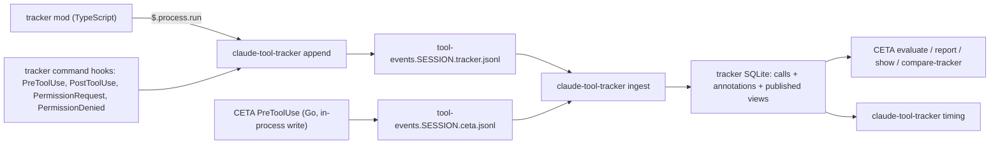

# claude-tool-tracker: a tool-call tracker mod that CETA and other tools can annotate — design

Date: 2026-10-14
Repo: `phillipgreenii-nix-agent-support` (public: no employer-specific detail in code, tests, comments or docs)
Status: approved (operator, 2026-10-29); rollout (section 8.3) amended per the same ruling
Origin: handoff bead `pg2-tbbpt`, workstream 1. Evidence: `docs/investigations/2026-10-13-claude-code-mods-spike.md`
(the "spike doc" below), measured on Claude Code 2.1.296.

## 1. Intent

Today `claude-extended-tool-approver` (CETA) does two jobs: it decides tool calls (`PreToolUse`), and
it records every call and its outcome through five more command hooks into its own SQLite database.
The operator wants these separated (direction recorded 2026-10-13 on `pg2-tbbpt`): CETA becomes only
its decision hook, and a new tool, the **tracker**, owns recording tool calls.

The tracker exists to answer two questions CETA's data answers badly today:

1. **Which calls could CETA have settled itself?** The operator uses CETA's miss analysis mainly to
   cut down asks, because an ask stops work until a person answers. In the operator's words, any
   time CETA can answer a request definitively it also saves the token cost of the auto-mode
   classifier, and when CETA can reject, it stops the wrong thing from being done. Today the data
   cannot tell who settled a call in auto mode: `ApprovalSource` labels every auto/dontAsk row
   `auto` (bead `pg2-tho4v`).
2. **Which tools and commands take the longest to run?** Per tool, and one level down by command
   (Bash will dominate at the tool level). The slowest ones get deep-dive beads asking whether they
   can be sped up.

## 2. Goals, non-goals, anti-goals

### Goals

- G1. Record every tool call in every Claude Code session: verdict, who settled it, outcome, and
  the tool's own run time.
- G2. Let CETA, and any other tool, attach its own facts to a tool call (CETA's rule trace, its
  per-rule failures, its command class), stored next to the tracker's record of that call.
- G3. Give CETA's miss analysis (`evaluate`, `report`, `show`, and the `identify-hook-misses`
  skill that drives them) a "who settled it" dimension, so it can rank the calls CETA could have
  settled by how often they happen.
- G4. A timing analysis that ranks tools and commands two ways: by total time spent, and by a
  single run's time (median and p90), so a slow command is found even if it rarely runs.
- G5. Shadow mode: the tracker runs next to CETA's existing recording for a couple of days, and a
  comparison shows whether the tracker can take over.
- G6. Small chunks, each landable on its own, to keep breakage low (operator direction 2026-10-13).

### Non-goals

- Background-shell ownership. It stays with CETA (operator ruling 2026-10-14); how CETA stores it
  ("may not be a database, that seems overkill") is reviewed later, outside this design.
- An ingest daemon. Ingest runs on demand for now; a daemon is the likely later step (operator,
  2026-10-14: "lets see how it works as is").
- Time spent waiting for a person's approval, and the hooks' own overhead. Timing is only while the
  tool is running (operator, 2026-10-14).
- Telling "No" from Esc at a permission dialog. Both are a refusal (operator, 2026-10-14; the spike
  showed a mod cannot tell them apart).
- The other workstreams in `pg2-tbbpt`: the session-state publisher for pa-monitor and the drain idle
  monitor. daily-focus display and TODO steering were dropped (operator ruling 2026-10-13).
- Changing CETA's decision engine or rules.

### Anti-goals (a failure even if it technically works)

- The tracker slows a tool call down, changes a call's input or verdict, or blocks a call when it
  fails.
- A tracker failure loses data silently: lines dropped, files skipped, or events never ingested with
  nothing to show for it.
- CETA's decisions come to depend on the tracker (CETA reading the tracker's files or database
  while deciding).
- The cut-over removes CETA's recording before the comparison shows the tracker is complete.

## 3. Constraints

- C1. **Classic events never reach a user mod on this machine.** With managed settings, the
  built-in guard `sec-default@builtin` skips user mods on every `classic.*` event; it is documented
  and not user-changeable (spike doc, "`classic.*` events never reach a user mod"). Any value only a
  classic event carries, above all the live `permission_mode`, needs a **command hook**.
- C2. **`$.fs.write` is not safe for event files.** It corrupted 2 of 328 per-event files under
  concurrent tool calls, and it has no append. A mod MUST hand events to a separate process
  (`$.process.run`, measured at 4 to 6 ms per start) rather than write files itself.
- C3. **A mod's child processes do not get `CLAUDE_CODE_SESSION_ID`.** The mod MUST pass the session
  id to the append command explicitly.
- C4. **The mods API is marked early access** in 2.1.296's type declarations and may change between
  releases. The re-check steps in the spike doc's "Re-checking this later" apply before each chunk
  that touches the mod.
- C5. **Parallel `PreToolUse` hooks.** Claude Code runs same-event hooks in parallel, and the last
  to finish wins on `updatedInput` (ADR 0071). The tracker's own `PreToolUse` hook therefore MUST
  emit no decision and no `updatedInput`, so running in parallel with CETA is harmless. The hook
  router of ADR 0071 is not installed on this machine (`claude-hook-router` is not on `PATH`); CETA
  runs from its own plugin `hooks/hooks.json`.
- C6. **Public repo.** No organization names, setting values, or identifiers in code, tests or docs.
- C7. **Packaging rules of this repo apply:** the plugin's hooks invoke a bare command whose binary
  rides `home.packages`; a `defaultEnabled: true` plugin's program module MUST default its `enable`
  to `claude-code.enable` so `checks.<system>.test-claude-plugin-binary-default-parity` passes (see
  this repo's `CLAUDE.md`, "Claude Code Rule / Skill / Plugin Delivery").
- C8. **Tests.** Every deterministic piece (envelope parsing, ingest, settlement derivation, timing
  math, the comparison) MUST have automated tests against real fixtures that stay in the repo
  (global rule V-3). Live checks are only for what a test cannot prove (section 10).

## 4. Shape of the system

Patterns, by name:

- **Event Sourcing, with the database as the lasting record.** The JSONL files are an append-only
  log of facts and the database is built from them. The files are a spool: once ingested and past
  retention they are deleted, so from then on the database is the record. Schema changes are
  therefore in-place migrations, as in CETA's database today; a full rebuild from files is possible
  only for events still inside the retention window.
- **Correlation Identifier.** Every tool-call event carries `session_id` + `tool_use_id`. That is
  how a producer attaches facts to a call it did not record itself.
- **Envelope Wrapper + Tolerant Reader.** A fixed envelope around a free-form `data` object. Ingest
  stores kinds it does not know rather than rejecting them, so a new producer needs no tracker
  change.
- **Published Language.** The contract between producers and the tracker is the documented line
  format, not shared code. The contract between the tracker and its readers is a set of SQL views.
- **Anti-Corruption Layer.** CETA reads the tracker through one adapter that maps the views onto
  CETA's own row type, so the rest of CETA does not depend on the tracker's schema.
- **Observer.** The mod and the tracker's hook only watch; they never change a call.

## 5. The event log (decided)

### 5.1 Location and file names

- Directory: `$XDG_STATE_HOME/claude-tool-tracker/events/` (default `~/.local/state/...`). Only the
  tracker uses it. Mode `0700`; files `0600`, because tool inputs can contain secrets (CETA stores
  them today too).
- File name: `tool-events.<session_id>.<source>.jsonl`. `source` MUST match `[a-z0-9-]+` (so it
  cannot contain a dot). Each producer writes only its own files, so two sources never share one.
- Ingest MUST read only files matching the whole pattern and ignore everything else.

### 5.2 One line per event

Each line is one JSON object, written with a **single** append-mode `write` call. Envelope fields:

| Field         | Required                      | Meaning                                                                         |
| ------------- | ----------------------------- | ------------------------------------------------------------------------------- |
| `schema`      | yes                           | the format and its version, `tool-events/1`                                     |
| `event_id`    | yes                           | unique per event, so a re-ingest never duplicates                               |
| `ts`          | yes                           | milliseconds since the Unix epoch, from the producer's clock                    |
| `source`      | yes                           | the producer, equal to the file name's `source`                                 |
| `kind`        | yes                           | `<source>.<name>`, e.g. `tracker.call_start`, `ceta.trace`                      |
| `session_id`  | yes                           | the Claude Code session id                                                      |
| `tool_use_id` | yes for tool-call kinds       | the call's id; left out only by a future session-level kind                     |
| `agent_id`    | when the call is a subagent's | the subagent id                                                                 |
| `data`        | yes (may be `{}`)             | the producer's own fields; the tracker does not interpret other sources' `data` |

Ingest MUST skip and **count** any line that is not valid JSON or lacks a required field, and report
the counts (per file) in its output. A skipped line is never silent.

### 5.3 Tracker event kinds

The builder fixes the exact `data` fields against the build's `claude-code.d.ts` (section 9). The
facts each kind carries:

| Kind                       | Written by                                        | Carries                                                                                            |
| -------------------------- | ------------------------------------------------- | -------------------------------------------------------------------------------------------------- |
| `tracker.call_start`       | mod, `tool.call`                                  | tool name, tool input (CETA's `evaluate` replays from it), `cwd`                                   |
| `tracker.check`            | mod, `tool.check`                                 | the verdict (`allow` / `deny` / `ask`), the deciding hook if any, the reason text                  |
| `tracker.running`          | mod, `ui.render` ToolUse                          | the moment the row first shows the tool running (interactive sessions only)                        |
| `tracker.call_end`         | mod, `tool.call`                                  | result: ran ok / ran and errored / refused / interrupted; error text if any                        |
| `tracker.session_end`      | mod, `session.end`                                | the session ended normally                                                                         |
| `tracker.pre_tool`         | command hook, `PreToolUse`                        | the live `permission_mode`, `agent_type`                                                           |
| `tracker.post_tool`        | command hook, `PostToolUse`, `PostToolUseFailure` | Claude Code's `duration_ms`; a response summary (is-error, exit code, size), never the raw payload |
| `tracker.permission_offer` | command hook, `PermissionRequest`                 | the permission suggestions shown with a dialog                                                     |
| `tracker.denied`           | command hook, `PermissionDenied`                  | the denial reason (carries the auto-mode classifier's reason)                                      |

The command hooks are one bare command, the same binary as `append`, reading the hook JSON on
stdin. It MUST print nothing that Claude Code reads as a decision or `updatedInput` (C5), MUST exit
0 on every path, and MUST run with a short timeout. Together they carry every per-call field CETA
records today and `identify-hook-misses` uses (`permission_mode`, `agent_type`, `outcome_notes`'
classifier reason, `tool_response.is_error`), so nothing is lost at the cut-over. `PermissionRequest`
and `PermissionDenied` fire only on dialogs and denials, so they add no cost to most calls.

### 5.4 CETA's event kinds

CETA writes these from its `PreToolUse` process, in Go, straight to its own file (no extra process),
for the call it is deciding:

| Kind                 | Carries                                                                                                                                                                                                                                                |
| -------------------- | ------------------------------------------------------------------------------------------------------------------------------------------------------------------------------------------------------------------------------------------------------ |
| `ceta.verdict`       | the engine's verdict (`approve` / `ask` / `reject` / `abstain`), the verdict actually delivered (they differ when an unattended session turns an ask into a reject, `hookio.NeverAskWhenUnattended`), the reason, the deciding rule, `sandbox_enabled` |
| `ceta.trace`         | the rule trace, whenever CETA computed one                                                                                                                                                                                                             |
| `ceta.rule_errors`   | the per-rule failure snapshot that ADR 0043 flushes today                                                                                                                                                                                              |
| `ceta.command_class` | for Bash, CETA's normalized command class (the key `report --group-by command` uses)                                                                                                                                                                   |

`ceta.verdict` makes attribution certain: the mod only learns that "a `PreToolUse` hook" decided, and
CETA's own record says it was CETA.

## 6. Who settled the call (decided)

Ingest derives one `settled_by` and one `settlement` per call and stores them, so every reader
agrees. Inputs: the `tracker.check` verdict and deciding hook, `ceta.verdict`, the permission mode,
and `tracker.call_end`.

| Verdict at `tracker.check`      | Permission mode                                                     | `settled_by` | `settlement` from the outcome         |
| ------------------------------- | ------------------------------------------------------------------- | ------------ | ------------------------------------- |
| `allow` or `deny`, CETA decided | any                                                                 | `ceta`       | approved / refused                    |
| `ask`, CETA decided             | any (a CETA ask reached the person in auto mode too, per the spike) | `person`     | approved if it ran, refused otherwise |
| `allow`, no deciding hook       | `bypassPermissions`                                                 | `mode`       | approved                              |
| `allow`, no deciding hook       | other                                                               | `rule`       | approved (a settings allow rule)      |
| `deny`, no deciding hook        | any                                                                 | `rule`       | refused                               |
| `ask`, no deciding hook         | `auto`                                                              | `classifier` | approved if it ran, refused otherwise |
| `ask`, no deciding hook         | `default`, `acceptEdits`, `plan`                                    | `person`     | approved if it ran, refused otherwise |
| `ask`, no deciding hook         | `dontAsk`                                                           | `mode`       | refused                               |
| no `call_end` yet               | any                                                                 | as above     | `pending`, then `unresolved` (below)  |

A call with no `call_end` is `pending` while its session may still be running. It becomes
`unresolved` once the session has a `tracker.session_end`, or once the session has written no event
for a quiet period the builder picks (a crashed session never sends `session_end`). Settlement is
recomputed whenever later events for the call arrive, so a resumed session that appends to the same
files later is handled.

When `ceta.verdict` shows the engine said `ask` and an unattended session delivered a reject, the
call is `settled_by` `ceta` with settlement `refused`, and is also flagged `converted_ask`. For the
miss analysis it counts as an ask (section 7.1), because CETA was not sure and the unattended agent
was refused for it.

"No" and Esc are both `refused`. A call that ran and errored is `approved` for settlement (it was
allowed) and is marked failed for timing. Rows marked "per the spike" were observed; the
`classifier` refused row and the `dontAsk` and `bypassPermissions` rows were not, and are on the
live-check list (section 10). A classifier refusal also arrives as `tracker.denied` (from
`PermissionDenied`), which carries the classifier's reason.

## 7. Readers

### 7.1 CETA's miss analysis

- CETA gains one adapter that opens the tracker database **read-only** and maps its published views
  onto the row type `evaluate`, `report` and `show` already use. A `--source ceta|tracker` flag picks
  the source; the default stays `ceta` until the cut-over (section 8.4) flips it.
- **Call ids.** The tracker assigns each call a stable integer `call_id` at first ingest. It never
  changes, because the database is the lasting record (section 4). `show <ids>` and
  `evaluate --baseline` use it under `--source tracker`, as they use CETA's row id today.
- **Operator labels stay in CETA's database.** `set-correct-decision` and `mark-excluded` are
  offline validation data, which is what CETA's database is for after the cut-over (operator
  direction, 2026-10-13). Under `--source tracker` they are keyed by `session_id` + `tool_use_id`,
  so a label survives any re-ingest, and the adapter joins them in. Labels already on CETA rows keep
  working under `--source ceta`.
- **No mixing of histories.** `--source tracker` shows only calls the tracker recorded, and
  `--source ceta` keeps showing CETA's history. Old CETA rows lack the settlement data, so mixing
  them would muddy the new dimension. `identify-hook-misses` switches source once the tracker holds
  the week or more of data the skill needs.
- New grading dimension: every call is placed by CETA's verdict and by `settled_by`/`settlement`.
  The calls CETA did not settle, ranked by count and grouped by tool (Bash by command class):

  | CETA's verdict                            | Settled by / as          | What it costs                                               | Points at                     |
  | ----------------------------------------- | ------------------------ | ----------------------------------------------------------- | ----------------------------- |
  | `ask`                                     | person, approved         | work stopped until answered                                 | a CETA approve rule           |
  | `ask`                                     | person, refused          | work stopped until answered                                 | a CETA reject rule            |
  | `ask`, converted to a reject (unattended) | CETA, refused            | the unattended agent was refused and had to route around it | a CETA approve or reject rule |
  | `abstain`                                 | classifier, approved     | classifier tokens                                           | a CETA approve rule           |
  | `abstain`                                 | classifier, refused      | classifier tokens                                           | a CETA reject rule            |
  | `abstain`                                 | person, approved/refused | work stopped until answered                                 | an approve / reject rule      |
  | `abstain`                                 | rule or mode             | nothing; low priority                                       | optional                      |

- The existing correctness check (a replayed verdict that disagrees with what was decided) stays,
  now graded against `settlement`. A `failed` row grades as `allow` (bead `pg2-h4m8q`).
- `show` shows `ceta.trace` from the annotations; for calls with no stored trace it may still replay.
- `identify-hook-misses` is updated to use the new dimension. Its existing command interface
  (`evaluate --misses-only --format=json`, `evaluate --baseline`, `show <ids> --format=json`) stays.

### 7.2 Timing analysis

`claude-tool-tracker timing` (the tracker's own command; it does not need CETA's rules):

- Run time MUST exclude approval waits, classifier time and hook overhead. Primary source: Claude
  Code's own `duration_ms` from `tracker.post_tool`, which also exists in headless (`claude -p`)
  sessions where no row is ever drawn. Live check 3 confirms what `duration_ms` covers. If it
  includes the wait for an answer, run time for asked calls is `tracker.running` to
  `tracker.call_end` instead, and `duration_ms` is used only for calls nothing asked about. A call
  with neither is left out and counted.
- Group by tool; for Bash by `ceta.command_class`, falling back to the command's first word when no
  CETA annotation exists. Also group by repo, because `go test` in one repo is not `go test` in
  another. Subagent calls are included.
- Per group: runs, total, median, p90, max. Two rankings: by total time, and by p90 (median shown
  next to it), so a slow but rare command still appears.
- Calls that errored or were interrupted are excluded by default and counted; a flag includes them.
- `table` and `json` output, like CETA's commands.
- A later skill, `identify-slow-tools`, takes the top of both rankings and files deep-dive beads,
  the way `identify-hook-misses` files miss beads.

## 8. Shadow mode, comparison, cut-over (decided)

### 8.1 Shadow mode

From the chunk that installs the mod, the tracker records alongside CETA. CETA keeps recording
exactly as today, and also writes its `ceta.*` events once that chunk lands.

### 8.2 Comparison

After a couple of days, `claude-extended-tool-approver compare-tracker` (in CETA, because it already
reads both CETA's database and, through the adapter, the tracker's) joins the two on
`session_id` + `tool_use_id` over a time window and reports:

- calls only CETA recorded, and calls only the tracker recorded;
- calls where CETA's recorded verdict differs from the tracker's `ceta.verdict`;
- calls where the outcome differs (CETA's `approved` / `denied` / `rejected` / `failed` /
  `unresolved` against the tracker's `settlement`);
- calls where a carried field differs: `permission_mode`, `agent_type`, `sandbox_enabled`,
  is-error, and the presence of a denial reason;
- ingest's skipped-line counts for the window.

CETA's `PreToolUse` has no matcher, so it sees every tool call; every CETA row should have a tracker
record.

### 8.3 Rollout: this laptop first, cut-over per machine

DECIDED (Phillip, 2026-10-29): approved, with the cut-over gated on the tracker recording. CETA runs on more
than one machine: this laptop and the homelab `monorepod` host, per this
repo's `CLAUDE.md`. The spike measured only this laptop, which has managed settings; a host without
them may behave differently for mods. So:

- Shadow mode, the live checks and the comparison start on this laptop.
- The cut-over MUST be switchable per machine. CETA keeps its old recording on any machine where the
  switch is not flipped, so no machine loses CETA's recording before the tracker is installed and
  compared there. The mechanism (an option on CETA's home-manager module that the consuming flake
  sets, or another way) is the builder's call, but a machine nobody has checked MUST keep CETA's
  recording.
- CETA MUST NOT drop its recording (the `PermissionRequest`, `PermissionDenied`, `PostToolUseFailure`
  and `SessionEnd` hooks; writes to `tool_decisions`, outcomes and `decision_trace_entries`) on a machine
  until the tracker is observed recording on that machine. The CETA side of the switch MUST NOT be
  flipped there before that observation (operator ruling, Phillip, 2026-10-29: "i want to make sure the
  tool tracking is happening before removing it from ceta").
- Another machine joins by enabling the tracker, repeating live checks 1-4, and passing the
  comparison there.

### 8.4 Cut-over

On a machine, only when the tracker is observed recording there (section 8.3) AND its comparison is
clean, or every difference is explained and the operator accepts it:
accepts it:

- CETA stops writing `tool_decisions`, outcomes and `decision_trace_entries`, and stops flushing
  `rule_errors` to its database (they are `ceta.rule_errors` events by then).
- CETA's plugin drops its `PermissionRequest`, `PermissionDenied`, `PostToolUseFailure` and
  `SessionEnd` hooks. `PostToolUse` remains, only for background-shell registration.
- `--source` defaults to `tracker`. CETA's old database stays readable for history.

## 9. Left to the builder

- Exact `data` fields for each tracker kind, checked against the build's `claude-code.d.ts`, which
  Claude Code writes when the `plugin-authoring` skill loads.
- How the mod hands events to the append command (one process per event, or a short in-memory
  buffer flushed on a timer and at `session.end`). It MUST add no wait to the tool path, and MUST
  bound how many events a crash can lose.
- The maximum line size and how an oversized event is shortened (for example a large `Write` input),
  keeping the single-write rule.
- The SQLite schema behind the published views; how ingest remembers how far it has read each file;
  how `cwd` maps to a repo name (a worktree counts as its repo).
- Retention: when fully ingested JSONL files are deleted, and how long the database keeps rows.
- Whether CETA turns tracing on for every call so `ceta.trace` always exists. Allowed only if it
  does not noticeably slow CETA's `PreToolUse`; measure before and after.
- How the TypeScript mod is checked in this repo's nix checks (at least `claude plugin validate`
  and `tsc` against the declarations; unit tests if a fake `$` is practical).

## 10. Live checks (what a test cannot prove)

Each is done in the chunk named, and its result is written back into this document:

1. The `tool_use_id` the mod sees equals the one CETA's `PreToolUse` input carries (chunk 2).
2. The shape of a classifier refusal in the mod's events and in `tracker.denied` (chunk 2).
3. What `PostToolUse`'s `duration_ms` covers (the tool's run only, or also the wait for an
   answer), measured against `tracker.running` to `tracker.call_end` on an approved and an
   unasked call (chunk 2).
4. `dontAsk` and `bypassPermissions` rows of section 6 (chunk 2).
5. No corrupt or interleaved lines over the shadow days (chunk 4, from ingest's skipped counts).

## 11. Chunks

Each chunk lands on its own; sizes are t-shirt sizes.

| #   | Chunk                                                                                                                                                   | Size | Depends on                |
| --- | ------------------------------------------------------------------------------------------------------------------------------------------------------- | ---- | ------------------------- |
| 1   | Package `claude-tool-tracker`: envelope spec, `append` command, `ingest` into SQLite with the published views, settlement derivation; all from fixtures | M    | none                      |
| 2   | Plugin: the mod (core kinds) + the command hooks of section 5.3; HM module; live checks 1-4; shadow mode starts                                         | M    | 1                         |
| 3   | CETA writes `ceta.*` events (still also writing its own database)                                                                                       | S-M  | 1                         |
| 4   | CETA adapter + `compare-tracker`; run it after the shadow days and record the result here                                                               | S-M  | 2, 3                      |
| 5   | Miss analysis on the tracker source: settlement dimension in `evaluate`/`report`/`show`; update `identify-hook-misses`                                  | M    | 4                         |
| 6   | `claude-tool-tracker timing`, then the `identify-slow-tools` skill                                                                                      | M    | 2 (3 for command classes) |
| 7   | Per-machine cut-over switch and the cut-over on this laptop (sections 8.3, 8.4), only after the operator accepts the comparison                         | M    | 4, 5                      |

## 12. Risks

- **The organization could turn on `allowManagedModsOnly`**, which would stop a user mod. The
  tracker would then record nothing. Before the cut-over this only empties the comparison; after it,
  CETA's miss data would stop. Mitigation: the cut-over chunk is a plain revert away from CETA's old
  recording, and `compare-tracker` (or ingest) reports a session with CETA activity but no tracker
  file.
- **The mods API changes** (C4). Mitigation: the re-check steps before each mod chunk; the tracker's
  readers depend only on the envelope and the views, not on mod internals.
- **Volume.** Every tool call writes several lines and stores its input. The builder's retention
  choices (section 9) bound it.
