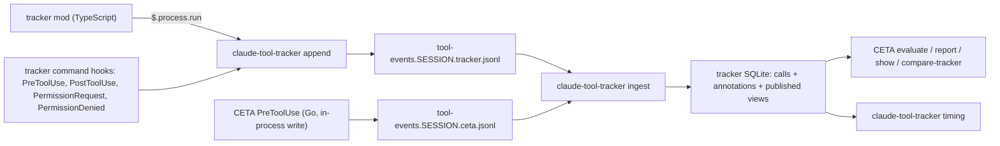

# claude-tool-tracker: a tool-call tracker mod that CETA and other tools can annotate — design

Date: 2026-10-14
Repo: `phillipgreenii-nix-agent-support` (public: no employer-specific detail in code, tests, comments or docs)
Status: approved (operator, 2026-10-29); rollout (section 8.3) amended per the same ruling
Origin: handoff bead `pg2-tbbpt`, workstream 1. Evidence: `docs/investigations/2026-10-13-claude-code-mods-spike.md`
(the "spike doc" below), measured on Claude Code 2.1.296.

## 1. Intent

Today `claude-extended-tool-approver` (CETA) does two jobs: it decides tool calls (`PreToolUse`), and
it records every call and its outcome through five more command hooks into its own SQLite database.
The operator wants these separated (direction recorded 2026-10-13 on `pg2-tbbpt`): CETA becomes only
its decision hook, and a new tool, the **tracker**, owns recording tool calls.

The tracker exists to answer two questions CETA's data answers badly today:

1. **Which calls could CETA have settled itself?** The operator uses CETA's miss analysis mainly to
   cut down asks, because an ask stops work until a person answers. In the operator's words, any
   time CETA can answer a request definitively it also saves the token cost of the auto-mode
   classifier, and when CETA can reject, it stops the wrong thing from being done. Today the data
   cannot tell who settled a call in auto mode: `ApprovalSource` labels every auto/dontAsk row
   `auto` (bead `pg2-tho4v`).
2. **Which tools and commands take the longest to run?** Per tool, and one level down by command
   (Bash will dominate at the tool level). The slowest ones get deep-dive beads asking whether they
   can be sped up.

## 2. Goals, non-goals, anti-goals

### Goals

- G1. Record every tool call in every Claude Code session: verdict, who settled it, outcome, and
  the tool's own run time.
- G2. Let CETA, and any other tool, attach its own facts to a tool call (CETA's rule trace, its
  per-rule failures, its command class), stored next to the tracker's record of that call.
- G3. Give CETA's miss analysis (`evaluate`, `report`, `show`, and the `identify-hook-misses`
  skill that drives them) a "who settled it" dimension, so it can rank the calls CETA could have
  settled by how often they happen.
- G4. A timing analysis that ranks tools and commands two ways: by total time spent, and by a
  single run's time (median and p90), so a slow command is found even if it rarely runs.
- G5. Shadow mode: the tracker runs next to CETA's existing recording for a couple of days, and a
  comparison shows whether the tracker can take over.
- G6. Small chunks, each landable on its own, to keep breakage low (operator direction 2026-10-13).

### Non-goals

- Background-shell ownership. It stays with CETA (operator ruling 2026-10-14); how CETA stores it
  ("may not be a database, that seems overkill") is reviewed later, outside this design.
- An ingest daemon. Ingest runs on demand for now; a daemon is the likely later step (operator,
  2026-10-14: "lets see how it works as is").
- Time spent waiting for a person's approval, and the hooks' own overhead. Timing is only while the
  tool is running (operator, 2026-10-14).
- Telling "No" from Esc at a permission dialog. Both are a refusal (operator, 2026-10-14; the spike
  showed a mod cannot tell them apart).
- The other workstreams in `pg2-tbbpt`: the session-state publisher for pa-monitor and the drain idle
  monitor. daily-focus display and TODO steering were dropped (operator ruling 2026-10-13).
- Changing CETA's decision engine or rules.

### Anti-goals (a failure even if it technically works)

- The tracker slows a tool call down, changes a call's input or verdict, or blocks a call when it
  fails.
- A tracker failure loses data silently: lines dropped, files skipped, or events never ingested with
  nothing to show for it.
- CETA's decisions come to depend on the tracker (CETA reading the tracker's files or database
  while deciding).
- The cut-over removes CETA's recording before the comparison shows the tracker is complete.

## 3. Constraints

- C1. **Classic events never reach a user mod on this machine.** With managed settings, the
  built-in guard `sec-default@builtin` skips user mods on every `classic.*` event; it is documented
  and not user-changeable (spike doc, "`classic.*` events never reach a user mod"). Any value only a
  classic event carries, above all the live `permission_mode`, needs a **command hook**.
- C2. **`$.fs.write` is not safe for event files.** It corrupted 2 of 328 per-event files under
  concurrent tool calls, and it has no append. A mod MUST hand events to a separate process
  (`$.process.run`, measured at 4 to 6 ms per start) rather than write files itself.
- C3. **A mod's child processes do not get `CLAUDE_CODE_SESSION_ID`.** The mod MUST pass the session
  id to the append command explicitly.
- C4. **The mods API is marked early access** in 2.1.296's type declarations and may change between
  releases. The re-check steps in the spike doc's "Re-checking this later" apply before each chunk
  that touches the mod.
- C5. **Parallel `PreToolUse` hooks.** Claude Code runs same-event hooks in parallel, and the last
  to finish wins on `updatedInput` (ADR 0071). The tracker's own `PreToolUse` hook therefore MUST
  emit no decision and no `updatedInput`, so running in parallel with CETA is harmless. The hook
  router of ADR 0071 is not installed on this machine (`claude-hook-router` is not on `PATH`); CETA
  runs from its own plugin `hooks/hooks.json`.
- C6. **Public repo.** No organization names, setting values, or identifiers in code, tests or docs.
- C7. **Packaging rules of this repo apply:** the plugin's hooks invoke a bare command whose binary
  rides `home.packages`; a `defaultEnabled: true` plugin's program module MUST default its `enable`
  to `claude-code.enable` so `checks.<system>.test-claude-plugin-binary-default-parity` passes (see
  this repo's `CLAUDE.md`, "Claude Code Rule / Skill / Plugin Delivery").
- C8. **Tests.** Every deterministic piece (envelope parsing, ingest, settlement derivation, timing
  math, the comparison) MUST have automated tests against real fixtures that stay in the repo
  (global rule V-3). Live checks are only for what a test cannot prove (section 10).

## 4. Shape of the system

Patterns, by name:

- **Event Sourcing, with the database as the lasting record.** The JSONL files are an append-only
  log of facts and the database is built from them. The files are a spool: once ingested and past
  retention they are deleted, so from then on the database is the record. Schema changes are
  therefore in-place migrations, as in CETA's database today; a full rebuild from files is possible
  only for events still inside the retention window.
- **Correlation Identifier.** Every tool-call event carries `session_id` + `tool_use_id`. That is
  how a producer attaches facts to a call it did not record itself.
- **Envelope Wrapper + Tolerant Reader.** A fixed envelope around a free-form `data` object. Ingest
  stores kinds it does not know rather than rejecting them, so a new producer needs no tracker
  change.
- **Published Language.** The contract between producers and the tracker is the documented line
  format, not shared code. The contract between the tracker and its readers is a set of SQL views.
- **Anti-Corruption Layer.** CETA reads the tracker through one adapter that maps the views onto
  CETA's own row type, so the rest of CETA does not depend on the tracker's schema.
- **Observer.** The mod and the tracker's hook only watch; they never change a call.

## 5. The event log (decided)

### 5.1 Location and file names

- Directory: `$XDG_STATE_HOME/claude-tool-tracker/events/` (default `~/.local/state/...`). Only the
  tracker uses it. Mode `0700`; files `0600`, because tool inputs can contain secrets (CETA stores
  them today too).
- File name: `tool-events.<session_id>.<source>.jsonl`. `source` MUST match `[a-z0-9-]+` (so it
  cannot contain a dot). Each producer writes only its own files, so two sources never share one.
- Ingest MUST read only files matching the whole pattern and ignore everything else.

### 5.2 One line per event

Each line is one JSON object, written with a **single** append-mode `write` call. Envelope fields:

| Field         | Required                      | Meaning                                                                         |
| ------------- | ----------------------------- | ------------------------------------------------------------------------------- |
| `schema`      | yes                           | the format and its version, `tool-events/1`                                     |
| `event_id`    | yes                           | unique per event, so a re-ingest never duplicates                               |
| `ts`          | yes                           | milliseconds since the Unix epoch, from the producer's clock                    |
| `source`      | yes                           | the producer, equal to the file name's `source`                                 |
| `kind`        | yes                           | `<source>.<name>`, e.g. `tracker.call_start`, `ceta.trace`                      |
| `session_id`  | yes                           | the Claude Code session id                                                      |
| `tool_use_id` | yes for tool-call kinds       | the call's id; left out only by a future session-level kind                     |
| `agent_id`    | when the call is a subagent's | the subagent id                                                                 |
| `data`        | yes (may be `{}`)             | the producer's own fields; the tracker does not interpret other sources' `data` |

Ingest MUST skip and **count** any line that is not valid JSON or lacks a required field, and report
the counts (per file) in its output. A skipped line is never silent.

### 5.3 Tracker event kinds

The builder fixes the exact `data` fields against the build's `claude-code.d.ts` (section 9). The
facts each kind carries:

| Kind                       | Written by                                        | Carries                                                                                            |
| -------------------------- | ------------------------------------------------- | -------------------------------------------------------------------------------------------------- |
| `tracker.call_start`       | mod, `tool.call`                                  | tool name, tool input (CETA's `evaluate` replays from it), `cwd`                                   |
| `tracker.check`            | mod, `tool.check`                                 | the verdict (`allow` / `deny` / `ask`), the deciding hook if any, the reason text                  |
| `tracker.running`          | mod, `ui.render` ToolUse                          | the moment the row first shows the tool running (interactive sessions only)                        |
| `tracker.call_end`         | mod, `tool.call`                                  | result: ran ok / ran and errored / refused / interrupted; error text if any                        |
| `tracker.session_end`      | mod, `session.end`                                | the session ended normally                                                                         |
| `tracker.pre_tool`         | command hook, `PreToolUse`                        | the live `permission_mode`, `agent_type`                                                           |
| `tracker.post_tool`        | command hook, `PostToolUse`, `PostToolUseFailure` | Claude Code's `duration_ms`; a response summary (is-error, exit code, size), never the raw payload |
| `tracker.permission_offer` | command hook, `PermissionRequest`                 | the permission suggestions shown with a dialog                                                     |
| `tracker.denied`           | command hook, `PermissionDenied`                  | the denial reason (carries the auto-mode classifier's reason)                                      |

The command hooks are one bare command, the same binary as `append`, reading the hook JSON on
stdin. It MUST print nothing that Claude Code reads as a decision or `updatedInput` (C5), MUST exit
0 on every path, and MUST run with a short timeout. Together they carry every per-call field CETA
records today and `identify-hook-misses` uses (`permission_mode`, `agent_type`, `outcome_notes`'
classifier reason, `tool_response.is_error`), so nothing is lost at the cut-over. `PermissionRequest`
and `PermissionDenied` fire only on dialogs and denials, so they add no cost to most calls.

### 5.4 CETA's event kinds

CETA writes these from its `PreToolUse` process, in Go, straight to its own file (no extra process),
for the call it is deciding:

| Kind                 | Carries                                                                                                                                                                                                                                                |
| -------------------- | ------------------------------------------------------------------------------------------------------------------------------------------------------------------------------------------------------------------------------------------------------ |
| `ceta.verdict`       | the engine's verdict (`approve` / `ask` / `reject` / `abstain`), the verdict actually delivered (they differ when an unattended session turns an ask into a reject, `hookio.NeverAskWhenUnattended`), the reason, the deciding rule, `sandbox_enabled` |
| `ceta.trace`         | the rule trace, whenever CETA computed one                                                                                                                                                                                                             |
| `ceta.rule_errors`   | the per-rule failure snapshot that ADR 0043 flushes today                                                                                                                                                                                              |
| `ceta.command_class` | for Bash, CETA's normalized command class (the key `report --group-by command` uses)                                                                                                                                                                   |

`ceta.verdict` makes attribution certain: the mod only learns that "a `PreToolUse` hook" decided, and
CETA's own record says it was CETA.

## 6. Who settled the call (decided)

Ingest derives one `settled_by` and one `settlement` per call and stores them, so every reader
agrees. Inputs: the `tracker.check` verdict and deciding hook, `ceta.verdict`, the permission mode,
and `tracker.call_end`.

| Verdict at `tracker.check`      | Permission mode                                                     | `settled_by` | `settlement` from the outcome         |
| ------------------------------- | ------------------------------------------------------------------- | ------------ | ------------------------------------- |
| `allow` or `deny`, CETA decided | any                                                                 | `ceta`       | approved / refused                    |
| `ask`, CETA decided             | any (a CETA ask reached the person in auto mode too, per the spike) | `person`     | approved if it ran, refused otherwise |
| `allow`, no deciding hook       | `bypassPermissions`                                                 | `mode`       | approved                              |
| `allow`, no deciding hook       | other                                                               | `rule`       | approved (a settings allow rule)      |
| `deny`, no deciding hook        | any                                                                 | `rule`       | refused                               |
| `ask`, no deciding hook         | `auto`                                                              | `classifier` | approved if it ran, refused otherwise |
| `ask`, no deciding hook         | `default`, `acceptEdits`, `plan`                                    | `person`     | approved if it ran, refused otherwise |
| `ask`, no deciding hook         | `dontAsk`                                                           | `mode`       | refused                               |
| no `call_end` yet               | any                                                                 | as above     | `pending`, then `unresolved` (below)  |

A call with no `call_end` is `pending` while its session may still be running. It becomes
`unresolved` once the session has a `tracker.session_end`, or once the session has written no event
for a quiet period the builder picks (a crashed session never sends `session_end`). Settlement is
recomputed whenever later events for the call arrive, so a resumed session that appends to the same
files later is handled.

When `ceta.verdict` shows the engine said `ask` and an unattended session delivered a reject, the
call is `settled_by` `ceta` with settlement `refused`, and is also flagged `converted_ask`. For the
miss analysis it counts as an ask (section 7.1), because CETA was not sure and the unattended agent
was refused for it.

"No" and Esc are both `refused`. A call that ran and errored is `approved` for settlement (it was
allowed) and is marked failed for timing. Rows marked "per the spike" were observed; the
`classifier` refused row and the `dontAsk` and `bypassPermissions` rows were not, and are on the
live-check list (section 10). A classifier refusal also arrives as `tracker.denied` (from
`PermissionDenied`), which carries the classifier's reason.

## 7. Readers

### 7.1 CETA's miss analysis

- CETA gains one adapter that opens the tracker database **read-only** and maps its published views
  onto the row type `evaluate`, `report` and `show` already use. A `--source ceta|tracker` flag picks
  the source; the default stays `ceta` until the cut-over (section 8.4) flips it.
- **Call ids.** The tracker assigns each call a stable integer `call_id` at first ingest. It never
  changes, because the database is the lasting record (section 4). `show <ids>` and
  `evaluate --baseline` use it under `--source tracker`, as they use CETA's row id today.
- **Operator labels stay in CETA's database.** `set-correct-decision` and `mark-excluded` are
  offline validation data, which is what CETA's database is for after the cut-over (operator
  direction, 2026-10-13). Under `--source tracker` they are keyed by `session_id` + `tool_use_id`,
  so a label survives any re-ingest, and the adapter joins them in. Labels already on CETA rows keep
  working under `--source ceta`.
- **No mixing of histories.** `--source tracker` shows only calls the tracker recorded, and
  `--source ceta` keeps showing CETA's history. Old CETA rows lack the settlement data, so mixing
  them would muddy the new dimension. `identify-hook-misses` switches source once the tracker holds
  the week or more of data the skill needs.
- New grading dimension: every call is placed by CETA's verdict and by `settled_by`/`settlement`.
  The calls CETA did not settle, ranked by count and grouped by tool (Bash by command class):

  | CETA's verdict                            | Settled by / as          | What it costs                                               | Points at                     |
  | ----------------------------------------- | ------------------------ | ----------------------------------------------------------- | ----------------------------- |
  | `ask`                                     | person, approved         | work stopped until answered                                 | a CETA approve rule           |
  | `ask`                                     | person, refused          | work stopped until answered                                 | a CETA reject rule            |
  | `ask`, converted to a reject (unattended) | CETA, refused            | the unattended agent was refused and had to route around it | a CETA approve or reject rule |
  | `abstain`                                 | classifier, approved     | classifier tokens                                           | a CETA approve rule           |
  | `abstain`                                 | classifier, refused      | classifier tokens                                           | a CETA reject rule            |
  | `abstain`                                 | person, approved/refused | work stopped until answered                                 | an approve / reject rule      |
  | `abstain`                                 | rule or mode             | nothing; low priority                                       | optional                      |

- The existing correctness check (a replayed verdict that disagrees with what was decided) stays,
  now graded against `settlement`. A `failed` row grades as `allow` (bead `pg2-h4m8q`).
- `show` shows `ceta.trace` from the annotations; for calls with no stored trace it may still replay.
- `identify-hook-misses` is updated to use the new dimension. Its existing command interface
  (`evaluate --misses-only --format=json`, `evaluate --baseline`, `show <ids> --format=json`) stays.

### 7.2 Timing analysis

`claude-tool-tracker timing` (the tracker's own command; it does not need CETA's rules):

- Run time MUST exclude approval waits, classifier time and hook overhead. Primary source: Claude
  Code's own `duration_ms` from `tracker.post_tool`, which also exists in headless (`claude -p`)
  sessions where no row is ever drawn. Live check 3 confirms what `duration_ms` covers. If it
  includes the wait for an answer, run time for asked calls is `tracker.running` to
  `tracker.call_end` instead, and `duration_ms` is used only for calls nothing asked about. A call
  with neither is left out and counted.
- Group by tool; for Bash by `ceta.command_class`, falling back to the command's first word when no
  CETA annotation exists. Also group by repo, because `go test` in one repo is not `go test` in
  another. Subagent calls are included.
- Per group: runs, total, median, p90, max. Two rankings: by total time, and by p90 (median shown
  next to it), so a slow but rare command still appears.
- Calls that errored or were interrupted are excluded by default and counted; a flag includes them.
- `table` and `json` output, like CETA's commands.
- A later skill, `identify-slow-tools`, takes the top of both rankings and files deep-dive beads,
  the way `identify-hook-misses` files miss beads.

## 8. Shadow mode, comparison, cut-over (decided)

### 8.1 Shadow mode

From the chunk that installs the mod, the tracker records alongside CETA. CETA keeps recording
exactly as today, and also writes its `ceta.*` events once that chunk lands.

### 8.2 Comparison

After a couple of days, `claude-extended-tool-approver compare-tracker` (in CETA, because it already
reads both CETA's database and, through the adapter, the tracker's) joins the two on
`session_id` + `tool_use_id` over a time window and reports:

- calls only CETA recorded, and calls only the tracker recorded;
- tracker-only calls that Claude Code refused before any hook ran, in their own category
  (`refused_before_hook`), kept out of the only-tracker list: the tracker has no `pre_tool`, no
  `check` and no `ceta.verdict` for the call (no permission mode, no verdict through the published
  views) and its error text contains `<tool_use_error>`. CETA runs only inside hooks, so its missing
  row is expected. A tracker-only call with any hook evidence, or without that error, stays under
  only-tracker. The category never makes a report unclean;
- calls where CETA's recorded verdict differs from the tracker's `ceta.verdict`;
- calls where the outcome differs (CETA's `approved` / `denied` / `rejected` / `failed` /
  `unresolved` against the tracker's `settlement`);
- calls where a carried field differs: `permission_mode`, `agent_type`, `sandbox_enabled`,
  is-error, and the presence of a denial reason;
- ingest's skipped-line counts for the window.

CETA's `PreToolUse` has no matcher, so it sees every tool call; every CETA row should have a tracker
record.

Comparison result (2026-11-07, this laptop). Window: 2026-10-30T00:11:20.695Z (the earliest event,
`event_span` scope `all`) to 2026-11-07T07:23:27.421Z (just after the latest event, exclusive end);
`compare-tracker --since 2026-10-30T00:11:20.695Z --until 2026-11-07T07:23:27.421Z`, exit code 2
(differences found). Counts: CETA 83794 calls, tracker 80405, matched 80195; only CETA 3599; only the
tracker 210; verdict differs 5; outcome differs 1769; permission mode differs 2; `agent_type`,
`sandbox_enabled`, is-error and denial-reason presence differ 0; duplicate keys 0; CETA rows with no
`tool_use_id` 9; sessions with CETA rows but no tracker event file 115 (the 9 unkeyed rows form the
empty session id); ingest skipped lines 0. A second and a third run over the same window gave the
same counts, except that the first run showed 1768 outcome differences and the later two 1769,
because calls still in flight in a live session (five calls of one session, CETA `pending` then
`unresolved` or `approved`) settled between runs; the second and third runs are identical.

- Only CETA, 3599. 2764 rows sit in 112 sessions whose first CETA row precedes the first tracker
  session of 2026-10-30T01:25Z to 05:00Z ramp-up: the tracker's hooks load at session start, so
  sessions begun before the apply never wrote a tracker file. Explained. The remaining 835 rows are explained as follows (investigated 2026-11-07 from the transcripts
  and the event files). The tracker's command hooks and mod load when the Claude Code process
  starts, not when a session id begins, and `/clear` (or a resume inside a running process) makes a
  new session id in the same process. Sessions 0f3990be (472 rows), 8d9c4dd8 (312 rows) and
  16b760bf (46 of its 56 CETA rows, 2026-10-30T18:37Z) each begin with a `/clear` command in a
  process that started before the plugin was installed (installed 2026-10-30T00:11Z); their
  transcripts show CETA's hooks and no `claude-tool-tracker hook` entry for any call. Two more
  sessions without a tracker file (2a6cd36c and 9e37d224, first CETA rows 2026-10-30T18:35Z and
  18:23Z) show the same signature: a `/clear` or `/plugin` command dated 2026-10-29 in the same
  process, and no tracker hook entry. Session 16b760bf has tracker events only from
  2026-11-03T14:29Z, when it was resumed in a new process. Sessions that started in a fresh
  process after the rollout (for example 50a30c1b at 06:12Z) all carry tracker events. The
  expected gap: a tracker plugin takes effect per process, so every session id begun inside a
  process that predates the install (a long-lived terminal) is invisible until that process is
  restarted; no repo change can close it, and no new such sessions can appear once those processes
  end. The one-row session `a161b5c3` (2026-11-05) has no event file and no transcript on this
  laptop (only an empty session-environment directory from 2026-11-05T05:30Z); its row exists in
  CETA's own database only. Re-checked 2026-11-07: the row is `echo TRACKER_PROBE` run in
  `/private/tmp/pgtt-spike.<random>/work`, a throwaway spike project (its transcript path names that
  directory, which is gone); it is a probe of the tracker's own spike work, not a user session, and
  needs no repo change. A one-row session `s`
  with tool use id `t` (2026-11-06) in the event directory is a test fixture of another tool
  writing into the real event directory, not a Claude session; it is noted for the owners of that
  tool. Of the 50 rows in sessions that have a tracker file, 46 are the 16b760bf group above
  (the file belongs to the later resume). The other 4 (one in cd63f2a6, two in 499f0a23, one in
  62683f59) were re-examined 2026-11-07 from the event files and transcripts and are one pattern,
  not the in-flight and subagent-call descriptions first written here: each is a call whose tracker
  command hooks ran and were recorded (`pre_tool`, `check`, `post_tool`; `call_end` for three) but
  for which the tracker has no `call_start`. The mod's `call_start` is missing, and ingest does not
  count a call without one, so the call is "only CETA". The cd63f2a6 call is a main-session Bash
  call at 2026-11-06T10:02:49Z (no agent id; its transcript shows both hooks succeeding), not a
  subagent call. The call first described as a subagent call at 10:02:46Z is a different one
  (`acf11f0b7aa87c6ca`, tool use `toolu_01DPtoRzQEHrLXGL9HoqW8u2`): the event file holds only its
  `ceta.verdict`, the ask log has no row for it, the tracker has no event of any kind for it, and the
  subagent's transcript ends at 10:02:32Z without it, so the subagent was most likely stopped as
  the call began. Why the mod emitted no `call_start` for these 4 (and 4 more calls in the event files since 2026-11-03
  that have a `call_end` or hook events but no `call_start`), and what happened to the 10:02:46Z
  call, cannot be settled from the files: a captured mod and hook trace around such a call is
  needed (the mod's debug log, plus a `PreToolUse` hook stderr capture, for a subagent stop and a
  call racing it). The 9 unkeyed rows are CETA rows with no `tool_use_id` and an empty session id (nothing to join
  on): they are hand-fed hook invocations, not Claude calls. All 9 were written within two seconds
  at 2026-10-30T01:48:57Z to 01:48:58Z, each with outcome `pending` and no session, and their
  commands (four refused `curl` forms, one plain loopback `curl`, two `cat` / `ls` of
  `~/.claude/projects` and two controls) are exactly the post-apply check of a CETA change landed
  the evening before, which a session piped as hand-written JSON into the installed hook binary
  (the transcript of session 2c0e1201 holds the check list). The hook records any input it is
  given into the live ask log, so they remain. Expected; no repo change.
- Only the tracker, 210 (64 Bash, 50 Monitor, 46 Edit, 18 Write, 10 `EnterWorktree`, 22 of other
  tools; 19 in one session). CETA wrote no row for them. Investigated 2026-11-07 from a copy of the
  tracker database (each call's event kinds and its `call_end` error text) and the session and
  subagent transcripts (the `hook_success` / `hook_cancelled` attachments of each call). Two causes
  account for every call; neither is a hook-matcher or permission-path gap.
  - 135 calls (Monitor 49, Edit 46, Write 15, `EnterWorktree` 10, Bash 5, `TaskStop` 4,
    `ExitWorktree` 3, one each of `ToolSearch`, `StructuredOutput` and Grep) have a tracker
    `call_start` but no `pre_tool` and no `check` event: no hook of any kind ran. 132 of them end
    with a `<tool_use_error>` and the other 3 have no `call_end`. The errors are Claude Code's own
    pre-hook input validation or tool-precondition refusals: `InputValidationError` (Monitor 49,
    Write 3, and singles), "File has not been read yet", "String to replace not found", "File has
    been modified since read", "Found N matches" and "No changes to make" (Edit), "Subagents should
    return findings as text, not write reports" (Write 11), `EnterWorktree` / `ExitWorktree`
    "cannot be called from a subagent", and `TaskStop` "No task found". These calls are refused
    before the `PreToolUse` hook fires, so CETA, which runs only inside hooks, never sees them;
    the tracker's mod sees them because it observes the call itself. Expected gap, not a CETA
    defect. 121 of the 210 carry an agent id, which is why subagent calls dominate.
    `compare-tracker` now reports the 132 with a `<tool_use_error>` under `refused_before_hook`
    rather than only-tracker (section 8.2, comparison); the 3 without a `call_end` stay listed.
  - 75 calls (Bash 59, Skill 5, Grep 4, Write 3, Glob 3, Monitor 1) did reach the hooks: the
    tracker has `pre_tool` and `check`. CETA's hook ran but its ask-log row was not written. The
    transcripts show two failure modes. (1) The harness cancelled CETA's `PreToolUse` hook:
    `hook_cancelled` with `timedOut` true and `timeoutMs` 5000, after 5.2 s to 60 s (at least 44 of
    the 75; for example session 2bfbbf02, 2026-10-30T08:53Z, 8252 ms). (2) The hook's own stderr
    reports `asklog open: ...` failures opening the ask log (at least 8): "migrate: create
    schema_version: disk I/O error (4874)", "unable to open database file (14)", "set WAL mode:
    database is locked". The hook still printed its verdict and wrote its `ceta.*` events
    (34 of the 75 have a `ceta.verdict` event) but `RecordPreToolDecision` never ran. The rest
    (about 23, among them 13 of session d503eec4's 19: the `date` calls every 60 s from
    2026-11-06T10:04Z) have no hook attachment in the transcripts; they sit in the same hours as
    the open failures and carry the same `ceta.verdict` event without a row, so the same cause
    is inferred, not observed. The ask log is 3.5 GB, opened in WAL mode by one process per tool
    call with a 3 s busy timeout, under a 5 s hook timeout; transcripts across all sessions
    hold well over a thousand such `asklog open` / `asklog` stderr lines. This is a real CETA
    logging loss (75 of 83794 calls, about 0.09 percent), not an exclusion candidate; fixing it means
    reducing the ask log's open and write latency or contention, which is a separate decision
    (follow-up bead). Section 10 check 1 found 25 such calls on the first day (18 from
    subagents); they were not re-examined here.
- Verdict differs, 5: CETA `deny` against the tracker's `ask`. Explained, and fixed in the
  comparison (investigated 2026-11-07). All five calls (sessions 0382aae1 twice, bcd05b7b, f2d42add,
  f840a60d) are asks that an unattended session turned into a refusal: the tracker's
  `ceta.verdict` shows engine `ask`, delivered `reject`, `converted_ask` set, and the refusal text
  "unattended session never asks". CETA's ask log records the delivered verdict (`result` of the
  hook, after the conversion), so it says `deny`; the tracker adapter took the engine's `ask` for
  the comparison. This was a defect in the adapter and in this section's rule, not a recording
  disagreement: the comparison now takes the tracker's delivered verdict, and these five agree
  (the engine's `ask` stays visible in the tracker as `engine_verdict`).
- Permission mode differs, 2: CETA `dontAsk`, tracker no value. Explained (investigated
  2026-11-07), expected. The tracker's permission mode comes only from its command hook
  (`tracker.pre_tool`, else `tracker.post_tool`); the mod's `call_start` carries none. For the two
  calls (sessions 09887392 and 5dc4e853, 2026-10-30) the tracker has `call_start` and `call_end`
  but no `pre_tool` and no `post_tool`. For 09887392 the transcript shows the `PreToolUse` hook
  cancelled by the 5 second hook timeout after 23.6 s ("hook_cancelled", `timedOut` true): the host
  stalled, CETA's own `ceta.verdict` landed 20 s after the call began, and the tracker's hook was
  cancelled before it wrote. The other call (5dc4e853, a subagent call refused with "No tools
  needed for summary") has the same signature, CETA's verdict 8.4 s after the call began, over the
  same 5 second limit, but its subagent transcript is not on this machine, so the timeout is the
  likely cause there, not a confirmed one. No code change: a hook the host cancels cannot record,
  and two calls in 80195 is the cost of the 5 second limit.
- Outcome differs, 1769 (CETA, tracker): 984 `unresolved`, `failed`; 668 `rejected`, `failed`;
  61 `pending`, `failed`; 22 `unresolved`, `approved`; 17 `denied`, `failed`; 6 `pending`,
  `unresolved`; 4 `pending`, `approved`; 4 `approved`, `pending`; 2 `approved`, `unresolved` (the
  counts of the second run; the first run moved five calls among the `pending`, `unresolved` and
  `approved` rows). Explained in part by a sample of 300 per group: the 668 `rejected` calls (and 17
  `denied`) are calls CETA refused through a hook error ("PreToolUse:Bash hook error: ..."); the
  tracker records them as tool errors and compare-tracker maps result `error` to `failed` before
  it considers a CETA refusal, so these are one defect or one mapping choice, not two verdicts that
  disagree. Of the `unresolved` calls, the sample shows `dontAsk` mode refusals ("Permission to use
  Bash has been denied because Claude Code is running ...", `settled_by` `mode`) and summary calls
  ("No tools needed for summary"): CETA never sees a post-tool event for them, the tracker does.
  Both open questions were examined on 2026-11-07 (follow-up), from copies of both databases.

  Decision, hook-error refusals (Decided, mapping only; the tracker's recording is unchanged): the
  tracker already records them correctly. For the 668 `rejected` calls, the tracker's stored
  `settled_by` is `ceta` and `settlement` is `refused` (the section 6 row "`allow` or `deny`, CETA
  decided"), with `result` `error` and the hook-error text as `error_text`; for CETA the hook
  decision of all 668 is `deny`. Only the adapter's outcome mapping was wrong: it checked result
  `error` before settlement and so turned a refusal into `failed`. `failed` means the hook let the
  call through and the tool then errored (`evaluate` grades `failed` like `approved`), so the old
  mapping would have graded 668 refusals as calls CETA allowed. The mapping now checks a refusal
  first (settlement `refused` -> `rejected` when `settled_by` is `ceta`, else `denied`), then result
  `error` -> `failed`. A call that ran and errored stays `approved` for settlement and `failed` for
  outcome, as section 6 says. The change is in the shared adapter, so `--source tracker` in
  `evaluate`, `report` and `show` sees the same corrected outcome as `compare-tracker`. The 17
  `denied` calls (auto-mode classifier refusals) are NOT fixed by this: the tracker stores them as
  `settlement` `approved` (the ingest defect already recorded in live check 2), so they still map to
  `failed` until that ingest bug is fixed, after which they map to `denied` and match.
  The `dontAsk` mode refusals also have `settlement` `refused` and result `error`; they now map to
  `denied` instead of `failed`, still against CETA's `unresolved` or `pending` (CETA never receives a
  post event for them).

  The small groups (counts from a later snapshot of both databases, so a few differ by one from the
  list above: 58 `pending`/`failed`, 23 `unresolved`/`approved`, 6 `pending`/`unresolved`, 5
  `approved`/`pending`, 3 `pending`/`approved`, 2 `approved`/`unresolved`). Only one group is a
  timing artifact; the rest persist and have causes.
  - `approved`/`pending`, 5: timing. The tracker snapshot ends at 07:23:27Z; CETA wrote each of
    these five rows' resolution between 07:23:30Z and 07:25:25Z, after it, for calls started
    between 07:19:48Z and 07:23:27Z (calls in flight at ingest; one is the session running the
    comparison). They agree after a re-ingest.
  - `unresolved`/`approved`, 23: not timing. Each call ran and the tracker has a `call_end`
    `ok`; CETA's row was flipped to `unresolved` by the `SessionEnd` sweep (`resolved_at` within 2 s
    of the tracker's `session_end` for 21 of 23; the other 2 have no `session_end` after the call),
    which means CETA's post-tool write for the call never landed. The gap from `call_end` to the
    sweep is 0 to 13633 s (three sweeps precede the tracker's `call_end` by 54 to 289 s). Same cause as the lost CETA rows above (ask log contention and hook timeouts),
    a CETA recording loss. Not an exclusion candidate.
  - `pending`/`failed`, 58: not timing. Calls whose error is a `dontAsk` refusal (34), "No tools needed
    for summary" (21) or a hook error / a kill (3); CETA gets no post event for them, and CETA's
    row stays `pending` because its `SessionEnd` sweep never ran for the session (no `unresolved`
    row in any of those sessions; 34 have no tracker `session_end` either). The same calls in a swept
    session are the `unresolved`/`failed` group (984). So this is the 984 group in sessions CETA
    never swept.
  - `pending`/`unresolved`, 6: not timing. The tracker settles a call whose session went quiet as
    `unresolved` (section 6's quiet period; 5 of the 6 sessions have no `session_end`); CETA has no
    quiet period and no sweep ran, so it stays `pending`. A design asymmetry, not a defect.
  - `pending`/`approved`, 3: not timing. The call ran (tracker `call_end` `ok`) and CETA never saw the
    post event; two of the sessions later ended (6 and 5 minutes after the call) yet CETA never swept them; the
    third (`d503eec4`) is still running, in the ask log failure window noted above. CETA recording loss.
  - `approved`/`unresolved`, 2: not timing. Re-examined 2026-11-07: the two times (08:28:39Z and
    17:11:46Z) are the tracker's own `post_tool` times, not a `session_end` (the sessions' ends are
    hours away), so CETA's `approved` is its normal post-tool write. Both calls are subagent Bash
    calls (sessions 9f3823c6 and 499f0a23) with `call_start`, `pre_tool`, `check` and `post_tool`
    recorded and no `call_end`; the tracker leaves them `unresolved`. The mod emitted no `call_end`
    (in 499f0a23 the following two calls also lack a `call_start`, 5 to 7 s later, as the
    subagent finished: the same missing-mod-event symptom as above). Cause in the mod not settled;
    a captured mod trace is needed.

Later-window comparison (2026-11-07, this laptop). Window since 2026-11-03T00:00Z, after the old
terminals restarted, to 2026-11-07T07:23:27.421Z, run on copies of both databases (installed
binary, which still has the old outcome mapping and verdict rule): CETA 56508 calls, tracker 56645,
matched 56503, only CETA 5, only the tracker 142, verdict differs 3, outcome differs 1118, unkeyed
CETA rows 0, duplicates 0, ingest skipped lines 0, sessions with CETA rows but no tracker file 1
(`a161b5c3`, the spike probe above). The 5 only-CETA rows are the 4 missing-`call_start` calls and
the spike probe, all explained above; no row is left from a session that predates the install. The
3 verdict differences are the unattended-session `deny` against `ask` (already fixed in the
comparison), and the outcome groups are those of the first run (444 `rejected`/`failed` fixed by the
mapping change; 596 `unresolved`/`failed`, 33 `pending`/`failed`, 17 `unresolved`/`approved`, 13
`denied`/`failed`, 6 `pending`/`unresolved`, 5 `approved`/`pending` in flight, 2 `pending`/`approved`,
2 `approved`/`unresolved`). Open: the mod's missing `call_start` / `call_end` events and the
10:02:46Z subagent call, each needing the captured trace named above.

Post-fix comparison (2026-11-12, this laptop). Window: `2026-11-08T00:00:00Z` to
`2026-11-12T07:10:09Z` (exclusive), after the 2026-11-07 fixes were applied, on the live databases
(read-only for the comparison) with the installed binaries. First `claude-tool-tracker ingest`
(default database and events directory), exit 0, 265789 new lines, 0 skipped. Then
`claude-extended-tool-approver compare-tracker --since 2026-11-08T00:00:00Z --until 2026-11-12T07:10:09Z`,
exit code 2 (differences found), run twice; the two reports are byte-identical (the window end was
fixed, and the tracker database did not change between them). Counts: CETA 37778 calls, tracker
39214, matched 37725; only CETA 53; only the tracker 1376 (plus 113 more under
`refused_before_hook`, which does not make a report unclean); verdict differs 0; outcome differs
257; `permission_mode`, `agent_type`, `sandbox_enabled`, is-error and denial-reason presence
differ 0; duplicate keys 1; CETA rows with no `tool_use_id` 9; sessions with CETA rows but no
tracker event file 1 (10 rows); ingest skipped lines 0 (of 265789 read in 865 files). The verdict
rule fix holds (0 verdict differences against 5 on 2026-11-07), and the carried fields all agree.
Each group against section 8.2 above:

- Only CETA, 53. 52 are timing: they are the last calls before the window end, in sessions still
  running while the ingest ran (CETA ids 1109956 to 1110007, sessions 47ece735, fdabbe74, 3ea61ad6,
  99c56110 and others); a second ingest afterwards loaded all 52 with a `call_start`, so they
  match on a re-run (the comparison itself was not repeated). The 53rd is the test-fixture session
  `x` with tool use id `x` (one CETA row; the same fixture is the 1 duplicate key `x`/`x` seven rows
  and the 1 session with no tracker file), the fixture of another tool writing into the real
  directories already noted above. No missing-`call_start` call appears: they are now counted.
- Only the tracker, 1376 (113 `refused_before_hook` not included): NEW, not covered by the
  2026-11-07 explanations. In 1368 of the 1376 the tracker has `call_start`, `check` and `call_end`
  but no `pre_tool` and no `ceta.verdict`: no command hook ran for the call (the `check` is the
  mod's observation of Claude Code's own permission decision, `approver` person, decision `ask`
  or `allow`). 1284 of them are one session, `9d5016e1` (2026-11-10T14:01Z to 2026-11-11T05:14Z,
  permission mode auto): its transcript holds 260 hook attachments, all of the terminal
  multiplexer's own hook, and none from CETA or the tracker, from the first call; the other
  sessions in the same hours have both. Another 79 are in three sessions (`8f3ae5f6` 56, `d4e5fa6a`
  16, `07b78cbe` 7) whose `pre_tool` and `ceta.verdict` events stop partway (2026-11-10T06:28Z,
  2026-11-06T18:36Z and 2026-11-10T06:17Z) while the mod's `call_start` continues until the end of
  the session. The remaining 13 are single calls; 8 of the 1376 have a `pre_tool` and 5 a
  `ceta.verdict` (ask log row not written, the 2026-11-07 "75 calls" group). Cause of the lost hooks
  not settled; it is a tracker and CETA hook-loading gap (a process whose command hooks are absent
  or stop), not a CETA decision difference. Open.
- Verdict differs, 0. The 5 of 2026-11-07 (delivered `reject` against engine `ask`) are fixed.
- Outcome differs, 257 (CETA, tracker): 198 `unresolved`, `denied`; 18 `pending`, `denied`; 11
  `unresolved`, `failed`; 7 `unresolved`, `approved`; 5 `pending`, `failed`; 5 `pending`,
  `approved`; 4 `approved`, `pending`; 2 `pending`, `unresolved`; 2 `failed`, `unresolved`; 2
  `failed`, `pending`; 2 `approved`, `unresolved`; 1 `rejected`, `unresolved`. The hook-error
  mapping fix holds: 0 `rejected`, `failed` (668 on 2026-11-07).
  - `unresolved`/`denied` 198 and `pending`/`denied` 18: the `dontAsk` mode refusals (214 of 216
    settled by `mode`, error "Permission to use Bash has been denied because Claude Code is running
    ..."; the other 2 are a `rule` refusal of a `CLAUDE.md` write) that 2026-11-07 expected to map
    to `denied` against CETA's `unresolved` or `pending` (CETA never receives a post event for
    them). Explained, with the mapping fix.
  - `approved`/`pending` 4 and `failed`/`pending` 2: timing, the same last-calls-before-the-end
    calls as the 52 only-CETA rows (CETA ids 1109763 to 1109954); they agree after a re-ingest.
  - `unresolved`/`approved` 7 and `pending`/`approved` 5 (12 calls, all with a tracker `call_end`
    `ok`): CETA's post-tool write never landed or its `SessionEnd` sweep did not run, as the
    2026-11-07 `unresolved`/`approved` and `pending`/`approved` groups. Explained.
  - `pending`/`unresolved` 2: the tracker's quiet-period settlement against CETA's `pending`, as
    2026-11-07. Explained.
  - `failed`/`unresolved` 2, `approved`/`unresolved` 2 and `rejected`/`unresolved` 1 (CETA ids
    1094257, 1094259, 1084471, 1073796, 1073807): calls the mod has no `call_end` (or, for
    1094259, no `call_start`) for, the "missing mod event" group of 2026-11-07 (post-tool event
    present with an error or ok, tracker `unresolved`). Explained, cause open as before.
  - `unresolved`/`failed` 11 and `pending`/`failed` 5: 5 exit code 137 kills, 1 `bgwait` exit 2, 4 `dontAsk` refusals, 4 Atlassian hook-error refusals, 1 classifier
    refusal, 1 user rejection ("The user doesn't want to take this action right now").
    The `failed` mapping is as 2026-11-07 (CETA gets no post event). Two details are NEW and
    small: the 4 `dontAsk` refusals and the 4 Atlassian-hook refusals (hook error text of another
    plugin's `PreToolUse` hook, CETA delivered `approve`) are stored with `settled_by` `ceta` and
    `settlement` `approved`, not `refused`, so the tracker cannot call them `denied` (the same
    storage defect as the classifier refusal, 1 call here, settled `classifier`/`approved`:
    already recorded under live check 2); each group is a handful of calls.

Result for the operator: the two recorders agree on 80195 matched calls for every carried field
except the groups above; the counts do not show a defect that blocks the cut-over by themselves,
but the open questions above are unexplained and are not accepted here (section 8.4).

Cause of the missing command hooks (investigated 2026-11-12, read-only, from the transcripts, the
installed plugin directories and the commit history): the plugin rename, not a hook-loading defect
in either tool. Both plugins are registered per plugin (each plugin's own `hooks/hooks.json`, not
`settings.json`), and Claude Code loads a plugin's hooks, skills and directory path when the process
starts. The rename of `claude-extended-tool-approver` and `claude-tool-tracker` to
`pg-claude-extended-tool-approver` and `pg-claude-tool-tracker` was applied at about
2026-11-10T13:55Z (the new plugin data directories date from 13:57Z). A process started before that
apply still held the old names, whose directories under `~/.local/share/pgii-marketplaces/` no
longer exist.

- Mid-session cases (`8f3ae5f6`, `07b78cbe`, `d4e5fa6a`): the last CETA `hook_success` of the
  first two (06:28Z, 06:17Z on 2026-11-10) is simply the last call before the session went idle;
  the next calls (13:54Z to 14:08Z) each carry `hook_non_blocking_error` attachments, "Plugin
  directory does not exist: .../claude-extended-tool-approver (run /plugin to reinstall)" and the
  same for the tracker, and after 14:08Z the transcript shows no CETA or tracker hook attachment at
  all, only the multiplexer's. `d4e5fa6a` is the same pattern on 2026-11-11 (errors at 17:15Z; its
  `pre_tool` events end 2026-11-06T18:36Z because the session sat idle until then). The mod, which
  loads separately, kept writing `call_start`.
- Whole-session case (`9d5016e1`): its first record is a `SessionStart:clear` at 2026-11-10T14:01Z,
  inside the same apply window, in a process that predated the rename. It has no hook error
  attachments and no CETA or tracker hook from the first call, and its skill listing (17:05Z)
  contains none of the `pg-claude-extended-tool-approver` or `pg-claude-tool-tracker` skills, which
  a normally loaded process lists; so the process had dropped both plugins. That a `/clear` after
  the directories vanished dropped the plugins quietly, rather than printing errors as the
  mid-session cases do, is inferred from those facts, not observed.
- The gap is therefore per process and ends when the process restarts; the same kind of expected
  gap as the sessions that predate the install (section 8.2, comparison). No repo change closes it.
  Not determinable from files: which Claude Code code path drops a plugin whose directory is gone,
  and the exact start time of the long-lived process of `9d5016e1`.
- The 9 refusal-settlement calls (4 `dontAsk` refusals, 4 refusals from another plugin's Atlassian
  `PreToolUse` hook, 1 classifier refusal) are the known tracker storage defect (live check 2): the
  tracker stores the call as `settled_by` `ceta`, `settlement` `approved` when the ask log holds an
  approve, even though Claude Code refused it afterwards. Not a CETA mapping error.

#### Calls without `call_start`: captured trace, handling, hypothesis

Captured from the live event files on 2026-11-07 (read-only; ids shortened, tool names only). A
subagent's last call is its `SubagentHandback` call (agent prefix `a33a01`); times are milliseconds
after that call's `post_tool`. In session `499f0a23` the next two calls were the parent's:

| +ms   | source  | kind                | call       | note                                        |
| ----- | ------- | ------------------- | ---------- | ------------------------------------------- |
| -165  | tracker | `tracker.pre_tool`  | `01XMsbVv` | `SubagentHandback`, agent `a33a01`          |
| -139  | ceta    | `ceta.verdict`      | `01XMsbVv` |                                             |
| 0     | tracker | `tracker.post_tool` | `01XMsbVv` | no `call_start`, no `check`, no `call_end`  |
| +2171 | tracker | `tracker.pre_tool`  | `01Uqx9NK` | `Bash`, parent; no `call_start` precedes it |
| +2457 | ceta    | `ceta.verdict`      | `01Uqx9NK` |                                             |
| +2593 | tracker | `tracker.post_tool` | `01Uqx9NK` |                                             |
| +2600 | tracker | `tracker.call_end`  | `01Uqx9NK` | `call_end` present: the mod ran `tool.call` |

A normal call in the same file runs `call_start`, `pre_tool` (about 30 ms later), `ceta.verdict`,
`check`, `post_tool`, `call_end`. The other lost calls: `62683f59` (`Bash`: `pre_tool`, `post_tool`,
`call_end`), `cd63f2a6` (`Bash`: `pre_tool`, `check`, `post_tool`, `call_end`; and a `Bash` call with
`pre_tool`, `check` only, whose session ended or was cut off). Of the eight calls without `call_start`
since 2026-11-03, the ones with a `call_end` prove the mod's `tool.call` handler returned, so its
`call_start` append (a separate process per event, fire-and-forget, errors swallowed) was lost or never
started while the `call_end` append succeeded.

Hypothesis (not reproduced): `emit` awaits `$.session.id()` before it spawns the append; if that or
the clock read rejects for a moment around a subagent finishing, the `catch` drops the event with no
trace, and the later `call_end` emit succeeds. The `SubagentHandback` call itself never reaches
`tool.call` (it has no `call_start`, `check` or `call_end` by design of the harness), which is a
second, expected kind of gap.

Handling. The reader no longer needs `call_start`: `tool_calls` carries `tracker_seen` and
`missing_call_start`, and the comparison treats any tracker-source event as "the tracker recorded
it" (start time falls back to the call's first event), so these calls are matched, not CETA-only.
Tests: the tracker's `TestIngestFlagsCallWithoutCallStart` and the adapter fixture `sess-d`.

Expected gap (no code can recover it): a call that has only a `ceta.verdict` event and no tracker
event at all, such as the 10:02:46Z call in `cd63f2a6`. It raced a subagent stop: CETA's hook ran,
the harness stopped the subagent before any tracker hook ran. It stays "only CETA recorded" and is
not a defect of ingest.

Live reproduction for a later person (cannot be done from a test): enable the mod's debug logging,
capture the stderr of the `claude-tool-tracker hook` command for PreToolUse, and run a session in
which a subagent finishes (its `SubagentHandback`) while the parent starts a `Bash` call; repeat
until a call shows `missing_call_start = 1` in `tool_calls`. Then check whether the mod's `tool.call`
hook ran (a `call_end` for the call proves it) and whether `$.session.id()` or the append process
failed at that moment. If the cause is a failing `$.session.id()`, cache the id from `session.start`
in `register.ts`.

### 8.3 Rollout: this laptop first, cut-over per machine

DECIDED (Phillip, 2026-10-29): approved, with the cut-over gated on the tracker recording. CETA runs on more
than one machine: this laptop and the homelab `monorepod` host, per this
repo's `CLAUDE.md`. The spike measured only this laptop, which has managed settings; a host without
them may behave differently for mods. So:

- Shadow mode, the live checks and the comparison start on this laptop.
- The cut-over MUST be switchable per machine. CETA keeps its old recording on any machine where the
  switch is not flipped, so no machine loses CETA's recording before the tracker is installed and
  compared there. The mechanism (an option on CETA's home-manager module that the consuming flake
  sets, or another way) is the builder's call, but a machine nobody has checked MUST keep CETA's
  recording.
- CETA MUST NOT drop its recording (the `PermissionRequest`, `PermissionDenied`, `PostToolUseFailure`
  and `SessionEnd` hooks; writes to `tool_decisions`, outcomes and `decision_trace_entries`) on a machine
  until the tracker is observed recording on that machine. The CETA side of the switch MUST NOT be
  flipped there before that observation (operator ruling, Phillip, 2026-10-29: "i want to make sure the
  tool tracking is happening before removing it from ceta").
- Another machine joins by enabling the tracker, repeating live checks 1-4, and passing the
  comparison there.

### 8.4 Cut-over

On a machine, only when the tracker is observed recording there (section 8.3) AND its comparison is
clean, or every difference is explained and the operator accepts it:
accepts it:

- CETA stops writing `tool_decisions`, outcomes and `decision_trace_entries`, and stops flushing
  `rule_errors` to its database (they are `ceta.rule_errors` events by then).
- CETA's plugin drops its `PermissionRequest`, `PermissionDenied`, `PostToolUseFailure` and
  `SessionEnd` hooks. `PostToolUse` remains, only for background-shell registration.
- `--source` defaults to `tracker`. CETA's old database stays readable for history.

## 9. Left to the builder

- Exact `data` fields for each tracker kind, checked against the build's `claude-code.d.ts`, which
  Claude Code writes when the `plugin-authoring` skill loads.
- How the mod hands events to the append command (one process per event, or a short in-memory
  buffer flushed on a timer and at `session.end`). It MUST add no wait to the tool path, and MUST
  bound how many events a crash can lose.
- The maximum line size and how an oversized event is shortened (for example a large `Write` input),
  keeping the single-write rule.
- The SQLite schema behind the published views; how ingest remembers how far it has read each file;
  how `cwd` maps to a repo name (a worktree counts as its repo).
- Retention: when fully ingested JSONL files are deleted, and how long the database keeps rows.
- Whether CETA turns tracing on for every call so `ceta.trace` always exists. Allowed only if it
  does not noticeably slow CETA's `PreToolUse`; measure before and after.
- How the TypeScript mod is checked in this repo's nix checks (at least `claude plugin validate`
  and `tsc` against the declarations; unit tests if a fake `$` is practical).

## 10. Live checks (what a test cannot prove)

Each is done in the chunk named, and its result is written back into this document:

1. The `tool_use_id` the mod sees equals the one CETA's `PreToolUse` input carries (chunk 2).
2. The shape of a classifier refusal in the mod's events and in `tracker.denied` (chunk 2).
3. What `PostToolUse`'s `duration_ms` covers (the tool's run only, or also the wait for an
   answer), measured against `tracker.running` to `tracker.call_end` on an approved and an
   unasked call (chunk 2).
4. `dontAsk` and `bypassPermissions` rows of section 6 (chunk 2).
5. No corrupt or interleaved lines over the shadow days (chunk 4, from ingest's skipped counts).
   Result: 2026-11-07, passes. `claude-tool-tracker ingest` over the real events directory (2647
   files, 6765 new lines on this run; 548470 events stored in all, 0 duplicates) reports
   `skipped_invalid_json=0` and `skipped_missing_field=0` in total, and no `ingest_skips` row has
   `skipped_total` above 0 (compare-tracker reads the same zero for the window). The events span
   2026-10-30T00:11:20Z to 2026-11-07T07:23:27Z (the `event_span` view, `all` scope), more than
   seven calendar days. 1144 events carry no `tool_use_id` and belong to no call; that is counted
   by ingest, not skipped.

Results of live checks 1 to 4 (measured 2026-10-30 on the first shadow-mode laptop, by
`claude-tool-tracker ingest` over its real events directory and queries of the published views,
plus headless `claude -p` sessions; check 5 is not part of this run):

1. 2026-10-30, confirmed. `ceta.verdict` is written by CETA's own `PreToolUse` process with the
   `tool_use_id` of the input it received. Of 9344 calls with a `tracker.call_start`, 9319 also
   have a `ceta.verdict` under the same session and `tool_use_id` (a join of `tracker.call_start`
   and `ceta.verdict` on both ids, so equal ids). The other 25 are all calls CETA wrote nothing for
   (18 sessions; 18 of the 25 are subagent calls: Edit, Write, Bash, `EnterWorktree`, `Monitor`);
   none is a mismatch of ids.
2. 2026-10-30, not observed. No `tracker.denied` event and no `denial_reason` exists among 12813
   calls, and no call has `settled_by` `classifier` with a `refused` settlement: all 1086
   classifier-settled calls (permission mode `auto`, verdict `ask`, no deciding hook) ran. Three
   headless `auto` sessions with deliberately risky commands did not produce one (the command was
   allowed, the model declined to issue it, or CETA refused it first), so the shape of a classifier
   refusal, in the mod's events and in `tracker.denied`, is still open and needs a real refusal
   (a later shadow day will show it). Section 6's `classifier` rows stay as written.
3. 2026-10-30, measured. `duration_ms` (from `tracker.post_tool`) covers the tool's run only and
   excludes the wait for an answer. Asked and approved calls (a person answered; three calls in
   `auto`, CETA ask): `duration_ms` 163, 1200 and 2633 ms against 1309776, 3464 and 149033 ms from
   `tracker.call_start` to `tracker.call_end`. These three calls have no `tracker.running` event,
   so `running_ts` to `call_end_ts` could not be taken for them. Unasked calls (CETA approve, 750
   interactive calls with a `tracker.running`): `call_end_ts` minus `running_ts` exceeds `duration_ms`
   by a median of 22 ms (554 of 750 within 0 to 1000 ms), the hook and delivery overhead after the
   tool ends. The `tool_calls.duration_ms` note in `views.md` ("excludes permission-prompt and hook
   time") is right.
4. 2026-10-30, `dontAsk` observed, `bypassPermissions` partly observed. `dontAsk`: 199 calls
   with verdict `ask`, no deciding hook and CETA `abstain` were `settled_by` `mode`, settlement
   `refused`, as the row says; they end with `result` `error` (not `refused`) and the error text
   "Permission ... denied ... don't ask mode", and ingest sets `failed_timing` to 1 for all 199.
   `bypassPermissions`: one headless session ran a Bash call and recorded permission mode
   `bypassPermissions` with verdict `allow`, deciding hook `PreToolUse`, CETA `approve`, so it was
   `settled_by` `ceta`; the row "`allow`, no deciding hook, `bypassPermissions` gives `mode`"
   was not reached, because CETA decides first while it is installed, so the `mode` case stays
   unobserved (it needs a call CETA abstains on).

Follow-up results for checks 2 and 4 (item 4 below covers the `bypassPermissions` row; observed 2026-11-07, same laptop, same method):

2. 2026-11-07, observed. The 2026-10-30 "not observed" result is superseded: by 2026-11-07 the
   tracker had recorded 17 real auto-mode classifier denials (first on 2026-11-01) among 82991
   calls. Shape: `tracker.check` has decision `ask` and no deciding hook, `ceta.verdict` is
   `abstain`, then `tracker.denied` carries `reason` (for example `[Git Destructive]`,
   `[Irreversible Local Destruction]`, `Classifier unavailable`, or "The server-side auto mode
   classifier judged this action dangerous (it gave no explanation)"), `permission_mode` `auto`,
   `tool_name` and `agent_type`; then `tracker.call_end` carries `outcome` `error` (not `refused`)
   with an error text beginning "Permission for this action was denied by the Claude Code auto
   mode classifier. Reason: ...". The view shows `denial_reason` set, `settled_by` `classifier`.
   CONTRADICTION with section 6: all 17 have `settlement` `approved` and `failed_timing` 1, because
   ingest treats outcome `error` as "ran"; the `classifier` row says a call that did not run is
   `refused`. Section 6 is left as written; a bug is filed for ingest (the same defect shape as the
   earlier `dontAsk` one). Example: session 08cf3751-f20c-4bd2-a441-80c5bde698a0, call
   toolu_01EMM2SP5vbq3qHSRY7UGfug. Query: `select settled_by, settlement, failed_timing, count(*)
from tool_calls where denial_reason is not null group by 1,2,3` gives `classifier|approved|1|17`.
3. 2026-11-07, `bypassPermissions` observed. A headless `claude -p --permission-mode
bypassPermissions` session (id 35100c2c-1270-403d-982a-e4ea25f96a2b) with its cwd in a scratch
   directory read and wrote files in another directory (Read and Write, which CETA abstains on
   outside the cwd; Bash and in-cwd Read were approved by CETA first in earlier attempts). Both
   rows show `permission_mode` `bypassPermissions`, `verdict` `allow`, no `deciding_hook`,
   `engine_verdict` and `delivered_verdict` `abstain`, `settled_by` `mode`, `settlement` `approved`,
   `result` `ok`. This matches the `allow`, no deciding hook, `bypassPermissions` row of section 6.

## 11. Chunks

Each chunk lands on its own; sizes are t-shirt sizes.

| #   | Chunk                                                                                                                                                   | Size | Depends on                |
| --- | ------------------------------------------------------------------------------------------------------------------------------------------------------- | ---- | ------------------------- |
| 1   | Package `claude-tool-tracker`: envelope spec, `append` command, `ingest` into SQLite with the published views, settlement derivation; all from fixtures | M    | none                      |
| 2   | Plugin: the mod (core kinds) + the command hooks of section 5.3; HM module; live checks 1-4; shadow mode starts                                         | M    | 1                         |
| 3   | CETA writes `ceta.*` events (still also writing its own database)                                                                                       | S-M  | 1                         |
| 4   | CETA adapter + `compare-tracker`; run it after the shadow days and record the result here                                                               | S-M  | 2, 3                      |
| 5   | Miss analysis on the tracker source: settlement dimension in `evaluate`/`report`/`show`; update `identify-hook-misses`                                  | M    | 4                         |
| 6   | `claude-tool-tracker timing`, then the `identify-slow-tools` skill                                                                                      | M    | 2 (3 for command classes) |
| 7   | Per-machine cut-over switch and the cut-over on this laptop (sections 8.3, 8.4), only after the operator accepts the comparison                         | M    | 4, 5                      |

## 12. Risks

- **The organization could turn on `allowManagedModsOnly`**, which would stop a user mod. The
  tracker would then record nothing. Before the cut-over this only empties the comparison; after it,
  CETA's miss data would stop. Mitigation: the cut-over chunk is a plain revert away from CETA's old
  recording, and `compare-tracker` (or ingest) reports a session with CETA activity but no tracker
  file.
- **The mods API changes** (C4). Mitigation: the re-check steps before each mod chunk; the tracker's
  readers depend only on the envelope and the views, not on mod internals.
- **Volume.** Every tool call writes several lines and stores its input. The builder's retention
  choices (section 9) bound it.
