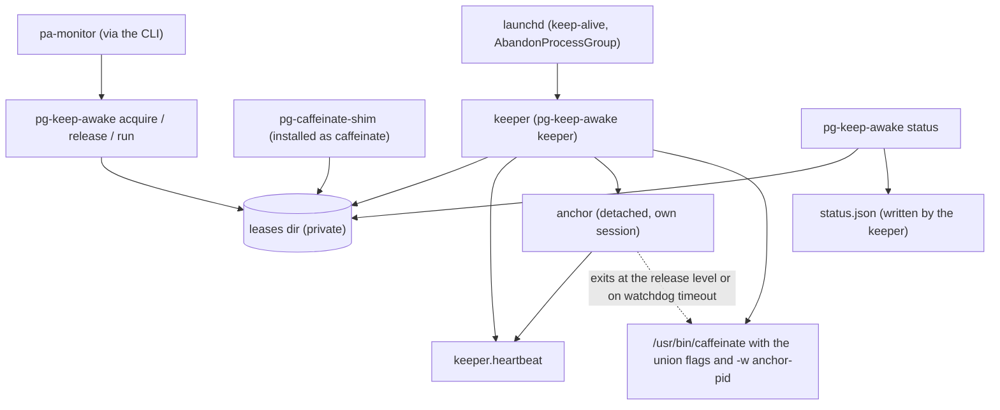

# pg-keep-awake: one holder for the keep-awake assertion

**Status**: Proposed (design reviewed twice by independent read-only reviewers; the operator's open
decisions are listed under "Open decisions")
**Date**: 2026-10-14
**Deciders**: Phillip Green II
**Decision record**: ADR 0100
**Related**: ADR 0024 (the session model that defines pa-monitor's keep-awake rule), ADR 0095 (the
low-battery rule this design takes over for the keep-awake path), ADR 0042 (exit-code convention)

Policy words (MUST, MUST NOT, SHOULD, MAY) follow RFC 2119.

## 1. Problem

Several programs on one Mac run `caffeinate` to keep it awake while agents work. Only pa-monitor's own
`caffeinate` obeys a low-battery rule (ADR 0095: hold 30, release 20, hysteresis 5). On 2026-10-09 and
2026-10-10 the Mac lost AC power with the lid open, other assertion holders kept it awake, the charge
fell to 1% to 3%, the CPU throttled and the host stalled for 42 to 46 minutes of awake time each time
until macOS hibernated it at 1%.

Holders observed on 2026-10-14 (`pmset -g assertions`, `ps`):

| Holder                                          | Command                      | Battery rule   |
| ----------------------------------------------- | ---------------------------- | -------------- |
| pa-monitor daemon                               | `caffeinate -w <daemon pid>` | yes (ADR 0095) |
| Claude Code CLI (2.1.296), one per busy session | `caffeinate -i -t 300`       | no             |
| an interactive shell                            | `caffeinate -s -i -t 180000` | no             |
| downstream wrapper scripts (outside this repo)  | `caffeinate -w $$ &`         | no             |
| `agent-activity-api wait --caffeinate`          | `caffeinate -w $$ &`         | no             |
| `wait-for-agents-to-finish --caffeinate`        | `caffeinate -w $$ &`         | no             |

Claude Code spawns `["caffeinate", ["-i","-t","300"]]` by bare name, reference-counted and re-armed
while a turn is busy. Its documentation, settings and environment variables expose no switch to turn
this off (checked 2026-10-14; the open upstream request is issue 21432). A `caffeinate` found earlier
on `PATH` therefore intercepts it.

macOS idle-sleeps when no assertion is held and the user is idle. This Mac's battery profile is
`sleep 1`, `displaysleep 5`, `hibernatemode 3`, `standby 1`, so releasing every keep-awake assertion lets
the Mac sleep within about a minute of the last activity. macOS itself forces sleep only at the critical
level, which is why the stall lasted so long.

## 2. Goals and non-goals

Goals:

1. Every keep-awake request on the Mac MUST pass one battery rule.
2. At steady state exactly one process holds the assertion (one `caffeinate`).
3. The only supported interface MUST be a CLI. State files are private.
4. The tool MUST survive its own restarts without dropping a held assertion.

Non-goals (out of scope):

- Forcing the Mac to sleep or shut down (`pmset sleepnow`). Releasing the assertion is the remedy.
- Killing non-`caffeinate` assertion holders (audio, browsers, other apps).
- Changing Claude Code itself.
- The pg-desk sweep capacity work.

## 3. Operator rulings (2026-10-14)

| #   | Ruling                                                                                                            |
| --- | ----------------------------------------------------------------------------------------------------------------- |
| R1  | No forced sleep or shutdown ("i don't want things to force shutdown"). Release the assertion at low battery.      |
| R2  | One tool abstracts `caffeinate` for pa-monitor, the desk-shadow collector, the activity wait tools and sessions.  |
| R3  | A PATH shim is acceptable. Repo name `pg-caffeinate-shim`; the installer adds a `caffeinate` symlink to it.       |
| R4  | Clients write state under XDG state; the service reads it; a client sleeps until it ends or is killed.            |
| R5  | No fallback to running the real `caffeinate` when the keeper is down. launchd keeps it alive; alerting covers it. |
| R6  | The anchor MUST NOT exit merely because the keeper is gone; it MAY exit after X minutes without a heartbeat.      |
| R7  | Config lives at XDG config, managed by home-manager: heartbeat duration, watchdog duration, battery rule, otel.   |
| R8  | The keeper cleans up on shutdown: remove expired files and the heartbeat, leave valid leases.                     |
| R9  | `-s` stays in the union of flags (the Mac may be on AC).                                                          |
| R10 | The CLI is the only contract. pa-monitor enables and disables itself through the CLI. `status --check` is in v1.  |
| R11 | Logging and metrics go to OTel, following the existing pattern.                                                   |

Rulings R1 to R11 are not reopened here. Items marked "proposed" in "Open decisions" were not
explicitly confirmed.

## 4. Architecture



Patterns: the lease table is a Registry of Leases; the keeper is a Reconciler (level-triggered control
loop); the battery rule is a hysteresis (Schmitt-trigger) Circuit Breaker; the shim is an Adapter over the
`caffeinate` command line; the CLI is a Facade; the anchor is a Watchdog with a dead-man's switch.

Components:

- **Lease**: one reason to stay awake, one file.
- **Keeper**: `pg-keep-awake keeper`, a launchd keep-alive agent. The only component that starts
  `caffeinate`, applies the battery rule and emits OTel.
- **Anchor**: `pg-keep-awake anchor`, a small autonomous child that `caffeinate` follows with `-w`.
- **Shim**: `pg-caffeinate-shim`, presented as `caffeinate`.
- **CLI**: `pg-keep-awake acquire | release | run | status | pause | resume | config check`.

Hold at steady state: `/usr/bin/caffeinate <union flags> -w <anchor pid>`. When the anchor exits the
assertion drops with it.

## 5. State layout and schemas

State directory: `${XDG_STATE_HOME:-~/.local/state}/pg-keep-awake/`. The writer MUST create it with
mode 0700 and files with mode 0600.

| Path                    | Written by        | Purpose                                                    |
| ----------------------- | ----------------- | ---------------------------------------------------------- |
| `leases/<id>.json`      | CLI, shim         | One lease per file                                         |
| `leases/.lock`          | CLI, shim, keeper | Empty file; `flock` guarding create, remove and reap       |
| `keeper.lock`           | keeper            | Empty file; `flock` held for the keeper's life (singleton) |
| `keeper.heartbeat`      | keeper            | Empty file; its mtime is the contract                      |
| `assertion.json`        | keeper            | The anchor and `caffeinate` the keeper started             |
| `status.json`           | keeper            | Snapshot read by `status`                                  |
| `anchor-exit.json`      | anchor            | Reason the anchor last exited                              |
| `pause.json`            | CLI, keeper       | An active pause; the keeper removes it on expiry           |
| `config.last-good.toml` | keeper            | Last configuration that parsed                             |

Readers MUST ignore unknown fields. A file whose `schema_version` is greater than the reader's MUST be
skipped, shown by `status` as `unreadable`, and MUST NOT be deleted.

The state directory MUST be owned by the current user with no group or other permission bits. A writer
that finds an existing directory that is not MUST exit 3 and say why; it MUST NOT chmod someone else's
directory.

### 5.1 Lease file

```json
{
  "schema_version": 1,
  "id": "shim.4412-1760400000123456",
  "owner": "shim",
  "key": "4412-1760400000123456",
  "kind": "shim",
  "client": { "pid": 4412, "start_us": 1760400000123456 },
  "expires_at": null,
  "watch": null,
  "flags": ["i", "s"],
  "argv": ["caffeinate", "-i", "-s"],
  "created_at": "2026-10-14T20:00:00.123456Z"
}
```

- `owner` and `key` MUST match `^[A-Za-z0-9_-]{1,64}$`. `id` is `<owner>.<key>`; the dot cannot occur in
  either part, so ids are unambiguous.
- `kind` is `shim`, `run` or `acquire`. A shim lease has owner `shim` and key `<pid>-<start_us>`; a
  `run` lease has owner from `--owner` and, unless `--key` is given, key `<pid>-<start_us>` of the
  `run` process.
- `client` is `{pid, start_us}` of the process the lease is bound to, or `null` for an `acquire` lease
  that has only `--for` (a pure timer). `client.start_us` and `watch.start_us` are the process start
  time in integer microseconds since the epoch. The CLI computes them; callers never supply them.
- `expires_at` is an RFC 3339 wall-clock time or `null`. `watch` is `null` or `{pid, start_us}`.
- `flags` is a subset of `d i m s`. `argv` is for display only and MUST NOT be executed.
- A lease MUST have at least one of: a `client`, an `expires_at`, a `watch`. A lease with none MUST be
  refused at creation, so a lease can never be unbounded and unowned.

A lease is **live** iff every one of these holds: `client` is null, or the client pid exists with a
matching `start_us` and is not a zombie; `expires_at` is null or in the future; `watch` is null or the
watched pid exists with a matching start time.

### 5.2 `assertion.json`

```json
{
  "schema_version": 1,
  "anchor": { "pid": 0, "start_us": 0, "argv": [] },
  "caffeinate": { "pid": 0, "start_us": 0, "argv": [] },
  "flags": ["i", "s"],
  "params": {
    "release_pct": 20,
    "blind_pct": 30,
    "watchdog_seconds": 600,
    "heartbeat_seconds": 10,
    "state_dir": "/abs/path"
  },
  "started_at": "2026-10-14T20:00:00Z",
  "keeper_version": ""
}
```

### 5.3 `status.json`

```json
{
  "schema_version": 1,
  "written_at": "2026-10-14T20:00:10Z",
  "keeper": {
    "pid": 0,
    "version": "",
    "heartbeat_age_s": 0,
    "config_error": null
  },
  "assertion": { "held": true, "flags": ["i"], "pid": 0 },
  "paused": null,
  "battery": {
    "percent": 64,
    "on_battery": false,
    "gate": "ok",
    "read_ok": true
  },
  "leases": [
    {
      "id": "",
      "owner": "",
      "key": "",
      "kind": "",
      "expires_at": null,
      "live": true,
      "reason": ""
    }
  ],
  "last_release": { "at": "", "reason": "release_threshold" },
  "external": [{ "pid": 0, "process": "", "type": "", "age_s": 0 }]
}
```

`gate` uses the names in pa-monitor's `battery.go`: `ok`, `no_spawn`, `released`, `unknown` or
`disabled` (see "The keeper"). `last_release.reason` names what released the assertion last: a battery
release (`release_threshold` or `blind_threshold`, copied from the anchor's exit record or the keeper's
own gate), `watchdog`, `no_leases`, `paused`, `keeper_stop` or `unknown`. `spawn_blocked` is a metric
reason only, because nothing was released. `paused` is `null` or the contents of `pause.json`.

### 5.3a `pause.json` and `anchor-exit.json`

```json
{
  "schema_version": 1,
  "until": "2026-10-14T21:00:00Z",
  "created_at": "2026-10-14T20:00:00Z",
  "by_pid": 4412
}
```

`pause.json` has `until` set to `null` for a pause with no `--for`. The keeper treats a past `until`
as no pause and removes the file.

```json
{
  "schema_version": 1,
  "at": "2026-10-14T20:20:00Z",
  "reason": "release_threshold",
  "percent": 19,
  "pid": 0
}
```

`anchor-exit.json` `reason` is `release_threshold`, `blind_threshold` or `watchdog`. The anchor writes
it before exiting. The keeper reads it on the next tick, emits it as a metric and log, records it in
`status.json` `last_release`, and removes it. An anchor killed by SIGKILL leaves no file, so its reason
is `unknown`.

### 5.4 Writing and reading lease files

1. A writer MUST hold `flock` on `leases/.lock`, write `.<id>.<pid>.<random>.tmp` in the same directory,
   then `rename(2)` it to `<id>.json`. The scanner MUST read only `*.json` and MUST ignore names that
   start with a dot or end in `.tmp`.
2. The keeper's reaper MUST take the same lock, re-read the file under it, and unlink only if the file
   it re-read is still dead. A lease refreshed between the first read and the unlink MUST survive.
   Every taker of `leases/.lock` MUST wait at most 2 seconds. A client that cannot get the lock treats
   the state directory as unwritable (exit 3). The keeper that cannot get it MUST skip the sweep for that
   tick and still touch the heartbeat, so one stopped client cannot wedge the loop or trip the watchdog.
3. A reader MUST open with `O_RDONLY|O_NOFOLLOW|O_NONBLOCK`, require a regular file by `fstat`, and
   reject files over 64 KiB. The keeper MUST consider at most 1024 lease files per tick and count the
   rest as rejected.
4. An unparsable `*.json` MUST be skipped and MUST NOT be deleted until its mtime is more than 60
   seconds old.
5. `*.tmp` files older than 60 seconds MUST be removed by the sweeps described under "The keeper".

### 5.5 Process liveness

The CLI and keeper MUST obtain `start_us` and the process state with `sysctl KERN_PROC_PID`
(`unix.SysctlKinfoProc`: `p_starttime` and `p_stat`), not by forking `ps`. A zombie (`SZOMB`) MUST NOT
count as live, because a SIGKILLed client whose parent has not reaped it would otherwise hold the
assertion. The keeper MUST `Wait()` on every child it spawned in its own process life; a pid it adopted
from an earlier keeper is not its child and is checked by state instead.

## 6. CLI contract

The CLI is the only supported interface. stdout carries data; stderr carries diagnostics. `--json`
prints exactly one JSON object.

| Command                                                           | Behavior                                                                                                                                                                                                                                                                                                                                                                                              |
| ----------------------------------------------------------------- | ----------------------------------------------------------------------------------------------------------------------------------------------------------------------------------------------------------------------------------------------------------------------------------------------------------------------------------------------------------------------------------------------------- |
| `acquire --owner O [--key K] [--pid P] [--for DUR] [-d -i -m -s]` | Create or refresh a lease. `--key` defaults to `default`. `--pid P` binds the lease to a process. With neither `--pid` nor `--for`, `--pid` defaults to the caller's parent pid; with only `--for` the lease is a pure timer and has no client. `--for` takes Go duration syntax. Default flags: `-i`. Prints the lease id. Idempotent. A dead `--pid` creates no lease, exits 0 and warns on stderr. |
| `release --owner O [--key K \| --all]`                            | Remove a lease. Without `--key` it removes key `default`; `--all` removes every lease of the owner. Exits 0 whether or not a lease existed.                                                                                                                                                                                                                                                           |
| `run --owner O [--key K] [flags] -- cmd...`                       | Hold a lease for the life of a command. The key defaults to `<pid>-<start_us>` of the `run` process. The exit status passes through; a signal gives 128+n; not found gives 127. It forwards SIGINT, SIGTERM and SIGHUP to the command.                                                                                                                                                                |
| `status [--json] [--check]`                                       | Show leases, keeper health, assertion, battery, last release and external holders. Reads `status.json` and the lease files plus a live process check. `--check` adds exit codes below.                                                                                                                                                                                                                |
| `pause [--for DUR]` / `resume`                                    | The keeper drops the assertion while paused; leases are untouched. Auto-resumes at expiry.                                                                                                                                                                                                                                                                                                            |
| `config check [--config PATH]`                                    | Validate a config file. Used at build time by the home-manager module.                                                                                                                                                                                                                                                                                                                                |
| `keeper`, `anchor`                                                | Long-running modes (not for interactive use).                                                                                                                                                                                                                                                                                                                                                         |

Exit codes follow ADR 0042:

| Code | Meaning                                                                                                                                                         |
| ---- | --------------------------------------------------------------------------------------------------------------------------------------------------------------- |
| 0    | Success                                                                                                                                                         |
| 1    | Unexpected error                                                                                                                                                |
| 2    | Usage error                                                                                                                                                     |
| 3    | State directory unwritable                                                                                                                                      |
| 4    | Configuration invalid (`config check` only)                                                                                                                     |
| 5    | `status --check`: the keeper is down (heartbeat older than twice the interval)                                                                                  |
| 6    | `status --check`: degraded (leases are live but no assertion is held, and neither the gate, a pause, nor the linger window explains it, for more than one tick) |

The shim deliberately keeps exit 1 for a usage error, to match `caffeinate`.

State-changing commands MUST succeed while the keeper is down; they only write files.

`status` human output:

```text
keeper   up  heartbeat 4s  v0.1.0
assert   HELD -i -s  caffeinate pid 123  battery 64% AC
leases   OWNER   KEY            CLIENT      EXPIRES  STATE
         shim    4412-17604...  4412 (zsh)  in 4m    live
         pa-monitor default     91835       -        live
other    pid 419 powerd  PreventUserIdleSystemSleep  3h54m
```

An empty system prints `no leases; assertion: none; keeper: ok (3s)`. A missing state directory prints
`keeper: never started` and exits 0 (exit 5 under `--check`).

## 7. The shim

`pg-caffeinate-shim` MUST NOT depend on `argv[0]`. The package installs `bin/pg-caffeinate-shim`; the
home-manager module adds `bin/caffeinate` as a symlink to it when `shim.enable` is true. The keeper
calls the real tool by absolute path `/usr/bin/caffeinate`, so there is no recursion.

It mirrors `caffeinate [-disu] [-t timeout] [-w pid] [utility arguments...]` with getopt semantics:
combined flags (`-dims`), attached values (`-t300`, `-it300`), `--`, and option parsing stops at the
first non-option. Observed behavior of the real tool (2026-10-14) defines the rows below; each row
MUST be an automated parity test against the real binary (see "Test plan").

| Input                                      | Shim behavior                                                                                                                                                                                                      |
| ------------------------------------------ | ------------------------------------------------------------------------------------------------------------------------------------------------------------------------------------------------------------------ |
| flags `d i m s`                            | Recorded. None given means `i`.                                                                                                                                                                                    |
| `-u` (proposed)                            | Rejected: message on stderr, exit 1. No known caller. The real tool held `-u` for more than 7 seconds in a probe, longer than the 5 seconds its man page promises.                                                 |
| unknown flag                               | `caffeinate: illegal option -- z` plus the usage line, exit 1                                                                                                                                                      |
| `-t N`, N greater than 0                   | `expires_at = now + N`; shim runs its own timer and exits 0                                                                                                                                                        |
| `-t 0`                                     | Indefinite lease                                                                                                                                                                                                   |
| `-t` negative, or overflow                 | No lease, exit 0                                                                                                                                                                                                   |
| `-t abc`, `-t`/`-w` without a value        | Usage line on stderr, exit 1                                                                                                                                                                                       |
| numeric-prefix values (`1x`, `1.5`, `0x1`) | Parsed like `strtol` base 0 (leading integer; hex and octal accepted)                                                                                                                                              |
| repeated `-t` or `-w`                      | The last one wins                                                                                                                                                                                                  |
| `-w PID`                                   | Record the pid and start time; exit 0 when it exits                                                                                                                                                                |
| `-w 0`                                     | Indefinite lease                                                                                                                                                                                                   |
| `-w -1`, or `-w` a nonexistent pid         | No lease, exit 0 immediately                                                                                                                                                                                       |
| `-t` and `-w` together                     | The first to fire ends the lease                                                                                                                                                                                   |
| utility form                               | Run the utility as a child; lease bound to the shim; `-t` and `-w` ignored (a `-w` on a dead pid still runs the utility); pass the exit status through; not found gives `<cmd>: No such file or directory` and 127 |
| `--`                                       | Ends options                                                                                                                                                                                                       |
| no arguments                               | Indefinite lease bound to the shim                                                                                                                                                                                 |

Lifetime and signals:

1. The shim is the client. Its lease lives exactly as long as the shim, so a caller that backgrounds
   it and later kills its pid releases the lease with no further protocol.
2. On SIGTERM, SIGHUP or SIGINT the shim MUST remove its lease, then re-raise the default action so the
   wait status is 143, 129 or 130. It MUST NOT install a handler for a signal that was ignored at
   start (a non-interactive background job keeps SIGINT ignored, as the real tool does).
3. SIGKILL leaves the file; the keeper reaps it (see "The keeper").
4. In the utility form the shim MUST forward SIGINT, SIGTERM and SIGHUP to the child, wait for it,
   remove its lease, and exit with the child's status (or re-raise the signal if the child died of it).
5. `-t` counts wall-clock time (a Mac that sleeps through a 50-hour `-t` still expires on schedule).
   Whether the real tool counts sleep time is unverified; the test plan includes a test.

Failure policy (proposed): if the lease cannot be written, the pure form MUST print one line on stderr
and exit 3; the utility form MUST warn on stderr, still run the utility, and exit with the utility's
status. When the keeper is down the shim writes the lease and holds silently (R5); `status` shows the
keeper as down. The shim MUST NOT read the configuration and MUST NOT initialize OTel.

## 8. The keeper

A Reconciler tick runs every `heartbeat_interval` (10 seconds by default). Each tick:

1. Sweep: reap dead, expired and orphaned leases (see "Writing and reading lease files").
2. Read the battery once (see "Battery policy") and compute the gate.
3. Compute desired state from the live leases, the pause state, the gate and the linger window.
4. Observe actual state (the anchor and `caffeinate` per `assertion.json` and a process check).
5. Converge: start, replace, adopt or stop.
6. Write `status.json`, then touch `keeper.heartbeat`.

The heartbeat MUST be touched only after a completed pass, by the same loop. A separate ticker would
hide a wedged loop. A pass whose sweep was skipped because `leases/.lock` could not be taken within its
2-second bound still counts as completed.

**Desired state.** The gate keeps the names and meaning of pa-monitor's `battery.go` (ADR 0095), so
pa-monitor can read it back unchanged:

| Gate       | Meaning                                                                                                                                       | Effect                                                        |
| ---------- | --------------------------------------------------------------------------------------------------------------------------------------------- | ------------------------------------------------------------- |
| `ok`       | On AC, or on battery above hold and not latched, or above hold plus hysteresis                                                                | Hold while any lease is live                                  |
| `no_spawn` | On battery at or below hold, or above hold but still inside the hysteresis latch (until AC returns or hold plus hysteresis) and above release | A running assertion is kept; none is started or replaced      |
| `released` | On battery at or below release                                                                                                                | Stop the assertion; leases stay                               |
| `unknown`  | The battery could not be read                                                                                                                 | Behaves as `ok`, except the blind rule under "Battery policy" |
| `disabled` | The rule is off (hold is 0)                                                                                                                   | Behaves as `ok`                                               |

When no lease is live the keeper MUST keep the assertion for `linger` (30 seconds by default, proposed)
before dropping it, so a client that is killed and respawned does not churn it. `released` and a pause
override `linger`. Under `no_spawn` the keeper MUST NOT start a replacement pair, so a flag-set change
takes effect only when the gate returns to `ok`.

**Spawn.** The keeper builds the argv itself: the union of the live leases' flags (`d i m s`), then
`-w <anchor pid>`, and it starts the anchor first, detached in its own session and process group. The
keeper MUST NOT execute, and MUST NOT interpolate, anything read from a lease file. If `caffeinate` is
killed, the next tick restarts it.

**Flag-set or parameter change.** The keeper starts the new anchor and `caffeinate` pair first, then
stops the old one, so no gap occurs. This also applies when the release level, watchdog or heartbeat
interval change.

**Anchor churn guard.** The keeper MUST NOT start an assertion when its own last reading is on battery
at or below the release level. If an anchor exits within 30 seconds of being spawned, the keeper MUST
NOT respawn for 60 seconds.

**Adoption on start.** The keeper takes `flock` on `keeper.lock` (a second keeper exits at once), then:

1. Create `keeper.heartbeat` first.
2. Read `assertion.json` and adopt the anchor and `caffeinate` iff each pid and `start_us` match, the
   anchor's argv has subcommand `anchor`, `caffeinate`'s argv has `-w <anchor pid>`, and the parameters
   and `state_dir` equal the keeper's current ones. Argv MUST be compared by subcommand and parameters,
   not by binary path (store paths change at every apply).
3. If the file is missing or wrong, scan for `pg-keep-awake anchor` processes whose `--state-dir` equals
   this keeper's, adopt the newest valid one, and stop the others. Processes with a different
   `state_dir` MUST NOT be touched.
4. If the adopted pair differs from the desired state, replace it make-before-break.

**Backstop for stuck clients.** When a lease is expired or orphaned and its client is still alive, the
keeper MAY send SIGTERM to the client only if `kind` is `shim` or `run`, and only after re-verifying
that the pid and `start_us` still match and the executable is `pg-caffeinate-shim` or `pg-keep-awake`.
The keeper MUST NOT signal a pid taken from an `acquire` lease (it may be pa-monitor itself).

**Sweeps.** Two idempotent sweeps share one routine and differ in one step. Only the holder of
`keeper.lock` may run either.

- The **startup sweep** removes expired leases and leases whose client or watched pid is gone, and removes
  `*.tmp` files older than 60 seconds. It MUST NOT remove `keeper.heartbeat`: the keeper creates it
  first, as step 1 of adoption.
- The **graceful-shutdown sweep** (on SIGTERM) does the same and then also removes `keeper.heartbeat`.
  Removing the heartbeat starts the anchor's watchdog countdown at shutdown; a launchd restart normally
  completes well inside it. A crash gets the same effect from the last touch.
- Both keep valid leases, `assertion.json`, the anchor and `caffeinate`.

## 9. The anchor

`pg-keep-awake anchor --release-pct R --blind-pct B --watchdog D --heartbeat PATH --interval I --state-dir DIR`
is autonomous: it takes its parameters from argv, MUST NOT read `config.toml`, and keeps no connection
to the keeper. `I` is the keeper's `heartbeat_interval`, recorded as `heartbeat_seconds` in
`assertion.json` and compared on adoption with the other parameters. When `hold_pct` is 0 (the rule is
off) the keeper passes `--release-pct 0 --blind-pct 0`.
Every `I`:

1. Read the battery (see "Battery policy"). If on battery and the percent is at or below `R`, write
   `anchor-exit.json` with reason `release_threshold` and exit. `R` of 0 means never exit for battery.
   If the last 3 reads all failed and the last good reading was on battery at or below `B`, write
   reason `blind_threshold` and exit. `B` is the keeper's hold level.
2. Stat the heartbeat file. Track the awake time since its mtime last changed, using a clock that
   excludes sleep (`mach_absolute_time`). Compare mtime values, not ages, so wall-clock steps are
   harmless. If the awake time reaches `D`, write `anchor-exit.json` and exit. A missing file counts as
   unchanged.

The anchor has no hold level, no hysteresis and no linger; those live in the keeper. `caffeinate -w`
follows the anchor, so the assertion drops when the anchor exits.

## 10. Battery policy

Extracted from ADR 0095, whose rule this design takes over for the keep-awake path. Defaults hold 30,
release 20, hysteresis 5. The rule is disabled when hold is 0, and a release of 0 never stops a running
assertion. A release above the hold is capped at it. The hysteresis latch is in memory; a keeper restart
while on battery between 31% and 35% loses it, which is accepted (the anchor still releases at the
release level).

**Reading.** The reader MUST use the absolute path `/usr/bin/pmset` with a timeout (an in-process IOKit
read MAY replace it and avoids a fork per tick). A single read error fails open. A starved host (load 50
or higher) is exactly when `pmset` times out, so failing open forever would defeat the purpose. The
**blind rule** therefore applies: after 3 consecutive read failures, if the last good reading was on
battery at or below the **hold** level, the keeper MUST treat the gate as `released` and the anchor MUST
exit (`--blind-pct`). The hold level is the right line, not the release level: by the time a reading at
or below release has been seen, the assertion is already gone, so a rule keyed on release could never
fire. A blind read above hold keeps failing open. The keeper reads once per tick and shares the reading
across its checks.

## 11. Configuration

`${XDG_CONFIG_HOME:-~/.config}/pg-keep-awake/config.toml`, rendered by home-manager (the same pattern as
pa-monitor's `config.toml`). Only the keeper reads it; the anchor gets its values from argv, and clients
and the shim MUST NOT read it.

```toml
# ~/.config/pg-keep-awake/config.toml
heartbeat_interval = "10s"
watchdog_timeout = "10m"
linger = "30s"

[battery]
hold_pct = 30
release_pct = 20
hysteresis_pct = 5

[otel]
endpoint = "http://collector.example:4317"
```

- An absent file means built-in defaults and no OTel.
- `[otel]` is rendered only when the system observability stack supplies an endpoint (as pa-monitor
  does); it is never hardcoded.
- The keeper reads its configuration at startup only (ADR 0028 is pa-monitor's Proposed hot-reload design
  and is not adopted here). Nothing restarts a launchd agent just because its config file changed, so
  the home-manager module MUST put a hash of the rendered `config.toml` into the launchd job definition
  (an environment variable), which makes an apply that changes the config restart the keeper. The
  restarted keeper re-evaluates the anchor through the make-before-break replacement.
- The keeper MUST NOT crash-loop on a bad file. On a parse error it MUST fall back to
  `config.last-good.toml`, then to built-in defaults, log the error, and report it as
  `keeper.config_error` in `status`. `config check` (exit 4) validates at build time.
- The home-manager module asserts `watchdog_timeout >= 6 * heartbeat_interval` and
  `release_pct <= hold_pct`.
- `shim.enable = false` removes the `caffeinate` symlink. Live shim leases stay valid until their
  clients exit; the keeper and anchor keep running. The assertion drains only when the keeper agent is
  also disabled, after the watchdog timeout.

## 12. Observability

The keeper is the only OTel emitter. The shim and the CLI MUST NOT initialize OTel. Export MUST be
non-blocking; a collector refusal MUST NOT stall the tick. Metric names follow the pa-monitor emitter
(dotted names that become underscored series).

| Metric                                             | Kind      | Labels                                                                          |
| -------------------------------------------------- | --------- | ------------------------------------------------------------------------------- |
| `pg_keep_awake.keeper.up`                          | gauge     |                                                                                 |
| `pg_keep_awake.keeper.last_tick_timestamp_seconds` | gauge     |                                                                                 |
| `pg_keep_awake.tick.duration`                      | histogram |                                                                                 |
| `pg_keep_awake.leases.live`                        | gauge     | `owner`                                                                         |
| `pg_keep_awake.leases.reaped_total`                | counter   | `reason` (`expired`, `client_dead`, `watched_dead`, `orphan`)                   |
| `pg_keep_awake.leases.rejected_total`              | counter   | `reason` (`unreadable`, `too_large`, `over_cap`)                                |
| `pg_keep_awake.assertion.held`                     | gauge     |                                                                                 |
| `pg_keep_awake.assertion.flags`                    | gauge     | `flag`                                                                          |
| `pg_keep_awake.gate.state`                         | gauge     | `state` (`ok`, `no_spawn`, `released`, `unknown`, `disabled`; 0 or 1 per state) |
| `pg_keep_awake.battery.percent`                    | gauge     |                                                                                 |
| `pg_keep_awake.battery.on_battery`                 | gauge     |                                                                                 |
| `pg_keep_awake.battery.release_pct`                | gauge     | the configured release level, so alerts can compare against it                  |
| `pg_keep_awake.battery.releases_total`             | counter   | `reason` (`release_threshold`, `blind_threshold`, `spawn_blocked`, `watchdog`)  |
| `pg_keep_awake.anchor.exits_total`                 | counter   | `reason` (`release_threshold`, `blind_threshold`, `watchdog`, `unknown`)        |

`owner` MUST be low-cardinality: after 16 distinct owners the rest are labelled `other`. A lease id or
pid MUST NOT be a label.

Logs (OTel): lease create and reap, assertion spawn, adopt and release, gate transitions, config errors,
and each anchor exit reason (read from `anchor-exit.json`, because the anchor is autonomous).

**"What is holding my Mac awake?"** `status` lists every live lease, the assertion, and `external`: the
holders reported by `pmset -g assertions` that are not this tool's `caffeinate` (best effort, fails
soft). This is also the only way to prove the shim's coverage.

**Alerts** live in `packages/pg-keep-awake/grafana/alerting/`. The pattern is pg-task-focus's
`alerts.yaml` ("Daemon down": `noDataState: Alerting`, `severity: critical`, `for: 5m`), not pa-monitor's
`daemon-connection.yaml`, which is `noDataState: OK` and `severity: warning` because a closed pane there
is not an incident:

1. Keeper down while leases were live: `noDataState: Alerting` on
   `sum(max_over_time(pg_keep_awake_leases_live[30m] offset 3m)) > 0 unless on() (pg_keep_awake_keeper_up == 1)`.
   A dead keeper emits nothing, so this alert uses the last-known state. OTel push staleness makes
   detection take about 5 minutes.
2. An independent signal that does not depend on the keeper: pa-monitor emits
   `pa_monitor_keep_awake_keeper_up` from `pg-keep-awake status --check` each tick (added to pa-monitor
   by the migration below), so it keeps reporting while the keeper is dead. If the existing launchd-health
   exporter covers user agents it MAY also be used; confirm at implementation.
3. Assertion held on battery at or below the release level:
   `pg_keep_awake_assertion_held == 1 and pg_keep_awake_battery_on_battery == 1 and pg_keep_awake_battery_percent <= pg_keep_awake_battery_release_pct`.

## 13. pa-monitor migration

pa-monitor keeps its mode toggle, busy detection and grace period. Only process spawning and the battery
policy move.

1. **During the transition** pa-monitor runs its own `caffeinate`. It MUST pin the absolute path
   `/usr/bin/caffeinate` (`Proc.Spawn` execs a bare name today), so it neither becomes a shim client nor
   has `Proc.Kill()` signal a shim.
2. **End state.** pa-monitor calls `pg-keep-awake acquire --owner pa-monitor --pid <daemon pid>` when it
   wants the Mac awake and `release --owner pa-monitor` when it does not. `caffeinate on` maps to
   acquire and `caffeinate off` to release, with the same `mode · process` output. Both calls are
   idempotent; while it wants awake it SHOULD repeat `acquire` about once a minute so a wiped state
   directory heals.
3. pa-monitor MUST read `status --json` for the held state and gate. `pa_monitor_caffeinate_active`
   keeps its meaning (is the Mac being held awake). `StateError` and `process=error` map to a degraded
   `status --check`.
4. The pa-monitor home-manager options `caffeinate.batteryHoldPercent` and `batteryReleasePercent` are
   deprecated in favor of this module's `[battery]` settings.
5. pa-monitor emits `pa_monitor_keep_awake_keeper_up` from `pg-keep-awake status --check` each tick (the
   independent alert signal). Its own `pa_monitor.caffeinate.battery_releases_total` stops being emitted
   once the keeper owns the rule; dashboards and alerts that read it move to
   `pg_keep_awake.battery.releases_total`.

## 14. Test plan

Deterministic behavior MUST be covered by automated tests that run the real tool in a hermetic
environment. Mocks of `caffeinate` do not count.

- **Go unit tests** (no `caffeinate` needed): the shim argument parser (every row of "The shim"), lease
  liveness, gate and hysteresis (reuse the pa-monitor battery cases), watchdog arithmetic with an
  injected clock, schema round-trips, and unknown-field and future-`schema_version` tolerance.
- **Parity test**: run the shim and `/usr/bin/caffeinate` over the shim table with `-t 1`-class
  timings and compare exit status and stderr, with a golden file for the real tool's output.
- **Integration tests**: a test-owned keeper child with `XDG_STATE_HOME` and `XDG_CONFIG_HOME` in
  `t.TempDir()` and a `heartbeat_interval` of 200 ms, observing the assertion with
  `pmset -g assertions` filtered to the pid read from `assertion.json`. Scenarios: SIGKILL the keeper
  (anchor and `caffeinate` survive and a new keeper adopts them with unchanged pids); flag-set change
  with no gap; killed `caffeinate` is restarted; expired lease reaped; a SIGKILLed shim leaves a file
  that is reaped; a zombie client does not hold; the watchdog fires with the heartbeat frozen;
  battery release at 19% frees the assertion; the blind rule releases after 3 failed reads at a last
  good reading at or below hold and does not release above it; a startup sweep keeps the heartbeat and
  a shutdown sweep removes it; concurrent acquire and reap loses no lease; a stopped client holding
  `leases/.lock` delays the tick by no more than the 2-second lock bound and still touches the
  heartbeat; a FIFO or a
  symlink named `x.json` is skipped; config change then adoption; `run` exit-status passthrough.
- **Battery injection**: a hidden `--battery-source file:<path>` or an environment variable, because the
  real battery cannot be driven.
- **Safety**: tests MUST signal only pids they spawned, MUST refuse pid 1 or lower and any pid outside
  their own spawn set, and a hermetic keeper MUST NOT see or touch the real anchor (the adoption scan is
  scoped by `state_dir`). A prior kill test crashed this machine.
- **bats** only for wiring: the `caffeinate` symlink and `PATH` order, `--help`, completions, and the
  tldr page.
- **nix**: `pg-keep-awake-go-tests` next to `pa-monitor-go-tests`, and `test-pg-keep-awake-hm-launchd`
  with the launchd registry stub. `caffeinate`, `pmset`, launchd and the sleep-excluding clock cannot run
  in the sandbox. Those tests guard on `runtime.GOOS` and `exec.LookPath("/usr/bin/caffeinate")` with
  `t.Skip`, and the nix check MUST print a visible `SKIPPED integration` line. A runbook step covers the
  manual run on the Mac.
- **Live checks after the first apply**: a write to the state directory from a real pool session; the
  shim winning `PATH` in a pool session (its `PATH` is assembled by nix wrappers, not a login shell, and
  the shim MUST land in the per-user profile, not only `~/.nix-profile`); whether the real tool counts
  `-t` across sleep.

## 15. Packaging

```text
packages/pg-keep-awake/
  cmd/pg-keep-awake/  cmd/pg-caffeinate-shim/  internal/{lease,policy,shimargs,keeper,anchor}/
  completions/  grafana/alerting/  go.mod  go.sum  gomod2nix.toml  default.nix  README.md
home/programs/pg-keep-awake/default.nix
```

- Go package with `mkGoApp` and both binaries in `subPackages`; versioning per the package-versioning
  path-rule. `internal/otel` and `internal/core/power` in pa-monitor cannot be imported across modules,
  so the needed code is copied, with a note naming the origin.
- Home-manager module `phillipgreenii.programs.pg-keep-awake` registers the keeper through
  `phillipgreenii.programs.launchdServices.userAgents` (keep-alive, `AbandonProcessGroup = true`; the
  precedent for that key is the pg-router darwin module, `darwin/modules/pg-router/default.nix`),
  renders `config.toml` with its hash in the job definition, validates it with `config check` at build
  time, and takes the OTel endpoint from the system observability option. It places the tool under the
  `claude-fleet` capability (proposed; confirm at implementation).
- The shim MUST be installed through the per-user profile (`home.packages`, which lands in
  `/etc/profiles/per-user/<user>/bin`). A pool session's `PATH` lists that directory before `/usr/bin`
  but not `~/.nix-profile/bin`, so a shim that lands only there is bypassed.
- Sessions and shells that started before the first apply keep their old `caffeinate` holders until they
  end, and a holder that calls `/usr/bin/caffeinate` by absolute path is never intercepted. `status`
  `external` shows both, which is the proof of coverage.
- Ship `--help`, bash and zsh completions and a tldr page, copying the pa-monitor layout.

## 16. Evidence and what is not yet verified

Verified on 2026-10-14:

- Four throwaway launchd jobs (`AbandonProcessGroup` on or off, detached session on or off), ended by
  SIGKILL and by `launchctl bootout`: the child survived in every combination except no
  `AbandonProcessGroup` with the same process group. Both settings are used for safety.
- The Go runtime source on this machine (toolchain 1.25.9; the repo's modules use 1.26.0) implements
  `nanotime1` on darwin with `mach_absolute_time`; that it excludes sleep is from Apple's documentation,
  not measured.
- The real `caffeinate`'s edge cases in "The shim" were measured, including `-t 2 -w 1` ending at 2.3 s
  with exit 0 and a nonexistent `-w` pid exiting at once with 0.
- `golang.org/x/sys` v0.49.0 exposes `unix.SysctlKinfoProc` with `P_starttime` and `P_stat` on darwin.
- The profile bin precedes `/usr/bin` on `PATH` in an interactive shell and in a pool session (the pool
  session's `PATH` lists the profile bin before `/usr/bin`).

Not verified: that Claude Code resolves `caffeinate` through `PATH` at spawn (the bundle shows a bare
name); whether the real tool counts `-t` across sleep; pa-monitor's launchd `PATH`; a write to the state
directory from inside a live pool session.

## 17. Open decisions (proposed defaults, awaiting the operator)

| #   | Decision                                                                                                                                                                                         |
| --- | ------------------------------------------------------------------------------------------------------------------------------------------------------------------------------------------------ |
| O1  | Tick 10 s and watchdog 10 min.                                                                                                                                                                   |
| O2  | The shim rejects `-u`. A rejected caller is discoverable only from its own stderr, because the shim writes no record and MUST NOT emit OTel; a follow-up adds a record if a real caller appears. |
| O3  | The shim failure policy under "The shim" (pure form exits 3; utility form warns and runs).                                                                                                       |
| O4  | `linger = 30s` as a config key (adds a key beyond the ruled list).                                                                                                                               |
| O5  | `pause`/`resume` and `release --all`.                                                                                                                                                            |
| O6  | `status` lists external assertion holders in v1.                                                                                                                                                 |
| O7  | A keeper with a bad config falls back to last-good, then defaults, instead of refusing to start.                                                                                                 |
| O8  | Names: `pg-keep-awake`, `pg-caffeinate-shim`.                                                                                                                                                    |
| O9  | Capability placement under `claude-fleet`.                                                                                                                                                       |

## 18. Follow-ups outside this spec

- A behavior-docs set `docs/behavior/pg-keep-awake/` (the CLI is the only contract, so it is the natural
  home for the invariants).
- Forced sleep stays out of scope. If a stall recurs on battery after the keeper is live, revisit it.
- An upstream feature request for a switch (issue 21432) is the operator's to file.
