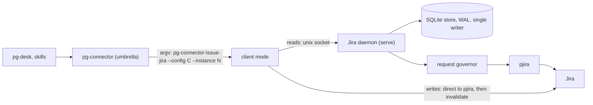
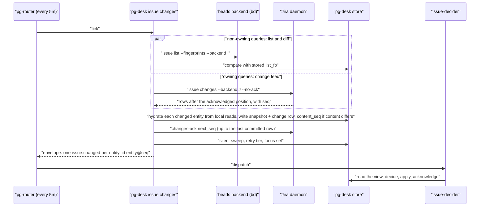

# Issue change emission per backend: a lean beads path and a Jira daemon — design

- **Status**: Draft 9 for operator review. Drafts 1 and 2 were a pg-desk-only fix; drafts 3 to 6 applied the
  GitHub daemon to every issue backend. On 2026-10-20 the operator ruled that the store and the daemon are
  **per implementation**: beads runs locally and needs neither, Jira needs both, and a beads daemon would be
  a separate, optional thing. Draft 7 was rewritten on that ruling; draft 8 folds in an independent review of
  draft 7 (section 12). Draft 9 applies the operator's 2026-10-21 rulings (section 13): the Jira daemon is
  committed and goes BEFORE the beads path, the 24-hour interim relief and the router selective-drop bead are
  not filed, and the queue's failure to de-duplicate is measured (section 1). Draft 9 has not been reviewed.
  Nothing here is implemented. No implementation bead is filed.
- **Date**: 2026-10-21 (draft 8: 2026-10-20)
- **Bead**: `pg2-oa1h4` (this design). Closes the root cause of `pg2-izeuu` and `pg2-2f24a`; gates
  `pg2-2j5ac.44.37` (the flip of the issue decider to `apply`).
- **Delta over**: `docs/superpowers/specs/2026-10-09-pg-connector-github-daemon-design.md` ("the GitHub
  design"), program epic `pg2-z5fax`, ADR 0090 (a backend declares `owns_changes` and the others stay as
  they are). The Jira part is a delta over the GitHub design; the beads part is a change to pg-desk.
- **Builds on**: ADR 0077 (S29, S31, S32, S33), ADR 0090, `packages/pg-connector/pkg/connectord`,
  `docs/behavior/pg-desk/changes.md`.

The key words MUST, MUST NOT, SHOULD, SHOULD NOT and MAY in this document are to be read as in
RFC 2119.

This repository is public. The document names no employer, workspace, channel or person. Bead ids
(`pg2-...`) are this repository's own tracker ids.

## 0. Summary

| Topic                   | Decision                                                                                                                                                                                                                                                                                                                                                                           |
| ----------------------- | ---------------------------------------------------------------------------------------------------------------------------------------------------------------------------------------------------------------------------------------------------------------------------------------------------------------------------------------------------------------------------------- |
| What is wrong           | 2,039 of 2,049 `issue.changed` events enqueued since 2026-10-19 18:52Z carry kind `reconcile` [2,039 / 2,049 = 99.5%]. pg-desk's two age-sweep tiers re-emit every active entity whether or not anything differs; the queue grows by about 113 per hour.                                                                                                                           |
| Where the load is       | Beads. `work-beads` held about 167 to 171 entities in the sampled connector ledgers and the focus queries add the rest of the 452 active issues; Jira's `mine` query held 3 to 4. The split is inferred, to be measured (section 1). The flood is fixed by the beads path, not by a Jira daemon; the Jira daemon is nevertheless committed and goes first (Order).                 |
| Operator ruling         | 2026-10-20: emit nothing when nothing differs; do what was done for PRs where it fits; the store and daemon are per implementation: Jira has them, beads does not need them (a beads one would be separate and optional).                                                                                                                                                          |
| Beads (no daemon)       | pg-desk keeps its fingerprint list-and-diff. The remote age tier becomes SILENT (it re-hydrates, and appends a row only when the content differs). The local tier becomes an acknowledged retry. A cross-process budget keeps `bd` from being overloaded.                                                                                                                          |
| Jira (daemon and store) | A Jira daemon owns a store, tracks every retrieved issue until closed plus 24 hours, evicts it 7 days after closing, and runs on an internal request budget (Jira's own quota signals are limited, section 3.4). pg-desk consumes its change feed.                                                                                                                                 |
| Order                   | Operator ruling 2026-10-21: the Jira daemon is necessary and has higher priority than beads, so it goes FIRST. The beads path, which is what stops the flood, follows it; the consequence for the incident is stated in section 8 and section 10. The pieces both need (section 5) land with whichever goes first.                                                                 |
| Decider acknowledgement | REQUIRED before the decider flips to `apply` (section 6, Appendix A).                                                                                                                                                                                                                                                                                                              |
| Interim                 | NOT filed (operator ruling 2026-10-21). Relaxing the two sweep ages to 24 hours would cut the long-run arrival mean from 177 to about 38 per hour (not a ceiling) without code (section 8); the operator reads the growing backlog as a larger problem and asked for the de-duplication to be checked first.                                                                       |
| De-duplication          | Checked 2026-10-21 (section 1): the router de-duplicates by exact event id and the id carries the change-log sequence, so a re-emission is always a new id and nothing is ever de-duplicated; 89.7% of enqueued events are superseded by a later event for the same entity. The emitter fixes of sections 4 and 6 remove the cause; router-side supersession is OPEN (section 10). |

## 1. Problem, measured

Measured 2026-10-20 06:29Z from the router queue log, `pg-router status --json` and `pg-desk status`.

- `issue.changed` queue depth is 1757; it was 312 at 2026-10-19 17:41Z. Net growth over that window is
  `(1757 - 312) / 12.8h = 113` per hour.
- Of 2,049 enqueued `issue.changed` events, 2,039 carry kind `reconcile` (1,443 origin `local-reconcile`,
  591 origin `sweep`, 5 other). Ten carry no `reconcile` kind. 454 distinct entities were enqueued, each 3
  to 6 times.
- Average arrival is `2,049 / 11.6h = 177` per hour; with growth of 113 per hour the average drain was
  `177 - 113 = 64` per hour. Short-window peaks (4.5 to 5.3 per minute, one hour of 190 dispatches after a
  router restart) are not a baseline, so no success criterion here uses a drain rate.
- The sweep bound `452 / 20 x 5m = 113m` exceeds the local tier's age (30m); each tier emits up to
  `sweep.max_per_poll` (20) per poll, for ever.
- The consumer `issue-decider` is serial. In `plan` mode every run is a no-op. After the flip to `apply` it
  writes beads, and a new event waits behind the backlog (47 to 57 minutes observed) against a 30-minute
  focus gate.
- **The backend split is inferred, not measured.** The sampled connector ledgers (2026-09-23 to 2026-10-15)
  show `work-beads` at 167 to 171 entities and the Jira `mine` query at 3 to 4; the focus queries are bulk
  open-bead queries. The 452 active issues are therefore almost certainly almost all beads, but no count by
  backend was taken from the pg-desk store. The packet that cuts the beads path MUST first record the active
  count per backend, and the number of hydrations whose fingerprint changed per day (the real-change rate that
  the success criterion of section 7 divides by). The new `fields_changed` rows add events that were
  previously dropped, so the real-change rate is measured against the NEW rule.
- **The queue does not de-duplicate this load (measured 2026-10-21 02:45Z, answering the operator's question
  whether the backlog is de-duplicating).** The router drops an enqueue only when its exact event id is still
  retained (INV-EVT-3 of the router's behavior docs). The id is `issue.changed:<entity>@<max change_log seq>`
  and every reconcile row appended by pg-desk gets a new sequence, so every re-emission is a new id and the
  rule can never fire. From the router's queue log: 4,495 `issue.changed` enqueues between 2026-10-20 03:22 and
  22:36 (UTC-4) carry 4,495 distinct ids for 465 distinct entities, 3 to 12 enqueues per entity (typically 9 to
  11). 4,030 of 4,495 are superseded by a later event for the same entity [(4,495 - 465) / 4,495 = 89.7%];
  4,461 of 4,495 carry only kind `reconcile` [4,461 / 4,495 = 99.2%] and 34 are real changes. Every one is
  born expired (`expiresAt` equal to `enqueuedAt`, 4,495 of 4,495), so even an id match would be inside a
  window of about one dispatch cycle. Queue depth at 02:42Z was 4,387 against 1,757 at 2026-10-20 06:29Z:
  growth of about 130 per hour [(4,387 - 1,757) / 20.2h], above the 113 per hour of the first measurement. The
  duplication is created by the EMITTER, which appends a row and a new id whether or not anything differs;
  sections 4 and 6 remove that at the source. They do not make the router supersede an older pending event for
  the same entity, which is the only thing that would stop a backlog from compounding if an emitter regressed
  (section 10, item 8).

## 2. Ownership per backend

ADR 0090 already says it: a backend that declares `owns_changes` decides what changed for its own types and
every other backend stays as it is. The `issue` type has two implementations, so the rule is applied per
backend, not per type:

| Backend       | Process model                                       | Who detects a change                                                               | Sweeps                                                                       |
| ------------- | --------------------------------------------------- | ---------------------------------------------------------------------------------- | ---------------------------------------------------------------------------- |
| Beads (local) | One-shot `bd` processes; no store, no daemon        | pg-desk, by fingerprint list-and-diff (ADR 0077 S29), as today                     | Remote tier silent (24 hours); local tier replaced by the acknowledged retry |
| Jira (remote) | After the daemon lands: a daemon with its own store | The daemon (`owns_changes`); pg-desk consumes the feed, hydrates, and acknowledges | The daemon's own revalidation and hard ages; pg-desk runs no sweep on it     |
| Jira (today)  | One-shot `pjira` processes                          | pg-desk, as for beads                                                              | As for beads                                                                 |

pg-desk therefore handles a MIX of backends inside its one `issue` flow (section 5), and the router source,
the roles and the decider are unchanged: pg-desk stays the single emitter of `issue.changed`.

**Why beads needs no daemon.** A `bd` read is local, so its data is always current and nothing needs
refreshing in the background; the fingerprint the umbrella computes covers every field the list returns (it
hashes the whole entity JSON minus `as_of`, `stale` and `metadata.last_checked_at`). What a daemon would add
(batching, quota protection, revalidation, a store) has nothing to act on. What the sweeps did for beads is
kept in a form that does not emit: the remote tier still re-reads, because a stored entity can depend on
other beads (its recursive dependencies change when a blocker closes without the entity's own fingerprint
moving), but it re-reads silently (section 4.2); and the local tier's recovery of failed decider runs is done
properly (section 6).

**A beads daemon is an option, not a requirement.** If a beads daemon is adopted for consistency it is a
separate binary instance with its own store and config, sharing only the library; the retention rule of
section 3.2 would then apply to it. It is not designed here, and section 4.3 gives the signal that would
justify it.

## 3. The Jira daemon

A delta over the GitHub design. Everything not stated here is the GitHub design's: one daemon as the store's
only writer, one unix socket, client mode, `unavailable` for reads when the daemon is down, a persistent
store, entity groups, the settle rule, per-group baselines, "first sighting logs nothing", the change feed
with explicit acknowledgement and the cursor key, `sources_freshness[]`, the capabilities `owns_changes` and
`cache_opt_out`, `status` and `explain`, the observability pattern, and the shadow-run rollout.

### 3.1 Groups

An issue is a set of groups with their own freshness, as for PRs:

| Group      | Content                                                               | Fetch                                                                                                                                                                                                                                           | Fresh until                                                         |
| ---------- | --------------------------------------------------------------------- | ----------------------------------------------------------------------------------------------------------------------------------------------------------------------------------------------------------------------------------------------- | ------------------------------------------------------------------- |
| `summary`  | What `list` returns, including `updated` as the revalidation token    | One full JQL search per configured query (today two; the cursor is always null)                                                                                                                                                                 | `summary_ttl`                                                       |
| `detail`   | What `show` adds: description, comments, direct edges, operator facts | `pjira issue` per issue when the summary changed or the hard age passed; the spike checks whether `search --expand` (the backend already uses it for operator facts) can return comments and changelog in the listing and avoid per-issue calls | `detail_ttl`, extended by revalidation, never past `detail_max_age` |
| `children` | Not cached (a live read)                                              | Passed through                                                                                                                                                                                                                                  | n/a                                                                 |

`updated` is decoded by the backend but deliberately not mapped today (`backend.go:184-189`); the daemon maps
it internally as the revalidation token. The Jira fingerprint covers only what `pjira` emits and
`toSchemaIssue` maps no description and no comments. **INV-ICD-1.** The entity MUST carry a comment summary (a
count and the time of the latest comment) derived from `detail`, so a comment is a visible field difference.

### 3.2 Tracking and retention

- **INV-ICD-2.** Every issue the daemon retrieves, whether as a member of a configured query or because a
  caller read it, is **tracked**, and a tracked issue is refreshed in the background until it has been closed
  for 24 hours (a Jira status category `done`). From 24 hours to 7 days after closing it is served from the
  store and not refreshed. After 7 days closed it is evicted; change-log rows keep their own retention.
- This is the GitHub design's `terminal_ttl` (24 hours) and `expiry` (7 days) with a different keep-alive
  trigger: the GitHub rule keeps an entity alive while it is a member of a configured query or was accessed
  within `keepalive_window`; this rule keeps any retrieved issue alive until it closes. Implementing it needs a
  closed-at timestamp, which the shared store's `entity` table does not have. The Jira daemon has its OWN store
  file, but the migration ladder is one shared list in `connectord/store`, so the new column is an additive
  migration that bumps `user_version` for every daemon: **it MUST be verified against the GitHub daemon's
  store and its migration tests before it lands**, and the claim that the live GitHub store is untouched is
  withdrawn.
- **Unbounded-growth guard.** Tracking "any retrieved issue" would refresh every ticket an agent ever
  `show`ed until it closes. The daemon MUST carry a cap on tracked open issues that are NOT members of a
  configured query (`max_tracked_adhoc`, default from the spike), refresh them at a lower priority class than
  members, and export their count.

### 3.3 Operations and writes

Reads (`show`, `list`) are served from the store; `children`, `search` and `list_activity` are live
pass-through reads under the governor; `--fresh` forces the needed groups. **Writes (`create`, `comment`,
`transition`, `update`, `close`) stay in client mode**, executed by the calling process directly against
`pjira`, because actor identity comes from the caller's environment (the daemon ignores per-call environment)
and the writers (pg-desk sync, pg-rescue, the decider) MUST NOT stop working when the daemon is down.

- **INV-ICD-3.** A write MUST NOT depend on the daemon. The client sends `write_begin {id}` before the write
  and `invalidate {id}` after it, each with a short delivery timeout (default 500 ms). On `write_begin` the
  daemon bumps the entity's generation, holds new refreshes of that entity and discards one in flight; on
  `invalidate` it releases the hold and queues one re-pull; if `invalidate` is dropped the hold expires after
  a lease (default 30 seconds). `create` has no id before it runs, so it sends `write_begin {instance}`. If
  `write_begin` is not delivered in time the write proceeds and the client skips `invalidate`.
- **Daemon down.** Reads answer `unavailable` naming the socket, the supervisor and the restart hint. Every
  caller whose docs or prompts treat `unavailable` as terminal MUST be updated to retry.

### 3.4 The request budget, and what Jira exposes

The operator asked whether Jira offers a quota metric like GitHub's points. Researched 2026-10-20 against
Atlassian's published rate-limiting documentation
([developer.atlassian.com, Jira Cloud rate limiting](https://developer.atlassian.com/cloud/jira/platform/rate-limiting/),
read through a summarising fetch, so the figures below are to be re-read against the live page when the
packet is cut) and the code:

- **Hourly points quota.** Jira Cloud has a points-based hourly quota (a global pool of 65,000 points per hour
  shared across tenants by default, per-tenant pools assigned after review), enforced from 2026-03-02, but it
  applies to Forge, Connect and OAuth 2.0 (3LO) apps. The documentation states that API-token traffic is not
  affected. `pjira` authenticates with basic auth and an API token (`client.go:127`;
  `JIRA_API_TOKEN`, `secret.go:83`, `config.go:21`), so the hourly quota does not apply to it today. **The
  exemption is time-bound in Atlassian's text and the packet MUST re-check it.**
- **What does apply.** Per-tenant, per-endpoint burst limits (token bucket; defaults of 100 requests per second
  for GET and POST and 50 for PUT and DELETE) and per-issue write limits (20 writes per 2 seconds, 100 per 30
  seconds). The tenant is shared with every other user's traffic, so the budget here must be a small share.
- **What a client can observe.** `X-RateLimit-Limit` and `X-RateLimit-Remaining` (the burst window, per
  second), `X-RateLimit-NearLimit: true` below 20% capacity, and on a 429 only `Retry-After`,
  `X-RateLimit-Reset` and `RateLimit-Reason` (`jira-burst-based`, `jira-quota-tenant-based`,
  `jira-quota-global-based`, `jira-per-issue-on-write`). The beta points headers (`Beta-RateLimit`) report
  remaining points only near the limit and only for quota-governed apps. Atlassian says `Retry-After` is a hint,
  because limits are per tenant.
- **What the code gives today.** `pjira` reads no rate-limit header, and the backend's own comment says it
  surfaces "no figure, header or Retry-After" (`eventlog.go:33-37`): the only signal is the 429 status text,
  classified `failure_class=rate_limited`. There is no hourly figure to read at all.

Therefore **INV-ICD-4.** The Jira daemon's budget is internal and conservative, because the external signal is
a rate, not a quota: a configured request-rate cap (requests per second) and a concurrency cap, a requests
counter, and a 429 handler that pauses background work for `Retry-After` (default 60 seconds when absent) and
doubles the pause on consecutive 429s with jitter, as Atlassian advises. Interactive reads are served stale
during a pause. A change in the repository that owns `pjira` (an out-of-tree dependency, its own bead)
surfaces `X-RateLimit-Remaining`, `X-RateLimit-NearLimit`, `Retry-After` and `RateLimit-Reason`; **how
`pjira` conveys them across its CLI boundary is unspecified** (stderr line, a field in its JSON, or a flag) and
is that bead's decision. Until it lands the daemon runs on the 429 signal and its own counter. If the token
moves to OAuth the points quota applies and the beta headers become the signal.

### 3.5 Change detection and the feed

Kinds, classified per group from before and after content: `closed`, `reopened`, `status_changed`,
`assignee_changed`, `priority_changed`, `labels_changed`, `parent_changed`, `title_changed`,
`description_changed`, `comments_changed`, `renamed`, `removed`, `entered_query`, `left_query`, and a
catch-all `fields_changed`. There is no `opened` kind.

- **INV-ICD-5.** A difference in the normalised content MUST produce a change row; when no specific kind
  matches, the row carries `fields_changed` naming the fields. A classifier that returns no kind for a real
  difference loses a change; pg-desk's classifier does this today for labels-only and priority-only edits, and
  the blanket tier hid it. This rule applies to pg-desk's list-and-diff for beads too (section 4.1).
- **INV-ICD-6.** `as_of`, `stale` and `updated` (`updated_at` for beads) are dropped from the compared
  content. `updated` is a revalidation token: a change to it alone re-pulls `detail` (Jira) or re-hydrates
  (beads) and MUST NOT by itself append a row. Any write by this system bumps it (a same-value `bd update`
  still does, `sync/rules.go`), and its real field changes are delivered once as a content change; the
  decider's run on its own write must converge (at most one extra run per write, T-12).
- The settle rule, baselines and the feed are the GitHub design's, with the cursor key
  `(consumer, issue, instance, query)` so two instances sharing a query name stay separate. Each row's entity
  carries the row's own `version` (the schema gains `Issue.Version`) and the store `epoch`.

## 4. The beads path (no daemon)

### 4.1 What pg-desk changes for backends that do not own changes

| Today (ADR 0077 S29, S31)                                          | After                                                                                                                  |
| ------------------------------------------------------------------ | ---------------------------------------------------------------------------------------------------------------------- |
| List-and-diff by fingerprint against the stored `list_fp`          | Kept                                                                                                                   |
| Remote tier: re-hydrate by age and always append a `reconcile` row | **Silent** (section 4.2): re-hydrate by age, append a row only when the normalised content differs; `max_age` 24 hours |
| Local tier: every active entity older than `reconcile_age`         | **Replaced** by the acknowledged retry of section 6, which emits only an entity a decider run has not acknowledged     |
| A hydration whose classifier yields no kind appends no row         | Appends a `fields_changed` content row (INV-ICD-5)                                                                     |

A fingerprint is the umbrella's hash of the whole list entity, so any field the list returns that differs
makes the entity "changed" and it is hydrated. UNVERIFIED: whether `bd list --json` returns every field the
decider reads (dependencies and metadata, which `bd show` may fill differently); a spike settles it, and the
fingerprint-completeness test (section 9, T-7) fails if a read field is missing from the fingerprint.

### 4.2 The remote tier made silent

Keeping a slow re-read is the design's answer to inputs the entity's own fingerprint cannot see (the stored
recursive `issue_deps` is a function of OTHER beads; `INV-CHANGES-16` and `-17`). It no longer emits when
nothing differs:

- **INV-ICD-7.** The sweep MUST stop forcing every hydration to count as a first observation (today
  `hydrate(..., forceReconcile=true)`) and MUST compare the NORMALISED hydrated snapshot with the stored one.
  Normalisation drops `as_of`, `stale`, `updated_at` and every field in the connector's fingerprint excludes;
  the stored payload and its hash differ on every read today (`as_of` is the read time), so a byte or hash
  comparison would never find "unchanged".
- **INV-ICD-8.** An unchanged entity MUST get a new `hydrated_at` through a write that appends no row and does
  not bump `entity.version` (a new store primitive: every write bumps the version today). A changed entity is
  written as today and stays classified `reconcile` with origin `sweep`, so `changes.md`'s statement that a
  sweep-found change "surfaces as `reconcile` only" holds. Because `hydrated_at` keeps advancing,
  `DueBacklog`, `pg_desk_due_backlog` and the focus coverage header (`focus/coverage.go`, which marks the
  focus state incomplete past `coverage_backlog_max`) keep their meaning and need no redefinition.
- The 24-hour `max_age` over about 452 entities is about 19 local re-hydrations per hour, spread by the
  existing jitter.

### 4.3 The budget that keeps `bd` from being overloaded

Beads has no quota, and the host's load average has been over 800 while `bd` calls time out at 30 to 40
seconds. The operator asked for an internal measure. The backend is one process per call, so the budget is
cross-process and has no daemon:

- **INV-ICD-9.** The beads backend MUST enforce a budget with two parts. (a) A counting semaphore of
  `bd_max_concurrent` slot files in a state directory; a call takes one slot with `flock` and passes the slot's
  open file descriptor to the `bd` child as an extra file, so the slot is held until the CHILD exits. The
  umbrella kills the backend at its call deadline and the backend then dies while `bd` can keep running; a
  slot tied only to the backend process would be released exactly when the host is most overloaded. (b) A
  sliding-window counter capping `bd` processes started per minute (`bd_max_per_minute`). A call over budget
  waits up to a short bound and then answers `unavailable` (retryable). Writes get reserved slots, so a decider
  claim or transition is not starved by reads. The settings come from the backend's own rendered flags (the
  runner is built before any request, `main.go`), not from per-request config. Two trackers served by one dolt
  server share a semaphore by naming the same `--budget-group` (the backend does not know the dolt address).
- **State directory.** A deterministic path that does not depend on the caller's environment (a launchd job
  and an interactive shell resolve `$XDG_STATE_HOME` and `$HOME` differently and would get two semaphores). If
  the directory is unwritable the budget FAILS OPEN and the event log records it, as the event log itself is
  best effort.
- **Limits that remain.** Direct `bd` use by drain agents and humans bypasses the budget; it caps only the
  connector's own load. The probes and routers that pin `--backend` and poll every 10 to 60 seconds are
  callers that will see `unavailable`; their docs MUST say it is retryable and the budget bound MUST be shorter
  than their poll interval.
- **Observability without a daemon.** The backend is one-shot, so its metrics come from its event log. The
  event today carries `bd_calls` and `bd_slowest_ms` only, so the event gains `bd_timeouts`, `budget_wait_ms`
  and `budget_denied`. The beads module deliberately has its generic error alert off; the new alert rules
  (sustained `budget_denied`, `bd_timeouts`) are new rules registered by the beads module with a promtool
  test, not an existing alert.
- **The signal that would justify a beads daemon.** A sustained `budget_denied` rate, or `bd` timeouts the
  semaphore cannot remove (the dolt server itself saturated). A separate daemon with its own store, the only
  `bd` reader, would then be the follow-up; it is not part of this design.

### 4.4 Retention for beads

pg-desk deactivates a bead on the confirming read after it leaves a watched query (`closed`), as today. The
closed-plus-24-hours and 7-day rule applies to a beads daemon if one is ever adopted; without one, a closed
bead is a store row in pg-desk and the existing pg-desk retention applies.

## 5. pg-desk: one flow over a mix of backends

- **One emitter, one role set.** The `desk-issue-changes` source, the `issue.changed` event and the
  `issue-decider` role stay. Ids stay `<entity>@<max change_log seq>`, one event per entity per poll, so a
  retry that appends a row is a distinct event and the router adapter is unchanged. Hydration happens BEFORE
  emission, so the decider reads a fresh store with no hydration role and no ordering problem.
- **The dispatch surface.** **INV-ICD-10.** Nothing exposes `owns_changes` to a caller today (the umbrella uses
  it only internally, `changes_forward.go:84-97`), pg-desk only calls `list --fingerprints`, and a `changes`
  call without `--backend` fans out to EVERY issue backend (a non-owning backend would then take the umbrella's
  ledger-diff path, a second change detector). So: (a) pg-desk's configuration names, per watched query, the
  backend instance that serves it and whether it owns changes, rendered from the same source as the registry
  so the two cannot drift, with the umbrella's capabilities answer as the check at start-up (a mismatch is a
  `doctor` gate); (b) every pg-desk `changes` call pins `--backend`; (c) the entity row gains a `backend`
  column (nullable, set from the listing's `sources[]` row or the feed row's source) so that sweep selection,
  retry selection and any per-backend rule can be applied per entity, not per type; (d) `--fresh` is dropped
  from `issue show` for ALL issue reads in the gatherer (`gather/entity.go:93`), because the umbrella forwards
  it only to `cache_opt_out` backends and it is a no-op for beads; it stays only on the head check and anchor
  reads that need read-your-own-write.
- **Feed consumption and acknowledgement.** **INV-ICD-11.** The umbrella today acknowledges a forwarded
  `changes` after it has flushed to its caller, which is right for the router adapter and wrong for pg-desk
  (a hydration may still fail). The umbrella gains a manual-acknowledge mode (`--no-ack`) and a `changes-ack
--consumer C --query Q --next-seq N` verb, both added to `docs/behavior/interfaces.md`. The acknowledged
  position is the scanned `next_seq`, which can pass the last returned row, so pg-desk decodes each row's
  `seq` (`gather.ListChanges` decodes only `change` and `entity` today) and an EMPTY poll still acknowledges
  `next_seq`. pg-desk commits rows in order; **on a row that fails to hydrate it records the failed entity id
  and the row's seq in a small pg-desk side table, continues, and acknowledges past it**: a permanently failing
  issue must not block every other issue's feed, which is the head-of-line blocking position-based
  acknowledgement would otherwise cause. The side table is retried at every poll (level-triggered, no counter),
  and an alert fires on its oldest age (section 7). The consumer name `pg-desk` is serialised across the fetch
  AND the commit, which extends the consumer lock beyond the `deliver` step it covers today.
- **A dropped key is a gap.** A feed key unseen for `consumer_stale_after` is dropped and its next poll starts
  at the tail (the GitHub design), a silent gap for the sole detector. The runbook for a dropped key is a
  `pg-desk issue refresh <id>` of every active entity of that backend, and the daemon's `cursor_expired:`
  answer is a `doctor` gate.
- **Membership.** For an owning backend the feed's `entered_query`, `left_query` and `removed` rows replace the
  removal confirmation and MUST maintain the per-query listing status and `change_flow.watchset.*` that
  `recordListing` and `applyMembership` maintain only for list runs today, because the focus coverage reads
  them.
- **Invariants and tests to rewrite.** `changes.md` scopes `INV-CHANGES-1` to `-12` to "types whose backend does
  not own changes". `-5` (pg-desk never execs `changes`) is directly contradicted by feed consumption; `-4`
  (first observation yields only `reconcile`), `-7`, `-8`, `-10`, `-12`, `-13` and `-15` change too. The tests
  that pin the retired behavior and must be rewritten: `changes/sweep_test.go`, `changes/changes_test.go`,
  `config_test.go`, `alertrules/sweep_bound_test.go`, `metrics/changeflow_test.go`, `doctor_test.go`.
- **Retired in pg-desk, for `issue`:** the blanket local tier, the always-appending remote tier (it stays, but
  silent), and, for owning backends, the list-and-diff and its removal confirmation. `pg-desk issue changes`,
  its consumer rows, `refresh`, `show` and the menu-bar plugin that reads the verb all stay.
- **The sweep-bound series.** It is emitted for `FlowEntityTypes` (`pr`, `issue`, `thread`) via `changeflow.go`.
  The local-tier bound is no longer evaluated for `issue` and its series goes with the tier; the remote-tier
  bound stays (the tier stays, silent). The doctor lines (`doctor_changeflow.go`), `serve.md`, the
  `pg-desk-serve` darwin module and the alert text are updated; the alert uid stays.

## 6. Recovery of a failed decider run

The old local tier recovered a failed decider run by re-emitting everything. The PR flow has backstop sweeps
and the feed's acknowledgement is a position, so neither recovers a deterministic decider failure. Router
retry (`DEC-RETRY-2`) covers only transient classes and only when the event has an expiry, so issue sources
MUST carry `--retry-window`. The decider acknowledgement of Appendix A is the only mechanism that recovers a
deterministic failure or a loss between acknowledgement and enqueue, and it emits nothing in steady state.

**Recommendation: the acknowledgement is REQUIRED before the decider flips to `apply`; it is not required for
the beads path, because a failed `plan` run loses nothing.** The gate of `pg2-2j5ac.44.37` depends on the
acknowledgement bead and on the Jira cutover bead if it exists by then, not on this design bead (which closes
when the document merges). A slow full backstop like the PR flow's is rejected for issues: it re-emits every
entity.

- **INV-ICD-12 (the retry tier is armed, not on by default).** The retry tier MUST be off until the first
  acknowledgement has been recorded (`meta`), so a decider that never acknowledges cannot make every changed
  entity retry every `retry_after`. It MUST skip an entity with an emission still outstanding, `retry_after`
  MUST be at least the time to drain a full redrive at the measured drain rate (the default is 6 hours, not 2,
  because a redrive of 452 entities against the 64-per-hour average drain takes about `452 / 64 = 7` hours),
  and a redrive MUST be staged (`--limit`, repeated after the previous batch drains). `emitted_at` is kept per
  consumer, because the focus consumer reads the same change log.

**Time-driven focus re-evaluation.** The blanket local tier also re-evaluated every active issue every 30
minutes, which fed the focus decider's time-based gates. This design removes that for the 452-issue set and
keeps it for the small set that needs it: pg-desk's flow appends a row every `focus_reconcile_age` (default 30
minutes, sized from the measured focus-set size, which is tens of entities) for each entity carrying a focus
annotation, selected or held. This needs only the annotation and ships with the beads path. A configuration
change to the decider (area vocabulary, priority map) is followed by `pg-desk issue redrive`.

## 7. Observability

- **pg-desk.** `pg_desk_undecided{type}`, `pg_desk_undecided_oldest_age_seconds{type}` (from the later of the
  last content change and the last emission), `pg_desk_decider_acks{type,result}`,
  `pg_desk_retry_enabled{type}`, `pg_desk_redrives`, `pg_desk_ingest_failed{backend}` and its oldest age, all
  persisted by the CLI in `meta` and read at scrape time (the CLI is short-lived); instruments registered
  without `_total`. Alerts on oldest undecided age past `retry_after + 1h` (joined on `pg_desk_retry_enabled`,
  `noDataState: OK`) and on the oldest failed-ingest age, each modelled in `internal/alertrules` and registered
  with the router probe's rule-uid list. `pg-desk-focus-consumer-lag` keeps working (the consumer rows stay).
- **Beads.** The event-log fields and alerts of section 4.3.
- **Jira daemon** (the GitHub design's catalogue, prefix `pg_connector_issue_jira.`): `daemon.up`,
  `governor.paused{reason}`, `jira.requests{result}`, `budget.remaining` as configured-rate headroom,
  `queue.depth`, `queue.oldest_overdue_seconds`, `group.staleness_seconds`, `request.duration`,
  `change.detection_delay_seconds{kind,origin}`, `change.settle{result}`, `query.last_success_age_seconds`,
  `consumer.lag_rows`, `consumer.oldest_unacked_age_seconds`, `consumer.redeliveries`, `tracked.entities{class}`
  (members, ad hoc, closed grace), `store.bytes`, `store.evictions`, and `change.rows_without_kind` (an alert on
  any non-zero value). Alerts, each with a `rule-tests/*.test.yaml` promtool test, a uid registered with the
  probe, and deploy gating (a `deleteRules:` twin while the daemon is not deployed, because Grafana keeps a
  file-provisioned rule live after its file is dropped, `pg2-bry0w`, `pg2-susum`): daemon down, queries stale,
  consumer stuck (above 15 minutes), settle holding, store moved aside, and Jira auth failing, unavailable and
  rate limited (the three existing alerts, ported onto the daemon's log with the same `failure_class` values;
  the old log stays installed until cleanup).
- **Success criterion.** The router's `issue.changed` enqueue rate is within one order of magnitude of the
  measured real-change rate of section 1 (hydrations whose fingerprint changed, under the new `fields_changed`
  rule), and `pg-router-queue-depth-growing` and `queue-slow-growth` stay quiet for 7 days. Those two alerts are
  the regression alarm; each gets a positive promtool case (the measured 113-per-hour growth fires) and a
  negative one (the steady state does not).
- **`doctor` and `status`.** Gates (can fail): oldest undecided age past `retry_after + 1h`; undecided entities
  exist while the retry tier is off; a failed-ingest entity older than a bound; a `cursor_expired:` key; a
  dispatch-configuration mismatch with the umbrella's capabilities. Reports: undecided count, retry armed,
  last retry emission, entities decided in plan mode only, "no acknowledgement ever recorded while content
  changes exist" (a decider without `ack`). `status` prints counts only. Doctor cannot read a role's mode and
  says nothing about it.

## 8. Rollout, cutover and interim relief

1. **Behavior docs, ADR, spikes.** Behavior docs first (per repository rule): `changes.md` (the per-backend
   split, the silent sweep, the retry tier, `fields_changed`, and the invariant rewrites of section 5),
   `store-schema.md` (the `decision` table, the `backend` column, the no-version-bump write, the failed-ingest
   side table), `consumer.md`, `config.md`, `show.md` (the view gains `content_seq` and `decided_seq`),
   `operator-commands.md`, `interfaces.md` (`--no-ack`, `changes-ack`, the capabilities answer), the
   `pg-decider` docs, and a behavior-docs set for the Jira daemon. ADR 0090 is still Proposed and words its
   consequences around GitHub, so an ADR for the issue connector amends it, and amends ADR 0077 (S29, S31, S32
   narrowed per backend; D6 reversed for `issue`; the invariants of section 5 rewritten), recording the
   operator ruling verbatim. Read-only spikes: what `bd list --json` returns against what the decider reads;
   the `bd` budget defaults; the active count per backend and the real-change rate (section 1); the focus-set
   size; Jira's burst headroom on the shared tenant and `search --expand`; whether the closed-at migration is
   safe for the GitHub store.
2. **Jira daemon (FIRST, operator ruling 2026-10-21: necessary, and higher priority than beads):** library
   generalisation (config-declared governor buckets; the feed accepts kind `issue`; the closed-at migration of
   section 3.2), the daemon, the Jira groups and tracking, the budget, the feed, the umbrella manual-acknowledge
   mode, pg-desk's feed consumption, `Issue.Version` and the comment summary, observability and packaging
   (home-manager options and launchd entry with a distinct label, state directory, log name and
   `service_name`; exact-path `logSources`; the old backend's error alert off to avoid a double page; an
   absolute `pjira` path because launchd gives no `PATH`; the nix checks mirrored from the GitHub daemon), and
   the shadow run. The pieces that both backends need LAND HERE, with the first consumer: the dispatch surface
   (INV-ICD-10) with the per-entity `backend` column, the manual-acknowledge verbs and the failed-ingest side
   table (INV-ICD-11), and `fields_changed` (INV-ICD-5) in the daemon's classifier and in pg-desk's. The Jira
   daemon does not stop the flood (section 1, Jira holds 3 to 4 entities); it does not depend on the beads path.
3. **Cutover for Jira:** install the daemon and register the argv form
   `[pg-connector-issue-jira, --config, <path>, --instance, <name>]` for every list that names the backend
   (the home-manager module rewrites them from one place, as for GitHub); the daemon baselines its queries;
   pg-desk's first feed poll starts at the tail; run `pg-desk issue refresh <id>` once for each active Jira
   issue (3 to 4 entities); clear the umbrella cache and ledger files for the Jira instance, and again at
   rollback. Rollback is the registry switch back to the old instance. `--reset` replays every tracked member
   as `added` and MUST NOT be part of any runbook except after a store move-aside.
4. **Beads path (stops the flood; follows the Jira daemon by ruling):** the silent sweep (INV-ICD-7, -8) at 24
   hours; the retry tier, the decider acknowledgement and the view change (Appendix A), armed as INV-ICD-12
   says; the focus-set re-emission; the `bd` budget; the beads metrics and alerts of section 7; the sweep-bound
   change; the rewritten tests. The decider's view change touches `pg-decider/internal/view` and its golden
   drift test, and the decider gains an acknowledge call, so both `pg-desk` and `pg-decider` ship together.
   **Consequence of the ordering, stated so it is not a surprise:** until this step deploys the flood continues
   (130 per hour measured 2026-10-21, section 1) and the decider stays in `plan` mode. The operator ruled the
   24-hour interim relief out (below) and the ordering in, so the queue keeps growing for the duration of steps
   2 and 3. If that cost proves unacceptable the operator can pull the silent sweep (INV-ICD-7, -8) forward
   ahead of step 2 as its own packet. Its stated inputs are the normalised comparison (INV-ICD-7) and the
   no-version-bump write (INV-ICD-8), neither of which names the Jira daemon; the packet that cuts it MUST
   confirm that against the code before relying on it.
5. **No migration off `PG_CONNECTOR_ISSUE_BEADS_DIR` is needed**, because beads stays one-shot with
   `--beads-dir` and the environment variable as today; a Jira instance takes its settings from its config file
   and never used the variable. The retired concern of drafts 3 to 6 does not apply.
6. **Backlog.** The queued reconcile events (1,757 at 2026-10-20 06:29Z, 4,387 at 2026-10-21 02:42Z):
   `pg-router log compact` "never discards a queued event" and no router verb drops queued events, so they
   drain naturally. At the 64-per-hour average drain of draft 8 (measured 2026-10-20, not re-measured: the
   router delivered 109 events in the 28 minutes after its 02:14Z restart, a different and short window) the
   4,387 take `4,387 / 64 = 69` hours, and a
   new real change waits behind them; the backlog compounds until step 4 deploys. A selective drop (type and
   kind), or router-side supersession of pending events per entity (section 10, item 8), is a pg-router bead;
   **it is NOT filed (operator ruling 2026-10-21: "lets wait on the selective drop for now"), pending the
   de-duplication question of section 10.**

**Interim relief (no code; NOT filed, operator ruling 2026-10-21).** The operator declined it, reading the
growing backlog as a larger problem than the sweep ages and asking for the de-duplication to be checked first
(section 1). It is kept here as the recorded option. Until step 4 deploys, one could set `sweep.reconcile_age` and
`sweep.max_age` to 24 hours in the deployment configuration. Each key bounds one tier and `sweep.max_per_poll`
caps each tier per poll. The long-run MEAN arrival falls from the measured 177 per hour to about
`(452 / 24h) x 2 = 38` per hour. It is not a ceiling and not a stop to growth: a tier's due time is the
entity's latest change plus the age plus a jitter of age / 5 (`sweep.go`). The local tier's changeover spreads
over about 4.8 hours of jitter plus the existing roughly 113-minute spread of the `latest` times, so about 6.7
hours (`452 / 6.7h = 67` per hour); the remote tier's, keyed on a `hydrated_at` that already spans the current 6
hours, over about 11 hours (`452 / 11h = 41` per hour). Together they can exceed the 64-per-hour average drain
for the first day. The backlog is untouched. The keys are global, so every flow that uses them relaxes,
failed-run recovery is removed (acceptable only in `plan` mode), and `pg-desk-sweep-bound-violated` goes
quiet. **Revert is enforced by the beads, and that part is DONE (2026-10-21, operator ruling "Amend .44.37
only; fix design section 8 for .52.22"):** the apply flip is gated on the acknowledgement bead, and the body of
the operator-run checkpoint `pg2-2j5ac.44.37` was amended so its first step (a new step (-1)) reads the
configured `reconcile_age` and refuses above 30 minutes. That amendment also supersedes the bead's wording
that issue entities "hydrate through `pg-desk issue changes`" and its sizing of the lag budget from
`sweep.reconcile_age` (it is now sized from the measured arrival rate of `issue.changed` events).
`pg2-2j5ac.52.22` is NOT re-scoped: it is already CLOSED, by the operator's 2026-10-14 ruling "A: collapse,
defer deletions" (bead `pg2-15ja3`), when Phase 10 collapsed into the GitHub design's rollout; nothing was
shipped under it, so the `.44.37` precondition that the cutover release "shipped" is checked by observing the
live pg-desk, not by that bead. The relief would be worth doing only if step 4 is weeks away, and it is not a
fix.

## 9. Test plan

The gate cannot run a real `bd` hermetically: the existing real-`bd` tests carry the build tag `contract`, can
land on the shared per-user dolt server and run only through `nix run .#pg-connector-contract`. So the gate
uses a `bd` shim replaying transcripts recorded from the real tool (with a freshness check against the pinned
`bd` version) and a fake `pjira` at the exec seam with a counting recorder; the real-`bd` tests are a named
cutover gate with their own prefix and workspace per test, including two trackers on one dolt server.

| Id   | Property                                                                                                                                                                                                                                                                                                                              | Mutation it must kill                                               |
| ---- | ------------------------------------------------------------------------------------------------------------------------------------------------------------------------------------------------------------------------------------------------------------------------------------------------------------------------------------- | ------------------------------------------------------------------- |
| T-1  | Steady state (beads): 452 unchanged entities, 100 polls over 8.3 hours, past `max_age`, the fake `bd` returns identical snapshots with different `as_of`: zero change rows and zero emissions, `hydrated_at` advances, the sweep ran                                                                                                  | a tier that emits by age; an unchanged re-hydration appending a row |
| T-2  | Retry: a failed decider run is re-emitted once per `retry_after` plus jitter and stops after an acknowledgement; a retry row never counts as content; a change landing between the decider's read and its acknowledgement stays undecided                                                                                             | count a retry row as content; acknowledge the latest value          |
| T-3  | `fields_changed`: a labels-only edit and a priority-only edit each produce exactly one content row and one emission; an exact kind is asserted for every other kind                                                                                                                                                                   | restore "no kind, no row"; collapse every kind                      |
| T-4  | Acknowledgement: monotonic and idempotent; no version bump; a failed acknowledgement after a successful apply exits 0 with a warning; `plan` acknowledges with `decided_mode=plan`; a decider without `ack` is reported                                                                                                               | exit non-zero on ack failure                                        |
| T-5  | Storage: `decision` rows are lazy (a deployment makes no entity undecided); `change_log` pruning does not hide an undecided entity; an older binary still opens the store; `redrive` is not undone by an in-flight acknowledgement                                                                                                    | derive `content_seq` from the log; bootstrap undecided              |
| T-6  | `bd` budget: over `bd_max_concurrent` or `bd_max_per_minute` a call waits then answers `unavailable`; a SIGKILLed backend with a still-running `bd` child keeps its slot until the child exits; writes keep reserved slots; an unwritable state directory fails open and logs it                                                      | slot tied to the backend process; no write reservation              |
| T-7  | Fingerprint completeness: for each field the issue rules and the view read, mutating only that field changes the fingerprint or yields a row; the field list is derived by parsing the rule sources; a blocker closing yields a row for its dependants via the silent sweep within `max_age`                                          | a hand-copied list; dropping the sweep                              |
| T-8  | Dispatch (INV-ICD-10): a beads query list-and-diffs, an owning Jira query consumes the feed, a mixed watch list does both in one poll; every `changes` call pins `--backend`; a mismatch with the capabilities answer is a doctor gate; the entity `backend` column drives sweep and retry selection                                  | dispatch by type; a `changes` call without `--backend`              |
| T-9  | Acknowledgement mechanics (INV-ICD-11): `--no-ack` does not acknowledge; an empty poll acknowledges `next_seq`; a row that fails to hydrate is recorded and acknowledged past, and a following row still commits; the failed row is retried every poll and surfaces in the alert; two concurrent polls serialise on the consumer lock | acknowledge on flush; stop at the first failure                     |
| T-10 | Jira tracking: an issue read by a caller is tracked; a closed issue is refreshed for 24 hours, served unrefreshed to 7 days, then evicted; the ad hoc cap holds and ad hoc issues refresh at a lower class; the closed-at migration opens a GitHub store and the GitHub migration tests pass                                          | refresh forever; evict at closure                                   |
| T-11 | Jira budget: the rate and concurrency caps are hard; a 429 pauses background work for `Retry-After` (60 seconds when absent) and consecutive 429s double with jitter; interactive reads are served stale during a pause                                                                                                               | drop the cap; ignore `Retry-After`                                  |
| T-12 | Convergence: a decider write (a claim or label) comes back as a fingerprint change, one content row and one decider run, whose own run writes nothing; at most one extra run per write, for beads and Jira                                                                                                                            | a loop; counting `updated_at` as content                            |
| T-13 | Jira detection: `updated` alone triggers a `detail` re-pull and no row; a comment yields `comments_changed`; a daemon restart serves fresh groups with zero origin calls                                                                                                                                                              | `updated` as a row trigger                                          |
| T-14 | Writes: a write succeeds with the daemon down; carries the caller's actor; with `write_begin` delivered a refresh before or during the write cannot store older content, even when `invalidate` is dropped                                                                                                                            | route writes through the daemon                                     |
| T-15 | Alert rules (promtool): each fires and clears; the queue-depth rule fires on the measured growth and not on the steady state; the Jira daemon-down rule fires when it is deployed and absent and not when it is undeployed                                                                                                            | one rule for deployed and undeployed                                |
| T-16 | Retry arming (INV-ICD-12): with no acknowledgement ever recorded nothing is emitted for undecided entities; a staged redrive emits at most `max_per_poll` and not again within `retry_after`; `emitted_at` is per consumer                                                                                                            | retry on by default; shared `emitted_at`                            |
| T-17 | GitHub carry-over for the Jira daemon: `env -i` independence with an absolute `pjira`, migrations and move-aside, log rotation, client with the daemon absent answers `unavailable` and never `served_from: cache`, protocol N-1, SIGTERM drain, Linux cross-compile, nix render tests                                                | none                                                                |
| T-18 | Live exercise (repository rule, recorded on the bead): after each deployment `pg-router run-query` on the source shows zero items in steady state; one edit yields one event and one decider run                                                                                                                                      | n/a                                                                 |

## 10. Open questions and risks

1. **RESOLVED 2026-10-21: the Jira daemon is committed and goes first.** Draft 8 asked whether a daemon and a
   store for 3 to 4 entities earns its weight and offered the lean fallback (Jira on the same silent sweep as
   beads) with the decision deferred until after the beads path. The operator ruled: "jira daemon is necessary
   and higher priority than beads." The question is closed, not deferred; the lean fallback is no longer an
   option of this design (section 11). The case for the daemon stays recorded: tracking until closed plus 24
   hours, a request budget on a shared tenant, local hits for every reader, and consistency with PRs. The open
   cost of the ruling is the incident: the flood is a beads flood and the beads path now follows (section 8,
   step 4).
2. **Beads daemon.** Not designed (section 2). The signal that would justify one is in section 4.3.
3. **Decider inputs that are not issue content** (bead state outside the watched set, wall-clock gates,
   decider configuration): the focus set is re-emitted on a timer (section 6) and a configuration change is
   followed by a redrive; bead state outside the watched set emits nothing and the packet that adds the
   decider's acknowledgement MUST list each such input.
4. **Comment summary field** for Jira (section 3.1) and the spike for what beads `list` returns.
5. **`pjira` headers** are a change in another repository, tracked by its own bead; the CLI-boundary format
   is that bead's decision.
6. **Closed-at migration** touches the shared store ladder and must be proven safe for the GitHub daemon.
7. **Where the shadow harness lives** for the Jira daemon (pg-desk-shadow's safety policy pins the tracker
   directory).
8. **Router-side supersession of pending events (OPEN, for the operator's final review).** The queue does not
   de-duplicate (section 1: 89.7% of enqueued events are superseded by a later event for the same entity)
   because the event id carries the change-log sequence. This design removes the CAUSE at the emitter and does
   not change the router. Router-side supersession (a newer pending event for an entity supersedes older
   pending ones of the same type) would also bound the backlog if an emitter regressed and would make the
   existing backlog drain without a separate selective-drop verb; it is a pg-router change and a change to the
   router's event-identity invariant (INV-EVT-3), so it needs its own behavior-doc change and the operator's
   decision. The operator asked for the check and ruled the selective-drop bead NOT filed for now; this item
   is the recorded question, and no bead is filed until it is decided.

## 11. Alternatives considered

| Alternative                                                                 | Verdict                                                                                                                                                                         |
| --------------------------------------------------------------------------- | ------------------------------------------------------------------------------------------------------------------------------------------------------------------------------- |
| A daemon and store for every issue backend (drafts 3 to 6)                  | Replaced: beads is local and needs none; one daemon for a local tracker adds a store and a hop with nothing to protect                                                          |
| Retire the remote tier entirely for beads (draft 7)                         | Replaced: it left a stored entity's recursive dependencies unrefreshed and broke the focus coverage's due-backlog meaning; a silent tier keeps both and emits nothing           |
| Jira stateless, with the same silent sweep                                  | Rejected (operator ruling 2026-10-21: the Jira daemon is necessary and higher priority than beads); no longer a fallback                                                        |
| Raise `sweep.max_per_poll` or lengthen `reconcile_age` as the permanent fix | Rejected: arrivals still scale with the watched set (`pg2-2f24a`); the 24-hour setting is interim only                                                                          |
| Router consumption of the Jira feed directly (the PR shape)                 | Rejected for `issue`: pg-desk is the single emitter and hydrator, which keeps hydration before emission, one event path, ids from its own change log and the menu-bar consumers |
| Slow full backstop sweep that emits (the PR precedent)                      | Rejected: it re-emits every entity. The silent sweep re-reads without emitting                                                                                                  |
| Router-side coalescing of pending items for one entity                      | OPEN (section 10, item 8): not rejected; the 2026-10-21 measurement shows the queue never de-duplicates this load, but the emitter is where the duplicates are made             |

## Appendix A. Decider acknowledgement (required before the flip to `apply`)

Level-triggered recovery that emits nothing in steady state; it lives in pg-desk's flow for every issue
backend.

- A table `decision(entity, content_seq, decided_seq, decided_mode, decided_at, emitted_at, emitted_n)` in
  pg-desk's store, created `IF NOT EXISTS` with no `user_version` change (an older binary ignores it, and a
  newer `user_version` would make it refuse the store). Rows are created lazily on an entity's first content
  change after deployment (no row means decided), so deployment creates no undecided entity. `content_seq` is a
  counter incremented in the transaction that writes a hydrated snapshot, and only when the normalised snapshot
  differs from the stored one or the entity is new; it is not derived from the prunable change log.
- The decider reads `content_seq` in the same read as the facts it decides on (the `show --json` view gains
  `content_seq` and `decided_seq`, which changes `pg-decider/internal/view` and its golden drift test) and, on
  a successful run in either mode, acknowledges exactly that value with a monotonic compare-and-set
  (`pg-desk issue ack <id> --seq <n>`, plumbing for the decider) that does not bump `entity.version`. A failed
  acknowledgement after a successful apply is a warning, never a failed run; the decider's writes are
  idempotent.
- The **retry tier** in `pg-desk issue changes` re-emits an entity with `content_seq > decided_seq` that has not
  been emitted for `retry_after` (INV-ICD-12), oldest first, capped per poll and by a store-derived outstanding
  bound (not by router consumer lag: pg-desk advances that cursor when the adapter has the envelope, so it
  cannot see the router queue). It appends a row of origin `local-reconcile`, so the event id `<entity>@<seq>` is
  new. Inactive entities whose latest change is `closed` or `removed` are included until
  `retry_terminal_max_age`, so a failed terminal transition is recovered. A poison entity is re-emitted at most
  once per `retry_after` plus jitter, with no counter.
- `pg-desk issue redrive (--all-active | <id>...) [--limit N] [--dry-run]` increments `content_seq` without
  touching `decided_seq`; it is how the flip to `apply` makes plan-era entities undecided on purpose, and it
  prints how many it changed. The flip runbook's first line reads the configured `reconcile_age` and refuses
  above 30 minutes.
- `INV-CHANGES-10` (no retry counter, deferral queue or timer for the flow), `-13` and `-15` (no decider
  acknowledgement for `pr` and `ci`) are rewritten for `issue` by the ADR: `retry_after` is a delay carried on
  each entity's last emission, not a clock.

## 12. Review log

| Draft  | Review                                                                              | Outcome                                                                                                                                                                                                                                                                                                                                                                                                                                                                                                                                                                                                                                                                                                                                                                                                                                                                                                                      |
| ------ | ----------------------------------------------------------------------------------- | ---------------------------------------------------------------------------------------------------------------------------------------------------------------------------------------------------------------------------------------------------------------------------------------------------------------------------------------------------------------------------------------------------------------------------------------------------------------------------------------------------------------------------------------------------------------------------------------------------------------------------------------------------------------------------------------------------------------------------------------------------------------------------------------------------------------------------------------------------------------------------------------------------------------------------- |
| 1, 2   | Two independent reviews (correctness and completeness; UX, observability and tests) | Folded into draft 2, now Appendix A and sections 4.1, 7 and 9                                                                                                                                                                                                                                                                                                                                                                                                                                                                                                                                                                                                                                                                                                                                                                                                                                                                |
| 3 to 6 | The operator's end state (the PR design), then four rounds of independent review    | A daemon for every backend. Findings on event identity, hydration, ordering, cutover, recovery, writes, alerts and tests shaped drafts 4 to 6; the parts that survive are sections 3.3, 3.5, 6, 7, 9 and Appendix A                                                                                                                                                                                                                                                                                                                                                                                                                                                                                                                                                                                                                                                                                                          |
| 7      | The operator, 2026-10-20: the store and daemon are per implementation               | Rewritten around beads without a daemon and Jira with one                                                                                                                                                                                                                                                                                                                                                                                                                                                                                                                                                                                                                                                                                                                                                                                                                                                                    |
| 8      | One independent review of draft 7 (all five dimensions)                             | Two blockers and seven majors, each changing the design: the dispatch surface, a per-entity `backend` and pinned `--backend` (INV-ICD-10); the retired remote tier broke the focus coverage and the dependency refresh, so it is made silent instead (4.2); the acknowledgement mechanics, per-row `seq`, empty-poll acknowledgement and skip-and-record instead of head-of-line blocking (INV-ICD-11); the retry tier armed and staged (INV-ICD-12); the budget's child-process semantics, state directory, write reservation and event fields (INV-ICD-9); the invariant and test rewrite list (5); the closed-at migration and the withdrawn "GitHub store untouched" claim (3.2); the decider view change and write-echo convergence (Appendix A, T-12); honest evidence for the backend split (1); the interim arithmetic (8); Jira source references and the dated API-token exemption (3.4). Draft 8 not yet reviewed |
| 9      | The operator, 2026-10-21: rulings on the open questions of draft 8                  | Jira daemon committed and first; `pg2-2j5ac.44.37` amended; interim relief and selective-drop bead not filed; queue de-duplication measured (sections 1, 8, 10, 13). Draft 9 not yet reviewed                                                                                                                                                                                                                                                                                                                                                                                                                                                                                                                                                                                                                                                                                                                                |

## 13. Operator rulings of 2026-10-21

Recorded verbatim on `pg2-oa1h4`; each supersedes the draft 8 text it names.

1. **Jira daemon sequencing.** "jira daemon is necessary and higher priority than beads." Supersedes draft 8's
   order (beads path first, Jira daemon second, with a go/no-go on whether it earns its weight): the daemon is
   committed and goes first (sections 0, 8, 10 item 1, 11).
2. **Bead bodies.** "Amend .44.37 only; fix design section 8 for .52.22." `pg2-2j5ac.44.37` was amended (section
   8); `pg2-2j5ac.52.22` is closed and is not amended, and section 8's "is re-scoped" sentence is corrected.
3. **24-hour interim relief.** Not filed. "the fact that the backlog signals to me a larger problem. there aren't
   that many jira issues or beads that i think it should be needing to pull in. i don't think the backlog is
   properly deduping. can you check that? that isn't directly related to this planned work, but that every
   growing backlog is daunting." The check is section 1's last bullet.
4. **Router selective-drop bead.** Not filed for now. "lets wait on the selective drop for now. see my previous
   comment about proper dedup" (section 8 step 6, section 10 item 8).
