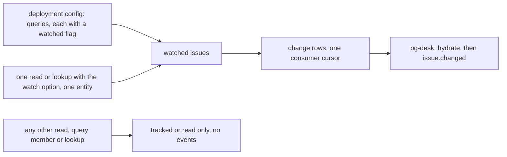
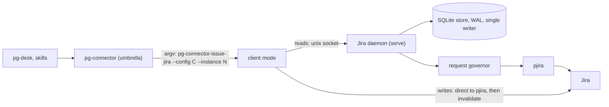
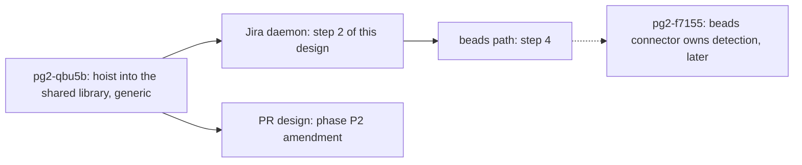
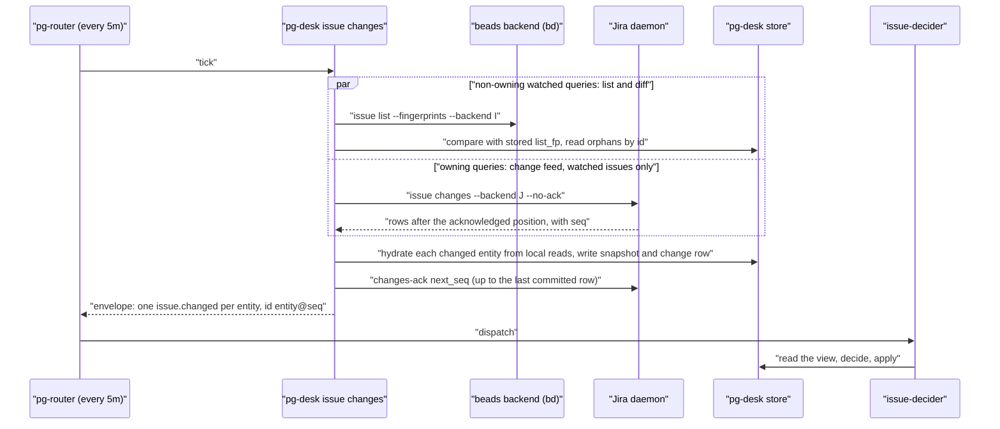

# Issue change emission for beads and Jira: watched-entity events only (the PR pattern) and a Jira daemon — design

- **Status**: Draft 11 for operator review. Drafts 1 and 2 were a pg-desk-only fix; drafts 3 to 6 applied the
  GitHub daemon to every issue backend. On 2026-10-20 the operator ruled that the store and the daemon are
  **per implementation**: beads runs locally and needs neither, Jira needs both. Draft 9 applied the
  operator's 2026-10-21 rulings (the Jira daemon is committed and goes BEFORE the beads path; the 24-hour
  interim relief and the router selective-drop bead are not filed; the queue's failure to de-duplicate is
  measured). Draft 10 was reshaped on the operator's 2026-10-22 ruling 7 (section 13): change events for BOTH
  beads and Jira issues follow the PR "watched" pattern, so the connector emits events only for watched
  issues; the blanket silent sweep, the acknowledged retry tier, Appendix A (the decider acknowledgement
  protocol) and the focus re-emission timer are removed. Draft 11 applies two independent reviews of draft 10
  and three operator decisions of 2026-10-22: ruling 8 (pg-desk keeps detecting beads changes "until the
  beads connector handles it", which the later bead `pg2-f7155` does), decision D1 (the generic change feed,
  change engine and watched-query shape are hoisted into the shared library first, bead `pg2-qbu5b`, and the
  Jira daemon and the PR design's P2 wait for it) and decision D2 (delivery of `issue.changed` is gated on
  `watched`). Draft 11 has not been independently re-reviewed (section 12). Nothing here is implemented. No
  implementation bead is filed.
- **Date**: 2026-10-22 (draft 9: 2026-10-21; draft 8: 2026-10-20)
- **Bead**: `pg2-oa1h4` (this design). Closes the root cause of `pg2-izeuu` and `pg2-2f24a`; gates
  `pg2-2j5ac.44.37` (the flip of the issue decider to `apply`). Related beads: `pg2-qbu5b` (the shared-library
  hoist, a prerequisite of rollout step 2) and `pg2-f7155` (the later move of beads change detection into the
  beads connector).
- **Delta over**: `docs/superpowers/specs/2026-10-09-pg-connector-github-daemon-design.md` ("the GitHub
  design"), program epic `pg2-z5fax`, ADR 0090 (a backend declares `owns_changes` and the others stay as
  they are), and the PR lane refactor design `docs/superpowers/specs/2026-10-20-pr-lane-refactor-design.md`
  ("the PR design", epic `pg2-6mo45`), whose tracked-versus-watched model this design follows. The PR design is
  not on the branch that carries this document: it exists at commit `23b7b33ac` on the `pg2-6mo45.2` branch,
  and every statement here about it is read from that commit. The Jira part is a delta over the GitHub design;
  the beads part is a change to pg-desk.
- **Builds on**: ADR 0077 (S29, S31, S32, S33), ADR 0090, `packages/pg-connector/pkg/connectord`,
  `docs/behavior/pg-desk/changes.md`.

The key words MUST, MUST NOT, SHOULD, SHOULD NOT and MAY in this document are to be read as in
RFC 2119.

This repository is public. The document names no employer, workspace, channel or person. Bead ids
(`pg2-...`) are this repository's own tracker ids.

Invariants are numbered in the order they were introduced across drafts. `INV-ICD-8` and `INV-ICD-12` are
withdrawn in draft 10 and their numbers are not reused. Every invariant is a MUST or MUST NOT, and section 9
has at least one test row for each; every test row names the invariant it checks.

## 0. Summary

| Topic                   | Decision                                                                                                                                                                                                                                                                                                                                                                                                                                                                                 |
| ----------------------- | ---------------------------------------------------------------------------------------------------------------------------------------------------------------------------------------------------------------------------------------------------------------------------------------------------------------------------------------------------------------------------------------------------------------------------------------------------------------------------------------- |
| What is wrong           | 2,039 of 2,049 `issue.changed` events enqueued since 2026-10-19 18:52Z carry kind `reconcile` [2,039 / 2,049 = 99.5%]. pg-desk's two age-sweep tiers re-emit every active entity whether or not anything differs; the queue grew by about 113 per hour at the first measurement and about 130 per hour at the second (section 1).                                                                                                                                                        |
| Where the load is       | Beads. `work-beads` held about 167 to 171 entities in the sampled connector ledgers and the focus queries add the rest of the 452 active issues; Jira's `mine` query held 3 to 4. The split is inferred, to be measured (section 1).                                                                                                                                                                                                                                                     |
| Operator rulings        | 2026-10-20: emit nothing when nothing differs; do what was done for PRs; the store and daemon are per implementation. 2026-10-22 (ruling 7): the watched-entity model for BOTH backends; (ruling 8): pg-desk keeps detecting beads changes "until the beads connector handles it", which bead `pg2-f7155` does later (section 13).                                                                                                                                                       |
| The model               | Tracking and change events are separate. Nothing is watched by default. An issue is watched when it is a member of a query the deployment marks `watched`, or when one read or lookup opts in to watching that one entity. Watched stays watched until the issue closes (INV-ICD-13(c)). The connector emits change events ONLY for watched issues, and pg-desk delivers `issue.changed` ONLY for a watched issue, whatever the origin of the change row (sections 2 and 5, INV-ICD-16). |
| Beads (no daemon)       | Beads has no daemon or store of its own. The watched flag is declared on the query in the connector configuration; the per-entity flag and the change emission live in pg-desk's existing flow (section 4.2). A cross-process budget keeps `bd` from being overloaded (section 4.4). pg-desk keeps detecting beads changes until the later bead `pg2-f7155` moves detection into the beads connector (ruling 8, section 10 item 9).                                                      |
| Jira (daemon and store) | A Jira daemon, built on the shared connector-daemon library AFTER the prerequisite hoist `pg2-qbu5b` (section 3.6), tracks every retrieved issue until closed plus 24 hours, evicts it 7 days after closing, and runs on an internal request budget (section 3). It delivers change rows for watched issues only. pg-desk consumes its change feed.                                                                                                                                      |
| Order                   | Build order only, operator ruling 2026-10-21: the Jira implementation is built FIRST, then the beads path (section 8). Before the Jira daemon, the shared-library hoist `pg2-qbu5b` lands (section 8, step 1.5); the Jira daemon and the PR design's P2 amendment wait for it.                                                                                                                                                                                                           |
| Shared library (D1)     | The feed, the change engine, the query runner and a configured-query shape with a `watched` option are GitHub-only today. The bead `pg2-qbu5b` hoists them into the shared library as GENERIC code (no PR, CI, issue, Jira or beads specifics; a guard test enforces it). This design only states what it needs from that shared shape and from the one cursor key (section 3.6, INV-ICD-20).                                                                                            |
| Delivery gate (D2)      | pg-desk MUST NOT append or deliver a change row for an issue entity that is not watched, whatever the origin: feed row, link or work propagation from a PR change, `refresh`, annotation write (section 5, INV-ICD-16).                                                                                                                                                                                                                                                                  |
| Failed decider run      | No decider-acknowledgement protocol is built. A failed decider run waits for the next change of that issue, as for PRs. Revisit only if problems appear without it (section 6).                                                                                                                                                                                                                                                                                                          |
| Removed in draft 10     | The blanket silent 24-hour sweep, the acknowledged retry tier, Appendix A (decision table, `pg-desk issue ack`, `redrive`, decider view change, `INV-ICD-12`), the 30-minute focus re-emission timer and the interim-relief machinery.                                                                                                                                                                                                                                                   |
| De-duplication          | Checked 2026-10-21 (section 1): the router de-duplicates by exact event id and the id carries the change-log sequence, so a re-emission is always a new id; 89.7% of enqueued events are superseded by a later event for the same entity. Measured background, no longer a driver. Router-side supersession stays OPEN (section 10, item 8).                                                                                                                                             |

## 1. Problem, measured

Measured 2026-10-20 06:29Z from the router queue log, `pg-router status --json` and `pg-desk status`.

- `issue.changed` queue depth is 1757; it was 312 at 2026-10-19 17:41Z. Net growth over that window is
  `(1757 - 312) / 12.8h = 113` per hour.
- Of 2,049 enqueued `issue.changed` events, 2,039 carry kind `reconcile` (1,443 origin `local-reconcile`,
  591 origin `sweep`, 5 other). Ten carry no `reconcile` kind. 454 distinct entities were enqueued, each 3
  to 6 times.
- Average arrival is `2,049 / 11.6h = 177` per hour; with growth of 113 per hour the average drain was
  `177 - 113 = 64` per hour (an approximation: the arrival window is 11.6 hours and the growth window 12.8
  hours). Short-window peaks (4.5 to 5.3 per minute, one hour of 190 dispatches after a
  router restart) are not a baseline, so no success criterion here uses a drain rate.
- The sweep bound `452 / 20 x 5m = 113m` exceeds the local tier's age (30m); each tier emits up to
  `sweep.max_per_poll` (20) per poll, for ever. This is the cause that the watched-entity model removes: no
  tier of that kind remains for `issue`.
- The consumer `issue-decider` is serial. In `plan` mode every run is a no-op. After the flip to `apply` it
  writes beads, and a new event waits behind the backlog (the length of that wait is unmeasured here, a spike
  output of section 10, item 13).
- **The backend split is inferred, not measured.** The sampled connector ledgers (2026-09-23 to 2026-10-15)
  show `work-beads` at 167 to 171 entities and the Jira `mine` query at 3 to 4; the focus queries are bulk
  open-bead queries. The 452 active issues are therefore almost certainly almost all beads, but no count by
  backend was taken from the pg-desk store. The packet that cuts the beads path MUST first record the active
  count per backend, the count of entities the deployment's watched queries would hold per backend (the expected watched-set size,
  which sections 2.1 and 6 otherwise call only "small"), and the
  number of hydrations whose fingerprint changed per day among them (the real-change rate that the success
  criterion of section 7 divides by). The new `fields_changed` rows add events that were previously dropped,
  so the real-change rate is measured against the NEW rule.
- **The queue does not de-duplicate this load (measured 2026-10-21 02:45Z, answering the operator's question
  whether the backlog is de-duplicating).** The router drops an enqueue only when its exact event id is still
  retained (INV-EVT-3 of the router's behavior docs). The id is `issue.changed:<entity>@<max change_log seq>`
  and every reconcile row appended by pg-desk gets a new sequence, so every re-emission is a new id and the
  rule can never fire. From the router's queue log: 4,495 `issue.changed` enqueues between 2026-10-20 03:22 and
  22:36 (UTC-4) carry 4,495 distinct ids for 465 distinct entities, 3 to 12 enqueues per entity (typically 9 to
  11). 4,030 of 4,495 are superseded by a later event for the same entity [(4,495 - 465) / 4,495 = 89.7%];
  4,461 of 4,495 carry only kind `reconcile` [4,461 / 4,495 = 99.2%] and 34 are real changes. Every one is
  born expired (`expiresAt` equal to `enqueuedAt`, 4,495 of 4,495), so even an id match would be inside a
  window of about one dispatch cycle. Queue depth at 02:42Z was 4,387 against 1,757 at 2026-10-20 06:29Z:
  growth of about 130 per hour [(4,387 - 1,757) / 20.2h], above the 113 per hour of the first measurement. The
  duplication is created by the EMITTER, which appends a row and a new id whether or not anything differs;
  watched-only emission with no reconcile event (sections 2 to 5) removes that at the source. It does not make
  the router supersede an older pending event for the same entity, which is the only thing that would stop a
  backlog from compounding if an emitter regressed (section 10, item 8). This finding is measured background:
  the model of section 2 is driven by the operator's ruling 7, not by it. (The two growth figures differ
  because they are two measurements of a queue that was still growing; neither is used as a threshold.)

## 2. The watched-entity model and ownership per backend

### 2.1 Tracked and watched

The model is the PR design's (its rulings 8 to 10 and its section on tracking and watching), applied to issues
by the operator's ruling 7. Two independent properties of an issue:

- **Tracked** means the connector keeps the issue's content and keeps it fresh. For Jira the daemon's store
  does this (section 3.2). Beads has no store of its own, so nothing is tracked for beads: a bead is read when
  asked for.
- **Watched** means the connector appends change rows for the issue and so makes it reach pg-desk and the
  decider. Tracking alone never produces an event.

- **INV-ICD-13.** (a) Nothing MUST be watched by default. (b) An issue MUST become watched when it is a member
  of a query whose configuration carries `watched = true` (the flag is a property of the query definition in
  the connector configuration, default false; the option is named `watched`, as INV-ICD-14(a) fixes it, in the
  single shared query shape of INV-ICD-20, and if that shape renames it every mention here and the `doctor`
  gate of INV-ICD-14(a) follow the shared name), or when a read or lookup of that one issue carries the watch
  option (a one-off watch of a specific entity). This design does NOT carry the PR design's "ad-hoc query run
  with the watch option": an issue reaches a watch only through a configured query or a read or lookup of one
  entity, because the operator's ruling 7 names those two and a query run with the option would watch a SET,
  which the configuration declares instead. (c) **Stickiness (stated here once; every other section refers to
  it).** A watched issue MUST stay watched after it leaves every query, until it is closed AND past retention:
  for Jira until it is evicted 7 days after closing (section 3.2), for beads until pg-desk deactivates it
  after observing it closed (section 4.5). While the flag is set the connector MUST deliver the issue's rows,
  including `closed` and `reopened`, so a `closed` row is delivered although the issue is no longer a query
  member, and a reopen inside the retention window needs no new watch (after the 24-hour refresh period of
  section 3.2 a Jira reopen is observed when a query run or a read next retrieves the issue). After the flag
  is cleared the issue is a first observation again (INV-ICD-18). (d) The connector MUST emit change rows ONLY
  for watched issues; an issue that was only read, or is only tracked, MUST deliver nothing. (e) The baseline
  of a query and the late watch of a known issue are governed by INV-ICD-18. (f) Which queries are watched is
  declared by the deployment, not by this design, which defines only the flag and its default; the expected
  size of the watched set is unmeasured (a spike output, section 1 and section 10 item 13).
- **INV-ICD-15.** pg-desk and the connector MUST NOT re-emit an issue that has not changed. For `issue` there
  is no age-driven sweep, no timer, no `reconcile` kind, no `sweep` or `local-reconcile` origin, and no
  acknowledgement or retry tier that appends a row: a row is appended only for a real difference in the
  normalised content (INV-ICD-5 to -7), for the first observation of a watched issue, or for the late watch of
  a known issue (INV-ICD-18). `pg-desk issue changes --reset` MUST replay only WATCHED active issues, as kind
  `added` with origin `reset`, never as `reconcile`, and the delivery gate (INV-ICD-16) applies to it. The feed's
  `entered_query` and `left_query` rows are membership information for pg-desk's listing status and are NOT
  stored as change rows (otherwise each would become a row and an event for a flip that changed nothing about
  the issue); an `entered_query` for an issue never seen before is delivered as its first-observation `added`
  row (INV-ICD-18).
- **Why.** The operator's ruling 7: the connector should only emit changes for watched items, which keeps the
  level of events much smaller so that the decision role is not overwhelmed (section 13). There is no
  blanket sweep and no `reconcile` event for `issue`.

### 2.2 Ownership per backend

ADR 0090 already says it: a backend that declares `owns_changes` decides what changed for its own types and
every other backend stays as it is. The `issue` type has two implementations, so the rule is applied per
backend, not per type:

| Backend       | Process model                                       | Who detects a change and where the watched flag lives                                                                                   | Sweeps                                                         |
| ------------- | --------------------------------------------------- | --------------------------------------------------------------------------------------------------------------------------------------- | -------------------------------------------------------------- |
| Beads (local) | One-shot `bd` processes; no store, no daemon        | pg-desk, by fingerprint list-and-diff (ADR 0077 S29) over watched queries and watched entities; the flag lives in pg-desk (section 4.2) | The old tiers until step 4, none after                         |
| Jira (remote) | After the daemon lands: a daemon with its own store | The daemon (`owns_changes`), which stores the flag; pg-desk consumes the feed, hydrates, and acknowledges                               | None (the old tiers skip an owning-backend entity from step 2) |
| Jira (today)  | One-shot `pjira` processes                          | pg-desk, as for beads                                                                                                                   | The old tiers until step 2                                     |

pg-desk therefore handles a MIX of backends inside its one `issue` flow (section 5), and the router source,
the roles and the decider are unchanged: pg-desk stays the single emitter of `issue.changed`.

**Why beads needs no daemon.** A `bd` read is local, so its data is always current and nothing needs
refreshing in the background; the fingerprint the umbrella computes covers every field the list returns (it
hashes the whole entity JSON minus `as_of`, `stale` and `metadata.last_checked_at`). What a daemon would add
(batching, quota protection, revalidation, a store) has nothing to act on. The operator's reason (ruling 7d):
"pulling the jira information can be slow and difficult, where as beads are local so having
additional support/daemons aren't needed for beads to work well".

**A beads daemon is an option, not a requirement.** If a beads daemon is adopted for consistency it is a
separate binary instance with its own store and config, sharing only the library; the retention rule of
section 3.2 would then apply to it. It is not designed here, and section 4.4 gives the signal that would
justify it.

**Who detects beads changes, now and later (operator ruling 8).** The operator ruled, on the question whether
pg-desk detects beads changes or the beads connector owns detection with a small store: "A is fine until the
beads connector handles it". Until then pg-desk keeps detecting beads changes by fingerprint list-and-diff
(ADR 0077 S29) over the deployment's watched queries and watched entities, and keeps the watched flag in its
own store (section 4.2). The LATER bead `pg2-f7155` moves detection into the beads connector, deleting
`watch.issue.queries` and pg-desk's beads list-and-diff as the PR design does for `watch.pr.queries`; it
decides the smallest state the one-shot beads connector needs between runs. That bead is not designed here.

### 2.3 Baseline and late watch (both backends)

Two draft-10 rules disagreed: every query had a per-query baseline (a first run appends no rows), yet the beads
baseline was limited to "the first run after cutover", so a watched query added later would append one row per
member that "appeared later", a flood. The disagreement is resolved by one rule, stated here once.

- **INV-ICD-18.** (a) **A marker per query.** Each watched query MUST have its own baseline marker, kept where
  its backend keeps state: for Jira the daemon's per-query `baseline_at` (the shared store's `query` table,
  set at a configured query's first complete run); for beads a pg-desk `meta` key `change_flow.baseline.<query>`
  (a time), because pg-desk's `meta` holds only the `change_flow.watchset.*` and `change_flow.listing.*` state and
  counters today (`change_flow.hydrations.*` and similar) and has no per-query baseline. (b) **The baseline run.** A run of a query that has no marker is a baseline run: every
  member MUST be marked watched and MUST append NO row. For beads, a member pg-desk does not yet hold MUST be
  hydrated silently with the existing no-row write (a state write with empty kinds updates the snapshot and
  bumps the version but appends no change-log row, `writeEntity` in `store/changelog.go`), paced by
  `hydration.max_per_poll`; a held member is only marked, and the marker MUST be written only in the poll in
  which the last unhydrated member was hydrated, so a baseline that takes several polls stays silent. For
  Jira the daemon holds the members, and pg-desk learns a member it does not hold from that member's first feed
  row (the members it already holds are backfilled at cutover, section 8 step 3). A query added to the
  configuration later has no marker, so its first run is also a baseline run. (c) **Which rule wins.** The
  baseline rule wins over "appears later": a member present at its query's baseline run is never "appearing
  later". (d) **First observation.** An entity first seen in a watched query that already has its marker MUST
  append exactly one `added` row, the one first-observation kind for both backends (section 3.5). (e) **Late
  watch.** A KNOWN entity that becomes watched after its query's baseline, by being listed by a baselined query
  it was not in or by a one-off watch, MUST append exactly one `added` row, so pg-desk hydrates and emits it
  (the PR design's late-watch rule). (f) **A query flipped to watched.** pg-desk lists only watched queries, so
  a query newly flagged has no pg-desk marker and its first run is a baseline run (silent). The Jira daemon
  baselines every configured query for tracking, so flipping an already-baselined query to watched is the PR
  design's late watch: one `added` row per known member. That burst is bounded in total by the number of known
  open members of the query and in rate by `hydration.max_per_poll`, because a row is emitted only after
  hydration; the flip is an operator configuration change and the member count is read before it. The
  asymmetry follows from where the marker lives, and the beads side is the quieter one. (g) **Move-aside.** A
  moved-aside pg-desk store or daemon store loses its markers, so each watched query runs a baseline run
  again: silent, no flood; the one-off flags are lost (section 10, item 11).

**Divergences from the PR design, stated in one place.** (1) No ad-hoc query run with the watch option
(INV-ICD-13(b)). (2) Beads orphans are read in the foreground at each poll against the `bd` budget, where the PR
daemon refreshes tracked PRs in the background under its governor (INV-ICD-17(g)). (3) Beads keeps its baseline
markers in pg-desk's `meta`, so a query newly flagged watched is a silent baseline for beads but a late watch
(one `added` per known member) for the Jira daemon (INV-ICD-18(f)). (4) pg-desk, not the router, consumes the
Jira feed and is the single emitter (section 11). The cursor key follows the PR design (one cursor per
consumer), the first-observation kind is `added` as there, and the stickiness, no-reconcile and
failed-run-waits rules are the PR design's.

## 3. The Jira daemon

A delta over the GitHub design. Everything not stated here is the GitHub design's: one daemon as the store's
only writer, one unix socket, client mode, `unavailable` for reads when the daemon is down, a persistent
store, entity groups, the settle rule, per-group baselines, "first sighting logs nothing", the change feed
with explicit acknowledgement, `sources_freshness[]`, the capabilities `owns_changes` and `cache_opt_out`,
`status` and `explain`, the observability pattern, and the shadow-run rollout. "The GitHub design's" does NOT
mean "already in the shared library": today only the store primitives, governor, scheduler, socket, process
scaffolding and router annotation are generic (`pkg/connectord`), and the feed, change engine, query runner
and group rules are GitHub-only. The hoist that makes them reusable is the prerequisite `pg2-qbu5b`
(section 3.6). The tracked-versus-watched amendment to that library is the PR design's phase P2, which waits
for the same hoist and is shared with this daemon (section 14).

### 3.1 Groups

An issue is a set of groups with their own freshness, as for PRs:

| Group      | Content                                                               | Fetch                                                                                                                                                                                                                                           | Fresh until                                                         |
| ---------- | --------------------------------------------------------------------- | ----------------------------------------------------------------------------------------------------------------------------------------------------------------------------------------------------------------------------------------------- | ------------------------------------------------------------------- |
| `summary`  | What `list` returns, including `updated` as the revalidation token    | One full JQL search per configured query (today two; the cursor is always null)                                                                                                                                                                 | `summary_ttl`                                                       |
| `detail`   | What `show` adds: description, comments, direct edges, operator facts | `pjira issue` per issue when the summary changed or the hard age passed; the spike checks whether `search --expand` (the backend already uses it for operator facts) can return comments and changelog in the listing and avoid per-issue calls | `detail_ttl`, extended by revalidation, never past `detail_max_age` |
| `children` | Not cached (a live read)                                              | Passed through                                                                                                                                                                                                                                  | n/a                                                                 |

`updated` is decoded by the backend but deliberately not mapped today (`backend.go:184-189`); the daemon maps
it internally as the revalidation token. The Jira fingerprint covers only what `pjira` emits and
`toSchemaIssue` maps no description and no comments. **INV-ICD-1.** The entity MUST carry a comment summary (a
count and the time of the latest comment) derived from `detail`, so a comment is a visible field difference.

### 3.2 Tracking, watching and retention

Tracking follows the PR design's amendment (tracked versus watched), NOT the GitHub design's older keep-alive
rule.

- **INV-ICD-2.** Every issue the daemon retrieves, whether as a member of a configured query, because a
  caller read it, or because it was watched, MUST be **tracked**, and a tracked issue MUST be refreshed in the
  background until it has been closed for 24 hours (a Jira status category `done`). From 24 hours to 7 days
  after closing it MUST be served from the store and MUST NOT be refreshed. After 7 days closed it MUST be
  evicted; change-log rows keep their own retention. A direct read MUST NOT have a different tracking rule
  from a query result, and there is no manual untrack.
- **Watched flag in the store.** The daemon MUST store each issue's watched flag (INV-ICD-13) and set it from a
  member of a configured query whose configuration carries `watched = true`, and from a read or lookup with
  the watch option. The change feed MUST return rows for watched issues only, with one cursor per consumer
  (the key is owned by the hoist, INV-ICD-20); `--query` is no longer required and MAY remain as a filter. The
  stickiness rule of INV-ICD-13(c) governs when the flag is cleared; informational membership rows are
  handled by INV-ICD-15. A moved-aside daemon store loses the flags: query members become watched again at
  the next run of their queries (as a baseline run, INV-ICD-18), directly watched issues do not, and with no
  sweep nothing re-asserts them (section 10, item 11).
- This is the GitHub design's `terminal_ttl` (24 hours) and `expiry` (7 days) with the keep-alive trigger the
  PR design also adopts: the GitHub design keeps an entity alive while it is a member of a configured query
  or was accessed within `keepalive_window`; this rule keeps any referenced issue alive until it closes.
  Implementing it needs a closed-at timestamp, which the shared store's `entity` table does not have (its
  columns are `kind`, `id`, `version`, `last_access`, `keep_alive`, `last_known_mergeable`, `tombstoned_at`,
  in the version 1 rung of `connectord/store/schema.go`). The Jira daemon has its OWN store file, but the
  migration ladder is one shared list in `connectord/store` (now at version 3), so the new column is an
  additive migration that bumps `user_version` for every daemon: **it MUST be verified against the GitHub
  daemon's store and its migration tests before it lands**, and the claim that the live GitHub store is
  untouched is withdrawn. Where this rung sits relative to the PR design's rung is decided by the hoist
  (INV-ICD-20), which owns the one ordering of the ladder.
- **Cost risk (accepted for PRs by the operator, the same here).** Tracking has no decay before closure, so an
  issue that someone merely read keeps being refreshed until it closes, and an abandoned open issue is
  refreshed indefinitely. The governor already prioritises and ages work; it SHOULD refresh tracked issues
  that are not members of any configured query at a lower priority class than members. The daemon MUST export
  the tracked and watched entity counts, and an alert fires when the tracked set exceeds a configured size
  (the size is a spike output), so the cost is visible before it hurts. A manual untrack is deferred until
  the numbers show it is needed. There is no hard cap on tracking that was not asked for by a query, to match
  the PR design.

### 3.3 Operations and writes

Reads (`show`, `list`) are served from the store; `children`, `search` and `list_activity` are live
pass-through reads under the governor; `--fresh` forces the needed groups; the watch option on a read is
forwarded to the daemon (INV-ICD-13). **Writes (`create`, `comment`, `transition`, `update`, `close`) stay in
client mode**, executed by the calling process directly against `pjira`, because actor identity comes from
the caller's environment (the daemon ignores per-call environment) and the writers (pg-desk sync, pg-rescue,
the decider) MUST NOT stop working when the daemon is down.

- **INV-ICD-3.** A write MUST NOT depend on the daemon. The client sends `write_begin {id}` before the write
  and `invalidate {id}` after it, each with a short delivery timeout (default 500 ms). On `write_begin` the
  daemon bumps the entity's generation, holds new refreshes of that entity and discards one in flight; on
  `invalidate` it releases the hold and queues one re-pull; if `invalidate` is dropped the hold expires after
  a lease (default 30 seconds). `create` has no id before it runs, so it sends `write_begin {instance}`. If
  `write_begin` is not delivered in time the write proceeds and the client skips `invalidate`.
- **Daemon down.** Reads answer `unavailable` naming the socket, the supervisor and the restart hint. Every
  caller whose docs or prompts treat `unavailable` as terminal MUST be updated to retry.

### 3.4 The request budget, and what Jira exposes

The operator asked whether Jira offers a quota metric like GitHub's points. Researched 2026-10-20 against
Atlassian's published rate-limiting documentation
([developer.atlassian.com, Jira Cloud rate limiting](https://developer.atlassian.com/cloud/jira/platform/rate-limiting/),
read through a summarising fetch, so the figures below are to be re-read against the live page when the
packet is cut) and the code:

- **Hourly points quota.** Jira Cloud has a points-based hourly quota (a global pool of 65,000 points per hour
  shared across tenants by default, per-tenant pools assigned after review), enforced from 2026-03-02, but it
  applies to Forge, Connect and OAuth 2.0 (3LO) apps. The documentation states that API-token traffic is not
  affected. `pjira` authenticates with basic auth and an API token (`client.go:127`;
  `JIRA_API_TOKEN`, `secret.go:83`, `config.go:21`; these three `pjira` file and line references are in a
  repository outside this one and are NOT VERIFIED from here, the packet MUST re-check them), so the hourly
  quota does not apply to it today. **The exemption is time-bound in Atlassian's text and the packet MUST
  re-check it.**
- **What does apply.** Per-tenant, per-endpoint burst limits (token bucket; defaults of 100 requests per second
  for GET and POST and 50 for PUT and DELETE) and per-issue write limits (20 writes per 2 seconds, 100 per 30
  seconds). The tenant is shared with every other user's traffic, so the budget here must be a small share.
- **What a client can observe.** `X-RateLimit-Limit` and `X-RateLimit-Remaining` (the burst window, per
  second), `X-RateLimit-NearLimit: true` below 20% capacity, and on a 429 only `Retry-After`,
  `X-RateLimit-Reset` and `RateLimit-Reason` (`jira-burst-based`, `jira-quota-tenant-based`,
  `jira-quota-global-based`, `jira-per-issue-on-write`). The beta points headers (`Beta-RateLimit`) report
  remaining points only near the limit and only for quota-governed apps. Atlassian says `Retry-After` is a hint,
  because limits are per tenant.
- **What the code gives today.** `pjira` reads no rate-limit header, and the backend's own comment says it
  surfaces "no figure, header or Retry-After" (`eventlog.go:33-37`): the only signal is the 429 status text,
  classified `failure_class=rate_limited`. There is no hourly figure to read at all.

Therefore **INV-ICD-4.** The Jira daemon's budget MUST be internal and conservative, because the external
signal is a rate, not a quota: it MUST enforce a configured request-rate cap (requests per second) and a
concurrency cap, MUST count requests, and MUST handle a 429 by pausing background work for `Retry-After`
(default 60 seconds when absent) and doubling the pause on consecutive 429s with jitter, as Atlassian advises.
Interactive reads MUST be served stale during a pause. A change in the repository that owns `pjira` (an out-of-tree dependency, its own bead)
surfaces `X-RateLimit-Remaining`, `X-RateLimit-NearLimit`, `Retry-After` and `RateLimit-Reason`; **how
`pjira` conveys them across its CLI boundary is unspecified** (stderr line, a field in its JSON, or a flag) and
is that bead's decision. Until it lands the daemon runs on the 429 signal and its own counter. If the token
moves to OAuth the points quota applies and the beta headers become the signal.

### 3.5 Change detection and the feed

Kinds, classified per group from before and after content: `closed`, `reopened`, `status_changed`,
`assignee_changed`, `priority_changed`, `labels_changed`, `parent_changed`, `title_changed`,
`description_changed`, `comments_changed`, `renamed`, `removed`, `entered_query`, `left_query`, and a
catch-all `fields_changed`. There is no `opened` kind (pg-desk's classifier already uses `opened` for "the
state moved to open", `classify/issue.go:181`, so the first observation MUST NOT reuse that word). The ONE
first-observation kind, for both backends, is `added`: it is delivered for the first observation of a watched
issue after its query's baseline and for the late watch of a known issue (INV-ICD-18), and nothing else
produces it. `entered_query` and `left_query` are membership information and are not stored as change rows
(INV-ICD-15).

- **INV-ICD-5.** A difference in the normalised content MUST produce a change row; when no specific kind
  matches, the row carries `fields_changed` naming the fields. A classifier that returns no kind for a real
  difference loses a change; pg-desk's classifier does this today for labels-only and priority-only edits, and
  the blanket tier hid it. This rule applies to pg-desk's list-and-diff for beads too (section 4.1).
- **INV-ICD-6.** `as_of`, `stale` and `updated` (`updated_at` for beads) MUST be dropped from the compared
  content. `updated` is a revalidation token: a change to it alone re-pulls `detail` (Jira) or re-hydrates
  (beads) and MUST NOT by itself append a row, EXCEPT the beads comments proxy below. Any write by this
  system bumps it (a same-value `bd update` still does, `sync/rules.go`), and its real field changes MUST be
  delivered once as a content change; the decider's run on its own write MUST converge (at most one extra run
  per write, T-12). **One exception, kept on purpose:** pg-desk's classifier today emits `comments_changed`
  exactly when `updated_at` advances and nothing else differs (`issueCommentsProxy` in `classify/issue.go`),
  because a bead's entity carries no comment list or count. That proxy is KEPT for beads until the spike of
  section 10 item 4 shows whether `bd` returns a comment count or latest-comment time (if it does, that field
  replaces the proxy), and it is RETIRED for Jira, where INV-ICD-1 supplies a real comment summary (today the
  retirement changes nothing, because the Jira backend never maps `updated`, `backend.go:184-189`; it keeps
  the proxy from firing once the daemon maps `updated` internally). Keeping the proxy means a same-value
  `bd update` by the decider on a watched bead produces one `comments_changed` row and one extra decider run,
  which T-12's budget allows only if that run writes nothing.
- The settle rule, baselines and the feed are the GitHub design's, with the PR design's amendment: ONE cursor
  per consumer, with `--query` an optional filter. This design does not define the key: the shared store keys a
  cursor `(consumer, kind, query)` today (the `consumer` table of `connectord/store/schema.go`), and the PR
  design's "one cursor per consumer" needs a primary-key change, which is a table-rebuild migration owned by the
  hoist (INV-ICD-20). Two Jira instances stay separate because each instance has its OWN daemon store file, so
  no instance component is needed in the key. Each row's entity carries the row's own `version` (the schema
  gains `Issue.Version`) and the store `epoch`.

### 3.6 The shared library: what is generic today, and the prerequisite hoist (`pg2-qbu5b`)

The sentences "the Jira daemon reuses the landed library" and "the feed accepts kind `issue`" of earlier drafts
were wrong about the code. Read from the code:

| Component                                                                                                                                                | Where it lives today                                                                                                                                                  | Reusable by a second daemon binary        |
| -------------------------------------------------------------------------------------------------------------------------------------------------------- | --------------------------------------------------------------------------------------------------------------------------------------------------------------------- | ----------------------------------------- |
| Store primitives and migrations, including the change log, pending change, consumer and per-query baseline tables (they hold opaque kinds, ids and JSON) | `pkg/connectord/store`                                                                                                                                                | Yes                                       |
| Governor, scheduler, socket server and client, process scaffolding, router annotation                                                                    | `pkg/connectord/{governor,scheduler,socket,proc,router}`                                                                                                              | Yes                                       |
| The change feed (cursor per consumer, first poll at the tail, `cursor_expired`)                                                                          | `cmd/pg-connector-github/internal/feed`; its cursor-key kinds are the constants `KindPR` and `KindCI`, and a key conflict is defined as pr versus ci (`feed/keys.go`) | No: GitHub-only and specific to two kinds |
| The change engine (settle, classifier, membership), the query runner and the group rules                                                                 | `cmd/pg-connector-github/internal/{changes,query,groups,groupsvc}`                                                                                                    | No: GitHub-only                           |

A Go binary cannot import another binary's `internal/` tree, and the module's layout test
(`cmd/pg-connector/layout_convention_test.go`) allowlists only `pkg/provider/`, `pkg/scriptout/` and
`pkg/connectord/` as shared. So everything in the last two rows MUST be hoisted into `pkg/connectord` before a
second daemon can use it. That hoist is the bead **`pg2-qbu5b`**, a **prerequisite** of rollout step 2
(section 8, step 1.5). The PR design's phase P2 edits the same GitHub-internal files, so it MUST wait for the
hoist too, and the two efforts do not collide.

**What the hoist moves** (its scope, restated; the bead owns the design and the decomposition): the change feed
(cursor per consumer, first poll at the tail, `cursor_expired`), the change engine skeleton (settle, per-query
baseline, membership, the watched flag), the query runner, and any group rules that are not provider-specific.
The feed's entity-kind and key validation is parameterised, so a connector registers its kinds instead of the
shared code naming `pr` and `ci`. The bead notes that `pg2-z5fax.4` (Phase 3b, the change engine) is still open
and edits the same area, so which of the two lands first is decided with that docket, not here.

**What this design requires of the hoist (it states the requirement and designs none of it):**

- **INV-ICD-20.** (a) **Genericity.** The operator's requirement (recorded on the hoist bead): "shared library is
  good, make sure the shared is generic enough and doesn't contain specifics of either usage." The shared
  library MUST NOT contain anything specific to PRs, CI, issues, Jira or beads. Entity kinds, change kinds, key
  shapes, grouping rules and classifier rules MUST be supplied by each connector as data or small interfaces,
  and shared code MUST NOT switch on a concrete kind. A guard test, in the spirit of the layout test, MUST fail
  if the shared package names a concrete provider or kind. (b) **One configured-query shape.** The hoist MUST
  define ONE shared shape of a configured query that carries a `watched` option (default false, a boolean named
  `watched`, INV-ICD-13), used by the PR design and by this design alike. Today a query is `schema.QueryExpr`, a
  bare string or list of strings (`pkg/schema/queries.go:27`), resolved by `schema.ResolveQuery` in the issue
  dispatcher (`pkg/provider/issue/dispatch.go:116`), held in the GitHub connector's configuration as
  `map[string]schema.QueryExpr` and parsed by the beads backend (`parseBDListExpr`); a flag needs an object
  form, and a bare string or list MUST keep parsing as an unwatched query. (c) **One cursor key.** The hoist
  MUST define ONE feed cursor key, one cursor per consumer within a store, as the PR design says; the code
  keys it `(consumer, kind, query)` today. (d) **One ladder order.** The hoist MUST define ONE order for the
  store-schema migration rungs (the ladder is at version 3), because the PR design's P2 and this design's
  closed-at rung (section 3.2) both add to it; a shipped rung MUST NOT change, and each new rung MUST be
  proven against the GitHub store and its fixture (T-10). (e) **No behaviour change for GitHub.** The hoist
  moves code behind the existing tests. (f) **Order.** The Jira daemon (section 8, step 2) and the PR design's
  P2 amendment MUST wait for the hoist.

This design states (a) to (f) and nothing more about the shared library: where the shape, the key and the ladder
order are decided is `pg2-qbu5b`, and every mention of them in this document follows that bead's decision.

## 4. The beads path (no daemon, watched only)

### 4.1 What pg-desk changes for backends that do not own changes

| Today (ADR 0077 S29, S31)                                          | After                                                                                                                                                                                                    |
| ------------------------------------------------------------------ | -------------------------------------------------------------------------------------------------------------------------------------------------------------------------------------------------------- |
| List-and-diff by fingerprint against the stored `list_fp`          | Kept, over the queries marked watched and over the watched entities only (section 4.2)                                                                                                                   |
| Remote tier: re-hydrate by age and always append a `reconcile` row | **Removed.** No age sweep and no `reconcile` kind or `sweep` origin for `issue`                                                                                                                          |
| Local tier: every active entity older than `reconcile_age`         | **Removed.** Nothing re-emits an entity that did not change                                                                                                                                              |
| First observation of an entity yields only `reconcile`             | An entity first seen in a watched query after that query's baseline, or becoming watched while known, appends one first-observation row (kind `added`, INV-ICD-18); the baseline run itself appends none |
| A hydration whose classifier yields no kind appends no row         | Appends a `fields_changed` content row (INV-ICD-5)                                                                                                                                                       |
| Removal when an entity leaves every watched query                  | Leaving a watched query is not removal: a watched entity stays watched and is read by id until it closes (section 4.2)                                                                                   |

A fingerprint is the umbrella's hash of the whole list entity, so any field the list returns that differs
makes the entity "changed" and it is hydrated. UNVERIFIED: whether `bd list --json` returns every field the
decider reads (dependencies and metadata, which `bd show` may fill differently); a spike settles it, and the
fingerprint-completeness test (section 9, T-7) fails if a read field is missing from the fingerprint.

### 4.2 Where the beads watched flag lives

Beads has no daemon or store of its own (operator ruling 2), so the flag is split between the connector
configuration, where a query is declared, and pg-desk's store, where an entity is remembered. This is the
minimal change that mirrors the PR connector configuration, and it adds no process and no store.

- **INV-ICD-14.** (a) **Query level.** A beads query MUST be watched exactly when its entry in the connector's
  query configuration (the beads backend's `config.queries.<name>`, in the single shared shape of
  INV-ICD-20(b)) carries `watched = true`, default false. The deployment declares the flag once; the
  home-manager module MUST render it into the backend's `config.queries` block and, for the same queries, into
  pg-desk's `watch.issue.queries`, which MUST list exactly the queries marked watched and no others, so the two
  cannot drift. Today `capabilities` is a BACKEND op that the umbrella uses only internally (`interfaces.md`
  lists it as a per-op row and no caller-facing verb exists), so a new umbrella verb MUST return a backend's
  capabilities answer to a caller, extended with each configured query's `watched` value; pg-desk MUST check
  it at start-up, and a mismatch with pg-desk's list MUST be a `doctor` gate (the check of INV-ICD-10(a)),
  comparing whatever option name INV-ICD-20(b) defines. Whether the backend sees its configuration on a
  capabilities call is a spike (section 10, item 13). pg-desk MUST list only watched queries; an unflagged
  query stays available to every other reader and MUST produce no change event. (b) **Entity level.** The
  entity row MUST gain a nullable `watched` column (NULL means not watched), ensured by the mechanism of
  INV-ICD-10(c) and written by its column-only write primitive and, for the first write of an entity, by the
  hydration write itself in the same statement (as `list_fp` is today), so that a first-observation row passes
  the gate of INV-ICD-16. It MUST be set when a watched query lists the entity, and by a one-off: the lookup
  `pg-desk issue refresh <id> --watch` (the watch option on a lookup), which also works for a Jira issue by
  forwarding the option to the daemon. When it is cleared is INV-ICD-13(c), stated once. (c) **Not watched
  means not diffed.** An entity pg-desk holds that is not watched MUST be hydrated on demand only and MUST NOT
  be diffed or emitted. (d) **Baseline.** The per-query baseline marker and the first-observation rules are
  INV-ICD-18, which applies to both backends.
- **Query-level source (ruling 8; section 10, item 9, resolved).** pg-desk keeps `watch.issue.queries` as a
  rendered mirror of the connector's flags, with the `doctor` gate above, until the bead `pg2-f7155` moves
  beads change detection into the beads connector. Until then these stay in pg-desk: `watch.issue.queries`,
  the list-and-diff over watched queries, the entity `watched` and `backend` columns, the baseline markers of
  INV-ICD-18 and the orphan reads of INV-ICD-17. `pg2-f7155` deletes `watch.issue.queries` and pg-desk's
  beads list-and-diff; what it keeps of the other four is its own design.
- **Narrowing `watch.issue.queries` changes two other readers.** The ticket-key hydration for an issue named
  in PR text (`hydrateJiraIssue`, `cmd/pg-desk/run.go`) stores an `issue` entity only while some
  `watch.issue.queries` entry exists; such an entity is HELD but not watched, so INV-ICD-16 keeps it silent,
  and a PR change no longer re-emits it. The due-date attention rules (`internal/attention/rules_issue_due.go`)
  "raise for exactly the issues the deployment's watch queries select", so an issue selected only by an
  unwatched query no longer gets due-date attention: a deployment that wants it MUST declare that query
  watched (section 10, item 12).
- **INV-ICD-17 (orphan reads).** A watched, still-open entity that no watched query lists any longer (a
  one-off watch, or an entity that left its query for any ordinary reason, for example a deferral, a block or
  a relabel) MUST NOT be removed and MUST be read by id until it closes. This is change detection for a
  watched entity, not a sweep. (a) **Bound.** At most `orphan_max_per_poll` orphans MUST be read per poll; the
  reads share `hydration.max_per_poll` and the `bd` budget of INV-ICD-9, so they cannot starve the changed
  members of watched queries. A hydration is two umbrella calls when dependency hydration is on (`issue show
--fresh` and `issue deps --full`, `gather/entity.go`); how many `bd` processes stand behind them is
  unmeasured (a spike output). The default of `orphan_max_per_poll` is a spike output; the recommended default
  is 10, which is `10 / 50 = 20%` of a poll's hydration budget at the documented `hydration.max_per_poll` of 50. (b) **Order.** Orphans MUST be read oldest-read first, so with N orphans each is read within
  `ceil(N / orphan_max_per_poll)` polls. (c) **Comparison basis.** An orphan read MUST compare the NORMALISED
  snapshot of INV-ICD-7 with the stored one, never `list_fp`, which is a hash of the LIST shape (section 4.1
  itself says it is unverified that list covers every field `show` returns); the read MUST leave `list_fp`
  untouched (a nil list fingerprint leaves it untouched in the store write), and an unchanged orphan read MUST
  write nothing: no row and no version bump. (d) **Gone.** A read answering `not_found` (a deleted bead) MUST
  append one `removed` row (delivered, because the entity is still watched at that moment, INV-ICD-16), clear
  the flag, deactivate the entity and stop reading it. (e) **Failed or degraded.** A failed or degraded read
  (INV-ICD-10(d)) MUST leave the entity watched and due; with no retry counter (INV-CHANGES-10) its age is
  what exposes it (INV-ICD-21). (f) INV-CHANGES-6 and -11 (removal and its confirmation read) are rewritten for
  `issue` accordingly. (g) **Divergence from the PR design, stated.** The PR daemon refreshes every tracked PR
  in the background under its governor; beads has no daemon, so these are foreground reads at each poll
  against the `bd` budget. This is the one place the beads path costs more than a store-backed one, and it is
  why the cap and the age metric exist.
- **A moved-aside pg-desk store** loses the one-off flags and every baseline marker. Query members are marked
  again by a baseline run (INV-ICD-18), which appends no row, so the move-aside cannot flood; with no sweep
  nothing re-asserts the one-off flags (section 10, item 11).

### 4.3 The normalised comparison

pg-desk decides whether a hydration appended a row by comparing the hydrated snapshot with the stored one:

- **INV-ICD-7.** The comparison MUST use a NORMALISED snapshot. Normalisation drops `as_of`, `stale`,
  `updated_at`, the umbrella's `served_from` and `age_seconds` (it adds them to every non-opted-out `show`
  answer, `cache_policy.go`) and every field in the connector's fingerprint excludes. It is a NEW
  payload-level normaliser factored out of `stripAsOf` in `pipeline/pipeline.go` (the one generic helper,
  which strips only `as_of`, at any depth): the existing `contentSignature` is typed on the PR-shaped
  `gather.Facts` and `normalizeVolatile` strips fields only under `pr_show` and `jira_issues`, while an issue
  payload is `IssueFacts` with `issue_show`, which unmarshalling into `Facts` would drop, so every issue change
  would compare equal. T-1 gains a case where an issue payload differs only in those fields; the stored
  payload and its hash differ on every read today (`as_of` is the read time), so a byte or hash comparison
  would never find "unchanged".
- With no sweep nothing needs to advance `hydrated_at` for an unchanged entity. The no-version-bump column
  write that section 5 still needs is stated in INV-ICD-10(c).

### 4.4 The budget that keeps `bd` from being overloaded

Beads has no quota, and the host has been overloaded to the point that `bd` calls time out (how heavy the
load was and how long the timeouts were is unmeasured here, a spike output of section 10, item 13). The
operator asked for an internal measure. The backend is one process per call, so the budget is
cross-process and has no daemon:

- **INV-ICD-9.** The beads backend MUST enforce a budget with two parts. (a) A counting semaphore of
  `bd_max_concurrent` slot files in a state directory; a call takes one slot with `flock` and passes the slot's
  open file descriptor to the `bd` child as an extra file, so the slot is held until the CHILD exits. The
  umbrella kills the backend at its call deadline and the backend then dies while `bd` can keep running; a
  slot tied only to the backend process would be released exactly when the host is most overloaded. (b) A
  sliding-window counter capping `bd` processes started per minute (`bd_max_per_minute`). A call over budget
  waits up to a short bound and then answers `unavailable` (retryable). Writes get reserved slots, so a decider
  claim or transition is not starved by reads. The settings come from the backend's own rendered flags (the
  runner is built before any request, `main.go`), not from per-request config. Two trackers served by one dolt
  server share a semaphore by naming the same `--budget-group` (the backend does not know the dolt address).
- **State directory.** A deterministic path that does not depend on the caller's environment (a launchd job
  and an interactive shell resolve `$XDG_STATE_HOME` and `$HOME` differently and would get two semaphores). If
  the directory is unwritable the budget FAILS OPEN and the event log records it, as the event log itself is
  best effort.
- **Limits that remain.** Direct `bd` use by drain agents and humans bypasses the budget; it caps only the
  connector's own load. The probes and routers that pin `--backend` and poll every 10 to 60 seconds are
  callers that will see `unavailable`; their docs MUST say it is retryable and the budget bound MUST be shorter
  than their poll interval.
- **Observability without a daemon.** The backend is one-shot, so its metrics come from its event log. The
  event today carries `bd_calls` and `bd_slowest_ms` only, so the event gains `bd_timeouts`, `budget_wait_ms`
  and `budget_denied`. The beads module deliberately has its generic error alert off; the new alert rules
  (sustained `budget_denied`, `bd_timeouts`) are new rules registered by the beads module with a promtool
  test, not an existing alert.
- **The signal that would justify a beads daemon.** A sustained `budget_denied` rate, or `bd` timeouts the
  semaphore cannot remove (the dolt server itself saturated). A separate daemon with its own store, the only
  `bd` reader, would then be the follow-up; it is not part of this design.

### 4.5 Retention for beads

pg-desk deactivates a bead when it is observed closed, as today, and the watched flag ends with it. The
closed-plus-24-hours and 7-day rule applies to a beads daemon if one is ever adopted; without one, a closed
bead is a store row in pg-desk and the existing pg-desk retention applies.

## 5. pg-desk: one flow over a mix of backends

- **One emitter, one role set.** The `desk-issue-changes` source, the `issue.changed` event and the
  `issue-decider` role stay. Ids stay `<entity>@<max change_log seq>`, one event per entity per poll.
  Hydration happens BEFORE emission, so the decider reads a fresh store with no hydration role and no
  ordering problem. The router source adapter (`packages/pg-router-source-pg-desk`) defines only
  `--consumer`, `--query` and `--limit` and sets no expiry, so every event is born expired (4,495 of 4,495,
  section 1) and router retry (`DEC-RETRY-2`) never applies to an issue event. It therefore gains
  `--retry-window` (step 2 of section 8), so the router can retry a transient dispatch failure first, as the
  PR design relies on (its no-reconcile section); the flag exists only on the connector's adapter, and its
  semantics for the pg-desk id `<entity>@<max seq>` MUST be specified in a behavior doc for that adapter,
  which step 1 adds (the package has no docs directory today). The flag alone does not enable router retry:
  each issue role that should retry MUST also opt in (`max_dispatch_retries`, default 0, DEC-RETRY-2), a
  deployment setting.
- **The dispatch surface.** **INV-ICD-10.** pg-desk MUST NOT choose how to detect an issue change by type alone.
  Nothing exposes `owns_changes` to a caller today (the umbrella uses it only internally,
  `changes_forward.go:84-97`), pg-desk only calls `list --fingerprints`, and a `changes` call without
  `--backend` fans out to EVERY issue backend (a non-owning backend would then take the umbrella's ledger-diff
  path, a second change detector). So: (a) pg-desk's configuration MUST name, per watched query, the backend
  instance that serves it and whether it owns changes, rendered from the same source as the registry so the
  two cannot drift, with the capabilities answer of INV-ICD-14(a) as the check at start-up (a mismatch MUST be
  a `doctor` gate); (b) every pg-desk `changes` call MUST pin `--backend`; (c) the entity row MUST gain a
  `backend` column (and the `watched` column of INV-ICD-14) so that per-backend rules can be applied per
  entity, not per type. A call knows its backend only where it pins one: `pg-desk issue refresh <id>` takes only an id,
  and the hydration call `issue show <id> --fresh` carries no `--backend` (`cmd/pg-desk/refresh.go`,
  `gather/entity.go:93`), so those paths cannot be the source of the column. The columns are written by a
  **column-only write primitive** that appends no row and does not bump `entity.version` (every write bumps
  the version today, so this is a new store primitive): (i) from a feed row's pinned `changes` call, (ii) from
  a listing, for a created, changed or unchanged listed entity, and (iii) by the cutover backfill. Hydration,
  `refresh` and the orphan reads READ the column, and when it is NULL resolve the backend from the configured
  watched queries of (a) and pass `--backend` to `issue show`, so a Jira id never costs a `bd` call first (an
  unpinned `issue show` tries every registered backend in order); an id served by queries of two different
  backends is a `doctor` gate. Existing rows are NULL after the migration and NULL is treated as non-owning
  only until set; the cutover therefore MUST run a one-time backfill, which is a numbered part of step 3
  (section 8): for each owning watched query one `list` read of the daemon, then the column-only write sets
  `backend` and `watched` for every returned id that pg-desk holds (an id it does not hold gets both from its
  first feed row). `refresh` cannot be that source. T-8 covers `refresh` and the orphan read of an
  owning-backend entity (the `backend` column read, `--backend` passed). The dropped-key runbook below selects
  the entities of a backend through the
  configured watched queries, not the column alone. The storage additions (the two columns and the
  failed-ingest side table of INV-ICD-11, all in step 2) MUST use one stated mechanism: `CREATE TABLE IF NOT
EXISTS` and an `ALTER TABLE ... ADD COLUMN` guarded by a `pragma table_info` check, with no `user_version`
  change, because SQLite has no `ADD COLUMN IF NOT EXISTS` and a newer `user_version` would make an older
  binary refuse the store. It MUST be a NEW ensure function called from the store's open path BEFORE the
  early return of `migrate()`, which returns for every `user_version` at or above the cut-over version
  (`store/migrations.go`): the only guarded-ALTER precedent, `ensureLedgerSettleColumns`, runs only for a
  version-1 store and so is no precedent for the cut-over store the issue flow uses. Read-only opens
  (`OpenReadOnly`) never migrate, so read-only verbs MUST tolerate a missing column or table, and the packet
  adds a test that opens a cut-over store without them; (d) `--fresh` MUST STAY on `issue show` for hydration
  reads (`gather/entity.go:93`); it is not a no-op for beads. The umbrella forwards it as an argument only to `cache_opt_out` backends, but for any other backend it makes
  `issue show` bypass the umbrella's read-through (`fresh.go`, `dispatchShow`, default `read_ttl` 120
  seconds), and hydration after a detected change MUST NOT be served from that cache: pg-desk would store the
  stale snapshot with the new `list_fp` and the change would be lost. Two holes are closed here. First, a
  fresh read of a non-opted-out backend still falls back to a stale cache entry when the backend answers
  `unavailable` (`tryCacheFallback` in `cache_dispatch.go`, answer marked `stale: true`), and INV-ICD-9's
  budget denial answers exactly `unavailable`; hydration MUST therefore treat an answer with `stale: true` or
  `served_from` of cache as DEGRADED: write nothing and leave the entity due (T-21). Second,
  for an owning backend "the daemon decides" means the daemon answers from its store when the stored group
  version is at least the feed row's version and otherwise refetches under its request budget (INV-ICD-4).
- **Feed consumption and acknowledgement.** **INV-ICD-11.** pg-desk MUST NOT acknowledge a feed row before it has been committed.
  The umbrella today acknowledges a forwarded `changes` after it has flushed to its caller, which is right for
  the router adapter and wrong for pg-desk (a hydration may still fail). The umbrella MUST gain a
  manual-acknowledge mode (`--no-ack`) and a `changes-ack --consumer C --query Q --next-seq N` verb, both added
  to `packages/pg-connector/docs/behavior/interfaces.md`. The acknowledged position is the scanned `next_seq`,
  which can pass the last returned row, so pg-desk MUST decode each row's `seq` (`gather.ListChanges` decodes
  only `change` and `entity` today) and an EMPTY poll MUST still acknowledge `next_seq`. pg-desk MUST commit
  rows in order; **on a row that fails to hydrate it MUST record the failed entity id and the row's seq in a
  small pg-desk side table, continue, and acknowledge past it**: a permanently failing issue MUST NOT block
  every other issue's feed, which is the head-of-line blocking position-based acknowledgement would otherwise
  cause. The side table MUST be retried at every poll (level-triggered, no counter), and an alert fires on its
  oldest age (section 7). This is INGEST recovery (a row that could not be hydrated), not decider recovery, and
  is kept because the feed is acknowledged by position. The consumer name `pg-desk` MUST be serialised across
  the fetch AND the commit, which extends the consumer lock beyond the `deliver` step it covers today. **Loss
  path, named and bounded:** a pg-desk store move-aside also loses this side table after its rows were already
  acknowledged, so those entities are never hydrated from the feed. The bound is the watched entities of the
  owning backend, and the recovery is the dropped-key runbook below (`pg-desk issue refresh <id>` of every
  watched entity of that backend), which the operator who moves the store aside MUST run.
- **Redelivery is idempotent (INV-ICD-19).** A crash between a commit and its acknowledgement redelivers rows,
  and feed rows are stored as given with no classifier diff, so a redelivered row would append a duplicate
  change row and a new event id. pg-desk MUST therefore key idempotence on the feed's own sequence: it MUST
  keep, in the same transaction as each row's commit, the highest feed `seq` it has committed per daemon
  instance (a `meta` key, `change_flow.feed_seq.<instance>`), and MUST skip a row whose `seq` is at or below it
  and a failed-ingest entry already recorded for that `seq`. A skipped row MUST NOT append a row, bump a
  version or produce an event.
- **A dropped key is a gap.** A feed key unseen for `consumer_stale_after` is dropped and its next poll starts
  at the tail (the GitHub design), a silent gap for the sole detector. The runbook for a dropped key is a
  `pg-desk issue refresh <id>` of every watched entity of that backend, and the daemon's `cursor_expired:`
  answer MUST be a `doctor` gate.
- **Membership.** For an owning backend the feed's `entered_query`, `left_query` and `removed` rows MUST keep
  maintaining the per-query listing status and `change_flow.watchset.*` that `recordListing` and
  `applyMembership` maintain only for list runs today, because the focus coverage reads them. They MUST NOT end
  watching (INV-ICD-13(c)) and, except for the first observation of an unseen issue (INV-ICD-18), they MUST
  NOT be stored as change rows (INV-ICD-15).
- **Kinds for an owning backend.** The change-log kinds of a feed-driven row come from the feed row's `kinds`
  (the daemon's classification, section 3.5), stored as given; pg-desk's own classifier is NOT run on it,
  because it knows only the status, closed, reopened, assignee, dependency and comment kinds and would collapse
  `title_changed`, `description_changed`, `labels_changed` and the rest into `fields_changed`. This is a design
  choice of this draft, not a ruling. Three gaps the packet MUST close: the daemon's kind set has no
  `deps_changed`, though dependency edges sit in `detail` and `INV-CHANGES-16` and `-17` depend on them;
  pg-desk's own classifier also knows `opened` ("the state moved to open"), which section 3.5 deliberately
  lacks and which the first-observation `added` never reuses; and link propagation
  (`pipeline/entity_change.go`) is derived from the classifier's kinds, so for a feed row it MUST be derived
  from the row's kinds or from the stored snapshot.
- **Invariants and tests to rewrite.** `changes.md` scopes `INV-CHANGES-1` to `-12` to "types whose backend does
  not own changes". `-5` (pg-desk never execs `changes`) is directly contradicted by feed consumption; `-4`
  (first observation yields only `reconcile`), `-6` (removal), `-7` and `-8` (sweeps), `-11` (confirmation
  read) and `-12` (the local reconcile tier) are rewritten or scoped for `issue` by the removal of both tiers
  and by INV-ICD-13, -14, -17 and -18, and `-9` (`list_fp`) is scoped to non-owning backends. `-10` (no retry
  counter, deferral queue or timer), `-13` and `-15` stand as written. The tests that pin the retired
  behavior and must be rewritten: `changes/sweep_test.go`, `changes/changes_test.go`, `config_test.go`,
  `alertrules/sweep_bound_test.go`, `metrics/changeflow_test.go`, `doctor_test.go`.
- **Retired in pg-desk, for `issue`:** both sweep tiers (the blanket local tier and the always-appending
  remote tier), the `reconcile` kind with its `sweep` and `local-reconcile` origins, the removal confirmation
  read as removal, and, for owning backends, the list-and-diff. `pg-desk issue changes`, its consumer rows,
  `refresh`, `show` and any other reader of the verb all stay. The `sweep.*` keys remain for `pr` and
  `thread`; the issue flow stops reading them.
- **The delivery gate (operator decision D2).** **INV-ICD-16.** pg-desk MUST NOT append, and so MUST NOT
  deliver, a change-log row for an `issue` entity that is not watched, whatever the origin of the row.
  INV-ICD-13(d) binds only the connector, but pg-desk has write paths of its own, and the consumer read
  delivers every row of the entity type: `ReadChanges` and `ListChangesAfter` (`internal/store/cursor.go`,
  `internal/store/changelog.go`) select by `entity_type` and cursor only, with no origin or watched filter, and
  `deliver` in `internal/changes/changes.go` emits what they return. The paths that append a row for an issue
  entity that the connector never reported are these (all of them reach the store through ONE function,
  `Store.AppendChangeLogTx` in `internal/store/changelog.go`, called from exactly three places):
  1. **Hydration and `refresh`**, through `writeEntity` (`WriteEntityStateWithLogFP`): `pg-desk issue refresh
<id>` of an unwatched entity appends a row at origin `pg-desk` (`cmd/pg-desk/refresh.go`).
  2. **Link and work propagation**, through `AppendEntityChange`, called by `appendLocalRecords`
     (`internal/pipeline/entity_change.go`, which appends `link_changed` and `work_changed` records to every
     entity xref-linked to a changed PR, via `classify.PropagationRecords` in `classify/local.go`) and by
     `cmd/pg-desk/link.go`. An issue entity held only because `hydrateJiraIssue` stored it (section 4.2)
     receives these rows, so today every PR change re-emits `issue.changed` for each linked unwatched issue;
     the draft 10 live check (T-18) would not have caught it.
  3. **Annotation writes**, through `annotationTx` (`internal/store/annotation_kv.go`).

  **The gate.** Inside `AppendChangeLogTx`, for `entity_type = issue`, the append MUST be skipped (no row, no
  sequence, no error) unless the entity's `watched` column is non-NULL in the same transaction. The snapshot,
  version, annotation and link writes themselves proceed; only the row is withheld, so no event can follow.
  The first-observation or `removed` row of a write that sets the flag passes, because the hydration write sets
  the flag in the same statement (INV-ICD-14(b)). The gate is on APPEND, not on read: filtering on the flag at
  read time would hide a `closed` row after the flag is cleared (INV-ICD-13(c)). A WATCHED issue still
  receives propagated rows (a watched issue whose linked PR changed is worth a decider run). Rows already in
  `change_log` when the gate lands are not rewritten; they are consumed once through the cursors and their
  queued events drain with the backlog (section 8, step 6).

  **Rollout.** The gate ships in two scopes. In step 2 it applies to entities whose `backend` column marks an
  owning backend (Jira), whose rows are watched-only already. In step 4 it applies to every `issue` entity, in
  the same release that retires the tiers and marks the baseline. A gate on every issue entity in step 2 would
  silence beads before any beads entity is watched, because until step 4 no beads entity has the flag and the
  old tiers still serve beads through the same append function.

- **Due backlog.** `DueBacklog`, `pg_desk_due_backlog` and the focus coverage header (`focus/coverage.go`,
  which marks the focus state incomplete past `coverage_backlog_max`) count every active entity of the type
  by age today (`DueBacklog`, `SweepInputs.ActiveCount` in `changes/sweep.go`). With no sweep, `hydrated_at`
  no longer advances for an unchanged entity, so for `issue` they MUST count only hydrations that are pending
  (a changed or watched entity not yet hydrated, and the failed-ingest table), not entities past an age, or
  coverage would read incomplete for ever. During step 2, while the old tiers still run for beads, the
  owning-backend entities MUST be excluded from both. The coverage header's dependence on these counts is
  decided here, not by `pg2-gudqw`, whose bead covers the work-item selection design (section 14).
- **The sweep-bound series.** It is emitted for `FlowEntityTypes` (`pr`, `issue`, `thread`) via `changeflow.go`.
  For `issue` both bounds go with the tiers (the local-tier bound at step 2 for owning-backend entities only,
  both at step 4). The doctor lines (`doctor_changeflow.go`), `serve.md`, the `pg-desk-serve` darwin module and
  the alert text are updated; the alert uid stays.

## 6. A failed decider run

No decider-acknowledgement protocol is built (operator ruling 7a: there is no blanket sweep and no reconcile
event, so the recovery question is moot). A failed decider run waits for the next change of that issue, as
for PRs (the PR design, its no-reconcile section): the router retries the dispatch first (the `--retry-window`
flag and per-role opt-in of section 5), and after that an issue with no further change is not retried. There
is no time-driven re-emission of any issue either, including a focus-annotated one (INV-ICD-15): the
30-minute focus re-emission timer is removed because the focus annotation it keyed on is dropped by
`pg2-gudqw` (its work-item selection design drops `focus_selected` and focus-bead minting) and the watched
set's size is unmeasured (a spike output, section 10 item 13). Revisit only if problems appear without it;
the revisit evidence is an open issue whose decider run failed and which has not changed for a day, which the
outcome alert of INV-ICD-21 makes visible (section 7).

## 7. Observability

- **pg-desk.** `pg_desk_watched_entities{type,backend}` (the count of watched entities),
  `pg_desk_ingest_failed{backend}` and its oldest age, `pg_desk_oldest_orphan_read_age_seconds{backend}`
  (INV-ICD-17) and `pg_desk_issue_unflagged_members{backend}` (INV-ICD-21), persisted by the CLI in `meta` and
  read at scrape time (the CLI is short-lived); instruments registered without `_total`. An alert on the
  oldest failed-ingest age, modelled in `internal/alertrules` and registered with the router probe's rule-uid
  list. `pg-desk-focus-consumer-lag` keeps working (the consumer rows stay).
- **Beads.** The event-log fields and alerts of section 4.4.
- **Jira daemon** (the GitHub design's catalogue, prefix `pg_connector_issue_jira.`): `daemon.up`,
  `governor.paused{reason}`, `jira.requests{result}`, `budget.remaining` as configured-rate headroom,
  `queue.depth`, `queue.oldest_overdue_seconds`, `group.staleness_seconds`, `request.duration`,
  `change.detection_delay_seconds{kind,origin}`, `change.settle{result}`, `query.last_success_age_seconds`,
  `consumer.lag_rows`, `consumer.oldest_unacked_age_seconds`, `consumer.redeliveries`, `tracked.entities{class}`
  (members, other open, closed grace), `watched.entities`, `store.bytes`, `store.evictions`, and
  `change.rows_without_kind` (an alert on any non-zero value). Alerts, each with a `rule-tests/*.test.yaml`
  promtool test, a uid registered with the probe, and deploy gating (a `deleteRules:` twin while the daemon
  is not deployed, because Grafana keeps a file-provisioned rule live after its file is dropped, `pg2-bry0w`,
  `pg2-susum`): daemon down, queries stale, consumer stuck (above 15 minutes), settle holding, store moved
  aside, the tracked set above its configured size, and Jira auth failing, unavailable and rate limited (the
  three existing alerts, ported onto the daemon's log with the same `failure_class` values; the old log stays
  installed until cleanup).
- **INV-ICD-21 (outcome alerts).** The PR design alerts on outcomes (its section on alerts adds an alert for
  PR work not created), and this design needs the same, because the process-liveness rules above cannot see a
  watched issue that silently stopped being observed. These alerts MUST exist; each is modelled in
  `internal/alertrules` (pg-desk side) or in the daemon's alert file, has a promtool test (T-24), has its uid
  registered with the router probe, and uses `noDataState: Alerting` guarded by pg-desk liveness where its
  series is derived from the store at scrape time:
  1. **Orphan lag.** `pg_desk_oldest_orphan_read_age_seconds{backend}` above a threshold, which is a spike
     output. Recommended default: 30 minutes, which is `6 polls x 5 minutes`, the longest an orphan waits
     under the recommended cap of INV-ICD-17 with up to `6 x 10 = 60` orphans.
  2. **Watched issue not observed.** The age of the oldest successful observation of the source of any watched
     open issue (beads: the last successful listing of its watched query, or its orphan read; Jira: the
     daemon's `query.last_success_age_seconds` and `consumer.oldest_unacked_age_seconds`) above one day, the
     PR design's revisit evidence ("more than a day"). This bounds how long a watched open issue's tracker
     state can differ from pg-desk's. A direct comparison of tracker state with stored state would need a
     tracker read per watched issue and is not built by default (a spike output, item 13).
  3. **An issue that should be watched is not.** `pg_desk_issue_unflagged_members{backend}`: members of the
     last successful listing of a watched query (beads) or of the daemon's watched queries (Jira) whose pg-desk
     entity has no `watched` flag; the alert fires on any non-zero value across two consecutive polls. The
     `doctor` report "an entity nothing watches" stays a report, not an alert.
  4. **A failed decider run with no later change.** An issue whose decider dispatch ended failed after the
     router's retry window and which has not changed since. Its source is a per-event router series of failed
     dispatches by event type and role; whether the router exposes one is a spike output. Recommended default:
     add the series in the router, not a pg-desk side table; until it exists this alert is the router's
     existing generic failure-rate rule (`pg-router-failure-rate`) and the gap is named here.
- **Success criterion.** The router's `issue.changed` enqueue rate is within one order of magnitude of the
  measured real-change rate of the WATCHED entities of section 1 (hydrations whose fingerprint changed, under
  the new `fields_changed` rule), no `issue.changed` event ENQUEUED AFTER the step 4 deploy carries kind
  `reconcile` (the events queued before it, depth 4,387 at 2026-10-21 02:42Z, are still draining, section 1 and
  section 8 step 6), and
  `pg-router-queue-depth-growing` and `queue-slow-growth` stay quiet for 7 days. Those two alerts are the
  regression alarm; each gets a positive promtool case (the measured growth fires, 113 per hour at the first
  measurement and 130 per hour at the second, section 1) and a negative one (the steady state does not).
- **`doctor` and `status`.** Gates (can fail): a failed-ingest entity older than a bound; a `cursor_expired:`
  key; a dispatch-configuration mismatch with the capabilities answer, including a `watched` mismatch
  (INV-ICD-14); active issue entities of a backend with no watched query declared for it (so a missing
  declaration is loud, section 8 step 4). Reports: watched count per backend, the member count of each watched
  query, and an entity pg-desk holds that nothing watches. `status` prints counts only.

## 8. Rollout, cutover and bead bodies

Build order only, per the operator's ruling of 2026-10-21 (section 13): the Jira implementation is built
FIRST, then the beads path.

1. **Behavior docs, ADR, spikes.** Behavior docs first (per repository rule): `changes.md` (the per-backend
   split, the watched-only emission, the removal of both sweep tiers and of the `reconcile` kind for `issue`,
   `fields_changed`, the delivery gate, baseline and late watch, orphan reads, redelivery idempotence,
   `--reset` for `issue` (watched entities only, kind `added`, not `reconcile`), and the invariant rewrites of
   section 5), `store-schema.md` (the `backend` and `watched` columns, the column-only write, the failed-ingest
   side table, the gate in the append function, the `change_flow.baseline.<query>` and
   `change_flow.feed_seq.<instance>` meta keys), `consumer.md`, `config.md` (the query `watched` flag, the issue
   flow no longer reading `sweep.*`, `orphan_max_per_poll`), `operator-commands.md` (`refresh --watch`, the
   one-shot cutover backfill of step 3), `interfaces.md` (`--no-ack`, `changes-ack`, a NEW caller-facing
   umbrella verb that returns a backend's capabilities answer with each query's `watched` value, since
   `capabilities` is only a backend op today, and the watch option on `show`), a behavior doc for the
   `pg-router-source-pg-desk` adapter, a behavior-docs set for the Jira daemon, and
   `docs/behavior/pg-decider/plan-and-apply.md` (its volume paragraph says a decider run happens "for every
   `sweep.reconcile_age` pass", which is false for `issue` after step 4). ADR 0090 is still Proposed and words its consequences around GitHub, so an ADR for the issue
   connector amends it, and amends ADR 0077 (S29, S31 and S32 narrowed per backend, S31's two tiers retired for
   `issue` with no replacement and its "failed decider run recovered by the local tier" clause retired for
   `issue`; the invariants of section 5 rewritten), recording the operator rulings verbatim. Read-only spikes:
   what `bd list --json` returns against what the decider reads; the `bd` budget defaults; the active and the
   watched count per backend and the real-change rate (section 1); Jira's burst headroom on the shared tenant
   and `search --expand`; whether the closed-at migration is safe for the GitHub store; the tracked-set size
   threshold; and the other spike outputs of section 10, item 13. **Done when:** the behavior docs and the ADR
   are merged, each spike has a recorded output, and no code has changed.

   **Step 1.5. Prerequisite: the shared-library hoist (bead `pg2-qbu5b`).** Section 3.6 gives the reason and the
   requirements this design places on it (INV-ICD-20); the bead owns the design and the decomposition, and
   this design designs none of it. **It moves** into the shared library: the generic change feed, the change
   engine skeleton (settle, per-query baseline, membership, the watched flag), the query runner and the
   non-provider-specific group rules, with entity-kind and key validation parameterised so each connector
   registers its kinds. **It defines**, once, for both designs: the single shared configured-query shape with
   a `watched` option, ONE feed cursor key (one cursor per consumer) and ONE order of the store-schema
   migration rungs. **Its genericity rule:** the shared library MUST NOT contain anything specific to PRs, CI,
   issues, Jira or beads; kinds, key shapes, grouping and classifier rules come from each connector as data or
   interfaces; a guard test fails if the shared package names a concrete provider or kind. **Ordering:** the
   Jira daemon (step 2) and the PR design's P2 amendment MUST wait for it, and GitHub behaves identically
   afterwards. **Done when** (this design's part; the bead has its own acceptance): the shared package passes
   the genericity guard, the GitHub daemon's existing tests pass unchanged, and the query shape, cursor key
   and ladder order this design relies on (INV-ICD-20(b) to (d)) are recorded on the bead.

2. **Jira daemon (first, after step 1.5):** library use (config-declared governor buckets, and the closed-at
   migration of section 3.2 at the rung position the hoist assigns; the stored watched flag, the watch option
   and the unified feed are the PR design's P2 and are built once in the shared library, section 14, by
   whichever of this step and P2 lands first, the other rebasing onto it; both wait for the hoist), the
   daemon, the Jira groups and
   tracking, the budget, the feed, the umbrella manual-acknowledge mode, pg-desk's feed consumption,
   `Issue.Version` and the comment summary, observability and packaging (home-manager options and launchd
   entry with a distinct label, state directory, log name and `service_name`; exact-path `logSources`; the old
   backend's error alert off to avoid a double page; an absolute `pjira` path because launchd gives no `PATH`;
   the nix checks mirrored from the GitHub daemon), and the shadow run. The pieces that both backends need
   LAND HERE, with the first consumer: the dispatch surface (INV-ICD-10) with the `backend` and `watched`
   columns and the column-only write, the manual-acknowledge verbs and the failed-ingest side table
   (INV-ICD-11), the normalised comparison (INV-ICD-6 and INV-ICD-7, which `fields_changed` needs: without it
   every hydration that differs only in `as_of`, `stale` or `updated_at` would emit), `fields_changed`
   (INV-ICD-5) in the daemon's classifier and in pg-desk's, and the `--retry-window` flag on the pg-desk
   router source adapter. Two things follow from landing them here. (a) The old local and remote tiers MUST
   skip an entity whose backend owns changes, so a Jira issue is never swept by the tiers the daemon
   replaces (INV-ICD-10), and owning-backend entities MUST be excluded from `DueBacklog`,
   `pg_desk_due_backlog` and `SweepInputs.ActiveCount` (a Jira entity that the old tiers skip never gets a new
   `hydrated_at` and would otherwise be due for ever and inflate the sweep bound). (b) The pg-desk
   observability of section 7 for the feed and the failed-ingest table (`pg_desk_ingest_failed{backend}`, its
   oldest-age alert, the `cursor_expired:` and dispatch-mismatch doctor gates) lands here, so no row is
   acknowledged past without an alert. The tests that step 2 invalidates (`changes/changes_test.go`,
   `config_test.go`, `doctor_test.go`: feed consumption contradicts INV-CHANGES-5) are rewritten here, and
   `changes/sweep_test.go` and `metrics/changeflow_test.go` gain additive cases here (the old-tier skip, the
   `pg_desk_ingest_failed` series); the rest are rewritten in step 4. (c) The delivery gate of INV-ICD-16 ships
   here in its first scope, for entities of an owning backend, together with the redelivery idempotence of
   INV-ICD-19. The Jira daemon does not stop the flood (section 1, Jira holds 3 to 4 entities in the sampled
   ledgers); it does not depend on the beads path. **Done when:** T-5, T-8 (the owning-backend cases), T-9,
   T-10, T-11, T-13, T-14, T-17, T-20 (its owning-backend cases), T-21, T-22 and T-23 pass; the daemon runs
   under its launchd label with its alert rules registered and the shadow run of the GitHub design's rollout
   has completed; and the closed-at rung is proven against the GitHub store and its fixture (T-10).
3. **Cutover for Jira:** the deployment declares which Jira queries are watched BEFORE the registry switch
   (none by default, so an undeclared deployment delivers nothing). Install the daemon and register the argv
   form `[pg-connector-issue-jira, --config, <path>, --instance, <name>]` for every list that names the
   backend (the home-manager module rewrites them from one place, as for GitHub); the daemon baselines its
   queries (a baseline run, INV-ICD-18, so no row); pg-desk's first feed poll starts at the tail; run the
   **one-time backfill**: for each owning watched query one `list` read of the daemon, then the column-only
   write sets `backend` and `watched` for every returned id that pg-desk holds (INV-ICD-10(c)); `refresh`
   cannot be that source, because it knows no backend. Then run `pg-desk issue refresh <id>` once for each
   active Jira issue so its snapshot is current (the 3 to 4 entities of the sampled ledgers; the packet
   records the real count). Clear the umbrella cache and ledger files for the Jira instance, and again at
   rollback. Rollback is the registry switch back to the old instance. `pg-desk issue changes --reset`
   replays every WATCHED active issue as `added` (INV-ICD-15) and MUST NOT be part of any runbook except after
   a store move-aside. **Done when:** every active Jira entity has `backend` and `watched` set; an edit to a
   watched Jira issue yields one event and one decider run, and an edit to an unwatched Jira issue yields none
   (T-18); the old Jira instance is no longer in any registry list.
4. **Beads path (stops the flood; follows the Jira daemon, build order only):** the `watched` flag on beads
   queries and its rendering into pg-desk (INV-ICD-14), the `watched` column and the per-query baseline
   markers (INV-ICD-18), the one-off `refresh --watch`, the orphan reads and their cap and metric
   (INV-ICD-17), the delivery gate extended to every `issue` entity (INV-ICD-16), the retirement of both sweep
   tiers and of the `reconcile` kind for `issue`, the `due backlog` change, the `bd` budget (INV-ICD-9), the
   beads, watched and outcome metrics and alerts of section 7, the sweep-bound change, and the sweep and
   metrics tests. **Consequence of the
   ordering, stated so it is not a surprise:** until this step deploys the flood continues (130 per hour
   measured 2026-10-21, section 1) and the decider stays in `plan` mode. The operator ruled the 24-hour
   interim relief out and the ordering in, so the queue keeps growing for the duration of steps 2 and 3. The
   router queue is bounded (64 MiB by default; polled emitters halt at 90% and new events are rejected at
   100%, INV-EVT-1), so the cost of the ordering includes the queue's headroom at that growth; the packet
   that cuts step 4 MUST record the headroom from the event size. Reordering is the operator's decision and
   no fallback is pre-built.

   **Beads cutover and rollback.** Retiring the tiers while no beads query is watched would silently starve
   the decider, so the order is fixed. (i) Before the release, the deployment declares which beads queries are
   watched (none by default, so an undeclared deployment delivers nothing), rendered to the backend's
   `config.queries` and to `watch.issue.queries` from one source (INV-ICD-14(a)); the `doctor` gate
   "active issue entities of a backend with no watched query declared for it" MUST be green. (ii) The release
   retires the tiers and starts the gate for every `issue` entity; its first poll of each watched query is a
   baseline run (INV-ICD-18): members are marked watched and hydrated silently, no row is appended, and the
   marker is written when the last member is done, paced by `hydration.max_per_poll`. (iii) Verify with the
   live check T-18: one edit to a watched bead yields one event, an edit to an unwatched bead yields none,
   and `pg-router run-query` on the source shows zero items in steady state. **Rollback** is reverting the
   release: the old tiers return and the flood resumes (which is why the revert is the last resort), and the
   `watched` and `backend` columns, the meta keys and the side table stay in the store, because they are
   additive, use no `user_version` change and are ignored by the old binary (INV-ICD-10(c)). **Done when:**
   the success criterion of section 7 holds for 7 days and T-1, T-2, T-16, T-18, T-19, T-20 and T-24 pass.

5. **No migration off `PG_CONNECTOR_ISSUE_BEADS_DIR` is needed**, because beads stays one-shot with
   `--beads-dir` and the environment variable as today; a Jira instance takes its settings from its config file
   and never used the variable. The retired concern of drafts 3 to 6 does not apply.
6. **Backlog.** The queued reconcile events (1,757 at 2026-10-20 06:29Z, 4,387 at 2026-10-21 02:42Z):
   `pg-router log compact` "never discards a queued event" and no router verb drops queued events, so they
   drain naturally. At the 64-per-hour average drain of section 1 (measured 2026-10-20, not re-measured: the
   router delivered 109 events in the 28 minutes after its 02:14Z restart, a different and short window) the
   4,387 take `4,387 / 64 = 68.5`, about 69 hours, and a new real change waits behind them; the backlog
   compounds until step 4 deploys. A selective drop (type and kind) is a pg-router bead and is **NOT filed
   (operator ruling 2026-10-21: "lets wait on the selective drop for now")**. Router-side supersession of
   pending events per entity (section 10, item 8) is NOT ruled: it is the one open question, and no bead is
   filed until it is decided. **Done when:** no queued `issue.changed` event carries kind `reconcile`, read
   from the router's queue log (nothing here drops them; they drain).
7. **Bead bodies.** The 24-hour interim relief is NOT filed (operator ruling 2026-10-21) and its machinery is
   removed from this design. On 2026-10-21 the body of the operator-run checkpoint `pg2-2j5ac.44.37` was
   amended (its section 1a) so that its first step reads the configured `reconcile_age` and refuses above 30
   minutes, and its "hydrate through `pg-desk issue changes`" and lag-budget wording were rewritten. Three
   fragments of that section are now stale and the further superseding amendment MUST cover all three:
   1. **The reconcile guard** (runbook step -1): it reads `sweep.reconcile_age` and refuses the flip to `apply`
      while it is above 30 minutes. It existed to enforce a revert of the interim relief and keys on a sweep
      setting this design retires for `issue`. Replacement: no `sweep.reconcile_age` read; the operator checks
      that the `doctor` gates of section 7 are green.
   2. **The Appendix A gate**: the same section says the flip is "gated on the decider acknowledgement of the
      design ... (Appendix A, REQUIRED before the flip to `apply`)". Appendix A no longer exists (ruling 7a).
      Replacement gate: step 4 of this design is deployed and the deployment's watched queries cover what the
      decider needs (section 10, item 12).
   3. **"beads by list-and-diff with a silent sweep"** (its superseded fragment 1): beads is detected by
      list-and-diff over the WATCHED queries and watched entities only, with no sweep of any kind.

   The lag-budget fragment ("measure after the beads path is deployed") stays correct. The amendment is a
   bead-body edit that the operator's session makes when this design lands (in the same exchange as the
   ruling that supersedes the old text, and replacing it, not accompanying it); this document edits no bead. **Done when** the three fragments read as the
   replacements above. `pg2-2j5ac.52.22` is NOT re-scoped: it is already CLOSED, by the operator's 2026-10-14 ruling "A: collapse,
   defer deletions" (bead `pg2-15ja3`; as recorded in that bead's close reason, which cannot be verified from
   this repository), when Phase 10 collapsed into the GitHub design's rollout; nothing was shipped under it,
   so the `.44.37` precondition that the cutover release "shipped" is checked by observing the live pg-desk,
   not by that bead.

## 9. Test plan

The gate cannot run a real `bd` hermetically: the existing real-`bd` tests carry the build tag `contract`, can
land on the shared per-user dolt server and run only through `nix run .#pg-connector-contract`. So the gate
uses a `bd` shim replaying transcripts recorded from the real tool (with a freshness check against the pinned
`bd` version) and a fake `pjira` at the exec seam with a counting recorder; the real-`bd` tests are a named
cutover gate with their own prefix and workspace per test, including two trackers on one dolt server.

| Id   | Invariant                         | Property                                                                                                                                                                                                                                                                                                                                                                                                                                                                                                                                                                                                                                                                              | Mutation it must kill                                                                                                |
| ---- | --------------------------------- | ------------------------------------------------------------------------------------------------------------------------------------------------------------------------------------------------------------------------------------------------------------------------------------------------------------------------------------------------------------------------------------------------------------------------------------------------------------------------------------------------------------------------------------------------------------------------------------------------------------------------------------------------------------------------------------- | -------------------------------------------------------------------------------------------------------------------- |
| T-1  | INV-ICD-15, -6, -7                | Steady state (beads): N watched entities (N from the spike of section 1), 100 polls at 5 minutes (`100 x 5 = 500` minutes, 8.3 hours), the fake `bd` returns identical snapshots that differ only in `as_of`, `served_from` and `age_seconds`: zero change rows, zero emissions and zero hydrations of listed members                                                                                                                                                                                                                                                                                                                                                                 | a tier that emits by age; an unchanged re-hydration appending a row; a normaliser that keeps `served_from`           |
| T-2  | INV-ICD-13(a) to (d), -14(b), (c) | Watched: an issue that was only read or only tracked delivers no row and no event; a member of a `watched` query, and a one-off watch read, deliver rows; stickiness (INV-ICD-13(c)): the flag survives the issue leaving every query, its `closed` row is delivered, then the flag is cleared (beads at deactivation, Jira at eviction); a Jira `reopened` inside the 7-day window is delivered, and after eviction the issue is a first observation again                                                                                                                                                                                                                           | emit for every tracked issue; drop the flag when the issue leaves its query                                          |
| T-3  | INV-ICD-5                         | `fields_changed`: a labels-only edit and a priority-only edit each produce exactly one content row and one emission; an exact kind is asserted for every other kind                                                                                                                                                                                                                                                                                                                                                                                                                                                                                                                   | restore "no kind, no row"; collapse every kind                                                                       |
| T-4  | INV-ICD-15                        | No re-emission: a failed decider run is not re-emitted by pg-desk; the next change of that issue is emitted; no `reconcile` kind, `sweep` origin or `local-reconcile` origin exists for `issue`; no timer re-emits a focus-annotated issue; `pg-desk issue changes --reset` replays only WATCHED active issues, as `added` with origin `reset`; an `entered_query` or `left_query` row of an already-known issue appends no row                                                                                                                                                                                                                                                       | a timer, sweep or acknowledgement that re-emits; `--reset` emitting `reconcile`; a membership row stored as a change |
| T-5  | INV-ICD-10(c)                     | Storage: the `backend` and `watched` columns and the failed-ingest table are created with no `user_version` change; an older binary still opens the store; a read-only open of a store without them works; the column-only write appends no row and does not bump `entity.version`                                                                                                                                                                                                                                                                                                                                                                                                    | bump `user_version`; bump the version on a column write                                                              |
| T-6  | INV-ICD-9                         | `bd` budget: over `bd_max_concurrent` or `bd_max_per_minute` a call waits then answers `unavailable`; a SIGKILLed backend with a still-running `bd` child keeps its slot until the child exits; writes keep reserved slots; an unwritable state directory fails open and logs it                                                                                                                                                                                                                                                                                                                                                                                                      | slot tied to the backend process; no write reservation                                                               |
| T-7  | INV-ICD-5, -7                     | Fingerprint completeness: for each field the issue rules and the view read, mutating only that field changes the fingerprint or yields a row; the field list is derived by parsing the rule sources                                                                                                                                                                                                                                                                                                                                                                                                                                                                                   | a hand-copied list                                                                                                   |
| T-8  | INV-ICD-10(a) to (c)              | Dispatch: a beads query list-and-diffs, an owning Jira query consumes the feed, a mixed watch list does both in one poll; every `changes` call pins `--backend`; a mismatch with the capabilities answer is a doctor gate; the entity `backend` column drives the old-tier exclusion; `refresh` and the orphan read of an owning-backend entity read the column and pass `--backend` (a Jira id never costs a `bd` call), a NULL column resolves from the configured watched queries, and an id served by queries of two backends is a doctor gate                                                                                                                                    | dispatch by type; a `changes` call without `--backend`; an unpinned `issue show` on a Jira id                        |
| T-9  | INV-ICD-11                        | Acknowledgement mechanics: `--no-ack` does not acknowledge; an empty poll acknowledges `next_seq`; a row that fails to hydrate is recorded and acknowledged past, and a following row still commits; the failed row is retried every poll and surfaces in the alert; two concurrent polls serialise on the consumer lock                                                                                                                                                                                                                                                                                                                                                              | acknowledge on flush; stop at the first failure                                                                      |
| T-10 | INV-ICD-2, -20(d)                 | Jira tracking: an issue read by a caller is tracked; an open tracked issue is refreshed beyond 24 hours and 7 days; a closed issue is refreshed for 24 hours, served unrefreshed to 7 days, then evicted; the tracked-set alert fires above its size; the closed-at migration opens a GitHub store and the GitHub migration tests pass, with a fixture store for the version it produces                                                                                                                                                                                                                                                                                              | refresh after closure for ever; evict at closure                                                                     |
| T-11 | INV-ICD-4                         | Jira budget: the rate and concurrency caps are hard; a 429 pauses background work for `Retry-After` (60 seconds when absent) and consecutive 429s double with jitter; interactive reads are served stale during a pause                                                                                                                                                                                                                                                                                                                                                                                                                                                               | drop the cap; ignore `Retry-After`                                                                                   |
| T-12 | INV-ICD-6                         | Convergence: a decider write (a claim or label) on a watched issue comes back as a fingerprint change, one content row and one decider run, whose own run writes nothing; at most one extra run per write, for beads and Jira                                                                                                                                                                                                                                                                                                                                                                                                                                                         | a loop; counting `updated_at` as content                                                                             |
| T-13 | INV-ICD-1, -5, -6                 | Jira detection: the entity carries a comment count and the time of the latest comment; `updated` alone triggers a `detail` re-pull and no row; a comment yields `comments_changed`; a daemon restart serves fresh groups with zero origin calls                                                                                                                                                                                                                                                                                                                                                                                                                                       | `updated` as a row trigger; no comment summary                                                                       |
| T-14 | INV-ICD-3                         | Writes: a write succeeds with the daemon down; carries the caller's actor; with `write_begin` delivered a refresh before or during the write cannot store older content, even when `invalidate` is dropped                                                                                                                                                                                                                                                                                                                                                                                                                                                                            | route writes through the daemon                                                                                      |
| T-15 | INV-ICD-4, -9, -21                | Alert rules (promtool): each fires and clears; the queue-depth rule fires on the measured growth and not on the steady state; the Jira daemon-down rule fires when it is deployed and absent and not when it is undeployed; the `bd` budget rules (sustained `budget_denied`, `bd_timeouts`) fire and clear                                                                                                                                                                                                                                                                                                                                                                           | one rule for deployed and undeployed                                                                                 |
| T-16 | INV-ICD-17                        | Orphan reads: at most the cap per poll, oldest-read first, so N orphans are each read within `ceil(N / cap)` polls; the comparison is on the normalised snapshot (a `list_fp`-only difference appends nothing), and an unchanged read writes nothing and leaves the version and `list_fp` untouched; `not_found` appends one `removed` row, clears the flag, deactivates and stops the reads; a failed or degraded read leaves the entity watched and due; closure yields `closed` and ends the flag; the oldest-read-age series is emitted                                                                                                                                           | deactivate on leaving the query; drop the flag at the query boundary; read all orphans every poll; compare `list_fp` |
| T-17 | INV-ICD-3, -20                    | GitHub carry-over for the Jira daemon: `env -i` independence with an absolute `pjira`, migrations and move-aside, log rotation, client with the daemon absent answers `unavailable` and never `served_from: cache`, protocol N-1, SIGTERM drain, Linux cross-compile, nix render tests                                                                                                                                                                                                                                                                                                                                                                                                | a daemon that depends on the environment of its caller                                                               |
| T-18 | INV-ICD-13(d), -15, -16           | Live exercise (repository rule, recorded on the bead): after each deployment `pg-router run-query` on the source shows zero items in steady state; one edit to a watched issue yields one event and one decider run; an edit to an unwatched issue yields none, and so does a change to a PR linked to an unwatched issue                                                                                                                                                                                                                                                                                                                                                             | n/a (a live check, not a mutation)                                                                                   |
| T-19 | INV-ICD-18                        | Baseline and late watch: a query's first complete run appends no rows and marks its members; a query added later runs a baseline (zero rows for N members, no flood); a member present at the baseline never appends `added`; an entity first seen after the marker appends exactly one `added`; a known entity that becomes watched appends exactly one `added`; a baseline of more members than `hydration.max_per_poll` stays silent across polls and the marker is written only after the last one; a moved-aside store re-baselines silently; a baselined Jira query flipped to watched appends one `added` per known member, hydrated at most `hydration.max_per_poll` per poll | marker written at the first poll; "appears later" beating the baseline; two rows for one entity                      |
| T-20 | INV-ICD-16                        | Delivery gate: on an UNWATCHED issue an edit hydrated by `refresh`, a `link_changed` or `work_changed` propagation from a PR change to a linked issue, an annotation write and a `--reset` replay each append NO row and produce NO event, while the snapshot, link or annotation write itself succeeds; on a WATCHED issue the same operations append rows; `refresh <id> --watch` sets the flag in the same write, so its row passes; a watched issue's `closed` row is appended before the flag clears; step 2 scope: only owning-backend entities are gated and a beads entity still emits through the old tiers; step 4 scope: every `issue` entity                              | gate on read instead of append (hides `closed`); gate missing on propagation; gate on every issue entity in step 2   |
| T-21 | INV-ICD-10(d)                     | `--fresh` stays: a hydration after a detected change is never served from the umbrella read-through cache; an answer with `stale: true` or `served_from` of cache (including the fallback after a budget-denial `unavailable`) is DEGRADED: nothing is written and the entity stays due                                                                                                                                                                                                                                                                                                                                                                                               | drop `--fresh`; store a cache-served snapshot with the new `list_fp`                                                 |
| T-22 | INV-ICD-19                        | Redelivery: a crash between a commit and its acknowledgement, then redelivery of the same rows, yields exactly one change row per feed `seq`; a row whose `seq` is at or below the committed marker appends no row, bumps no version and produces no event; the marker is written in the same transaction as the row                                                                                                                                                                                                                                                                                                                                                                  | a marker written after the transaction; duplicate rows on redelivery                                                 |
| T-23 | INV-ICD-20                        | Shared library (the hoist owns and runs these; this design requires them): a guard test fails if the shared package names a concrete provider or kind; a bare string or list query parses as unwatched and an object query with `watched = true` parses as watched; the GitHub daemon's existing tests pass unchanged; one cursor per consumer; the ladder test asserts the one order of rungs                                                                                                                                                                                                                                                                                        | a shared package that imports a connector's `internal/` tree or names `pr`, `ci`, an issue or a Jira kind            |
| T-24 | INV-ICD-21                        | Outcome alerts (promtool): orphan lag, watched issue not observed and unflagged member each fire on their series and clear; `noDataState: Alerting` is guarded by pg-desk liveness; each uid is registered with the router probe; the failed-decider alert is the router's generic failure-rate rule until the spike of section 10 item 13 decides on a per-event series                                                                                                                                                                                                                                                                                                              | an alert that reads process liveness only; an unregistered uid                                                       |

**Invariant coverage.** Each invariant has at least one row, and each row above names its invariants.
INV-ICD-1: T-13. INV-ICD-2: T-10. INV-ICD-3: T-14, T-17. INV-ICD-4: T-11, T-15. INV-ICD-5: T-3, T-7, T-13.
INV-ICD-6: T-1, T-12, T-13. INV-ICD-7: T-1, T-7. INV-ICD-9: T-6, T-15. INV-ICD-10: T-5, T-8, T-21.
INV-ICD-11: T-9. INV-ICD-13: T-2, T-18. INV-ICD-14: T-2, T-8. INV-ICD-15: T-1, T-4, T-18. INV-ICD-16: T-18,
T-20. INV-ICD-17: T-16. INV-ICD-18: T-19. INV-ICD-19: T-22. INV-ICD-20: T-10, T-17, T-23. INV-ICD-21: T-15,
T-24. `INV-ICD-8` and `INV-ICD-12` are withdrawn.

## 10. Open questions and risks

Item 8 is the ONLY open design question of this draft, and it has no bead. Item 13 lists SPIKE outputs:
measurements and checks, each with a recommended default, which are not questions for the operator. The rest
are resolved items or recorded risks.

1. **RESOLVED 2026-10-21: the Jira daemon is committed and goes first.** Draft 8 asked whether a daemon and a
   store for 3 to 4 entities earns its weight and offered the lean fallback (Jira on the same sweep as beads)
   with the decision deferred until after the beads path. The operator ruled: "jira daemon is necessary
   and higher priority than beads." The question is closed, not deferred; this design therefore drops the
   lean fallback (that is the design's inference from "necessary", not a separate ruling; section 11). The
   case for the daemon stays recorded: tracking until closed plus 24 hours, a request budget on a shared
   tenant, local hits for every reader, and consistency with PRs. The open cost of the ruling is the
   incident: the flood is a beads flood and the beads path follows (section 8, step 4).
2. **Beads daemon.** Not designed (section 2.2). The signal that would justify one is in section 4.4. The
   later bead `pg2-f7155` moves beads change detection into the beads connector and decides the smallest state
   it needs (a small local store, no daemon unless its design shows one is needed); see item 9.
3. **Decider inputs that are not issue content** (bead state outside the watched set, wall-clock gates,
   decider configuration): with no timer, redrive or acknowledgement none of them triggers a run by itself;
   an issue is decided when it changes. Revisit only if problems appear without them.
4. **Comment summary field** for Jira (section 3.1), the spike for what beads `list` returns, and the spike
   for whether `bd` returns a comment count or latest-comment time, which decides whether the beads comments
   proxy of INV-ICD-6 is replaced.
5. **`pjira` headers** are a change in another repository, tracked by its own bead; the CLI-boundary format
   is that bead's decision.
6. **Closed-at migration** touches the shared store ladder and must be proven safe for the GitHub daemon; its
   position in the ladder relative to the PR design's rung is decided by the hoist (INV-ICD-20(d)).
7. **Where the shadow harness lives** for the Jira daemon (pg-desk-shadow's safety policy pins the tracker
   directory).
8. **Router-side supersession of pending events (OPEN, for the operator's final review).** The queue does not
   de-duplicate (section 1: 89.7% of enqueued events are superseded by a later event for the same entity)
   because the event id carries the change-log sequence. This design removes the CAUSE at the emitter and does
   not change the router. Router-side supersession (a newer pending event for an entity supersedes older
   pending ones of the same type) would also bound the backlog if an emitter regressed and would make the
   existing backlog drain without a separate selective-drop verb; it is a pg-router change and a change to the
   router's event-identity invariant (INV-EVT-3), so it needs its own behavior-doc change and the operator's
   decision. The operator asked for the check and ruled the selective-drop bead NOT filed for now; this item
   is the recorded question, and no bead is filed until it is decided.
9. **Where pg-desk learns which beads queries are watched (RESOLVED by ruling 8, 2026-10-22).** The operator's
   answer to "A: pg-desk detects, or B: the beads connector owns detection with a small store" was: "A is fine
   until the beads connector handles it". So pg-desk keeps detecting beads changes by list-and-diff over the
   deployment's watched queries and keeps `watch.issue.queries` as a rendered mirror of the connector's
   `watched` flags, with the `doctor` gate of INV-ICD-14(a). What stays in pg-desk until then is listed in
   section 4.2 (`watch.issue.queries`, the list-and-diff, the `watched` and `backend` columns, the baseline
   markers, the orphan reads). The LATER bead `pg2-f7155` ("Beads connector owns change detection for beads
   issues") moves detection into the beads connector and deletes `watch.issue.queries` and pg-desk's beads
   list-and-diff, as the PR design does for `watch.pr.queries`. This design does not design that move. An
   earlier draft recommended reading the flags from the connector at run time "when the PR design's deletion
   of `watch.pr.queries` lands"; ruling 8 replaces that with the later bead.
10. **Risk: unbounded tracking** (Jira). Tracking has no decay before closure, so the tracked set grows with
    every issue ever referenced and shrinks only when issues close (section 3.2). Mitigated by the governor, a
    lower priority class for non-members, and the tracked-set alert; a manual untrack is deferred.
11. **Risk: no reconcile.** Nothing re-asserts or re-reads a watched issue on a timer. The loss paths, each
    named and bounded: (a) the daemon misses a change, so that issue's state differs from pg-desk's until its
    next change, bounded by the observation-age outcome alert of INV-ICD-21 (one day); (b) a moved-aside store
    loses the one-off watch flags and, for pg-desk, the failed-ingest side table after its rows were
    acknowledged (INV-ICD-11), bounded by the watched entities of the backend and recovered by the
    dropped-key runbook of section 5; query members are re-baselined silently (INV-ICD-18(g)); (c) a feed row
    redelivered after a crash is neutralised by INV-ICD-19, not a loss; (d) a change reaches a watched bead only
    through another bead: a blocker closing changes a dependant's stored recursive `issue_deps` without the
    dependant's own fingerprint moving (`INV-CHANGES-16` and `-17`), so the dependant is seen at its next
    change. No detector exists for (d); its detector is a spike output (item 13) and until then the gap is
    accepted and named. The revisit conditions, each visible through the outcome alerts of section 7
    (INV-ICD-21): a watched open issue not observed for more than a day, an issue that should be watched but
    is not, and a failed decider run with no later change. Revisit only if problems appear.
12. **Risk: the watched set decides what the decider and the focus rank can see.** An issue outside every
    watched query and every one-off watch delivers no event (INV-ICD-16), so the deployment's watched queries
    MUST cover what the decider needs, what the focus coverage needs, and what the due-date attention rules
    select (section 4.2: narrowing `watch.issue.queries` and `hydrateJiraIssue`). `pg2-gudqw` covers the
    work-item selection design only (it drops `focus_selected` and focus-bead minting, and plans "a schema
    step beyond schema 2" that could meet the ensure-before-`migrate()` mechanism of INV-ICD-10(c), a
    coordination point for that bead); it does NOT rework the focus coverage or the watched queries.
13. **SPIKE outputs (not open questions; each has a recommended default that applies if the spike changes
    nothing).** (a) The expected size of the watched set per backend, and the member count of each watched
    query (section 1). Default: none; the packet records it before declaring queries. (b) The `orphan_max_per_poll`
    default and the orphan-lag alert threshold (INV-ICD-17, INV-ICD-21). Default: a cap of 10 and 30 minutes.
    (c) How many `bd` processes stand behind one hydration (two umbrella calls with dependency hydration on).
    Default: size the orphan cap on umbrella calls (two per hydration) until measured. (d) The `bd` budget defaults (section 4.4), and the host load and
    the `bd` timeout length behind it. (e) The wait of a new event behind the decider backlog. Default: record
    it at the step 4 cutover. (f) Whether a backend sees its configuration on a capabilities call
    (INV-ICD-14(a)). Default: if not, the umbrella adds the query list to the answer. (g) Whether the router
    exposes per-event failed dispatches by event type and role (section 7, alert 4). Default: add the series
    in the router. (h) A detector for a dependant left stale by a blocker's closure. Default: on a watched
    blocker's `closed` row re-hydrate its watched direct dependants through the reverse-edge index
    (`INV-CHANGES-17`), within `hydration.max_per_poll`. (i) A direct comparison of tracker state with stored
    state for watched issues (section 7, alert 2). Default: not built. (j) The tracked-set size threshold, the
    Jira burst headroom, `search --expand`, and what `bd list --json` returns against what the decider reads
    (section 8, step 1).

## 11. Alternatives considered

| Alternative                                                                            | Verdict                                                                                                                                                                            |
| -------------------------------------------------------------------------------------- | ---------------------------------------------------------------------------------------------------------------------------------------------------------------------------------- |
| A daemon and store for every issue backend (drafts 3 to 6)                             | Replaced: beads is local and needs none; one daemon for a local tracker adds a store and a hop with nothing to protect                                                             |
| A silent 24-hour sweep of every active issue, and an acknowledged retry tier (draft 9) | Removed by ruling 7: events are emitted only for watched issues, so no blanket tier and no decider acknowledgement exist; a failed run waits for the next change                   |
| Retire the remote tier entirely for beads (draft 7)                                    | Superseded by the same ruling: both tiers are retired for `issue`, and the dependency-freshness and coverage consequences are recorded (section 5 due backlog, section 10 item 11) |
| Jira stateless, with the same sweep                                                    | Rejected (operator ruling 2026-10-21: the Jira daemon is necessary and higher priority than beads); dropped as a fallback (inferred from the ruling, not separately ruled)         |
| Raise `sweep.max_per_poll` or lengthen `reconcile_age` as the permanent fix            | Rejected: arrivals still scale with the watched set (`pg2-2f24a`); the 24-hour setting is not filed (operator ruling 2026-10-21)                                                   |
| Router consumption of the Jira feed directly (the PR shape)                            | Rejected for `issue`: pg-desk is the single emitter and hydrator, which keeps hydration before emission, one event path, ids from its own change log and the menu-bar consumers    |
| Slow full backstop sweep that emits (the PR precedent)                                 | Rejected: ruling 7 and the PR design's ruling 10 drop reconcile                                                                                                                    |
| The beads connector owns detection now, with a small store (option B of ruling 8)      | Deferred, not rejected: ruling 8 says pg-desk detecting is fine "until the beads connector handles it", and the later bead `pg2-f7155` does that (section 10, item 9)              |
| Copy the GitHub feed and change engine into the Jira binary instead of hoisting them   | Rejected: a binary cannot import another binary's `internal/` tree, and two copies would diverge; the operator chose the generic hoist `pg2-qbu5b` (section 3.6)                   |
| Gate delivery on read (filter `ReadChanges` by the current `watched` flag)             | Rejected: clearing the flag at close would hide an undelivered `closed` row; the gate is on append (INV-ICD-16)                                                                    |
| Router-side coalescing of pending items for one entity                                 | OPEN (section 10, item 8): not rejected; the 2026-10-21 measurement shows the queue never de-duplicates this load, but the emitter is where the duplicates are made                |

## 12. Review log

Rows 1 to 9 describe the draft under review at the time. Items they name that draft 10 removed (Appendix A,
`INV-ICD-8` and `INV-ICD-12`, the silent sweep, the retry tier, the focus timer) are history, not part of this
design. Section numbers and test ids inside rows 1 to 9 are those of the draft under review then, not of this
draft.

| Draft        | Review                                                                                                                                                          | Outcome                                                                                                                                                                                                                                                                                                                                                                                                                                                                                                                                                                                                                                                                                                                                                                                                                                                                                                                                                                                                                                                                                                                                                                                                                                                                                                                                                                                                                              |
| ------------ | --------------------------------------------------------------------------------------------------------------------------------------------------------------- | ------------------------------------------------------------------------------------------------------------------------------------------------------------------------------------------------------------------------------------------------------------------------------------------------------------------------------------------------------------------------------------------------------------------------------------------------------------------------------------------------------------------------------------------------------------------------------------------------------------------------------------------------------------------------------------------------------------------------------------------------------------------------------------------------------------------------------------------------------------------------------------------------------------------------------------------------------------------------------------------------------------------------------------------------------------------------------------------------------------------------------------------------------------------------------------------------------------------------------------------------------------------------------------------------------------------------------------------------------------------------------------------------------------------------------------ |
| 1, 2         | Two independent reviews (correctness and completeness; UX, observability and tests)                                                                             | Folded into draft 2 (its decider-acknowledgement part, Appendix A, was removed in draft 10)                                                                                                                                                                                                                                                                                                                                                                                                                                                                                                                                                                                                                                                                                                                                                                                                                                                                                                                                                                                                                                                                                                                                                                                                                                                                                                                                          |
| 3 to 6       | The operator's end state (the PR design), then four rounds of independent review                                                                                | A daemon for every backend. Findings on event identity, hydration, ordering, cutover, recovery, writes, alerts and tests shaped drafts 4 to 6; the parts that survive are sections 3.3, 3.5, 7 and 9                                                                                                                                                                                                                                                                                                                                                                                                                                                                                                                                                                                                                                                                                                                                                                                                                                                                                                                                                                                                                                                                                                                                                                                                                                 |
| 7            | The operator, 2026-10-20: the store and daemon are per implementation                                                                                           | Rewritten around beads without a daemon and Jira with one                                                                                                                                                                                                                                                                                                                                                                                                                                                                                                                                                                                                                                                                                                                                                                                                                                                                                                                                                                                                                                                                                                                                                                                                                                                                                                                                                                            |
| 8            | One independent review of draft 7 (all five dimensions)                                                                                                         | Two blockers and seven majors, each changing the design: the dispatch surface, a per-entity `backend` and pinned `--backend` (INV-ICD-10); the retired remote tier broke the focus coverage and the dependency refresh, so it is made silent instead (draft 8 section 4.2); the acknowledgement mechanics, per-row `seq`, empty-poll acknowledgement and skip-and-record instead of head-of-line blocking (INV-ICD-11); the retry tier armed and staged (INV-ICD-12); the budget's child-process semantics, state directory, write reservation and event fields (INV-ICD-9); the invariant and test rewrite list (draft 8 section 5); the closed-at migration and the withdrawn "GitHub store untouched" claim (draft 8 section 3.2); the decider view change and write-echo convergence (draft 8 Appendix A, T-12); honest evidence for the backend split (draft 8 section 1); the interim arithmetic (draft 8 section 8); Jira source references and the dated API-token exemption (draft 8 section 3.4). Draft 8 was not reviewed again; draft 9 was reviewed (rows 9 review 1 and 9 review 2)                                                                                                                                                                                                                                                                                                                                    |
| 9            | The operator, 2026-10-21: rulings on the open questions of draft 8                                                                                              | Jira daemon committed and first; `pg2-2j5ac.44.37` amended; interim relief and selective-drop bead not filed; queue de-duplication measured (sections 1, 8, 10, 13). Draft 9 reviewed twice (the next two rows)                                                                                                                                                                                                                                                                                                                                                                                                                                                                                                                                                                                                                                                                                                                                                                                                                                                                                                                                                                                                                                                                                                                                                                                                                      |
| 9 (review 1) | One independent read-only review of draft 9 (consistency after the reorder, step dependencies, the de-duplication measurement, repo facts, public-repo hygiene) | REVISE, four majors, each applied: the silent-sweep pull-forward removes only the `sweep` origin (28.0%), so it must also switch the local tier off (section 8, step 4); step 2 now carries the shared normalisation, tier exclusion for owning backends, the feed and failed-ingest observability and the tests it invalidates; step 4 now carries the missing `--retry-window` on the pg-desk router adapter (the adapter sets no expiry, so router retry never applied to issue events); the router queue bound is named as a cost of the ordering. Minors applied: the section 6 wording, the 6-hour retry default marked as a spike output because two drain measurements disagree (64 and about 92 per hour), the `interfaces.md` path, the INV-CHANGES-13 and -15 wording. Not applied: the out-of-tree `pjira` line references (that repository is deliberately not named here) and the stale `.52.22` mentions in other repo docs (`docs/behavior/pg-desk/shadow-compare.md`, `docs/runbooks/pg-desk-shadow-compare.md`, `packages/pg-desk/internal/guards/scan.go`), which belong to the packet that touches them. That revision was reviewed in the next row                                                                                                                                                                                                                                                              |
| 9 (review 2) | A second independent read-only review of the revised draft 9 (same dimensions, no memory of review 1)                                                           | REVISE, three majors (each confirmed in the code) and eleven minors, all applied except where noted. Majors: `--fresh` was wrongly called a no-op for beads and dropped, which would let hydration after a detected change read a stale cache entry for up to 120 seconds and lose the change, so it STAYS on hydration reads (INV-ICD-10(d)); the per-entity `backend` column had no source for existing rows or for `refresh`, so it is now set from the pinned backend on every listing, feed row and hydration, with NULL as non-owning until first set (INV-ICD-10(c)); INV-ICD-6 contradicted the classifier's `updated_at` comments proxy, so the proxy is retired for Jira and kept for beads pending the spike (INV-ICD-6, section 10 item 4). Minors: the storage-addition mechanism is stated; the normalisation extends `contentSignature`; section 12 labels; the 6-hour retry default marked provisional and below its own bound; the drain-window mixing noted; T-1 overrides `max_age`; the step 2 test list; the pull-forward fallback's two gaps; the role opt-in for router retry and the missing adapter behavior doc; kinds for an owning backend are taken from the feed row; four phrasings that went past what the operator ruled were trimmed to the quotes. Not verifiable from the repo and left as stated: the bead-state claims about `.44.37` and `.52.22`. That revision was reviewed in the next row |
| 9 (review 3) | A third independent read-only review, told to spend most of its effort verifying code and doc claims against the repo                                           | REVISE, five majors (the two spot-checked were confirmed in the code) and eight minors, applied. Majors: `refresh` and hydration have no pinned backend, so the `backend` column is written only from feed rows and from changing listings and is READ (with resolution from the watched queries) elsewhere, with a step 3 backfill (INV-ICD-10(c)); the storage mechanism MUST be a new ensure function before `migrate()`'s early return, because the cited precedent runs only for a version-1 store (INV-ICD-10(c)); "extends `contentSignature`" did not work for issues, so a new payload-level normaliser is factored out of `stripAsOf` and also drops `served_from` and `age_seconds` (INV-ICD-7); the `--fresh` guarantee had a hole when the umbrella falls back to a stale cache on `unavailable`, so hydration treats a stale or cache-served answer as degraded (INV-ICD-10(d)); the kept beads comments proxy now bumps `content_seq` and the "MUST NOT" sentence says so (INV-ICD-6, Appendix A). Minors: the owning-entity exclusion from `DueBacklog` and `ActiveCount`, the missing kinds and link propagation for feed rows, `-6`, `-9` and `-11` scoping, the `sweep.max_age` key and scope, the unflagged drain windows, the unverifiable menu-bar claim, and ruling-fidelity labels ("this design's reading"). The revision has not been reviewed again                                                       |
| 10           | The operator, 2026-10-22: ruling 7 (the watched-entity model)                                                                                                   | Draft 10, 2026-10-22: reshaped to the watched-entity model per operator ruling 7; not independently reviewed                                                                                                                                                                                                                                                                                                                                                                                                                                                                                                                                                                                                                                                                                                                                                                                                                                                                                                                                                                                                                                                                                                                                                                                                                                                                                                                         |
| 11           | Two independent reviews of draft 10 (internal consistency; fit with the code and with the other designs), then the operator's decisions D1 to D3 of 2026-10-22  | Draft 11, 2026-10-22: applied the two independent reviews of draft 10 and operator decisions D1-D3 (hoist pg2-qbu5b, delivery gated on watched, ruling 8); not independently re-reviewed. Changes: section 13 renumbered to the bead's rulings 1 to 8 with verbatim quotes; the shared-library hoist as a prerequisite (section 3.6, step 1.5, INV-ICD-20); the delivery gate (INV-ICD-16); one first-observation kind `added`, baseline and late watch (INV-ICD-18), no re-emission (INV-ICD-15), orphan-read bounds (INV-ICD-17), redelivery idempotence (INV-ICD-19), outcome alerts (INV-ICD-21); every invariant restated with RFC 2119 words and mapped to a test row; a done-when per step, the beads cutover and rollback, the backfill in step 3, the three stale fragments of `pg2-2j5ac.44.37`; item 9 resolved by ruling 8 with the later bead `pg2-f7155`; unsourced figures dropped                                                                                                                                                                                                                                                                                                                                                                                                                                                                                                                                    |

## 13. Operator rulings of 2026-10-20 to 2026-10-22

Recorded on `pg2-oa1h4`. The numbering is the bead's (rulings 1 to 8), and each passage in quotation marks as
"verbatim" is a continuous passage of the bead's text (the bead's line wrapping and doubled spaces after a full
stop are normalised). Each ruling supersedes the draft text it names. Where this document says "first" or
"follows", that is the design's reading of the ruling "higher priority" as build order only, not a separate
ruling.

Ruled 2026-10-20:

1. **Do what was done for PRs.** Verbatim: "we should not be overloading the system with messages to expensive
   roles if nothing is different. it sounds like we need to do what was done for PRs. the connector
   implementation can manage the entities and only emit when things are different."
2. **The store and the daemon are per implementation.** Verbatim: "the store and daemon should be per
   implementation. ie, beads doesn't need a store or daemon because it runs locally (i'm open to the idea of
   store and daemon for consistency, but it would be separte from jira's if it is helpful). only jira would
   need the local store and daemon. similar to PRs, we will continue to pull any retrieved jira issues (or
   bead, we do daemon/store for it) until it is closed + 24hours. it can fall off after being closed for 7
   days. we need to check if jira has s similar quota metric available so we don't overload it. beads doesn't,
   but we can decide on one to track internally to keep beads from being overloaded." This supersedes the
   "daemon for every issue backend" direction of drafts 3 to 6; it does not supersede ruling 1.

Ruled 2026-10-21:

3. **Jira daemon sequencing.** Verbatim: "jira daemon is necessary and higher priority than beads." It
   supersedes draft 8's order (beads path first, Jira daemon second, with a go/no-go on whether it earns its
   weight): the daemon is committed and goes first (sections 0, 8, 10 item 1, 11).
4. **Bead bodies.** The operator chose the option "Amend .44.37 only; fix design section 8 for .52.22".
   `pg2-2j5ac.44.37` is to be amended (section 8, step 7); `pg2-2j5ac.52.22` is already closed and is not
   amended, and the design's "is re-scoped" sentence cites that closure.
5. **24-hour interim relief.** Not filed. Verbatim: "the fact that the backlog signals to me a larger
   problem. there aren't that many jira issues or beads that i think it should be needing to pull in. i don't
   think the backlog is properly deduping. can you check that? that isn't directly related to this planned
   work, but that every growing backlog is daunting." The check is the last bullet of section 1; the relief
   itself is moot under ruling 7.
6. **Router selective-drop bead.** Not filed for now. Verbatim: "lets wait on the selective drop for now. see
   my previous comment about proper dedup" (section 8 step 6, section 10 item 8).

Ruled 2026-10-22:

7. **The watched-entity model.** Issue change emission follows the PR pattern for BOTH beads and Jira issues:
   "the implementation of beads and jira should be similar to how PR will work". Verbatim fragments: "the
   basic 'watched' situation is bound to a query configured in the connector for which were marked as
   watched"; "there were one-off where a specific entity could be watched as well"; and the connector emits
   change events only for watched issues, so "the level of events [will be] much smaller so that the decision
   role should not be over whelmed" (the bracketed words are the bead's own). Which queries are watched is
   declared by the deployment, not by this design. The bead's consequences, each superseding the draft 9 text
   it names (this list is the bead's summary, not a quotation):
   a. No decider-acknowledgement protocol: Appendix A (decision table, `pg-desk issue ack`, `redrive`, the
   retry tier, the decider view change, `INV-ICD-12`) is dropped; a failed decider run waits for the next
   change of that issue, as for PRs; revisit only if problems appear (section 6).
   b. The 30-minute focus re-emission is removed: the focus annotation it keys on is dropped by `pg2-gudqw`,
   and the watched set is small (its size is unmeasured here, section 10 item 13).
   c. The beads silent 24-hour sweep of every active issue is replaced by watched-only emission; no blanket
   tier remains (sections 2 and 4).
   d. Build order only, the Jira implementation first. Verbatim: "pulling the jira information can be slow
   and difficult, where as beads are local so having additional support/daemons aren't needed for beads to
   work well" (section 8). Ruling 3 is unchanged.
   e. The Jira daemon's tracking rule follows the PR design's tracked-versus-watched amendment, not the older
   keep-alive rule (section 3.2).
   f. Ruling 2 still holds: beads needs no daemon or store of its own; where its watched flag lives is
   defined in section 4.2 and, by ruling 8, section 10 item 9.
8. **Who detects beads changes.** The operator was asked "A: pg-desk detects, or B: the beads connector owns
   detection with a small store". Verbatim: "A is fine until the beads connector handles it". pg-desk keeps
   detecting beads changes (list-and-diff, ADR 0077 S29) over the deployment's watched queries and keeps the
   watched flag in its own store; a LATER bead, `pg2-f7155`, moves detection into the beads connector, which
   deletes `watch.issue.queries` and pg-desk's beads list-and-diff, as the PR design does for PRs. Section 10
   item 9 is resolved accordingly (sections 2.2 and 4.2).

Decisions of 2026-10-22 taken after the independent reviews of draft 10. D1 is recorded on `pg2-qbu5b`; D2 is
not recorded as a numbered ruling on `pg2-oa1h4` and no verbatim text of it exists in this repository, so it is
stated as the decision, not as a quotation, and the operator's session records it on the bead when this design
lands:

- **D1. The shared library is hoisted first and kept generic.** Bead `pg2-qbu5b`. Verbatim, from that bead:
  "shared library is good, make sure the shared is generic enough and doesn't contain specifics of either
  usage." The Jira daemon (step 2) and the PR design's P2 amendment wait for it (section 3.6, step 1.5,
  INV-ICD-20).
- **D2. Delivery of `issue.changed` is gated on `watched`.** pg-desk does not append or deliver a change row
  for an unwatched issue entity, whatever the origin (section 5, INV-ICD-16).
- **D3. Ruling 8 resolves open item 9.** The later bead is `pg2-f7155` (section 10 item 9).

## 14. Relationship to other in-flight work

The connector-owned, watched-only change pattern for issues is THIS design (`pg2-oa1h4`), not a separate
effort.

| Bead              | What it is                                                                                                                            | Relationship                                                                                                                                                                                                                                                                                                                                                                                                                                                                                                                                                                                                                                                             |
| ----------------- | ------------------------------------------------------------------------------------------------------------------------------------- | ------------------------------------------------------------------------------------------------------------------------------------------------------------------------------------------------------------------------------------------------------------------------------------------------------------------------------------------------------------------------------------------------------------------------------------------------------------------------------------------------------------------------------------------------------------------------------------------------------------------------------------------------------------------------ |
| `pg2-qbu5b`       | **Prerequisite hoist.** Hoist the generic change feed, change engine and watched-query shape into the shared connector-daemon library | The Jira daemon (step 2) and the PR design's P2 amendment MUST WAIT for it. It moves the feed, the change engine skeleton (settle, per-query baseline, membership, watched flag), the query runner and the non-provider-specific group rules into `pkg/connectord`, GENERIC: nothing specific to PRs, CI, issues, Jira or beads, kinds and key shapes supplied by each connector, and a guard test that fails if the shared package names a concrete provider or kind. It also owns the ONE configured-query shape with a `watched` option, the ONE feed cursor key and the ONE order of the store-schema rungs. THIS design only states those requirements (INV-ICD-20) |
| `pg2-z5fax`       | The GitHub daemon program; its shared library has landed only in part (store, governor, scheduler, socket, process, router)           | The Jira daemon uses the shared library AFTER the hoist, not "the landed library"; the closed-at migration (section 3.2) MUST be proven safe against the GitHub store                                                                                                                                                                                                                                                                                                                                                                                                                                                                                                    |
| `pg2-z5fax.4`     | Phase 3b of that program, the change engine (open)                                                                                    | Edits the same area as the hoist; the hoist bead decides with that docket which lands first                                                                                                                                                                                                                                                                                                                                                                                                                                                                                                                                                                              |
| `pg2-6mo45`       | The PR lane refactor                                                                                                                  | Its phase P2 (tracked versus watched, a stored watched flag, the watch option, one cursor per consumer, no keep-alive decay) amends the SAME shared pieces as this design's Jira daemon and MUST wait for the hoist too. After it, the change is implemented once, in the shared library, by whichever of P2 and step 2 lands first; the other rebases onto it. The PR design is read at commit `23b7b33ac` of its own branch                                                                                                                                                                                                                                            |
| `pg2-f7155`       | Beads connector owns change detection for beads issues (the later step of ruling 8)                                                   | Retires pg-desk's beads list-and-diff and `watch.issue.queries` after this design's step 4; not designed here (sections 2.2, 4.2, 10 item 9)                                                                                                                                                                                                                                                                                                                                                                                                                                                                                                                             |
| `pg2-gudqw`       | pg-desk work item design: the work-item selection design, which drops `focus_selected` and focus-bead minting                         | The 30-minute focus re-emission is removed because the annotation it keyed on is dropped there. That bead does NOT own the focus coverage or the watched queries it needs (they are section 10 item 12 and the due-backlog paragraph of section 5 here), and it plans "a schema step beyond schema 2" that could meet this design's ensure-before-`migrate()` mechanism (INV-ICD-10(c)), a coordination point                                                                                                                                                                                                                                                            |
| `pg2-2j5ac.44.37` | The Phase 15 operator-run checkpoint, gated by this design                                                                            | Its body has three stale fragments that the operator's session replaces when this design lands (section 8, step 7)                                                                                                                                                                                                                                                                                                                                                                                                                                                                                                                                                       |
