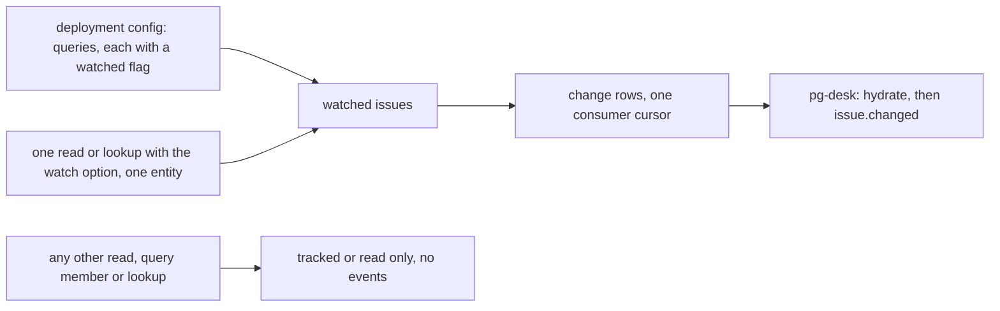
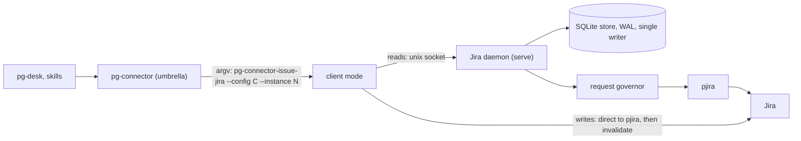
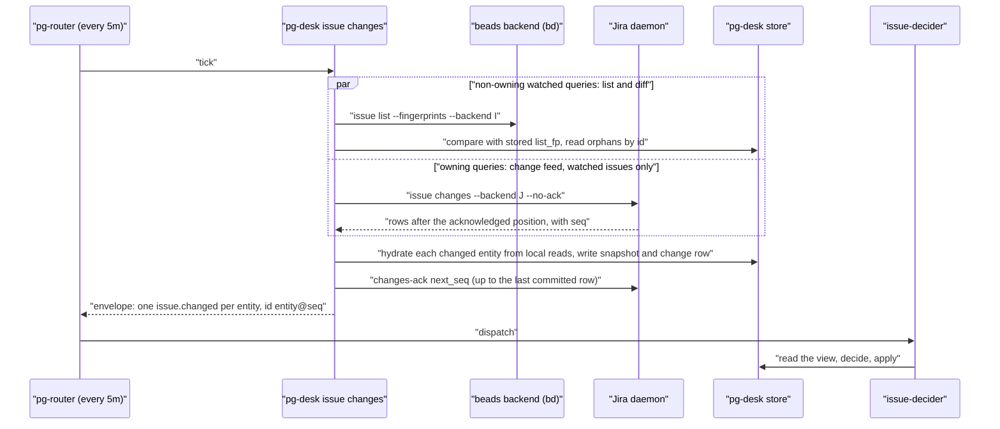

# Issue change emission for beads and Jira: watched-entity events only (the PR pattern) and a Jira daemon — design

- **Status**: Draft 10 for operator review. Drafts 1 and 2 were a pg-desk-only fix; drafts 3 to 6 applied the
  GitHub daemon to every issue backend. On 2026-10-20 the operator ruled that the store and the daemon are
  **per implementation**: beads runs locally and needs neither, Jira needs both. Draft 9 applied the
  operator's 2026-10-21 rulings (the Jira daemon is committed and goes BEFORE the beads path; the 24-hour
  interim relief and the router selective-drop bead are not filed; the queue's failure to de-duplicate is
  measured). Draft 10 is reshaped on the operator's 2026-10-22 ruling 7 (section 13): change events for BOTH
  beads and Jira issues follow the PR "watched" pattern, so the connector emits events only for watched
  issues. The blanket silent sweep, the acknowledged retry tier, Appendix A (the decider acknowledgement
  protocol) and the focus re-emission timer are removed. Draft 10 has not been independently reviewed
  (section 12). Nothing here is implemented. No implementation bead is filed.
- **Date**: 2026-10-22 (draft 9: 2026-10-21; draft 8: 2026-10-20)
- **Bead**: `pg2-oa1h4` (this design). Closes the root cause of `pg2-izeuu` and `pg2-2f24a`; gates
  `pg2-2j5ac.44.37` (the flip of the issue decider to `apply`).
- **Delta over**: `docs/superpowers/specs/2026-10-09-pg-connector-github-daemon-design.md` ("the GitHub
  design"), program epic `pg2-z5fax`, ADR 0090 (a backend declares `owns_changes` and the others stay as
  they are), and the PR lane refactor design `docs/superpowers/specs/2026-10-20-pr-lane-refactor-design.md`
  ("the PR design", epic `pg2-6mo45`), whose tracked-versus-watched model this design follows. The Jira part
  is a delta over the GitHub design; the beads part is a change to pg-desk.
- **Builds on**: ADR 0077 (S29, S31, S32, S33), ADR 0090, `packages/pg-connector/pkg/connectord`,
  `docs/behavior/pg-desk/changes.md`.

The key words MUST, MUST NOT, SHOULD, SHOULD NOT and MAY in this document are to be read as in
RFC 2119.

This repository is public. The document names no employer, workspace, channel or person. Bead ids
(`pg2-...`) are this repository's own tracker ids.

Invariants are numbered in the order they were introduced across drafts. `INV-ICD-8` and `INV-ICD-12` are
withdrawn in draft 10 and their numbers are not reused.

## 0. Summary

| Topic                   | Decision                                                                                                                                                                                                                                                                                                                                        |
| ----------------------- | ----------------------------------------------------------------------------------------------------------------------------------------------------------------------------------------------------------------------------------------------------------------------------------------------------------------------------------------------- |
| What is wrong           | 2,039 of 2,049 `issue.changed` events enqueued since 2026-10-19 18:52Z carry kind `reconcile` [2,039 / 2,049 = 99.5%]. pg-desk's two age-sweep tiers re-emit every active entity whether or not anything differs; the queue grows by about 113 per hour.                                                                                        |
| Where the load is       | Beads. `work-beads` held about 167 to 171 entities in the sampled connector ledgers and the focus queries add the rest of the 452 active issues; Jira's `mine` query held 3 to 4. The split is inferred, to be measured (section 1).                                                                                                            |
| Operator rulings        | 2026-10-20: emit nothing when nothing differs; do what was done for PRs; the store and daemon are per implementation. 2026-10-22 (ruling 7): the watched-entity model for BOTH backends (section 13).                                                                                                                                           |
| The model               | Tracking and change events are separate. Nothing is watched by default. An issue is watched when it is a member of a query the deployment marks `watched`, or when one read or lookup opts in to watching that one entity. Watched stays watched until the issue closes. The connector emits change events ONLY for watched issues (section 2). |
| Beads (no daemon)       | Beads has no daemon or store of its own. The watched flag is declared on the query in the connector configuration; the per-entity flag and the change emission live in pg-desk's existing flow (section 4.2). A cross-process budget keeps `bd` from being overloaded (section 4.4).                                                            |
| Jira (daemon and store) | A Jira daemon, built on the GitHub daemon library already landed, tracks every retrieved issue until closed plus 24 hours, evicts it 7 days after closing, and runs on an internal request budget (section 3). It delivers change rows for watched issues only. pg-desk consumes its change feed.                                               |
| Order                   | Build order only, operator ruling 2026-10-21: the Jira implementation is built FIRST, then the beads path (section 8).                                                                                                                                                                                                                          |
| Failed decider run      | No decider-acknowledgement protocol is built. A failed decider run waits for the next change of that issue, as for PRs. Revisit only if problems appear without it (section 6).                                                                                                                                                                 |
| Removed in draft 10     | The blanket silent 24-hour sweep, the acknowledged retry tier, Appendix A (decision table, `pg-desk issue ack`, `redrive`, decider view change, `INV-ICD-12`), the 30-minute focus re-emission timer and the interim-relief machinery.                                                                                                          |
| De-duplication          | Checked 2026-10-21 (section 1): the router de-duplicates by exact event id and the id carries the change-log sequence, so a re-emission is always a new id; 89.7% of enqueued events are superseded by a later event for the same entity. Measured background, no longer a driver. Router-side supersession stays OPEN (section 10, item 8).    |

## 1. Problem, measured

Measured 2026-10-20 06:29Z from the router queue log, `pg-router status --json` and `pg-desk status`.

- `issue.changed` queue depth is 1757; it was 312 at 2026-10-19 17:41Z. Net growth over that window is
  `(1757 - 312) / 12.8h = 113` per hour.
- Of 2,049 enqueued `issue.changed` events, 2,039 carry kind `reconcile` (1,443 origin `local-reconcile`,
  591 origin `sweep`, 5 other). Ten carry no `reconcile` kind. 454 distinct entities were enqueued, each 3
  to 6 times.
- Average arrival is `2,049 / 11.6h = 177` per hour; with growth of 113 per hour the average drain was
  `177 - 113 = 64` per hour (an approximation: the arrival window is 11.6 hours and the growth window 12.8
  hours). Short-window peaks (4.5 to 5.3 per minute, one hour of 190 dispatches after a
  router restart) are not a baseline, so no success criterion here uses a drain rate.
- The sweep bound `452 / 20 x 5m = 113m` exceeds the local tier's age (30m); each tier emits up to
  `sweep.max_per_poll` (20) per poll, for ever. This is the cause that the watched-entity model removes: no
  tier of that kind remains for `issue`.
- The consumer `issue-decider` is serial. In `plan` mode every run is a no-op. After the flip to `apply` it
  writes beads, and a new event waits behind the backlog (47 to 57 minutes observed).
- **The backend split is inferred, not measured.** The sampled connector ledgers (2026-09-23 to 2026-10-15)
  show `work-beads` at 167 to 171 entities and the Jira `mine` query at 3 to 4; the focus queries are bulk
  open-bead queries. The 452 active issues are therefore almost certainly almost all beads, but no count by
  backend was taken from the pg-desk store. The packet that cuts the beads path MUST first record the active
  count per backend, the count of entities the deployment's watched queries would hold per backend, and the
  number of hydrations whose fingerprint changed per day among them (the real-change rate that the success
  criterion of section 7 divides by). The new `fields_changed` rows add events that were previously dropped,
  so the real-change rate is measured against the NEW rule.
- **The queue does not de-duplicate this load (measured 2026-10-21 02:45Z, answering the operator's question
  whether the backlog is de-duplicating).** The router drops an enqueue only when its exact event id is still
  retained (INV-EVT-3 of the router's behavior docs). The id is `issue.changed:<entity>@<max change_log seq>`
  and every reconcile row appended by pg-desk gets a new sequence, so every re-emission is a new id and the
  rule can never fire. From the router's queue log: 4,495 `issue.changed` enqueues between 2026-10-20 03:22 and
  22:36 (UTC-4) carry 4,495 distinct ids for 465 distinct entities, 3 to 12 enqueues per entity (typically 9 to
  11). 4,030 of 4,495 are superseded by a later event for the same entity [(4,495 - 465) / 4,495 = 89.7%];
  4,461 of 4,495 carry only kind `reconcile` [4,461 / 4,495 = 99.2%] and 34 are real changes. Every one is
  born expired (`expiresAt` equal to `enqueuedAt`, 4,495 of 4,495), so even an id match would be inside a
  window of about one dispatch cycle. Queue depth at 02:42Z was 4,387 against 1,757 at 2026-10-20 06:29Z:
  growth of about 130 per hour [(4,387 - 1,757) / 20.2h], above the 113 per hour of the first measurement. The
  duplication is created by the EMITTER, which appends a row and a new id whether or not anything differs;
  watched-only emission with no reconcile event (sections 2 to 5) removes that at the source. It does not make
  the router supersede an older pending event for the same entity, which is the only thing that would stop a
  backlog from compounding if an emitter regressed (section 10, item 8). This finding is measured background:
  the model of section 2 is driven by the operator's ruling 7, not by it.

## 2. The watched-entity model and ownership per backend

### 2.1 Tracked and watched

The model is the PR design's (its rulings 8 to 10 and its section on tracking and watching), applied to issues
by the operator's ruling 7. Two independent properties of an issue:

- **Tracked** means the connector keeps the issue's content and keeps it fresh. For Jira the daemon's store
  does this (section 3.2). Beads has no store of its own, so nothing is tracked for beads: a bead is read when
  asked for.
- **Watched** means the connector appends change rows for the issue and so makes it reach pg-desk and the
  decider. Tracking alone never produces an event.

- **INV-ICD-13.** (a) Nothing is watched by default. (b) An issue becomes watched when it is a member of a
  query whose configuration carries `watched = true` (the flag is a property of the query definition in the
  connector configuration; its default is false and its option name is a placeholder, as in the PR design), or
  when a read or lookup of that one issue carries the watch option (a one-off watch of a specific entity).
  (c) Once watched, an issue stays watched until it is closed and evicted; an issue that leaves its query
  stays watched, so its `closed` row is still delivered. (d) The connector MUST emit change rows ONLY for
  watched issues; an issue that was only read, or is only tracked, delivers nothing. (e) A query's first
  complete run appends no rows (the GitHub design's per-query baseline), so a cold store cannot push every
  issue to the decider at once; an issue that becomes watched later while already known appends exactly one
  first-observation row so pg-desk hydrates it. (f) Which queries are watched is declared by the deployment,
  not by this design, which defines only the flag and its default.
- **Why.** The operator's ruling 7: the connector should only emit changes for watched items, which keeps the
  level of events much smaller so that the decision role is not overwhelmed (section 13). There is no
  blanket sweep and no `reconcile` event for `issue`.

### 2.2 Ownership per backend

ADR 0090 already says it: a backend that declares `owns_changes` decides what changed for its own types and
every other backend stays as it is. The `issue` type has two implementations, so the rule is applied per
backend, not per type:

| Backend       | Process model                                       | Who detects a change and where the watched flag lives                                                                                   | Sweeps |
| ------------- | --------------------------------------------------- | --------------------------------------------------------------------------------------------------------------------------------------- | ------ |
| Beads (local) | One-shot `bd` processes; no store, no daemon        | pg-desk, by fingerprint list-and-diff (ADR 0077 S29) over watched queries and watched entities; the flag lives in pg-desk (section 4.2) | None   |
| Jira (remote) | After the daemon lands: a daemon with its own store | The daemon (`owns_changes`), which stores the flag; pg-desk consumes the feed, hydrates, and acknowledges                               | None   |
| Jira (today)  | One-shot `pjira` processes                          | pg-desk, as for beads                                                                                                                   | None   |

pg-desk therefore handles a MIX of backends inside its one `issue` flow (section 5), and the router source,
the roles and the decider are unchanged: pg-desk stays the single emitter of `issue.changed`.

**Why beads needs no daemon.** A `bd` read is local, so its data is always current and nothing needs
refreshing in the background; the fingerprint the umbrella computes covers every field the list returns (it
hashes the whole entity JSON minus `as_of`, `stale` and `metadata.last_checked_at`). What a daemon would add
(batching, quota protection, revalidation, a store) has nothing to act on. The operator's reason (ruling 7,
point d): "pulling the jira information can be slow and difficult, where as beads are local so having
additional support/daemons aren't needed for beads to work well".

**A beads daemon is an option, not a requirement.** If a beads daemon is adopted for consistency it is a
separate binary instance with its own store and config, sharing only the library; the retention rule of
section 3.2 would then apply to it. It is not designed here, and section 4.4 gives the signal that would
justify it.

## 3. The Jira daemon

A delta over the GitHub design. Everything not stated here is the GitHub design's: one daemon as the store's
only writer, one unix socket, client mode, `unavailable` for reads when the daemon is down, a persistent
store, entity groups, the settle rule, per-group baselines, "first sighting logs nothing", the change feed
with explicit acknowledgement, `sources_freshness[]`, the capabilities `owns_changes` and `cache_opt_out`,
`status` and `explain`, the observability pattern, and the shadow-run rollout. The tracked-versus-watched
amendment to that library is the PR design's phase P2, shared with this daemon (section 14).

### 3.1 Groups

An issue is a set of groups with their own freshness, as for PRs:

| Group      | Content                                                               | Fetch                                                                                                                                                                                                                                           | Fresh until                                                         |
| ---------- | --------------------------------------------------------------------- | ----------------------------------------------------------------------------------------------------------------------------------------------------------------------------------------------------------------------------------------------- | ------------------------------------------------------------------- |
| `summary`  | What `list` returns, including `updated` as the revalidation token    | One full JQL search per configured query (today two; the cursor is always null)                                                                                                                                                                 | `summary_ttl`                                                       |
| `detail`   | What `show` adds: description, comments, direct edges, operator facts | `pjira issue` per issue when the summary changed or the hard age passed; the spike checks whether `search --expand` (the backend already uses it for operator facts) can return comments and changelog in the listing and avoid per-issue calls | `detail_ttl`, extended by revalidation, never past `detail_max_age` |
| `children` | Not cached (a live read)                                              | Passed through                                                                                                                                                                                                                                  | n/a                                                                 |

`updated` is decoded by the backend but deliberately not mapped today (`backend.go:184-189`); the daemon maps
it internally as the revalidation token. The Jira fingerprint covers only what `pjira` emits and
`toSchemaIssue` maps no description and no comments. **INV-ICD-1.** The entity MUST carry a comment summary (a
count and the time of the latest comment) derived from `detail`, so a comment is a visible field difference.

### 3.2 Tracking, watching and retention

Tracking follows the PR design's amendment (tracked versus watched), NOT the GitHub design's older keep-alive
rule.

- **INV-ICD-2.** Every issue the daemon retrieves, whether as a member of a configured query, because a
  caller read it, or because it was watched, is **tracked**, and a tracked issue is refreshed in the
  background until it has been closed for 24 hours (a Jira status category `done`). From 24 hours to 7 days
  after closing it is served from the store and not refreshed. After 7 days closed it is evicted;
  change-log rows keep their own retention. A direct read has no different tracking rule from a query
  result, and there is no manual untrack.
- **Watched flag in the store.** The daemon stores each issue's watched flag (INV-ICD-13) and sets it from a
  member of a configured query whose configuration carries `watched = true`, and from a read or lookup with
  the watch option. The change feed returns rows for watched issues only, with one cursor per consumer;
  `--query` is no longer required and MAY remain as a filter. `entered_query` and `left_query` rows stay
  informational: leaving a query does not end watching. A moved-aside daemon store loses the flags: query
  members become watched again at the next run of their queries, directly watched issues do not, and with no
  sweep nothing re-asserts them (section 10, item 11).
- This is the GitHub design's `terminal_ttl` (24 hours) and `expiry` (7 days) with the keep-alive trigger the
  PR design also adopts: the GitHub design keeps an entity alive while it is a member of a configured query
  or was accessed within `keepalive_window`; this rule keeps any referenced issue alive until it closes.
  Implementing it needs a closed-at timestamp, which the shared store's `entity` table does not have. The
  Jira daemon has its OWN store file, but the migration ladder is one shared list in `connectord/store`, so
  the new column is an additive migration that bumps `user_version` for every daemon: **it MUST be verified
  against the GitHub daemon's store and its migration tests before it lands**, and the claim that the live
  GitHub store is untouched is withdrawn.
- **Cost risk (accepted for PRs by the operator, the same here).** Tracking has no decay before closure, so an
  issue that someone merely read keeps being refreshed until it closes, and an abandoned open issue is
  refreshed indefinitely. The governor already prioritises and ages work; it SHOULD refresh tracked issues
  that are not members of any configured query at a lower priority class than members. The daemon MUST export
  the tracked and watched entity counts, and an alert fires when the tracked set exceeds a configured size
  (the size is a spike output), so the cost is visible before it hurts. A manual untrack is deferred until
  the numbers show it is needed. Draft 9's hard cap `max_tracked_adhoc` is replaced by this rule, to match
  the PR design.

### 3.3 Operations and writes

Reads (`show`, `list`) are served from the store; `children`, `search` and `list_activity` are live
pass-through reads under the governor; `--fresh` forces the needed groups; the watch option on a read is
forwarded to the daemon (INV-ICD-13). **Writes (`create`, `comment`, `transition`, `update`, `close`) stay in
client mode**, executed by the calling process directly against `pjira`, because actor identity comes from
the caller's environment (the daemon ignores per-call environment) and the writers (pg-desk sync, pg-rescue,
the decider) MUST NOT stop working when the daemon is down.

- **INV-ICD-3.** A write MUST NOT depend on the daemon. The client sends `write_begin {id}` before the write
  and `invalidate {id}` after it, each with a short delivery timeout (default 500 ms). On `write_begin` the
  daemon bumps the entity's generation, holds new refreshes of that entity and discards one in flight; on
  `invalidate` it releases the hold and queues one re-pull; if `invalidate` is dropped the hold expires after
  a lease (default 30 seconds). `create` has no id before it runs, so it sends `write_begin {instance}`. If
  `write_begin` is not delivered in time the write proceeds and the client skips `invalidate`.
- **Daemon down.** Reads answer `unavailable` naming the socket, the supervisor and the restart hint. Every
  caller whose docs or prompts treat `unavailable` as terminal MUST be updated to retry.

### 3.4 The request budget, and what Jira exposes

The operator asked whether Jira offers a quota metric like GitHub's points. Researched 2026-10-20 against
Atlassian's published rate-limiting documentation
([developer.atlassian.com, Jira Cloud rate limiting](https://developer.atlassian.com/cloud/jira/platform/rate-limiting/),
read through a summarising fetch, so the figures below are to be re-read against the live page when the
packet is cut) and the code:

- **Hourly points quota.** Jira Cloud has a points-based hourly quota (a global pool of 65,000 points per hour
  shared across tenants by default, per-tenant pools assigned after review), enforced from 2026-03-02, but it
  applies to Forge, Connect and OAuth 2.0 (3LO) apps. The documentation states that API-token traffic is not
  affected. `pjira` authenticates with basic auth and an API token (`client.go:127`;
  `JIRA_API_TOKEN`, `secret.go:83`, `config.go:21`), so the hourly quota does not apply to it today. **The
  exemption is time-bound in Atlassian's text and the packet MUST re-check it.**
- **What does apply.** Per-tenant, per-endpoint burst limits (token bucket; defaults of 100 requests per second
  for GET and POST and 50 for PUT and DELETE) and per-issue write limits (20 writes per 2 seconds, 100 per 30
  seconds). The tenant is shared with every other user's traffic, so the budget here must be a small share.
- **What a client can observe.** `X-RateLimit-Limit` and `X-RateLimit-Remaining` (the burst window, per
  second), `X-RateLimit-NearLimit: true` below 20% capacity, and on a 429 only `Retry-After`,
  `X-RateLimit-Reset` and `RateLimit-Reason` (`jira-burst-based`, `jira-quota-tenant-based`,
  `jira-quota-global-based`, `jira-per-issue-on-write`). The beta points headers (`Beta-RateLimit`) report
  remaining points only near the limit and only for quota-governed apps. Atlassian says `Retry-After` is a hint,
  because limits are per tenant.
- **What the code gives today.** `pjira` reads no rate-limit header, and the backend's own comment says it
  surfaces "no figure, header or Retry-After" (`eventlog.go:33-37`): the only signal is the 429 status text,
  classified `failure_class=rate_limited`. There is no hourly figure to read at all.

Therefore **INV-ICD-4.** The Jira daemon's budget is internal and conservative, because the external signal is
a rate, not a quota: a configured request-rate cap (requests per second) and a concurrency cap, a requests
counter, and a 429 handler that pauses background work for `Retry-After` (default 60 seconds when absent) and
doubles the pause on consecutive 429s with jitter, as Atlassian advises. Interactive reads are served stale
during a pause. A change in the repository that owns `pjira` (an out-of-tree dependency, its own bead)
surfaces `X-RateLimit-Remaining`, `X-RateLimit-NearLimit`, `Retry-After` and `RateLimit-Reason`; **how
`pjira` conveys them across its CLI boundary is unspecified** (stderr line, a field in its JSON, or a flag) and
is that bead's decision. Until it lands the daemon runs on the 429 signal and its own counter. If the token
moves to OAuth the points quota applies and the beta headers become the signal.

### 3.5 Change detection and the feed

Kinds, classified per group from before and after content: `closed`, `reopened`, `status_changed`,
`assignee_changed`, `priority_changed`, `labels_changed`, `parent_changed`, `title_changed`,
`description_changed`, `comments_changed`, `renamed`, `removed`, `entered_query`, `left_query`, and a
catch-all `fields_changed`. There is no `opened` kind; the feed delivers `added` (an `entered_query` row, and
the one first-observation row of an issue that becomes watched while known, INV-ICD-13(e)).

- **INV-ICD-5.** A difference in the normalised content MUST produce a change row; when no specific kind
  matches, the row carries `fields_changed` naming the fields. A classifier that returns no kind for a real
  difference loses a change; pg-desk's classifier does this today for labels-only and priority-only edits, and
  the blanket tier hid it. This rule applies to pg-desk's list-and-diff for beads too (section 4.1).
- **INV-ICD-6.** `as_of`, `stale` and `updated` (`updated_at` for beads) are dropped from the compared
  content. `updated` is a revalidation token: a change to it alone re-pulls `detail` (Jira) or re-hydrates
  (beads) and MUST NOT by itself append a row, EXCEPT the beads comments proxy below. Any write by this
  system bumps it (a same-value `bd update` still does, `sync/rules.go`), and its real field changes are
  delivered once as a content change; the decider's run on its own write must converge (at most one extra run
  per write, T-12). **One exception, kept on purpose:** pg-desk's classifier today emits `comments_changed`
  exactly when `updated_at` advances and nothing else differs (`issueCommentsProxy` in `classify/issue.go`),
  because a bead's entity carries no comment list or count. That proxy is KEPT for beads until the spike of
  section 10 item 4 shows whether `bd` returns a comment count or latest-comment time (if it does, that field
  replaces the proxy), and it is RETIRED for Jira, where INV-ICD-1 supplies a real comment summary (today the
  retirement changes nothing, because the Jira backend never maps `updated`, `backend.go:184-189`; it keeps
  the proxy from firing once the daemon maps `updated` internally). Keeping the proxy means a same-value
  `bd update` by the decider on a watched bead produces one `comments_changed` row and one extra decider run,
  which T-12's budget allows only if that run writes nothing.
- The settle rule, baselines and the feed are the GitHub design's, with the PR design's amendment: one cursor
  per consumer, keyed `(consumer, issue, instance)` with `--query` an optional filter, so two instances stay
  separate. Each row's entity carries the row's own `version` (the schema gains `Issue.Version`) and the
  store `epoch`.

## 4. The beads path (no daemon, watched only)

### 4.1 What pg-desk changes for backends that do not own changes

| Today (ADR 0077 S29, S31)                                          | After                                                                                                                                                                                    |
| ------------------------------------------------------------------ | ---------------------------------------------------------------------------------------------------------------------------------------------------------------------------------------- |
| List-and-diff by fingerprint against the stored `list_fp`          | Kept, over the queries marked watched and over the watched entities only (section 4.2)                                                                                                   |
| Remote tier: re-hydrate by age and always append a `reconcile` row | **Removed.** No age sweep and no `reconcile` kind or `sweep` origin for `issue`                                                                                                          |
| Local tier: every active entity older than `reconcile_age`         | **Removed.** Nothing re-emits an entity that did not change                                                                                                                              |
| First observation of an entity yields only `reconcile`             | An entity first seen in a watched query after the baseline run, or becoming watched while known, appends one first-observation row (kind `opened`); the baseline run itself appends none |
| A hydration whose classifier yields no kind appends no row         | Appends a `fields_changed` content row (INV-ICD-5)                                                                                                                                       |
| Removal when an entity leaves every watched query                  | Leaving a watched query is not removal: a watched entity stays watched and is read by id until it closes (section 4.2)                                                                   |

A fingerprint is the umbrella's hash of the whole list entity, so any field the list returns that differs
makes the entity "changed" and it is hydrated. UNVERIFIED: whether `bd list --json` returns every field the
decider reads (dependencies and metadata, which `bd show` may fill differently); a spike settles it, and the
fingerprint-completeness test (section 9, T-7) fails if a read field is missing from the fingerprint.

### 4.2 Where the beads watched flag lives

Beads has no daemon or store of its own (operator ruling 2), so the flag is split between the connector
configuration, where a query is declared, and pg-desk's store, where an entity is remembered. This is the
minimal change that mirrors the PR connector configuration, and it adds no process and no store.

- **INV-ICD-14.** (a) **Query level.** A beads query is watched when its entry in the connector's query
  configuration (the beads backend's `config.queries.<name>`) carries `watched = true`, default false. The
  deployment declares the flag once; the home-manager module renders it into the backend's `config.queries`
  block and, for the same queries, into pg-desk's `watch.issue.queries`, which therefore lists exactly the
  queries marked watched and no others, so the two cannot drift. The umbrella's capabilities answer reports each
  query's `watched` value, and a mismatch with pg-desk's list is a `doctor` gate (the check of
  INV-ICD-10(a)). pg-desk lists only watched queries; an unflagged query stays available to every other
  reader and produces no change event. (b) **Entity level.** The entity row gains a nullable `watched` column
  (NULL means not watched), ensured by the mechanism of INV-ICD-10(c) and written by its column-only write
  primitive. It is set when a watched query lists the entity, and by a one-off: the lookup
  `pg-desk issue refresh <id> --watch` (the watch option on a lookup), which also works for a Jira issue by
  forwarding the option to the daemon. Once set it is cleared only when the entity is deactivated after it
  closes (the existing retention). (c) **Not watched means not diffed.** An entity pg-desk holds that is not
  watched is hydrated on demand and is never diffed or emitted. (d) **The baseline run.** On the first run
  after cutover, stored members of a watched query are marked watched with no row; an entity appearing later
  appends one `opened` row.
- **Working assumption (section 10, item 9).** Query-level source: pg-desk keeps `watch.issue.queries` as a
  rendered mirror of the connector's flags. The alternative, reading the flags from the connector at run time
  and deleting `watch.issue.queries` as the PR design does for `watch.pr.queries`, is the open question.
- **Orphan reads.** A watched, still-open entity that no watched query lists any longer (a one-off watch, or
  an entity that left its query) is not removed. pg-desk reads it by id at each poll, through the `bd` budget
  of INV-ICD-9 and oldest-read first when the budget runs out, and compares its fingerprint, until it closes.
  This is change detection for a watched entity, not a sweep. INV-CHANGES-6 and -11 (removal and its
  confirmation read) are rewritten for `issue` accordingly.
- **A moved-aside pg-desk store** loses the one-off flags; query members are marked again at the next listing.
  With no sweep nothing re-asserts them (section 10, item 11).

### 4.3 The normalised comparison

pg-desk decides whether a hydration appended a row by comparing the hydrated snapshot with the stored one:

- **INV-ICD-7.** The comparison MUST use a NORMALISED snapshot. Normalisation drops `as_of`, `stale`,
  `updated_at`, the umbrella's `served_from` and `age_seconds` (it adds them to every non-opted-out `show`
  answer, `cache_policy.go`) and every field in the connector's fingerprint excludes. It is a NEW
  payload-level normaliser factored out of `stripAsOf` in `pipeline/pipeline.go` (the one generic helper,
  which strips only `as_of`, at any depth): the existing `contentSignature` is typed on the PR-shaped
  `gather.Facts` and `normalizeVolatile` strips fields only under `pr_show` and `jira_issues`, while an issue
  payload is `IssueFacts` with `issue_show`, which unmarshalling into `Facts` would drop, so every issue change
  would compare equal. T-1 gains a case where an issue payload differs only in those fields; the stored
  payload and its hash differ on every read today (`as_of` is the read time), so a byte or hash comparison
  would never find "unchanged".
- The age-sweep half of draft 9's `INV-ICD-7` and the whole of `INV-ICD-8` (a `hydrated_at` write with no row
  and no version bump, which existed only so a silent sweep could advance `hydrated_at`) are withdrawn with the
  sweep. The no-version-bump column write that section 5 still needs is stated in INV-ICD-10(c).

### 4.4 The budget that keeps `bd` from being overloaded

Beads has no quota, and the host's load average has been over 800 while `bd` calls time out at 30 to 40
seconds. The operator asked for an internal measure. The backend is one process per call, so the budget is
cross-process and has no daemon:

- **INV-ICD-9.** The beads backend MUST enforce a budget with two parts. (a) A counting semaphore of
  `bd_max_concurrent` slot files in a state directory; a call takes one slot with `flock` and passes the slot's
  open file descriptor to the `bd` child as an extra file, so the slot is held until the CHILD exits. The
  umbrella kills the backend at its call deadline and the backend then dies while `bd` can keep running; a
  slot tied only to the backend process would be released exactly when the host is most overloaded. (b) A
  sliding-window counter capping `bd` processes started per minute (`bd_max_per_minute`). A call over budget
  waits up to a short bound and then answers `unavailable` (retryable). Writes get reserved slots, so a decider
  claim or transition is not starved by reads. The settings come from the backend's own rendered flags (the
  runner is built before any request, `main.go`), not from per-request config. Two trackers served by one dolt
  server share a semaphore by naming the same `--budget-group` (the backend does not know the dolt address).
- **State directory.** A deterministic path that does not depend on the caller's environment (a launchd job
  and an interactive shell resolve `$XDG_STATE_HOME` and `$HOME` differently and would get two semaphores). If
  the directory is unwritable the budget FAILS OPEN and the event log records it, as the event log itself is
  best effort.
- **Limits that remain.** Direct `bd` use by drain agents and humans bypasses the budget; it caps only the
  connector's own load. The probes and routers that pin `--backend` and poll every 10 to 60 seconds are
  callers that will see `unavailable`; their docs MUST say it is retryable and the budget bound MUST be shorter
  than their poll interval.
- **Observability without a daemon.** The backend is one-shot, so its metrics come from its event log. The
  event today carries `bd_calls` and `bd_slowest_ms` only, so the event gains `bd_timeouts`, `budget_wait_ms`
  and `budget_denied`. The beads module deliberately has its generic error alert off; the new alert rules
  (sustained `budget_denied`, `bd_timeouts`) are new rules registered by the beads module with a promtool
  test, not an existing alert.
- **The signal that would justify a beads daemon.** A sustained `budget_denied` rate, or `bd` timeouts the
  semaphore cannot remove (the dolt server itself saturated). A separate daemon with its own store, the only
  `bd` reader, would then be the follow-up; it is not part of this design.

### 4.5 Retention for beads

pg-desk deactivates a bead when it is observed closed, as today, and the watched flag ends with it. The
closed-plus-24-hours and 7-day rule applies to a beads daemon if one is ever adopted; without one, a closed
bead is a store row in pg-desk and the existing pg-desk retention applies.

## 5. pg-desk: one flow over a mix of backends

- **One emitter, one role set.** The `desk-issue-changes` source, the `issue.changed` event and the
  `issue-decider` role stay. Ids stay `<entity>@<max change_log seq>`, one event per entity per poll.
  Hydration happens BEFORE emission, so the decider reads a fresh store with no hydration role and no
  ordering problem. The router source adapter (`packages/pg-router-source-pg-desk`) defines only
  `--consumer`, `--query` and `--limit` and sets no expiry, so every event is born expired (4,495 of 4,495,
  section 1) and router retry (`DEC-RETRY-2`) never applies to an issue event. It therefore gains
  `--retry-window` (step 2 of section 8), so the router can retry a transient dispatch failure first, as the
  PR design relies on (its no-reconcile section); the flag exists only on the connector's adapter, and its
  semantics for the pg-desk id `<entity>@<max seq>` MUST be specified in a behavior doc for that adapter,
  which step 1 adds (the package has no docs directory today). The flag alone does not enable router retry:
  each issue role that should retry MUST also opt in (`max_dispatch_retries`, default 0, DEC-RETRY-2), a
  deployment setting.
- **The dispatch surface.** **INV-ICD-10.** Nothing exposes `owns_changes` to a caller today (the umbrella uses
  it only internally, `changes_forward.go:84-97`), pg-desk only calls `list --fingerprints`, and a `changes`
  call without `--backend` fans out to EVERY issue backend (a non-owning backend would then take the umbrella's
  ledger-diff path, a second change detector). So: (a) pg-desk's configuration names, per watched query, the
  backend instance that serves it and whether it owns changes, rendered from the same source as the registry
  so the two cannot drift, with the umbrella's capabilities answer as the check at start-up (a mismatch is a
  `doctor` gate); (b) every pg-desk `changes` call pins `--backend`; (c) the entity row gains a `backend`
  column (and the `watched` column of INV-ICD-14) so that per-backend rules can be applied per entity, not per
  type. A call knows its backend only where it pins one: `pg-desk issue refresh <id>` takes only an id,
  and the hydration call `issue show <id> --fresh` carries no `--backend` (`cmd/pg-desk/refresh.go`,
  `gather/entity.go:93`), so those paths cannot be the source of the column. The columns are written by a
  **column-only write primitive** that appends no row and does not bump `entity.version` (every write bumps
  the version today, so this is a new store primitive): (i) from a feed row's pinned `changes` call, (ii) from
  a listing, for a created, changed or unchanged listed entity, and (iii) by the cutover backfill. Hydration,
  `refresh` and the orphan reads READ the column, and when it is NULL resolve the backend from the configured
  watched queries of (a) and pass `--backend` to `issue show`, so a Jira id never costs a `bd` call first (an
  unpinned `issue show` tries every registered backend in order); an id served by queries of two different
  backends is a `doctor` gate. Existing rows are NULL after the migration and NULL is treated as non-owning
  only until set; the step 3 cutover therefore includes a one-time backfill of the column for the 3 to 4
  active Jira issues from the configured queries, and a T-8 case covers `refresh` and the orphan read of an
  owning-backend entity. The dropped-key runbook below selects the entities of a backend through the
  configured watched queries, not the column alone. The storage additions (the two columns and the
  failed-ingest side table of INV-ICD-11, all in step 2) MUST use one stated mechanism: `CREATE TABLE IF NOT
EXISTS` and an `ALTER TABLE ... ADD COLUMN` guarded by a `pragma table_info` check, with no `user_version`
  change, because SQLite has no `ADD COLUMN IF NOT EXISTS` and a newer `user_version` would make an older
  binary refuse the store. It MUST be a NEW ensure function called from the store's open path BEFORE the
  early return of `migrate()`, which returns for every `user_version` at or above the cut-over version
  (`store/migrations.go`): the only guarded-ALTER precedent, `ensureLedgerSettleColumns`, runs only for a
  version-1 store and so is no precedent for the cut-over store the issue flow uses. Read-only opens
  (`OpenReadOnly`) never migrate, so read-only verbs MUST tolerate a missing column or table, and the packet
  adds a test that opens a cut-over store without them; (d) `--fresh` STAYS on `issue show` for hydration
  reads (`gather/entity.go:93`). Draft 8 said it is a no-op for beads and dropped it; that was wrong. The
  umbrella forwards it as an argument only to `cache_opt_out` backends, but for any other backend it makes
  `issue show` bypass the umbrella's read-through (`fresh.go`, `dispatchShow`, default `read_ttl` 120
  seconds), and hydration after a detected change MUST NOT be served from that cache: pg-desk would store the
  stale snapshot with the new `list_fp` and the change would be lost. Two holes are closed here. First, a
  fresh read of a non-opted-out backend still falls back to a stale cache entry when the backend answers
  `unavailable` (`tryCacheFallback` in `cache_dispatch.go`, answer marked `stale: true`), and INV-ICD-9's
  budget denial answers exactly `unavailable`; hydration MUST therefore treat an answer with `stale: true` or
  `served_from` of cache as DEGRADED: write nothing and leave the entity due (cases in T-6 and T-8). Second,
  for an owning backend "the daemon decides" means the daemon answers from its store when the stored group
  version is at least the feed row's version and otherwise refetches under its request budget (INV-ICD-4).
- **Feed consumption and acknowledgement.** **INV-ICD-11.** The umbrella today acknowledges a forwarded
  `changes` after it has flushed to its caller, which is right for the router adapter and wrong for pg-desk
  (a hydration may still fail). The umbrella gains a manual-acknowledge mode (`--no-ack`) and a `changes-ack
--consumer C --query Q --next-seq N` verb, both added to `packages/pg-connector/docs/behavior/interfaces.md`.
  The acknowledged position is the scanned `next_seq`, which can pass the last returned row, so pg-desk
  decodes each row's `seq` (`gather.ListChanges` decodes only `change` and `entity` today) and an EMPTY poll
  still acknowledges `next_seq`. pg-desk commits rows in order; **on a row that fails to hydrate it records
  the failed entity id and the row's seq in a small pg-desk side table, continues, and acknowledges past
  it**: a permanently failing issue must not block every other issue's feed, which is the head-of-line
  blocking position-based acknowledgement would otherwise cause. The side table is retried at every poll
  (level-triggered, no counter), and an alert fires on its oldest age (section 7). This is INGEST recovery
  (a row that could not be hydrated), not decider recovery, and is kept because the feed is acknowledged by
  position. The consumer name `pg-desk` is serialised across the fetch AND the commit, which extends the
  consumer lock beyond the `deliver` step it covers today.
- **A dropped key is a gap.** A feed key unseen for `consumer_stale_after` is dropped and its next poll starts
  at the tail (the GitHub design), a silent gap for the sole detector. The runbook for a dropped key is a
  `pg-desk issue refresh <id>` of every watched entity of that backend, and the daemon's `cursor_expired:`
  answer is a `doctor` gate.
- **Membership.** For an owning backend the feed's `entered_query`, `left_query` and `removed` rows MUST keep
  maintaining the per-query listing status and `change_flow.watchset.*` that `recordListing` and
  `applyMembership` maintain only for list runs today, because the focus coverage reads them. They no longer
  end watching (INV-ICD-13(c)).
- **Kinds for an owning backend.** The change-log kinds of a feed-driven row come from the feed row's `kinds`
  (the daemon's classification, section 3.5), stored as given; pg-desk's own classifier is NOT run on it,
  because it knows only the status, closed, reopened, assignee, dependency and comment kinds and would collapse
  `title_changed`, `description_changed`, `labels_changed` and the rest into `fields_changed`. This is a design
  choice of this draft, not a ruling. Three gaps the packet MUST close: the daemon's kind set has no
  `deps_changed`, though dependency edges sit in `detail` and `INV-CHANGES-16` and `-17` depend on them;
  pg-desk's own classifier also knows `opened`, which section 3.5 deliberately lacks; and link propagation
  (`pipeline/entity_change.go`) is derived from the classifier's kinds, so for a feed row it MUST be derived
  from the row's kinds or from the stored snapshot.
- **Invariants and tests to rewrite.** `changes.md` scopes `INV-CHANGES-1` to `-12` to "types whose backend does
  not own changes". `-5` (pg-desk never execs `changes`) is directly contradicted by feed consumption; `-4`
  (first observation yields only `reconcile`), `-6` (removal), `-7` and `-8` (sweeps), `-11` (confirmation
  read) and `-12` (the local reconcile tier) are rewritten or scoped for `issue` by the removal of both tiers
  and by INV-ICD-13 and -14, and `-9` (`list_fp`) is scoped to non-owning backends. `-10` (no retry counter,
  deferral queue or timer), `-13` and `-15` stand as written: the retry tier and decider acknowledgement that
  draft 9 would have required rewriting them for are not built. The tests that pin the retired behavior and
  must be rewritten: `changes/sweep_test.go`, `changes/changes_test.go`, `config_test.go`,
  `alertrules/sweep_bound_test.go`, `metrics/changeflow_test.go`, `doctor_test.go`.
- **Retired in pg-desk, for `issue`:** both sweep tiers (the blanket local tier and the always-appending
  remote tier), the `reconcile` kind with its `sweep` and `local-reconcile` origins, the removal confirmation
  read as removal, and, for owning backends, the list-and-diff. `pg-desk issue changes`, its consumer rows,
  `refresh`, `show` and any other reader of the verb all stay. The `sweep.*` keys remain for `pr` and
  `thread`; the issue flow stops reading them.
- **Due backlog.** `DueBacklog`, `pg_desk_due_backlog` and the focus coverage header (`focus/coverage.go`,
  which marks the focus state incomplete past `coverage_backlog_max`) count every active entity of the type
  by age today (`DueBacklog`, `SweepInputs.ActiveCount` in `changes/sweep.go`). With no sweep, `hydrated_at`
  no longer advances for an unchanged entity, so for `issue` they MUST count only hydrations that are pending
  (a changed or watched entity not yet hydrated, and the failed-ingest table), not entities past an age, or
  coverage would read incomplete for ever. During step 2, while the old tiers still run for beads, the
  owning-backend entities MUST be excluded from both. The focus design itself is reworked by `pg2-gudqw`
  (section 14).
- **The sweep-bound series.** It is emitted for `FlowEntityTypes` (`pr`, `issue`, `thread`) via `changeflow.go`.
  For `issue` both bounds go with the tiers (the local-tier bound at step 2 for owning-backend entities only,
  both at step 4). The doctor lines (`doctor_changeflow.go`), `serve.md`, the `pg-desk-serve` darwin module and
  the alert text are updated; the alert uid stays.

## 6. A failed decider run

No decider-acknowledgement protocol is built (operator ruling 7a: there is no blanket sweep and no reconcile
event, so the recovery question is moot). A failed decider run waits for the next change of that issue, as
for PRs (the PR design, its no-reconcile section): the router retries the dispatch first (the `--retry-window`
flag and per-role opt-in of section 5), and after that an issue with no further change is not retried. There
is no time-driven re-emission of any issue either, including a focus-annotated one: the 30-minute focus
re-emission timer is removed because the focus annotation it keyed on is dropped by `pg2-gudqw`, and the
watched set is small. Revisit only if problems appear without it; the revisit evidence is an open issue whose
decider run failed and which has not changed for a day, which the decider's own failure outcomes already show.

## 7. Observability

- **pg-desk.** `pg_desk_watched_entities{type,backend}` (the count of watched entities),
  `pg_desk_ingest_failed{backend}` and its oldest age, persisted by the CLI in `meta` and read at scrape time
  (the CLI is short-lived); instruments registered without `_total`. An alert on the oldest failed-ingest
  age, modelled in `internal/alertrules` and registered with the router probe's rule-uid list.
  `pg-desk-focus-consumer-lag` keeps working (the consumer rows stay).
- **Beads.** The event-log fields and alerts of section 4.4.
- **Jira daemon** (the GitHub design's catalogue, prefix `pg_connector_issue_jira.`): `daemon.up`,
  `governor.paused{reason}`, `jira.requests{result}`, `budget.remaining` as configured-rate headroom,
  `queue.depth`, `queue.oldest_overdue_seconds`, `group.staleness_seconds`, `request.duration`,
  `change.detection_delay_seconds{kind,origin}`, `change.settle{result}`, `query.last_success_age_seconds`,
  `consumer.lag_rows`, `consumer.oldest_unacked_age_seconds`, `consumer.redeliveries`, `tracked.entities{class}`
  (members, other open, closed grace), `watched.entities`, `store.bytes`, `store.evictions`, and
  `change.rows_without_kind` (an alert on any non-zero value). Alerts, each with a `rule-tests/*.test.yaml`
  promtool test, a uid registered with the probe, and deploy gating (a `deleteRules:` twin while the daemon
  is not deployed, because Grafana keeps a file-provisioned rule live after its file is dropped, `pg2-bry0w`,
  `pg2-susum`): daemon down, queries stale, consumer stuck (above 15 minutes), settle holding, store moved
  aside, the tracked set above its configured size, and Jira auth failing, unavailable and rate limited (the
  three existing alerts, ported onto the daemon's log with the same `failure_class` values; the old log stays
  installed until cleanup).
- **Success criterion.** The router's `issue.changed` enqueue rate is within one order of magnitude of the
  measured real-change rate of the WATCHED entities of section 1 (hydrations whose fingerprint changed, under
  the new `fields_changed` rule), no `issue.changed` event carries kind `reconcile`, and
  `pg-router-queue-depth-growing` and `queue-slow-growth` stay quiet for 7 days. Those two alerts are the
  regression alarm; each gets a positive promtool case (the measured 113-per-hour growth fires) and a
  negative one (the steady state does not).
- **`doctor` and `status`.** Gates (can fail): a failed-ingest entity older than a bound; a `cursor_expired:`
  key; a dispatch-configuration mismatch with the umbrella's capabilities, including a `watched` mismatch
  (INV-ICD-14). Reports: watched count per backend, and an entity pg-desk holds that nothing watches.
  `status` prints counts only.

## 8. Rollout, cutover and bead bodies

Build order only, per the operator's ruling of 2026-10-21 (section 13): the Jira implementation is built
FIRST, then the beads path.

1. **Behavior docs, ADR, spikes.** Behavior docs first (per repository rule): `changes.md` (the per-backend
   split, the watched-only emission, the removal of both sweep tiers and of the `reconcile` kind for `issue`,
   `fields_changed`, and the invariant rewrites of section 5), `store-schema.md` (the `backend` and `watched`
   columns, the column-only write, the failed-ingest side table), `consumer.md`, `config.md` (the query
   `watched` flag, the issue flow no longer reading `sweep.*`), `operator-commands.md` (`refresh --watch`),
   `interfaces.md` (`--no-ack`, `changes-ack`, the capabilities answer with each query's `watched`, the watch
   option on `show`), a behavior doc for the `pg-router-source-pg-desk` adapter, and a behavior-docs set for the
   Jira daemon. ADR 0090 is still Proposed and words its consequences around GitHub, so an ADR for the issue
   connector amends it, and amends ADR 0077 (S29, S31 and S32 narrowed per backend, S31's two tiers retired for
   `issue` with no replacement and its "failed decider run recovered by the local tier" clause retired for
   `issue`; the invariants of section 5 rewritten), recording the operator rulings verbatim. Read-only spikes:
   what `bd list --json` returns against what the decider reads; the `bd` budget defaults; the active and the
   watched count per backend and the real-change rate (section 1); Jira's burst headroom on the shared tenant
   and `search --expand`; whether the closed-at migration is safe for the GitHub store; the tracked-set size
   threshold.
2. **Jira daemon (first):** library generalisation (config-declared governor buckets; the feed accepts kind
   `issue`; the closed-at migration of section 3.2; the stored watched flag, the watch option and the unified
   feed, which are the PR design's P2 and are implemented once, section 14), the daemon, the Jira groups and
   tracking, the budget, the feed, the umbrella manual-acknowledge mode, pg-desk's feed consumption,
   `Issue.Version` and the comment summary, observability and packaging (home-manager options and launchd
   entry with a distinct label, state directory, log name and `service_name`; exact-path `logSources`; the old
   backend's error alert off to avoid a double page; an absolute `pjira` path because launchd gives no `PATH`;
   the nix checks mirrored from the GitHub daemon), and the shadow run. The pieces that both backends need
   LAND HERE, with the first consumer: the dispatch surface (INV-ICD-10) with the `backend` and `watched`
   columns and the column-only write, the manual-acknowledge verbs and the failed-ingest side table
   (INV-ICD-11), the normalised comparison (INV-ICD-6 and INV-ICD-7, which `fields_changed` needs: without it
   every hydration that differs only in `as_of`, `stale` or `updated_at` would emit), `fields_changed`
   (INV-ICD-5) in the daemon's classifier and in pg-desk's, and the `--retry-window` flag on the pg-desk
   router source adapter. Two things follow from landing them here. (a) The old local and remote tiers MUST
   skip an entity whose backend owns changes, so a Jira issue is never swept by the tiers the daemon
   replaces (INV-ICD-10), and owning-backend entities MUST be excluded from `DueBacklog`,
   `pg_desk_due_backlog` and `SweepInputs.ActiveCount` (a Jira entity that the old tiers skip never gets a new
   `hydrated_at` and would otherwise be due for ever and inflate the sweep bound). (b) The pg-desk
   observability of section 7 for the feed and the failed-ingest table (`pg_desk_ingest_failed{backend}`, its
   oldest-age alert, the `cursor_expired:` and dispatch-mismatch doctor gates) lands here, so no row is
   acknowledged past without an alert. The tests that step 2 invalidates (`changes/changes_test.go`,
   `config_test.go`, `doctor_test.go`: feed consumption contradicts INV-CHANGES-5) are rewritten here, and
   `changes/sweep_test.go` and `metrics/changeflow_test.go` gain additive cases here (the old-tier skip, the
   `pg_desk_ingest_failed` series); the rest are rewritten in step 4. The Jira daemon does not stop the flood
   (section 1, Jira holds 3 to 4 entities); it does not depend on the beads path.
3. **Cutover for Jira:** the deployment declares which Jira queries are watched BEFORE the registry switch
   (none by default, so an undeclared deployment delivers nothing). Install the daemon and register the argv
   form `[pg-connector-issue-jira, --config, <path>, --instance, <name>]` for every list that names the
   backend (the home-manager module rewrites them from one place, as for GitHub); the daemon baselines its
   queries; pg-desk's first feed poll starts at the tail; run `pg-desk issue refresh <id>` once for each
   active Jira issue (3 to 4 entities); clear the umbrella cache and ledger files for the Jira instance, and
   again at rollback. Rollback is the registry switch back to the old instance. `--reset` replays every
   watched member as `added` and MUST NOT be part of any runbook except after a store move-aside.
4. **Beads path (stops the flood; follows the Jira daemon, build order only):** the `watched` flag on beads
   queries and its rendering into pg-desk (INV-ICD-14), the `watched` column and the baseline marking, the
   one-off `refresh --watch`, the orphan reads, the retirement of both sweep tiers and of the `reconcile`
   kind for `issue`, the `due backlog` change, the `bd` budget (INV-ICD-9), the beads and watched metrics and
   alerts of section 7, the sweep-bound change, and the sweep and metrics tests. **Consequence of the
   ordering, stated so it is not a surprise:** until this step deploys the flood continues (130 per hour
   measured 2026-10-21, section 1) and the decider stays in `plan` mode. The operator ruled the 24-hour
   interim relief out and the ordering in, so the queue keeps growing for the duration of steps 2 and 3. The
   router queue is bounded (64 MiB by default; polled emitters halt at 90% and new events are rejected at
   100%, INV-EVT-1), so the cost of the ordering includes the queue's headroom at that growth; the packet
   that cuts step 4 MUST record the headroom from the event size. Reordering is the operator's decision and
   no fallback is pre-built.
5. **No migration off `PG_CONNECTOR_ISSUE_BEADS_DIR` is needed**, because beads stays one-shot with
   `--beads-dir` and the environment variable as today; a Jira instance takes its settings from its config file
   and never used the variable. The retired concern of drafts 3 to 6 does not apply.
6. **Backlog.** The queued reconcile events (1,757 at 2026-10-20 06:29Z, 4,387 at 2026-10-21 02:42Z):
   `pg-router log compact` "never discards a queued event" and no router verb drops queued events, so they
   drain naturally. At the 64-per-hour average drain of section 1 (measured 2026-10-20, not re-measured: the
   router delivered 109 events in the 28 minutes after its 02:14Z restart, a different and short window) the
   4,387 take `4,387 / 64 = 69` hours, and a new real change waits behind them; the backlog compounds until
   step 4 deploys. A selective drop (type and kind) is a pg-router bead and is **NOT filed (operator ruling
   2026-10-21: "lets wait on the selective drop for now")**. Router-side supersession of pending events per
   entity (section 10, item 8) is NOT ruled: it is an open question, and no bead is filed until it is decided.
7. **Bead bodies.** The 24-hour interim relief is NOT filed (operator ruling 2026-10-21) and its machinery is
   removed from this design. On 2026-10-21 the body of the operator-run checkpoint `pg2-2j5ac.44.37` was
   amended so that its first step reads the configured `reconcile_age` and refuses above 30 minutes, and its
   "hydrate through `pg-desk issue changes`" and lag-budget wording were rewritten. That gate existed to
   enforce a revert of the interim relief and keys on a sweep setting this design retires for `issue`, so its
   body needs a further superseding amendment once this design is approved; this document cannot make it.
   `pg2-2j5ac.52.22` is NOT re-scoped: it is already CLOSED, by the operator's 2026-10-14 ruling "A: collapse,
   defer deletions" (bead `pg2-15ja3`; as recorded in that bead's close reason, which cannot be verified from
   this repository), when Phase 10 collapsed into the GitHub design's rollout; nothing was shipped under it,
   so the `.44.37` precondition that the cutover release "shipped" is checked by observing the live pg-desk,
   not by that bead.

## 9. Test plan

The gate cannot run a real `bd` hermetically: the existing real-`bd` tests carry the build tag `contract`, can
land on the shared per-user dolt server and run only through `nix run .#pg-connector-contract`. So the gate
uses a `bd` shim replaying transcripts recorded from the real tool (with a freshness check against the pinned
`bd` version) and a fake `pjira` at the exec seam with a counting recorder; the real-`bd` tests are a named
cutover gate with their own prefix and workspace per test, including two trackers on one dolt server.

| Id   | Property                                                                                                                                                                                                                                                                                                                                                                                                                            | Mutation it must kill                                                       |
| ---- | ----------------------------------------------------------------------------------------------------------------------------------------------------------------------------------------------------------------------------------------------------------------------------------------------------------------------------------------------------------------------------------------------------------------------------------- | --------------------------------------------------------------------------- |
| T-1  | Steady state (beads): 452 unchanged watched entities, 100 polls over 8.3 hours, the fake `bd` returns identical snapshots with different `as_of`: zero change rows, zero emissions and zero hydrations                                                                                                                                                                                                                              | a tier that emits by age; an unchanged re-hydration appending a row         |
| T-2  | Watched (INV-ICD-13, -14): an issue that was only read or only tracked delivers no row and no event; a member of a `watched` query, and a one-off watch read, deliver rows; the flag is sticky after the issue leaves its query and ends on close; a query's first complete run appends no rows; an issue becoming watched while known appends exactly one row; a moved-aside store keeps no one-off flags until the queries re-run | emit for every tracked issue; drop the flag when the issue leaves its query |
| T-3  | `fields_changed`: a labels-only edit and a priority-only edit each produce exactly one content row and one emission; an exact kind is asserted for every other kind                                                                                                                                                                                                                                                                 | restore "no kind, no row"; collapse every kind                              |
| T-4  | No recovery protocol: a failed decider run is not re-emitted by pg-desk; the next change of that issue is emitted; no `reconcile` kind, `sweep` origin or `local-reconcile` origin exists for `issue`; no timer re-emits a focus-annotated issue                                                                                                                                                                                    | a timer, sweep or acknowledgement that re-emits                             |
| T-5  | Storage: the `backend` and `watched` columns and the failed-ingest table are created with no `user_version` change; an older binary still opens the store; a read-only open of a store without them works; the column-only write appends no row and does not bump `entity.version`                                                                                                                                                  | bump `user_version`; bump the version on a column write                     |
| T-6  | `bd` budget: over `bd_max_concurrent` or `bd_max_per_minute` a call waits then answers `unavailable`; a SIGKILLed backend with a still-running `bd` child keeps its slot until the child exits; writes keep reserved slots; an unwritable state directory fails open and logs it                                                                                                                                                    | slot tied to the backend process; no write reservation                      |
| T-7  | Fingerprint completeness: for each field the issue rules and the view read, mutating only that field changes the fingerprint or yields a row; the field list is derived by parsing the rule sources                                                                                                                                                                                                                                 | a hand-copied list                                                          |
| T-8  | Dispatch (INV-ICD-10): a beads query list-and-diffs, an owning Jira query consumes the feed, a mixed watch list does both in one poll; every `changes` call pins `--backend`; a mismatch with the capabilities answer is a doctor gate; the entity `backend` column drives the old-tier exclusion and the orphan read                                                                                                               | dispatch by type; a `changes` call without `--backend`                      |
| T-9  | Acknowledgement mechanics (INV-ICD-11): `--no-ack` does not acknowledge; an empty poll acknowledges `next_seq`; a row that fails to hydrate is recorded and acknowledged past, and a following row still commits; the failed row is retried every poll and surfaces in the alert; two concurrent polls serialise on the consumer lock                                                                                               | acknowledge on flush; stop at the first failure                             |
| T-10 | Jira tracking: an issue read by a caller is tracked; an open tracked issue is refreshed beyond 24 hours and 7 days; a closed issue is refreshed for 24 hours, served unrefreshed to 7 days, then evicted; the tracked-set alert fires above its size; the closed-at migration opens a GitHub store and the GitHub migration tests pass                                                                                              | refresh after closure for ever; evict at closure                            |
| T-11 | Jira budget: the rate and concurrency caps are hard; a 429 pauses background work for `Retry-After` (60 seconds when absent) and consecutive 429s double with jitter; interactive reads are served stale during a pause                                                                                                                                                                                                             | drop the cap; ignore `Retry-After`                                          |
| T-12 | Convergence: a decider write (a claim or label) on a watched issue comes back as a fingerprint change, one content row and one decider run, whose own run writes nothing; at most one extra run per write, for beads and Jira                                                                                                                                                                                                       | a loop; counting `updated_at` as content                                    |
| T-13 | Jira detection: `updated` alone triggers a `detail` re-pull and no row; a comment yields `comments_changed`; a daemon restart serves fresh groups with zero origin calls                                                                                                                                                                                                                                                            | `updated` as a row trigger                                                  |
| T-14 | Writes: a write succeeds with the daemon down; carries the caller's actor; with `write_begin` delivered a refresh before or during the write cannot store older content, even when `invalidate` is dropped                                                                                                                                                                                                                          | route writes through the daemon                                             |
| T-15 | Alert rules (promtool): each fires and clears; the queue-depth rule fires on the measured growth and not on the steady state; the Jira daemon-down rule fires when it is deployed and absent and not when it is undeployed                                                                                                                                                                                                          | one rule for deployed and undeployed                                        |
| T-16 | Orphan reads (INV-ICD-14): a watched open entity that left every watched query is read by id each poll within the `bd` budget, oldest-read first; its closure yields `closed` and ends the flag; a failed or degraded read leaves it watched                                                                                                                                                                                        | deactivate on leaving the query; drop the flag at the query boundary        |
| T-17 | GitHub carry-over for the Jira daemon: `env -i` independence with an absolute `pjira`, migrations and move-aside, log rotation, client with the daemon absent answers `unavailable` and never `served_from: cache`, protocol N-1, SIGTERM drain, Linux cross-compile, nix render tests                                                                                                                                              | none                                                                        |
| T-18 | Live exercise (repository rule, recorded on the bead): after each deployment `pg-router run-query` on the source shows zero items in steady state; one edit to a watched issue yields one event and one decider run; an edit to an unwatched issue yields none                                                                                                                                                                      | n/a                                                                         |

## 10. Open questions and risks

Items 8 and 9 are the open design questions of this draft; the rest are resolved items, spike outputs or
recorded risks.

1. **RESOLVED 2026-10-21: the Jira daemon is committed and goes first.** Draft 8 asked whether a daemon and a
   store for 3 to 4 entities earns its weight and offered the lean fallback (Jira on the same sweep as beads)
   with the decision deferred until after the beads path. The operator ruled: "jira daemon is necessary
   and higher priority than beads." The question is closed, not deferred; this design therefore drops the
   lean fallback (that is the design's inference from "necessary", not a separate ruling; section 11). The
   case for the daemon stays recorded: tracking until closed plus 24 hours, a request budget on a shared
   tenant, local hits for every reader, and consistency with PRs. The open cost of the ruling is the
   incident: the flood is a beads flood and the beads path follows (section 8, step 4).
2. **Beads daemon.** Not designed (section 2.2). The signal that would justify one is in section 4.4.
3. **Decider inputs that are not issue content** (bead state outside the watched set, wall-clock gates,
   decider configuration): with no timer, redrive or acknowledgement none of them triggers a run by itself;
   an issue is decided when it changes. Revisit only if problems appear without them.
4. **Comment summary field** for Jira (section 3.1), the spike for what beads `list` returns, and the spike
   for whether `bd` returns a comment count or latest-comment time, which decides whether the beads comments
   proxy of INV-ICD-6 is replaced.
5. **`pjira` headers** are a change in another repository, tracked by its own bead; the CLI-boundary format
   is that bead's decision.
6. **Closed-at migration** touches the shared store ladder and must be proven safe for the GitHub daemon.
7. **Where the shadow harness lives** for the Jira daemon (pg-desk-shadow's safety policy pins the tracker
   directory).
8. **Router-side supersession of pending events (OPEN, for the operator's final review).** The queue does not
   de-duplicate (section 1: 89.7% of enqueued events are superseded by a later event for the same entity)
   because the event id carries the change-log sequence. This design removes the CAUSE at the emitter and does
   not change the router. Router-side supersession (a newer pending event for an entity supersedes older
   pending ones of the same type) would also bound the backlog if an emitter regressed and would make the
   existing backlog drain without a separate selective-drop verb; it is a pg-router change and a change to the
   router's event-identity invariant (INV-EVT-3), so it needs its own behavior-doc change and the operator's
   decision. The operator asked for the check and ruled the selective-drop bead NOT filed for now; this item
   is the recorded question, and no bead is filed until it is decided.
9. **Where pg-desk learns which beads queries are watched (RESOLVED, operator ruling 2026-10-22: option 1
   now, "A is fine until the beads connector handles it").** pg-desk keeps detecting beads changes and so
   keeps the watched query list; a later bead moves beads change detection into the beads connector, which
   deletes `watch.issue.queries` and pg-desk's beads list-and-diff, as the PR design does for PRs. The two
   options that were weighed follow. Option 1, the adopted assumption of INV-ICD-14: the deployment declares `watched` once; the home-manager
   module renders it into the connector's `config.queries` and into pg-desk's existing `watch.issue.queries`
   (now only the watched queries), with a `doctor` gate against the capabilities answer. It is the smallest
   change, because pg-desk's list-and-diff, coverage and `doctor` already iterate that list. Option 2: pg-desk
   reads each query's `watched` value from the connector at run time and `watch.issue.queries` is deleted, as
   the PR design deletes `watch.pr.queries`; the connector is then the only declaration, but pg-desk's flow
   gains a connector read it does not have today. **Recommendation: option 1 now, and option 2 when the PR
   design's deletion of `watch.pr.queries` lands, so both types move together.**
10. **Risk: unbounded tracking** (Jira). Tracking has no decay before closure, so the tracked set grows with
    every issue ever referenced and shrinks only when issues close (section 3.2). Mitigated by the governor, a
    lower priority class for non-members, and the tracked-set alert; a manual untrack is deferred.
11. **Risk: no reconcile.** If the daemon ever misses a change, if a moved-aside store loses one-off watches,
    or if a change reaches a watched bead only through another bead (a blocker closing changes a dependant's
    stored recursive `issue_deps` without the dependant's own fingerprint moving, `INV-CHANGES-16` and `-17`),
    nothing re-asserts or re-reads it. The dependant is seen at its next change. The revisit conditions, each
    visible through the outcome alerts: a watched open issue whose tracker state differs from pg-desk's for
    more than a day, an issue that should be watched but is not, and a moved-aside store. Revisit only if
    problems appear.
12. **Risk: the watched set decides what the decider and the focus rank can see.** An issue outside every
    watched query and every one-off watch delivers no event, so the deployment's watched queries MUST cover
    what the decider and the focus coverage need; the focus design is reworked by `pg2-gudqw` (section 14).

## 11. Alternatives considered

| Alternative                                                                            | Verdict                                                                                                                                                                            |
| -------------------------------------------------------------------------------------- | ---------------------------------------------------------------------------------------------------------------------------------------------------------------------------------- |
| A daemon and store for every issue backend (drafts 3 to 6)                             | Replaced: beads is local and needs none; one daemon for a local tracker adds a store and a hop with nothing to protect                                                             |
| A silent 24-hour sweep of every active issue, and an acknowledged retry tier (draft 9) | Removed by ruling 7: events are emitted only for watched issues, so no blanket tier and no decider acknowledgement exist; a failed run waits for the next change                   |
| Retire the remote tier entirely for beads (draft 7)                                    | Superseded by the same ruling: both tiers are retired for `issue`, and the dependency-freshness and coverage consequences are recorded (section 5 due backlog, section 10 item 11) |
| Jira stateless, with the same sweep                                                    | Rejected (operator ruling 2026-10-21: the Jira daemon is necessary and higher priority than beads); dropped as a fallback (inferred from the ruling, not separately ruled)         |
| Raise `sweep.max_per_poll` or lengthen `reconcile_age` as the permanent fix            | Rejected: arrivals still scale with the watched set (`pg2-2f24a`); the 24-hour setting is not filed (operator ruling 2026-10-21)                                                   |
| Router consumption of the Jira feed directly (the PR shape)                            | Rejected for `issue`: pg-desk is the single emitter and hydrator, which keeps hydration before emission, one event path, ids from its own change log and the menu-bar consumers    |
| Slow full backstop sweep that emits (the PR precedent)                                 | Rejected: ruling 7 and the PR design's ruling 10 drop reconcile                                                                                                                    |
| Router-side coalescing of pending items for one entity                                 | OPEN (section 10, item 8): not rejected; the 2026-10-21 measurement shows the queue never de-duplicates this load, but the emitter is where the duplicates are made                |

## 12. Review log

Rows 1 to 9 describe the draft under review at the time. Items they name that draft 10 removed (Appendix A,
`INV-ICD-8` and `INV-ICD-12`, the silent sweep, the retry tier, the focus timer) are history, not part of this
design.

| Draft        | Review                                                                                                                                                          | Outcome                                                                                                                                                                                                                                                                                                                                                                                                                                                                                                                                                                                                                                                                                                                                                                                                                                                                                                                                                                                                                                                                                                                                                                                                                                                                                                                                                                                                                              |
| ------------ | --------------------------------------------------------------------------------------------------------------------------------------------------------------- | ------------------------------------------------------------------------------------------------------------------------------------------------------------------------------------------------------------------------------------------------------------------------------------------------------------------------------------------------------------------------------------------------------------------------------------------------------------------------------------------------------------------------------------------------------------------------------------------------------------------------------------------------------------------------------------------------------------------------------------------------------------------------------------------------------------------------------------------------------------------------------------------------------------------------------------------------------------------------------------------------------------------------------------------------------------------------------------------------------------------------------------------------------------------------------------------------------------------------------------------------------------------------------------------------------------------------------------------------------------------------------------------------------------------------------------ |
| 1, 2         | Two independent reviews (correctness and completeness; UX, observability and tests)                                                                             | Folded into draft 2 (its decider-acknowledgement part, Appendix A, was removed in draft 10)                                                                                                                                                                                                                                                                                                                                                                                                                                                                                                                                                                                                                                                                                                                                                                                                                                                                                                                                                                                                                                                                                                                                                                                                                                                                                                                                          |
| 3 to 6       | The operator's end state (the PR design), then four rounds of independent review                                                                                | A daemon for every backend. Findings on event identity, hydration, ordering, cutover, recovery, writes, alerts and tests shaped drafts 4 to 6; the parts that survive are sections 3.3, 3.5, 7 and 9                                                                                                                                                                                                                                                                                                                                                                                                                                                                                                                                                                                                                                                                                                                                                                                                                                                                                                                                                                                                                                                                                                                                                                                                                                 |
| 7            | The operator, 2026-10-20: the store and daemon are per implementation                                                                                           | Rewritten around beads without a daemon and Jira with one                                                                                                                                                                                                                                                                                                                                                                                                                                                                                                                                                                                                                                                                                                                                                                                                                                                                                                                                                                                                                                                                                                                                                                                                                                                                                                                                                                            |
| 8            | One independent review of draft 7 (all five dimensions)                                                                                                         | Two blockers and seven majors, each changing the design: the dispatch surface, a per-entity `backend` and pinned `--backend` (INV-ICD-10); the retired remote tier broke the focus coverage and the dependency refresh, so it is made silent instead (4.2); the acknowledgement mechanics, per-row `seq`, empty-poll acknowledgement and skip-and-record instead of head-of-line blocking (INV-ICD-11); the retry tier armed and staged (INV-ICD-12); the budget's child-process semantics, state directory, write reservation and event fields (INV-ICD-9); the invariant and test rewrite list (5); the closed-at migration and the withdrawn "GitHub store untouched" claim (3.2); the decider view change and write-echo convergence (Appendix A, T-12); honest evidence for the backend split (1); the interim arithmetic (8); Jira source references and the dated API-token exemption (3.4). Draft 8 was not reviewed again; draft 9 was reviewed (rows 9 review 1 and 9 review 2)                                                                                                                                                                                                                                                                                                                                                                                                                                            |
| 9            | The operator, 2026-10-21: rulings on the open questions of draft 8                                                                                              | Jira daemon committed and first; `pg2-2j5ac.44.37` amended; interim relief and selective-drop bead not filed; queue de-duplication measured (sections 1, 8, 10, 13). Draft 9 reviewed twice (the next two rows)                                                                                                                                                                                                                                                                                                                                                                                                                                                                                                                                                                                                                                                                                                                                                                                                                                                                                                                                                                                                                                                                                                                                                                                                                      |
| 9 (review 1) | One independent read-only review of draft 9 (consistency after the reorder, step dependencies, the de-duplication measurement, repo facts, public-repo hygiene) | REVISE, four majors, each applied: the silent-sweep pull-forward removes only the `sweep` origin (28.0%), so it must also switch the local tier off (section 8, step 4); step 2 now carries the shared normalisation, tier exclusion for owning backends, the feed and failed-ingest observability and the tests it invalidates; step 4 now carries the missing `--retry-window` on the pg-desk router adapter (the adapter sets no expiry, so router retry never applied to issue events); the router queue bound is named as a cost of the ordering. Minors applied: the section 6 wording, the 6-hour retry default marked as a spike output because two drain measurements disagree (64 and about 92 per hour), the `interfaces.md` path, the INV-CHANGES-13 and -15 wording. Not applied: the out-of-tree `pjira` line references (that repository is deliberately not named here) and the stale `.52.22` mentions in other repo docs (`docs/behavior/pg-desk/shadow-compare.md`, `docs/runbooks/pg-desk-shadow-compare.md`, `packages/pg-desk/internal/guards/scan.go`), which belong to the packet that touches them. That revision was reviewed in the next row                                                                                                                                                                                                                                                              |
| 9 (review 2) | A second independent read-only review of the revised draft 9 (same dimensions, no memory of review 1)                                                           | REVISE, three majors (each confirmed in the code) and eleven minors, all applied except where noted. Majors: `--fresh` was wrongly called a no-op for beads and dropped, which would let hydration after a detected change read a stale cache entry for up to 120 seconds and lose the change, so it STAYS on hydration reads (INV-ICD-10(d)); the per-entity `backend` column had no source for existing rows or for `refresh`, so it is now set from the pinned backend on every listing, feed row and hydration, with NULL as non-owning until first set (INV-ICD-10(c)); INV-ICD-6 contradicted the classifier's `updated_at` comments proxy, so the proxy is retired for Jira and kept for beads pending the spike (INV-ICD-6, section 10 item 4). Minors: the storage-addition mechanism is stated; the normalisation extends `contentSignature`; section 12 labels; the 6-hour retry default marked provisional and below its own bound; the drain-window mixing noted; T-1 overrides `max_age`; the step 2 test list; the pull-forward fallback's two gaps; the role opt-in for router retry and the missing adapter behavior doc; kinds for an owning backend are taken from the feed row; four phrasings that went past what the operator ruled were trimmed to the quotes. Not verifiable from the repo and left as stated: the bead-state claims about `.44.37` and `.52.22`. That revision was reviewed in the next row |
| 9 (review 3) | A third independent read-only review, told to spend most of its effort verifying code and doc claims against the repo                                           | REVISE, five majors (the two spot-checked were confirmed in the code) and eight minors, applied. Majors: `refresh` and hydration have no pinned backend, so the `backend` column is written only from feed rows and from changing listings and is READ (with resolution from the watched queries) elsewhere, with a step 3 backfill (INV-ICD-10(c)); the storage mechanism MUST be a new ensure function before `migrate()`'s early return, because the cited precedent runs only for a version-1 store (INV-ICD-10(c)); "extends `contentSignature`" did not work for issues, so a new payload-level normaliser is factored out of `stripAsOf` and also drops `served_from` and `age_seconds` (INV-ICD-7); the `--fresh` guarantee had a hole when the umbrella falls back to a stale cache on `unavailable`, so hydration treats a stale or cache-served answer as degraded (INV-ICD-10(d)); the kept beads comments proxy now bumps `content_seq` and the "MUST NOT" sentence says so (INV-ICD-6, Appendix A). Minors: the owning-entity exclusion from `DueBacklog` and `ActiveCount`, the missing kinds and link propagation for feed rows, `-6`, `-9` and `-11` scoping, the `sweep.max_age` key and scope, the unflagged drain windows, the unverifiable menu-bar claim, and ruling-fidelity labels ("this design's reading"). The revision has not been reviewed again                                                       |
| 10           | The operator, 2026-10-22: ruling 7 (the watched-entity model)                                                                                                   | Draft 10, 2026-10-22: reshaped to the watched-entity model per operator ruling 7; not independently reviewed                                                                                                                                                                                                                                                                                                                                                                                                                                                                                                                                                                                                                                                                                                                                                                                                                                                                                                                                                                                                                                                                                                                                                                                                                                                                                                                         |

## 13. Operator rulings of 2026-10-21 and 2026-10-22

Quoted from the operator's answers and recorded on `pg2-oa1h4`; each supersedes the draft text it names. Where
this document says "first" or "follows", that is the design's reading of the ruling "higher priority" as
build order only, not a separate ruling.

1. **Jira daemon sequencing.** "jira daemon is necessary and higher priority than beads." Supersedes draft 8's
   order (beads path first, Jira daemon second, with a go/no-go on whether it earns its weight): the daemon is
   committed and goes first (sections 0, 8, 10 item 1, 11).
2. **Bead bodies.** "Amend .44.37 only; fix design section 8 for .52.22." `pg2-2j5ac.44.37` was amended (section
   8, step 7); `pg2-2j5ac.52.22` is closed and is not amended, and the "is re-scoped" sentence is corrected.
3. **24-hour interim relief.** Not filed. "the fact that the backlog signals to me a larger problem. there aren't
   that many jira issues or beads that i think it should be needing to pull in. i don't think the backlog is
   properly deduping. can you check that? that isn't directly related to this planned work, but that every
   growing backlog is daunting." The check is section 1's last bullet; the relief itself is moot after ruling 5.
4. **Router selective-drop bead.** Not filed for now. "lets wait on the selective drop for now. see my previous
   comment about proper dedup" (section 8 step 6, section 10 item 8).
5. **Watched-entity model (ruling 7 on the bead, 2026-10-22).** Issue change emission follows the PR pattern,
   for BOTH beads and Jira issues ("the implementation of beads and jira should be similar to how PR will
   work"). Verbatim: "the basic 'watched' situation is bound to a query configured in the connector for which
   were marked as watched. but there were one-off where a specific entity could be watched as well." and
   "the connector should be smart enough to only emit changes for 'watched' items. this will keep the level of
   events to be much smaller so that the decision role should not be over whelmed." Consequences, each
   superseding the draft 9 text named:
   a. No decider-acknowledgement protocol: Appendix A (decision table, `pg-desk issue ack`, `redrive`, the
   retry tier, the decider view change, `INV-ICD-12`) is dropped; a failed decider run waits for the next
   change of that issue, as for PRs; revisit only if problems appear (section 6).
   b. The 30-minute focus re-emission is removed: the focus annotation it keys on is dropped by `pg2-gudqw`
   and the watched set is small.
   c. The silent 24-hour sweep of every active issue is replaced by watched-only emission; no blanket tier
   remains (sections 2 and 4).
   d. Build order only, the Jira implementation first: "pulling the jira information can be slow and
   difficult, where as beads are local so having additional support/daemons aren't needed for beads to work
   well" (section 8).
   e. The Jira daemon's tracking rule follows the PR design's tracked-versus-watched amendment, not the older
   keep-alive rule (section 3.2).
   f. Beads needs no daemon or store of its own; where its watched flag lives is defined in section 4.2, with
   one open question (section 10, item 9).

## 14. Relationship to other in-flight work

The connector-owned, watched-only change pattern for issues is THIS design (`pg2-oa1h4`), not a separate
effort.

| Bead        | What it is                                                                      | Relationship                                                                                                                                                                                                                                                                                      |
| ----------- | ------------------------------------------------------------------------------- | ------------------------------------------------------------------------------------------------------------------------------------------------------------------------------------------------------------------------------------------------------------------------------------------------- |
| `pg2-z5fax` | The GitHub daemon program; its library has landed under `packages/pg-connector` | The Jira daemon reuses that library (`pkg/connectord`); the shared-store closed-at migration (section 3.2) MUST be proven safe against it                                                                                                                                                         |
| `pg2-6mo45` | The PR lane refactor                                                            | Its phase P2 (tracked versus watched, a stored watched flag, the watch option, one cursor per consumer, no keep-alive decay) amends the SAME library as this design's Jira daemon. The change is implemented once, in the library, by whichever lands first; whoever lands second rebases onto it |
| `pg2-gudqw` | pg-desk work item design; drops the focus annotation and focus-bead minting     | The 30-minute focus re-emission is removed because its annotation is dropped there; the focus coverage and the watched queries it needs are reworked there (section 10, item 12)                                                                                                                  |
