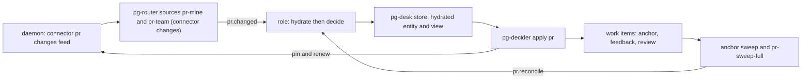
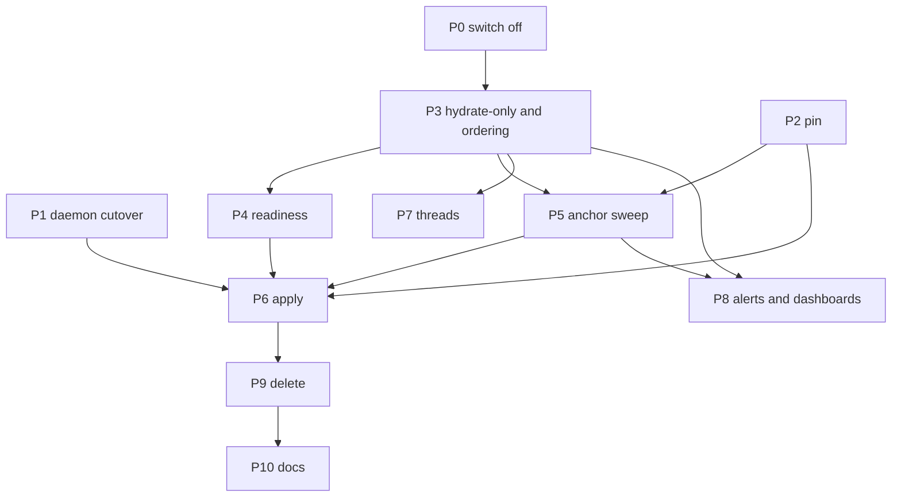

# PR lane refactor: replace the legacy sync and reconcile lane after the schema-2 cutover

Status: DRAFT for review (bead `pg2-6mo45.2`, epic `pg2-6mo45`). Not approved.
Date: 2026-10-20.
Owner: the operator. Depends on: the daemon program `pg2-z5fax` (cutover phase `pg2-z5fax.8`).
Supersedes: the deferral in `pg2-15ja3` (ruling "A: collapse, defer deletions", 2026-10-14), the
date-based deferral of `pg2-l2wkd`, and the record-path fix `pg2-f6osn`.

## 1. Intent

Pull request work (anchor, feedback and review work items) has not been opened or closed since
2026-10-19 16:12Z. This design finishes the move from pg-desk's legacy per-PR sync lane to the
entity change flow that ADR 0077 specified, so PR work is again driven by one decider reading
one hydrated view, and so the lane cannot be broken by a schema change again.

### 1.1 What happened

`pg-desk migrate --cutover` ran on the live store on 2026-10-19 (16:10Z to 16:15Z) and moved it to
schema 2. The migration drops `interpretation.sync_error` and the `ledger` table (ADR 0077 removes
the sync stage that wrote them). The legacy PR lane was still deployed and still needs both:

| Piece                                         | Result since 2026-10-19 16:20Z                                       |
| --------------------------------------------- | -------------------------------------------------------------------- |
| `desk-pr` role (`pg-desk run pr`)             | 0 ok, 1,200 failed; each ends at stage `record_sync_error`           |
| `desk-reconcile` role (`pg-desk reconcile`)   | every run fails with `no such table: ledger`                         |
| `pr-decider` role (plan form, writes nothing) | 428 ok, 56 failed (`does not resolve to a stored entity`)            |
| `desk-thread` role                            | failures are the Claude usage limit, not the schema (separate cause) |

The `record_sync_error` failure is the second error. The first is the sync stage reading the dropped
ledger; the pipeline then tries to store that failure through `UpsertInterpretation`, which refuses
a non-empty `SyncError` on schema 2, and the second error replaces the first in the run record.

### 1.2 Why the plan missed it

- ADR 0077 assumed one stop-the-world release: migrate the store, ship the PR decider, delete the
  sync machinery together.
- The daemon design (spec rev 7, 2026-10-09) kept the PR lane and struck every PR step from Phase 10.
  On 2026-10-14 the operator ruled "collapse, defer deletions" (`pg2-15ja3`): the lane stays until a
  PR-decider phase replaces it. Phase 10 closed without decomposition. Its store-migration item and
  its issue-source item were recorded as "not ruled, not scheduled".
- On 2026-10-15 `pg2-r7v1h` landed the issue half of the deployment config. It recorded the order
  "migrate the store, then apply" because the new issue source refuses a schema-1 store. Its scope
  excluded PR, so nobody checked what the same migration removes from the PR lane.
- Phase 15 (daily focus) was written for a post-cutover world and needs the schema-2 tables.

Root cause: an irreversible, store-wide migration was separated from the lane it breaks, and no bead
owned "the PR lane survives schema 2". This design adds the missing owner and a traceability table
(section 10) so that every ADR 0077 decision and every daemon consumer row maps to a phase.

## 2. Operator rulings (2026-10-20, interactive session)

1. Fix forward. No store rollback.
2. Take the daemon path as quickly as possible. The shadow run started 2026-10-20 and the cutover
   MUST NOT wait for it to finish; ruling 14 of the daemon design (cut over with unmet criteria, one
   follow-up bead per unmet criterion) applies.
3. Do the full PR refactor properly. No stop-gap code fix of the record path. Switching off what is
   not working is the first step.
4. Any PR with an open work item MUST keep being tracked and updated until that work item is closed.
   Only after it closes do the daemon's `terminal_ttl` (24 h) and `expiry` (7 d) rules apply.
5. Mass adoption of existing anchors and a hydration burst are acceptable.
6. Threads that belong to tracked PRs are in scope and MUST be supported.
7. Alerts: keep the existing set, remove the four `sync_error` alerts with the lane, add the alerts
   in section 8. The Grafana dashboards MUST be updated in the same change.

## 3. Goals, non-goals, anti-goals

Goals:

- PR anchor, feedback and review work items are opened, updated and closed by `pg-decider` in
  `apply` mode, from a hydrated view, with no dependence on the ledger or `sync_error`.
- A PR with an open work item is never silently dropped from tracking.
- The legacy lane (sync stage, `pg-desk reconcile`, ledger, `heartbeat-item`, the deployment
  `desk-reconcile` tick, the `sync_error` metrics and alerts) is deleted.
- Every failure mode that was invisible in this outage has an alert that would have fired.

Non-goals:

- Changing the daemon's GitHub cost model beyond the open-anchor pin (section 5.2).
- Issue and Slack-thread decider rules other than what threads of tracked PRs need.
- Repairing `desk-thread`'s Claude usage-limit failures.

Anti-goals (a technically working result that would still be a failure):

- Any new alert keyed only on a stored row that can vanish. This outage read `sync_errors: 0` for the
  whole time, so rows-based alerts are blind to it. Every new alert MUST include a throughput or lag
  signal (section 8).
- A second source of truth for "which PR has an open work item" inside the daemon. The daemon MUST
  NOT depend on pg-desk or on the tracker (ADR 0077 dependency direction).

## 4. Current state (verified 2026-10-20)

- Store: schema 2; 495 PR rows, none hydrated (`hydrated_at` null) because the legacy `run pr`
  persist stage writes `entity` and `interpretation` rows but never sets `hydrated_at`. Its `as_of`
  is still current, so desk-pr still refreshes those rows even though its sync stage fails.
- `pg-desk pr show <id>` resolves from the store alone and fails for a PR with no stored row. The
  `pr-decider` failures are a race: `pr.changed` is delivered to `desk-pr` and `pr-decider` in
  parallel, and the decider reads the view before `desk-pr` has stored a new PR.
- The decider package exists with PR rules, a parity harness against the old sync stage, and a
  plan/apply split. The `pr-decider` role is deployed in plan form (writes nothing).
- Sources: `pr-mine` ticks; `pr-team` and `pr-sweep` fail intermittently under host load
  (the daemon path addresses this).
- The daemon (`pg-connector-github`): change engine, change feed, settle, metrics landed. Shadow run
  started 2026-10-20; cutover phase has no packets yet.
- Daemon keep-alive today: an entity is kept alive while it is a member of a configured query or was
  accessed within `keepalive_window` (24 h); merged and closed PRs use `terminal_ttl` (24 h);
  entities are evicted after `expiry` (7 d). `left_query` is recorded only from a complete listing
  and only after an entity read confirms it.

## 5. Target architecture

### 5.0 What hydration does and what the decider decides

Two separate jobs, and the design keeps them separate.

**Hydration (pg-desk) answers "what is true about this PR right now?" and decides nothing.** For one
PR id it reads from the connector only, never from the forge or the tracker directly: the PR itself
(title, state, draft flag, head commit, mergeability, review decision, comment and review counts),
its files and commits (stored by head commit and not re-read while the head is unchanged), its CI
runs (per-job results only for failing runs on the current head), its conversation (comments and
review threads), the work items already linked to it, and the dependencies of those work items. It
then interprets that data with pure, deterministic rules and no model: who owns the PR (mine,
co-owned or team), its kind, languages and size, urgency, category, which feedback is addressed,
approvals, gate state, whether it waits on the operator, why it matched a watched query, and whether
it is ready to promote. The result is stored: the raw snapshot with a version and a `hydrated_at`
stamp, the interpretation row, and one change-log entry. After that, `pg-desk pr show <id>` answers
from the store alone, which is the only thing the decider reads.

**The decider answers "which work items should exist for this PR, and in what state?"** It reads the
stored view and computes the whole action set again on every run, so a re-run on an unchanged view
writes nothing. The work-item kinds (`docs/behavior/pg-decider/work-items.md`):

| Kind               | What it asks a worker to do                       | Governed by rule           | Only for       |
| ------------------ | ------------------------------------------------- | -------------------------- | -------------- |
| `anchor`           | nothing; it is the parent, one per PR             | adoption and closure rules | every PR       |
| `review-pr`        | review the PR at its current head                 | `review.head-advanced`     | per ownership  |
| `process-feedback` | address the unaddressed review feedback           | `feedback.digest-changed`  | mine, co-owned |
| `fix-ci`           | fix the failing CI builds on the current head     | `fixci.failing-on-head`    | mine, co-owned |
| `resolve-conflict` | resolve the merge conflict with the base          | the conflict rule          | mine, co-owned |
| `focus-item`       | one bead per source entity picked for daily focus | `focus.item`               | PR and issue   |

Around those: a PR that merges or closes gets its anchor and children closed, and a reopened PR gets
them reopened; existing anchors are adopted by backend node id or by title shape instead of being
recreated; `hide` stops every action on a PR, `wip` is view-only; a closed `fix-ci`,
`resolve-conflict` or `process-feedback` item is not recreated for the same context (the same head
and base); every write carries an audit comment naming the rule and the facts it keyed on; and a
rule that fails `escalate_after` (3) runs in a row raises one `human` task instead of retrying
forever. The decider never calls the forge and never writes pg-desk state except annotations.

Today, with the sync stage dead, none of this runs: the legacy lane did both jobs in one process
and needed the dropped ledger to know which work item belonged to which PR.

### 5.1 Hydrate then decide (ordering)

The decider MUST NOT read a view that has not been hydrated for the event it is deciding on. Today
two roles race. Options:

- (a) One role whose command runs hydration and then `pg-decider apply pr <id>` in sequence. Ordering
  is guaranteed by construction; it composes two tools in deployment config, which keeps pg-desk
  independent of the decider.
- (b) Two roles chained by an event emitted after hydration. Cleaner separation, an extra event
  type and a hop.

Recommendation (my call, for the builder check): (a).

Hydration verb: the legacy `pg-desk run pr` never sets `hydrated_at`, so focus coverage and the
change log do not see it. Hydration SHOULD go through the entity-change path (`pg-desk pr refresh`,
which runs `RunEntityChange`) or `run pr` MUST be changed to do the same. Open question U3.

### 5.2 Open-anchor tracking (ruling 4)

The daemon design (rev 7, "Keep-alive, revalidation and expiry") MUST be amended: an entity with an
open work item stays in the keep-alive set until that work item closes; only then do `terminal_ttl`
and `expiry` apply.

The daemon cannot read the tracker. Two ways to tell it:

- Pin: the decider calls a daemon op to pin a PR when it creates or finds an open anchor, and to
  release the pin when the anchor closes. The pin is stored in the daemon store. A lost release is
  bounded by a pin lease the decider renews on every run and the sweep renews for every open anchor.
- Sweep as keep-alive: the anchor sweep reads every open anchor's PR on a period shorter than
  `keepalive_window`, relying on the existing "accessed within the window" rule. No daemon change,
  but the guarantee silently lapses if the sweep stops.

Recommendation (my call): the pin with a lease, because ruling 4 is a guarantee and a lapse is
silent in the second option. The pin is a small, backward-compatible daemon op and the lease means a
crashed decider cannot pin a PR forever.

### 5.3 Anchor sweep (replaces `pg-desk reconcile`)

`pg-desk reconcile` closes anchors whose PR left every watched query. The replacement is a periodic
pg-router source that lists open PR anchors from the tracker and emits one event per anchor PR; the
hydrate-then-decide role handles it exactly like a change event, so a PR that merged while no query
watched it is hydrated, observed as merged, and its anchor closed by the decider's closure rule. The
sweep also renews the pins of section 5.2.

### 5.4 Adoption and backfill

The ledger recorded which work item belongs to which PR. It is gone. The decider's adoption rules
(`adoption.go`, `adoption_nodeid.go`: node id, then title-prefix shapes) re-link existing anchors.
Before flipping to `apply`:

1. Hydrate every active PR (the 495-row burst; accepted by ruling 5; sized against the points budget).
2. Run `pg-decider plan` over every open anchor and review the adoption report: every open anchor
   MUST be adopted exactly once and nothing MUST be created twice.
3. Run the parity gate against the real binaries; every difference MUST be listed as expected.

### 5.5 Threads (ruling 6)

Two meanings of "thread" appear in the system and both are covered:

- GitHub review threads are part of the PR's conversation data (counts and resolution state are in the
  `conversation` group). They are covered by hydration and the decider's feedback rules.
- pg-desk's chat-thread entity type (a Slack thread linked to a PR) has no change feed today
  (`thread changes` is refused). Supporting threads of tracked PRs means: a thread feed or
  per-PR thread discovery, hydration of linked threads, and a decider rule that attributes thread
  activity to the PR's anchor. Open question U4 asks which of these the operator wants first.

## 6. Phases

Sizes are effort (S, M, L, XL), not time.

| Id  | Phase                                                                                     | Repo                                    | Size | Consumes                 | Produces                                                       |
| --- | ----------------------------------------------------------------------------------------- | --------------------------------------- | ---- | ------------------------ | -------------------------------------------------------------- |
| P0  | Switch off the dead legacy pieces (config only: `sync.mode` off, remove `desk-reconcile`) | deployment repo                         | S    | none                     | `pg2-6mo45.1`; `record_sync_error` and reconcile failures stop |
| P1  | Daemon cutover without waiting for the shadow run                                         | both, operator apply                    | L    | shadow report, ruling 14 | live daemon, `pr-sweep` retired, `--fresh` off                 |
| P2  | Open-anchor pin in the daemon                                                             | agent-support                           | M    | amended daemon design    | pin op, lease, tests, metrics                                  |
| P3  | Hydrate-only `run pr` and hydrate-then-decide                                             | agent-support, deployment               | M    | P0                       | no sync stage; hydrated entities; ordering role                |
| P4  | Decider readiness: adoption, parity, plan report                                          | agent-support                           | M    | P3                       | adoption report, parity gate green on live data                |
| P5  | Anchor sweep                                                                              | both                                    | M    | P2, P3                   | sweep source and role, pin renewal                             |
| P6  | Flip `pr-decider` to `apply`, exercise live                                               | deployment repo                         | S    | P1, P2, P4, P5           | PR work flows again; operator apply                            |
| P7  | Thread support for tracked PRs                                                            | agent-support                           | L    | P3, U4 answer            | thread feed or discovery, rule, tests                          |
| P8  | Alerts and dashboards                                                                     | agent-support, support-apps, deployment | M    | P3 to P5                 | section 8 set; dashboard panels                                |
| P9  | Delete the legacy machinery                                                               | agent-support, deployment               | L    | P6 stable                | scope of `pg2-l2wkd` and `pg2-ei1k8` list                      |
| P10 | Docs: ADR, behavior docs, runbook                                                         | agent-support                           | S    | all                      | ADR, updated behavior docs                                     |

The daemon cutover (P1) and the decider track (P2 to P5) are independent until P6: the decider reads
the existing `pr-mine` and `pr-team` feed unchanged, and the daemon serves those commands unchanged.
The daemon buys reliability (the `pr show --fresh` deadline kills under host load), not correctness.

Phase 15 checkpoint `pg2-2j5ac.44.37` (focus coverage) depends on P3.

## 7. Deletion scope (P9)

The `pg2-ei1k8` list plus the extras recorded in `pg2-15ja3`: `pg-desk reconcile` and
`heartbeat_item.go`; `internal/sync`; the `internal/pipeline` syncer, `Reconcile`, retry and ledger
coupling; `internal/store` `sync_retry.go` and `ledger.go`; the `sync:` config keys and
`review_settle_window`; the `sync_error` metrics (`pg_desk_sync_error_rows`,
`pg_desk_oldest_sync_error_age_seconds`, `pg_desk_sync_error_retrying_rows`,
`pg_desk_sync_error_exhausted_rows`, `pg_desk_sync_errors`) and the reconcile gauges in
`internal/httpapi/metrics_handler.go`; the behavior-doc sections for reconcile and `sync_error`;
and in the deployment repo the `desk-reconcile` remnants, the alert references, the evaluation
assertion `probeRequiredRuleUids` that requires `pg-desk-sync-error-rows`, and the escalation
triager prompt that names removed alerts. Re-derive every item from current source before deleting.

## 8. Alerts and dashboards

Keep: the pg-router rules (liveness, queue depth and stalled, failure rate by class, source failure
ratio, source not succeeded recently, gate held), the seven `pg-connector-github` rules, and the
pg-desk rules for liveness, snapshot stale, sweep bound, watch listing, focus and consumer lag.

Remove with P9: `pg-desk-sync-errors`, `pg-desk-sync-error-rows`, `pg-desk-sync-error-retrying`,
`pg-desk-unreconciled-anchor-age`.

Add (my proposal; the decider has no Prometheus metrics today, only the stderr counters line
`pg-decider.run-counters/v1` and an escalation bead after `escalate_after` consecutive failures):

| Alert                      | Signal                                                            | Why it would have caught this outage                       |
| -------------------------- | ----------------------------------------------------------------- | ---------------------------------------------------------- |
| Decider failures by rule   | failed actions and escalations per rule, from counters            | desk-pr failures were visible only via router failure rate |
| Oldest unapplied PR change | age of the oldest `pr.changed` event with no applied decider run  | successor of `pg-desk-unreconciled-anchor-age`             |
| Hydration backlog          | active PR entities with null `hydrated_at`, and oldest such age   | 489 PRs sat unhydrated with no alert                       |
| Dead-man on decider        | `pr.changed` delivered, zero decider actions over a window        | rows-based alerts read 0 throughout                        |
| Stale anchors              | open anchors whose PR is merged or closed, older than a threshold | closure gap for PRs outside every watched query            |

The decider counters need a path to Prometheus (a metrics push, or a log-shipper match on the
contract string). Choosing it is a P8 design item.

Dashboards (live in the support-apps repo under `darwin/modules/observability/dashboards/`):
update `pg-desk-metrics.json` (remove the `sync_error` panels, add hydration backlog, decider
throughput, anchor lag and stale anchors), the router progress dashboard from `pg2-kftf9.20`, and
`packages/pg-connector/grafana/pg-connector-github.json` (pins and, if the cap moves at cutover, the
cap line and the matching alert threshold).

## 9. Constraints

- This repository is public: the design, tests and docs MUST NOT name the deployment's repositories,
  projects or people. Deployment specifics live in the deployment repo.
- The daemon MUST NOT depend on pg-desk, pg-router or the tracker.
- pg-router owns every clock (ADR 0077, S30): no retry or timer loop in pg-desk.
- Validation per repo rules: targeted `nix build .#checks.<system>.<name>` through the wrapper in the
  background; tests against a real schema-2 store (the `OpenForTest` helper), not mocks.
- Every new or changed pg-router query or role MUST be exercised live once with a non-trivial outcome.

## 10. Traceability

Every row below MUST map to a phase or be recorded as dropped with a ruling.

| Source decision                                                         | Phase  |
| ----------------------------------------------------------------------- | ------ |
| ADR 0077: pull-through change flow (`pr changes` feed, acknowledgement) | P1     |
| ADR 0077: decisions move out of pg-desk into deciders (S2)              | P3, P6 |
| ADR 0077: deciders ship PR rules on day one (S20)                       | P4, P6 |
| ADR 0077: sync stage, ledger, run, heartbeat removed at cutover         | P9     |
| ADR 0077: `sync_error` auto-retry deleted at cutover (S30)              | P9     |
| Daemon spec: consumer table, `pr-sweep` retired                         | P1     |
| Daemon spec: `desk-reconcile` "Kept"                                    | P5, P9 |
| Daemon spec: `--fresh` removed from pg-desk `pr` reads                  | P1     |
| Daemon spec: keep-alive, revalidation and expiry                        | P2     |
| Accepted gap (`pg2-ei1k8`): PR merged after leaving every watched query | P5     |
| `pg2-l2wkd` deletion scope                                              | P9     |
| Phase 15 focus coverage (`pg2-2j5ac.44.37`)                             | P3     |

## 11. Open questions and risks

- U1. Hydrate-then-decide mechanism: one composed role (recommended) or chained events.
- U2. Open-anchor tracking: pin with lease (recommended) or sweep as keep-alive.
- U3. Hydration verb: `pg-desk pr refresh` (sets `hydrated_at`, writes the change log) or change
  `run pr`; cost per PR with and without `--fresh`.
- U4. Threads: which of thread feed, per-PR discovery, or decider attribution comes first.
- U5. Shadow report: which criteria will read NOT MET; each needs its own follow-up bead (ruling 14).
- U6. Adoption volume: the number of open anchors and how many the decider adopts without a ledger
  (measured in P4; a gap here blocks P6).
- U7. Decider exit-code accounting: exit 2 and 3 count as failed dispatches in the router failure-rate
  metrics; decide whether that is the intended alerting path or needs its own reason.
- U8. Backfill cost: the 495-PR hydration burst against the points budget while the shadow run shares
  the same token.
- Risk R1. Until P6, no PR work items are opened or closed. Accepted by the operator (ruling 3); a
  config-only stop-gap (switching the sync stage off, P0) restores hydration but not decisions.
- Risk R2. The decider has no production history for PR on schema 2; P4 and the live exercise in P6
  are the only evidence.

## 12. What is left to the builder

Package and file layout for the pin op, the sweep source's command line, the counters transport,
the dashboard panel queries, test fixtures, and the exact retirement order inside P9.

## 13. Resolutions from the builder check (calls made by the author)

A fresh reviewer read this document and asked eight questions. Where the answer is in the repo it is
stated here as fact; where it is a decision it is marked "Call:" and the operator MAY override it.

1. Feed and hydration. The PR sources stay the connector's `changes` command (`pr-mine`, `pr-team`),
   served by the daemon after P1. The pg-desk pull-through (`pg-desk pr changes` wrapped by the
   `pg-router-source-pg-desk` adapter, ADR 0077 S5 and S31 to S34) is NOT used for PR: the daemon
   design's consumer table marks pg-desk's PR change flow "Not used for PRs; retired", because the
   daemon now owns change detection, the confirmation read on leaving a query, and the local reconcile
   tier's job. The pull-through source remains the feed for issues. Therefore PR hydration needs a
   role (section 5.1), and the hydrate-then-decide role MUST bind both `pr.changed` and
   `pr.reconcile` (the type `pr-sweep-full` keeps emitting as the 6 h backstop).
2. What the anchor sweep is for. With the pin (section 5.2) the daemon keeps every PR that has an
   open work item alive and emits its `merged` or `closed` change, so the normal path needs no sweep.
   The sweep exists for three cases: pinning anchors that were created before pins existed (done once
   at P5 and P6), renewing leases, and a backstop for a missed delivery or a pin lost when the daemon
   store is moved aside. The accepted gap of `pg2-ei1k8` was a PR that merges after leaving every
   watched query; the pin closes it for any PR with an open work item. It MUST emit `pr.reconcile`
   (not a new type) so the router binds need no change beyond the role in item 1.
3. P0 is config only. With `sync.mode` set to `off`, `Sync()` returns nil (`internal/sync/sync.go`,
   `ModeOff` check) and the pipeline gates the call on the same mode, so a failing sync no longer
   reaches the record step and `desk-pr` exits 0. `desk-reconcile` has no mode check and is removed.
   `desk-pr` keeps persisting its `entity` and `interpretation` rows. `pr-decider` (plan form) is NOT
   switched off: its focus rule rides that role and several deployment checks pin it. Its failures
   until P3 are the hydration race of section 5.1.
4. Pin contract. Call: a new connector op pair `pr pin <id> --lease <duration>` and `pr unpin <id>`,
   forwarded by the umbrella to the daemon like the other `pr` ops, so the decider reaches it through
   the connector it already depends on and the daemon never learns about the tracker. The lease
   defaults to `keepalive_window` and the decider and the sweep renew it on every run, so an
   unreleased pin expires on its own. A pin lives in the daemon store; when the store is moved aside
   the pins are lost and the sweep re-establishes them within one sweep period. P2 MUST land and be
   deployed with the daemon live (P1), because the pin only exists in the daemon. P6 therefore
   depends on both.
5. P1 contents (from the daemon program's cutover phase): install the daemon with the post-cutover
   budget; switch the registry to the daemon instance; turn on the umbrella pass-through,
   acknowledgement and opt-out; clear the two old instances' umbrella cache and ledger files; retire
   `pr-sweep`; drop `--fresh` from `pg-desk` gather's `pr` reads (the `issue` reads and `head_check`
   keep it); exercise the sources live once; verify the review pre-check treats `unavailable` as
   retryable. Mostly deployment config plus operator apply, with docs-only edits; the one possible
   code change is the pre-check. Under ruling 14 the cutover bead MUST record each unmet shadow
   criterion and file a follow-up bead for each.
6. Backfill. Call: a controlled, paced hydration of the active PRs (a loop over the hydration verb with
   a fixed rate) that stops when the newest `graphql_remaining` falls under 3,000, the same floor the
   shadow runbook uses, rather than a config knob. This keeps the shadow run's budget safe.
7. Alert metrics path. Call: a log-shipper match on the `pg-decider.run-counters/v1` line is the final
   answer for P8 (size M). A push exporter would add a dependency and is out of scope. Each new alert
   rule uid MUST be registered with `pg-router-probe` or it will not escalate to a bead.
8. Threads. Call (default until the operator says otherwise): first make the decider attribute thread
   activity to a PR using the thread-to-PR links pg-desk already records, and hydrate linked threads
   through the existing `thread` entity path; a new thread change feed (`thread changes` is refused
   today) is a second step inside P7. P7 stays sized L until U4 is answered.
