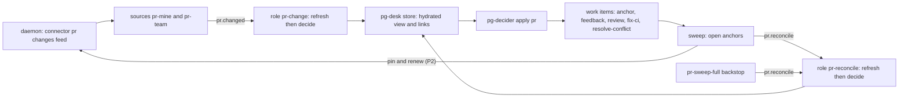
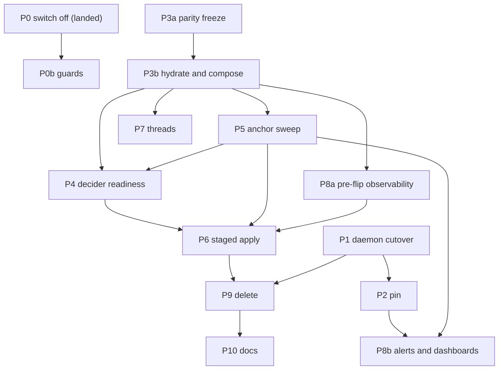

# PR lane refactor: replace the legacy sync and reconcile lane after the schema-2 cutover

Status: DRAFT v2 for operator approval (bead `pg2-6mo45.2`, epic `pg2-6mo45`). Not approved.
Date: 2026-10-20.
Revision history: v1 written the same day; v2 incorporates a builder check and five independent
reviews (completeness, correctness, UX, observability, test coverage). Section 15 lists what each
review changed.
Owner: the operator. Depends on: the daemon program `pg2-z5fax` (cutover phase `pg2-z5fax.8`).
Supersedes: the deferral in `pg2-15ja3` (ruling "A: collapse, defer deletions", 2026-10-14), the
date-based deferral of `pg2-l2wkd`, and the record-path fix `pg2-f6osn`.

## 1. Intent

Pull request work (anchor, feedback, review, fix-ci and resolve-conflict work items) has not been
opened or closed since 2026-10-19 16:12Z. This design finishes the move from pg-desk's legacy per-PR
sync lane to the entity change flow that ADR 0077 specified, so PR work is again driven by one
decider reading one hydrated view, and so the lane cannot be broken silently by a schema change
again.

### 1.1 What happened

`pg-desk migrate --cutover` ran on the live store on 2026-10-19 (16:10Z to 16:15Z) and moved it to
schema 2. The migration drops `interpretation.sync_error` and the `ledger` table (ADR 0077 removes
the sync stage that wrote them). The legacy PR lane was still deployed and still needs both:

| Piece                                         | Result since 2026-10-19 16:20Z                                       |
| --------------------------------------------- | -------------------------------------------------------------------- |
| `desk-pr` role (`pg-desk run pr`)             | 0 ok, 1,200 failed; each ends at stage `record_sync_error`           |
| `desk-reconcile` role (`pg-desk reconcile`)   | every run fails with `no such table: ledger`                         |
| `pr-decider` role (plan form, writes nothing) | 428 ok, 56 failed (`does not resolve to a stored entity`)            |
| `desk-thread` role                            | failures are the Claude usage limit, not the schema (separate cause) |

The `record_sync_error` failure is the second error. The first is the sync stage reading the dropped
ledger; the pipeline then tries to store that failure through `UpsertInterpretation`, which refuses
a non-empty `SyncError` on schema 2, and the second error replaces the first in the run record.

### 1.2 Why the plan missed it

- ADR 0077 assumed one stop-the-world release: migrate the store, ship the PR decider, delete the
  sync machinery together.
- The daemon design (spec rev 7, 2026-10-09) kept the PR lane and struck every PR step from Phase 10.
  On 2026-10-14 the operator ruled "collapse, defer deletions" (`pg2-15ja3`): the lane stays until a
  PR-decider phase replaces it. Phase 10 closed without decomposition. Its store-migration item and
  its issue-source item were recorded as "not ruled, not scheduled".
- On 2026-10-15 `pg2-r7v1h` landed the issue half of the deployment config. It recorded the order
  "migrate the store, then apply" because the new issue source refuses a schema-1 store. Its scope
  excluded PR, so nobody checked what the same migration removes from the PR lane.
- Phase 15 (daily focus) was written for a post-cutover world and needs the schema-2 tables.
- No test in either repo ties a deployed role to the schema it needs, so nothing failed before the
  operator ran the migration (section 10).

Root cause: an irreversible, store-wide migration was separated from the lane it breaks, no bead
owned "the PR lane survives schema 2", and nothing mechanical checked it. This design adds the
owner, a traceability table (section 12), a cross-repo contract test (section 10) and an alert that
reads the outcome rather than the machinery (section 9).

## 2. Operator rulings (2026-10-20, interactive session)

1. Fix forward. No store rollback.
2. Take the daemon path as quickly as possible. The shadow run started 2026-10-20 and the cutover
   MUST NOT wait for it to finish; ruling 14 of the daemon design (cut over with unmet criteria, one
   follow-up bead per unmet criterion) applies.
3. Do the full PR refactor properly. No stop-gap code fix of the record path. Switching off what is
   not working is the first step, and what is constantly failing stays off until it is expected to
   work.
4. Any PR with an open work item MUST keep being tracked and updated until that work item is closed.
   Only after it closes do the daemon's `terminal_ttl` (24 h) and `expiry` (7 d) rules apply.
5. Mass adoption of existing anchors and a hydration burst are acceptable.
6. Threads that belong to tracked PRs are in scope and MUST be supported.
7. Alerts: keep the existing set, remove the four `sync_error` alerts with the lane, add the alerts
   in section 9. The Grafana dashboards MUST be updated in the same change.

## 3. Goals, non-goals, anti-goals

Goals:

- PR work items are opened, updated and closed by `pg-decider` in `apply` mode, from a hydrated
  view, with no dependence on the ledger or `sync_error`.
- A PR with an open work item is never silently dropped from tracking.
- The legacy lane (sync stage, `pg-desk reconcile`, ledger, the deployment `desk-reconcile` tick,
  the `sync_error` metrics and alerts) is deleted.
- The next silent stall of PR work is caught by an alert that reads the outcome ("an open PR has no
  anchor") and by a test that fails before a migration reaches production.

Non-goals:

- Changing the daemon's GitHub cost model beyond the open-anchor pin (section 6.3).
- Repairing `desk-thread`'s Claude usage-limit failures.
- A new thread change feed before attribution of existing thread links works (section 6.6).

Anti-goals (a technically working result that would still be a failure):

- Any alert that reads only a stored row or a throughput proxy. This outage read `sync_errors: 0`
  for its whole duration, and the failure-rate alert went quiet the moment P0 made `desk-pr` exit 0.
  The primary alert MUST be an outcome invariant with `noDataState: Alerting`.
- Flipping the decider to `apply` before that alert is live and rule-tested (P8a precedes P6).
- A second source of truth for "which PR has an open work item" inside the daemon. The daemon MUST
  NOT depend on pg-desk or on the tracker.
- A flip that mints duplicates: the first `apply` MUST be staged, attributable and reversible
  (section 6.5).

## 4. Current state (verified 2026-10-20)

- P0 is landed on the deployment repo's main branch (commit `414f0a27`, closed bead `pg2-6mo45.1`;
  not yet applied by the operator; post-apply verification is gated bead `pg2-oli1o`):
  `sync.mode` is `off`, the `desk-reconcile` query, role and handler are removed, and the
  `pr-decider` role is declared with `enabled = false` (three flake checks were changed to pin it as
  declared-but-disabled). Consequence: the PR focus rule (`focus.item`) also does not run, so
  `pg-desk doctor` reports unminted PR focus selections until P6 re-enables the role.
- With `sync.mode off`, `Sync()` returns nil (`internal/sync/sync.go`), so `desk-pr` exits 0.
  The pipeline calls `Sync` unconditionally; the mode check is inside `Sync`.
- The legacy `run pr` persist stage writes `entity` and `interpretation` rows (their `as_of` is
  current) but derives no links, sets no `hydrated_at`, bumps no version and writes no change log.
  All 495 PR rows have a null `hydrated_at`. Links are derived only by the entity-change path
  (`RunEntityChange`, reached through `pg-desk pr refresh`). So P0 restores row freshness, NOT
  hydration, and not work-item links.
- `pg-desk pr show <id>` resolves from the store alone and succeeds on such a legacy row with zero
  links. The decider does not check the view's version or staleness (apart from the focus path), so
  a decider run on that view would mint a new anchor for every PR. The `pr-decider` failures seen
  so far were a race: `pr.changed` reaches `desk-pr` and `pr-decider` in parallel, and the decider
  reads the view of a PR that has no stored row yet.
- The decider's index of existing work items is built from the view's links, which come from the
  gather's `work-beads` query. The deployed query lists only open, in-progress and blocked items and
  only the `merge-request` type plus `process-feedback:` and `review-pr:` tasks. Closed items and
  every `fix-ci` and `resolve-conflict` item are invisible to it (section 6.2).
- The parity gate's old side runs `pg-desk run pr` in sync plan mode and reads the ledger; it cannot
  pass once the sync stage is gone (section 6.7).
- The router's command executor never reads the stderr of a successful run, so the decider's counters
  line (`pg-decider.run-counters/v1`) never reaches any log except on failures (section 9).
- Sources: `pr-mine` ticks; `pr-team` and `pr-sweep` fail intermittently under host load (about 6 to
  25 percent of ticks in the last six hours); those are not constant failures and stay on.
- The daemon (`pg-connector-github`): change engine, change feed, settle and metrics landed. The
  shadow run started 2026-10-20 and is healthy; the cutover phase has no packets yet.
- Daemon keep-alive today: an entity is kept alive while it is a member of a configured query or was
  accessed within `keepalive_window` (24 h); merged and closed PRs use `terminal_ttl` (24 h);
  entities are evicted after `expiry` (7 d). The change feed is filtered to the query's members plus
  the rows of entities that just left it, so a PR outside every query delivers no change row to the
  query-keyed sources.

## 5. What hydration does and what the decider decides

Two separate jobs, and the design keeps them separate.

**Hydration (pg-desk) answers "what is true about this PR right now?" and decides nothing.** For one
PR id it reads from the connector only, never from the forge or the tracker directly: the PR itself
(title, state, draft flag, head commit, mergeability, review decision, comment and review counts),
its files and commits, its CI runs (per-job results only for failing runs on the current head), its
conversation (comments and review threads), the work items linked to it, and the dependencies of
the first matched work item. It then interprets that data with pure, deterministic rules and no
model: who owns the PR (mine, co-owned or team), its kind, languages and size, urgency, category,
which feedback is addressed, approvals, gate state, whether it waits on the operator, why it matched
a watched query, and whether it is ready to promote. The result is stored through the entity-change
path: the raw snapshot with a version and a `hydrated_at` stamp, the interpretation row, the derived
links to work items, and one change-log entry. After that, `pg-desk pr show <id>` answers from the
store alone, which is the only thing the decider reads. Each `pg-desk pr refresh` is a new process,
so its per-process cache of files and commits does not carry between runs; a backfill pays the full
read cost for every PR.

**The decider answers "which work items should exist for this PR, and in what state?"** It reads the
stored view and computes the whole action set again on every run, so a re-run on an unchanged view
writes nothing. The work-item kinds (`docs/behavior/pg-decider/work-items.md`):

| Kind               | What it asks a worker to do                       | Governed by rule           | Only for       |
| ------------------ | ------------------------------------------------- | -------------------------- | -------------- |
| `anchor`           | nothing; it is the parent, one per PR             | adoption and closure rules | every PR       |
| `review-pr`        | review the PR at its current head                 | `review.head-advanced`     | per ownership  |
| `process-feedback` | address the unaddressed review feedback           | `feedback.digest-changed`  | mine, co-owned |
| `fix-ci`           | fix the failing CI builds on the current head     | `fixci.failing-on-head`    | mine, co-owned |
| `resolve-conflict` | resolve the merge conflict with the base          | the conflict rule          | mine, co-owned |
| `focus-item`       | one bead per source entity picked for daily focus | `focus.item`               | PR and issue   |

Around those: a PR that merges or closes gets its anchor and children closed, and a reopened PR gets
them reopened; existing anchors are adopted by backend node id or by title shape instead of being
recreated; `hide` stops every action on a PR, `wip` is view-only; a closed `fix-ci`,
`resolve-conflict` or `process-feedback` item is not recreated for the same context (the same head
and base); every write carries an audit comment naming the rule and the facts it keyed on; and a
rule that fails `escalate_after` (3) runs in a row raises one `human` task instead of retrying
forever. The decider never calls the forge and never writes pg-desk state except annotations.

Today, with the sync stage dead, none of this runs: the legacy lane did both jobs in one process
and needed the dropped ledger to know which work item belonged to which PR.

## 6. Target architecture

The PR sources stay the connector's `changes` command (`pr-mine`, `pr-team`), served by the daemon
after P1. The pg-desk pull-through (`pg-desk pr changes` through the `pg-router-source-pg-desk`
adapter, ADR 0077 S5 and S31 to S34) is NOT used for PR: the daemon design's consumer table marks
pg-desk's PR change flow "Not used for PRs; retired", because the daemon owns change detection and
the confirmation read on leaving a query. The pull-through remains the feed for issues.

### 6.1 Hydrate then decide

The decider MUST NOT decide on a view that was not hydrated through the entity-change path.

- Hydration verb: the composed role MUST hydrate with `pg-desk pr refresh <id>`, not `run pr`, so
  links, `hydrated_at`, version and the change log exist. `run pr` is not used for PR after P3b and
  is deleted in P9.
- Composition (call, section 13 item U1): one command per role runs refresh and then
  `pg-decider apply pr <id>` in sequence, so ordering is guaranteed by construction and pg-desk stays
  independent of the decider. The command MUST be a packaged, tested binary or script in this
  repository, not a shell snippet in the deployment config, so its exit-code mapping is testable.
- Fail closed: the decider (or the composed command) MUST refuse and exit non-zero with a distinct
  code when the view's version is 0, its `hydrated_at` is null, or it is marked stale, so an
  unhydrated view can never mint an anchor.
- Exit mapping: a refresh exit of 2 (degraded; nothing is written) MUST NOT run the decider; exit 3
  (failed, including not found) MUST NOT run the decider but MUST be reported with its own code.
  The command exits with a code that names the failing stage (hydrate or decide) in the code and in
  its stderr `error_class`, because the router counts every non-zero exit except 9 as a failed
  dispatch and cannot tell the stages apart.
- Not found: a PR that no longer exists (deleted or transferred repository) exits 3 from refresh, so
  the decider never runs and its anchor would never close. The composed command MUST handle it: with
  an open anchor it records the condition and raises one `human` escalation (never silently
  nothing). The builder MAY instead add a removed-change path to refresh.
- Two roles, one command (call): `pr-change` binds `pr.changed` and `pr-reconcile` binds
  `pr.reconcile`. One role binding both would take a sweep burst (about 88 events for
  `pr-sweep-full`) ahead of change events, because a handler has one outstanding offer at a time;
  that is the `pg2-pkwkr` stall. The sweep emits at most a bounded number of events per tick and
  carries the rest to the next tick. `pr.reconcile` events are born expired, so they are not retried
  by the router; recovery is the next sweep.

### 6.2 Work-item visibility

The decider can only avoid duplicates and reopen items it can see.

- The gather's `work-beads` query and the decider's dedup lookup MUST include closed items and all
  six kinds (`merge-request`, `process-feedback`, `review-pr`, `fix-ci`, `resolve-conflict`,
  `focus-item`), or the decider MUST get its own lookup by dedup key. Without this, a closed
  `review-pr` is recreated instead of reopened, and a `fix-ci` item is minted again on every run.
- This is a P4 gate item with an end-to-end test (section 10): the second `apply` MUST write nothing
  against a tracker listing that behaves like production.

### 6.3 Open-anchor tracking (ruling 4)

Two parts, because the daemon cannot read the tracker and the feed is query-keyed.

Interim guarantee, available before the daemon cutover (P5): the sweep reads every open anchor's PR
through `pg-desk pr refresh` at least once per sweep period. A read counts as an access, so the
daemon's `keepalive_window` rule keeps the PR alive, and the old backend simply refreshes it. The
sweep period (call: 1 hour) MUST be shorter than the lease or window it renews (24 h). A lapse of the
sweep is itself alerted (section 9), because this option fails silently otherwise.

Hardening, with the daemon (P2): an explicit pin.

- Contract (call): connector ops `pr pin <id> --lease <duration>` and `pr unpin <id>`, forwarded by
  the umbrella to the daemon like the other `pr` ops. The decider does not call them from a rule;
  the sweep and the composed command do, driven by the open anchors in the view, so the decider stays
  tracker-only and the daemon never learns about the tracker.
- A pin keeps the entity alive and makes it a member of a configured pseudo-query `pinned`, so its
  changes (including `merged` and `closed`) appear in the change feed of a source `pr-pinned`. A
  plain pin without feed membership would keep the PR fresh but deliver nothing for a PR outside
  every watched query, which would make the sweep, not the pin, the only closer.
- The lease defaults to `keepalive_window` and every sweep renews it, so a crashed sweep cannot pin a
  PR forever. When the daemon store is moved aside the pins are lost and the first poll of every key
  returns `cursor_expired`; the operator runs the documented reset and the sweep re-pins within one
  period. The sweep period is the recovery bound.
- A hidden PR (`hide`) skips every decider rule including closure. The sweep MUST NOT renew pins for
  hidden PRs, and the stale-anchor alert excludes them but a separate count reports "hidden PR with
  an open anchor" so it is visible, not silent.
- The daemon design amendment ("Keep-alive, revalidation and expiry": an entity with an open work
  item stays until it closes, then `terminal_ttl` and `expiry` apply, plus the pin op and the
  `pinned` query) is a deliverable of P2, produced before its implementation.

### 6.4 Anchor sweep

A periodic pg-router source lists open PR anchors from the tracker and emits one `pr.reconcile` event
per anchor PR (bounded per tick, carried over). The `pr-reconcile` role handles it exactly like a
change event, so a PR that merged while no query watched it is hydrated, observed as merged and its
anchor closed. The sweep is load-bearing for three cases: the interim guarantee (6.3), pinning
anchors that predate pins, and PRs outside every query. `pr-sweep-full` (every 6 h, served from the
daemon's query cache after P1 at no extra GitHub cost) stays as the backstop for PRs that have no
anchor yet; with P1 live its period SHOULD be shortened to bound recovery of a failed first run to
that period (call: 1 hour). Until P1, a PR with no anchor whose first run failed waits for the 6 h
backstop; that is the stated recovery bound for the interim.

### 6.5 Adoption, backfill and the first apply

The ledger recorded which work item belongs to which PR. It is gone. Adoption re-links existing
anchors by backend node id or title shape (`adoption.go`, `adoption_nodeid.go`).

1. Hydrate every active PR through `refresh` in a controlled, paced loop (call) that stops when the
   newest `graphql_remaining` is under 3,000, the floor the shadow runbook uses. The cost is the full
   per-PR read (section 5), not the cached cost.
2. Produce one aggregate plan over every PR: counts of adopt, create, reopen and close per kind, the
   list of unadoptable items (for example a keyless `process-feedback` item without a digest label),
   and the list of PRs that would get a second anchor. Pass thresholds are numbers fixed in the P4
   packet: zero PRs with a second anchor and zero unexplained creates; every unadoptable item has a
   recorded disposition (adopt, close with a reason, or leave) chosen by the operator.
3. Run the end-to-end decider tests of section 10 against real binaries.
4. First apply is staged (call): first only PRs that are merged or closed (their open work items are
   still claimable by agents today and are wasted effort), then active PRs. Each stage runs under a
   distinct tracker actor so its writes can be listed and reverted. `review-pr`, `fix-ci` and
   `resolve-conflict` creation MAY be suppressed for the first active pass.
5. Rollback: set the role back to `plan` and disabled, list the stage's writes by actor, and close or
   revert them. Writes already made are not undone automatically; the runbook gives the exact tracker
   query. This replaces the ADR 0077 rollback ("restore the store backup"), which fix-forward rules
   out.

### 6.6 Threads (ruling 6)

Two meanings of "thread" appear in the system.

- GitHub review threads are part of the PR's conversation data (counts and resolution state), covered
  by hydration and the decider's feedback rules.
- pg-desk's chat-thread entity type (a chat thread linked to a PR) has no change feed today
  (`thread changes` is refused). Default until the operator says otherwise (call): first make the
  decider attribute thread activity to a PR through the thread-to-PR links pg-desk already records and
  hydrate linked threads through the existing `thread` path; a new thread feed is a second step in P7.
  The parity fake connector answers only PR and issue calls, so P7 needs new fake endpoints and a
  scenario.

### 6.7 Parity gate

The parity gate compares the old sync stage's plan with the decider's plan. After the sync stage is
removed it has no old side. P3a runs the gate once against a pinned pre-removal pg-desk, records the
old plans as a frozen per-scenario golden (`expected-plan`), and converts the gate to compare the
decider against that golden, seeding with `pr refresh` on a schema-2 store instead of `run pr`.
Its "a stale expected entry fails" rule is kept. P9 deletes the old-side runner only.

### 6.8 Heartbeat chain stays

`pg-desk heartbeat` stamps `meta.last_heartbeat` (the source of `pg_desk_dashboard_stale`, a kept
alert) and the `source_fetch.*` keys behind `pg-desk freshness`, the data-age panels and the menu bar
data-age row. `pg-desk heartbeat-item`, which the deployment's `desk-heartbeat` query uses as its tick
generator, therefore stays. Deleting the heartbeat chain is out of scope unless its stamps are first
re-homed; P9 does not delete it.

## 7. Phases

Sizes are effort (S, M, L, XL), not time.

| Id  | Phase                                                                                                               | Repo                            | Size | Needs            |
| --- | ------------------------------------------------------------------------------------------------------------------- | ------------------------------- | ---- | ---------------- |
| P0  | Switch off the dead legacy pieces (landed `414f0a27`, not applied)                                                  | deployment repo                 | S    | none             |
| P0b | Guards: `sync.mode` pin check, schema-2 `run pr` test, interim tripwire alert                                       | both                            | S    | none             |
| P1  | Daemon cutover without waiting for the shadow run                                                                   | both, operator apply            | L    | shadow report    |
| P2  | Pin op, lease, `pinned` query and daemon design amendment                                                           | agent-support                   | M    | P1               |
| P3a | Parity freeze: golden plans from the pre-removal build                                                              | agent-support                   | S    | none             |
| P3b | Hydrate via `refresh`, composed role, fail-closed, exit mapping, run record                                         | both                            | L    | P3a              |
| P4  | Decider readiness: work-item visibility, adoption policy, aggregate plan, end-to-end tests                          | agent-support, deployment       | L    | P3b, P5          |
| P5  | Anchor sweep with keep-alive reads and bounded emit                                                                 | both                            | M    | P3b              |
| P8a | Pre-flip observability: coverage alert, backlog rule, run-record log source, probe uids, triager prompt, rule tests | all three repos                 | M    | P3b              |
| P6  | Staged flip to `apply`, rollback drill, live exercise                                                               | deployment repo, operator apply | M    | P3b, P4, P5, P8a |
| P7  | Thread support for tracked PRs                                                                                      | agent-support                   | L    | P3b              |
| P8b | Remaining alerts and dashboards (pin alerts, router stall map, dashboard panels)                                    | all three repos                 | M    | P2, P5           |
| P9  | Delete the legacy machinery                                                                                         | all three repos                 | L    | P6 stable, P1    |
| P10 | Docs: ADR, behavior docs, operator runbook                                                                          | agent-support                   | S    | all              |

The decider track (P3a to P6) does not wait for the daemon: it reads the existing `pr-mine` and
`pr-team` feed unchanged, and the interim keep-alive guarantee is the sweep (6.3). The daemon buys
reliability (the `pr show --fresh` deadline kills under host load) and the pin hardening. This is
faster than the v1 ordering, which made the flip wait for the daemon; the operator can re-impose that
order by adding edges from P1 and P2 to P6.

Phase 15 checkpoint `pg2-2j5ac.44.37` (focus coverage) needs P3b, and the PR focus rule needs the
`pr-decider` role re-enabled (it was disabled by P0), which P3b does in plan form.

Deployment changes the plan makes, so they are not discovered late: rewrite the `pr-decider` pins in
three flake checks (disabled-pin, the six-element argv pin, the focus check) for the composed argv; add
the new roles and the sweep query to the low-disk non-blocking pairing check; update the
`pg-router-queue-stalled` role-to-type map (it has `desk-reconcile`, not the new roles); add every new
alert uid to both probe lists and the required list; drop the four removed uids; update the escalation
triager prompt.

## 8. Deletion scope (P9)

The `pg2-ei1k8` list plus the extras of `pg2-15ja3`: `pg-desk reconcile`; `internal/sync`; the
`internal/pipeline` syncer, `Reconcile`, retry and ledger coupling; `internal/store` `sync_retry.go`
and `ledger.go`; the `sync:` config keys, `review_settle_window` and the home-manager options for
them; the metrics `pg_desk_sync_error_rows`, `pg_desk_oldest_sync_error_age_seconds`,
`pg_desk_sync_error_retrying_rows`, `pg_desk_sync_error_exhausted_rows`, `pg_desk_sync_errors`,
`pg_desk_oldest_anchor_check_age_seconds` and the `pg_desk_reconcile_*` gauges, with the sync reads
removed from the metrics callback that also serves the kept stale and age gauges (one read error
currently fails the whole callback); the `sync_error` and ledger lines of `pg-desk status` and the
`sync_error` and retry checks and remedy text of `pg-desk doctor`; the `run pr` command path for PR;
the PR halves of pg-desk's change flow that the daemon design retires (`pr changes`, the PR part of
`internal/changes`, `doctor_changeflow`); the old side of the parity harness; the
`internal/sync` contract checks in the flake; and the behavior-doc sections for reconcile,
`sync_error` and `run`. In the deployment repo: the `sync` block of the machine config, the alert
references and probe-uid entries, the evaluation assertion `probeRequiredRuleUids`, the triager prompt
text, and the retired `pr-sweep` (with P1). Daemon design Rollout step 6 items (moving the
posted-review sidecar into the store, removing the old backend packages and their darwin module once
no host registers them) and the docs-only plugin update of ruling 11 are tracked here or in the
daemon program's cleanup phases, not dropped. `heartbeat` and `heartbeat-item` are NOT deleted
(section 6.8). Re-derive every item from current source before deleting.

## 9. Observability

### 9.1 What would have caught this, and what must not be repeated

The outage was visible only through the generic router failure-rate alert; P0 silences even that
(`desk-pr` exits 0), and nothing then shows that PR work is not being created. The design therefore
adds an outcome alert before the flip, and a tripwire now.

### 9.2 Alerts

Keep: the pg-router rules, the seven `pg-connector-github` rules, and the pg-desk rules for liveness,
snapshot stale (`pg-desk-sync-stale`, uid contains "sync" but is a keeper), sweep bound, watch
listing, focus and consumer lag.

Remove with P9, using `deleteRules` entries (Grafana keeps a file-provisioned rule live after its file
drops it): `pg-desk-sync-errors`, `pg-desk-sync-error-rows`, `pg-desk-sync-error-retrying`,
`pg-desk-unreconciled-anchor-age`, with a test that the deleted uids are not in the rule groups.

Add:

| Alert                                  | Signal (source)                                                                                                                                                                                                                                              | Phase                  |
| -------------------------------------- | ------------------------------------------------------------------------------------------------------------------------------------------------------------------------------------------------------------------------------------------------------------ | ---------------------- |
| PR work not created (primary, outcome) | `pg_desk_pr_anchor_coverage` by state (none, one, many) and the age of the oldest hydrated open PR with no anchor, derived from the store at scrape time; `noDataState: Alerting` guarded by pg-desk liveness; `many` also catches duplicates after adoption | P8a                    |
| Hydration backlog                      | the existing `pg_desk_due_backlog` for type pr (a never-hydrated PR counts as due); needs a rule, not a metric                                                                                                                                               | P0b tripwire, P8a rule |
| Decider and hydrate failures           | one JSON record per run from the composed command (section 9.3), by stage and rule; router series for the new roles                                                                                                                                          | P8a                    |
| Sweep lapse                            | open anchors with no hydrate within the sweep period, from the run record or a store-derived gauge                                                                                                                                                           | P5                     |
| Pin and lease health                   | active pins and lease renewal failures (daemon); alert when open anchors exceed active pins for more than one sweep period                                                                                                                                   | P8b                    |
| Hidden PR with open anchor             | count from the store; low severity                                                                                                                                                                                                                           | P8b                    |

A throughput dead-man ("`pr.changed` delivered, zero actions") is dropped: an idempotent decider
legitimately plans nothing in a quiet window. "Oldest unapplied change" is dropped: the decider keeps
no last-applied sequence and PR has no pg-desk consumer cursor after the pull-through retirement.

Every new rule uid MUST be registered with `pg-router-probe` (both probe lists and the required list
in the deployment config) or it will not escalate to a bead; a generalised check fails when a new
rule uid is missing from the probe list. The triager prompt MUST learn the new fingerprints and the
investigation commands (`pg-decider plan pr <id>`, `pg-desk pr history`).

### 9.3 Run record

The router never reads the stderr of a successful command run, so a counters line on stderr cannot be
the transport (v1 error). The composed command MUST append one JSON record per run to a state file
registered as a log source (as `pg-router-events` is): entity, change sequence, hydrate result and
exit code, decide exit code, per-rule outcome and skip reason, and the failing stage. The sweep writes
one record per tick (anchors emitted, pins renewed, hidden skipped). With these an operator can answer
"why was PR X not acted on" without running `plan` against changed state. Gauges derived from the
store are computed in `pg-desk serve` at scrape time, as the existing change-flow and focus health
gauges are.

### 9.4 Dashboards

They live in the support-apps repo under `darwin/modules/observability/dashboards/`: update
`pg-desk-metrics.json` (remove the panels on removed metrics, add anchor coverage, hydration backlog
and failures, run and failure rate of the new roles, oldest queue age, pins and leases), update the
six `sync_error` columns in `pg-desk.json`, and update the dashboard validator, which assumes every
panel with an id of 10 or more is a focus panel. `pg-router.json` has no reconcile or sync panels.
`packages/pg-connector/grafana/pg-connector-github.json` gets the pin panels and, if the cap moves at
cutover, the cap line and matching alert threshold. The "router progress dashboard" named in
`pg2-kftf9.20` does not exist as a separate file. The panel removal ships in the same change as the
metric removal (P9), which therefore includes the support-apps repo.

### 9.5 Status truthfulness in the interim

`pg-desk status` prints `sync_errors: 0` and `doctor` passes "sync_error rows: 0" while the lane is
down. P3b adds a "pr lane" line to both, from hydration backlog and the time since the last decider
apply, so the operator is told the lane is not working. P9 removes the sync lines and the doctor gate.

## 10. Test strategy

Rules: a check of deterministic behavior lives in an automated test against the real tool in a
hermetic environment; a new or changed router query or role is exercised live once with a
non-trivial outcome; targeted `checks.<system>` builds, never a whole-repo flake check.

| Tier                                       | Test                                                                                                                                                                                                                                                                                                                                                                                                   | Phase       |
| ------------------------------------------ | ------------------------------------------------------------------------------------------------------------------------------------------------------------------------------------------------------------------------------------------------------------------------------------------------------------------------------------------------------------------------------------------------------ | ----------- |
| Integration, real pg-desk                  | On a migrated schema-2 store (`OpenNewSchemaForTest` plus `migrate --cutover`; plain `OpenForTest` is schema 1), `run pr` with sync off exits 0 and stores entity and interpretation rows                                                                                                                                                                                                              | P0b         |
| Cross-repo contract (flake check)          | pg-desk exports a verb manifest marking each verb schema-2-safe; one real-binary test runs every listed verb on a schema-2 store; a deployment check reads the rendered role argvs and fails if a role runs a verb not marked safe. This is the test that would have failed before the 2026-10-19 migration                                                                                            | P0b         |
| Flake check                                | the machine's pg-desk `sync.mode` value is pinned                                                                                                                                                                                                                                                                                                                                                      | P0b         |
| Golden (flake check)                       | parity gate compares the decider with the frozen old plans; stale expected entries still fail                                                                                                                                                                                                                                                                                                          | P3a         |
| Table test, real tools                     | refresh exit (0, 1, 2, 3, 4) against decider exit (0, 2, 3) gives the composed command's exit code and stage; a degraded refresh does not decide; not-found with an open anchor escalates                                                                                                                                                                                                              | P3b         |
| Integration, real binaries, fake connector | seed N open anchors: apply adopts all and mints nothing; a second apply writes nothing against a tracker listing that behaves like production; a closed review or feedback item stays closed for the same head; a merged PR closes anchor and children; a reopened PR reopens them; the fail-closed refusal on an unhydrated view; many anchors with no ledger                                         | P4          |
| Binding and shape tests                    | the new roles bind `pr.changed` and `pr.reconcile` respectively; the sweep emits one event per open anchor and none for an empty tracker; the per-tick bound holds                                                                                                                                                                                                                                     | P5          |
| Unit with fake clock                       | pin lease expires at now plus lease; renewal extends it; unpin releases it; a pinned PR survives `terminal_ttl` and `expiry` and then follows the normal rules; a moved-aside store has no pins until re-pinned; the umbrella forwards pin ops; the daemon imports neither pg-desk nor the tracker; the metrics catalog lists the pin gauge                                                            | P2          |
| Rule tests (`promtool`)                    | per new alert, including a case replaying 2026-10-19: failures present, `sync_error` rows zero, no anchors created, and the outcome alert fires                                                                                                                                                                                                                                                        | P8a         |
| Metrics test, schema 2                     | anchor coverage and backlog gauges on a migrated store                                                                                                                                                                                                                                                                                                                                                 | P8a         |
| Unit                                       | the review pre-check treats `unavailable` as retryable (P1); thread fake-connector endpoints and a parity scenario (P7); new fixtures pass the identifier allowlist (P10)                                                                                                                                                                                                                              | P1, P7, P10 |
| Live exercise                              | 495-PR backfill stays above `graphql_remaining` 3,000; adoption count equals the tracker's open-anchor count; one composed run on a real open anchor then a second run with zero writes; a real merge closes its anchor; a pin survives a daemon restart; a drill per new alert (induce the failure, confirm a bead is filed); a post-apply bead gated on `pn:applied` that asserts a metric condition | P6, P8b     |

## 11. Constraints

- This repository is public: the design, tests and docs MUST NOT name the deployment's repositories,
  projects or people. Deployment specifics live in the deployment repo.
- The daemon MUST NOT depend on pg-desk, pg-router or the tracker.
- pg-router owns every clock (ADR 0077, S30): no retry or timer loop in pg-desk.
- Validation per repo rules: targeted `nix build .#checks.<system>.<name>` through the wrapper in the
  background; tests against a real schema-2 store, not mocks.
- Every new or changed pg-router query or role MUST be exercised live once with a non-trivial outcome.
- Landing the agent-support change, relocking, and editing the deployment's probe-uid lists MUST
  happen together, because a deployment check fails when a listed uid is absent from the rendered
  rule files.

## 12. Traceability

Every row MUST map to a phase or be recorded as dropped with a ruling.

| Source decision                                                         | Phase                     |
| ----------------------------------------------------------------------- | ------------------------- |
| ADR 0077: pull-through feed for issues; PR feed is the daemon's         | P1                        |
| ADR 0077: decisions move out of pg-desk into deciders (S2)              | P3b, P6                   |
| ADR 0077: deciders ship PR rules on day one (S20)                       | P4, P6                    |
| ADR 0077: derived work-item links replace the ledger (S25)              | P3b, P4                   |
| ADR 0077: sync stage, ledger, run, heartbeat-item removed at cutover    | P9 (heartbeat stays, 6.8) |
| ADR 0077: `sync_error` auto-retry deleted (S30)                         | P9                        |
| ADR 0077 Consequences: rollback by restoring the store backup           | replaced by 6.5           |
| Daemon spec: consumer table, `pr-sweep` retired                         | P1                        |
| Daemon spec: `desk-reconcile` "Kept"                                    | replaced by P5 and P9     |
| Daemon spec: `--fresh` removed from pg-desk `pr` reads                  | P1                        |
| Daemon spec: keep-alive, revalidation and expiry                        | P2 (amendment), 6.3       |
| Daemon spec Rollout step 5 rollback (registry back, caches cleared)     | P1                        |
| Daemon spec Rollout step 6: sidecar, old packages, old darwin module    | P9                        |
| Daemon spec ruling 11: plugin docs-only update                          | P1 or P9                  |
| Accepted gap (`pg2-ei1k8`): PR merged after leaving every watched query | P5, 6.3                   |
| `pg2-l2wkd` deletion scope                                              | P9                        |
| Phase 15 focus coverage (`pg2-2j5ac.44.37`)                             | P3b                       |
| Dashboards and alert rule removal                                       | P8a, P8b, P9              |

## 13. Open questions and risks

Calls already made by the author are marked "call" above; the operator MAY override any of them.

- U1. One composed command with two roles (call), or chained events.
- U2. Interim keep-alive by sweep with the pin as hardening (call), or the pin before the flip.
- U3. Threads: attribution first (call), or a thread feed first. Sizes P7.
- U4. Sweep period 1 hour and `pr-sweep-full` shortened to 1 hour after P1 (calls).
- U5. Staged first apply with terminal PRs first and a distinct actor (call).
- U6. Disposition of unadoptable legacy items (the operator chooses per batch in P4).
- U7. Shadow report: which criteria read NOT MET; each needs its own follow-up bead (ruling 14).
- U8. Whether the flip may precede P1 and P2 (this design says yes; the operator MAY require otherwise).
- Risk R1. Until P6, no PR work items are opened or closed; P0 made the failing alert go quiet. The
  tripwire of P0b and a dated time box limit this. The PR focus rule is also off until P3b.
- Risk R2. The decider has no production history for PR on schema 2; P4's end-to-end tests and P6's
  staged flip are the only evidence.
- Risk R3. Dead PRs' open work items stay claimable by agents until the terminal-PR stage of P6.

## 14. What is left to the builder

Package and file layout for the composed command, the pin op and the sweep source; the verb-manifest
format; exact metric and label names; the dashboard panel queries; test fixtures; the exact
retirement order inside P9.

## 15. What the five reviews changed

- Completeness: the parity gate and its freeze (6.7), the heartbeat chain staying (6.8), `deleteRules`
  and the deployment probe lists (9.2), the recovery bound of failed first runs (6.4), the P9 list
  (section 8), rollback (6.5), and the missing traceability rows.
- Correctness: unhydrated-view duplicate minting and the fail-closed rule (4, 6.1), work-item
  visibility of closed and fix-ci items (4, 6.2), the pin needing feed membership (6.3), the corrected
  P0 facts (4), refresh semantics and exit codes (5, 6.1), head-of-line blocking (6.1), the missing
  sequencing edges (7).
- UX: staged and attributable first apply (6.5), dead PRs' work (R3), `hide` handling (6.3), status
  truthfulness (9.5), escalation bead content (the composed command's stage and the run record).
- Observability: the transport correction (9.3), the outcome alert (9.2), the interim tripwire and
  P8a before P6, dashboard facts (9.4).
- Test coverage: the cross-repo contract test and schema-2 `run pr` test (10), the golden parity gate,
  end-to-end decider tests, pin tests with a fake clock, rule tests that replay this outage.
