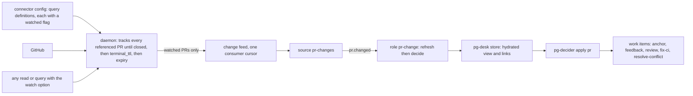
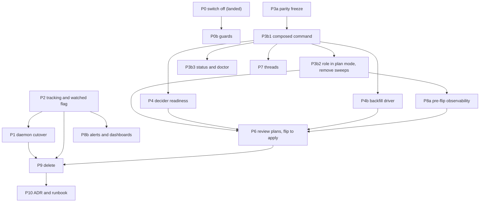

# PR lane refactor: replace the legacy sync and reconcile lane after the schema-2 cutover

Status: DRAFT v4 for operator approval (bead `pg2-6mo45.2`, epic `pg2-6mo45`). Not approved.
Date: 2026-10-20, revised 2026-10-22.
Revision history: v1 and v2 were written 2026-10-20. v2 incorporated a builder check and five
independent reviews (completeness, correctness, UX, observability, test coverage). v3 applied three
further operator rulings (8 to 10 in section 2) that remove the sweep, the pin and the second role
and replace them with a tracked-versus-watched split in the connector. v4 (2026-10-22) applies five
independent reviews of v3 and the operator rulings 11 to 17 that settle the open calls of v3 (every
former open call U1 to U10 is now decided, section 13). Section 15 lists what each revision changed.
v4 has NOT yet been through the follow-up independent review.
Owner: the operator. Depends on: the daemon program `pg2-z5fax` (cutover phase `pg2-z5fax.8`).
Supersedes: the deferral in `pg2-15ja3` (ruling "A: collapse, defer deletions", 2026-10-14), the
date-based deferral of `pg2-l2wkd`, and the record-path fix `pg2-f6osn`.

## 1. Intent

Pull request work (anchor, feedback, review, fix-ci and resolve-conflict work items) has not been
opened or closed since 2026-10-19 16:12Z. This design finishes the move from pg-desk's legacy per-PR
sync lane to the entity change flow that ADR 0077 specified, so PR work is again driven by one
decider reading one hydrated view, and so the lane cannot be broken silently by a schema change
again.

### 1.1 What happened

`pg-desk migrate --cutover` ran on the live store on 2026-10-19 (16:10Z to 16:15Z) and moved it to
schema 2. The migration drops `interpretation.sync_error` and the `ledger` table (ADR 0077 removes
the sync stage that wrote them). The legacy PR lane was still deployed and still needs both:

| Piece                                         | Result since 2026-10-19 16:20Z                                       |
| --------------------------------------------- | -------------------------------------------------------------------- |
| `desk-pr` role (`pg-desk run pr`)             | 0 ok, 1,200 failed; each ends at stage `record_sync_error`           |
| `desk-reconcile` role (`pg-desk reconcile`)   | every run fails with `no such table: ledger`                         |
| `pr-decider` role (plan form, writes nothing) | 428 ok, 56 failed (`does not resolve to a stored entity`)            |
| `desk-thread` role                            | failures are the Claude usage limit, not the schema (separate cause) |

The `record_sync_error` failure is the second error. The first is the sync stage reading the dropped
ledger; the pipeline then tries to store that failure through `UpsertInterpretation`, which refuses
a non-empty `SyncError` on schema 2, and the second error replaces the first in the run record.

### 1.2 Why the plan missed it

- ADR 0077 assumed one stop-the-world release: migrate the store, ship the PR decider, delete the
  sync machinery together.
- The daemon design (spec rev 7, 2026-10-09) kept the PR lane and struck every PR step from Phase 10.
  On 2026-10-14 the operator ruled "collapse, defer deletions" (`pg2-15ja3`): the lane stays until a
  PR-decider phase replaces it. Phase 10 closed without decomposition. Its store-migration item and
  its issue-source item were recorded as "not ruled, not scheduled".
- On 2026-10-15 `pg2-r7v1h` landed the issue half of the deployment config. It recorded the order
  "migrate the store, then apply" because the new issue source refuses a schema-1 store. Its scope
  excluded PR, so nobody checked what the same migration removes from the PR lane.
- Phase 15 (daily focus) was written for a post-cutover world and needs the schema-2 tables.
- No test in either repo ties a deployed role to the schema it needs, so nothing failed before the
  operator ran the migration (section 10).

Root cause: an irreversible, store-wide migration was separated from the lane it breaks, no bead
owned "the PR lane survives schema 2", and nothing mechanical checked it. This design adds the
owner, a traceability table (section 12), a cross-repo contract test (section 10) and an alert that
reads the outcome rather than the machinery (section 9).

## 2. Operator rulings (2026-10-20, interactive session)

1. Fix forward. No store rollback.
2. Take the daemon path as quickly as possible. The shadow run started 2026-10-20 and the cutover
   MUST NOT wait for it to finish; ruling 14 of the daemon design (cut over with unmet criteria, one
   follow-up bead per unmet criterion) applies.
3. Do the full PR refactor properly. No stop-gap code fix of the record path. Switching off what is
   not working is the first step, and what is constantly failing stays off until it is expected to
   work.
4. Any PR with an open work item MUST keep being tracked and updated until that work item is closed.
   Only after it closes do the daemon's `terminal_ttl` (24 h) and `expiry` (7 d) rules apply.
   (Ruling 8 generalises this to every referenced PR.)
5. Mass adoption of existing anchors and a hydration burst are acceptable.
6. Threads that belong to tracked PRs are in scope and MUST be supported.
7. Alerts: keep the existing set, remove the four `sync_error` alerts with the lane, add the alerts
   in section 9. The Grafana dashboards MUST be updated in the same change.
8. Tracking rule. Every PR the connector references (a query result, a direct read, or a watch) is
   kept locally and refreshed until it closes, then evicted by the normal `terminal_ttl` and
   `expiry` rules. A direct read has no different tracking rule. There is no manual untrack action
   and none is needed now.
9. Watched flag. Tracking and change events are separate. By default nothing is watched. A query in
   the connector's configuration carries a flag saying whether its results are watched, and a query
   or lookup MAY opt in to watching at call time. A PR flagged watched in any way stays watched
   until it closes and is evicted. `pr.changed` events are emitted only for watched PRs. pg-desk
   consumes only change events from the connector.
10. Drop reconcile. There is no `pr.reconcile` event and no sweep (`pr-sweep`, `pr-sweep-full`, the
    anchor sweep) until problems appear without them.

Rulings of the interactive session of 2026-10-22 (recorded on epic `pg2-6mo45`):

11. One role, `pr-change`, runs `pg-desk pr refresh <id>` and then `pg-decider` in one packaged
    command. There is no separate operator verb for it. `pg-decider` keeps its name and stays one
    command with `plan` and `apply`. An emit-events variant (the decider only emits actions and a
    separate writer applies them) was considered and not pursued (section 6.1); a rename or a split
    MAY be revisited once the lane works.
12. The first flip replaces the staged apply: the role runs in `plan` mode for a short period, the
    operator reviews the recorded plans, then switches to `apply` for all PRs. There is no stage
    selector, no creation-suppression switch, no distinct-actor tooling and no creates cap. Rollback
    is closing the beads created since the flip.
13. The flip MAY precede P1 and P2. The gap that a PR which left both old-feed queries while open is
    not followed before P1 (R6) is accepted, and so is P3b2 removing the sweeps before P1.
14. Threads: attribute them through the existing thread-to-PR links first, add a thread feed second.
15. The tracked-set alert threshold starts at about twice the post-backfill count and is revisited
    with data.
16. Several `review-pr` work items per PR over time are allowed (section 6.9). When a PR's head
    advances and no open, unclaimed review item exists, create one; when one exists, update its
    head. A closed item for the same head is never recreated. This replaces the old review settle
    window.
17. A watched PR stays watched after it leaves its query, so the only watching gap is the backlog at
    cutover. P1 marks every PR that has an open anchor as watched directly, with the watch option on
    a read, and verifies the count (section 6.3). There is no per-run re-assert.

## 3. Goals, non-goals, anti-goals

Goals:

- PR work items are opened, updated and closed by `pg-decider` in `apply` mode, from a hydrated
  view, with no dependence on the ledger or `sync_error`.
- A PR with an open work item is never silently dropped from tracking.
- The legacy lane (sync stage, `pg-desk reconcile`, ledger, the deployment `desk-reconcile` tick,
  the sweeps, the `sync_error` metrics and alerts) is deleted.
- Queries are defined in one place, the connector, and neither pg-router nor pg-desk names them.
- The next silent stall of PR work is caught by alerts that read the outcome (a PR never hydrated,
  a PR whose plan still has actions after apply, an anchor open on a finished PR) and by a test that
  fails before a migration reaches production.

Non-goals:

- Changing the daemon's GitHub cost model beyond the tracking rule of ruling 8 (section 6.3 states
  the cost risk).
- Repairing `desk-thread`'s Claude usage-limit failures.
- A new thread change feed before attribution of existing thread links works (section 6.6).
- Any reconcile or sweep mechanism (ruling 10).

Anti-goals (a technically working result that would still be a failure):

- Any alert that reads only a stored row or a throughput proxy. This outage read `sync_errors: 0`
  for its whole duration, and the failure-rate alert went quiet the moment P0 made `desk-pr` exit 0.
  The primary alerts MUST read outcomes, and the one that must fire when nothing runs MUST be
  testable for its no-data case (section 9.2).
- Flipping the decider to `apply` before those alerts are live and rule-tested (P8a precedes P6).
- A second source of truth for "which PR has an open work item" inside the daemon. The daemon MUST
  NOT depend on pg-desk or on the tracker.
- A flip that mints duplicates: the role MUST run in `plan` mode first, its plans MUST be recorded
  and reviewable, and the first `apply` MUST be reversible by closing the beads created since the
  flip (section 6.5).
- Mere reading making a PR produce work: a PR that was only read (tracked, not watched) MUST NOT
  reach the decider.

## 4. Current state (verified 2026-10-20)

- P0 is landed on the deployment repo's main branch (commit `414f0a27`, closed bead `pg2-6mo45.1`;
  not yet applied by the operator; post-apply verification is gated bead `pg2-oli1o`):
  `sync.mode` is `off`, the `desk-reconcile` query, role and handler are removed, and the
  `pr-decider` role is declared with `enabled = false` (three flake checks were changed to pin it as
  declared-but-disabled). Consequence: the PR focus rule (`focus.item`) also does not run, so
  `pg-desk doctor` reports unminted PR focus selections until P6 re-enables the role.
- With `sync.mode off`, `Sync()` returns nil (`internal/sync/sync.go`), so `desk-pr` exits 0.
  The pipeline calls `Sync` unconditionally; the mode check is inside `Sync`.
- The legacy `run pr` persist stage writes `entity` and `interpretation` rows (their `as_of` is
  current) but derives no links, sets no `hydrated_at`, bumps no version and writes no change log.
  All 495 PR rows have a null `hydrated_at`. Links are derived only by the entity-change path
  (`RunEntityChange`, reached through `pg-desk pr refresh`). So P0 restores row freshness, NOT
  hydration, and not work-item links.
- `pg-desk pr show <id>` resolves from the store alone and succeeds on such a legacy row with zero
  links. The decider does not check the view's version or staleness (apart from the focus path), so
  a decider run on that view would mint a new anchor for every PR. The `pr-decider` failures seen
  so far were a race: `pr.changed` reaches `desk-pr` and `pr-decider` in parallel, and the decider
  reads the view of a PR that has no stored row yet.
- The decider's index of existing work items is built from the view's links, which come from the
  gather's `work-beads` query. The deployed query lists only open, in-progress and blocked items and
  only the `merge-request` type plus `process-feedback:` and `review-pr:` tasks. Closed items and
  every `fix-ci` and `resolve-conflict` item are invisible to it (section 6.2).
- Nothing in pg-desk's interpretation depends on which query returned a PR: ownership comes from
  config and commit authors, and "match reasons" are recomputed from facts each run. Queries
  therefore carry no meaning downstream of the connector.
- The parity gate's old side runs `pg-desk run pr` in sync plan mode and reads the ledger; it cannot
  pass once the sync stage is gone (section 6.7).
- The router's command executor never reads the stderr of a successful run, so the decider's counters
  line (`pg-decider.run-counters/v1`) never reaches any log except on failures (section 9).
- Sources: `pr-mine` ticks; `pr-team` and `pr-sweep` fail intermittently under host load (about 6 to
  25 percent of ticks in the last six hours); those are not constant failures and stay on until the
  phase that replaces them.
- Today's live backend (`pg-connector-pr-github`) is query-agnostic: each `pr-mine` or `pr-team` poll
  makes the umbrella run the search and diff the result against a ledger. The daemon
  (`pg-connector-github`) instead reads its own config (query definitions rendered by nix from the
  same `backends` options as the umbrella), re-runs the queries on its own clock, keeps the full
  content of the member PRs in its store, and serves a change feed. The change engine, feed, settle
  and metrics have landed; the shadow run started 2026-10-20 and is healthy; the cutover phase has no
  packets yet.
- The daemon design as written (rev 7) keeps an entity alive while it is a member of a configured
  query or was accessed within `keepalive_window` (24 h), requires `--query` on `changes`, and so
  delivers nothing for a PR outside every query. Rulings 8 and 9 amend this (section 6.3).

## 5. What hydration does and what the decider decides

Two separate jobs, and the design keeps them separate.

**Hydration (pg-desk) answers "what is true about this PR right now?" and decides nothing.** For one
PR id it reads from the connector only, never from the forge or the tracker directly: the PR itself
(title, state, draft flag, head commit, mergeability, review decision, comment and review counts),
its files and commits, its CI runs (per-job results only for failing runs on the current head), its
conversation (comments and review threads), the work items linked to it, and the dependencies of
the first matched work item. It then interprets that data with pure, deterministic rules and no
model: who owns the PR (mine, co-owned or team), its kind, languages and size, urgency, category,
which feedback is addressed, approvals, gate state, whether it waits on the operator, why it matched
a watched query, and whether it is ready to promote. The result is stored through the entity-change
path: the raw snapshot with a version and a `hydrated_at` stamp, the interpretation row, the derived
links to work items, and one change-log entry. After that, `pg-desk pr show <id>` answers from the
store alone, which is the only thing the decider reads. Each `pg-desk pr refresh` is a new process,
so its per-process cache of files and commits does not carry between runs; a backfill pays the full
read cost for every PR.

**The decider answers "which work items should exist for this PR, and in what state?"** It reads the
stored view and computes the whole action set again on every run, so a re-run on an unchanged view
writes nothing. The work-item kinds (`docs/behavior/pg-decider/work-items.md`):

| Kind               | What it asks a worker to do                       | Governed by rule           | Only for                               |
| ------------------ | ------------------------------------------------- | -------------------------- | -------------------------------------- |
| `anchor`           | nothing; it is the parent, one per PR             | adoption and closure rules | PRs with a child (created lazily)      |
| `review-pr`        | review the PR at its current head                 | `review.head-advanced`     | per ownership; several over time (6.9) |
| `process-feedback` | address the unaddressed review feedback           | `feedback.digest-changed`  | mine, co-owned                         |
| `fix-ci`           | fix the failing CI builds on the current head     | `fixci.failing-on-head`    | mine, co-owned                         |
| `resolve-conflict` | resolve the merge conflict with the base          | the conflict rule          | mine, co-owned                         |
| `focus-item`       | one bead per source entity picked for daily focus | `focus.item`               | PR and issue                           |

Around those: a PR that merges or closes gets its anchor and children closed, and a reopened PR gets
them reopened; existing anchors are adopted by backend node id or by title shape instead of being
recreated; `hide` stops every action on a PR, `wip` is view-only; a closed `fix-ci`,
`resolve-conflict` or `process-feedback` item is not recreated for the same context (the same head
and base); every write carries an audit comment naming the rule and the facts it keyed on; and a
rule that fails `escalate_after` (3) runs in a row raises one `human` task instead of retrying
forever. The decider never calls the forge and never writes pg-desk state except annotations.

Today, with the sync stage dead, none of this runs: the legacy lane did both jobs in one process
and needed the dropped ledger to know which work item belonged to which PR.

## 6. Target architecture

Who owns queries: only the connector's configuration defines them (the deployment declares them once
and nix renders the daemon and umbrella blocks from the same options). pg-router names none: it
polls the change feed with a consumer name. pg-desk names none after P9 deletes its legacy
`watch.pr.queries`. Until P1, the old backend is still polled by query name (`pr-mine`, `pr-team`)
and those two sources keep their current form.

### 6.1 Hydrate then decide

The decider MUST NOT decide on a view that was not hydrated through the entity-change path.

- Hydration verb: the composed role MUST hydrate with `pg-desk pr refresh <id>`, not `run pr`, so
  links, `hydrated_at`, version and the change log exist. `run pr` is not used for PR after P3b2 and
  is deleted in P9.
- Composition (ruling 11): one command per role runs refresh and then `pg-decider` (`plan` or
  `apply`, set by the role's mode option) for the same PR id, in sequence, so ordering is guaranteed
  by construction and pg-desk stays independent of the decider. The command MUST be a packaged,
  tested binary or script in this repository, not a shell snippet in the deployment config, so its
  exit-code mapping is testable. An operator MAY run it by hand for one PR; there is no separate
  pg-desk verb for it.
- The decider always runs after a successful refresh, including when refresh reports "no change".
  "No change in the PR" is not "nothing to decide": a retry after a decider failure sees no change
  because the first attempt already hydrated, an operator annotation changes the decider's input
  without any change on the forge, and a work item closed by an agent changes what should exist. The
  decider is idempotent, so a run with nothing to do writes nothing.
- Alternative considered and not pursued (ruling 11): the decider only emits actions as events and a
  separate writer applies them. The seam exists (`plan` is a pure function of the view and `apply`
  adds the writes), but a split moves the dedup lookup into the writer, loses the ordering of an
  anchor before its children (the router serializes by event type, not across types), needs a new
  action log for a router source to poll, and adds hops where a change can vanish silently. Revisit
  if more writers appear.
- One role: `pr-change` binds `pr.changed` and nothing else. There is no `pr.reconcile` (ruling 10).
- Per-PR serialization: the composed command MUST hold a per-PR lock (a lock file keyed by the PR id)
  for the whole run, so a manual run, the paced backfill and a live dispatch for one PR cannot both
  see "no anchor" and each mint one.
- Attribution: the command MUST pass `--from-item` to the decider with the routed item, so audit
  comments carry the change sequence and the decider's `escalate_after` counter counts one delivery
  once (a run without `--from-item` always counts, so a router retry would raise a premature `human`
  task).
- Retry (the router's safety net is narrower than it looks): the router re-runs a failed dispatch
  only for the transient classes `killed`, `deadline` and `unavailable`, only while the event carries
  a future `expiresAt`, and only if the role opts in with `max_dispatch_retries`. An ordinary
  non-zero exit, such as a refresh exit of 2 or 3, is never re-run. The feed acknowledges a change
  row on flush, so a failed hydrate of a `merged` row would otherwise leave its anchor open until the
  PR is evicted. Therefore: the new source MUST stamp `expiresAt`, the role MUST set
  `max_dispatch_retries`, and the composed command MUST itself retry a degraded or failed hydrate a
  bounded number of times before it exits, and on exhaustion MUST exit with the `retry exhausted`
  failure class (below) that the router's failure-rate alert counts. Nothing else re-drives a PR
  with no further change (ruling 10).
- Fail closed: the composed command MUST refuse and exit non-zero with a distinct code when the
  view's version is 0 or it is marked stale, so an unhydrated view can never mint an anchor. A legacy
  row has version 0, so version is a sufficient test; the `pg-desk.view/v1` JSON carries no
  `hydrated_at`, and P3b1 MAY add it. `pg-desk pr show` on such a row MUST print an "unhydrated: run
  `pg-desk pr refresh <id>`" line, because today it succeeds silently with zero links.
- Exit mapping: a refresh exit of 2 (degraded; nothing is written) and of 3 (failed, including not
  found) MUST NOT run the decider. Refresh defines only the exits 0 to 3 (4 is not a refresh code);
  the decider defines 0 to 3. The composed command's exit code MUST name the failing stage (hydrate
  or decide), MUST NOT be 9 (the router's "busy, retry" code) and MUST NOT be 1 (reserved for
  unexpected errors), and the code table MUST be published in the command's behavior doc. Every
  failure line on stderr MUST end with the next command to run, for example `refresh failed
(stage=hydrate, class=not_found): run pg-desk pr show <id> --json`.
- Failure classes (`error_class`): `not_found`, `transient` (forge 5xx, rate limit, timeout),
  `degraded`, `retry_exhausted`, `unhydrated`, `decide_partial`, `decide_failed`. Refresh exit 3
  covers both not found and a transient failure today, told apart only by message text; P3b1 MUST add
  a machine-readable class to refresh's output so a transient 5xx is never escalated as not found.
- Not found: a PR that no longer exists (deleted or transferred repository) exits 3 from refresh with
  class `not_found`, so the decider never runs and its anchor would never close. With an open
  anchor the composed command MUST record the condition and raise one `human` escalation, with a
  title naming the PR as `<repo>#<n>`, a body stating the class and the next command, and a dedup key
  so a redelivered change cannot raise a second one. Silently doing nothing is not allowed. The
  builder MAY instead add a removed-change path to refresh.
- Operator annotations (`pg-desk pr hide`, `unhide`, `force-review`, `wip`): they only write
  annotations and do not call the decider, because pg-desk stays independent of it. They take effect
  at the next run of the composed command for that PR, which the operator MAY run by hand; each verb
  MUST print that command. Until it is run, a hide or a force-review does not reach the decider.

### 6.2 Work-item visibility

The decider can only avoid duplicates and reopen items it can see.

- The decider MUST get its own lookup by dedup key that sees closed items and all six kinds
  (`merge-request`, `process-feedback`, `review-pr`, `fix-ci`, `resolve-conflict`, `focus-item`) and
  MUST fail closed when the listing is truncated. The gather's `work-beads` query MUST NOT be
  widened: the same query also feeds `issue.changed`, so widening it would pull every closed work
  item into the issue store and make every PR hydration list an unbounded set. The deployed
  decider's dedup lookup over `work-beads` does not fail on a truncated listing today, which would
  silently mint duplicates; the focus-beads lookup is the precedent for a separate, fail-closed
  query. Without a lookup that sees closed items, a closed `fix-ci` item is
  minted again on every run.
- This is a P4 gate item with an end-to-end test (section 10): the second `apply` MUST write nothing
  against a tracker listing that behaves like production, and a truncated listing MUST fail the run.

### 6.3 Tracking and watching (rulings 4, 8 and 9)

Two independent properties of a PR inside the daemon.

**Tracked** means the daemon keeps the PR's content in its store and refreshes it. Every PR the
daemon is told about is tracked: a query result, a direct read of one PR, or a watch. A tracked PR
stays tracked until it is closed or merged; then the existing `terminal_ttl` (24 h) applies, then
`expiry` (7 d) evicts it. The `keepalive_window` decay of rev 7 is removed, so a direct read has no
different rule from a query result. There is no manual untrack.

**Watched** means the daemon appends change rows for the PR to the change feed. Nothing is watched
by default. A PR becomes watched when:

- it is a result of a configured query whose configuration carries `watched = true`;
- it is a result of an ad-hoc query run with the watch option; or
- it is read directly with the watch option.

Once watched, a PR stays watched until it is closed and evicted. A watched PR that leaves its query
stays watched, which closes the gap the v2 sweep and pin covered: a PR with an open anchor that stops
matching every query keeps delivering changes, including its `merged` or `closed` row, so the
decider closes the anchor. The flag is stored in the daemon's store.

The daemon does not know the tracker, so ruling 4 ("until that work item is closed") is met through
the PR: while the PR is open it is tracked and, if watched, emits changes; its `merged` or `closed`
row is the event that makes the decider close the work items, and the daemon keeps the PR for
`terminal_ttl` and then `expiry` so that event can be delivered and retried (section 6.1). If the
closure still fails, the stale-anchor alert (section 9.2) is the detection, and it MUST read the
tracker and the pg-desk store directly, not the daemon, so it works after the PR is evicted.

The one gap is the backlog at cutover (ruling 17): a PR that has an open anchor but has never been
matched by a daemon query is tracked by the backfill's reads but is not watched, and so would never
deliver its `merged` row. P1 therefore marks every PR with an open anchor as watched, directly, with
the watch option on a read (no query needed), and then verifies that the daemon's watched count of
those PRs equals the tracker's open-anchor count (a non-zero count, so the check cannot pass at 0
equals 0). Anchors whose PR is already merged or closed are not marked: the backfill refreshes them
once and the decider closes them.

Feed rules (daemon design amendment, a deliverable of P2, written before the implementation). The
amendment reverses two durable invariants of the connector's behavior docs (`INV-GH-FRESH-3`, the
keep-alive rule, and `INV-GH-CHG-5`, `--query` required) and MUST edit them in the same change:

- The change feed returns rows for watched PRs only, with one cursor per consumer. `--query` is no
  longer required; it MAY remain as a filter for compatibility. A PR that was only read is tracked but
  delivers nothing, so mere reading never reaches the decider.
- The source adapter, the umbrella forward and the wire cursor key are keyed by consumer, kind and
  query today, and the adapter takes a mandatory `<type> <query>`. P2 MUST change all three for a
  query-less feed, update the `query` label that the consumer-stuck rule groups by (and its rule
  tests), and give the adapter a defined behavior on `cursor_expired` that surfaces through the
  existing source-failure alert path. A replay after a reset (every current member replays as
  `added`) is a hydration burst and MUST be treated as such by the backfill pacing.
- Switching sources: the new `pr-changes` consumer starts at the log tail, so rows between the last
  `pr-mine` or `pr-team` poll and the first `pr-changes` poll would be lost. P1 MUST either carry the
  old cursor across or reset with a replay, and the P1 checklist MUST say which.
- The per-query baseline rule is kept: a query's first complete run appends no rows, so a cold store
  cannot push every PR into the decider at once. The initial hydration of the active PRs is the paced
  backfill of section 6.5. A PR that becomes watched later, while already known, appends one `added`
  row so pg-desk hydrates it. A watch-option read of a PR the store has never seen appends nothing
  until that PR next changes (the first fetch of an entity appends no row), so the P1 marking step
  is followed by the backfill's own refresh of the same PRs; a P2 test covers this case.
- `left_query` rows are no longer needed for tracking; a PR that leaves a query keeps its flag.

Cost risk (accepted by the operator): tracking has no decay, so a PR that someone merely read keeps
being refreshed until it closes, and an abandoned open PR is refreshed indefinitely. The governor
already prioritises and ages work, so the budget is protected, but the tracked set can grow. The
daemon MUST export the tracked and watched entity counts and the governor's backlog, and an alert
fires when the tracked set exceeds a configured size, so the cost is visible before it hurts. A
manual untrack operation is deferred until the numbers show it is needed.

Before the daemon is live (until P1) the old backend's query-diff feed applies: it delivers `added`,
`changed` and `removed` for the members of `mine` and `team`, and `removed` triggers a hydration and
closure of a merged PR. A PR that left both queries while still open is not followed until P1; that is
the accepted interim gap (ruling 13, R6). The old backend's adapter also coalesces content-only
changes on an unchanged head and the daemon design records that "the next sweep" catches them, so
until P1 a feedback or CI change on an unchanged head (which drives three of the decider's rules)
may be picked up late once P3b2 removes the sweeps. The old backend's exact change detection was not
verified; this gap is accepted with the same ruling.

A moved-aside daemon store loses the watched flags: query members become watched again at the next
query run, but directly watched PRs do not, and a PR that is no longer watched delivers no change that
could re-assert it. With no sweep (ruling 10) the detection is the connector's existing store-aside
rule, the stale-anchor alert and the watched-versus-open-anchor count check of section 9.2; the
recovery is to re-run the P1 marking step and the backfill.

A hidden PR (`hide`) skips every decider rule including closure, so a hidden PR that merges keeps its
anchor open. A count of "hidden PR with an open anchor" makes that visible (section 9).

### 6.4 No reconcile (ruling 10)

There is no `pr.reconcile` event type and no sweep. P3b2 removes `desk-pr`, `pr-sweep` and
`pr-sweep-full` together, because their events have no remaining consumer (an event with no consumer
is an orphan producer, which a deployment check rejects). `desk-reconcile` is already removed (P0).
This means:

- the 6 h backstop for "changes missed without a baseline" is gone, and so is the 30-minute sweep of
  recently updated PRs. The daemon's own refresh, fingerprint revalidation and hard ages replace
  them;
- a failed first run of a PR waits for the next change of that PR, not for a sweep. The composed
  command retries a failed hydrate itself and the router retries its transient classes (section
  6.1); after that a PR with no further change is not retried, and `retry_exhausted` counts in the
  router's failure-rate alert (the `upstream-killed` class is excluded from that alert today on the
  premise that the sweep heals it, and P3b3 MUST drop that exclusion for the new role);
- the revisit conditions are written down so the decision can be reversed on evidence: an open anchor
  whose PR is terminal on the forge for more than a day, a PR whose plan still has actions after
  apply, a missing child item (review, fix-ci) for a PR that needs one, a PR never hydrated, or a
  moved-aside store. Each is visible through the outcome alerts (section 9.2).

### 6.5 Adoption, backfill and the first apply

The ledger recorded which work item belongs to which PR. It is gone. Adoption re-links existing
anchors by backend node id or title shape (`adoption.go`, `adoption_nodeid.go`).

The flip is plan first, then apply (ruling 12). There is no staging, suppression switch, actor
tooling or creates cap.

1. Deploy the `pr-change` role in `plan` mode (P3b2). The decider decides and records, and writes no
   work item. Hydration runs for real, so the pg-desk store fills.
2. Backfill: run the composed command over the backfill set through a controlled, paced loop that
   stops when the newest `graphql_remaining` is under 3,000, the floor the shadow runbook uses, and
   that resumes after an interruption without re-hydrating a PR that already has a recorded result.
   The cost is the full per-PR read (section 5), not the cached cost. The set MUST be enumerated
   from the tracker's open anchors plus the open PRs, not from the store's active rows: an anchor
   whose PR is already merged or closed, or absent from the store, is reached only by that
   enumeration. The loop's counts MUST be asserted non-zero and equal to the tracker's open-anchor
   count, so the check cannot pass at 0 equals 0. Marking watched is P1's step (section 6.3). The
   loop takes the per-PR lock of section 6.1, and runs through the composed command so each result
   is recorded in the run record.
3. Review: the run record (section 9.3) carries, per PR, the planned actions and the skip reasons;
   a `jq` summary over it gives counts of adopt, create, reopen and close per kind, the list of
   unadoptable items (for example a keyless `process-feedback` item without a digest label), and the
   list of PRs that would get a second anchor. The operator reviews it. Pass conditions: zero PRs
   with a second anchor, zero unexplained creates, and every unadoptable item has a recorded
   disposition chosen by the operator (adopt, close with a reason, or leave). Recording and
   summarizing the plans is part of P3b1 and P8a, because without it the plan period has nothing to
   inspect.
4. Run the end-to-end decider tests of section 10 against real binaries before the flip.
5. Flip: change the role's mode to `apply` for all PRs at once and record the flip time. A PR that
   is merged or closed is handled by the normal closure rules in the same pass, so no separate stage
   exists for it.
6. Rollback: set the role back to `plan` and list the beads created since the flip time (every
   write carries an audit comment naming the rule); close or revert them. Writes already made are not
   undone automatically. This replaces the ADR 0077 rollback ("restore the store backup"), which
   fix-forward rules out. If a flood of review, fix-ci or conflict beads is a concern after the plan
   review, the operator MAY keep the role in `plan` mode longer.

### 6.6 Threads (ruling 6)

Two meanings of "thread" appear in the system.

- GitHub review threads are part of the PR's conversation data (counts and resolution state), covered
  by hydration and the decider's feedback rules.
- pg-desk's chat-thread entity type (a chat thread linked to a PR) has no change feed today
  (`thread changes` is refused). Ruling 14: first make the decider attribute thread activity to a PR
  through the thread-to-PR links pg-desk already records and hydrate linked threads through the
  existing `thread` path; a new thread feed is a second step in P7.
  The parity fake connector answers only PR and issue calls, so P7 needs new fake endpoints and a
  scenario.

### 6.7 Parity gate

The parity gate compares the old sync stage's plan with the decider's plan. After the sync stage is
removed it has no old side. P3a runs the gate once against a pinned pre-removal pg-desk, records the
old plans as a frozen per-scenario golden (`expected-plan`), and converts the gate to compare the
decider against that golden, seeding with `pr refresh` on a schema-2 store instead of `run pr`.
Its "a stale expected entry fails" rule is kept. P9 deletes the old-side runner only.

The gate is a regression snapshot, not an oracle: the old side observes only creates for three kinds
(closes, reopens and updates are not modelled), most expected-difference entries are new-only or
hand-pinned as unobservable, and it compares plans, never applies, against a fake connector. The
frozen golden MUST therefore carry the full normalized expected set including those pins; it MUST
keep one scenario seeded the legacy way (a version-0, never-hydrated row that the decider must
refuse, and that plans correctly after a refresh); `Diff` MUST have mutant self-tests (flip a kind or
operation and the gate fails); and the real oracle is the end-to-end test against a real tracker
(section 10). The intended review-rule change of section 6.9 appears in the golden as a recorded,
explained difference.

### 6.8 Heartbeat chain stays

`pg-desk heartbeat` stamps `meta.last_heartbeat` (the source of `pg_desk_dashboard_stale`, a kept
alert) and the `source_fetch.*` keys behind `pg-desk freshness`, the data-age panels and the menu bar
data-age row. `pg-desk heartbeat-item`, which the deployment's `desk-heartbeat` query uses as its tick
generator, therefore stays. Deleting the heartbeat chain is out of scope unless its stamps are first
re-homed; P9 does not delete it.

### 6.9 Review items (ruling 16)

A PR may have several `review-pr` work items over time, as it already may for `fix-ci`,
`resolve-conflict` and `process-feedback`. The rule `review.head-advanced`:

- if no `review-pr` item for the PR is open and unclaimed (open with an empty assignee), and no
  closed item records the current head, create one; the new item's metadata MUST name the previous
  review item of the PR (`previous_review`) and it MUST carry a non-blocking related link to it (not
  a `blocks` edge, which would hide the new item from the ready list until the old one closes);
- if an open, unclaimed item exists, update its recorded head to the current head, and create
  nothing, so a burst of pushes before any claim yields one item for the head the burst ended on;
- a closed item whose recorded head equals the current head means the head is already handled: it
  MUST NOT be recreated (otherwise a completed review is followed by an endless stream of new items);
- a claimed item is left alone. A reviewer already working on the old head is refused at submit
  when the head moves, and the new item lets the next reviewer start without waiting for it;
- the one-shot force-review flag creates or refreshes an item once, then is consumed, as today.

What changes in the code and docs: the dedup key of `review-pr` gets a head suffix like `fix-ci`; the
rule matches "an open, unclaimed review item of any head" instead of looking it up by key (the key
keeps the head the item was created at); an existing one-per-PR item without a suffix is still
adopted. Closure on merge already iterates every item of a kind. The behavior doc
(`docs/behavior/pg-decider/work-items.md`, which says "the one item is reopened and refreshed"), the
rule's fixtures and the key schema change in the same change (P4). The reviewer role's prompt, which
is deployment configuration outside this repository, MUST be updated in the same phase to read all
review items of the PR and not only the one it was handed; the previous-review link and metadata are
what let it find them. This replaces the old review settle window (the ledger-based wait before a
reopen), which ruling 10 removes together with the reconcile that re-drove it. The natural delay
between creating an item and a claim is the only protection; reconsider if it proves too short.

## 7. Phases

Sizes are effort (S, M, L, XL), not time. P5 (the anchor sweep) is dropped by ruling 10 and its id is
not reused. P3b of v3 is split into P3b1 to P3b3 so each packet can be decomposed and landed alone,
and the backfill driver is its own packet P4b because nothing owned it in v3.

| Id   | Phase                                                                                                                                                                                                                                                                                                                              | Repo                            | Size | Needs                                        |
| ---- | ---------------------------------------------------------------------------------------------------------------------------------------------------------------------------------------------------------------------------------------------------------------------------------------------------------------------------------- | ------------------------------- | ---- | -------------------------------------------- |
| P0   | Switch off the dead legacy pieces (landed `414f0a27`, not applied)                                                                                                                                                                                                                                                                 | deployment repo                 | S    | none                                         |
| P0b  | Guards: pg-desk verb-exhaustiveness test on a schema-2 store, `migrate --cutover` preflight against enabled roles, `sync.mode` pin check, interim tripwire alert (section 9.2)                                                                                                                                                     | both                            | S    | none                                         |
| P1   | Daemon cutover without waiting for the shadow run (ruling 2): registry switch to `pr-changes` with cursor carry-over or replay, mark every open-anchor PR watched and verify the count (6.3), `--fresh` removal, review pre-check treats `unavailable` as retryable, one follow-up bead per unmet shadow criterion                 | both, operator apply            | L    | P2                                           |
| P2   | Daemon tracking and watched flag: design amendment and the two durable invariants it reverses, query `watched` option, watch option on reads, unified query-less feed, adapter, umbrella, wire cursor and `cursor_expired` handling, `query` label change in rule tests, tracked and watched metrics, store migration for the flag | agent-support                   | L    | none                                         |
| P3a  | Parity freeze: golden plans from the pre-removal build, full normalized set, legacy-seeded scenario, mutant self-tests of `Diff` (6.7)                                                                                                                                                                                             | agent-support                   | S    | none                                         |
| P3b1 | The composed command: refresh then decide, per-PR lock, bounded hydrate retry, fail-closed, exit table and error classes (refresh gains a machine-readable class), `--from-item`, run record with planned actions, behavior doc (6.1, 9.3)                                                                                         | agent-support                   | L    | P3a                                          |
| P3b2 | The `pr-change` role in `plan` mode; remove `desk-pr`, `pr-sweep`, `pr-sweep-full` and `pr.reconcile`; deployment pins; the router stall-alert role map, its rule test and the TUI heartbeat prefix that names `pr.reconcile` (these live in this repo)                                                                            | both                            | M    | P3b1                                         |
| P3b3 | `status` and `doctor` truthfulness line (9.5), phase-aware remedy text, the router failure-rate alert stops excluding `upstream-killed` for the new role, `pg-desk pr show` prints the unhydrated hint                                                                                                                             | agent-support                   | S    | P3b1                                         |
| P4   | Decider readiness: own dedup lookup that fails closed on truncation (6.2), the review rule of 6.9 with the reviewer prompt, adoption policy, the end-to-end check `pg-decider-lane-e2e`, concurrency and duplicate-delivery tests                                                                                                  | agent-support, deployment       | L    | P3b1                                         |
| P4b  | Backfill driver: enumerate the set from the tracker's open anchors plus open PRs, paced loop with the rate-limit floor and resume, non-zero count assertion, `jq` plan summary over the run record (6.5)                                                                                                                           | agent-support                   | M    | P3b1                                         |
| P8a  | Pre-flip observability: the alerts of 9.2 that apply before the flip, the pg-desk promtool harness, rule tests, run-record log source, probe uids, triager prompt                                                                                                                                                                  | all three repos                 | M    | P3b2                                         |
| P6   | Review the recorded plans and flip to `apply` (6.5), live exercise, rollback drill                                                                                                                                                                                                                                                 | deployment repo, operator apply | S    | P3b2, P4, P4b, P8a                           |
| P7   | Thread support for tracked PRs (6.6)                                                                                                                                                                                                                                                                                               | agent-support                   | L    | P3b1                                         |
| P8b  | Remaining alerts and dashboards (tracked-set alert, hidden-PR count, watched-versus-anchor check, dashboard panels)                                                                                                                                                                                                                | all three repos                 | M    | P2                                           |
| P9   | Delete the legacy machinery (section 8)                                                                                                                                                                                                                                                                                            | all three repos                 | L    | P6 (the operator declares it stable), P1, P2 |
| P10  | The ADR and the consolidated operator runbook; every other doc ships with the phase that changes the behavior                                                                                                                                                                                                                      | agent-support                   | S    | all                                          |

The decider track (P3a to P6) does not wait for the daemon (ruling 13): before P1 it reads the old
backend's `pr-mine` and `pr-team` feed unchanged. P1 and P2 switch the feed to the daemon and give the
tracked and watched behaviour. P1 needs P2 because the marking of open-anchor PRs uses the watch option
that P2 delivers. P1's registry switch replaces `pr-mine` and `pr-team` with the single `pr-changes`
source; P1 owns that switch, the deployment's declaration of which queries are watched, and the
cursor decision of 6.3.

Documentation ships with the code: every phase edits the behavior docs and runbook pages its change
makes wrong, in the same change (this repository's rule). Pages that change include the pg-desk
behavior docs for sync, operator commands, pipeline run and store schema, the pg-decider rule table
(it lists four rules and the code registers eleven), and the connector invariants named in 6.3. The
operator runbook for the first apply (6.5) is a P6 deliverable, not a P10 one.

The phase 15 checkpoint `pg2-2j5ac.44.37` (focus coverage) needs P6, not P3b: in `plan` mode the
`pr-decider` role mints no focus beads, so the PR focus rule has no effect until the flip. The kept alert
`pg-desk-focus-pending-beads-age` is documented to fire for "a decider role in plan mode"; from P3b2 to
P6 it MAY fire and `pg-desk doctor` keeps reporting unminted PR focus selections. This is expected and
the operator runbook says so.

Deployment changes the plan makes, so they are not discovered late: rewrite the `pr-decider` pins in
three flake checks (disabled-pin, the six-element argv pin, the focus check) for the composed argv;
add the new role to the low-disk non-blocking pairing check and remove the removed ones; add every new
alert uid to both probe lists and the required list (at P6, see 9.2, unless an alert is gated so that it
is not red before then); drop the four removed uids; update the escalation triager prompt; update the
reviewer prompt (6.9). The role's argv and mode live in the per-role rendered JSON, not in the router's
`config.toml`; `pg-router config --show` cannot show them. The role's timeout MUST be chosen with the
router's shutdown drain in mind, so a restart does not kill a run mid-write; the builder decides the
role's environment and wrap entries (section 14).

## 8. Deletion scope (P3b2 and P9)

P3b2 removes `desk-pr`, `pr-sweep`, `pr-sweep-full` and the `pr.reconcile` event type from the
deployment config and the `sweep` verb's PR use from the router adapter's wiring, and updates the
router's stall-alert role-to-type map (which lives in this repository, with its rule test and the
router TUI's heartbeat prefix that names `pr.reconcile`) in the same change, because that map is the
only idle-consumer detection for `pr.changed` and goes silent when `desk-pr` is removed.

P9 deletes the `pg2-ei1k8` list plus the extras of `pg2-15ja3`: `pg-desk reconcile`; `internal/sync`;
the `internal/pipeline` syncer, `Reconcile`, retry and ledger coupling; `internal/store`
`sync_retry.go` and `ledger.go`; the `sync:` config keys, `review_settle_window` and the home-manager
options for them; the metrics `pg_desk_sync_error_rows`, `pg_desk_oldest_sync_error_age_seconds`,
`pg_desk_sync_error_retrying_rows`, `pg_desk_sync_error_exhausted_rows`, `pg_desk_sync_errors`,
`pg_desk_oldest_anchor_check_age_seconds` and the `pg_desk_reconcile_*` gauges, with the sync reads
removed from the metrics callback that also serves the kept stale and age gauges (one read error
currently fails the whole callback); the `sync_error` and ledger lines of `pg-desk status` and the
`sync_error` and retry checks and remedy text of `pg-desk doctor`; the `run pr` command path for PR;
pg-desk's `watch.pr.queries` and the PR halves of pg-desk's change flow that the daemon design
retires (`pr changes`, the PR part of `internal/changes`, `doctor_changeflow`); the old side of the
parity harness; the `internal/sync` contract checks in the flake; and the behavior-doc sections for
reconcile, `sync_error` and `run`. In the deployment repo: the `sync` block of the machine config, the
alert references and probe-uid entries, the evaluation assertion `probeRequiredRuleUids`, and the
triager prompt text. Daemon design Rollout step 6 items (moving the posted-review sidecar into the
store, removing the old backend packages and their darwin module once no host registers them) and the
docs-only plugin update of ruling 11 are tracked here or in the daemon program's cleanup phases, not
dropped. `heartbeat` and `heartbeat-item` are NOT deleted (section 6.8). Re-derive every item from
current source before deleting.

P9 MUST also decide, item by item and with a test that survives the deletion, the fate of the
dependents that the list above does not name:

- `pg-desk run issue` and `pg-desk run thread`, which call the legacy interpret-only path for PRs
  (that path does no hydration or link derivation and survives P3b2);
- the `pg-desk-shadow` package, its runbook and its behavior doc, which depend on `watch.pr.queries`,
  `pr changes` and the sync-off configuration;
- pg-desk's focus coverage, which reads the PR watch queries and the PR hydration backlog (the daily
  focus draft is marked incomplete when the PR backlog exceeds a share of active PRs), and the PR half
  of the `pg-desk-watch-listing-degraded` alert, which depends on `watch.pr.queries`;
- the `pg-desk-sweep-bound-violated` alert, whose PR input series comes from the router's `pr-sweep`
  poll and has no series after P3b2 (with `noDataState: OK` it would silently do nothing), so P8a
  scopes it to issue and thread or removes it;
- the metrics callback: one read error fails all of its gauges, so the stale-snapshot gauge MUST
  still serve on a schema-2 store with no ledger (a test), and the heartbeat verbs MUST still work.

## 9. Observability

### 9.1 What would have caught this, and what must not be repeated

The outage was visible only through the generic router failure-rate alert; P0 silences even that
(`desk-pr` exits 0), and nothing then shows that PR work is not being created. The design therefore
adds an outcome alert before the flip, and a tripwire now. With the sweeps gone (ruling 10) the
outcome alerts are also the only detection of lost tracking.

### 9.2 Alerts

Keep: the pg-router rules, the seven `pg-connector-github` rules (the consumer-stuck rule's `query`
label changes with P2 and its rule tests change with it), and the pg-desk rules for liveness, snapshot
stale (`pg-desk-sync-stale`, uid contains "sync" but is a keeper), focus and consumer lag. The sweep
bound and watch-listing rules are scoped to issue and thread in P8a (section 8), because their PR
inputs vanish. The connector's existing `pg-conn-github-store-aside` rule is the detector for a
moved-aside daemon store (section 6.3) and its uid MUST be registered with the probe.

Remove with P9, using `deleteRules` entries in a delete-only file (Grafana keeps a file-provisioned
rule live after its file drops it): `pg-desk-sync-errors`, `pg-desk-sync-error-rows`,
`pg-desk-sync-error-retrying`, `pg-desk-unreconciled-anchor-age`. Tests: the deleted uids are not in
the rule groups, the delete-only file's uids equal the removed rules' uids (the connector's structure
check S8 is the precedent), and the kept `pg-desk-sync-stale` is not in the delete file. The sync-error
gauges read a dropped column and always say 0; until P9 the dashboard columns and the rules on them
MUST carry a note that "0" is not healthy, and P3b3 MAY remove them earlier.

Add. Every row's signal MUST be a metric that a rule test can exercise (no alert depends only on a log
line), every gauge MUST be emitted with zero values when healthy so that "no series" never means
"healthy", and every rule MUST suppress under `SYSTEM_PAUSE` as `pg-desk-sync-stale` does.

| Alert                                 | Signal (source)                                                                                                                                                                                                                                                                                                                                                                                                                                                     | Phase    |
| ------------------------------------- | ------------------------------------------------------------------------------------------------------------------------------------------------------------------------------------------------------------------------------------------------------------------------------------------------------------------------------------------------------------------------------------------------------------------------------------------------------------------- | -------- |
| PR never hydrated (primary)           | `pg_desk_pr_unhydrated` (count of open, not hidden PRs with version 0) and `pg_desk_pr_unhydrated_oldest_age_seconds`, from the store at scrape time. This is the signal that would have fired on 2026-10-19, when all 495 rows were unhydrated; it replaces v3's "hydrated open PR with no anchor", which was wrong because anchors are created lazily (a quiet green PR has none). `noDataState: Alerting`, with the no-data property pinned structurally (below) | P0b, P8a |
| Plan residual after apply             | the composed command runs a read-only `plan` after `apply` and exports the number of PRs whose plan still has actions and the age of the oldest (`pg_pr_lane_residual_prs`, `pg_pr_lane_residual_oldest_age_seconds`), labelled with the role's mode. It covers a missing child item (review, fix-ci, conflict) as well as a missing anchor. The rule reads only `mode="apply"` series, because in `plan` mode the residual is non-zero by definition               | P8a      |
| Stale anchor                          | open anchors whose PR the store shows as merged or closed for more than a threshold, read from the tracker and the pg-desk store and NOT from the daemon, so it works after the PR is evicted; hidden PRs are excluded and counted separately                                                                                                                                                                                                                       | P8a      |
| Decider and hydrate failures          | `pg_pr_lane_runs{stage,class}` exported by the composed command (classes in 6.1); the rule fires on `retry_exhausted`, `decide_failed` and `unhydrated` over a window; the existing `pg_desk_hydration_failures` and `pg_desk_repeated_degraded_entities` for type pr; router series for the new role                                                                                                                                                               | P8a      |
| Hydrate stage dead-man                | change rows delivered to `pr-change` versus PR hydrations recorded (`pg_desk_hydrations{type="pr"}`, a persisted counter) diverging over a window                                                                                                                                                                                                                                                                                                                   | P8a      |
| Watched versus open anchors           | the daemon's watched count of PRs with an open anchor against the tracker's open-anchor count; catches a moved-aside store and the cutover marking step (6.3)                                                                                                                                                                                                                                                                                                       | P8b      |
| Tracked-set size and governor backlog | the daemon's tracked and watched entity counts, the configured limit exported as its own gauge (so the rule alerts on the ratio and its growth, not on a number copied into YAML), and the governor's backlog                                                                                                                                                                                                                                                       | P8b      |
| Hidden PR with open anchor            | count from the store; low severity                                                                                                                                                                                                                                                                                                                                                                                                                                  | P8b      |

The interim tripwire (P0b) is the "PR never hydrated" rule with its first threshold. From the first
apply of P0 until the backfill it WILL fire (495 PRs are unhydrated), which is true, and so its uid is
NOT registered with the probe until P8a (a rule that is red for a known reason must not file beads); it
carries a `for` duration, and the rule is the same rule P8a finalizes, so there is nothing to remove
later. P8a precedes P6, so no outcome alert that is red because the flip has not happened is live
before the flip: the residual rule reads apply-mode series only.

The no-data property of the primary rule is Grafana behavior that `promtool` cannot test. The design
therefore requires: the gauge is zero-filled by a metrics test on a schema-2 store, the guard on
liveness is written in the rule's query so an empty result is testable, and a structure check with
mutant self-tests (as the connector's `check-alert-structure.sh` does) pins `noDataState` and the
guard. A `noDataState: Alerting` rule guarded by `pg-desk-liveness-down` that simply double-pages would
flap on host sleep, so the guard MUST suppress, and a mutant that removes it MUST fail the check.

A throughput dead-man ("`pr.changed` delivered, zero actions") is dropped: an idempotent decider
legitimately plans nothing in a quiet window. "Oldest unapplied change" is dropped: the decider keeps
no last-applied sequence and PR has no pg-desk consumer cursor after the pull-through retirement.

Every new rule uid MUST be registered with `pg-router-probe` (both probe lists and the required list in
the deployment config) or it will not escalate to a bead; the existing deployment check runs in the
opposite direction (a listed uid absent from the rendered rules fails it), so P8a adds the generalised
check that fails when a new rule uid is missing from the probe list. The escalation path runs inside the
same router that drives the lane, so a router outage silences the probe too: the router liveness rules
and the connector's daemon-down rule (`noDataState: Alerting`) are the independent signals. The triager
prompt MUST learn the new fingerprints and the investigation commands (`pg-decider plan pr <id>`,
`pg-desk pr history`, and the run-record lookup of 9.3). No command today shows whether a PR is tracked
or watched, so P2 MUST add one, because "why was no bead made for PR X" needs it.

### 9.3 Run record

The router never reads the stderr of a successful command run, so a counters line on stderr cannot be
the transport. The composed command MUST append one JSON record per run to a state file registered as
a log source (as `pg-router-events` is): entity, change sequence, router event id and a run id, mode
(`plan` or `apply`), hydrate result, exit code and `error_class`, decide exit code, per-rule outcome
and skip reason, the planned actions (kind and operation) with the count per kind, the residual after
apply, and the failing stage. In `plan` mode this record is what the operator reviews before the flip
(6.5), so it is a P3b1 deliverable and the plan review's `jq` summary reads it. With it an operator can
answer "why was PR X not acted on" without running `plan` against changed state.

A registered log path that does not match the path written leaves the stream empty without any error
(this happened to another source), so a test MUST assert that the registered path equals the written
path, a stream-silence check MUST exist, and the file needs a rotation policy. The alerts above read
the exported metrics, not the log, so a dead log pipeline cannot silence them. Gauges derived from the
store are computed in `pg-desk serve` at scrape time, as the existing change-flow and focus health
gauges are.

### 9.4 Dashboards

They live in the support-apps repo under `darwin/modules/observability/dashboards/`: update
`pg-desk-metrics.json` (remove the panels on removed metrics, add anchor coverage, hydration backlog
and failures, run and failure rate of the new role, oldest queue age, tracked and watched counts),
update the six `sync_error` columns in `pg-desk.json`, and update the dashboard validator, which
assumes every panel with an id of 10 or more is a focus panel. `pg-router.json` has no reconcile or
sync panels. `packages/pg-connector/grafana/pg-connector-github.json` gets the tracked and watched
panels and, if the cap moves at cutover, the cap line and matching alert threshold. The "router
progress dashboard" named in `pg2-kftf9.20` does not exist as a separate file. The panel removal ships
in the same change as the metric removal (P9), which therefore includes the support-apps repo.

### 9.5 Status truthfulness in the interim

`pg-desk status` prints `sync_errors: 0` and `doctor` passes "sync_error rows: 0" while the lane is
down, and doctor's remedy text still says "fix the cause, then `pg-desk reconcile --retry-all`", a
command that fails on the dropped ledger until P9.

- P0b adds a static "pr lane" line to both, read from configuration: legacy sync off, decider
  disabled or in `plan` mode, so the operator is told the lane is not running from the first apply.
- P3b3 replaces it with the live line: the never-hydrated count and its oldest age, the residual in
  apply mode, and the time of the last recorded run from the run record. It MUST NOT use "time since
  the last decider apply", which is legitimately large in a quiet window and has no source in pg-desk
  (the decider writes only focus annotations there).
- Doctor's remedy text is made phase-aware at once, and the lines that are red for a known reason
  until P6 (unminted PR focus selections) carry an "expected until P6" tag, so a permanently red
  doctor does not become learned noise.
- P9 removes the sync lines and the doctor gate.

## 10. Test strategy

Rules: a check of deterministic behavior lives in an automated test against the real tool in a
hermetic environment, and a mock of the tool does not count; a new or changed router query or role is
exercised live once with a non-trivial outcome; targeted `checks.<system>` builds, never a whole-repo
flake check.

Three facts shape the tests. This repository has no CI, so the only automatic runners are the
commit-time hook for the touched projects and the pre-land run, and the event that broke production
was an operator running `migrate --cutover` on the live store, not a code change: the gate therefore
has to sit in the migrate command itself as well as in a check. The plain test-store helper
(`OpenForTest`) opens schema 1, which is why every existing test missed the break. A test that skips
when its binaries are absent (the real-tracker and real-binary tests are opt-in today) proves nothing
unless a nix check requires it, as the parity check does (required binaries plus an assertion on the
PASS line); every real-binary test below MUST be wired that way. A count check MUST assert a non-zero
minimum, so "equal" cannot pass at 0 equals 0.

| Tier                                            | Test                                                                                                                                                                                                                                                                                                                                                                                                                                                                                                                                                                                                                                                                                                                                                                                                                                                                                                                                                                                                                                                                                                                                                                                                                                                                    | Phase                  |
| ----------------------------------------------- | ----------------------------------------------------------------------------------------------------------------------------------------------------------------------------------------------------------------------------------------------------------------------------------------------------------------------------------------------------------------------------------------------------------------------------------------------------------------------------------------------------------------------------------------------------------------------------------------------------------------------------------------------------------------------------------------------------------------------------------------------------------------------------------------------------------------------------------------------------------------------------------------------------------------------------------------------------------------------------------------------------------------------------------------------------------------------------------------------------------------------------------------------------------------------------------------------------------------------------------------------------------------------- | ---------------------- |
| Integration, real pg-desk: verb exhaustive      | an exhaustiveness test walks every leaf verb of pg-desk's command tree; each verb MUST be classified schema-2-safe or not, and an unclassified new verb fails the test (a self-declared manifest alone is circular: the author of `run pr` would have marked it safe, because it passed on schema 1); every safe verb is run on a migrated schema-2 store under the deployment's rendered pg-desk configuration, not only with `sync.mode` off                                                                                                                                                                                                                                                                                                                                                                                                                                                                                                                                                                                                                                                                                                                                                                                                                          | P0b                    |
| Integration, real pg-desk: migrate preflight    | `migrate --cutover` given the directory of rendered per-role JSON refuses (or requires an explicit override flag) when an enabled role runs an unsafe verb; reuse the historical-schema store helper and the router-config reader                                                                                                                                                                                                                                                                                                                                                                                                                                                                                                                                                                                                                                                                                                                                                                                                                                                                                                                                                                                                                                       | P0b                    |
| Deployment check wired into the build           | the rendered per-role JSON (not the router `config.toml`, which carries no argv) is checked against the safe-verb list as an assertion of the system build, not only as a `checks.*` attribute                                                                                                                                                                                                                                                                                                                                                                                                                                                                                                                                                                                                                                                                                                                                                                                                                                                                                                                                                                                                                                                                          | P0b                    |
| Flake check                                     | the machine's pg-desk `sync.mode` value is pinned (a change detector, kept because it is cheap)                                                                                                                                                                                                                                                                                                                                                                                                                                                                                                                                                                                                                                                                                                                                                                                                                                                                                                                                                                                                                                                                                                                                                                         | P0b                    |
| Golden (flake check)                            | the parity gate compares the decider with the full frozen old plans; stale expected entries fail; one legacy-seeded scenario; mutant self-tests of `Diff` (flip a kind or operation and the gate fails)                                                                                                                                                                                                                                                                                                                                                                                                                                                                                                                                                                                                                                                                                                                                                                                                                                                                                                                                                                                                                                                                 | P3a                    |
| Real tools: composed command                    | real refresh and real decider against the fake `gh` controls (`fail.*`): a 502 gives class `transient`, is retried, ends `retry_exhausted` and is never escalated as not found; a null node gives `not_found` and exactly one `human` escalation, and a redelivered change raises no second; a degraded read gives exit 2 and no decide; a refresh that reports "no change" still runs the decider; the router's retry-window id `<entity>@<12 hex>` still refreshes the bare entity id; the command never exits 1 or 9; `--from-item` reaches the decider (audit comment carries the sequence)                                                                                                                                                                                                                                                                                                                                                                                                                                                                                                                                                                                                                                                                         | P3b1                   |
| Deployment checks                               | `pr-change` binds `pr.changed` only; no event type is produced without a consumer (no `pr.reconcile`); `desk-pr`, `pr-sweep` and `pr-sweep-full` are gone; every event type a role binds is in the stall-alert role map (derived, not copied)                                                                                                                                                                                                                                                                                                                                                                                                                                                                                                                                                                                                                                                                                                                                                                                                                                                                                                                                                                                                                           | P3b2                   |
| Integration, real binaries, real tracker        | the new check `pg-decider-lane-e2e`, built like the parity check: fake `gh`, the real daemon, the real connector, `pg-desk pr refresh`, `pg-decider apply` and a real `bd`. Ground truth is the tracker's own listing: N (greater than 0) seeded keyless anchors are adopted with no creates; the second apply writes nothing; a closed review or feedback item stays closed for the same head; a merged PR closes anchor and children; a reopened PR reopens them; an unhydrated view is refused; a truncated listing fails the run; the review behavior of 6.9 (a burst yields one item, a claimed item is left alone, a closed same-head item is not recreated, `previous_review` is recorded). The tracker query in the test and in the deployment share one definition                                                                                                                                                                                                                                                                                                                                                                                                                                                                                             | P4                     |
| Concurrency and failure injection               | two concurrent composed runs for one PR yield exactly one anchor; a duplicate `pr.changed` delivery writes nothing; a kill between the tracker create and its audit comment or link, then a rerun, creates no duplicate; a decider run that exits 2 converges on rerun (the helper-process double with a failing Nth write)                                                                                                                                                                                                                                                                                                                                                                                                                                                                                                                                                                                                                                                                                                                                                                                                                                                                                                                                             | P4                     |
| Property                                        | the dedup key round trips; key comparison is symmetric and never matches across entities (`#1`, `#10`, `#100`); adoption by title shape never adopts into another entity; a re-plan after apply is empty over generated views (the property-test library already used elsewhere in this repository, with a fixed seed)                                                                                                                                                                                                                                                                                                                                                                                                                                                                                                                                                                                                                                                                                                                                                                                                                                                                                                                                                  | P4                     |
| Integration: backfill driver                    | with the fake `gh` `remaining` control: the loop stops at the floor and resumes after a restart without re-hydrating; it survives a 5xx and a rate limit; nothing is decided on a partially hydrated PR; the enumeration includes an anchor whose PR is merged or absent from the store; the count assertion is non-zero                                                                                                                                                                                                                                                                                                                                                                                                                                                                                                                                                                                                                                                                                                                                                                                                                                                                                                                                                | P4b                    |
| Unit with fake clock plus real process (daemon) | a PR that was only read is tracked and delivers no change row; a PR from a `watched = true` query, a watch-option query and a watch-option read delivers rows; the flag is sticky after the PR leaves its query and survives a daemon restart (real process); an open tracked PR is still refreshed after 24 h and 7 d; after it closes `terminal_ttl` then `expiry` apply; a query's first complete run appends no rows; a PR becoming watched while known appends one `added` row, and a watch-option read of a never-seen PR appends none; a moved-aside store keeps no flags until the queries re-run; the feed works without `--query` and still honours it as a filter, under a moved-aside store and under prune; the adapter against the real daemon surfaces `cursor_expired` through the existing source-failure alert path; the load test scaled to about 500 tracked PRs, mixed watched and unwatched, shows the unwatched population does not starve the freshness of watched ones and the governor backlog is emitted; a model-based test of the tracked and watched flags (an unwatched PR never emits; the flag is sticky until eviction); the daemon imports neither pg-desk nor the tracker; the metrics catalog lists the tracked and watched gauges | P2                     |
| Rule tests (`promtool`) and structure check     | pg-desk gets a `promtool` harness modelled on the router's (a check script and a flake check); every new alert has a firing case, a healthy case and an empty-input case; a case replays 2026-10-19 (all rows unhydrated, `sync_error` rows zero, no anchors created) and the primary alert fires; the deleted uids are absent and the delete-only file's uids equal the removed rules'; the `noDataState` and liveness guard of the primary rule are pinned by a structure check with mutants; the residual rule ignores `mode="plan"` series                                                                                                                                                                                                                                                                                                                                                                                                                                                                                                                                                                                                                                                                                                                          | P8a                    |
| Metrics test, schema 2                          | the unhydrated, residual and stale-anchor gauges on a migrated store, zero-filled when healthy; the stale-snapshot gauge still serves on a schema-2 store with no ledger (P9)                                                                                                                                                                                                                                                                                                                                                                                                                                                                                                                                                                                                                                                                                                                                                                                                                                                                                                                                                                                                                                                                                           | P8a, P9                |
| Unit and registry checks                        | the review pre-check treats `unavailable` as retryable and the source registry switch is checked (P1); thread fake-connector endpoints and a parity scenario (P7); `status` and `doctor` goldens for the lane line and the phase-aware remedy text (P3b3); new fixtures pass the identifier allowlist (P10)                                                                                                                                                                                                                                                                                                                                                                                                                                                                                                                                                                                                                                                                                                                                                                                                                                                                                                                                                             | P1, P3b3, P7, P10      |
| Mutation testing                                | the Go mutation tool runs over the composed command's exit and stage mapping, the fail-closed predicate, the adoption context checks, key comparison, the backfill floor comparison, the daemon's `terminal_ttl` and `expiry` boundaries and the watched predicate, the coverage zero-fill, and `Diff`                                                                                                                                                                                                                                                                                                                                                                                                                                                                                                                                                                                                                                                                                                                                                                                                                                                                                                                                                                  | P2, P3a, P3b1, P4, P4b |
| Live exercise                                   | P1: the marking step's watched count equals the tracker's open-anchor count (non-zero), the cutover and cursor decision. P6: the plan review, the flip, one composed run on a real open anchor then a second run with zero writes, a real merge closes its anchor through the feed. P8b: a drill per new alert (induce the failure, confirm a bead is filed), and a post-apply bead gated on `pn:applied` that asserts a metric condition. A role newly changed is exercised once live with a non-trivial outcome                                                                                                                                                                                                                                                                                                                                                                                                                                                                                                                                                                                                                                                                                                                                                       | P1, P6, P8b            |

## 11. Constraints

- This repository is public: the design, tests and docs MUST NOT name the deployment's repositories,
  projects or people. Deployment specifics live in the deployment repo.
- The daemon MUST NOT depend on pg-desk, pg-router or the tracker.
- pg-router owns every clock (ADR 0077, S30): no retry or timer loop in pg-desk.
- Validation per repo rules: targeted `nix build .#checks.<system>.<name>` through the wrapper in the
  background; tests against a real schema-2 store, not mocks.
- Every new or changed pg-router query or role MUST be exercised live once with a non-trivial outcome.
- Landing the agent-support change, relocking, and editing the deployment's probe-uid lists MUST
  happen together, because a deployment check fails when a listed uid is absent from the rendered
  rule files.

## 12. Traceability

Every row MUST map to a phase or be recorded as dropped with a ruling.

Operator rulings and goals:

| Ruling or goal                                                   | Phase                                  |
| ---------------------------------------------------------------- | -------------------------------------- |
| 1 Fix forward, no store rollback                                 | P0, P3b1 to P6                         |
| 2 Daemon path as quickly as possible, no wait for the shadow run | P2, P1 (needs P2 only)                 |
| 3 Do the full refactor, no stop-gap; failing pieces stay off     | P0, P3b2, P6                           |
| 4 Track until the work item is closed                            | 6.3, P1 marking step, P8a stale anchor |
| 5 Mass adoption and a hydration burst are acceptable             | P4, P4b, P6                            |
| 6 and 14 Threads of tracked PRs                                  | P7                                     |
| 7 Alerts and dashboards                                          | P8a, P8b, P9                           |
| 8 and 9 Tracking and the watched flag                            | P2                                     |
| 10 No reconcile and no sweep                                     | P3b2                                   |
| 11 One composed role, `pg-decider` unchanged                     | P3b1, P3b2                             |
| 12 Plan first, then apply, rollback by timestamp                 | P3b1 (run record), P4b, P6             |
| 13 The flip may precede P1 and P2; sweeps removed before P1      | P3b2, P6                               |
| 15 Tracked-set threshold                                         | P8b                                    |
| 16 Several review items per PR                                   | P4 (6.9)                               |
| 17 Open-anchor PRs marked watched at cutover                     | P1                                     |
| Goal: outcome alerts and a test that fails before a migration    | P0b, P8a                               |
| Goal: queries defined only in the connector                      | P2, P9                                 |
| Goal: the legacy lane is deleted                                 | P9                                     |

Source decisions:

| Source decision                                                         | Phase                             |
| ----------------------------------------------------------------------- | --------------------------------- |
| ADR 0077: pull-through feed for issues; PR feed is the daemon's         | P1, P2                            |
| ADR 0077: decisions move out of pg-desk into deciders (S2)              | P3b1, P6                          |
| ADR 0077: deciders ship PR rules on day one (S20)                       | P4, P6                            |
| ADR 0077: derived work-item links replace the ledger (S25)              | P3b1, P4                          |
| ADR 0077: sync stage, ledger, run, heartbeat-item removed at cutover    | P9 (heartbeat stays, 6.8)         |
| ADR 0077: `sync_error` auto-retry deleted (S30)                         | P9                                |
| ADR 0077 Consequences: rollback by restoring the store backup           | replaced by 6.5                   |
| Daemon spec: consumer table, `pr-sweep` retired                         | P3b2                              |
| Daemon spec: `pr-sweep-full` kept as the 6 h backstop                   | dropped by ruling 10              |
| Daemon spec: `desk-reconcile` "Kept"                                    | dropped by ruling 10 (P0 removed) |
| Daemon spec: `--fresh` removed from pg-desk `pr` reads                  | P1                                |
| Daemon spec: keep-alive, revalidation and expiry; `--query` required    | P2 (amended by rulings 8 and 9)   |
| Daemon spec Rollout step 5 rollback (registry back, caches cleared)     | P1                                |
| Daemon spec Rollout step 6: sidecar, old packages, old darwin module    | P9                                |
| Daemon spec ruling 11: plugin docs-only update                          | P1 or P9                          |
| Accepted gap (`pg2-ei1k8`): PR merged after leaving every watched query | P2 (watched flag is sticky), 6.3  |
| Review settle window (`pg2-a9yhn`)                                      | replaced by 6.9 (ruling 16), P4   |
| Operator annotations reaching the decider                               | 6.1, P3b1                         |
| `pg2-l2wkd` deletion scope                                              | P9                                |
| Phase 15 focus coverage (`pg2-2j5ac.44.37`)                             | P6                                |
| Dashboards and alert rule removal                                       | P8a, P8b, P9                      |

## 13. Decisions and risks

Every call that v3 left open is decided. The operator MAY reopen any of them.

| Former call | Decision                                                                                                                                             | Source    |
| ----------- | ---------------------------------------------------------------------------------------------------------------------------------------------------- | --------- |
| U1          | One composed command in one role; no separate operator verb; chained events considered and not pursued (6.1)                                         | ruling 11 |
| U2 and U4   | Numbers were never assigned in v2 or v3; there is no U2 or U4                                                                                        | none      |
| U3          | Thread attribution through existing links first, a thread feed second (6.6)                                                                          | ruling 14 |
| U5          | Plan first, then apply for all PRs; no staging, suppression, actor or cap tooling; rollback by timestamp (6.5)                                       | ruling 12 |
| U6          | Not a decision: the operator disposes of unadoptable legacy items per batch while reviewing the plans (6.5); the default is to leave and report them | design    |
| U7          | Not a decision: the shadow report's unmet criteria each get a follow-up bead and are P1 acceptance, not a gate (ruling 2)                            | design    |
| U8          | The flip may precede P1 and P2; the R6 gap is accepted                                                                                               | ruling 13 |
| U9          | `watched` in the connector configuration and `--watch` on reads; pg-desk's legacy `watch.pr.queries` is deleted in P9                                | design    |
| U10         | Tracked-set threshold of about twice the post-backfill count, revisited with data                                                                    | ruling 15 |

Still to confirm by the builder, not decisions: where the reviewer prompt lives and its edit (6.9); the
router's capability for the retry classes of 6.1 (an event's `expiresAt` and the role's
`max_dispatch_retries`), which the retry design relies on; and the old backend's change detection for
the gap in 6.3.

Risks:

- Risk R1. Until P6, no PR work items are opened or closed; P0 made the failing alert go quiet. The
  tripwire of P0b limits this; the PR focus rule is also off until P6 (6.1 and section 7).
- Risk R2. The decider has no production history for PR on schema 2; P4's end-to-end tests, the plan
  review and the flip of P6 are the only evidence.
- Risk R3. Dead PRs' open work items stay claimable by agents until the flip; the normal closure rules
  close them in the first apply pass.
- Risk R4. Unbounded tracking (ruling 8): the tracked set grows with every PR ever referenced and
  never shrinks until PRs close. Mitigated by the governor, the tracked-set alert and a deferred manual
  untrack.
- Risk R5. No reconcile (ruling 10): if the daemon ever misses a change, or a moved-aside store loses
  direct watches, nothing re-asserts them. The revisit conditions are in section 6.4 and the detectors
  are the stale-anchor, hydrate dead-man, store-aside and watched-versus-anchor alerts.
- Risk R6. Before P1 a PR that left both queries while open is not followed, and a content-only change
  on an unchanged head may be picked up late once P3b2 removes the sweeps (6.3). Accepted by ruling 13.
- Risk R7. Several review items per PR (6.9): a reviewer already working on an old head is wasted,
  and a PR with quick successive pushes can cost one review per claim window. The natural delay before
  a claim is the only protection; reconsider on evidence.
- Risk R8. The decider's `escalate_after` counter and the router's retries interact (6.1): a missing
  `--from-item` makes every retry count. P3b1 owns the fix and a test.

## 14. What is left to the builder

Package and file layout for the composed command and the watched flag; the exact numeric exit codes
within the constraints of 6.1 and their published table; exact metric and label names; the transport
that exports the residual and run metrics (it MUST be testable with `promtool`); the dashboard panel
queries; test fixtures; the exact retirement order inside P9; the environment and wrap entries of the
role and its timeout value (section 7); the schema migration for the daemon's stored watched flag; the
backfill loop's interface. The backfill loop is an operator-started batch that runs to completion and
resumes, not a scheduled job, so no clock lives outside pg-router (S30).

## 15. What each revision changed

v2, after five independent reviews:

- Completeness: the parity gate and its freeze (6.7), the heartbeat chain staying (6.8), `deleteRules`
  and the deployment probe lists (9.2), the P9 list (section 8), rollback (6.5), and the missing
  traceability rows.
- Correctness: unhydrated-view duplicate minting and the fail-closed rule (4, 6.1), work-item
  visibility of closed and fix-ci items (4, 6.2), the corrected P0 facts (4), refresh semantics and
  exit codes (5, 6.1), the missing sequencing edges (7).
- UX: staged and attributable first apply (6.5), dead PRs' work (R3), `hide` handling (6.3), status
  truthfulness (9.5), escalation bead content (the composed command's stage and the run record).
- Observability: the transport correction (9.3), the outcome alert (9.2), the interim tripwire and
  P8a before P6, dashboard facts (9.4).
- Test coverage: the cross-repo contract test and schema-2 `run pr` test (10), the golden parity gate,
  end-to-end decider tests, rule tests that replay this outage.

v3, after operator rulings 8 to 10:

- The pin, its lease, the `pinned` pseudo-query, the `pr-pinned` source, the anchor sweep, the
  hourly renewals, the second role and the `pr.reconcile` event are removed. Tracking and change
  events are split: every referenced PR is tracked until closed; only watched PRs emit `pr.changed`
  (6.3, 6.4).
- Queries are defined only in the connector and carry a watched flag (section 6, 6.3).
- P2 becomes the daemon tracking-and-watched amendment; P5 is dropped; P3b also removes the sweeps;
  P9 also needs P2 (7, 8).
- The alerts and tests for pins, leases and sweeps are replaced by tracked-set and watched-flag ones
  (9.2, 10); new risks R4 to R6 (13).

v4, after five independent reviews of v3 (correctness, completeness, observability, UX, test
coverage) and operator rulings 11 to 17:

- Rulings and decisions: one composed role (ruling 11), plan first then apply instead of the staged
  apply (12), the flip before P1 and P2 (13), threads (14), the tracked-set threshold (15), several
  review items per PR instead of the settle window (16), open-anchor PRs marked watched at cutover
  (17); every former open call decided (13).
- Correctness: the router retries only transient classes, so the composed command retries itself and
  the source stamps `expiresAt` (6.1); per-PR lock; `--from-item`; a real exit-code table with error
  classes, not found distinguished from a transient 5xx; the backfill set enumerated from the tracker;
  the decider's own fail-closed dedup lookup instead of widening `work-beads` (6.2); the watched
  marking gap at cutover (6.3); `pr-changes` source switch and cursor decision (6.3, P1, P2);
  the review rule (6.9).
- Completeness: split P3b, a backfill packet P4b, the stall map moved to P3b2, docs ship with the
  phases, the invariants P2 reverses, the P9 dependents (`run issue`, the shadow package, focus
  coverage, sweep-bound and watch-listing alerts), the focus checkpoint moved to P6, operator
  annotations (6.1), the parity gate's limits (6.7), traceability rows for rulings and goals (12).
- Observability: the primary alert now reads never-hydrated PRs (the v3 coverage alert was wrong:
  anchors are created lazily and the replay would not fire), a residual-after-apply gauge,
  stale-anchor from the tracker and store, a hydrate dead-man, expected-red windows and probe timing,
  zero-filled gauges, pause suppression, the stale status line and doctor remedy text (9.2, 9.5).
- UX: the first apply is a short procedure with a reviewable run record, operators are told the next
  command in every failure line, annotation verbs print the command to run (6.1).
- Test coverage: verb exhaustiveness and a migrate preflight instead of a self-declared manifest, a
  required real-tracker end-to-end check, concurrency and failure-injection, property and mutation
  tests, a pg-desk `promtool` harness, daemon real-process tests (10).
