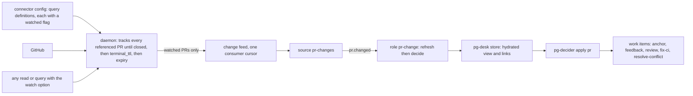
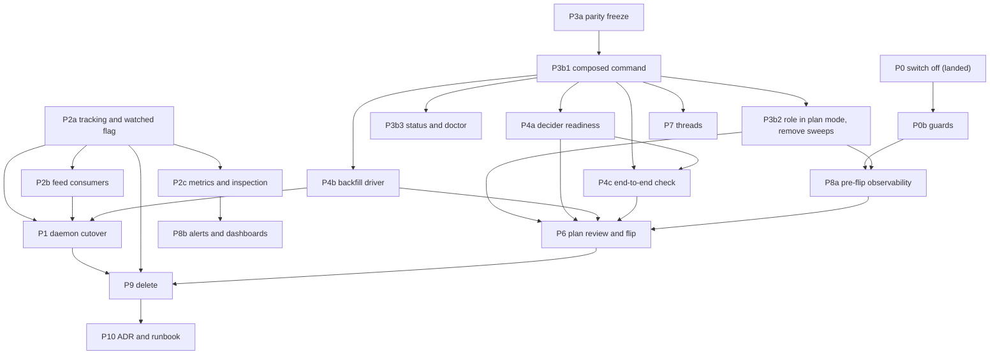

# PR lane refactor: replace the legacy sync and reconcile lane after the schema-2 cutover

Status: DRAFT v5 for operator approval (bead `pg2-6mo45.2`, epic `pg2-6mo45`). Not approved.
Date: 2026-10-20, revised 2026-10-22.
Revision history: v1 and v2 were written 2026-10-20. v2 incorporated a builder check and five
independent reviews (completeness, correctness, UX, observability, test coverage). v3 applied three
further operator rulings (8 to 10 in section 2) that remove the sweep, the pin and the second role
and replace them with a tracked-versus-watched split in the connector. v4 (2026-10-22) applies five
independent reviews of v3 and the operator rulings 11 to 17 that settle the open calls of v3 (every
former open call U1 to U10 is now decided, section 13). v5 (2026-10-22) applies five re-reviews of v4
and rulings 18 and 19. Section 15 lists what each revision changed. v5 has NOT yet been through a
further independent review.

Reader's guide (what the operator decides and does):

- Decisions: every former open call is decided (section 13, with what an override touches). The new
  rulings are 11 to 19 in section 2. Nothing is awaiting a decision except the approval of this design.
- First apply: section 6.5 is the numbered procedure (plan period, plan review, flip, apply pass,
  verification, rollback); the P6 runbook is a copy of it with the commands filled in.
- What exists to build: section 7 (phases and their order), section 9.2 (alerts) and section 10
  (tests). Terms: "plan" is the decider's dry-run mode, "tracked" and "watched" are the daemon's two
  per-PR flags (6.3), "residual" is what a read-only plan still wants after an apply, and there is no
  "sweep" or "reconcile" any more (ruling 10).
  Owner: the operator. Depends on: the daemon program `pg2-z5fax` (cutover phase `pg2-z5fax.8`).
  Supersedes: the deferral in `pg2-15ja3` (ruling "A: collapse, defer deletions", 2026-10-14), the
  date-based deferral of `pg2-l2wkd`, and the record-path fix `pg2-f6osn`.

## 1. Intent

Pull request work (anchor, feedback, review, fix-ci and resolve-conflict work items) has not been
opened or closed since 2026-10-19 16:12Z. This design finishes the move from pg-desk's legacy per-PR
sync lane to the entity change flow that ADR 0077 specified, so PR work is again driven by one
decider reading one hydrated view, and so the lane cannot be broken silently by a schema change
again.

### 1.1 What happened

`pg-desk migrate --cutover` ran on the live store on 2026-10-19 (16:10Z to 16:15Z) and moved it to
schema 2. The migration drops `interpretation.sync_error` and the `ledger` table (ADR 0077 removes
the sync stage that wrote them). The legacy PR lane was still deployed and still needs both:

| Piece                                         | Result since 2026-10-19 16:20Z                                       |
| --------------------------------------------- | -------------------------------------------------------------------- |
| `desk-pr` role (`pg-desk run pr`)             | 0 ok, 1,200 failed; each ends at stage `record_sync_error`           |
| `desk-reconcile` role (`pg-desk reconcile`)   | every run fails with `no such table: ledger`                         |
| `pr-decider` role (plan form, writes nothing) | 428 ok, 56 failed (`does not resolve to a stored entity`)            |
| `desk-thread` role                            | failures are the Claude usage limit, not the schema (separate cause) |

The `record_sync_error` failure is the second error. The first is the sync stage reading the dropped
ledger; the pipeline then tries to store that failure through `UpsertInterpretation`, which refuses
a non-empty `SyncError` on schema 2, and the second error replaces the first in the run record.

### 1.2 Why the plan missed it

- ADR 0077 assumed one stop-the-world release: migrate the store, ship the PR decider, delete the
  sync machinery together.
- The daemon design (spec rev 7, 2026-10-09) kept the PR lane and struck every PR step from Phase 10.
  On 2026-10-14 the operator ruled "collapse, defer deletions" (`pg2-15ja3`): the lane stays until a
  PR-decider phase replaces it. Phase 10 closed without decomposition. Its store-migration item and
  its issue-source item were recorded as "not ruled, not scheduled".
- On 2026-10-15 `pg2-r7v1h` landed the issue half of the deployment config. It recorded the order
  "migrate the store, then apply" because the new issue source refuses a schema-1 store. Its scope
  excluded PR, so nobody checked what the same migration removes from the PR lane.
- Phase 15 (daily focus) was written for a post-cutover world and needs the schema-2 tables.
- No test in either repo ties a deployed role to the schema it needs, so nothing failed before the
  operator ran the migration (section 10).

Root cause: an irreversible, store-wide migration was separated from the lane it breaks, no bead
owned "the PR lane survives schema 2", and nothing mechanical checked it. This design adds the
owner, a traceability table (section 12), a cross-repo contract test (section 10) and an alert that
reads the outcome rather than the machinery (section 9).

## 2. Operator rulings (2026-10-20, interactive session)

1. Fix forward. No store rollback.
2. Take the daemon path as quickly as possible. The shadow run started 2026-10-20 and the cutover
   MUST NOT wait for it to finish; ruling 14 of the daemon design (cut over with unmet criteria, one
   follow-up bead per unmet criterion) applies.
3. Do the full PR refactor properly. No stop-gap code fix of the record path. Switching off what is
   not working is the first step, and what is constantly failing stays off until it is expected to
   work.
4. Any PR with an open work item MUST keep being tracked and updated until that work item is closed.
   Only after it closes do the daemon's `terminal_ttl` (24 h) and `expiry` (7 d) rules apply.
   (Ruling 8 generalises this to every referenced PR.)
5. Mass adoption of existing anchors and a hydration burst are acceptable.
6. Threads that belong to tracked PRs are in scope and MUST be supported.
7. Alerts: keep the existing set, remove the four `sync_error` alerts with the lane, add the alerts
   in section 9. The Grafana dashboards MUST be updated in the same change.
8. Tracking rule. Every PR the connector references (a query result, a direct read, or a watch) is
   kept locally and refreshed until it closes, then evicted by the normal `terminal_ttl` and
   `expiry` rules. A direct read has no different tracking rule. There is no manual untrack action
   and none is needed now.
9. Watched flag. Tracking and change events are separate. By default nothing is watched. A query in
   the connector's configuration carries a flag saying whether its results are watched, and a query
   or lookup MAY opt in to watching at call time. A PR flagged watched in any way stays watched
   until it closes and is evicted. `pr.changed` events are emitted only for watched PRs. pg-desk
   consumes only change events from the connector.
10. Drop reconcile. There is no `pr.reconcile` event and no sweep (`pr-sweep`, `pr-sweep-full`, the
    anchor sweep) until problems appear without them.

Rulings of the interactive session of 2026-10-22 (recorded on epic `pg2-6mo45`):

11. One role, `pr-change`, runs `pg-desk pr refresh <id>` and then `pg-decider` in one packaged
    command. There is no separate operator verb for it. `pg-decider` keeps its name and stays one
    command with `plan` and `apply`. An emit-events variant (the decider only emits actions and a
    separate writer applies them) was considered and not pursued (section 6.1); a rename or a split
    MAY be revisited once the lane works.
12. The first flip replaces the staged apply: the role runs in `plan` mode for a short period, the
    operator reviews the recorded plans, then switches to `apply` for all PRs. There is no stage
    selector, no creation-suppression switch, no distinct-actor tooling and no creates cap. Rollback
    is closing the beads created since the flip.
13. The flip MAY precede P1 and P2. The gap that a PR which left both old-feed queries while open is
    not followed before P1 (R6) is accepted, and so is P3b2 removing the sweeps before P1.
14. Threads: attribute them through the existing thread-to-PR links first, add a thread feed second.
15. The tracked-set alert threshold starts at about twice the post-backfill count and is revisited
    with data.
16. Several `review-pr` work items per PR over time are allowed (section 6.9). When a PR's head
    advances and no open, unclaimed review item exists, create one; when one exists, update its
    head. A closed item for the same head is never recreated. This replaces the old review settle
    window.
17. A watched PR stays watched after it leaves its query, so the only watching gap is the backlog at
    cutover. P1 marks every PR that has an open anchor as watched directly, with the watch option on
    a read, and verifies the count (section 6.3). There is no per-run re-assert.
18. No relation link between review items. The connector has no verb to write one and adding it is
    out of scope; the tracker query of 6.9 finds all of a PR's review items in any state. Making work
    item relations agnostic of the entity type is parked.
19. No independent canary. The decider's decisions are exported as a metric with a dashboard panel and
    no alert (9.2), and an alert is added only after a silent-empty result has actually been observed
    (risk R9).

## 3. Goals, non-goals, anti-goals

Goals:

- PR work items are opened, updated and closed by `pg-decider` in `apply` mode, from a hydrated
  view, with no dependence on the ledger or `sync_error`.
- A PR with an open work item is never silently dropped from tracking.
- The legacy lane (sync stage, `pg-desk reconcile`, ledger, the deployment `desk-reconcile` tick,
  the sweeps, the `sync_error` metrics and alerts) is deleted.
- Queries are defined in one place, the connector, and neither pg-router nor pg-desk names them.
- The next silent stall of PR work is caught by alerts that read the outcome (a PR never hydrated,
  a PR whose plan still has actions after apply, an anchor open on a finished PR) and by a test that
  fails before a migration reaches production.

Non-goals:

- Changing the daemon's GitHub cost model beyond the tracking rule of ruling 8 (section 6.3 states
  the cost risk).
- Repairing `desk-thread`'s Claude usage-limit failures.
- A new thread change feed before attribution of existing thread links works (section 6.6).
- Any reconcile or sweep mechanism (ruling 10).

Anti-goals (a technically working result that would still be a failure):

- Any alert that reads only a stored row or a throughput proxy. This outage read `sync_errors: 0`
  for its whole duration, and the failure-rate alert went quiet the moment P0 made `desk-pr` exit 0.
  The primary alerts MUST read outcomes, and the one that must fire when nothing runs MUST be
  testable for its no-data case (section 9.2).
- Flipping the decider to `apply` before those alerts are live and rule-tested (P8a precedes P6).
- A second source of truth for "which PR has an open work item" inside the daemon. The daemon MUST
  NOT depend on pg-desk or on the tracker.
- A flip that mints duplicates: the role MUST run in `plan` mode first, its plans MUST be recorded
  and reviewable, and the first `apply` MUST be reversible by closing the beads created since the
  flip (section 6.5).
- Mere reading making a PR produce work: a PR that was only read (tracked, not watched) MUST NOT
  reach the decider.

## 4. Current state (verified 2026-10-20)

- P0 is landed on the deployment repo's main branch (commit `414f0a27`, closed bead `pg2-6mo45.1`;
  not yet applied by the operator; post-apply verification is gated bead `pg2-oli1o`):
  `sync.mode` is `off`, the `desk-reconcile` query, role and handler are removed, and the
  `pr-decider` role is declared with `enabled = false` (three flake checks were changed to pin it as
  declared-but-disabled). Consequence: the PR focus rule (`focus.item`) also does not run, so
  `pg-desk doctor` reports unminted PR focus selections until P6 re-enables the role.
- With `sync.mode off`, `Sync()` returns nil (`internal/sync/sync.go`), so `desk-pr` exits 0.
  The pipeline calls `Sync` unconditionally; the mode check is inside `Sync`.
- The legacy `run pr` persist stage writes `entity` and `interpretation` rows (their `as_of` is
  current) but derives no links, sets no `hydrated_at`, bumps no version and writes no change log.
  All 495 PR rows have a null `hydrated_at`. Links are derived only by the entity-change path
  (`RunEntityChange`, reached through `pg-desk pr refresh`). So P0 restores row freshness, NOT
  hydration, and not work-item links.
- `pg-desk pr show <id>` resolves from the store alone and succeeds on such a legacy row with zero
  links. The decider does not check the view's version or staleness (apart from the focus path), so
  a decider run on that view would mint a new anchor for every PR. The `pr-decider` failures seen
  so far were a race: `pr.changed` reaches `desk-pr` and `pr-decider` in parallel, and the decider
  reads the view of a PR that has no stored row yet.
- The decider's index of existing work items is built from the view's links, which come from the
  gather's `work-beads` query. The deployed query lists only open, in-progress and blocked items and
  only the `merge-request` type plus `process-feedback:` and `review-pr:` tasks. Closed items and
  every `fix-ci` and `resolve-conflict` item are invisible to it (section 6.2).
- Nothing in pg-desk's interpretation depends on which query returned a PR: ownership comes from
  config and commit authors, and "match reasons" are recomputed from facts each run. Queries
  therefore carry no meaning downstream of the connector.
- The parity gate's old side runs `pg-desk run pr` in sync plan mode and reads the ledger; it cannot
  pass once the sync stage is gone (section 6.7).
- The router's command executor never reads the stderr of a successful run, so the decider's counters
  line (`pg-decider.run-counters/v1`) never reaches any log except on failures (section 9).
- Sources: `pr-mine` ticks; `pr-team` and `pr-sweep` fail intermittently under host load (about 6 to
  25 percent of ticks in the last six hours); those are not constant failures and stay on until the
  phase that replaces them.
- Today's live backend (`pg-connector-pr-github`) is query-agnostic: each `pr-mine` or `pr-team` poll
  makes the umbrella run the search and diff the result against a ledger. The daemon
  (`pg-connector-github`) instead reads its own config (query definitions rendered by nix from the
  same `backends` options as the umbrella), re-runs the queries on its own clock, keeps the full
  content of the member PRs in its store, and serves a change feed. The change engine, feed, settle
  and metrics have landed; the shadow run started 2026-10-20 and is healthy; the cutover phase has no
  packets yet.
- The daemon design as written (rev 7) keeps an entity alive while it is a member of a configured
  query or was accessed within `keepalive_window` (24 h), requires `--query` on `changes`, and so
  delivers nothing for a PR outside every query. Rulings 8 and 9 amend this (section 6.3).

## 5. What hydration does and what the decider decides

Two separate jobs, and the design keeps them separate.

**Hydration (pg-desk) answers "what is true about this PR right now?" and decides nothing.** For one
PR id it reads from the connector only, never from the forge or the tracker directly: the PR itself
(title, state, draft flag, head commit, mergeability, review decision, comment and review counts),
its files and commits, its CI runs (per-job results only for failing runs on the current head), its
conversation (comments and review threads), the work items linked to it, and the dependencies of
the first matched work item. It then interprets that data with pure, deterministic rules and no
model: who owns the PR (mine, co-owned or team), its kind, languages and size, urgency, category,
which feedback is addressed, approvals, gate state, whether it waits on the operator, why it matched
a watched query, and whether it is ready to promote. The result is stored through the entity-change
path: the raw snapshot with a version and a `hydrated_at` stamp, the interpretation row, the derived
links to work items, and one change-log entry. After that, `pg-desk pr show <id>` answers from the
store alone, which is the only thing the decider reads. Each `pg-desk pr refresh` is a new process,
so its per-process cache of files and commits does not carry between runs; a backfill pays the full
read cost for every PR.

**The decider answers "which work items should exist for this PR, and in what state?"** It reads the
stored view and computes the whole action set again on every run, so a re-run on an unchanged view
writes nothing. The work-item kinds (`docs/behavior/pg-decider/work-items.md`):

| Kind               | What it asks a worker to do                       | Governed by rule           | Only for                               |
| ------------------ | ------------------------------------------------- | -------------------------- | -------------------------------------- |
| `anchor`           | nothing; it is the parent, one per PR             | adoption and closure rules | PRs with a child (created lazily)      |
| `review-pr`        | review the PR at its current head                 | `review.head-advanced`     | per ownership; several over time (6.9) |
| `process-feedback` | address the unaddressed review feedback           | `feedback.digest-changed`  | mine, co-owned                         |
| `fix-ci`           | fix the failing CI builds on the current head     | `fixci.failing-on-head`    | mine, co-owned                         |
| `resolve-conflict` | resolve the merge conflict with the base          | the conflict rule          | mine, co-owned                         |
| `focus-item`       | one bead per source entity picked for daily focus | `focus.item`               | PR and issue                           |

Around those: a PR that merges or closes gets its anchor and children closed, and a reopened PR gets
them reopened; existing anchors are adopted by backend node id or by title shape instead of being
recreated; `hide` stops every action on a PR, `wip` is view-only; a closed `fix-ci`,
`resolve-conflict` or `process-feedback` item is not recreated for the same context (the same head
and base); every write carries an audit comment naming the rule and the facts it keyed on; and a
rule that fails `escalate_after` (3) runs in a row raises one `human` task instead of retrying
forever. The decider never calls the forge and never writes pg-desk state except annotations.

Today, with the sync stage dead, none of this runs: the legacy lane did both jobs in one process
and needed the dropped ledger to know which work item belonged to which PR.

## 6. Target architecture



Who owns queries: only the connector's configuration defines them (the deployment declares them once
and nix renders the daemon and umbrella blocks from the same options). pg-router names none: it
polls the change feed with a consumer name. pg-desk names none after P9 deletes its legacy
`watch.pr.queries`. Until P1, the old backend is still polled by query name (`pr-mine`, `pr-team`)
and those two sources keep their current form.

### 6.1 Hydrate then decide

The decider MUST NOT decide on a view that was not hydrated through the entity-change path.

- Hydration verb: the composed role MUST hydrate with `pg-desk pr refresh <id>`, not `run pr`, so
  links, `hydrated_at`, version and the change log exist. `run pr` is not used for PR after P3b2 and
  is deleted in P9.
- Composition (ruling 11): one command per role runs refresh and then `pg-decider` (`plan` or
  `apply`, set by the role's mode option) for the same PR id, in sequence, so ordering is guaranteed
  by construction and pg-desk stays independent of the decider. The command MUST be a packaged,
  tested binary or script in this repository, not a shell snippet in the deployment config, so its
  exit-code mapping is testable. An operator MAY run it by hand for one PR, with the mode as an
  argument (`plan` for a read-only look at what would happen, which doubles as the answer to "why was
  no bead made for PR X"); there is no separate pg-desk verb for it. The command's name is the
  builder's choice; this document writes it as the composed command.
- The decider always runs after a successful refresh, including when refresh reports "no change".
  "No change in the PR" is not "nothing to decide": a retry after a decider failure sees no change
  because the first attempt already hydrated, an operator annotation changes the decider's input
  without any change on the forge, and a work item closed by an agent changes what should exist. The
  decider is idempotent, so a run with nothing to do writes nothing.
- Alternative considered and not pursued (ruling 11): the decider only emits actions as events and a
  separate writer applies them. The seam exists (`plan` is a pure function of the view and `apply`
  adds the writes), but a split moves the dedup lookup into the writer, loses the ordering of an
  anchor before its children (the router serializes by event type, not across types), needs a new
  action log for a router source to poll, and adds hops where a change can vanish silently. Revisit
  if more writers appear.
- One role: `pr-change` binds `pr.changed` and nothing else. There is no `pr.reconcile` (ruling 10).
  The older `pr-decider` role is replaced by `pr-change`: P3b2 removes `pr-decider` (it is disabled by
  P0) and deploys `pr-change`; the focus rule (`focus.item`) runs inside the composed command too.
- Per-PR serialization: the composed command MUST hold a per-PR lock (a lock file keyed by the
  normalized PR id, the same for `<repo>#<n>` and the router's retry-window id `<entity>@<12 hex>`)
  for the whole run, so a manual run, the paced backfill and a live dispatch for one PR cannot both
  see "no anchor" and each mint one. A killed holder MUST release the lock. A caller that cannot get
  the lock within a bounded wait exits with the transient failure class below (never 1 or 9), so the
  router re-runs it.
- Attribution: in `apply` mode the command MUST pass `--from-item` to the decider with the routed
  item (only `apply` has that flag), so audit comments carry the change sequence and the decider's
  `escalate_after` counter counts one delivery once (a run without `--from-item` always counts, so a
  router retry would raise a premature `human` task).
- Retry is the router's, not the command's (ruling 10 and ADR 0077's rule that pg-router owns every
  clock, S30). The router re-runs a failed dispatch only when the failure text carries one of its
  transient classes (`killed`, `deadline`, `unavailable`), only while the event carries a future
  `expiresAt`, and only if the role opts in with `max_dispatch_retries`. Therefore:
  - the composed command exits non-zero with a failure line that carries the router's `unavailable`
    class for every retryable condition: a transient or degraded hydrate, a lock wait that timed out,
    and a partial decide (decider exit 2). It MUST NOT sleep and retry inside one run;
  - the source MUST stamp `expiresAt` and the role MUST set `max_dispatch_retries`; P3b2 also sets the
    retry window on the old `pr-mine` and `pr-team` sources, which stamp none today, so the retry
    exists before P1 (a source that stamps no `expiresAt` produces born-expired events that are never
    retried);
  - an ordinary non-zero exit that is not marked retryable is never re-run, and the feed acknowledges
    a change row on flush, so a failed hydrate of a `merged` row that is not retried leaves its anchor
    open until the PR is evicted. That is why every transient condition is marked retryable;
  - when the retries are exhausted the router counts the dispatch as failed, and P3b2 removes the
    `upstream-killed` exclusion of the router failure-rate alert for this role (that exclusion assumes
    the removed sweep heals those runs).
- Fail closed: the composed command MUST refuse and exit non-zero with a distinct code when the
  view's version is 0 or it is marked stale, so an unhydrated view can never mint an anchor. A legacy
  row has version 0, so version is a sufficient test; the `pg-desk.view/v1` JSON carries no
  `hydrated_at`, and P3b1 MAY add it. `pg-desk pr show` on such a row MUST print an "unhydrated: run
  `pg-desk pr refresh <id>`" line (P3b3), because today it succeeds silently with zero links.
- Exit mapping: a refresh exit of 2 (degraded; nothing is written) and of 3 (failed, including not
  found) MUST NOT run the decider. Refresh defines only the exits 0 to 3 (4 is not a refresh code);
  the decider defines 0 to 3. The composed command's exit code MUST name the failing stage (hydrate
  or decide), MUST NOT be 9 (the router's "busy, retry" code) and MUST NOT be 1 (reserved for
  unexpected errors), and the code table MUST be published in the command's behavior doc. Every
  failure line on stderr MUST end with the next command to run, for example `refresh failed
(stage=hydrate, class=not_found): run pg-desk pr show <id> --json`, and the decider's own failure
  lines (which end with no next command today) MUST be re-wrapped the same way.
- Failure classes (`error_class`): `not_found`, `transient` (forge 5xx, rate limit, timeout, lock
  wait), `degraded`, `retry_exhausted`, `unhydrated`, `unauthenticated` (a missing or invalid
  credential: not retryable, needs a person), `decide_partial`, `decide_failed`. Refresh exit 3 covers
  both not found and a transient failure today, told apart only by message text; P3b1 MUST add a
  machine-readable class to refresh's output so a transient 5xx is never escalated as not found.
- Not found: a PR that no longer exists (deleted or transferred repository) exits 3 from refresh with
  class `not_found`, so the decider never runs and its anchor would never close. In `apply` mode with
  an open anchor the composed command MUST record the condition and raise one `human` escalation,
  with a title naming the PR as `<repo>#<n>`, a body stating the class and the next command, and a
  dedup key (looked up across closed items too) so a redelivered change cannot raise a second one. In
  `plan` mode it only records the condition in the run record and writes nothing. Silently doing
  nothing is not allowed. A not-found PR with no open anchor is marked inactive and counted
  separately, so it does not keep the never-hydrated alert red (section 9.2). The builder MAY instead
  add a removed-change path to refresh.
- Operator annotations (`pg-desk pr hide`, `unhide`, `force-review`): they only write annotations and
  do not call the decider, because pg-desk stays independent of it. They take effect at the next run
  of the composed command for that PR, which the operator MAY run by hand; each of these verbs MUST
  print that command. `wip` is view-only and prints nothing. `hide` stops every rule including
  closure, so beads already open for a hidden PR stay open and claimable; the verb's output says so.
  Until the command is run, a hide or a force-review does not reach the decider.

### 6.2 Work-item visibility

The decider can only avoid duplicates and reopen items it can see.

- The decider MUST get its own lookup that sees closed items and all six kinds (`merge-request`,
  `process-feedback`, `review-pr`, `fix-ci`, `resolve-conflict`, `focus-item`), scoped to the PR (by
  the `repo` and `pr_number` metadata every item carries, or by the entity's dedup-key prefix) and not
  to the whole tracker, because a whole-tracker, all-status listing grows without bound and a
  truncated listing would stop the lane. It MUST fail closed when the scoped listing is truncated.
  The gather's `work-beads` query MUST NOT be widened: the same query also feeds `issue.changed`, so
  widening it would pull every closed work item into the issue store and make every PR hydration list
  an unbounded set. The decider's dedup lookup over `work-beads` does not fail on a truncated listing
  today, which would silently mint duplicates; the focus-beads lookup is the precedent for a
  separate, fail-closed query. Without a lookup that sees closed items, a closed `fix-ci` item is
  minted again on every run.
- `plan` MUST use the same read-only lookup as `apply`, so that what `plan` records is what `apply`
  then does on the same state. Today `plan` is a pure function of the view and dedups nothing, so a
  plan can show `create` for an item `apply` would dedup; that would make the plan review (6.5) and
  the residual metric (9.2) noisy. A test asserts plan and apply agree per kind and operation.
- This is a P4a gate item with an end-to-end test (section 10): the second `apply` MUST write nothing
  against a tracker listing that behaves like production, and a truncated listing MUST fail the run.

### 6.3 Tracking and watching (rulings 4, 8 and 9)

Two independent properties of a PR inside the daemon.

**Tracked** means the daemon keeps the PR's content in its store and refreshes it. Every PR the
daemon is told about is tracked: a query result, a direct read of one PR, or a watch. A tracked PR
stays tracked until it is closed or merged; then the existing `terminal_ttl` (24 h) applies, then
`expiry` (7 d) evicts it. The `keepalive_window` decay of rev 7 is removed, so a direct read has no
different rule from a query result. There is no manual untrack.

**Watched** means the daemon appends change rows for the PR to the change feed. Nothing is watched
by default. A PR becomes watched when:

- it is a result of a configured query whose configuration carries `watched = true`;
- it is a result of an ad-hoc query run with the watch option; or
- it is read directly with the watch option.

Once watched, a PR stays watched until it is closed and evicted. A watched PR that leaves its query
stays watched, which closes the gap the v2 sweep and pin covered: a PR with an open anchor that stops
matching every query keeps delivering changes, including its `merged` or `closed` row, so the
decider closes the anchor. The flag is stored in the daemon's store.

The daemon does not know the tracker, so ruling 4 ("until that work item is closed") is met through
the PR: while the PR is open it is tracked and, if watched, emits changes; its `merged` or `closed`
row is the event that makes the decider close the work items, and the daemon keeps the PR for
`terminal_ttl` and then `expiry` so that event can be delivered and retried (section 6.1). If the
closure still fails, the stale-anchor alert (section 9.2) is the detection, and it MUST read the
tracker and the pg-desk store directly, not the daemon, so it works after the PR is evicted.

The one gap is the backlog at cutover (ruling 17): a PR that has an open anchor but has never been
matched by a daemon query is tracked by the backfill's reads but is not watched, and so would never
deliver its `merged` row. P1 therefore marks every PR with an open anchor as watched, directly, with
the watch option on a read (no query needed), using the backfill driver's enumerator in its marking
mode (P4b; one packaged tool, not a hand-rolled loop), and then verifies that the daemon's watched
count of those PRs equals the tracker's open-anchor count (a non-zero count, so the check cannot pass
at 0 equals 0). Anchors whose title cannot be mapped to a PR are listed by the enumerator, not
dropped. Anchors whose PR is already merged or closed are not marked: the backfill refreshes them
once and the decider closes them in the apply pass (6.5). Marking is followed by a refresh of the
same PRs, because a watch-option read of a never-seen PR appends no row, and because the backfill
MAY have hydrated them before the daemon first saw them (ruling 13), so a change in that gap would
otherwise be missed.

Feed rules (daemon design amendment, a deliverable of P2a and P2b, written before the implementation). The
amendment reverses two durable invariants of the connector's behavior docs (`INV-GH-FRESH-3`, the
keep-alive rule, and `INV-GH-CHG-5`, `--query` required) and MUST edit them in the same change:

- The change feed returns rows for watched PRs only, with one cursor per consumer. `--query` is no
  longer required; it MAY remain as a filter for compatibility. A PR that was only read is tracked but
  delivers nothing, so mere reading never reaches the decider.
- The source adapter, the umbrella forward and the wire cursor key are keyed by consumer, kind and
  query today, and the adapter takes a mandatory `<type> <query>`. P2b MUST change all three for a
  query-less feed, update the `query` label that the consumer-stuck rule groups by (and its rule
  tests), and give the adapter a defined behavior on `cursor_expired` that surfaces through the
  existing source-failure alert path. A replay after a reset (every current member replays as
  `added`) is a hydration burst and MUST be treated as such by the backfill pacing.
- Switching sources: the new `pr-changes` consumer starts at the log tail, so rows between the last
  `pr-mine` or `pr-team` poll and the first `pr-changes` poll would be lost. P1 MUST either carry the
  old cursor across or reset with a replay, and the P1 checklist MUST say which.
- The per-query baseline rule is kept: a query's first complete run appends no rows, so a cold store
  cannot push every PR into the decider at once. The initial hydration of the active PRs is the paced
  backfill of section 6.5. A PR that becomes watched later, while already known, appends one `added`
  row so pg-desk hydrates it. A watch-option read of a PR the store has never seen appends nothing
  until that PR next changes (the first fetch of an entity appends no row), so the P1 marking step
  is followed by the backfill's own refresh of the same PRs; a P2a test covers this case.
- `left_query` rows are no longer needed for tracking; a PR that leaves a query keeps its flag.

Cost risk (accepted by the operator): tracking has no decay, so a PR that someone merely read keeps
being refreshed until it closes, and an abandoned open PR is refreshed indefinitely. The governor
already prioritises and ages work, so the budget is protected, but the tracked set can grow. The
daemon MUST export the tracked and watched entity counts and the governor's backlog, and an alert
fires when the tracked set exceeds a configured size, so the cost is visible before it hurts. A
manual untrack operation is deferred until the numbers show it is needed.

Before the daemon is live (until P1) the old backend's query-diff feed applies: it delivers `added`,
`changed` and `removed` for the members of `mine` and `team`, and `removed` triggers a hydration and
closure of a merged PR. A PR that left both queries while still open is not followed until P1; that is
the accepted interim gap (ruling 13, R6). The old backend's adapter also coalesces content-only
changes on an unchanged head and the daemon design records that "the next sweep" catches them, so
until P1 a feedback or CI change on an unchanged head (which drives three of the decider's rules)
may be picked up late once P3b2 removes the sweeps. The old backend's exact change detection was not
verified; this gap is accepted with the same ruling.

A moved-aside daemon store loses the watched flags: query members become watched again at the next
query run, but directly watched PRs do not, and a PR that is no longer watched delivers no change that
could re-assert it. With no sweep (ruling 10) the detection is the connector's existing store-aside
rule, the stale-anchor alert and the watched-versus-open-anchor count check of section 9.2; the
recovery is to re-run the P1 marking step and the backfill.

A hidden PR (`hide`) skips every decider rule including closure, so a hidden PR that merges keeps its
anchor open. A count of "hidden PR with an open anchor" makes that visible (section 9).

### 6.4 No reconcile (ruling 10)

There is no `pr.reconcile` event type and no sweep. P3b2 removes `desk-pr`, `pr-sweep` and
`pr-sweep-full` together, because their events have no remaining consumer (an event with no consumer
is an orphan producer, which a deployment check rejects). `desk-reconcile` is already removed (P0).
This means:

- the 6 h backstop for "changes missed without a baseline" is gone, and so is the 30-minute sweep of
  recently updated PRs. The daemon's own refresh, fingerprint revalidation and hard ages replace
  them;
- a failed first run of a PR waits for the next change of that PR, not for a sweep. The router
  retries a failure that the composed command marks transient (section 6.1, bounded by
  `max_dispatch_retries`); after that a PR with no further change is not retried, and the exhausted
  dispatch counts in the router's failure-rate alert (the `upstream-killed` class is excluded from
  that alert today on the premise that the sweep heals it, and P3b2 MUST drop that exclusion for the
  new role);
- the revisit conditions are written down so the decision can be reversed on evidence: an open anchor
  whose PR is terminal on the forge for more than a day, a PR whose plan still has actions after
  apply, a missing child item (review, fix-ci) for a PR that needs one, a PR never hydrated, or a
  moved-aside store. Each is visible through the outcome alerts (section 9.2).

### 6.5 Adoption, backfill and the first apply

The ledger recorded which work item belongs to which PR. It is gone. Adoption re-links existing
anchors by backend node id or title shape (`adoption.go`, `adoption_nodeid.go`).

The flip is plan first, then apply (ruling 12). There is no staging, suppression switch, actor
tooling or creates cap. Because nothing re-drives a quiet PR (ruling 10), changing the role's mode
decides nothing for a PR that never changes again; the flip therefore includes an explicit apply pass
over the whole backfill set. The names below (the composed command, the backfill driver, the plan
summary script) are the builder's; this section fixes what each must do.

Backfill driver (P4b), one packaged tool with these modes:

- `enumerate`: lists the backfill set from the tracker's open anchors plus the open PRs (not from the
  store's active rows: an anchor whose PR is already merged or closed, or absent from the store, is
  reached only this way); anchors whose title maps to no PR are reported, not dropped; the count is
  asserted non-zero.
- `mark-watched`: P1's marking step (6.3), over the enumerated open-anchor PRs.
- `run --mode plan|apply`: runs the composed command over the set, paced, stopping when the newest
  `graphql_remaining` is under 3,000 (the floor the shadow runbook uses; the source of that number
  before P1 is the old backend's log, after P1 the daemon's metrics, and the driver's interface names
  it). It takes the per-PR lock of 6.1 and resumes after an interruption by skipping a PR that already
  has a recorded result for the SAME mode (a plan-mode result never satisfies an apply-mode resume).
  Its last line is one of `DONE`, `FLOOR` or `FAILED`, with counts, and its exit code differs for each
  (never 1 or 9).
- The cost of the plan pass is the full per-PR read (section 5), not the cached cost.

Plan summary (a shipped script, P4b): reads the run record (9.3) and prints, from the latest record per
PR and mode, fixed fields: PRs enumerated and PRs with a plan-mode record (they MUST be equal, and
the check names any PR without one, including failed and unhydrated ones); counts of adopt, create,
reopen, close and update per kind; the list of unadoptable items; the list of PRs that would get a
second anchor; and the age of the oldest plan record. A plan record older than a bound stated in the
runbook MUST be re-planned before the flip.

The procedure (the P6 runbook is a numbered copy of this, with the commands filled in):

1. Deploy the `pr-change` role in `plan` mode (P3b2) with the lane mode key set to `plan` in the
   pg-desk configuration (9.5). It decides and records, and writes no work item and no escalation.
2. Mark and backfill: run `mark-watched` (after P1), then `run --mode plan` over the enumerated set
   until it prints `DONE`.
3. Review the plan summary. Pass conditions: coverage complete; zero PRs with a second anchor; zero
   creates the operator cannot explain; and every unadoptable item has a disposition of ADOPT or
   CLOSE with a reason (there is no "leave": a keyless item that is left alone is duplicated by the
   first apply, which the no-duplicates anti-goal forbids). The operator writes the expected number of
   creates per kind from the summary on the epic bead; that number is the stop criterion of step 6.
4. Run the end-to-end decider tests of section 10 against real binaries.
5. Flip: change the lane mode key and the role's mode to `apply` (one deployment apply), and have the
   driver write a flip marker (time and mode) into the run record and a comment on the epic bead.
6. Apply pass: run the driver with `--mode apply` over the same set until `DONE`. Stop at once if the
   creates of any kind exceed the number recorded in step 3, or if any run ends `retry_exhausted` or
   `unauthenticated`; then go to step 8. A PR that is merged or closed is handled by the normal closure
   rules in this pass, so no separate stage exists for it.
7. Verify: the summary run again in apply mode shows a residual of zero for every enumerated PR; the
   second apply pass writes nothing; the primary and residual alerts are green; one real open anchor
   was re-run by hand and wrote nothing.
8. Rollback: set the role and the lane mode key back to `plan`, then list every write since the flip
   marker (creates, closes, reopens and head updates; each carries an audit comment naming the rule and
   the flip is bounded by the marker), and close or revert them. A close or reopen made by the first
   pass is not undone by closing created beads, so the listing is by timestamp across kinds. This
   replaces the ADR 0077 rollback ("restore the store backup"), which fix-forward rules out. If a flood
   of review, fix-ci or conflict beads is a concern after the plan review, the operator MAY keep the
   role in `plan` mode longer.

### 6.6 Threads (ruling 6)

Two meanings of "thread" appear in the system.

- GitHub review threads are part of the PR's conversation data (counts and resolution state), covered
  by hydration and the decider's feedback rules.
- pg-desk's chat-thread entity type (a chat thread linked to a PR) has no change feed today
  (`thread changes` is refused). Ruling 14: first make the decider attribute thread activity to a PR
  through the thread-to-PR links pg-desk already records and hydrate linked threads through the
  existing `thread` path; a new thread feed is a second step in P7.
  The parity fake connector answers only PR and issue calls, so P7 needs new fake endpoints and a
  scenario.

### 6.7 Parity gate

The parity gate compares the old sync stage's plan with the decider's plan. After the sync stage is
removed it has no old side. P3a runs the gate once against a pinned pre-removal pg-desk, records the
old plans as a frozen per-scenario golden (`expected-plan`), and converts the gate to compare the
decider against that golden, seeding with `pr refresh` on a schema-2 store instead of `run pr`.
Its "a stale expected entry fails" rule is kept. P9 deletes the old-side runner only.

The gate is a regression snapshot, not an oracle: the old side observes only creates for three kinds
(closes, reopens and updates are not modelled), most expected-difference entries are new-only or
hand-pinned as unobservable, and it compares plans, never applies, against a fake connector. The
frozen golden MUST therefore carry the full normalized expected set including those pins; it MUST
keep one scenario seeded the legacy way, written by a store helper because P9 deletes `run pr` (a version-0, never-hydrated row that the decider must
refuse, and that plans correctly after a refresh); `Diff` MUST have mutant self-tests (flip a kind or
operation and the gate fails); and the real oracle is the end-to-end test against a real tracker
(section 10). The intended review-rule change of section 6.9 appears in the golden as a recorded,
explained difference.

### 6.8 Heartbeat chain stays

`pg-desk heartbeat` stamps `meta.last_heartbeat` (the source of `pg_desk_dashboard_stale`, a kept
alert) and the `source_fetch.*` keys behind `pg-desk freshness`, the data-age panels and the menu bar
data-age row. `pg-desk heartbeat-item`, which the deployment's `desk-heartbeat` query uses as its tick
generator, therefore stays. Deleting the heartbeat chain is out of scope unless its stamps are first
re-homed; P9 does not delete it.

### 6.9 Review items (ruling 16)

A PR may have several `review-pr` work items over time, as it already may for `fix-ci`,
`resolve-conflict` and `process-feedback`. Every review item carries `repo`, `pr_number` and
`head_sha` metadata and a title of the form `review-pr: <repo>#<n> @ <short head>`, so all of a PR's
review items, in any state, are found with one tracker query and no link between them:

```bash
bd list --all --metadata-field repo=<repo> --metadata-field pr_number=<n> --title-contains 'review-pr:' --sort created
```

(Whether `bd` applies that filter to real review items is proven by the P4c spike, not assumed.) An
earlier idea of a related link between the items (ruling 18) is not built: the connector has no
verb to write a relation, adding one is out of scope here, and the query makes it unnecessary. A
generalization of work-item relations to every entity type is parked.

The rule `review.head-advanced`, given the PR's review items in all states ("unclaimed" means status
open, no assignee, not deferred and not blocked):

- an item of ANY state whose `head_sha` equals the PR's current head means the head is already being
  reviewed or was reviewed: create nothing (this covers a claimed item at the current head, a closed
  item, and a legacy item written before suffixes existed; the test is on metadata, never on the
  dedup key, because an update rewrites `head_sha`);
- otherwise, if an unclaimed item exists, update its `head_sha`, its `dedup_key` suffix and its title
  to the current head (after a live re-read of the item's state, as the focus rule does, so an update
  never rewrites an item that was claimed in the meantime; a stale read is skipped, not applied), and
  create nothing, so a burst of pushes before any claim yields one item for the head the burst ended
  on;
- otherwise create one item for the current head;
- a claimed item for an older head is left alone. That reviewer is refused at submit when the head
  has moved, and the new item lets the next reviewer start without waiting;
- the closure rules on merge close every open review item of the PR (they iterate every item of a
  kind), and the reopen rule for a reopened PR MUST NOT reopen closed review items: the review rule
  alone creates review items, so a reopened PR whose head already has a reviewed item gets none;
- force-review (one-shot): if an unclaimed item exists it is updated as above; otherwise a NEW item
  is created with a request-unique dedup-key suffix even when an item for the same head exists
  (otherwise apply reports a dedup and the flag is consumed with no review); the flag is then
  consumed, as today, only after the create succeeded.

What changes in the code and docs: the dedup key of `review-pr` gets a head suffix like `fix-ci`; the
rule reads the PR's review items through the scoped lookup of 6.2; the review item's creation, update
and title change; the behavior doc (`docs/behavior/pg-decider/work-items.md`, which says "the one item
is reopened and refreshed"), the PR rule table of the entity-change-flow decisions that the decider's
behavior README names as the single home of rule conditions, the rule's fixtures and the key schema
change in the same change (P4a). `fix-ci` and `resolve-conflict` titles also gain the short head so a
PR with flapping CI does not accumulate identically titled beads. The reviewer role's prompt, which
is deployment configuration outside this repository, MUST be updated in the same phase and say:

- the head to review is the item's `head_sha` read at claim time (an unclaimed item's head is
  rewritten in place);
- before reviewing, list the PR's review items with the query above and read the earlier ones, so a
  re-review builds on what was already reviewed;
- when a submit is refused because the head moved, close the item as superseded naming the newer item
  and stop;
- never review two heads of one PR concurrently.

This replaces the old review settle window (the ledger-based wait before a reopen), which ruling 10
removes together with the reconcile that re-drove it. The natural delay between creating an item and
a claim is the only protection; reconsider if it proves too short.

## 7. Phases

Sizes are effort (S, M, L, XL), not time. P5 (the anchor sweep) is dropped by ruling 10 and its id is
not reused. v3's P3b is split into P3b1 to P3b3, P2 into P2a to P2c and P4 into P4a to P4c, so each
packet can be decomposed and landed alone; the backfill driver and enumerator are their own packet
(P4b) because nothing owned them before v4.

| Id   | Phase                                                                                                                                                                                                                                                                                                                                                  | Repo                            | Size | Needs                                         |
| ---- | ------------------------------------------------------------------------------------------------------------------------------------------------------------------------------------------------------------------------------------------------------------------------------------------------------------------------------------------------------ | ------------------------------- | ---- | --------------------------------------------- |
| P0   | Switch off the dead legacy pieces (landed `414f0a27`, not applied)                                                                                                                                                                                                                                                                                     | deployment repo                 | S    | none                                          |
| P0b  | Guards: pg-desk verb-exhaustiveness test on a schema-2 store, `migrate --cutover` preflight (reads the rendered per-role JSON and the router queries; refuses a bare call), `sync.mode` pin check, the lane mode key and static `pr lane` line (9.5), the tripwire rule (9.2). Applied together with or before P0                                      | both                            | S    | none                                          |
| P1   | Daemon cutover without waiting for the shadow run (ruling 2): registry switch to `pr-changes` with the cursor decision, marking of open-anchor PRs and the post-marking refresh (6.3), `--fresh` removal, review pre-check treats `unavailable` as retryable, one follow-up bead per unmet shadow criterion                                            | both, operator apply            | L    | P2a, P2b, P4b                                 |
| P2a  | Daemon tracking and watched flag: the design amendment and the two durable invariants it reverses, query `watched` option, watch option on reads, query-less feed, store migration for the flag                                                                                                                                                        | agent-support                   | L    | none                                          |
| P2b  | The feed's consumers: adapter, umbrella forward, wire cursor key and `cursor_expired` handling, the `query` label change in the consumer-stuck rule and its rule tests                                                                                                                                                                                 | agent-support                   | M    | P2a                                           |
| P2c  | Tracked and watched metrics, the per-PR tracked and watched inspection command, the store-aside registration (9.2)                                                                                                                                                                                                                                     | agent-support                   | M    | P2a                                           |
| P3a  | Parity freeze: golden plans from the pre-removal build, full normalized set, legacy-seeded scenario written by a store helper, mutant self-tests of `Diff` (6.7)                                                                                                                                                                                       | agent-support                   | S    | none                                          |
| P3b1 | The composed command: refresh then decide, per-PR lock, retryable-failure marking, fail-closed, exit table and error classes (refresh gains a machine-readable class), `--from-item`, run record, the pg-desk write path for the persisted lane metrics, atomic counter increments (6.1, 9.3)                                                          | agent-support                   | L    | P3a                                           |
| P3b2 | The `pr-change` role in `plan` mode; remove `pr-decider`, `desk-pr`, `pr-sweep`, `pr-sweep-full` and `pr.reconcile`; deployment pins; the stall-alert role map, its rule test and the TUI prefix naming `pr.reconcile`; the retry window on the old sources; the `upstream-killed` exclusion; PR leaves the due backlog and focus coverage (section 8) | both                            | M    | P3b1                                          |
| P3b3 | `status` and `doctor` live lane line, phase-aware remedy text, the "unhydrated" hint of `pg-desk pr show`, removal or annotation of the dead sync-error gauges                                                                                                                                                                                         | agent-support                   | S    | P3b1                                          |
| P4a  | Decider readiness: the scoped fail-closed lookup, `plan` using it, the review rule and titles of 6.9, adoption policy, the behavior docs and the reviewer prompt                                                                                                                                                                                       | agent-support, deployment       | L    | P3b1                                          |
| P4b  | Backfill driver (`enumerate`, `mark-watched`, `run --mode`), the plan summary script (6.5)                                                                                                                                                                                                                                                             | agent-support                   | M    | P3b1                                          |
| P4c  | Real-tracker end-to-end check `pg-decider-lane-e2e` and its commit hook, concurrency and duplicate-delivery tests, property tests; its first deliverable is a spike proving real `bd` runs under the check's sandbox (section 10)                                                                                                                      | agent-support                   | L    | P4a, P3b1                                     |
| P8a  | Pre-flip observability: the alerts of 9.2 that apply before the flip, the pg-desk `promtool` harness, rule tests, the run-record log source, probe registration, triager prompt                                                                                                                                                                        | all three repos                 | M    | P3b2                                          |
| P6   | The plan review and the flip (6.5): runbook, apply pass, verification, rollback drill                                                                                                                                                                                                                                                                  | deployment repo, operator apply | S    | P3b2, P4a, P4b, P4c, P8a                      |
| P7   | Thread support for tracked PRs (6.6)                                                                                                                                                                                                                                                                                                                   | agent-support                   | L    | P3b1                                          |
| P8b  | Remaining alerts and dashboards: tracked-set size, hidden PR, the lower-bound watched alert, dashboard panels                                                                                                                                                                                                                                          | all three repos                 | M    | P2c                                           |
| P9   | Delete the legacy machinery (section 8)                                                                                                                                                                                                                                                                                                                | all three repos                 | L    | P6 (the operator declares it stable), P1, P2a |
| P10  | The ADR and the consolidated operator runbook; every other doc ships with the phase that changes the behavior                                                                                                                                                                                                                                          | agent-support                   | S    | all                                           |



The decider track (P3a to P6) does not wait for the daemon (ruling 13): before P1 it reads the old
backend's `pr-mine` and `pr-team` feed unchanged. P1 and P2 switch the feed to the daemon and give the
tracked and watched behaviour. P1 needs P2a (the watch option on reads), P2b (the new source) and P4b
(the enumerator in its marking mode). P1's registry switch replaces `pr-mine` and `pr-team` with the
single `pr-changes` source; P1 owns that switch, the deployment's declaration of which queries are
watched, and the cursor decision of 6.3.

Documentation ships with the code: every phase edits the behavior docs and runbook pages its change
makes wrong, in the same change (this repository's rule). Pages that change include the pg-desk
behavior docs for sync, operator commands, pipeline run and store schema, the pg-decider rule table
(it lists fewer rules than the code registers), and the connector invariants named in 6.3. The
operator runbook for the first apply (6.5) is a P6 deliverable, not a P10 one.

The phase 15 checkpoint `pg2-2j5ac.44.37` (focus coverage) needs P6, not P3b: in `plan` mode the
composed command mints no focus beads, so the PR focus rule has no effect until the flip. The kept alert
`pg-desk-focus-pending-beads-age` is documented to fire for "a decider role in plan mode"; from P3b2 to
P6 it MUST be inhibited while the lane mode key says `plan` (or its probe registration deferred to P6),
and `pg-desk doctor` keeps reporting unminted PR focus selections with an "expected until P6" tag.

Deployment changes the plan makes, so they are not discovered late: replace the `pr-decider` role and
rewrite its pins in three flake checks (disabled-pin, the six-element argv pin, the focus check) for
the composed command's argv; add the new role to the low-disk non-blocking pairing check and remove
the removed ones; drop the four removed alert uids; render the lane mode key; update the escalation
triager prompt; update the reviewer prompt (6.9). Alert uids are registered with the probe at the start
of P6, after the backfill has run (9.2), so no rule that is red for a known reason files beads. The
role's argv and mode live in the per-role rendered JSON, not in the router's `config.toml`;
`pg-router config --show` cannot show them. The role's timeout MUST be chosen with the router's
shutdown drain in mind, so a restart does not kill a run mid-write; the builder decides the role's
environment and wrap entries (section 14).

## 8. Deletion scope (P3b2 and P9)

P3b2 removes `desk-pr`, `pr-sweep`, `pr-sweep-full` and the `pr.reconcile` event type from the
deployment config and the `sweep` verb's PR use from the router adapter's wiring, and updates the
router's stall-alert role-to-type map (which lives in this repository, with its rule test and the
router TUI's heartbeat prefix that names `pr.reconcile`) in the same change, because that map is the
only idle-consumer detection for `pr.changed` and goes silent when `desk-pr` is removed.

P9 deletes the `pg2-ei1k8` list plus the extras of `pg2-15ja3`: `pg-desk reconcile`; `internal/sync`;
the `internal/pipeline` syncer, `Reconcile`, retry and ledger coupling; `internal/store`
`sync_retry.go` and `ledger.go`; the `sync:` config keys, `review_settle_window` and the home-manager
options for them; the metrics `pg_desk_sync_error_rows`, `pg_desk_oldest_sync_error_age_seconds`,
`pg_desk_sync_error_retrying_rows`, `pg_desk_sync_error_exhausted_rows`, `pg_desk_sync_errors`,
`pg_desk_oldest_anchor_check_age_seconds` and the `pg_desk_reconcile_*` gauges, with the sync reads
removed from the metrics callback that also serves the kept stale and age gauges (one read error
currently fails the whole callback); the `sync_error` and ledger lines of `pg-desk status` and the
`sync_error` and retry checks and remedy text of `pg-desk doctor`; the `run pr` command path for PR;
pg-desk's `watch.pr.queries` and the PR halves of pg-desk's change flow that the daemon design
retires (`pr changes`, the PR part of `internal/changes`, `doctor_changeflow`); the old side of the
parity harness; the `internal/sync` contract checks in the flake; and the behavior-doc sections for
reconcile, `sync_error` and `run`. In the deployment repo: the `sync` block of the machine config, the
alert references and probe-uid entries, the evaluation assertion `probeRequiredRuleUids`, and the
triager prompt text. Daemon design Rollout step 6 items (moving the posted-review sidecar into the
store, removing the old backend packages and their darwin module once no host registers them) and the
docs-only plugin update of ruling 11 are tracked here or in the daemon program's cleanup phases, not
dropped. `heartbeat` and `heartbeat-item` are NOT deleted (section 6.8). Re-derive every item from
current source before deleting.

P9 MUST also decide, item by item and with a test that survives the deletion, the fate of the
dependents that the list above does not name:

- `pg-desk run issue` and `pg-desk run thread`, which call the legacy interpret-only path for PRs
  (that path does no hydration or link derivation and survives P3b2);
- the `pg-desk-shadow` package, its runbook and its behavior doc, which depend on `watch.pr.queries`,
  `pr changes` and the sync-off configuration;
- pg-desk's focus coverage, which reads the PR watch queries and the PR hydration backlog, and the PR
  half of the `pg-desk-watch-listing-degraded` alert, which depends on `watch.pr.queries`. The backlog
  part breaks at P3b2, not P9: the due backlog counts PRs hydrated longer ago than the sweep max age
  (6 h by default), and with the sweeps removed every quiet PR ages past it, so the daily focus draft
  would be marked incomplete (and the checkpoint of section 7 could not go green). P3b2 therefore
  removes PR from the due backlog (or redefines it as "version 0 only") and from the focus coverage
  gate, and the doctor remedy text that says "run pg-desk sweep" is changed with it; P9 deletes what
  remains;
- the `pg-desk-sweep-bound-violated` alert, whose PR input series comes from the router's `pr-sweep`
  poll and has no series after P3b2 (with `noDataState: OK` it would silently do nothing), so P8a
  scopes it to issue and thread or removes it;
- the metrics callback: one read error fails all of its gauges, so the stale-snapshot gauge MUST
  still serve on a schema-2 store with no ledger (a test), and the heartbeat verbs MUST still work.

## 9. Observability

### 9.1 What would have caught this, and what must not be repeated

The outage was visible only through the generic router failure-rate alert; P0 silences even that
(`desk-pr` exits 0), and nothing then shows that PR work is not being created. The design therefore
adds an outcome alert before the flip, and a tripwire now. With the sweeps gone (ruling 10) the
outcome alerts are also the only detection of lost tracking.

### 9.2 Alerts

Keep: the pg-router rules, the seven `pg-connector-github` rules (the consumer-stuck rule's `query`
label changes with P2b and its rule tests change with it), and the pg-desk rules for liveness,
snapshot stale (`pg-desk-sync-stale`, uid contains "sync" but is a keeper), focus and consumer lag.
The sweep bound and watch-listing rules are scoped to issue and thread in P8a (section 8), because
their PR inputs vanish. The connector's existing `pg-conn-github-store-aside` rule is the detector for
a moved-aside daemon store (section 6.3) and its uid MUST be registered with the probe.

Remove with P9, using `deleteRules` entries in a delete-only file (Grafana keeps a file-provisioned
rule live after its file drops it): `pg-desk-sync-errors`, `pg-desk-sync-error-rows`,
`pg-desk-sync-error-retrying`, `pg-desk-unreconciled-anchor-age`. Tests: the deleted uids are not in
the rule groups, the delete-only file's uids equal the removed rules' uids (the connector's structure
check S8 is the precedent), and the kept `pg-desk-sync-stale` is not in the delete file. The sync-error
gauges (and `pg_desk_oldest_anchor_check_age_seconds`) read a dropped column and always say 0; P3b3
removes them from the dashboard or annotates "0 is not healthy" until P9 deletes them.

Transport of the lane metrics. The composed command is short-lived and handles one PR, so it cannot
compute a fleet-wide gauge, an "oldest age", or hold a cumulative counter between runs. It therefore
persists per-PR lane state (mode, residual, first-seen time of a non-empty residual, last outcome) and
cumulative counters through a pg-desk-owned write path it calls after each run (P3b1), and
`pg-desk serve` aggregates them at scrape time, as it already does for the change-flow counters.
This gives zero-filled series, counters that accumulate across runs, and rules a `promtool` test can
exercise, and it needs no collector behavior that this repository does not already rely on. The
existing counter recorder reads then writes, so concurrent runs (the backfill beside live dispatches)
lose increments; P3b1 MUST make increments atomic and test it concurrently. (Other short-lived
commands in this repository push OpenTelemetry directly; the builder MAY choose that only if it also
meets the zero-fill and cumulative requirements, shown by a test.)

Every rule below MUST read a metric that a rule test can exercise (no alert depends only on a log
line), every gauge MUST be emitted with a value when healthy so that "no series" never means
"healthy", and every rule MUST suppress under `SYSTEM_PAUSE` as `pg-desk-sync-stale` does.

| Alert                                 | Signal (source)                                                                                                                                                                                                                                                                                                                                                                                                                                                                                                                                                                     | Phase    |
| ------------------------------------- | ----------------------------------------------------------------------------------------------------------------------------------------------------------------------------------------------------------------------------------------------------------------------------------------------------------------------------------------------------------------------------------------------------------------------------------------------------------------------------------------------------------------------------------------------------------------------------------- | -------- |
| PR never hydrated (primary)           | `pg_desk_pr_unhydrated` (open, not hidden, not marked inactive, version 0) and its oldest age, from the store at scrape time. It is the signal that would have fired on 2026-10-19, when all 495 rows were unhydrated. It replaces v3's "hydrated open PR with no anchor", which was wrong because anchors are created lazily. `noDataState: OK`; the rule fires when the gauge is above its threshold for its `for` duration, OR when the gauge is absent while pg-desk liveness is up and `SYSTEM_PAUSE` is not set (the absence test is in the expression, not in `noDataState`) | P0b, P8a |
| Plan residual after apply             | the composed command runs a read-only `plan` after `apply` and persists the PR's residual; the gauges are the number of PRs with a non-empty residual and the age of the oldest, labelled with the lane mode. It covers a missing child item (review, fix-ci, conflict) as well as a missing anchor. The rule reads `mode="apply"` only, because in `plan` mode the residual is non-zero by definition                                                                                                                                                                              | P8a      |
| Stale anchor                          | open anchors whose PR the store shows as merged or closed for longer than a threshold that is longer than the apply pass; AND the oldest `hydrated_at` among PRs that have an open anchor (a lost or failed `merged` hydration leaves the store saying "open", which the first part cannot see). Both read the store's links, not the tracker and not the daemon. Gated on `mode="apply"`; hidden PRs excluded and counted separately                                                                                                                                               | P8a      |
| Decider and hydrate failures          | `pg_pr_lane_runs_total{stage,class}` persisted by the composed command (classes in 6.1), every series initialized to 0 so the first event is not lost to `increase()`; the rule fires on `increase > 0` with no `for` for `retry_exhausted`, `unauthenticated` and `decide_failed`, and on a rate for the rest; the existing hydration failure and repeated-degraded gauges for type pr; router series for the new role                                                                                                                                                             | P8a      |
| Hydrate stage dead-man                | dispatches of the `pr-change` role (a router series) in a window with no increase of the persisted PR hydrations counter (`pg_desk_hydrations_total`)                                                                                                                                                                                                                                                                                                                                                                                                                               | P8a      |
| No watched PRs while anchors are open | the daemon's watched gauge is 0 while pg-desk's open-anchor count is above 0 (two metrics in one rule). The exact per-PR check is the marking step's count (6.3), not a standing alert; a connector rule added here MUST update the structure check that pins the connector's rule uids and their `noDataState`                                                                                                                                                                                                                                                                     | P8b      |
| Tracked-set size and governor backlog | the daemon's tracked and watched counts, the configured limit exported as its own gauge (so the rule alerts on the ratio and its growth, not on a number copied into YAML), and the governor's backlog                                                                                                                                                                                                                                                                                                                                                                              | P8b      |
| Hidden PR with open anchor            | count from the store; low severity                                                                                                                                                                                                                                                                                                                                                                                                                                                                                                                                                  | P8b      |

The no-data property of the primary rule is tested with `promtool` in four states: gauge live and
absent (fires), live and 0 (quiet), pg-desk liveness down (quiet) and `SYSTEM_PAUSE` set (quiet). A
structure check with mutant self-tests (as the connector's `check-alert-structure.sh` does) pins
`noDataState` and the guard, and a mutant that removes the guard MUST fail it.

The decisions metric (ruling 19). The decider's per-rule results, which the run record already
carries, are also exported as `pg_decider_decisions_total{rule,action,outcome,reason}` (through the
same persisted path): `action` is create, update, reopen, close, annotate, escalate or skip; `outcome`
is planned, applied, deduped, skipped or failed; `reason` is the skip reason (a bounded set the decider
defines). Cardinality is bounded by rules times actions times reasons. It has a dashboard panel and NO
alert: it exists so an operator can see what the decider is doing over time, for example a rule that
stops matching, and a rule or an independent check is added only after a silent-empty result has
actually been observed (risk R9).

Expected-red windows and probe timing. The primary rule fires from the first apply of P0 until the
backfill (495 PRs are unhydrated), which is true; its uid is therefore NOT registered with the probe
until the start of P6, after the backfill, so a rule that is red for a known reason files no bead. It
is the same rule P8a finalizes (the P0b version is that rule with its first threshold, tested by its
structure check; the `promtool` harness arrives in P8a). Every other new uid is registered at the start
of P6 as well, and the apply-gated rules (residual, stale anchor) are not red before the flip.

A throughput dead-man ("`pr.changed` delivered, zero actions") is dropped: an idempotent decider
legitimately plans nothing in a quiet window. "Oldest unapplied change" is dropped: the decider keeps
no last-applied sequence and PR has no pg-desk consumer cursor after the pull-through retirement.

Every new rule uid MUST be registered with `pg-router-probe` (both probe lists and the required list in
the deployment config) or it will not escalate to a bead; the existing deployment check runs in the
opposite direction (a listed uid absent from the rendered rules fails it), so P8a adds the generalised
check that fails when a new rule uid is missing from the probe list. The escalation path runs inside the
same router that drives the lane, so a router outage silences the probe too: the router liveness rules
and the connector's daemon-down rule (`noDataState: Alerting`) are the independent signals. The triager
prompt MUST learn the new fingerprints and the investigation commands: the composed command run by
hand in `plan` mode for one PR (what would happen and why), `pg-desk pr show`, `pg-desk pr history`,
the P2c command that says whether a PR is tracked or watched, and the tracker query of 6.9 for a PR's
review items.

### 9.3 Run record

The router never reads the stderr of a successful command run, so a counters line on stderr cannot be
the transport. The composed command MUST append one JSON record per run to a state file registered as
a log source (as `pg-router-events` is): entity, change sequence, router event id and a run id, mode
(`plan` or `apply`), hydrate result, exit code and `error_class`, decide exit code, per-rule outcome
and skip reason, the planned actions (kind and operation) with the count per kind, the adoption outcome
and the candidate anchors of each PR, the residual after apply, and the failing stage. The record is
for people and for the plan summary script (6.5); no alert reads it, so a dead log pipeline cannot
silence an alert. In `plan` mode it is what the operator reviews before the flip, so it is a P3b1
deliverable. With it an operator can answer "why was PR X not acted on" without running `plan` against
changed state.

A registered log path that does not match the path written leaves the stream empty without any error
(this happened to another source), so a test MUST assert that the registered path equals the written
path and a stream-silence check MUST exist. Each record MUST be written as one atomic append so
concurrent runs cannot interleave lines. The file MUST NOT be rotated away before the plan summary has
been consumed: the retention floor is until the operator declares the lane stable (P9's criterion), and
the rotation policy is stated in the runbook. Gauges derived from the store are computed in `pg-desk
serve` at scrape time, as the existing change-flow and focus health gauges are.

### 9.4 Dashboards

They live in the support-apps repo under `darwin/modules/observability/dashboards/`: update
`pg-desk-metrics.json` (remove the panels on removed metrics, add anchor coverage, hydration backlog
and failures, run and failure rate of the new role, oldest queue age, tracked and watched counts),
update the six `sync_error` columns in `pg-desk.json`, and update the dashboard validator, which
assumes every panel with an id of 10 or more is a focus panel. `pg-router.json` has no reconcile or
sync panels. `packages/pg-connector/grafana/pg-connector-github.json` gets the tracked and watched
panels and, if the cap moves at cutover, the cap line and matching alert threshold. The "router
progress dashboard" named in `pg2-kftf9.20` does not exist as a separate file. The panel removal ships
in the same change as the metric removal (P9), which therefore includes the support-apps repo.

### 9.5 Status truthfulness in the interim

`pg-desk status` prints `sync_errors: 0` and `doctor` passes "sync_error rows: 0" while the lane is
down, and doctor's remedy text still says "fix the cause, then `pg-desk reconcile --retry-all`", a
command that fails on the dropped ledger until P9.

- The lane mode has one source: a key `pr_lane.mode` (`off`, `plan` or `apply`) that the deployment
  renders into the pg-desk configuration beside the role's own mode, and that the composed command also
  persists with every run and with the flip time. The router's per-role JSON is not readable by pg-desk,
  which is why the key exists. A check in the deployment asserts that the key and the role's mode
  agree.
- P0b adds a static "pr lane" line to both `status` and `doctor`, read from that key: legacy sync off,
  lane `off`, so the operator is told the lane is not running from the first apply. P0b is applied
  together with or before P0, so no apply leaves `sync_errors: 0` on a dead lane.
- P3b3 replaces it with the live line: the lane mode and the flip time, the never-hydrated count and
  its oldest age, the residual in apply mode, and the time of the last recorded run, all from the
  persisted store state of 9.2 (pg-desk does not read the run-record file). It MUST NOT use "time
  since the last decider apply", which is legitimately large in a quiet window and has no source in
  pg-desk (the decider writes only focus annotations there).
- Doctor's remedy text is made phase-aware at once, and the lines that are red for a known reason
  until P6 (unminted PR focus selections) carry an "expected until P6" tag, so a permanently red
  doctor does not become learned noise.
- P9 removes the sync lines and the doctor gate.

## 10. Test strategy

Rules: a check of deterministic behavior lives in an automated test against the real tool in a
hermetic environment, and a mock of the tool does not count; a new or changed router query or role is
exercised live once with a non-trivial outcome; targeted `checks.<system>` builds, never a whole-repo
flake check.

Facts that shape the tests:

- This repository has no CI. The only automatic runners are the commit-time hooks (path-scoped to the
  touched projects) and the pre-land run; a nix check is NOT run automatically at land (operator
  ruling 2026-10-01). A real-binary test that exists only as a nix check therefore guards nothing:
  each one below MUST also have a path-scoped hook beside the check, in the style of the existing
  real-tool hooks (for example the pg-desk closure contract hook), whose file regex covers the inputs
  of every binary involved, with a bats mutant showing that dropping a path from the regex fails, and
  failing loudly when a tool is absent.
- The event that broke production was an operator running `migrate --cutover` on the live store, not
  a code change, so the gate has to sit in the migrate command as well as in a check. The plain
  test-store helper (`OpenForTest`) opens schema 1, which is why every existing test missed the break.
- A test that skips when its binaries are absent proves nothing unless a check requires it, as the
  parity check does (required binaries plus an assertion on the PASS line); that assertion alone is
  not enough, since a test whose subtests all skip still prints PASS. Every real-binary gate below
  MUST assert a PASS line per named scenario, assert no SKIP line, and assert a minimum scenario
  count. A count check MUST assert a non-zero minimum, so "equal" cannot pass at 0 equals 0.

| Tier                                                    | Test                                                                                                                                                                                                                                                                                                                                                                                                                                                                                                                                                                                                                                                                                                                                                                                                                                                                                                                               | Phase                    |
| ------------------------------------------------------- | ---------------------------------------------------------------------------------------------------------------------------------------------------------------------------------------------------------------------------------------------------------------------------------------------------------------------------------------------------------------------------------------------------------------------------------------------------------------------------------------------------------------------------------------------------------------------------------------------------------------------------------------------------------------------------------------------------------------------------------------------------------------------------------------------------------------------------------------------------------------------------------------------------------------------------------- | ------------------------ |
| Real pg-desk: verb exhaustiveness                       | walks every leaf verb of pg-desk's command tree; each MUST be classified schema-2-safe or not, and an unclassified new verb fails; every safe verb runs on a migrated schema-2 store under the deployment's rendered pg-desk configuration (a self-declared manifest alone is circular: the author of `run pr` would have marked it safe, because it passed on schema 1)                                                                                                                                                                                                                                                                                                                                                                                                                                                                                                                                                           | P0b                      |
| Real pg-desk: migrate preflight                         | `migrate --cutover` refuses a bare call, and refuses when the supplied rendered role JSON or the router queries contain an enabled role or query that runs an unsafe verb (the existing router-config reader parses only `config.toml` and cannot see role argv, so the JSON reader is new; the legacy reconcile ran from a query, so queries are checked too); the historical-schema store helper is reused                                                                                                                                                                                                                                                                                                                                                                                                                                                                                                                       | P0b                      |
| Deployment check wired into the build                   | the rendered per-role JSON and the queries are checked against the safe-verb list as an assertion of the system build, not only as a `checks.*` attribute; the lane mode key and the role's mode agree                                                                                                                                                                                                                                                                                                                                                                                                                                                                                                                                                                                                                                                                                                                             | P0b                      |
| Flake check                                             | the machine's pg-desk `sync.mode` value is pinned (a change detector, kept because it is cheap)                                                                                                                                                                                                                                                                                                                                                                                                                                                                                                                                                                                                                                                                                                                                                                                                                                    | P0b                      |
| Golden (flake check) and hook                           | the parity gate compares the decider with the full frozen old plans; stale expected entries fail; one legacy-seeded scenario whose version-0 row is written by a store helper (not by `run pr`, which P9 deletes); mutant self-tests of `Diff` (flip a kind or operation and the gate fails); the intended 6.9 change appears as a recorded, explained difference                                                                                                                                                                                                                                                                                                                                                                                                                                                                                                                                                                  | P3a                      |
| Real tools: composed command                            | real refresh and real decider against the fake `gh` controls (`fail.*`, `calls.log`): a 502 gives class `transient` with the router's retryable wording and is never escalated as not found; a null node gives `not_found` and exactly one escalation in `apply` mode (none, only a record, in `plan` mode, and none when no anchor is open), and a redelivered change raises no second; a degraded read gives exit 2 and no decide; a refresh that reports "no change" still runs the decider; the id `<entity>@<12 hex>` and `<repo>#<n>` take the same lock; a killed lock holder releases it and a lock wait that times out exits transient; the command never exits 1 or 9; `--from-item` reaches the decider in apply mode (audit comment carries the sequence); the annotation verbs print the command and `pg-desk pr show` prints the "unhydrated" line; counter increments are atomic under concurrent runs              | P3b1, P3b3               |
| Deployment checks                                       | `pr-change` binds `pr.changed` only and `pr-decider` is gone; no event type is produced without a consumer (no `pr.reconcile`); `desk-pr`, `pr-sweep` and `pr-sweep-full` are gone; every event type a role binds is in the stall-alert role map (derived, not copied); the old sources carry a retry window and the router failure-rate rule no longer excludes `upstream-killed` for the new role                                                                                                                                                                                                                                                                                                                                                                                                                                                                                                                                | P3b2                     |
| Real tracker: the end-to-end gate `pg-decider-lane-e2e` | a nix check plus a hook. Its first deliverable is a spike that shows real `bd` (embedded database, one precedent: the handoff-create check) and `pg-connector issue` running under the check's sandbox, with the measured time; the parity harness is NOT reused (its fake connector answers only reads and its module cannot import the daemon's `internal` packages), only the fake `gh` script is, by path, with newly authored fixtures. Ground truth is the tracker's own listing: N (greater than 0) seeded keyless anchors are adopted with no creates; the second apply writes nothing; plan and apply agree per kind and operation; an unhydrated view is refused; a truncated scoped listing fails the run; the `bd list` query of 6.9 returns a PR's review items in every state                                                                                                                                        | P4c                      |
| Review rule (real tracker)                              | a burst of pushes yields one item; a claimed item at the current head blocks a second; an item created at one head, updated to another and closed blocks a re-create (test on metadata, not on the key); legacy suffix-less open and closed items are recognized; force-review with only a claimed or closed same-head item creates one new item and consumes the flag only on success; a claim that lands between the listing and the update leaves the item unchanged; a reopened PR with several closed review items reopens none and creates none for a reviewed head; a deferred item is left alone and does not block a create                                                                                                                                                                                                                                                                                               | P4a, P4c                 |
| Concurrency and failure injection                       | two concurrent composed runs for one PR yield exactly one anchor, the interleaving forced with the fake `gh` `block` control, and a mutant without the lock yields two; a duplicate `pr.changed` writes nothing; a kill between a tracker create and its audit comment, then a rerun, creates no duplicate; a decider run that exits 2 converges on rerun, the failure injected by a passthrough shim that delegates to real `bd` and fails the Nth write                                                                                                                                                                                                                                                                                                                                                                                                                                                                          | P4c                      |
| Property                                                | the dedup key round trips; key comparison is symmetric and never matches across entities (`#1`, `#10`, `#100`); adoption by title shape never adopts into another entity; a re-plan after apply is empty over generated views (the property-test library used in another package of this repository, which `pg-decider` must vendor with its `gomod2nix` file, with a fixed seed)                                                                                                                                                                                                                                                                                                                                                                                                                                                                                                                                                  | P4c                      |
| Backfill driver and plan summary                        | with the fake `gh` `remaining` control the driver stops at the floor and reports `FLOOR`; it resumes after a restart in the same mode without redoing finished PRs, and a switch from plan to apply redoes all of them; it survives a 5xx and a rate limit; nothing is decided on a partially hydrated PR; `enumerate` includes an anchor whose PR is merged or absent and reports an unparseable title; counts are non-zero; the plan summary run on a golden run record prints the fixed fields, names a PR with no record, and flags a plan older than the bound; the apply pass after the flip writes nothing on a second run; a by-timestamp listing of every write since the flip marker includes closes and reopens                                                                                                                                                                                                         | P4b                      |
| Daemon: unit with fake clock plus real process          | a PR that was only read is tracked and delivers no change row; a PR from a `watched = true` query, a watch-option query and a watch-option read delivers rows; the flag is sticky after the PR leaves its query and survives a daemon restart (real process); an open tracked PR is still refreshed after 24 h and 7 d; after it closes `terminal_ttl` then `expiry` apply; a query's first complete run appends no rows; a PR becoming watched while known appends one `added` row, and a watch-option read of a never-seen PR appends none; a moved-aside store keeps no flags until the queries re-run; the feed works without `--query` and still honours it as a filter, under a moved-aside store and under prune; the daemon imports neither pg-desk nor the tracker; a model-based test of the flags (an unwatched PR never emits; the flag is sticky until eviction)                                                      | P2a                      |
| Daemon consumers                                        | the adapter against the real daemon surfaces `cursor_expired` through the existing source-failure alert path; the cursor decision loses no row between the last old-source poll and the first new-source poll (the old adapter's event shapes and ids are tested against the composed command, since the flip can precede P1); the load test scaled to about 500 tracked PRs, mixed watched and unwatched, shows the unwatched population does not starve the freshness of watched ones and the governor backlog is emitted; the metrics catalog lists the tracked and watched gauges                                                                                                                                                                                                                                                                                                                                              | P2b, P2c                 |
| Rule tests (`promtool`), catalog and structure          | pg-desk gets a `promtool` harness modelled on the router's (a check script, a flake check and a hook); every new alert has a firing case, a healthy case and an empty-input case; the primary rule's four states (gauge absent while live, 0, liveness down, pause); a case replays 2026-10-19 (all rows unhydrated, `sync_error` rows zero, no anchors created) and the primary alert fires; a first-ever `retry_exhausted` series starting at 1 fires; the residual rule ignores `mode="plan"` series; a catalog check (modelled on the connector's metrics catalog check) that every metric named in a pg-desk alert is emitted by a real scrape on a schema-2 store and by the composed command; a failed store read at scrape time never yields 0 for a gauge; the deleted uids are absent and the delete-only file's uids equal the removed rules'; the `noDataState` and guard are pinned by a structure check with mutants | P8a                      |
| Metrics test, schema 2                                  | the unhydrated, residual, stale-anchor and decisions series on a migrated store, emitted when healthy; the stale-snapshot gauge still serves on a schema-2 store with no ledger (P9)                                                                                                                                                                                                                                                                                                                                                                                                                                                                                                                                                                                                                                                                                                                                               | P8a, P9                  |
| Unit and registry checks                                | the review pre-check treats `unavailable` as retryable and the source registry switch is checked (P1); thread fake-connector endpoints and a parity scenario (P7); `status` and `doctor` goldens for the lane line and the phase-aware remedy text (P3b3); new fixtures pass the identifier allowlist (P10)                                                                                                                                                                                                                                                                                                                                                                                                                                                                                                                                                                                                                        | P1, P3b3, P7, P10        |
| Mutation testing                                        | the Go mutation tool runs over the composed command's exit and stage mapping, the fail-closed predicate, the adoption context checks, the review rule's head and claim tests, key comparison, the backfill floor comparison, the daemon's `terminal_ttl` and `expiry` boundaries and the watched predicate, and `Diff`; survivors are listed in the packet or killed by explicit boundary tests                                                                                                                                                                                                                                                                                                                                                                                                                                                                                                                                    | P2a, P3a, P3b1, P4a, P4b |
| Live exercise                                           | P1: the marking step's watched count equals the tracker's open-anchor count (non-zero), the cutover and the cursor decision. P6: the plan review, the flip, the apply pass, one real open anchor re-run by hand with zero writes, a real merge closes its anchor through the feed. P8b: a drill per new alert (induce the failure, confirm a bead is filed after registration), and a post-apply bead gated on `pn:applied` that asserts a metric condition. A role newly changed is exercised once live with a non-trivial outcome                                                                                                                                                                                                                                                                                                                                                                                                | P1, P6, P8b              |

## 11. Constraints

- This repository is public: the design, tests and docs MUST NOT name the deployment's repositories,
  projects or people. Deployment specifics live in the deployment repo.
- The daemon MUST NOT depend on pg-desk, pg-router or the tracker.
- pg-router owns every clock (ADR 0077, S30): no retry or timer loop in pg-desk.
- Validation per repo rules: targeted `nix build .#checks.<system>.<name>` through the wrapper in the
  background; tests against a real schema-2 store, not mocks.
- Every new or changed pg-router query or role MUST be exercised live once with a non-trivial outcome.
- Landing the agent-support change, relocking, and editing the deployment's probe-uid lists MUST
  happen together, because a deployment check fails when a listed uid is absent from the rendered
  rule files.

## 12. Traceability

Every row MUST map to a phase or be recorded as dropped with a ruling.

Operator rulings and goals:

| Ruling or goal                                                   | Phase                                  |
| ---------------------------------------------------------------- | -------------------------------------- |
| 1 Fix forward, no store rollback                                 | P0, P3b1 to P6                         |
| 2 Daemon path as quickly as possible, no wait for the shadow run | P2a, P1                                |
| 3 Do the full refactor, no stop-gap; failing pieces stay off     | P0, P3b2, P6                           |
| 4 Track until the work item is closed                            | 6.3, P1 marking step, P8a stale anchor |
| 5 Mass adoption and a hydration burst are acceptable             | P4a, P4b, P6                           |
| 6 and 14 Threads of tracked PRs                                  | P7                                     |
| 7 Alerts and dashboards                                          | P8a, P8b, P9                           |
| 8 and 9 Tracking and the watched flag                            | P2a                                    |
| 10 No reconcile and no sweep                                     | P3b2                                   |
| 11 One composed role, `pg-decider` unchanged                     | P3b1, P3b2                             |
| 12 Plan first, then apply, rollback by timestamp                 | P3b1 (run record), P4b, P6             |
| 13 The flip may precede P1 and P2; sweeps removed before P1      | P3b2, P6                               |
| 15 Tracked-set threshold                                         | P8b                                    |
| 16 Several review items per PR                                   | P4a (6.9)                              |
| 17 Open-anchor PRs marked watched at cutover                     | P1, P4b                                |
| 18 No relation link; review items found by tracker query         | P4a (6.9)                              |
| 19 No canary; decisions exported as a metric                     | P3b1, P8a (9.2)                        |
| Goal: outcome alerts and a test that fails before a migration    | P0b, P8a                               |
| Goal: queries defined only in the connector                      | P2a, P9                                |
| Goal: the legacy lane is deleted                                 | P9                                     |

Source decisions:

| Source decision                                                         | Phase                              |
| ----------------------------------------------------------------------- | ---------------------------------- |
| ADR 0077: pull-through feed for issues; PR feed is the daemon's         | P1, P2a                            |
| ADR 0077: decisions move out of pg-desk into deciders (S2)              | P3b1, P6                           |
| ADR 0077: deciders ship PR rules on day one (S20)                       | P4a, P6                            |
| ADR 0077: derived work-item links replace the ledger (S25)              | P3b1, P4a                          |
| ADR 0077: sync stage, ledger, run, heartbeat-item removed at cutover    | P9 (heartbeat stays, 6.8)          |
| ADR 0077: `sync_error` auto-retry deleted (S30)                         | P9                                 |
| ADR 0077 Consequences: rollback by restoring the store backup           | replaced by 6.5                    |
| Daemon spec: consumer table, `pr-sweep` retired                         | P3b2                               |
| Daemon spec: `pr-sweep-full` kept as the 6 h backstop                   | dropped by ruling 10               |
| Daemon spec: `desk-reconcile` "Kept"                                    | dropped by ruling 10 (P0 removed)  |
| Daemon spec: `--fresh` removed from pg-desk `pr` reads                  | P1                                 |
| Daemon spec: keep-alive, revalidation and expiry; `--query` required    | P2a, P2b (amended by rulings 8, 9) |
| Daemon spec Rollout step 5 rollback (registry back, caches cleared)     | P1                                 |
| Daemon spec Rollout step 6: sidecar, old packages, old darwin module    | P9                                 |
| Daemon spec ruling 11: plugin docs-only update                          | P1 or P9                           |
| Accepted gap (`pg2-ei1k8`): PR merged after leaving every watched query | P2a (watched flag is sticky), 6.3  |
| Review settle window (`pg2-a9yhn`)                                      | replaced by 6.9 (ruling 16), P4a   |
| Operator annotations reaching the decider                               | 6.1, P3b1                          |
| `pg2-l2wkd` deletion scope                                              | P9                                 |
| Phase 15 focus coverage (`pg2-2j5ac.44.37`)                             | P6                                 |
| Dashboards and alert rule removal                                       | P8a, P8b, P9                       |

## 13. Decisions and risks

Every call that v3 left open is decided. The operator MAY reopen any of them; the right-hand column
says what an override touches.

| Former call | Decision                                                                                                                                   | Source    | Override touches |
| ----------- | ------------------------------------------------------------------------------------------------------------------------------------------ | --------- | ---------------- |
| U1          | One composed command in one role; no separate pg-desk verb; chained events considered and not pursued                                      | ruling 11 | 6.1, P3b1, P3b2  |
| U2 and U4   | Numbers were never assigned in v2 or v3; there is no U2 or U4                                                                              | none      | none             |
| U3          | Thread attribution through existing links first, a thread feed second                                                                      | ruling 14 | 6.6, P7          |
| U5          | Plan first, then apply for all PRs; no staging, suppression, actor or cap tooling; rollback by timestamp                                   | ruling 12 | 6.5, P4b, P6     |
| U6          | Not a decision: the operator disposes of unadoptable legacy items while reviewing the plans (6.5); ADOPT or CLOSE, never leave             | design    | 6.5              |
| U7          | Not a decision: the shadow report's unmet criteria each get a follow-up bead and are P1 acceptance, not a gate (ruling 2)                  | design    | P1               |
| U8          | The flip may precede P1 and P2; the R6 gap is accepted                                                                                     | ruling 13 | 7, 6.3, R6       |
| U9          | `watched` in the connector configuration and `--watch` on reads; pg-desk's legacy `watch.pr.queries` is deleted in P9                      | design    | P2a, P9          |
| U10         | Tracked-set threshold of about twice the post-backfill count, revisited with data                                                          | ruling 15 | P8b              |
| (new)       | No relation link between review items; the query of 6.9 finds a PR's review items; entity-agnostic relations parked                        | ruling 18 | 6.9, P4a         |
| (new)       | No independent canary; the decider's decisions are exported as a metric and a panel, an alert only after a silent-empty result is observed | ruling 19 | 9.2, R9          |

Still to confirm by the builder, not decisions: where the reviewer prompt lives and its edit (6.9);
that the router's retry classes behave as 6.1 describes for a failure line carrying `unavailable`; that
`bd list --metadata-field` returns a PR's review items (P4c spike); and the old backend's change
detection for the gap in 6.3.

Risks:

- Risk R1. Until P6, no PR work items are opened or closed; P0 made the failing alert go quiet. The
  tripwire of P0b limits this; the PR focus rule is also off until P6 (6.1 and section 7).
- Risk R2. The decider has no production history for PR on schema 2; P4c's end-to-end tests, the plan
  review and the flip of P6 are the only evidence.
- Risk R3. Dead PRs' open work items stay claimable by agents until the apply pass of 6.5 closes them.
- Risk R4. Unbounded tracking (ruling 8): the tracked set grows with every PR ever referenced and
  never shrinks until PRs close. Mitigated by the governor, the tracked-set alert and a deferred manual
  untrack.
- Risk R5. No reconcile (ruling 10): if the daemon ever misses a change, or a moved-aside store loses
  direct watches, nothing re-asserts them. The revisit conditions are in section 6.4 and the detectors
  are the stale-anchor, hydrate dead-man, store-aside and no-watched-PRs alerts.
- Risk R6. Before P1 a PR that left both queries while open is not followed, and a content-only change
  on an unchanged head may be picked up late once P3b2 removes the sweeps (6.3). Accepted by ruling 13.
- Risk R7. Several review items per PR (6.9): a reviewer already working on an old head is wasted,
  and a PR with quick successive pushes can cost one review per claim window. The natural delay before
  a claim is the only protection; reconsider on evidence.
- Risk R8. The decider's `escalate_after` counter and the router's retries interact (6.1): a missing
  `--from-item` makes every retry count. P3b1 owns the fix and a test.
- Risk R9. No canary (ruling 19): a decider that exits 0 with a wrongly empty plan, for example from a
  missing field in the view, would leave every alert green. No such case has been observed in this
  repository's history (the closest silent-success incidents were found and fixed per component). The
  decisions metric makes it visible on a panel; the revisit condition is the first observed occurrence,
  when an outcome-mix alert on the decisions metric is added.
- Risk R10. Whether real `bd` runs in the nix check sandbox at an acceptable cost is unproven (other
  checks record that the sandbox has none, and one real-bd suite took minutes); the P4c spike settles it
  before the rest of P4c is built.
- Risk R11. A rollback after the apply pass is a listing by timestamp across creates, closes, reopens
  and updates, not an undo; the runbook says so and the drill of P6 rehearses it.

## 14. What is left to the builder

Package and file layout for the composed command, the backfill driver and the watched flag; the names
of those commands; the exact numeric exit codes within the constraints of 6.1 and their published
table; exact metric and label names; the dashboard panel queries; test fixtures; the exact retirement
order inside P9; the environment and wrap entries of the role and its timeout value (section 7); the
schema migration for the daemon's stored watched flag; the backfill driver's interface and the source
of its rate-limit signal. The backfill driver is an operator-started batch that runs to completion and
resumes, not a scheduled job, so no clock lives outside pg-router (S30).

## 15. What each revision changed

v2, after five independent reviews:

- Completeness: the parity gate and its freeze (6.7), the heartbeat chain staying (6.8), `deleteRules`
  and the deployment probe lists (9.2), the P9 list (section 8), rollback (6.5), and the missing
  traceability rows.
- Correctness: unhydrated-view duplicate minting and the fail-closed rule (4, 6.1), work-item
  visibility of closed and fix-ci items (4, 6.2), the corrected P0 facts (4), refresh semantics and
  exit codes (5, 6.1), the missing sequencing edges (7).
- UX: staged and attributable first apply (6.5), dead PRs' work (R3), `hide` handling (6.3), status
  truthfulness (9.5), escalation bead content (the composed command's stage and the run record).
- Observability: the transport correction (9.3), the outcome alert (9.2), the interim tripwire and
  P8a before P6, dashboard facts (9.4).
- Test coverage: the cross-repo contract test and schema-2 `run pr` test (10), the golden parity gate,
  end-to-end decider tests, rule tests that replay this outage.

v3, after operator rulings 8 to 10:

- The pin, its lease, the `pinned` pseudo-query, the `pr-pinned` source, the anchor sweep, the
  hourly renewals, the second role and the `pr.reconcile` event are removed. Tracking and change
  events are split: every referenced PR is tracked until closed; only watched PRs emit `pr.changed`
  (6.3, 6.4).
- Queries are defined only in the connector and carry a watched flag (section 6, 6.3).
- P2 becomes the daemon tracking-and-watched amendment; P5 is dropped; P3b also removes the sweeps;
  P9 also needs P2 (7, 8).
- The alerts and tests for pins, leases and sweeps are replaced by tracked-set and watched-flag ones
  (9.2, 10); new risks R4 to R6 (13).

v4, after five independent reviews of v3 and operator rulings 11 to 17: one composed role, plan first
then apply, the flip before P1 and P2, several review items per PR, the watched marking at cutover;
P3b split; the primary alert rewritten to read never-hydrated PRs; the test strategy rewritten around
real binaries; every former open call decided.

v5, after the five re-reviews of v4 and operator rulings 18 and 19:

- Rulings: no relation link (the query of 6.9 finds a PR's review items), no canary, decisions
  exported as a metric (ruling 18, 19; 9.2).
- Flip: an explicit apply pass after the mode change, resume keyed by (PR, mode), a numbered
  procedure with a flip marker, stop criteria, verification and a by-timestamp rollback of every write,
  a defined plan summary with a freshness bound and a coverage check, and ADOPT or CLOSE instead of
  "leave" (6.5).
- Review rule (6.9): the same-head test on metadata of any item (a claimed item at the current head no
  longer yields a second item), the key rewritten on update, legacy suffix-less items, force-review that
  creates a new item, a live re-read before an update, deferred items, no reopen of closed review items,
  titles with the short head for review, fix-ci and resolve-conflict, the reviewer prompt's duties.
- Composed command (6.1): retry is the router's through retryable failure wording (no sleeping
  retry; the old sources get a retry window), the lock's contention outcome, an `unauthenticated`
  class, plan-mode behavior of the not-found escalation, `--from-item` in apply mode only, and what
  `hide` does and does not do. Lookup (6.2): scoped, bounded and fail-closed, shared by `plan`.
- Observability (9.2, 9.3, 9.5): metrics persisted by the composed command through a pg-desk write path
  and aggregated at scrape (the zero-fill and cumulative requirements), atomic counter increments, the
  primary rule with `noDataState: OK` and the absence test in its expression, a stale-anchor rule that
  also reads the oldest hydration of open-anchor PRs and is apply-gated, a lower-bound watched alert in
  place of the cross-system aggregate, first-event counter semantics, probe registration at the start of
  P6, the lane mode key as the one source of the lane line, a retention floor and atomic appends for the
  run record.
- Phases (7): P2 and P4 split, the enumerator moved to P4b with a marking mode that P1 uses, the
  `upstream-killed` exclusion and the due-backlog fix moved to P3b2, the focus rule's removal of `pr-decider`,
  P8b needing P2c, edges added to the graph.
- Tests (10): a hook beside every real-binary check, the end-to-end harness spike and its PASS-per-scenario
  assertion, the preflight reader for role JSON and queries, plan and apply agreement, resume by mode,
  the rule tests' four states, the catalog check, the first-event case, the review rule's branches.
