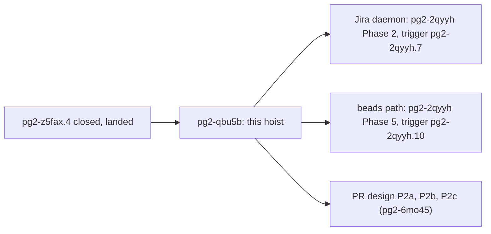
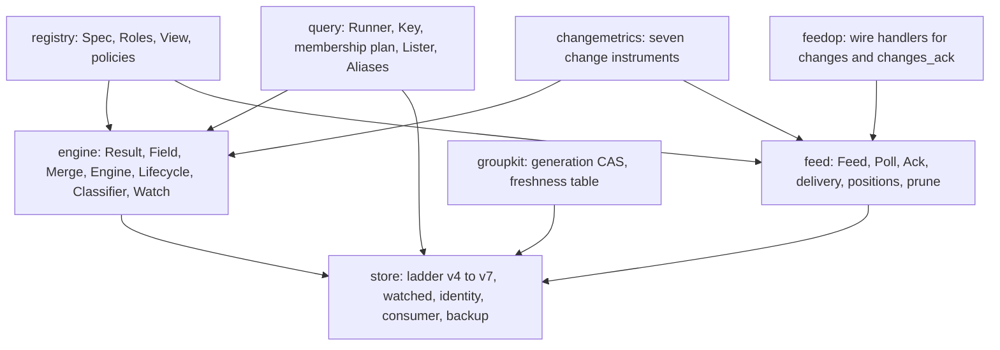
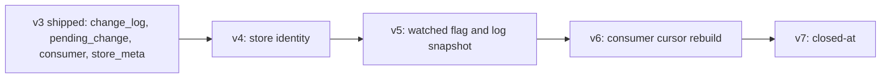
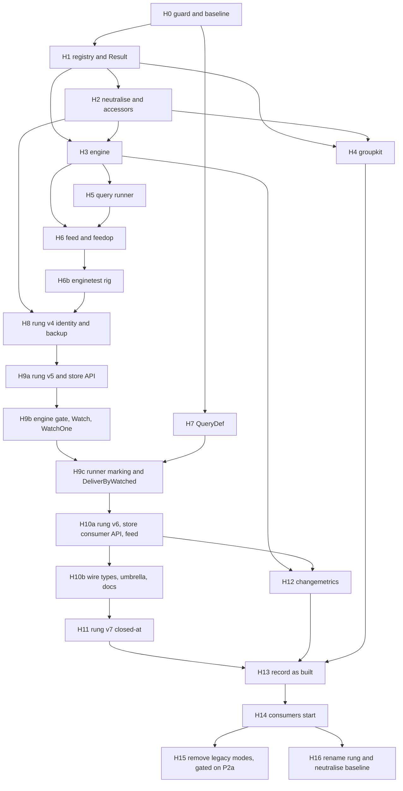

# Hoisting the generic change feed, change engine, query runner and watched-query shape into the shared connector-daemon library: design

**Status: DRAFT 2 (revision 1) for operator approval (bead pg2-qbu5b). Not approved.**

- **Date**: 2026-10-22. Draft 2 applies an independent review of draft 1; the per-finding log is the last section.
- **Bead**: `pg2-qbu5b`. Blocks `pg2-2qyyh.7` (Phase 2 decompose-trigger, Jira daemon) and `pg2-2qyyh.10` (Phase 5
  decompose-trigger, beads path) of program `pg2-2qyyh`. Related: `pg2-oa1h4` (issue change emission design),
  `pg2-6mo45` (PR lane refactor design, read at draft v5, commit `ea6f04a7d` of branch `drain/pg2-6mo45.2`),
  `pg2-z5fax` (the GitHub daemon; its Phase 3b `pg2-z5fax.4` is CLOSED).
- **Code read**: the canonical clone on `main` at commit `a35e79140`. The feed and change-engine packages were last
  touched by `d6c3ed49f` (a lint fix), after the Phase 3b packets landed, so the code read here is the landed code.
- **Nothing here is implemented.** No bead, branch, store or file other than this document was changed.

The key words MUST, MUST NOT, SHOULD, SHOULD NOT and MAY are to be read as in RFC 2119. This repository is public:
the document names no employer, workspace, channel or person; the operator is "the operator".

## The operator's decision

1. **Question.** Do you approve this design as the one contract for the hoist (approve, reject, or approve with the
   alternative option of the single pick in section 20)?
2. **Recommendation.** Approve, with Option A of the pick: the GitHub group refresh engine (`groupsvc`) stays in the
   GitHub daemon for now, the Jira daemon builds its own over the shared pieces, and a follow-up bead hoists it once
   two implementations exist.
3. **The pick (section 20).** Option A leaves `groupsvc` behind (recommended); Option B hoists it now, which adds one
   XL packet and collides with the PR design's keep-alive rewrite. The true cost of A: Jira Phase 2 also writes its own
   refresh service and generalises the governor's GitHub buckets (finding C1), so that phase grows.
4. **Approve unblocks** plan-decompose of the hoist into eighteen packets plus two deferred ones (section 17;
   forward-only order, sizes S to L, a test row per invariant `INV-HOIST-1` to `INV-HOIST-24`).
5. **Closing the hoist then triggers** `pg2-2qyyh.7` and `pg2-2qyyh.10` (program `pg2-2qyyh`) and the PR design's
   P2 amendment (`pg2-6mo45`); both consumers only consume what section 15 lists and add no store rung.
6. **You also accept (i, GitHub changes in the hoist itself).** Packets H10a and H10b change the GitHub daemon
   unconditionally: one cursor per consumer (two sources can no longer share one consumer name across queries, the
   `pr-mine` and `pr-team` pattern), a scope conflict error, a `store_identity` field, bumped pr and ci schema versions
   and a reversed `INV-GH-CHG-6`. Recommendation: accept (the operator ruled one cursor per consumer). Override cost:
   keeping `(consumer, kind, query)` contradicts that ruling and the Jira behavior set and makes every consumer repeat
   the query filter forever. Everything else (emission, delivery selection) stays as today until P2a (`INV-HOIST-22`).
7. **You also accept (ii, store policy defaults).** The ladder goes from 3 to 7 on the live store. `Open` fails closed
   when the pre-migration backup cannot be written (the daemon will not start), and the copy roughly doubles the store's
   disk use until it expires. The cursor collapse keeps the lowest `acked_seq` of a shared consumer name and drops the
   other scopes with only a `store_meta` note. Recommendation: accept. Override cost: allowing an unprotected open
   restores the move-aside data-loss path (finding C7); a different collapse needs a per-consumer rule nobody has data
   for.
8. **You also accept (iii, "generic enough" with shipped specifics baselined).** The guard's `legacy` class also baselines
   shipped specifics beyond the bead's list: the governor's GitHub buckets, the CI `job` rung and `store/jobs.go`,
   `base_sha`, `fetched_for_head/base`, GitHub wording in `tables.go` and `groupcas.go`, and about 260 lines of
   PR-flavoured test fixtures. They cannot change without rewriting shipped rungs. Recommendation: accept, with the
   deferred packet H16 (rename rung and neutralise) as the follow-up. Override cost: renaming inside this hoist adds the work of
   the deferred packet H16 (L: a rename rung plus the governor refactor) to it and reopens shipped schemas.
9. **You also accept (iv, transitional modes live in shared code).** `EmitAll`, `DeliverByMembership`, the
   scope-required rule and `StoreRows` are GitHub's pre-refactor behaviour inside the shared library until packet H15.
   Exit condition (observable, no date): H15 runs when P2a has been applied, the deployment's queries are marked
   `watched`, and no consumer polls with a scope. Recommendation: accept. Override cost: removing them now means
   flipping GitHub in the hoist, which silences its feed because `watched` defaults to false.
10. **Reject:** nothing is decomposed, and the Jira daemon and the PR design's P2 stay blocked on this bead.
11. **Settled facts:** the bead's ordering question is moot (`pg2-z5fax.4` is closed and landed); there is one pick.

## 0. Summary of the design calls

| #   | Call                                                                                                                                                                                                                                                                                                                            | Where           |
| --- | ------------------------------------------------------------------------------------------------------------------------------------------------------------------------------------------------------------------------------------------------------------------------------------------------------------------------------- | --------------- |
| 1   | A connector supplies **one `registry.Spec` value** (data: entity kind, change kinds, four structural roles, feed views, a reference-fold function, three policy enums) plus **three small interfaces** (classifier, lister, renderer). Shared code never names a kind and has no switch on one.                                 | sections 5-7    |
| 2   | **One configured-query type** `schema.QueryDef` in `pkg/schema`: a bare string, a list of strings, or `{"expr": ..., "watched": true}`. `schema.ResolveQuery` keeps its signature; `schema.ResolveQueryDef` is new.                                                                                                             | section 8       |
| 3   | **One cursor per consumer**, with the feed view and the optional query filter bound to the cursor at its creation (a mismatch is a loud `invalid_argument`, never a silent loss); **delivery by an append-time `watched` snapshot on the log row**; **a persisted store identity** on every `changes` and `changes_ack` answer. | sections 9-11   |
| 4   | The hoist **lands the whole store ladder** v4 to v7 (identity, watched flag, cursor rebuild, closed-at), so no consumer adds a rung; a **verified backup copy** is taken before a populated store migrates.                                                                                                                     | sections 12, 19 |
| 5   | GitHub keeps **two transitional modes** (`EmitAll`, `DeliverByMembership`) so the move changes no behaviour; the PR design's P2 flips them later. A **genericity guard** with a ratchet allowlist enforces the operator's requirement mechanically.                                                                             | sections 9, 13  |

## 1. Ground truth and ordering

- `pg2-z5fax.4` (Phase 3b, the change engine) is **CLOSED** (`bd show pg2-z5fax.4`: packets `.2` to `.14` done, `.15` to
  `.23` closed as not needed, the final acceptance bullet struck by operator ruling on 2026-10-22). The bead text's question whether it lands first is moot.
  The packages named by the bead as GitHub-only are verified present and landed under
  `packages/pg-connector/cmd/pg-connector-github/internal/`: `feed`, `changes`, `query`, `groups`, `groupsvc`,
  `classify`, `summary`, `entity`, `ratefeed`, `vcs`, `config`, `metered`, `revalidate`, `telemetry`.
- `pkg/connectord` holds `store`, `governor`, `scheduler`, `socket`, `proc`, `router` (and `doc.go`, `logger.go`).
  The store ladder is at version 3 (`pkg/connectord/store/schema.go:10`, ladder at `:15-19`, "A migration, once
  shipped, MUST NOT change" at `:12-14`).
- The layout test `cmd/pg-connector/layout_convention_test.go` allows every package under `pkg/connectord/`
  (`allowedSharedLayoutPrefixes`, `:46`), so new subpackages need no layout-test change.
- The Jira behavior-docs set already exists under `packages/pg-connector/docs/behavior/jira/` (commit `d5be3bdc5`) and
  states the Jira daemon's own requirements on the feed (`INV-JIRA-CHG-6` to `-10`, `INV-JIRA-WATCH-1` to `-7`). This
  design is checked against it.
- The two consumer designs and the existing behavior docs assign the umbrella verbs `--no-ack`, `changes-ack`, the
  caller-facing `capabilities` verb and `--watch` on `show` to program `pg2-2qyyh` (README realization-gap register
  rows `INTF-WIRE-ACK-1`, `-ACK-2`, `-CAPS-1`, `-WATCH-1`). They are **not** hoist work.



## 2. Operator requirement, restated as the acceptance rule

"shared library is good, make sure the shared is generic enough and doesn't contain specifics of either usage."
The shared library (everything under `pkg/connectord`) MUST NOT contain anything specific to PRs, CI, issues, Jira or
beads. Entity kinds, change kinds, key shapes, grouping rules and classifier rules MUST arrive as data or small
interfaces, and no shared code switches on a concrete kind. Section 13 turns this into three mechanical checks that fail
the build: a known-word ratchet (a closed word list, so it cannot prove the absence of every PR or issue concept), a rule
that bans comparing to string literals in the generic packages, and the second-registration test (`INV-HOIST-3`). Review
of new shared code stays a human duty for anything these checks cannot see.

## 3. What the code contradicts (claims in the bead or the consumer designs)

Each row was verified by reading the code.

| #   | Claim                                                                                                                                                               | What the code shows                                                                                                                                                                                                                                                                                                                                                                                                                                                                                                                                                                                                                                   |
| --- | ------------------------------------------------------------------------------------------------------------------------------------------------------------------- | ----------------------------------------------------------------------------------------------------------------------------------------------------------------------------------------------------------------------------------------------------------------------------------------------------------------------------------------------------------------------------------------------------------------------------------------------------------------------------------------------------------------------------------------------------------------------------------------------------------------------------------------------------- |
| C1  | Issue design 3.6 and the bead: the governor is "already generic" and reusable by a second daemon.                                                                   | `governor/types.go:11-26` defines `BucketGraphQL`, `BucketRESTCore`, `BucketRESTSearch`, and `Config` has the three fixed fields `GraphQL`, `RESTCore`, `RESTSearch` (`:142-148`, resolved by the `switch` at `:154-170`). The Jira design's "config-declared governor buckets" (its step 2) is therefore a governor change nobody owns in INV-ICD-20. **Resolved:** out of this hoist, baselined in the guard, owned by the Jira daemon packet (section 15).                                                                                                                                                                                         |
| C2  | The bead lists the PR-named store columns as `head_sha` (log and pending), `entity.last_known_mergeable` and `ChangeRow.HeadSHA`.                                   | The store also holds `base_sha` on `pending_change` (`schema.go:171`), `PendingChange.BaseSHA` (`changes.go:199`), `fetched_for_head` and `fetched_for_base` on `entity_group` (`schema.go:76-77`, `GroupRow.FetchedForHead/Base` at `tables.go:440-441`), a CI-run `job` table and `store/jobs.go` (rung 2), and GitHub wording in `tables.go:218` and `groupcas.go:20`. Section 13 lists them.                                                                                                                                                                                                                                                      |
| C3  | The feed's keys are hard-coded to the PR and CI "kinds".                                                                                                            | `ci` is not an entity kind. The only log and entity kind is `pr` (`changes/engine.go:14`); `ci` is a **view** over the PR rows (`delivery.go:113`: rows of a member whose kinds include `ci_changed`). The feed scan drops every row whose kind is not `changes.LogKindPR` (`feed.go:197`), so a second daemon's feed would **silently deliver nothing**. The registry therefore has one `EntityKind` and a list of `View`s.                                                                                                                                                                                                                          |
| C4  | The reference folding is one rule.                                                                                                                                  | It is copied four times: `feed/delivery.go:121`, `ops/changesop/handlers.go:271`, `changes/gone.go:20` and `query/membership.go:68`, all folding `owner/repo#n`. The registry supplies one `FoldRef`.                                                                                                                                                                                                                                                                                                                                                                                                                                                 |
| C5  | The bead's inventory item 3 names `changes/summary.go`, `append.go` and `group.go`.                                                                                 | `changes/gone.go:95,101` and `changes/membership.go:58` also read `HeadRefOid`/`HeadSHA`, and `append.go:125,157` also pass it. All go through one `Describe` (section 7).                                                                                                                                                                                                                                                                                                                                                                                                                                                                            |
| C6  | "Existing GitHub tests pass unchanged."                                                                                                                             | False for the store ladder tests pinned to version 3: `store/changes_test.go:33` fails when `SchemaVersion != 3`, and `:46,70,82` assert `ToVersion == 3` and `OutcomeOpened` for the v3 fixture. The ladder bump, the fixture generator, the rename of the cursor types and the third `RestartHint` argument all edit existing tests; section 17.2 lists every file, the edit and the packet. The edits change setup, version pins and type names, not what an assertion checks, except the cursor-key tests that assert per-`(consumer, kind, query)` independence, which change by design (section 10). All other assertions stay (`INV-HOIST-1`). |
| C7  | Both consumer designs treat a migration as a safe additive step.                                                                                                    | `store.Open` moves the whole store aside when a migration step fails (`store.go:221-222`, `errMigrationFailed`), which costs the change log and every consumer cursor. A rung that rebuilds the cursor table on the live store must be proven on populated data and a backup must exist (section 12).                                                                                                                                                                                                                                                                                                                                                 |
| C8  | The GitHub design fixes the cursor key as `(consumer, kind, query)` "because `pr-mine` and `pr-team` share the consumer name `pg-router` across different queries". | Under the operator's one-cursor-per-consumer ruling that sharing stops working; the second query's poll gets a scope conflict. The migration collapses any such existing rows and says so (section 10, `INV-HOIST-9`).                                                                                                                                                                                                                                                                                                                                                                                                                                |
| C9  | The bead says `--query` is required today only at the feed.                                                                                                         | It is required in three places: `feed.validate` (`feed/keys.go:117`), the op argument decoder `keyArgs` (`ops/changesop/handlers.go:102`) and the umbrella CLI. The wire result `ChangesAckResult.Query` has no `omitempty` (`pkg/schema/changes.go`).                                                                                                                                                                                                                                                                                                                                                                                                |
| C10 | The issue design says the PR design's P2 amends the shared pieces "once".                                                                                           | The PR design is now at draft v5 and splits P2 into P2a (flag, query option, store migration), P2b (consumers: adapter, umbrella forward, wire cursor key) and P2c (metrics). The issue design reads draft v3. Section 4 reconciles v5.                                                                                                                                                                                                                                                                                                                                                                                                               |
| C11 | `classify.Kinds()` is the change-kind vocabulary.                                                                                                                   | It is a closed set of fourteen kinds with no `added` (`classify/kinds.go:7-35`), and `classify/kinds_test.go` pins the count. Both consumer designs need an `added` first-observation row. The GitHub registration appends it in its adapter, so the pinned test is untouched.                                                                                                                                                                                                                                                                                                                                                                        |

## 4. Where the two consumer designs ask for incompatible things, and the resolution

| #   | The PR design (v5) says                                                                                                                                 | The issue design and the Jira behavior docs say                                                                                                    | Resolution in this design                                                                                                                                                                                                                                                                                                                                                                                                                                                                                                                                                                                                                                |
| --- | ------------------------------------------------------------------------------------------------------------------------------------------------------- | -------------------------------------------------------------------------------------------------------------------------------------------------- | -------------------------------------------------------------------------------------------------------------------------------------------------------------------------------------------------------------------------------------------------------------------------------------------------------------------------------------------------------------------------------------------------------------------------------------------------------------------------------------------------------------------------------------------------------------------------------------------------------------------------------------------------------- |
| D1  | A PR becomes watched by a configured query, **an ad-hoc query run with the watch option**, or a direct read with the watch option (6.3).                | No ad-hoc query watch: "The daemon MUST NOT accept a watch option on a query run, a listing or a feed read" (`INV-JIRA-WATCH-1`, `INV-ICD-13(b)`). | The mechanism exists once in shared code and is gated by a registered capability `Spec.AdHocQueryWatch`. GitHub registers true, Jira false; a query run with `watch` on a Jira daemon is `invalid_argument` (`INV-HOIST-15`).                                                                                                                                                                                                                                                                                                                                                                                                                            |
| D2  | P2b changes "the source adapter, the umbrella forward and the wire cursor key".                                                                         | Step 2 of the issue design adds `--no-ack`, `changes-ack` and consumption; the bead says the hoist defines and implements the cursor key.          | The hoist owns the daemon wire key **and** the umbrella forward becoming query-optional with the store identity passed through (packets H10a and H10b), because both consumers need that one file changed once. P2b keeps the pg-router adapter, `cursor_expired` handling and the stuck-rule label; the Jira program keeps `--no-ack`, `changes-ack`, `capabilities`, `--watch`.                                                                                                                                                                                                                                                                        |
| D3  | `--query` "MAY remain as a filter for compatibility" (6.3).                                                                                             | `--query` "narrows what is returned and never gives the consumer a second position" (`INV-JIRA-CHG-6`).                                            | One position per consumer. The first poll fixes the cursor's view and optional filter (its `scope`); a later poll with a different scope is `invalid_argument` unless it is a `--reset`. Without this, a narrowed poll would acknowledge past rows another narrowed poll should see.                                                                                                                                                                                                                                                                                                                                                                     |
| D4  | "A watch-option read of a PR the store has never seen appends nothing until that PR next changes" (6.3).                                                | "An issue first seen in a watched query that already has its marker MUST append exactly one `added` row" (`INV-JIRA-WATCH-6`).                     | Both hold, by cause: a direct watch of a never-seen entity appends nothing; a never-seen entity that **arrives in a baselined watched query** appends one `added` row; a **known** entity that becomes watched appends one `added` row; a baseline run appends none (`INV-HOIST-13`).                                                                                                                                                                                                                                                                                                                                                                    |
| D5  | The GitHub log keeps `entered_query` and `left_query` rows (6.3: "`left_query` rows are no longer needed for tracking", not removed).                   | The Jira daemon "MUST NOT store them as change rows" (`INV-JIRA-CHG-5`).                                                                           | `Spec.Membership.StoreRows`: GitHub true, Jira false (`INV-HOIST-14`). When false, an arrival of an entity that is not yet watched yields the `added` row and nothing else.                                                                                                                                                                                                                                                                                                                                                                                                                                                                              |
| D6  | The flag's store migration is "left to the builder" (14) and sits in P2a.                                                                               | The hoist owns the stored flag; the Jira closed-at rung "sits where the hoist assigns" (3.2).                                                      | One owner of the ladder: the hoist lands v4 to v7. P2a and the Jira packet add **no** rung (`INV-HOIST-21`).                                                                                                                                                                                                                                                                                                                                                                                                                                                                                                                                             |
| D7  | The stuck rule groups `consumer.lag_rows` by a `query` label; P2b "MUST update the `query` label".                                                      | A consumer has no query component (`INV-JIRA-CHG-6`).                                                                                              | The label key `query` stays and so does the fold: `queryLabel` (`changemetrics.go:139-148`) maps everything that is not a configured query name, the empty string of an unscoped consumer included, to `other`. (`none`, `telemetry.go:48`, is the group-label and paused-reason placeholder, not a query value.) P2b's rule-test case uses `other`; no new label value exists (`INV-HOIST-17`).                                                                                                                                                                                                                                                         |
| D8  | A reset replays "every current member as `added`" (6.3).                                                                                                | A reset "replays only watched issues, as `added`, and never as a `reconcile`" (`INV-JIRA-CHG-8`).                                                  | In `DeliverByWatched` a scoped reset replays the watched members of its scope, an unscoped reset replays every watched entity; in legacy `DeliverByMembership` a scoped reset replays the query's members as today (`INV-HOIST-8`).                                                                                                                                                                                                                                                                                                                                                                                                                      |
| D9  | The first poll of the new `pr-changes` consumer starts at the log tail, so rows between the last old-source poll and the first new poll are lost (6.3). | A consumer's first poll starts at the tail "taken after the baselines exist" (`INV-JIRA-CHG-7`).                                                   | The rule is one: an unscoped first poll creates its cursor at the tail only when every configured **watched** query has its baseline; before that it answers empty with `next_seq` at the head and creates nothing (the existing missing-baseline path). The P1 cursor decision (carry or replay) remains P1's.                                                                                                                                                                                                                                                                                                                                          |
| D10 | `watched` is a property of the configured query; the entity flag lives in the daemon store.                                                             | The same, plus a pg-desk-side `watched` column in pg-desk's own store.                                                                             | Not a conflict: different stores. The daemon column is `entity.watched_at` (section 9); the configured option is `watched`; pg-desk's column is the issue design's own.                                                                                                                                                                                                                                                                                                                                                                                                                                                                                  |
| D11 | The draft cites `INV-GH-FRESH-3` (keep-alive) and `INV-GH-CHG-5` (`--query` required) as the durable invariants P2a reverses.                           | The Jira set already states the reversed forms.                                                                                                    | H10b edits `INV-GH-CHG-6` in the GitHub behavior set (`docs/behavior/github/invariants.md:196-200`: "The cursor key MUST be (consumer, kind, query), because two queries share one consumer name"), which the hoist reverses unconditionally. `INV-GH-CHG-5` ("`--query` MUST stay required") is **not** edited by the hoist, because GitHub stays in `DeliverByMembership`, where the query is still required; P2a edits it when it flips the delivery mode. `INV-GH-FRESH-3` and the keep-alive rewrite stay in P2a: the tracked-until-closed lifecycle is **not** hoisted (it lives in the GitHub summary service and, for Jira, in the Jira daemon). |

## 5. Package layout (item a)

All new packages live under `pkg/connectord/`, so the layout test accepts them. Every one MUST import only the standard
library, other `pkg/connectord/...` packages, `pkg/schema`, `pkg/scriptout` and third-party modules (`INV-HOIST-18`).



### 5.1 What moves

| From (`cmd/pg-connector-github/internal/`)                                                                                      | To (`pkg/connectord/`) | Becomes                                                                                                                                                            |
| ------------------------------------------------------------------------------------------------------------------------------- | ---------------------- | ------------------------------------------------------------------------------------------------------------------------------------------------------------------ |
| `feed/feed.go`, `positions.go`, `prune.go`, `queries.go` (the `Queries` interface), `keys.go` (minus `KindPR`, `KindCI`)        | `feed/`                | `Feed`, `PollRequest`, `PollResult`, `Queries`, `Members`, `Position`, errors; the cursor is `(consumer)`.                                                         |
| `feed/delivery.go`                                                                                                              | `feed/delivery.go`     | `Deliver` driven by `registry.Spec` (views as data, `FoldRef`).                                                                                                    |
| `ops/changesop/handlers.go` (argument decoding, ack, freshness, member set), `errors.go` (`mapError`)                           | `feedop/`              | Wire handlers over a `Renderer`; the unauthenticated sentinel list is a parameter.                                                                                 |
| `changes/engine.go`, `append.go`, `group.go`, `summary.go`, `membership.go`, `gone.go`, `awaited.go`, `lifecycle.go`            | `engine/`              | `Engine` (`DetectPrimary`, `DetectGroup`, `DetectGone`, `AppendMembership`, `Watch`, `Complete`), `Lifecycle`, `Observer`, origin and result words, `RefreshInfo`. |
| `classify/fields.go` (`Field`, encode, decode, normalise), `merge.go` (`Merge`, `Membership`, `Removed`), `kinds.go` (`Result`) | `engine/result.go`     | `Result`, `Field`, `Merge` with the kind order taken from the registry. The classifier proper stays.                                                               |
| `query/runner.go`, `key.go` (`Key`, `String`), `membership.go`, `confirm.go` (the interfaces)                                   | `query/`               | `Runner` over `Lister`, `Aliases`, `Tracker`, `Confirmer`, `Settings`; `Key{Name, Args}`; the membership plan.                                                     |
| `groups/generation.go` (`Begin`, `Commit`, `CommitThen`, `Invalidate`), `groups/rules.go` (`Level`, `Freshness`, `Rules`)       | `groupkit/`            | The same functions over a data table (`Spec` per group: TTL, max age, stamped, extendable, background).                                                            |
| `telemetry/changemetrics.go`                                                                                                    | `changemetrics/`       | Seven instruments with a configurable name prefix (section 14).                                                                                                    |
| (new)                                                                                                                           | `registry/`            | `Spec` and its validation.                                                                                                                                         |

### 5.2 What stays in the GitHub daemon

| Stays                                                                                                                                                        | Why                                                                                                                                                                                                                        |
| ------------------------------------------------------------------------------------------------------------------------------------------------------------ | -------------------------------------------------------------------------------------------------------------------------------------------------------------------------------------------------------------------------- |
| `classify` (the fourteen kinds, summary and group classifiers, `fields.go` builders `diff`, `bodyValue`), `revalidate`, `summary`, `entity`, `prfacts`       | Pull-request semantics. They become the GitHub implementation of `engine.Classifier`.                                                                                                                                      |
| `groups/table.go` (`FieldTable`, `ResultTypes`, `AuditFields`), `groups/names.go`, `groups/fetcher.go` (`Fetcher`, `Target`)                                 | The table assigns schema fields of `schema.PR` and `schema.CIRun` to groups; `Target` carries `HeadRefName`, `State`. A data-driven `Fetcher` contract is only worth hoisting together with `groupsvc` (pick, section 20). |
| `groupsvc` (`Service`, `Ensure`, executor, book, rebuild, write)                                                                                             | Bound to `summary.Service`, the alias table and `ratefeed`; the PR design's P2a rewrites its keep-alive rule. Option A leaves it; Option B hoists it.                                                                      |
| `query/fetch.go` (the GraphQL membership document, `PageSize`, `SearchResultLimit`, paging), `Key.qualifiers`, `query/confirm.go`'s `NewConfirmer`           | GitHub search. They become the GitHub implementation of `query.Lister` and `query.Confirmer`.                                                                                                                              |
| `ratefeed`, `vcs`, `metered`, `config`, `identity`, `eventlog`, `ops/*` other than the feed handlers, `ciprovider`, `github`, `serve` assembly, `changeview` | Provider code, configuration and assembly.                                                                                                                                                                                 |
| `telemetry` other than the change instruments, `loadtest`                                                                                                    | GitHub-private metrics and its load harness; both import the shared packages afterwards.                                                                                                                                   |
| `cmd/pg-connector` (the umbrella)                                                                                                                            | Not shared library code. The umbrella forward becomes query-optional in H10b (section 4, D2).                                                                                                                              |

### 5.3 The facade rule

The GitHub packages `feed`, `changes`, `query` and `groups` MUST remain as thin adapters for the whole hoist: they
re-export the shared types by alias, bind the GitHub `registry.Spec` and the GitHub interface implementations, and
keep their exported API **until packet H10a**, so the existing tests compile and run against the real shared code. Until
H10a that means, concretely: the facade `feed.PollRequest` keeps `Kind` and `Query`, `feed.Ack` keeps the signature
`(ctx, kind, consumer, query string, nextSeq int64) error`, `feed.Position` keeps `Kind` and `Query`, and `feed.Queries`
keeps its three methods (the facade wraps it in an adapter that supplies `Names`, `Watched` and `WatchedRefs` for the
shared interface: no names, never watched, no refs, which is right while GitHub is in `DeliverByMembership`). The shared
feed takes `View` and `Scope` from the first packet that creates it; the facade translates. The rename of the facade types
and the rebuild of the consumer table happen in H10a only, with the enumerated test edits of 17.2. Deleting a facade is
outside this hoist (section 17, H15). White-box tests of unexported identifiers move with the code; the GitHub literals in
them are replaced by invented kinds in the shared tree, and the GitHub-flavoured assertion is kept in a GitHub-tree test.

## 6. The kind registration (item b)

### 6.1 The data

`pkg/connectord/registry/spec.go`:

```go
package registry

// Emission says which entities the change engine appends rows for.
type Emission int

const (
	// EmitAll appends a row for every tracked entity. It is the behaviour the GitHub
	// daemon has before the PR lane refactor; a row carries the entity's watched flag as it stood.
	EmitAll Emission = iota
	// EmitWatchedOnly appends a row only for an entity whose watched flag is set in
	// the same transaction (or is set by the same write).
	EmitWatchedOnly
)

// Delivery says how the feed selects the rows a consumer receives.
type Delivery int

const (
	// DeliverByMembership is the behaviour the GitHub feed has before the PR lane
	// refactor: a query name is required, a member's rows are delivered, and a
	// non-member's row only when a membership kind names the query.
	DeliverByMembership Delivery = iota
	// DeliverByWatched delivers the rows whose watched snapshot is set, whether or
	// not the entity is still a member of any query.
	DeliverByWatched
)

// Roles name the four change kinds the feed protocol itself needs. Added and Removed MUST be in
// Spec.Changes; EnteredQuery and LeftQuery MUST be in Spec.Changes only when Membership.StoreRows is true
// (a connector that stores no membership rows does not list them in its change catalog).
type Roles struct {
	Added        string // first observation, late watch (appended by the engine)
	Removed      string // the entity is gone
	EnteredQuery string // membership: arrival
	LeftQuery    string // membership: departure
}

// View is a named filter over one log. A consumer's cursor is bound to one view.
type View struct {
	Name string
	// AnyOf: when non-empty, a row of a member is delivered only if its kinds
	// include one of these. The Removed role and a membership kind that names the
	// consumer's query always pass.
	AnyOf []string
}

// MembershipPolicy says whether arrivals and departures are stored as log rows.
type MembershipPolicy struct{ StoreRows bool }

// The causes recorded in entity.watched_via.
const (
	ViaQuery  = "query:" // followed by the configured query name
	ViaDirect = "direct" // one read or lookup of one entity carried the watch option
	ViaAdHoc  = "adhoc:" // followed by the query name of an ad-hoc run carrying the watch option
)

// Spec is everything one connector tells the shared code about its vocabulary.
// It is plain data plus one function; it holds no behaviour of the shared code.
type Spec struct {
	// EntityKind is the entity.kind, change_log.kind and pending_change.kind of the
	// one entity type this daemon's feed serves.
	EntityKind string
	// PrimaryGroup is the group that describes the entity itself (its first
	// fetch is the entity's baseline). Groups lists every group name in canonical order,
	// PrimaryGroup included.
	PrimaryGroup string
	Groups       []string
	// Changes is every change kind the connector emits, in canonical order (the order
	// Merge writes a kind list in, and the label set of the kind metric).
	Changes []string
	Roles   Roles
	// Views: at least one; Views[0] is the default view.
	Views []View
	// FoldRef folds a wire reference to the form in which two references of one
	// entity compare equal. nil means the identity.
	FoldRef func(ref string) string

	Emission        Emission
	Delivery        Delivery
	Membership      MembershipPolicy
	AdHocQueryWatch bool
}

// Validate reports the first thing wrong with s: an empty EntityKind, a Roles entry (see Roles)
// or View.AnyOf entry that is not in Changes, a duplicate or empty name, a name
// that is not lower_snake_case, a PrimaryGroup missing from Groups, no View.
func (s Spec) Validate() error
```

The comments in this snippet and in the others of this document explain the design and name GitHub and the PR lane refactor;
the **committed** comments MUST NOT (the guard's comment class forbids those words, section 13.3): they say "the first
adopter's pre-refactor behaviour" and "the registered connector".

The words `added`, `removed` and `changed` that the umbrella wire already uses for the `change` field stay constants of
`feed` (`ChangeAdded`, `ChangeRemoved`, `ChangeChanged`, moved verbatim from `feed/delivery.go:12-16`); the roles map a
connector's kinds onto them. The prefix `query:` of the field that names a query in a membership row is the one
protocol-level field name the shared code knows (`engine.QueryFieldPrefix`, moved from `feed/delivery.go:20`).

### 6.2 The three small interfaces

`pkg/connectord/engine/classifier.go`:

```go
// Primary is what the engine needs of an entity's stored primary-group content.
type Primary struct {
	Ref      string    // the entity's wire reference as of this content
	Stamp    string    // opaque; stored with every row in the stamp column (see store accessors)
	Stamp2   string    // opaque; stored with a pending row
	OriginAt time.Time // the origin's own update time, zero when unknown
	Gone     bool
}

// Classifier is the connector's change classifier. It is pure and store-free.
type Classifier interface {
	// Describe reads the stored primary content. A content that does not decode is an error.
	Describe(content []byte) (Primary, error)
	// Primary classifies a refreshed primary-group content change (prev is nil for a
	// first sighting, which the engine never passes) and names the groups that must be
	// re-fetched before the row settles (the awaited set).
	Primary(prev, next []byte, bodyCap int) (res Result, dependents []string, err error)
	// Group classifies one non-primary group's change.
	Group(name string, prev, next []byte, bodyCap int) (Result, error)
	// Counts reports whether a fetch of a group satisfies an awaited group of a pending
	// row (a stamped group compares the stamps it was fetched for with the pending row's).
	Counts(a Awaiting, fetched store.GroupRow, pending store.PendingChange, started time.Time) bool
}
```

`pkg/connectord/query/interfaces.go`:

```go
// Member is one listed entity: a stable id (the store entity id) and its display
// reference (the wire form, which can change on a rename).
type Member struct{ ID, Ref string }

// Listing is what running a query returned: the members in the origin's order and
// whether the list is the whole result.
type Listing struct {
	Members  []Member
	Complete bool
}

// CallMeta is what the origin call is admitted as.
type CallMeta struct {
	Class   governor.Class
	Purpose governor.Purpose
}

// Lister runs every expression of a configured query against the origin and unions the
// members. The shared runner never builds an origin request itself.
type Lister interface {
	List(ctx context.Context, key Key, exprs []string, call CallMeta) (Listing, error)
}

// Aliases resolves the display references of a previous listing to stable ids, so a
// rename is neither an arrival nor a departure (the runner's planMembership).
type Aliases interface {
	Put(ctx context.Context, id, ref string) error
	Resolve(ctx context.Context, refs []string) (map[string]Alias, error) // keyed by the ref given
}
type Alias struct{ ID, CanonicalRef string }

// Settings is the connector's own query configuration.
type Settings interface {
	Expr(name string) (exprs []string, ok bool)
	Watched(name string) bool
	Names() []string                  // configured query names, sorted
	TTL(key Key) time.Duration        // query_ttl for a configured key, the ad-hoc ttl otherwise
}

// Tracker gives each listed entity without a row one and queues its first refresh.
type Tracker interface {
	Track(ctx context.Context, refs []string) (unresolved []string, err error)
}

// Confirmer makes the one read that tells an entity that closed apart from one that was
// merely filtered out of a query; State is opaque to the shared code.
type Confirmer interface {
	Confirm(ctx context.Context, id, ref string) (Confirmation, error)
}
type Confirmation struct {
	State string
	Gone  bool
}
```

`pkg/connectord/feedop/renderer.go`:

```go
// Renderer builds the wire entity of a delivered row. Both methods return JSON for the
// connector's own schema type; the shared handler never decodes it.
type Renderer interface {
	// Row renders the entity as it is stored now with the row's OWN version and stamp set.
	Row(ctx context.Context, row store.ChangeRow) (json.RawMessage, error)
	// Replay renders the entity of a reset replay entry from its wire reference.
	Replay(ctx context.Context, ref string) (json.RawMessage, error)
}
```

### 6.3 How each registration item maps

| Item the bead names | Supplied as                                                                                                  | Shared code that used to hard-code it                                                                                                                                       |
| ------------------- | ------------------------------------------------------------------------------------------------------------ | --------------------------------------------------------------------------------------------------------------------------------------------------------------------------- |
| Entity kinds        | `Spec.EntityKind`                                                                                            | `changes.LogKindPR` (eighteen uses in `changes/`: `append.go` 7, `gone.go` 5, `group.go` 2, `summary.go` 2, `membership.go` 2; plus `feed.go:197`, `changeview.go:209,230`) |
| Change kinds        | `Spec.Changes`, `Spec.Roles`                                                                                 | `classify.Kinds()` in `merge.go`, `feed/delivery.go:35-40`, `telemetry/changemetrics.go:93`                                                                                 |
| Key shapes          | `Spec.FoldRef`                                                                                               | the four copies of `refFold` (finding C4)                                                                                                                                   |
| Key conflict rule   | one rule, generic: a consumer's cursor has one view and one scope (`KeyConflictError`, `ScopeConflictError`) | `feed/keys.go:58-65,131-146` (`other()`, `checkConflict`)                                                                                                                   |
| Feed views          | `Spec.Views`                                                                                                 | `KindPR`, `KindCI`, `DeliveryForKey` (`delivery.go:97-117`)                                                                                                                 |
| Grouping rules      | `groupkit.Table` (data) and `Spec.Groups`                                                                    | `groups/rules.go:81-109` (`TTL` and `MaxAge`: `switch group { case Summary ... }`)                                                                                          |
| Classifier rules    | `engine.Classifier`                                                                                          | `classify.Summary`, `classify.Group`, `revalidate.Decide` called from `changes/*`                                                                                           |
| Listing the origin  | `query.Lister`                                                                                               | `query/fetch.go`                                                                                                                                                            |

### 6.4 Example registrations (illustrative; each consumer owns its own)

The GitHub adapter (packet H3, `cmd/pg-connector-github/internal/changes/spec.go`):

```go
// Spec is the GitHub daemon's registration. Emission and Delivery are the legacy modes
// until the PR lane refactor's P2a flips them.
func Spec() registry.Spec {
	return registry.Spec{
		EntityKind:   "pr",
		PrimaryGroup: groups.Summary,
		Groups:       groups.All(),
		Changes:      append(classify.Kinds(), "added"),
		Roles: registry.Roles{
			Added: "added", Removed: classify.KindRemoved,
			EnteredQuery: classify.KindEnteredQuery, LeftQuery: classify.KindLeftQuery,
		},
		Views: []registry.View{
			{Name: "pr"},
			{Name: "ci", AnyOf: []string{classify.KindCIChanged}},
		},
		FoldRef:         foldOwnerRepo,
		Emission:        registry.EmitAll,
		Delivery:        registry.DeliverByMembership,
		Membership:      registry.MembershipPolicy{StoreRows: true},
		AdHocQueryWatch: true,
	}
}
```

The Jira daemon's registration (owned by the Jira packet; shown to prove the shape fits the Jira behavior set):

```go
func Spec() registry.Spec {
	return registry.Spec{
		EntityKind:   "issue",
		PrimaryGroup: "summary",
		Groups:       []string{"summary", "detail"},
		Changes: []string{"closed", "reopened", "status_changed", "assignee_changed", "priority_changed",
			"labels_changed", "parent_changed", "title_changed", "description_changed",
			"comments_changed", "renamed", "removed", "fields_changed", "added"}, // no membership kinds: StoreRows is false
		Roles:           registry.Roles{Added: "added", Removed: "removed", EnteredQuery: "entered_query", LeftQuery: "left_query"},
		Views:           []registry.View{{Name: "issue"}},
		FoldRef:         strings.ToUpper,
		Emission:        registry.EmitWatchedOnly,
		Delivery:        registry.DeliverByWatched,
		Membership:      registry.MembershipPolicy{StoreRows: false},
		AdHocQueryWatch: false,
	}
}
```

## 7. The engine skeleton, query runner and group kit (item a, contracts)

### 7.1 The engine

`pkg/connectord/engine/engine.go` (signatures; behaviour is the moved code of `changes/`):

```go
type Config struct {
	Spec          registry.Spec
	Classifier    Classifier
	Clock         governor.Clock
	SettleTimeout time.Duration // required, positive: the shared code has no default
	BodyCap       int           // required, positive
}

func New(Config) (*Engine, error)

// RefreshInfo, Origin* and Result* move from groupsvc and changes unchanged in value.
type RefreshInfo struct {
	Started time.Time
	Class   governor.Class
	Purpose governor.Purpose
}
const (
	OriginQuery, OriginRefresh, OriginWrite, OriginRead = "query", "refresh", "write", "read"
	ResultSettled, ResultFailed, ResultTimeout          = "settled", "failed", "timeout"
)

// PrimaryChange is one stored change of the primary group. Prev is nil for a first sighting.
type PrimaryChange struct {
	ID         string
	Prev, Next []byte
	Info       RefreshInfo
}

func (e *Engine) DetectPrimary(ctx context.Context, tx *store.Tx, c PrimaryChange) error
func (e *Engine) DetectGroup(ctx context.Context, tx *store.Tx, prev *store.GroupRow, next store.GroupRow, info RefreshInfo) error
func (e *Engine) DetectGone(ctx context.Context, tx *store.Tx, id string, purpose governor.Purpose) error
func (e *Engine) AppendMembership(ctx context.Context, tx *store.Tx, m Membership) error
func (e *Engine) Watch(ctx context.Context, tx *store.Tx, w WatchRequest) (WatchResult, error)
func (e *Engine) Complete(ctx context.Context, tx *store.Tx, p store.PendingChange, result string) error
// WatchOne is Watch for one entity outside any transaction of the caller: it opens its own. It is the one-off watch
// helper of the "watch" read option (section 9.1); it exists because Watch needs an open *store.Tx and the engine
// holds no store handle.
func (e *Engine) WatchOne(ctx context.Context, st *store.Store, w WatchRequest) (WatchResult, error)
func (e *Engine) NoteOrigin(id, group, origin string)
func (e *Engine) SetObserver(Observer)

type Membership struct {
	Kind        string // Spec.Roles.EnteredQuery or Spec.Roles.LeftQuery
	Query, ID, Ref string
	Extra       []Field
	Watch       WatchMode // 0: none. Used for an arrival into a watched query.
	Via         string
}
type WatchMode int
const (
	WatchBaseline WatchMode = iota + 1 // set the flag, never append a row
	WatchLate                          // set the flag; append one Added row when it was newly set and the rules of section 9.3 say so
)
type WatchRequest struct {
	ID, Ref string // Ref is needed only when the entity has no stored primary content
	Via     string
	Mode    WatchMode
}
type WatchResult struct{ Newly, Appended bool }
```

`Lifecycle`, `Stats`, `Queuer` and the hint table move unchanged; `Lifecycle.Recover` queues through `Queuer`
(`*groupsvc.Service` satisfies it). The engine holds no store handle (every method takes the open `*store.Tx`, the rule
of `changes/doc.go`).

Behaviour pinned by the move (all inherited, none new): baselines add nothing; a primary change that queues dependents
becomes one pending row with a deadline of detection time plus `SettleTimeout`; `Complete` appends one row, bumps the
entity version once and deletes the pending row; a merged result that ended up empty appends nothing; a tombstone appends
one `Removed`-role row naming every configured query that listed the entity, once per tombstone (`store_meta` key
`changes.removed.<id>`, `gone.go:16`).

New behaviour (all behind `Spec.Emission`/`Spec.Membership`, section 9): the append gate, `Watch`, `WatchOne` and the
single merged row of an arrival. `engine.New` also fails when `Spec.PrimaryGroup` is not `store.SummaryGroupName`
(exported as part of H2; today the store hard-codes the word `summary` in `BumpGroup`, `groupcas.go:20`), until a
connector needs another name and `store.Options.PrimaryGroup` replaces the constant.

### 7.2 The query runner

`query.Runner` is the moved `query/runner.go` over the interfaces of 6.2. Its public methods keep their GitHub names
(`Expr`, `TTL`, `Row`, `Schedule`, `Expire`, `Fetch`, `QueueRun`) so `feed.NewQueries(runner, st)` and the ops that call
it compile unchanged. `Fetch` gains an options value:

```go
type FetchOptions struct {
	// Watch marks every member of this run watched (an ad-hoc query run with the watch
	// option). It is refused (invalid_argument) unless Spec.AdHocQueryWatch is true.
	Watch bool
}
func (r *Runner) Fetch(ctx context.Context, key Key, opts ...FetchOptions) (store.QueryRow, error)
```

A run of a configured watched query performs, inside the one transaction that stores the run's row (`runner.go:400-411`
today), for every member: an arrival goes through `AppendMembership` with `Watch` set; every other member goes through
`engine.Watch`. The mode is `WatchBaseline` when the query row has no `BaselineAt` before this run (the run is the
baseline run), `WatchLate` otherwise. The runner never appends a row itself. It reaches the engine through one small
interface (`*engine.Engine` satisfies it, as `query.Changes` does today at `membership.go:19-21`):

```go
type Changes interface {
	AppendMembership(ctx context.Context, tx *store.Tx, m engine.Membership) error
	Watch(ctx context.Context, tx *store.Tx, w engine.WatchRequest) (engine.WatchResult, error)
}
```

`query.Config` carries `AdHocWatch bool` (the registration's `AdHocQueryWatch`), which `Fetch` checks.

### 7.3 The group kit

`groupkit.Table` replaces the `switch group` of `groups/rules.go:81-109` with data; `Begin`, `Commit`, `CommitThen`,
`Invalidate` and the `Level`/`Freshness` verdicts move verbatim.

```go
type GroupSpec struct {
	Name                       string
	TTL, MaxAge                time.Duration // zero: none
	Stamped, Extendable, Background bool
}
type Table struct {
	Groups      []GroupSpec
	TerminalTTL time.Duration
}
type Stamps struct{ Primary, Secondary string } // compared with GroupRow.FetchedForHead/Base through accessors
func (t Table) Schedule(group string, terminal bool, fetchedAt time.Time) (freshUntil, maxAgeAt time.Time)
func (t Table) Extend(row store.GroupRow, group string, now time.Time) (time.Time, bool)
func (t Table) Fresh(row store.GroupRow, cur Stamps, now time.Time) Freshness
```

The GitHub `groups.Rules` is built from its `config.Settings` into a `Table` (the runs group's `TTL` is `ci_active_ttl`
as today, `groups/rules.go:81-95`).

## 8. The configured-query shape (item c)

### 8.1 The type

`pkg/schema/queries.go` (the existing home of `QueryExpr`; `pkg/schema` is already the shared surface the dispatch tables
and the beads backend import):

```go
// QueryDef is one configured query: its native expressions and whether its members are watched.
type QueryDef struct {
	Expr    QueryExpr
	Watched bool
}

// UnmarshalJSON accepts exactly three forms:
//   "a native expression"                         (watched false)
//   ["expression one", "expression two"]          (watched false)
//   {"expr": "one" | ["one", "two"], "watched": true}
// An object with a key other than "expr" and "watched", an object with no "expr",
// and a "watched" that is not a JSON boolean are errors. "watched" defaults to false.
// JSON null keeps today's result, one empty expression (QueryExpr{""}, queries.go:33: unmarshalling null into a
// string is a no-op), unwatched; a test pins it, because turning it into an error would make ResolveQuery treat
// the whole queries block as absent.
func (q *QueryDef) UnmarshalJSON(data []byte) error

// MarshalJSON writes the bare list form for an unwatched definition and the object form otherwise,
// so a config round-trips and an unwatched deployment's rendered file does not change.
func (q QueryDef) MarshalJSON() ([]byte, error)

type QueriesConfig struct {
	Queries map[string]QueryDef `json:"queries"`
}

// ResolveQuery is unchanged for every caller: it returns the expressions.
func ResolveQuery(config json.RawMessage, name string) (QueryExpr, bool)

// ResolveQueryDef returns the whole definition.
func ResolveQueryDef(config json.RawMessage, name string) (QueryDef, bool)
```

### 8.2 Where each form is used

| Form in the connector configuration                          | Parses as                              | Notes                                                                           |
| ------------------------------------------------------------ | -------------------------------------- | ------------------------------------------------------------------------------- |
| `"queries": {"mine": "is:open author:@me"}`                  | `QueryDef{Expr: [..], Watched: false}` | Backward compatible. Every existing deployment and every existing test fixture. |
| `"queries": {"mine": ["a", "b"]}`                            | `Watched: false`                       | Backward compatible.                                                            |
| `"queries": {"mine": {"expr": ["a", "b"], "watched": true}}` | `Watched: true`                        | The new form.                                                                   |
| `{"expr": "a", "watch": true}` (a typo)                      | error naming the unknown key `watch`   | A typo MUST NOT silently leave a query unwatched.                               |
| `{"expr": "a", "watched": "true"}`                           | error: `watched` must be a boolean     |                                                                                 |

### 8.3 Storage and consumers

- **Stored**: the flag is a property of the configuration, not of the store. The daemon reads it through
  `query.Settings.Watched(name)`; the store holds only the per-entity flag that results from it (section 9).
- **GitHub**: `config.PR.Queries` changes its type from `map[string]schema.QueryExpr` (`config/config.go:158`) to
  `map[string]schema.QueryDef`; `Runner.Expr` returns `def.Expr`. The config hash (`config/hash_test.go`) MUST not change
  for a deployment that uses only bare forms (the marshalled form of an unwatched definition is the bare list).
- **Beads and other non-daemon backends**: `ResolveQuery` keeps returning the expressions, so `pkg/provider/*/dispatch.go`
  callers and `Backend.List(query schema.QueryExpr, ...)` are untouched. `schema.QueriesConfig` is shared by the pr,
  issue, calendar and alert dispatch tables, so a backend that keeps no store (calendar, alert, beads) **parses and
  ignores** `watched`: it does not reject it, and it is reported only through the `capabilities` verb of the Jira
  program. A beads backend reads
  `schema.ResolveQueryDef` for the `capabilities` answer (the Jira program's `INTF-WIRE-CAPS-1`).
- **PR design `watch.pr.queries` mirror and the issue design's per-backend queries**: the deployment renders the same
  `{"expr", "watched"}` objects into the connector blocks; pg-desk's mirror list is rendered from the same option and is
  outside the hoist. The option name is `watched` everywhere (`INV-ICD-13(b)`, PR design 6.3).

## 9. The stored watched flag, emission and delivery (items d and h)

### 9.1 Storage

The flag is per entity, stored on the shared `entity` row (rung v5, section 12). `watched_at` is the Unix-millisecond time
it was first set; `NULL` means not watched. `watched_via` records the cause: `query:<name>`, `direct`, or `adhoc:<name>`.

- A watched entity MUST stay watched until its entity row is deleted (eviction). There is **no clear operation** in the
  shared store: stickiness (`INV-ICD-13(c)`, PR design 6.3, `INV-JIRA-WATCH-2`) is enforced by the absence of one.
- First cause wins: `Tx.SetWatched` is `UPDATE ... SET watched_at = ?, watched_via = ? WHERE kind = ? AND id = ? AND
watched_at IS NULL` after `EnsureEntity`, and reports `newly`.
- The query-membership cause and the one-off cause differ only in `watched_via`; both are sticky.
- **Order of a one-off watch.** A connector handling a read with the `watch` option MUST call `engine.WatchOne` **before**
  it refreshes or reads the entity, so a change the refresh finds is appended as a row of a watched entity and is not
  lost (a watch after the refresh would put the change in an unwatched entity's skipped row). `WatchOne` sets the flag
  and, under `EmitWatchedOnly`, appends the one `Added` row of a known entity (9.3); P2a's `pr show --watch` and the Jira
  `show --watch` both call it and invent no transaction of their own.
- `PutEntity`'s `ON CONFLICT DO UPDATE SET` list (`tables.go:308-320`) MUST NOT name `watched_at`, `watched_via` or
  `closed_at`, so a read-modify-write of an old copy of the row cannot clear them (`INV-HOIST-20`; the same reason
  `TouchEntity` exists, `tables.go:323`).

### 9.2 The log row's watched snapshot

`change_log.watched INTEGER NOT NULL DEFAULT 0` records, at append time and in the same transaction, whether the entity's
flag was set. `AppendChange` writes it from `ChangeRow.Watched`; the engine sets it from `IsWatched` read in the same
transaction (or from the flag the same write sets).

### 9.3 Emission (what the engine appends)

| `Spec.Emission`   | Behaviour                                                                                                                                                                                                                                                                                                                                                                                                                                                                                            |
| ----------------- | ---------------------------------------------------------------------------------------------------------------------------------------------------------------------------------------------------------------------------------------------------------------------------------------------------------------------------------------------------------------------------------------------------------------------------------------------------------------------------------------------------- |
| `EmitAll`         | As today: a row is appended for every tracked entity. The flag is stored and snapshotted, and `Watch(WatchLate)` sets it and appends **no** row. GitHub today.                                                                                                                                                                                                                                                                                                                                       |
| `EmitWatchedOnly` | `DetectPrimary`, `DetectGroup`, `DetectGone` and `AppendMembership` return at once for an entity that is not watched (no pending row, no version bump, no sequence number). A row of a watched entity is appended and delivered. A **watch rule**: `Watch` appends exactly one `Added`-role row when the flag was newly set **and** (`WatchLate`) the entity has stored primary content (a known entity). A baseline run or a direct watch of a never-seen entity sets the flag and appends nothing. |

The arrival of an entity into a watched, baselined query is **one** row, built by `AppendMembership` as the union of:
the `EnteredQuery` kind when `Spec.Membership.StoreRows`, and **only under `EmitWatchedOnly`** the `Added` kind when the
flag was newly set by this very arrival (known or unknown entity). Under `EmitAll` the union is the `EnteredQuery` kind
alone, exactly today's row, even in a deployment whose queries are marked watched. When the union is empty nothing is appended. So GitHub under `EmitWatchedOnly` and
`StoreRows` gets `[entered_query, added]` in one row, Jira gets `[added]`, and an arrival of an already watched entity under
Jira gets nothing.

### 9.4 Delivery (what the feed hands out)

```go
// Deliver reports whether a log row reaches a consumer bound to (view, scope), and the wire word.
// member says whether the row's entity is a member of scope now (false when scope is empty).
func Deliver(spec registry.Spec, view registry.View, row store.ChangeRow, scope string, member bool) (ok bool, word string)
```

Rules, in order:

1. `n` = which membership kinds of the row name `scope` (only when `scope != ""`; the field `query:<scope>` is read
   exactly as `feed/delivery.go:31-60` does today).
2. `DeliverByMembership` (legacy): `n.any()` delivers; otherwise a non-member is dropped; otherwise a view with `AnyOf`
   drops a row whose kinds miss `AnyOf`. This is `DeliveryForKey` (`delivery.go:97-117`) with `KindCI`/`ci_changed`
   replaced by the view data.
3. `DeliverByWatched`: a row with `watched = 0` is dropped. With a scope, a row whose entity is not a member and whose
   kinds do not name the scope through a membership kind is dropped. A view with `AnyOf` drops a row whose kinds miss
   `AnyOf` unless it carries the `Removed` role or names the scope. Everything else is delivered, **member or not**: for an
   unscoped consumer the `closed` row of an issue that already left its query reaches it. A scoped consumer asked for a
   membership filter and gets it, so the same row reaches it only while the entity is a member or the row names the scope.
4. The wire word. With a scope, exactly as `delivery.go:98-106` today: an `EnteredQuery` kind that **names the scope**
   is `added`, a `LeftQuery` or `Removed` kind that names the scope is `removed`, anything else `changed`; the `Added` role
   counts as `added` for a row whose entity is a member. Without a scope no row names a query, so the word follows the
   kinds: `EnteredQuery` or `Added` is `added`, `LeftQuery` or `Removed` is `removed`, anything else `changed`.

A row of an unwatched entity is therefore never delivered in `DeliverByWatched`, and in `EmitWatchedOnly` it is never
appended either: both are asserted (`INV-HOIST-6`, `-7`).

### 9.5 The two modes and the PR design

The PR design's P2a flips GitHub to `EmitWatchedOnly` and `DeliverByWatched`. It SHOULD do it in two steps: first mark the
deployment's queries `watched = true` while still in the legacy modes (`INV-HOIST-22` allows it, and the flag is stored and
snapshotted on every row from then on), then flip the two modes, the second step waiting until every consumer's `acked_seq` is at or past the head recorded at step 1 (`Feed.Positions` shows it). A one-step flip would leave rows appended before it with
`watched = 0`, which `DeliverByWatched` drops for a consumer that lags behind the flip. Until the flip the modes are the
legacy ones, so a GitHub deployment, with or without `watched` queries, has the emission and delivery selection it has today
(`INV-HOIST-22`). When the exit condition of the decision section, item 9, holds, packet H15 deletes the two legacy values and
their code.

## 10. The one cursor key and the wire (item e)

### 10.1 The table

Today: `consumer(consumer, kind, query, acked_seq, seen_at)` with primary key `(consumer, kind, query)`
(`schema.go:180-188`). Rung v6 (section 12) rebuilds it as:

```sql
CREATE TABLE consumer (
    consumer  TEXT    NOT NULL PRIMARY KEY,
    feed_view TEXT    NOT NULL,
    scope     TEXT    NOT NULL DEFAULT '',
    acked_seq INTEGER NOT NULL DEFAULT 0,
    seen_at   INTEGER NOT NULL
);
CREATE INDEX consumer_seen_at ON consumer (seen_at);
```

`feed_view` is the registered view name (`pr`, `ci`, `issue`); `scope` is the query filter fixed at creation (`''` for an
unscoped consumer). `store.ConsumerRow` becomes `{Consumer, View, Scope string; AckedSeq int64; SeenAt time.Time}` and
`GetConsumer`, `PutConsumer`, `DeleteConsumer` take `consumer` alone.

### 10.2 The feed

```go
type PollRequest struct {
	View, Consumer, Scope string // View "" means Spec.Views[0]
	Cached, Reset         bool
	Limit                 int
}
type PollResult struct {
	Rows              []store.ChangeRow
	NextSeq, Position int64
	Replay            []string // Reset only: the refs to replay as added
	StoreID           string   // the store identity (section 11)
}
type AckRequest struct {
	View, Consumer, Scope string
	NextSeq               int64
}
type AckResult struct{ AckedSeq int64; StoreID string }

func (f *Feed) Poll(ctx context.Context, req PollRequest) (PollResult, error)
func (f *Feed) Ack(ctx context.Context, req AckRequest) (AckResult, error)
func (f *Feed) Positions(ctx context.Context) ([]Position, error)
func (f *Feed) Prune(ctx context.Context) (rows, keys int64, err error)
func (f *Feed) NoteMovedAside(ctx context.Context, at time.Time) error

type Queries interface {
	Known(name string) bool
	Names() []string                                          // configured query names
	Watched(name string) bool
	Members(ctx context.Context, name string) (Members, error) // Refs, Baseline
	Run(ctx context.Context, name string) error
	WatchedRefs(ctx context.Context) ([]string, error)         // every watched entity's wire ref, for an unscoped reset
}
```

```go
type Members struct {
	Refs     []string // the stored members' wire references, in the stored row's order
	Baseline bool     // the query's membership baseline exists
}
type Position struct {
	Consumer, View, Scope string
	AckedSeq, Head        int64
	LagRows               int       // rows a poll would deliver after AckedSeq
	OldestUnacked, SeenAt time.Time // OldestUnacked is zero when none
}
```

Rules (each is a test row of `INV-HOIST-8`):

1. A consumer has **one** row. The first poll or ack that creates it fixes its `View` and `Scope`.
2. An existing consumer polled with another view is a `*KeyConflictError` (`invalid_argument`, naming the existing view
   and scope; the type and its `Is(ErrInvalidArgument)` are kept from `keys.go:43-51`).
3. An existing consumer polled with another scope is a new `*ScopeConflictError` (`invalid_argument`) unless the call is a
   `Reset`, which rebinds the cursor to the new scope and moves it to the head. This is what makes `--query` "a filter that
   never gives the consumer a second position" (D3) without silent loss.
4. `Scope` is required exactly when `Spec.Delivery == DeliverByMembership` (as `query` is today); otherwise it is optional,
   and when given it MUST be a configured query (`ErrQueryNotRecognized`).
5. The first poll of an unscoped consumer creates the cursor at the tail only when every configured **watched** query has its
   baseline; until then it answers empty with `NextSeq` at the head and creates nothing, and the consumer's `Ack` of that
   `NextSeq` creates it (the existing path, `feed.go:151-154`). A scoped first poll keeps today's rule (that query's baseline).
6. **An uncached unscoped poll runs every configured watched query** through `Queries.Run`, each honouring its own TTL (a
   fresh stored result is a no-op, as `queries.go` `Run` does today), so per-query freshness and the baselines of rule 5
   do not depend on a scheduler timing; a failed run is returned as today. `Cached` skips the runs. A scoped poll runs
   its one query, as today.
7. `cursor_expired:` (retention gap, or a moved-aside store whose marker covers the consumer), `ErrAckBeyondHead`,
   `CursorExpiredError` and the at-least-once redelivery observer keep their meaning (`keys.go`, `feed.go:215-246`).
8. `Reset` in `DeliverByMembership` replays the scope's members as today; in `DeliverByWatched` it replays the watched
   members of the scope, or `Queries.WatchedRefs` for an unscoped consumer (D8). It never appends a row.
9. The per-consumer serialisation lock keys on `consumer` (it keyed on the triple; `keyLocks` is kept, `keys.go:67-108`).

### 10.3 The wire

`pkg/schema/changes.go` (the two generic types additive in packet H6, the `store_identity` field in H10b). The shared handlers cannot name `PRChange` (the guard forbids the token
`pr` in the generic packages), so H10b adds **two generic answer types** that every connector's changes op returns, and
keeps `PRChangesResult` and `CIChangesResult` as the typed decoders the tests use. The umbrella decodes the answer into its
own struct (`forwardedChangesResult`, `changes_forward.go:112-117`), which has **no** `store_identity` field today, so the umbrella
is affected (see "The umbrella" below):

```go
// ChangesResult is the answer every changes op returns; Entity is the connector's own JSON.
type ChangesResult struct {
	Sources          []ChangeSource    `json:"sources"`
	Changes          []Change          `json:"changes"`
	SourcesFreshness []SourceFreshness `json:"sources_freshness"`
	StoreIdentity    string            `json:"store_identity"`
}
type Change struct {
	Change string          `json:"change"`
	Source string          `json:"source"`
	Entity json.RawMessage `json:"entity"`
	Seq    int64           `json:"seq"`
	Kinds  []string        `json:"kinds"`
	Fields json.RawMessage `json:"fields"`
}
```

The marshalled bytes equal today's for a GitHub answer (same keys, same order, `Entity` already compact JSON of
`schema.PR`), except for `store_identity` (`INV-HOIST-1`, `-16`; HT-25 compares the golden). Schema versions: `PRSchemaVersion` and
`CISchemaVersion` are bumped by one in H10b for the added field. A bump stamps **every** pr and ci op, so
`cmd/pg-connector-pr-github/main.go:88-91` and `cmd/pg-connector-ci-github-actions/main.go:60-62` (which register the same
constants) move with it, and their conformance goldens are regenerated in the same packet. The Jira daemon owns its own
answer's version: it returns `ChangesResult` stamped with `IssueSchemaVersion` and bumps that constant in its own packet
(listed in 15.1); this hoist does not touch `IssueSchemaVersion`. That bump also stamps `pg-connector-issue-beads`
(`cmd/pg-connector-issue-beads/main.go:132,170`), which registers the same constant, so the Jira packet regenerates the beads
backend's goldens with it. The typed result types and `ChangesAckResult` gain the
field as follows:

```go
type PRChangesResult struct {
	Sources          []ChangeSource    `json:"sources"`
	Changes          []PRChange        `json:"changes"`
	SourcesFreshness []SourceFreshness `json:"sources_freshness"`
	StoreIdentity    string            `json:"store_identity"`
}
// CIChangesResult gains the same field. ChangesAckResult gains it and makes Query omitempty:
type ChangesAckResult struct {
	Consumer      string `json:"consumer"`
	Query         string `json:"query,omitempty"`
	AckedSeq      int64  `json:"acked_seq"`
	StoreIdentity string `json:"store_identity"`
}
```

Requests: `changes {consumer, query?, cached, reset}` and `changes_ack {consumer, query?, next_seq}`. `query` is optional on
the wire in the daemon from H10a/H10b, but a registration in `DeliverByMembership` still requires it (rule 4 of 10.2), so GitHub
callers see no change in what they must send.

**The umbrella (packet H10b).** `cmd/pg-connector/changes.go:299` marks `--query` required; H10b makes it optional, and makes the
umbrella carry the store identity: `forwardedChangesResult` decodes `store_identity`; `changesSourceRow` (`changes.go:218-226`)
gains `store_identity,omitempty`, set from the forwarded answer (a fan-out answer has one store per source, so the field
sits on the source row, not on `changesWire`); `commitForwardedAcks` (`changes_forward.go:292-293`) and the forward call omit
`query` when it is empty; `stampForwarded` is skipped for an empty query on both the success path and the failure path
(`fail`, `changes_forward.go:131-135`, stamps a ledger today even for an empty query). With no query: (1) a backend that owns its changes is forwarded the call without a `query` argument and its answer is passed through;
no per-query ledger entry is created or stamped (the rule at `changes_forward.go:36-38` already forbids creating a ledger file
for a query nobody polled), and the consumer's `last_seen` is not stamped (the daemon's `status` positions carry it);
(2) a backend that does **not** own its changes (the ledger-diff path and the refresher in `changes_refresher.go`, which
key on the query) answers that source `disabled` with a reason naming the instance and saying a query is required for a
backend that does not own its changes; when every queried backend is such a source the call fails `invalid_argument`,
the shape of `ciNotOwningResult` and `ciNotOwningErr` (`ci_changes.go:49-87`), which today cover `ci` only and which H10b extends
to `pr` and `issue` with a "query required" reason. `changes_ack`
without a query follows the same split. With `--query` nothing changes.

`feedop.Handlers` builds both ops for any connector:

```go
type Deps struct {
	Feed          *feed.Feed
	Store         *store.Store
	View          string          // the view this instance serves
	Source        string          // the registry name written to sources[].backend and changes[].source
	Renderer      Renderer
	AuthErrors    []error         // errors that map to unauthenticated (the GitHub adapter passes vcs.ErrAuthInvalid)
	SchemaVersion int
	Clock         governor.Clock
}
func Handlers(d Deps) map[string]scriptout.OpHandler // keys "changes" and "changes_ack"

// WatchArg decodes the boolean argument "watch" of a read or lookup op (absent or null is false).
func WatchArg(raw json.RawMessage) (bool, error)
```

## 11. Store identity (item g)

- The store gets a persisted identity in `store_meta` under the key `store_id`: 128 random bits as 32 lowercase hex
  characters from `crypto/rand`, written by rung v4 inside the rung's transaction, so it is created **with** the store
  (a new store climbs the whole ladder) and for a populated store at its first open after the hoist.
- `(*Store).Identity(ctx) (string, error)` reads it. A moved-aside store is a new file that climbs the ladder again and
  gets a new identity, which is exactly the signal a consumer needs (`INV-JIRA-CHG-9`).
- Every `changes` and `changes_ack` answer carries it as `store_identity`; `PollResult.StoreID` and `AckResult.StoreID`
  carry it inside the feed. The umbrella passes it through unchanged (packet H10b). A `status` op MAY print it.
- Why not the existing `moved_aside_at`: it exists only for `consumer_stale_after` after a move and says nothing about a
  store replaced by hand or restored from a backup. Why not `user_version` or the file inode: neither survives a copy
  and neither is visible on the wire. A restored backup keeps the identity of the copy it came from, which is correct: it
  is the same store.
- `change_log.seq` stays AUTOINCREMENT (`schema.go:150`). A consumer keys its redelivery marker on `(instance, store
identity)`, as the issue design's `INV-ICD-19` already requires; nothing in the hoist depends on that consumer rule.

## 12. The one ordering of ladder rungs (item f)

The shipped rungs v1 to v3 MUST NOT change. The hoist adds exactly four rungs and owns all of them (`INV-HOIST-21`):



| Rung | Name (the `Migration.Name`)     | What it does                                                                                                                                                                                                                                              | Why this position                                                                                                                                                  | Depends on        | Proven by                                                                                                                                                                                                                                                                                                                 |
| ---- | ------------------------------- | --------------------------------------------------------------------------------------------------------------------------------------------------------------------------------------------------------------------------------------------------------- | ------------------------------------------------------------------------------------------------------------------------------------------------------------------ | ----------------- | ------------------------------------------------------------------------------------------------------------------------------------------------------------------------------------------------------------------------------------------------------------------------------------------------------------------------- |
| v4   | `store identity`                | inserts `store_meta('store_id', <32 hex>)` when absent. No DDL.                                                                                                                                                                                           | Smallest and first: a consumer can key on the identity as soon as any later rung ships; it exercises the Go-side `Apply` path with no table change.                | v3 (`store_meta`) | fixture `v4.sqlite3`; open v3 fixture, assert the key is created, equal after reopen, and the two fixtures opened separately get different values.                                                                                                                                                                        |
| v5   | `watched flag and log snapshot` | `ALTER TABLE entity ADD COLUMN watched_at INTEGER`, `ADD COLUMN watched_via TEXT NOT NULL DEFAULT ''`, `ALTER TABLE change_log ADD COLUMN watched INTEGER NOT NULL DEFAULT 0`, partial index on `entity (kind, watched_at) WHERE watched_at IS NOT NULL`. | Additive only; ahead of the destructive rung so the engine and feed code of H9 land and are proven before the cursor rebuild.                                      | v4 (order only)   | fixture `v5.sqlite3` populated from the GitHub-shaped scenario **and seeded with a one-row consumer, a multi-row consumer and a `ci`-view consumer** (so rung v6 can be proven from it); opening v3 and v4 fixtures migrates with all rows intact; old rows read `watched = 0`; `putEntity` leaves the new columns alone. |
| v6   | `consumer cursor per consumer`  | builds `consumer_v6` with primary key `(consumer)`, copies rows by the collapse rule below, drops `consumer`, renames, recreates `consumer_seen_at`; records collapsed keys in `store_meta`.                                                              | After the flag so the delivery rule (which needs the snapshot column) and the cursor semantics land in one feed packet; the only rung that rewrites existing rows. | v5 (order only)   | fixture `v6.sqlite3`; a populated v5 fixture with one-row, multi-row and ci-view consumers migrates per the rule; positions of one-row consumers are byte-identical; idempotent.                                                                                                                                          |
| v7   | `entity closed-at`              | `ALTER TABLE entity ADD COLUMN closed_at INTEGER`; partial index on `entity (kind, closed_at) WHERE closed_at IS NOT NULL`.                                                                                                                               | Last: unused by GitHub, so it also proves a purely additive rung on the live GitHub store; the Jira daemon (issue design 3.2) is its only reader.                  | v6 (order only)   | fixture `v7.sqlite3`; the v3, v4, v5, v6 fixtures all migrate to v7 and the GitHub scenario runs unchanged on the result.                                                                                                                                                                                                 |

Each rung's `Apply` is a Go function in `store/schema.go` with its SQL in a `schemaV4` ... `schemaV7` constant, following the
shipped pattern (`migrateV1` ... `migrateV3`). The DDL not shown above is:

`pkg/connectord/store/schema.go`, rung 5:

```sql
ALTER TABLE entity ADD COLUMN watched_at INTEGER;
ALTER TABLE entity ADD COLUMN watched_via TEXT NOT NULL DEFAULT '';
ALTER TABLE change_log ADD COLUMN watched INTEGER NOT NULL DEFAULT 0;
CREATE INDEX entity_watched ON entity (kind, watched_at) WHERE watched_at IS NOT NULL;
```

`pkg/connectord/store/schema.go`, rung 7:

```sql
ALTER TABLE entity ADD COLUMN closed_at INTEGER;
CREATE INDEX entity_closed_at ON entity (kind, closed_at) WHERE closed_at IS NOT NULL;
```

### 12.1 The cursor rebuild rule (rung v6)

Executed in Go inside the rung's transaction:

1. Read every `consumer` row.
2. For each distinct `consumer` name, choose the **kept** row: the one with the lowest `acked_seq` (ties: lowest `kind`,
   then lowest `query`), so no consumer is ever moved past a row it has not acknowledged (at-least-once is preserved).
3. Insert into `consumer_v6`: `consumer`, `feed_view = kept.kind`, `scope = kept.query`, `acked_seq = kept.acked_seq`,
   `seen_at = max(seen_at)` over that consumer's rows.
4. For a consumer that had more than one row, write `store_meta` key `consumer_collapsed.<consumer>` with a JSON list of
   `{"view", "scope", "acked_seq"}` of the rows not kept, so the loss is visible and a doctor or status line can name it.
5. Drop the old table, rename, recreate the index.

A consumer with exactly one row is copied exactly; this is the case of every consumer today whose name is not shared.

### 12.2 Backup before migrating a populated store

`store.Open` today moves a store aside when a rung fails (`store.go:221-222`), which loses the log and every cursor
(finding C7). The hoist adds `Options.BackupBeforeMigrate` (default true) to `store.Open`. The precondition is read from
`PRAGMA user_version` on the open connection, **not** from the file header: `Open` itself notes that the header can be stale
while a newer version still sits in the WAL (`store.go:213-217`). Inside `runMigrations`, when that version is above 0 and
below the ladder top and **before the first rung**, the store writes a consistent copy with `VACUUM INTO ?`, the target path
`<path>.pre-schema-<from>-<yyyymmddThhmmssZ>` **bound as a parameter** (the file name of `VACUUM INTO` is an SQL expression;
if the driver refuses a bound value the path is single-quote escaped instead), opens the copy, checks it reports the same
`user_version`, and only then migrates. If the copy cannot be made or verified, `Open` fails (the daemon does not start)
rather than migrating unprotected. The copies need their **own pruner**: `pruneMovedAside` globs only
`<path>.moved-aside-*` (`moveaside.go:54`), so H8 adds `pruneBackups` over `<path>.pre-schema-*`, run at the same point of
`Open` and with the same `Expiry`. `Result` gains `BackupPath`. The copy roughly doubles the store's disk use until it
expires; that is the price named in the operator's decision, item 7.

### 12.3 The store API the rungs produce

`pkg/connectord/store` (all additions; nothing existing is renamed):

```go
// rung v4
func (s *Store) Identity(ctx context.Context) (string, error)

// rung v5 (EntityRow gains read-only WatchedAt, WatchedVia; ChangeRow gains Watched)
func (t *Tx) SetWatched(ctx context.Context, kind, id, via string, at time.Time) (newly bool, err error)
func (t *Tx) IsWatched(ctx context.Context, kind, id string) (bool, error)
func (s *Store) ListWatched(ctx context.Context, kind string) ([]EntityRow, error)
func (s *Store) CountWatched(ctx context.Context, kind string) (int, error)

// rung v6 (ConsumerRow becomes {Consumer, View, Scope string; AckedSeq int64; SeenAt time.Time})
func (s *Store) GetConsumer(ctx context.Context, consumer string) (ConsumerRow, bool, error)
func (s *Store) PutConsumer(ctx context.Context, c ConsumerRow) error
func (s *Store) DeleteConsumer(ctx context.Context, consumer string) error
// the Tx variants, ListConsumers and DeleteConsumersSeenBefore keep their names

// rung v7 (EntityRow gains read-only ClosedAt)
func (s *Store) SetClosedAt(ctx context.Context, kind, id string, at time.Time) error // zero clears; touches only closed_at

// accessors that confine the shipped PR-named columns (packet H2)
func (c *ChangeRow) SetStamp(s string);           func (c ChangeRow) Stamp() string
func (p *PendingChange) SetStamps(a, b string);   func (p PendingChange) Stamps() (string, string)
func (g *GroupRow) SetStamps(a, b string);        func (g GroupRow) Stamps() (string, string)

// backup (packet H8)
type Options struct { /* existing fields */ BackupBeforeMigrate *bool } // nil means true
type Result struct { /* existing fields */ BackupPath string }
```

### 12.4 Proof against a GitHub store fixture (the issue design's T-10)

1. Each new rung ships its `testdata/vN.sqlite3` fixture (`TestFixtureExistsForEveryVersion`, `store_test.go:260`),
   written by the committed fixture generator test (`go test -run TestWriteFixture`, guarded by an environment switch).
2. A populated GitHub-shaped fixture (pull-request rows, a configured query with a baseline, change-log rows with kinds and
   fields, pending rows, consumers including the shared-name case) is opened by `store.Open` from v3, v4, v5 and v6, and the
   test asserts: every old row byte-equal where the rung does not rewrite it; `ChangeHead` unchanged; the GitHub feed and
   engine tests (legacy modes) run on the migrated store and give the same answers as on the v3 store.
3. A **new** test in `cmd/pg-connector-github/internal/serve/` (`serve/store_test.go` today holds only migration-running,
   corrupt-store and newer-store tests, `:22,:51,:88`) opens the v3 fixture through the daemon's own open path and serves a
   `changes` poll with the same answer as before the rungs.
4. `TestSchemaVersionMatchesLadder` (`store_test.go:106`) and `TestValidateLadderRejectsGapsAndNilApply` keep passing; a new
   test pins the **text** of `schemaV1` to `schemaV3` and the rung names and order (`INV-HOIST-11`).

## 13. The genericity guard (item i)

### 13.1 What it is

`pkg/connectord/genericity_guard_test.go` (package `connectord`), in the style of `layout_convention_test.go`: a function
`evaluateGenericity(root string, allow Allowlist) ([]string, error)` returning one violation string per problem, a test
that runs it over the real tree, and unit tests of that function over a synthetic tree in a temp directory (as the layout test
does for its own function). The guard has three rules: G1 the known-word ratchet (13.3, 13.4), G2 no string-literal
comparison in the generic packages (13.7), G3 the import boundary (`INV-HOIST-18`).
The allowlist is `pkg/connectord/testdata/genericity_allowlist.json`.

### 13.2 What it scans

Every `.go` file under `pkg/connectord/`, tests included, except `testdata/`, parsed with `go/parser` (comments kept):

- **Identifiers**: every `*ast.Ident` (declarations and uses, fields, labels, package-level names).
- **String literals**: every `*ast.BasicLit` of kind STRING (interpreted and raw), including struct tags and SQL; import
  paths are skipped (`ast.ImportSpec.Path`), as are build constraints and `//go:` directives.
- **Comments**: every comment group.

### 13.3 The forbidden words and how false positives are avoided

Each identifier, string literal and comment is split into **tokens** on non-alphanumeric characters and on camel-case and
acronym boundaries (`PRSchemaVersion` gives `pr`, `schema`, `version`; `ci_changed` gives `ci`, `changed`; digits do not
split, so `sha256` is one token). Tokens are compared **whole**, lower-cased, so `process`, `prune`, `priority`, `circuit`
and `checks` never match.

| Class                              | Whole-token match                                                                                                                                                                                                        | Substring match (on the lower-cased identifier or literal)               | Phrase         |
| ---------------------------------- | ------------------------------------------------------------------------------------------------------------------------------------------------------------------------------------------------------------------------ | ------------------------------------------------------------------------ | -------------- |
| A: identifiers and string literals | `pr`, `prs`, `ci`, `gh`, `bd`, `jira`, `pjira`, `jql`, `bead`, `beads`, `issue`, `issues`, `epic`, `sprint`, `owner`, `repo`, `repos`, `draft`, `review`, `reviews`, `workflow`, `sha`, `mergeable`, `rollup`, `graphql` | `github`, `graphql`, `pjira`, `pullrequest`, `pull_request`, `mergeable` | `pull request` |
| B: comments                        | `pr`, `prs`, `ci`, `gh`, `bd`, `jira`, `pjira`, `jql`, `bead`, `beads`, `issue`, `issues`, `epic`, `sprint`, `owner`, `repo`                                                                                             | `github`, `graphql`, `pjira`                                             | `pull request` |

The list is closed, so it is a **ratchet over known words**, not a proof. Words left out on purpose, because shipped generic
code uses them in their ordinary database or Go sense: `ticket` (the governor's admission ticket: 14 whole-token hits in `governor.go`, `Ticket`, `ErrTicketDone`), `head` and `base` (a log head), `commit` (`CommitThen`), `branch`,
`merge` (`Merge` of results) and `checks`. So `fetched_for_head` and `fetched_for_base` are not flagged; they are listed in
13.5 because they are PR-semantic stamps. Prose in committed comments of the new packages avoids `issue` as a verb ("raise",
"send") to keep class B clean.

### 13.4 The allowlist and the ratchet

```json
{
  "version": 1,
  "baseline": [
    {
      "file": "store/changes.go",
      "token": "sha",
      "max": 0,
      "class": "opaque-column",
      "why": "ChangeRow.HeadSHA and PendingChange.HeadSHA/BaseSHA map the shipped columns head_sha and base_sha"
    },
    {
      "file": "store/schema.go",
      "token": "sha",
      "max": 0,
      "class": "opaque-column",
      "why": "rung 3 (shipped, MUST NOT change) names head_sha and base_sha"
    },
    {
      "file": "store/tables.go",
      "token": "mergeable",
      "max": 0,
      "class": "opaque-column",
      "why": "EntityRow.LastKnownMergeable maps the shipped column last_known_mergeable"
    },
    {
      "file": "governor/types.go",
      "token": "graphql",
      "max": 0,
      "class": "legacy",
      "why": "GitHub bucket names; the Jira daemon packet generalises the governor"
    }
  ]
}
```

(The `max` values above are placeholders: the first run of packet H0 in report mode writes the real counts from the tree.)

- **One list, two classes.** Every allowed occurrence is a `(file, token, max)` entry. Class `opaque-column` is a shipped,
  PR-named store column or its Go field (`head_sha` and `HeadSHA` on `change_log`, `pending_change`, `ChangeRow`,
  `PendingChange`; `base_sha` and `BaseSHA` on `pending_change` and `PendingChange`; `last_known_mergeable` and
  `LastKnownMergeable` on `entity` and `EntityRow`), permanent until a later rename rung (not in this hoist). Class `legacy`
  is pre-existing, non-hoisted code that this design does not neutralise (the governor's GitHub buckets, the CI `job` rung and
  `store/jobs.go`, GitHub wording in `store/tables.go` and `groupcas.go`) and the PR-flavoured fixtures of the existing test
  files. New code in `engine`, `feed`, `feedop`, `query`, `groupkit` and `changemetrics` MUST reach the opaque columns only
  through accessor methods the store provides (`ChangeRow.SetStamp/Stamp`, `PendingChange.SetStamps/Stamps`), so those entries
  stay confined to `store/` (`INV-HOIST-19`).
- **The ratchet.** A count **above** `max` fails (a new use); a count **below** fails with "lower the baseline to N"; a file or
  token with no entry has `max` zero. Expected files, from the read of the tree: non-test `governor/types.go`,
  `governor/governor.go`, `store/schema.go`, `store/jobs.go`, `store/groupcas.go`, `store/tables.go`, `store/changes.go`; and the
  test files that use PR-flavoured fixtures: about 260 matching lines over fourteen test files (`governor`, `proc`, `router`,
  `scheduler`, `socket` and `store` tests). A first `grep` over the earlier, shorter word list gave 268 lines; an independent
  recount with a slightly different filter differed by up to six lines in four files. The counts in the committed file are
  **the guard's own report-mode output**, never a hand count; this document states no sum.
- **New packages get nothing.** A file under `engine/`, `feed/`, `feedop/`, `query/`, `groupkit/`, `changemetrics/`,
  `registry/` or `enginetest/` has no entry and so no allowed occurrence: any hit fails. This is the operator's requirement
  for the hoisted code and for every new identifier in `pkg/connectord`.

### 13.5 Neutralised rather than allowlisted

| Item                                                                                             | Action (packet H2)                                                                                                                                                                                                                                                                               |
| ------------------------------------------------------------------------------------------------ | ------------------------------------------------------------------------------------------------------------------------------------------------------------------------------------------------------------------------------------------------------------------------------------------------ |
| `router/router.go:63,91` ("pr or ci", "pr and ci for pg-connector-github"), `socket/frame.go:62` | Comments reworded: "the registered instance name".                                                                                                                                                                                                                                               |
| `socket/client.go:46` (`the pg-connector-github daemon is not reachable ...`)                    | `DaemonDownError` gains `Daemon string`, `socket.Client` gains `DaemonName`; the GitHub assembly passes `"pg-connector-github"`, so the message text is byte-identical (`client_test.go` unchanged).                                                                                             |
| `proc/supervisor_linux.go:15` (`nohup pg-connector-github --config ...`)                         | `RestartHint(label, configPath string)` becomes `RestartHint(label, configPath, binary string)` on both platforms (`supervisor_darwin.go:65` ignores `binary`); the two call sites (`ops/status/collect.go:58`, `client/client.go:98`) pass the GitHub name; the text is byte-identical.         |
| `store.summaryGroupName = "summary"` (`groupcas.go:20`, used by `BumpGroup`)                     | Not a forbidden word; exported as `store.SummaryGroupName` (H2) and checked by `engine.New` against `Spec.PrimaryGroup` (7.1), so a connector whose primary group is named otherwise fails at start-up instead of silently skipping the empty-row rule. Both known connectors name it `summary`. |
| `fetched_for_head`, `fetched_for_base`, `GroupRow.FetchedForHead/Base`                           | Not flagged by the token list; recorded here as PR-semantic stamp columns of shipped rung 1. `groupkit` reaches them through `GroupRow.Stamps()`/`SetStamps()` accessors added in H2.                                                                                                            |

### 13.6 Unit tests of the guard function (false-positive and false-negative cases)

Ordinary unit tests of `evaluateGenericity` over a synthetic tree in a temp directory (they are not a self-check of any other
test) prove: a clean file passes; each forbidden word as identifier, string and comment fails; `process`,
`prune`, `Priority`, `circuit`, `sha256`, `checks` pass; an import path containing `github.com` passes; a baseline count above and below
the real count both fail; a hit in a new file under `engine/` fails (new files get no entry); a file importing a path containing `/cmd/` or `/internal/` fails
(`INV-HOIST-18`); a comparison to a literal outside the protocol list fails (13.7).

### 13.7 The no-literal-comparison rule (G2)

In `engine`, `feed`, `feedop`, `query`, `groupkit` and `changemetrics` (non-test files), an `==` or `!=` with a string literal
operand, a `switch` `case` with a string literal, and a call of `strings.HasPrefix`, `HasSuffix` or `Contains` with a literal
argument, fails the guard unless the literal is on the committed **protocol list**: `query:` (the membership field prefix), the
origin words `query`, `refresh`, `write`, `read`, the result words `settled`, `failed`, `timeout`, the wire change words
`added`, `removed`, `changed`, the label placeholders `other` and `unknown`, the JSON word `null` (the moved code compares
`string(raw) == "null"` at `ops/changesop/handlers.go:77,91,188,217` and `changes/awaited.go:22`), and the empty string. The rule
also covers string literals that are **not** compared: a string literal in a `const` or `var` initialiser, a map key or a
composite literal of those packages must be on the same list, so a kind written as a constant cannot slip past (the closed
word list of G1 would otherwise be its only catch). This makes `INV-HOIST-3` ("no switch on a concrete kind") checkable for
comparisons and string constants by the guard, and not only by the second registration. The same
packages also MUST NOT name a `pkg/schema` identifier whose tokens are on the forbidden list (`schema.PRChange`,
`schema.CIRun`, an issue type): rule G1 already catches the selector, and the schema names they MAY use are `QueryDef`,
`QueryExpr`, `ChangesResult`, `Change`, `ChangeSource`, `SourceFreshness` and `ChangesAckResult`.

## 14. Telemetry (item j)

`changemetrics.New(meter metric.Meter, cfg Config) (*Metrics, error)` hoists `telemetry/changemetrics.go` and the seven
instruments registered at `telemetry.go:241-279`:

```go
type Config struct {
	Prefix  string // "pg_connector_github." for GitHub; the Jira daemon passes its own
	Kinds   []string // Spec.Changes: the kind label set; anything else folds to "unknown"
	Started time.Time
	Sources Sources
}
type Sources struct {
	Pending           func(ctx context.Context) (int, error)
	Consumers         func(ctx context.Context) ([]feed.Position, error)
	Queries           func(ctx context.Context) ([]store.QueryRow, error)
	ConfiguredQueries func() []string
	Watched           func(ctx context.Context) (int, error) // new: count of watched entities
}
func (m *Metrics) ChangeObserver() engine.Observer
func (m *Metrics) FeedObserver() feed.Observer
```

| Instrument (name after the prefix)    | Kind      | Labels              | Generic?                                                                                                        |
| ------------------------------------- | --------- | ------------------- | --------------------------------------------------------------------------------------------------------------- |
| `change.settle`                       | counter   | `result`            | Yes: `settled`, `failed`, `timeout` come from `engine`.                                                         |
| `change.settle_pending`               | gauge     |                     | Yes.                                                                                                            |
| `change.detection_delay_seconds`      | histogram | `kind`, `origin`    | Yes: kinds from `Spec.Changes`, origins from `engine.Origin*`.                                                  |
| `consumer.lag_rows`                   | gauge     | `consumer`, `query` | Yes; the `query` value of an unscoped consumer folds to `other`, as every non-configured query does today (D7). |
| `consumer.oldest_unacked_age_seconds` | gauge     | `consumer`, `query` | Yes.                                                                                                            |
| `consumer.redeliveries`               | counter   | `consumer`, `query` | Yes.                                                                                                            |
| `query.last_success_age_seconds`      | gauge     | `query`             | Yes.                                                                                                            |
| `watched.entities` (new)              | gauge     |                     | Yes; the issue design's observability list names it.                                                            |

Stays in the connector: `tracked.entities{class}` (the classes are the connector's tracking rule), `store.bytes`,
`store.evictions`, `queue.*`, `group.staleness_seconds`, `request.duration`, the governor and budget series, and
`change.rows_without_kind` (a Jira-specific alert series; its source is the Jira classifier). `changeKindLabel`'s fold
(`changemetrics.go:93`) uses `Config.Kinds`, `changeOriginLabel` (`:104`) the engine's four origin words and
`settleResultLabel` (`:115`) the three result words. GitHub's
`telemetry.Telemetry` keeps its own constants (`MetricChangeSettle = Prefix + name`) so existing alert rules and the metrics
catalog check see the same names (`INV-HOIST-17`). `consumerLabel` and `queryLabel` read `Telemetry` state today (the consumer
set noted from the last `Positions` poll and `opts.ConfiguredQueries`, `changemetrics.go:127-148`); both move into `Metrics`
and are fed by `Sources.Consumers` and `Sources.ConfiguredQueries`, so the fold is unchanged.

## 15. The consumer contract tables (item k)

### 15.1 The Jira daemon (issue design step 2, program `pg2-2qyyh` Phase 2) consumes

| Need                                       | Symbol and shape                                                                                                                                                                                    | Source packet |
| ------------------------------------------ | --------------------------------------------------------------------------------------------------------------------------------------------------------------------------------------------------- | ------------- |
| Its vocabulary                             | `registry.Spec` (6.4 Jira example), `registry.Spec.Validate`                                                                                                                                        | H1            |
| Classifier                                 | implement `engine.Classifier` (`Describe`, `Primary`, `Group`, `Counts`); use `engine.Result`, `engine.Field`, `engine.Merge`                                                                       | H1, H3        |
| Engine                                     | `engine.New`, `DetectPrimary`, `DetectGroup`, `DetectGone`, `AppendMembership`, `Watch`, `Lifecycle` (`Run`, `Recover`, `FlushAll`, `Stats`), `engine.Observer`                                     | H3, H9b       |
| Query runner                               | `query.Runner` over its own `query.Lister` (JQL search), `query.Aliases`, `query.Settings`, `query.Tracker`; `query.Fetch(..., FetchOptions)` (Jira never sets `Watch`; `AdHocQueryWatch` is false) | H5, H9c       |
| Group rules                                | `groupkit.Table` (summary and detail), `groupkit.Begin/Commit/CommitThen/Invalidate`                                                                                                                | H4            |
| Feed                                       | `feed.New(feed.Config{Spec, Store, Queries, ...})`, `Poll`, `Ack`, `Positions`, `Prune`, `NoteMovedAside`; `feedop.Handlers(Deps)` with its own `Renderer`                                          | H6, H10a      |
| Query shape                                | `schema.QueryDef`, `schema.ResolveQueryDef`; the Jira daemon's `config.queries` uses the three forms                                                                                                | H7            |
| Stored flag                                | `store.Tx.SetWatched`, `Tx.IsWatched`, `Store.ListWatched`, `Store.CountWatched`; `watched` arg via `feedop.WatchArg` on `show`, then `engine.WatchOne` **before** the read (9.1)                   | H9a, H9b      |
| Wire answer                                | `schema.ChangesResult` and `schema.Change` (10.3), stamped with `schema.IssueSchemaVersion`; **the Jira packet owns** that constant's bump and any typed decoder it wants                           | H6, H10b      |
| Closed-at                                  | `store.Store.SetClosedAt(ctx, kind, id, at)` (zero clears), `EntityRow.ClosedAt`, index `entity_closed_at` (rung v7)                                                                                | H11           |
| Store identity                             | `store.Store.Identity`, `store_identity` on both answers                                                                                                                                            | H8, H10b      |
| Metrics                                    | `changemetrics.New` with its own prefix                                                                                                                                                             | H12           |
| Behaviour proofs                           | `enginetest` rig (a neutral fake connector) to reuse in its own conformance tests                                                                                                                   | H6b           |
| Governor and refresh service (not hoisted) | the Jira packet generalises the governor's buckets (finding C1) and writes its own group refresh service (pick, section 20, Option A)                                                               | none          |

The Jira daemon MUST NOT: add a ladder rung; name `pr` or `ci` or import any GitHub `internal/` package; hard-code a feed
key; accept `watch` on a query run; or implement a second delivery rule. It still owns, outside this hoist: the governor's
config-declared buckets (finding C1), the Jira group service, `--no-ack`, `changes-ack`, `capabilities`, `show --watch`
(`INTF-WIRE-*`), pg-desk consumption and the closed-plus-24-hours retention rule that reads `closed_at`.

### 15.2 The PR design's P2 (P2a, P2b, P2c) consumes

| P2 item (draft v5)                                               | Consumes                                                                                                                                                                                                              | Owned by P2 (not by the hoist)                                                                                                                           |
| ---------------------------------------------------------------- | --------------------------------------------------------------------------------------------------------------------------------------------------------------------------------------------------------------------- | -------------------------------------------------------------------------------------------------------------------------------------------------------- |
| P2a: query `watched` option                                      | `schema.QueryDef`; GitHub `config.PR.Queries` already `map[string]schema.QueryDef` after H7; the runner marks members (H9)                                                                                            | the deployment rendering of `watched = true`; the behavior-docs edit of `INV-GH-FRESH-3`                                                                 |
| P2a: watch option on reads                                       | `feedop.WatchArg`, `engine.WatchOne(ctx, st, WatchRequest{Mode: WatchLate, Via: registry.ViaDirect})` before the read; ad-hoc query run: `query.FetchOptions{Watch: true}` (GitHub registers `AdHocQueryWatch: true`) | the `--watch` flag on `pr show` and the op argument plumbing in `ops/prread`                                                                             |
| P2a: store migration for the flag                                | rung v5, already landed                                                                                                                                                                                               | nothing: P2a adds no rung                                                                                                                                |
| P2a: query-less feed, rows for watched PRs only                  | flip `Spec.Emission = EmitWatchedOnly`, `Spec.Delivery = DeliverByWatched` in `changes/spec.go`; unscoped consumers; the `added` kind is already in the registration                                                  | the keep-alive removal and the tracked-until-closed rule in `summary.Service` and `groupsvc` (`inKeepAlive`), the tracked and watched gauges             |
| P2b: wire cursor key                                             | daemon: `feedop` handlers with optional `query`, `store_identity`, `schema.ChangesResult`; umbrella forward query-optional (H10b)                                                                                     | nothing on the key                                                                                                                                       |
| P2b: source adapter, `cursor_expired` handling, stuck-rule label | the answers' `store_identity` and the existing `query="other"` label value for an unscoped consumer                                                                                                                   | the `pg-router-source-pg-connector` change (query argument optional), its surfacing of `cursor_expired` through the source-failure alert, the rule tests |
| P2c: tracked and watched metrics, inspection command             | `changemetrics` `watched.entities`; `Store.ListWatched`; `entity.watched_via`                                                                                                                                         | `tracked.entities{class}`, the per-PR inspection verb, store-aside registration                                                                          |
| P1: cursor decision for the new `pr-changes` consumer            | `Feed.Poll` of an unscoped consumer starts at the tail after the baselines; `--reset` replays the watched entities                                                                                                    | choosing carry or replay                                                                                                                                 |

P2 MUST NOT add a ladder rung, edit `feed`, `engine` or `query` in the shared tree except through a new bead, or name a
concrete kind in shared code.

## 16. Invariants

Each is a MUST or MUST NOT and each has at least one test row in section 17.3.

| ID             | Statement                                                                                                                                                                                                                                                                                                                                                                                                                                                                                                                        |
| -------------- | -------------------------------------------------------------------------------------------------------------------------------------------------------------------------------------------------------------------------------------------------------------------------------------------------------------------------------------------------------------------------------------------------------------------------------------------------------------------------------------------------------------------------------- |
| `INV-HOIST-1`  | The move packets (H1 to H6, H6b) MUST NOT change the assertion of any existing test (a test MAY move packages, and the edits of 17.2 for those packets change setup and names only) and MUST NOT change any byte of a GitHub `changes`, `changes_ack` or `ci changes` answer; the later packets change the answer only by the fields and versions 10.3 lists.                                                                                                                                                                    |
| `INV-HOIST-2`  | A file under `pkg/connectord/` MUST NOT contain a token of the forbidden list outside the committed baseline; a new file MUST contain none; the baseline counts MUST NOT rise.                                                                                                                                                                                                                                                                                                                                                   |
| `INV-HOIST-3`  | Shared code MUST NOT compare a value to a connector's entity-kind or change-kind literal; kinds reach it only through `registry.Spec`; the generic packages MUST NOT compare to a string literal outside the protocol list (13.7). A registration made of invented names MUST pass every shared test.                                                                                                                                                                                                                            |
| `INV-HOIST-4`  | A bare string or a list of strings MUST parse as an unwatched query; the object form with `watched: true` MUST parse as watched; an unknown key or a non-boolean `watched` MUST be an error; `ResolveQuery` MUST return the same expressions as before for every existing form.                                                                                                                                                                                                                                                  |
| `INV-HOIST-5`  | A watched entity MUST stay watched until its entity row is deleted; the shared store MUST NOT offer an operation that clears the flag; the first cause MUST win; `PutEntity` MUST NOT write `watched_at`, `watched_via` or `closed_at`.                                                                                                                                                                                                                                                                                          |
| `INV-HOIST-6`  | Under `EmitWatchedOnly` the engine MUST NOT append a row, bump a version or create a pending row for an unwatched entity; under `EmitAll` it MUST append as before.                                                                                                                                                                                                                                                                                                                                                              |
| `INV-HOIST-7`  | Under `DeliverByWatched` the feed MUST deliver every row whose `watched` snapshot is set, member of a query or not, and MUST NOT deliver a row whose snapshot is clear; under `DeliverByMembership` delivery MUST equal the pre-hoist `DeliveryForKey` for every input of the existing delivery tests.                                                                                                                                                                                                                           |
| `INV-HOIST-8`  | A consumer MUST hold one cursor; its view and scope are fixed at creation; a different view MUST be `invalid_argument`, a different scope MUST be `invalid_argument` unless the call is a `Reset`; an unscoped first poll MUST start at the tail only after every configured watched query has its baseline.                                                                                                                                                                                                                     |
| `INV-HOIST-9`  | Rung v6 MUST copy every one-row consumer without changing `acked_seq` or `seen_at`, MUST keep the lowest `acked_seq` of a multi-row consumer, MUST record the dropped rows in `store_meta`, and MUST be a no-op on a second run.                                                                                                                                                                                                                                                                                                 |
| `INV-HOIST-10` | A store MUST have exactly one identity, created when the store is created or at its first open after rung v4, unchanged by reopening, different for a moved-aside replacement, and present and non-empty on every `changes` and `changes_ack` answer.                                                                                                                                                                                                                                                                            |
| `INV-HOIST-11` | Rungs v1 to v3 MUST be byte-identical to the shipped text; the ladder MUST be exactly v4 identity, v5 watched, v6 cursor, v7 closed-at; every version MUST have a fixture that opens and migrates to the top with its data intact.                                                                                                                                                                                                                                                                                               |
| `INV-HOIST-12` | `store.Open` MUST NOT run the first rung on a populated store before a verified backup copy exists; if the copy cannot be made it MUST fail; a restored copy MUST open with a binary of the previous ladder.                                                                                                                                                                                                                                                                                                                     |
| `INV-HOIST-13` | A baseline run MUST append no row; under `EmitWatchedOnly` a known entity newly watched MUST append exactly one `Added` row, an unknown entity arriving in a baselined watched query MUST append exactly one, and a never-seen entity watched directly MUST append none; one arrival MUST yield at most one row; under `EmitAll` a watch MUST append none.                                                                                                                                                                       |
| `INV-HOIST-14` | With `Membership.StoreRows` false no `EnteredQuery` or `LeftQuery` row MUST be appended; with it true they MUST be appended as before.                                                                                                                                                                                                                                                                                                                                                                                           |
| `INV-HOIST-15` | A watch option on a query run MUST be refused with `invalid_argument` unless `Spec.AdHocQueryWatch` is true; a watch option on a one-entity read MUST be accepted by every registration.                                                                                                                                                                                                                                                                                                                                         |
| `INV-HOIST-16` | A registration in `DeliverByWatched` MUST accept `changes` and `changes_ack` with no `query` (a registration in `DeliverByMembership` keeps requiring it); every answer MUST carry `store_identity`; the pr and ci schema versions MUST be bumped for the added field; the umbrella MUST answer a query-less call for a non-owning backend as a disabled source, never by running its ledger path.                                                                                                                               |
| `INV-HOIST-17` | Every metric name and label set GitHub emits today MUST be unchanged, no new label value MUST appear (an unscoped consumer's `query` value folds to `other`); a connector MUST be able to set its own prefix.                                                                                                                                                                                                                                                                                                                    |
| `INV-HOIST-18` | A package under `pkg/connectord/` MUST NOT import a path containing `/cmd/` or `/internal/`, or a `package main`.                                                                                                                                                                                                                                                                                                                                                                                                                |
| `INV-HOIST-19` | `engine`, `feed`, `feedop`, `query`, `groupkit` and `changemetrics` MUST NOT name the shipped PR-named columns or fields; they MUST use the store accessors.                                                                                                                                                                                                                                                                                                                                                                     |
| `INV-HOIST-20` | A full-row write of an old copy of an entity MUST NOT clear the watched flag or the closed-at time.                                                                                                                                                                                                                                                                                                                                                                                                                              |
| `INV-HOIST-21` | Only this hoist adds ladder rungs v4 to v7; a consumer MUST NOT add a rung without a new bead; a test MUST list the rung names.                                                                                                                                                                                                                                                                                                                                                                                                  |
| `INV-HOIST-22` | With `EmitAll` and `DeliverByMembership` the GitHub daemon's **emission and delivery selection** MUST be as before for every configuration, including one that marks queries `watched`. The packets H10a and H10b change GitHub unconditionally in exactly these ways and no other: one cursor per consumer (`ScopeConflictError`, the view-conflict wording, the collapsed rows), the `store_identity` field, the bumped pr and ci schema versions, the umbrella's `--query` becoming optional and the reversed `INV-GH-CHG-6`. |
| `INV-HOIST-23` | A one-off watch MUST be applied before the refresh or read of the entity it names, through `engine.WatchOne`, so the change that read finds is appended as a row of a watched entity; a watch of an already watched entity MUST change and append nothing.                                                                                                                                                                                                                                                                       |
| `INV-HOIST-24` | In `engine`, `feed`, `feedop`, `query`, `groupkit` and `changemetrics`, an `==`, `!=`, `case` or `strings.HasPrefix`, `HasSuffix`, `Contains` against a string literal MUST fail the guard unless the literal is on the committed protocol list.                                                                                                                                                                                                                                                                                 |

Traceability of the issue design's `INV-ICD-20`:

| `INV-ICD-20`                   | Covered by                                                       |
| ------------------------------ | ---------------------------------------------------------------- |
| (a) genericity                 | `INV-HOIST-2`, `-3`, `-18`, `-19`; the guard (section 13)        |
| (b) one query shape            | `INV-HOIST-4`                                                    |
| (c) one cursor                 | `INV-HOIST-8`, `-9`, `-16`                                       |
| (d) one ladder order           | `INV-HOIST-11`, `-12`, `-21`                                     |
| (e) store identity             | `INV-HOIST-10`, `-16`                                            |
| (f) delivery by the flag       | `INV-HOIST-5`, `-6`, `-7`                                        |
| (g) no GitHub behaviour change | `INV-HOIST-1`, `-22`                                             |
| (h) order                      | section 1 (the Jira daemon and P2 wait; `pg2-z5fax.4` is closed) |

## 17. Phased packet outline (item l)

Sizes are effort (S, M, L, XL), not time. The order is forward only: a packet consumes only what an earlier packet produced.
Every packet runs through the existing gates: the module's Go tests for the touched packages and the guard.



### 17.1 Packets

Eighteen packets (H0 to H13 with H6b, H9a to H9c and H10a to H10b), plus two deferred ones (H15, H16). H14 is not a packet.
Rungs land in order, one packet per rung, so each is a version a store can be at.

**H0 (S): guard and baseline.** Consumes: nothing. Produces: `pkg/connectord/genericity_guard_test.go` with rules G1 to G3
(13), `testdata/genericity_allowlist.json` (generated by the guard's report mode from the current tree), a characterization
golden of the GitHub `pr` and `ci` `changes`/`changes_ack` answers for a scripted scenario
(`cmd/pg-connector-github/golden/changes_*.json`, byte-compared by `INV-HOIST-1`; its fixtures use `example-*` names so the
module's identifier guard stays green), `doc.go` updated to name the guard. Tests: HT-2, HT-3, HT-19, HT-26, HT-34.

**H1 (S): registry and Result.** Consumes: H0. Produces: `registry` (6.1) with `Validate`; `engine/result.go` (`Result`, `Field`,
`Merge(order []string, ...)`, encode, decode, `QueryFieldPrefix`); GitHub `classify` re-exports them by alias, its
`Merge` calls the shared one with `Kinds()`. Tests: HT-1, HT-4, HT-5.

**H2 (M): neutralise and accessors.** Consumes: H1. Produces: the text changes of 13.5 (router and frame comments;
`DaemonName`; `RestartHint` with a third `binary` argument, with the five two-argument test call sites edited as 17.2
lists), store accessor methods (`ChangeRow.SetStamp/Stamp`, `PendingChange.SetStamps/Stamps`, `GroupRow.SetStamps/Stamps`),
`store.SummaryGroupName`, baseline entries removed for what was neutralised. Tests: HT-1, HT-3, HT-17.

**H3 (L): the engine.** Consumes: H1, H2. Produces: `engine` (7.1) with `Lifecycle`, `Observer`, origin and result words,
over **package-local test helpers** with invented kinds (the cross-package rig comes in H6b); the GitHub `changes` package
becomes the adapter (`spec.go`, `classifier.go`, `facade.go`) with `changes.New` and `changes.Lifecycle` keeping their API;
`groupsvc.RefreshInfo` and the `Origin*` constants become aliases. Behaviour-neutral (`EmitAll`; the emission gate does not
exist yet). Tests: the moved engine tests with invented kinds in `engine/`, the GitHub engine tests unchanged in `changes/`
(HT-1, HT-9, HT-10a).

**H4 (M): group kit.** Consumes: H1, H2. Produces: `groupkit` (7.3) with the moved generation-CAS tests and a data-driven
freshness table; GitHub `groups.Rules` built on it, `groups.Begin/Commit/...` aliased. Tests: HT-1, HT-6.

**H5 (L): the query runner.** Consumes: H3. Produces: `query` (7.2, the interfaces of 6.2); the GitHub `query` package
becomes the adapter implementing `Lister` (search paging stays), `Aliases` (over `entity.Identity`), `Settings`, `Confirmer`.
No watch behaviour yet. Tests with package-local invented-kind helpers: HT-1, HT-11a.

**H6 (L): the feed and the wire handlers.** Consumes: H3, H5. Produces: `feed` with `View`/`Scope` in its own request types and
the cursor still stored in the v3 columns (`kind` = view, `query` = scope), `Deliver` (9.4, legacy rule only), `feedop` (10.3), and the **additive generic result types** `schema.ChangesResult` and `schema.Change` (no `store_identity` yet), which `feedop` returns with the connector's entity as raw JSON, proven byte-identical to the typed answers by the H0 golden, the GitHub `feed` and `ops/changesop`
adapters keeping `PollRequest{Kind,Query}`, `Ack(ctx, kind, consumer, query, next)`, `Position{Kind,Query}` and the
three-method `Queries` (5.3). Tests: HT-1 (the golden of H0 passes byte-identically), HT-12.

**H6b (M): the neutral rig.** Consumes: H6. Produces: `pkg/connectord/enginetest` (a fake connector with invented kinds
`alpha`, `beta`, a scripted lister and classifier, assertions as helper functions) used by the shared tests of later packets
and reusable by the Jira packet. Tests: HT-13 (all shared tests also pass with a second invented registration).

**H7 (S): the query shape.** Consumes: H0. Produces: `schema.QueryDef`, `ResolveQueryDef`, `QueriesConfig` over it; GitHub
`config.PR.Queries` as `map[string]schema.QueryDef`, config hash unchanged for bare forms. Tests: HT-7, HT-8.

**H8 (M): rung v4 and the backup.** Consumes: H2, H6b (H6b only for ordering: the byte-identical oracle of `INV-HOIST-1` runs
against the v3 ladder, so no rung lands before the move packets end). Produces: rung 4, `Store.Identity`,
`Options.BackupBeforeMigrate` with its pruner and `Result.BackupPath`, fixture `v4.sqlite3`, the fixture generator, the new
`serve` open-path test (12.4); the version-pin edits of 17.2. Tests: HT-14, HT-15, HT-16.

**H9a (M): rung v5 and the store API.** Consumes: H8. Produces: rung 5 (`watched_at`, `watched_via`, `change_log.watched`, index),
`Tx.SetWatched/IsWatched`, `Store.ListWatched/CountWatched`, `ChangeRow.Watched`, `AppendChange` writing it, `PutEntity` proven not
to touch the new columns, fixture `v5.sqlite3` **seeded with a one-row, a multi-row and a `ci`-view consumer**, the fixture
generator edits of 17.2. Tests: HT-18, HT-15 (v5 part).

**H9b (M): the engine gate and the watch.** Consumes: H9a. Produces: the `EmitWatchedOnly` gate, `Watch`, `WatchOne`, the arrival
merge (`Membership.Watch`), `Spec.Membership` handling; GitHub stays in the legacy modes. Tests on the rig: HT-9, HT-10b, HT-33, HT-35.

**H9c (M): the runner marking and delivery by flag.** Consumes: H7, H9b. Produces: the runner marking members of watched
queries in the run's transaction, `FetchOptions`, `Deliver` in `DeliverByWatched`. Tests: HT-11b, HT-20, HT-21, HT-22.

**H10a (L): rung v6, the consumer table and the feed.** Consumes: H9c. Produces: rung 6 and the collapse rule, the
`store.ConsumerRow` and `GetConsumer`/`PutConsumer`/`DeleteConsumer` of 12.3, the feed's cursor semantics of 10.2 (view and scope
binding, unscoped first poll, unscoped uncached poll, scoped `Reset` rebinding), the **rename of the GitHub facade types**
(`PollRequest`, `Ack`, `Position`, `Queries`) with every test edit of 17.2 marked H10a, fixture `v6.sqlite3`. Tests: HT-23,
HT-24, HT-28, HT-36.

**H10b (M): the wire, the umbrella, the docs.** Consumes: H10a. Produces: the `store_identity` field on `schema.ChangesResult` and the
typed results (10.3), `feedop` with optional `query` and `store_identity`, the bumped
`PRSchemaVersion` and `CISchemaVersion` with the regenerated goldens of the pr and ci backends, the umbrella forward and CLI
changes of 10.3 (`changes.go:299`, the non-owning source reply), the `INV-GH-CHG-6` edit in the GitHub behavior set (not
`INV-GH-CHG-5`), the edits of 17.2 marked H10b. Tests: HT-25, HT-27.

**H11 (S): rung v7.** Consumes: H10b. Produces: rung 7, `Store.SetClosedAt`, `EntityRow.ClosedAt`, fixture `v7.sqlite3`, the
final ladder test (names and order), the per-rung column-list edits of 17.2 marked H11. Tests: HT-15 (the final ladder), HT-29, HT-30.

**H12 (M): change metrics.** Consumes: H3, H10a (the `Position` rename is already done there). Produces: `changemetrics` (section 14), including the `Telemetry` state its
label folds read; GitHub `telemetry` delegates, constants unchanged; `watched.entities`; the `feed.Position` edits of
17.2. Tests: HT-31.

**H13 (S): record as built.** Consumes: H4, H11, H12. Produces: the as-built shapes recorded on bead `pg2-qbu5b` (query shape,
cursor key, store identity field, delivery rule, ladder order), the consumer tables of section 15 updated to the landed
symbols, `doc.go` and the GitHub behavior docs updated. Tests: HT-26 (guard green, baseline committed).

**H14 (not a packet): the consumers start.** `pg2-2qyyh.7` and `pg2-2qyyh.10` are triggered and the PR design's P2 amendment
is written against sections 6, 9, 10 and 15.

**H15 (S, deferred): remove the legacy modes.** Consumes: H13. Gate (observable): P2a applied, the deployment's queries marked `watched`, no
consumer polling with a scope. Produces: `EmitAll`, `DeliverByMembership` and the scope-required rule deleted with their code
and tests. Tests: HT-2, HT-32.

**H16 (L, deferred): rename rung and neutralise the baseline.** Consumes: H13. Gate: the operator asks for it. Produces: a rung v8 renaming
the opaque columns to neutral names, the neutralisation of the baselined governor, job-table and wording items, and an
emptied baseline. Tests: HT-2 with an empty baseline.

### 17.2 Every existing test edit, by file and packet

Rule: an edit changes setup, a version pin, a type or a column name, or a call signature; no assertion of behaviour is weakened
or deleted. Any other change to an existing test fails `INV-HOIST-1` review. The file/line facts below were read on `main`
at `a35e79140`.

| File (under `packages/pg-connector/`)                                                                                                                           | Packet             | Edit                                                                                                                                                                                                                                                                                                                                                                    |
| --------------------------------------------------------------------------------------------------------------------------------------------------------------- | ------------------ | ----------------------------------------------------------------------------------------------------------------------------------------------------------------------------------------------------------------------------------------------------------------------------------------------------------------------------------------------------------------------- |
| `pkg/connectord/proc/supervisor_linux_test.go:17,25`, `supervisor_darwin_test.go:71`                                                                            | H2                 | `RestartHint` gains the third `binary` argument; the two calls in the linux file and the darwin call pass the name the expected text already contains.                                                                                                                                                                                                                  |
| `cmd/pg-connector-github/client_binary_test.go:252`, `internal/client/client_test.go:176`                                                                       | H2                 | The same third argument at the two other two-argument call sites (five call sites in all).                                                                                                                                                                                                                                                                              |
| `pkg/connectord/store/changes_test.go:27-85`                                                                                                                    | H8                 | The tests pinned to `SchemaVersion == 3` (`:33`) and `ToVersion`/`OutcomeOpened` for the v3 fixture (`:46,70,82`) assert `>= 3` and the current top.                                                                                                                                                                                                                    |
| `pkg/connectord/store/store_test.go:131-150` (`TestOpenEmptyCreatesCurrentSchema`: `const wantVersion = 3` at `:133` and per-table column lists)                | H8, H9a, H10a, H11 | H8: the version pin follows the ladder top. H9a: `entity` gains `watched_at`, `watched_via` and `change_log` gains `watched` in the expected column lists. H10a: the consumer columns become `consumer, feed_view, scope, acked_seq, seen_at`. H11: `entity` gains `closed_at`.                                                                                         |
| `pkg/connectord/store/tables_test.go:47` (fixture generator)                                                                                                    | H9a, H11           | The positional `INSERT INTO entity VALUES (...7 values)` becomes a column-named insert, once for the v5 columns and the v7 column.                                                                                                                                                                                                                                      |
| `pkg/connectord/store/tables_test.go:68` (consumer seed) and `assertFixtureChanges` (`:168`, which expects exactly one consumer at `:56-61`)                    | H9a, H10a          | The fixture generator writes only the current version and refuses to overwrite (`:25-27`), so **H9a** seeds the v5 fixture's one-row, multi-row and `ci`-view consumers with `kind` and `query` and updates `assertFixtureChanges` for them. **H10a** changes the seed to `feed_view` and `scope` and asserts the post-collapse rows for the v6 fixture.                |
| `pkg/connectord/store/changes_test.go:378-480` (`TestConsumerRowsRoundTripAndAreOrdered` at `:378-420`, the stale-consumer and transaction tests at `:431-480`) | H10a               | Assert several rows per consumer today (`alpha/ci/`, `alpha/pr/q1` order) and use `ConsumerRow{Kind,Query}` and the three-argument `GetConsumer`/`DeleteConsumer` (also the `Tx` variants, `:457-461`); rewritten to the one-row-per-consumer rule and the new signatures: the same round-trip, order and stale-removal checks over distinct consumer names.            |
| `cmd/pg-connector-github/internal/feed/{feed,keys,queries,rig}_test.go`                                                                                         | H10a               | `PollRequest{Kind,Query}` literals (34 literals across eight files in all) become `{View,Scope}`; `Ack` calls take `AckRequest`; the three-method `Queries` fakes gain `Names`, `Watched`, `WatchedRefs` (or use the facade adapter). `keys_test.go`: `TestOneConsumerCannotHoldBothTheCIAndThePRKeyOfOneQuery` asserts the generalised view conflict, same error type. |
| `internal/feed/feed_test.go` cases asserting `(consumer, kind, query)` independence                                                                             | H10a               | Re-expressed as the one-cursor-per-consumer rules of 10.2 (the only behavioural change, by design); every other case unchanged.                                                                                                                                                                                                                                         |
| `internal/feed/positions_test.go`, `prune_test.go`; `internal/telemetry/changemetrics_test.go:201-258,383`                                                      | H10a               | `feed.Position{Kind,Query}` literals become `{View,Scope}`, in the feed tests and in the telemetry test together with `telemetry/changemetrics.go:196` and `changeview/changeview.go:175` (non-test, below), so no package is uncompilable between H10a and H12; H12 only moves code.                                                                                   |
| `internal/changeview/changeview_test.go`, `internal/loadtest/harness_test.go`, `internal/ops/changesop/rig_test.go`                                             | H10a               | The remaining `PollRequest{` literals and the `GetConsumer(ctx, consumer, kind, query)` callers (`feed/rig_test.go:181`, `changesop/rig_test.go:187`, `changesop/ci_test.go:55`) take the new signature.                                                                                                                                                                |
| `internal/ops/changesop/ci_test.go`, `handlers_test.go`                                                                                                         | H10a, H10b         | H10a: key-conflict tests (`TestCIKeyConflictsWithThePRKeyBothWaysNamingTheExistingKey`, `TestAKeyConflictIsInvalidArgumentNamingTheExistingKey`) for the reworded message. H10b: answer goldens for `store_identity`.                                                                                                                                                   |
| `internal/serve/changes_wire_test.go:223-250`                                                                                                                   | H10a               | Raw SQL on `consumer.kind` and `consumer.query` uses `feed_view` and `scope`.                                                                                                                                                                                                                                                                                           |
| pr and ci backend schema-version and conformance goldens, `pkg/schema/changes_test.go`                                                                          | H10b               | The bumped `PRSchemaVersion` and `CISchemaVersion` and the added `store_identity` field.                                                                                                                                                                                                                                                                                |

Non-test files that change with these (not edits of tests): `internal/ops/changesop/{ci,handlers}.go` (they build the
`PollRequest{` literals), the GitHub `feed` facade, `internal/changeview/changeview.go:175` (reads `p.Kind`, `p.Query`),
`internal/telemetry/changemetrics.go:196` (reads `p.Query`), `cmd/pg-connector/changes.go` and `changes_forward.go`.

### 17.3 Test rows

Tests are ordinary unit, integration and golden tests plus the genericity guard. Each row names the invariants it checks.

| ID     | Invariants    | Test                                                                                                                                                                                                                                                                                                                                                                                                                                                                                                             | Packet     |
| ------ | ------------- | ---------------------------------------------------------------------------------------------------------------------------------------------------------------------------------------------------------------------------------------------------------------------------------------------------------------------------------------------------------------------------------------------------------------------------------------------------------------------------------------------------------------- | ---------- |
| HT-1   | 1             | The full existing test suites of `cmd/pg-connector-github/...` and `pkg/connectord/...` pass with no assertion changed: a review rule backed by the packet's diff of test files, which may contain only moves and the edits of 17.2 for that packet.                                                                                                                                                                                                                                                             | H1-H6, H6b |
| HT-2   | 2             | The guard passes on the committed tree; the baseline never has a file above its count.                                                                                                                                                                                                                                                                                                                                                                                                                           | H0, H15    |
| HT-3   | 2, 24         | Unit tests of the guard function (13.6): every forbidden word as identifier, string and comment; the false-positive words; baseline above and below; a literal comparison outside the protocol list (13.7) and one inside it.                                                                                                                                                                                                                                                                                    | H0, H2     |
| HT-4   | 3             | `registry.Spec.Validate` table test: roles outside `Changes`, duplicate names, empty entity kind, missing primary group, no view, non-snake-case name.                                                                                                                                                                                                                                                                                                                                                           | H1         |
| HT-5   | 3             | `engine.Merge` with a registry order of invented kinds unions in that order and drops a field that came back (the moved `merge_test.go` cases with `alpha`/`beta`).                                                                                                                                                                                                                                                                                                                                              | H1         |
| HT-6   | 1             | `groupkit` freshness and schedule tables equal the old `groups.Rules` verdicts for every case of `groups/rules_test.go`; the moved `generation_test.go` and `committhen_test.go` pass.                                                                                                                                                                                                                                                                                                                           | H4         |
| HT-7   | 4             | `QueryDef` parse table: the three forms, the typo `watch`, the string `"true"`, a missing `expr`, null, an empty list; marshal round trip; `ResolveQuery` over every existing `testdata` config returns the same expressions as before.                                                                                                                                                                                                                                                                          | H7         |
| HT-8   | 4             | The GitHub config hash for a bare-forms config is equal before and after (`config/hash_test.go` unchanged).                                                                                                                                                                                                                                                                                                                                                                                                      | H7         |
| HT-9   | 3, 13         | On package-local helpers (H3) and then the `enginetest` rig (H9b), invented kinds: baselines add nothing, a settle row appends once, `Complete` bumps the version once, a tombstone appends one removed-role row once per tombstone, the SIGTERM flush and the restart `Recover` re-queue pending rows (the moved engine and lifecycle tests).                                                                                                                                                                   | H3, H9b    |
| HT-10a | 6, 22         | `EmitAll` on the engine of H3: a row is appended for an unwatched entity as before (the moved tests, no gate exists yet).                                                                                                                                                                                                                                                                                                                                                                                        | H3         |
| HT-10b | 6, 13, 22     | `Emission` matrix on the rig: `EmitWatchedOnly` appends nothing, bumps nothing and creates no pending row for an unwatched entity, and appends and delivers for a watched one; a pending row of an entity watched before it settles appends.                                                                                                                                                                                                                                                                     | H9b        |
| HT-11a | 1             | Runner on package-local invented-kind helpers: the moved runner and membership tests (baseline, arrivals, departures, confirmation, failure) pass unchanged in assertion.                                                                                                                                                                                                                                                                                                                                        | H5         |
| HT-11b | 5, 13, 14, 15 | Runner on the rig: a baseline run flags members and appends nothing; a later run of a watched query: arrival of an unknown entity gives one `added` row, arrival of a known unwatched entity gives one `added`, an already watched member gives none; `StoreRows` true adds `entered_query` in the same row; under `EmitAll` a watched query adds no `added`; a watched-flip burst equals the known members; `FetchOptions{Watch}` refused when the registry says so and accepted otherwise.                     | H9c        |
| HT-12  | 1, 7          | `Deliver` legacy table: every case of `delivery_test.go` and `keys_test.go` (`TestTheCIKeyDeliversOnlyCIChangesAndTheMembershipRowsNamingItsQuery`) through the GitHub registration.                                                                                                                                                                                                                                                                                                                             | H6         |
| HT-13  | 3             | The whole shared test set re-run with a second registration of different invented names and different role strings passes (no hidden literal).                                                                                                                                                                                                                                                                                                                                                                   | H6b        |
| HT-14  | 10            | Identity: created once by rung 4 for a new store and for a v3 fixture; equal after reopen; two stores differ; a moved-aside store gets a new one.                                                                                                                                                                                                                                                                                                                                                                | H8         |
| HT-15  | 11, 12, 21    | Ladder test: the SQL text constants of rungs 1 to 3 hash to the shipped values; the rung names and their order are exactly the table of section 12; `TestFixtureExistsForEveryVersion`; every fixture migrates to the top with its data.                                                                                                                                                                                                                                                                         | H8, H11    |
| HT-16  | 12            | Backup: opening a populated v3 store writes a backup that opens and has `user_version` 3; a failing rung (an injected one through `Options.Migrations`) moves the store aside and the backup is intact; an unwritable backup directory fails `Open` and leaves the store untouched; a binary with the v3 ladder opens the backup.                                                                                                                                                                                | H8         |
| HT-17a | 2, 19         | Neutralisations: the `DaemonDownError` and `RestartHint` texts equal the old texts for the GitHub values on both platforms (the tests change only by the third argument of 17.2); accessor methods round trip the stamp columns.                                                                                                                                                                                                                                                                                 | H2         |
| HT-17b | 3             | `engine.New` fails for a `Spec.PrimaryGroup` other than `store.SummaryGroupName`.                                                                                                                                                                                                                                                                                                                                                                                                                                | H3         |
| HT-18  | 5, 20         | Store: `SetWatched` first cause wins and reports `newly` once; no exported method clears it (a reflection test over `*Store` and `*Tx` method names); `PutEntity` of an old copy leaves `watched_at`, `watched_via`, `closed_at` as they were; `DeleteEntity` removes them.                                                                                                                                                                                                                                      | H9a        |
| HT-19  | 2             | The characterization golden of H0 (pr and ci `changes`, `changes_ack`) is stored in the repo and used as the oracle of HT-1 for H3, H5, H6.                                                                                                                                                                                                                                                                                                                                                                      | H0         |
| HT-20  | 7             | `DeliverByWatched`: a `closed` row of a watched entity that left its query is delivered (scoped consumer naming the scope or unscoped consumer); a row of an unwatched entity inserted raw with `watched = 0` is not; a row of an entity watched later is delivered only from its watch.                                                                                                                                                                                                                         | H9c        |
| HT-21  | 6, 7          | Property test over generated sequences of watch, unwatched writes and polls: a row is delivered iff its snapshot is set, and an unwatched entity never appears in any answer.                                                                                                                                                                                                                                                                                                                                    | H9c        |
| HT-22  | 22            | The legacy matrix on the real GitHub assembly: a configuration with `watched = true` queries in `EmitAll`/`DeliverByMembership` yields the same rows and the same answers as the same configuration without the flag.                                                                                                                                                                                                                                                                                            | H9c        |
| HT-23  | 8             | Feed: one row per consumer; view conflict both ways; scope conflict unless `Reset`; `Reset` rebinds; scope required exactly in `DeliverByMembership`; unscoped first poll at the tail only after every watched baseline, else empty with no cursor and the ack creates it; an uncached unscoped poll runs every configured watched query through `Queries.Run` and a cached one runs none; per-consumer serialisation under concurrent polls and acks.                                                           | H10a       |
| HT-24  | 9             | Rung 6 on a populated v5 fixture: one-row consumers byte-identical; a multi-row consumer keeps the lowest `acked_seq`, the dropped rows are in `store_meta`; a `ci` view consumer keeps its view; second `Open` changes nothing; `ChangeHead` and the log are untouched.                                                                                                                                                                                                                                         | H10a       |
| HT-25  | 16            | Wire: a `DeliverByWatched` registration answers `changes` and `changes_ack` with no `query`; a `DeliverByMembership` registration still refuses a missing query; `query` given binds the scope; `store_identity` non-empty and equal across calls and changed after a moved-aside open; `ChangesAckResult.Query` omitted when empty; the `ChangesResult` bytes for a GitHub scenario equal the typed `PRChangesResult` bytes plus `store_identity`; the bumped schema-version goldens of the pr and ci backends. | H10b       |
| HT-26  | 2, 18         | Import boundary: every package under `pkg/connectord/` imports no path with `/cmd/` or `/internal/` and no `package main`; `go vet` and the Linux cross-compile gate (`crosscompile_test.go`) pass for the new packages.                                                                                                                                                                                                                                                                                         | H0, H13    |
| HT-27  | 8, 16         | Umbrella forward: a query-less `changes` to an owning backend forwards without a `query` argument, stamps no per-query ledger entry and passes `store_identity` through; a query-less call to a backend that does not own its changes is a `disabled` source with the reason, and the whole call is `invalid_argument` when every source is such; with `--query` it behaves as before (`changes_forward_test.go` cases unchanged).                                                                               | H10b       |
| HT-28  | 1             | `cursor_expired:` after a retention gap and after a store move-aside still answers every consumer with the same message and a `--reset` recovers (the moved `keys_test.go` cases).                                                                                                                                                                                                                                                                                                                               | H10a       |
| HT-29  | 11, 21        | Rung 7: v3 to v6 fixtures migrate to v7 and the GitHub scenario runs unchanged; `SetClosedAt` sets and (zero) clears only that column and bumps nothing.                                                                                                                                                                                                                                                                                                                                                         | H11        |
| HT-30  | 20            | `PutEntity` of an old copy leaves `closed_at`.                                                                                                                                                                                                                                                                                                                                                                                                                                                                   | H11        |
| HT-31  | 17            | Telemetry golden: the names and label sets of the seven instruments for the GitHub prefix equal the old ones and no new label value appears (an unscoped consumer folds to `other`); a second prefix works; `watched.entities` reports the count; the label folds read the same consumer and configured-query state as before; the metrics catalog check passes.                                                                                                                                                 | H12        |
| HT-32  | 22            | After H15 the legacy values and code are gone and the full suite passes.                                                                                                                                                                                                                                                                                                                                                                                                                                         | H15        |
| HT-33  | 23            | `WatchOne` before a read: a change found by the read appends a row of the now watched entity (the watch-after-read ordering loses it, shown by a test of that order); `WatchOne` of an already watched entity appends nothing and changes nothing.                                                                                                                                                                                                                                                               | H9b        |
| HT-34  | 2, 24         | The guard's protocol list and baseline file are committed, and the guard fails on a synthetic tree containing a forbidden token.                                                                                                                                                                                                                                                                                                                                                                                 | H0         |
| HT-35  | 13, 14        | `Spec.Validate`: `EnteredQuery` and `LeftQuery` are not required in `Changes` when `StoreRows` is false and are required when it is true.                                                                                                                                                                                                                                                                                                                                                                        | H9b        |
| HT-36  | 8, 9          | Collapse notes: a multi-row consumer produces a `consumer_collapsed.<name>` record naming each dropped view, scope and position, and a later poll of a dropped scope gets the scope conflict naming the bound scope.                                                                                                                                                                                                                                                                                             | H10a       |

## 18. Alternatives considered (item m)

| Alternative                                                                                               | Decision         | Reason                                                                                                                                                                                                                                                                                                                                                                                                  |
| --------------------------------------------------------------------------------------------------------- | ---------------- | ------------------------------------------------------------------------------------------------------------------------------------------------------------------------------------------------------------------------------------------------------------------------------------------------------------------------------------------------------------------------------------------------------- |
| Go generics (`Engine[E Entity]`, `Feed[K Kind]`) for kind registration                                    | Rejected         | Everything hoisted moves opaque bytes, JSON and strings; type parameters would spread to the store API, the wire handlers and every adapter and still not carry a closed set of kinds. A data value that is validated at start-up is simpler and testable with invented names.                                                                                                                          |
| Interfaces only (no data table), one big `Connector` interface                                            | Rejected         | A single wide interface forces every connector to implement trivial accessors and makes the guard unable to see the vocabulary. Data for vocabulary, interfaces for behaviour (classify, list, render) keeps each small.                                                                                                                                                                                |
| A table of kinds loaded from a file                                                                       | Rejected         | The vocabulary is compiled in with the classifier that produces it; a file could drift from the code. A Go value built in the adapter fails the build when a role is missing.                                                                                                                                                                                                                           |
| A separate Go module for the shared library                                                               | Rejected         | The module already isolates the shared surface by layout (`layout_convention_test.go`) and shares `pkg/schema` and `pkg/scriptout` with the umbrella; a second module adds `go.mod`, `gomod2nix.toml` and `replace` wiring for each of five consumers and the version-skew problem the single module avoids. The guard enforces genericity without it. Revisit if a third repository needs the library. |
| Move only the feed and leave the engine in the GitHub daemon                                              | Rejected         | The Jira daemon needs settle, baselines and membership as much as the feed, and delivery by the flag needs the engine's append gate and the late-watch row. Two engines would diverge on exactly the rules the two consumer designs share.                                                                                                                                                              |
| Leave the cursor key as is and layer "one cursor per consumer" in the connector (constant kind and query) | Rejected         | The store still needs the three-column key, the wire still requires `query`, the pr-versus-ci conflict rule stays hard-coded, and the Jira behavior set states a cursor "with no component for the kind of entity or for a query". A table rebuild is one rung and is proven on populated data.                                                                                                         |
| Cursor keyed `(consumer, scope)`, keeping independent positions per query                                 | Rejected         | Contradicts the operator's "one cursor per consumer" and the Jira set's "never gives the consumer a second position". It would keep the shared-name pattern working, which is why the migration reports collapsed rows loudly instead.                                                                                                                                                                  |
| Delivery by the flag via a join of `change_log` to `entity` at read time                                  | Rejected         | `change_log.id` is the wire reference while `entity.id` is the node id, and a `closed` row must survive the flag's later deletion by eviction. An append-time snapshot column needs no join and is checkable on a raw row.                                                                                                                                                                              |
| Flip GitHub to `EmitWatchedOnly` and `DeliverByWatched` inside the hoist                                  | Rejected         | `watched` defaults to false, so every existing deployment would deliver nothing; the flip belongs to P2a with the deployment's declaration.                                                                                                                                                                                                                                                             |
| Let each consumer add its own rung (P2a for the flag, Jira for closed-at)                                 | Rejected         | Two branches would both claim version 5 and the shared ladder has one linear order; one owner removes the conflict (`INV-HOIST-21`).                                                                                                                                                                                                                                                                    |
| A clear-watched operation in the store                                                                    | Rejected         | Stickiness is a ruling; the absence of the operation enforces it and the only way out is eviction.                                                                                                                                                                                                                                                                                                      |
| Several entity kinds per engine                                                                           | Rejected for now | A daemon serves one entity kind through its feed (GitHub: `pr`, with `ci` a view; Jira: `issue`). A daemon with two would build two engines on one store only after a new design.                                                                                                                                                                                                                       |
| Hoist `groupsvc` and the `Fetcher` contract now                                                           | Open (pick)      | Section 20.                                                                                                                                                                                                                                                                                                                                                                                             |

## 19. Risks and rollback (item n)

| #   | Risk                                                                                                                                     | Mitigation                                                                                                                                                                                                                                                                                                                                                                                                                                                                                                                                                                                                                                                                                                                                                                                                                                                                                                     |
| --- | ---------------------------------------------------------------------------------------------------------------------------------------- | -------------------------------------------------------------------------------------------------------------------------------------------------------------------------------------------------------------------------------------------------------------------------------------------------------------------------------------------------------------------------------------------------------------------------------------------------------------------------------------------------------------------------------------------------------------------------------------------------------------------------------------------------------------------------------------------------------------------------------------------------------------------------------------------------------------------------------------------------------------------------------------------------------------- |
| R1  | A rung fails on the live store and `Open` moves the store aside, losing the change log and every cursor (finding C7).                    | Populated fixtures for v3 to v6 (12.4); each rung is small; a verified backup copy before the first rung (12.2); a consumer meets `cursor_expired:` after any move-aside and recovers with `--reset`, a path that exists and is tested (HT-28).                                                                                                                                                                                                                                                                                                                                                                                                                                                                                                                                                                                                                                                                |
| R2  | Consumers sharing one name across queries (finding C8) lose independent positions.                                                       | The rung keeps the lowest position (no row skipped), records the rest (`consumer_collapsed.<name>`), and the second query's poll gets a loud `invalid_argument` naming the bound scope. Before applying the hoist the operator MAY read the live store, read-only: `SELECT consumer, count(*) FROM consumer GROUP BY consumer HAVING count(*) > 1`, and rename sources to distinct consumer names. Which consumers poll the daemon's feed today could not be verified from the repository (the router sources `pr-mine` and `pr-team` are documented as still on the old backend until the PR design's P1; the shadow comparison tool uses consumer `shadow-compare`, `docs/behavior/pg-desk/shadow-compare.md:232`), so that read-only query is the check; a consumer found under two queries needs one name per query before the hoist is applied. The PR design's single query-less source is not affected. |
| R3  | After the migration an older binary refuses the store (`SchemaNewerError`, `store.go:153,236`), so a plain rollback of the binary fails. | Rollback is: stop the daemon, move the current file aside, copy the pre-migration backup (12.2) to the store path, start the previous binary. Positions and rows written after the migration are lost; consumers re-poll (`cursor_expired:` only if the backup is older than retention). Because the legacy modes keep GitHub behaviour identical, a binary rollback is expected to be needed only for a defect in the move itself.                                                                                                                                                                                                                                                                                                                                                                                                                                                                            |
| R4  | The added `store_identity` field and bumped schema versions break a strict decoder.                                                      | Additive JSON; Go decoders ignore unknown fields. The packet H10b checks the pg-router adapter, pg-desk's gather and the umbrella decoders for `DisallowUnknownFields` and records the result (a failing decoder is fixed in the same packet).                                                                                                                                                                                                                                                                                                                                                                                                                                                                                                                                                                                                                                                                 |
| R5  | The hoist is large and touches files the PR design and others read.                                                                      | `pg2-z5fax.4` is closed; P2 and the Jira daemon are ordered behind this bead; the facade rule (5.3) keeps GitHub imports stable; packets are forward-only and each lands behind the full existing suites.                                                                                                                                                                                                                                                                                                                                                                                                                                                                                                                                                                                                                                                                                                      |
| R6  | The guard's ratchet is annoying: a legitimate edit near a baselined line changes a count.                                                | The baseline is per file and token (not per line); a lower count fails with the exact new number to commit; the report mode regenerates it.                                                                                                                                                                                                                                                                                                                                                                                                                                                                                                                                                                                                                                                                                                                                                                    |
| R7  | A watched flip of a large known query makes a burst of `added` rows (one per known member).                                              | Inherent to the issue and PR designs (`INV-ICD-18(f)`, PR 6.3); bounded by the member count, which the operator reads before the flip; the runner appends in the run's one transaction and the rows are cheap.                                                                                                                                                                                                                                                                                                                                                                                                                                                                                                                                                                                                                                                                                                 |
| R8  | `Watch` runs for every member on every run of a watched query.                                                                           | One column-only `UPDATE ... WHERE watched_at IS NULL` per member inside the run's transaction; a configured query lists at most the origin's cap (GitHub 1,000 results), so the cost is at most 1,000 statements per run.                                                                                                                                                                                                                                                                                                                                                                                                                                                                                                                                                                                                                                                                                      |
| R9  | The Jira daemon duplicates the group refresh service and carries the governor generalisation (pick below, finding C1).                   | Named follow-up bead for the service; the shared `groupkit` and engine seams are exactly what it needs; the governor work is listed in 15.1 so the Jira phase is sized with it.                                                                                                                                                                                                                                                                                                                                                                                                                                                                                                                                                                                                                                                                                                                                |
| R10 | The governor still names GitHub buckets (C1) and the Jira daemon needs config-declared ones.                                             | Owned by the Jira packet (15.1), baselined in the guard; `governor.Class` and `Purpose` that the hoisted code uses are generic words.                                                                                                                                                                                                                                                                                                                                                                                                                                                                                                                                                                                                                                                                                                                                                                          |
| R11 | The first open after the hoist blocks the daemon while rungs run, and the backup copy adds to it.                                        | The daemon already answers `migrating:` during a long open (`store.Progress`, `TestMigratingIsObservableWhileASlowMigrationRuns`); the rungs are one `INSERT`, three `ALTER`s, a small table copy and one `ALTER`; the copy is the cost of the store's size.                                                                                                                                                                                                                                                                                                                                                                                                                                                                                                                                                                                                                                                   |

## 20. Open items: the genuine operator picks (item o)

Everything else in this document is decided.

### Pick 1: does the hoist include the group refresh engine (`groupsvc`)?

| Option                                                                                                                                               | What it means                                                                                                                                                                                                                                                                                                                        | Consequences                                                                                                                                                                                                                                                                                                                                                                                                                                                                                                                                                                                                                                           |
| ---------------------------------------------------------------------------------------------------------------------------------------------------- | ------------------------------------------------------------------------------------------------------------------------------------------------------------------------------------------------------------------------------------------------------------------------------------------------------------------------------------ | ------------------------------------------------------------------------------------------------------------------------------------------------------------------------------------------------------------------------------------------------------------------------------------------------------------------------------------------------------------------------------------------------------------------------------------------------------------------------------------------------------------------------------------------------------------------------------------------------------------------------------------------------------ |
| **A (recommended)**: leave `groupsvc` (`Service`, `Ensure`, executor, book, rebuild, write) and the `Fetcher`/`Target` contract in the GitHub daemon | The hoist ships `groupkit` (generation CAS and the freshness table) and the engine seams (`RefreshInfo`, origin words, `Queuer`, the three `On...` hooks), which are what a second refresh service builds on. A follow-up bead hoists `groupsvc` once the Jira service exists and the shared part is known from two implementations. | **The true cost of A:** the Jira daemon packet (program `pg2-2qyyh` Phase 2) also owns the governor generalisation (finding C1: config-declared buckets instead of the three GitHub ones) and writes its own refresh service (summary and detail groups, no keep-alive set of the GitHub kind), so that phase is larger than the issue design's step 2 reads; roughly 1,500 lines of the GitHub service (`groupsvc` non-test files: 457+414+266+261+83+61 = 1,542) are not reused. No collision with the PR design's P2a, which rewrites the keep-alive rule that `groupsvc` calls (`service.go:407-417`). The hoist stays at the sizes of section 17. |
| **B**: hoist `groupsvc` now behind interfaces                                                                                                        | `Service` is rewritten over a `Primary` accessor, an alias interface and a keep-alive predicate, with `Fetcher` and `Target` made generic (`Target.HeadRefName` and `State` removed or moved into an opaque attribute map).                                                                                                          | One more XL packet between H4 and H9; it collides with P2a (both rewrite the keep-alive rule) unless P2a waits for it too, so P2 would start later; the Jira daemon reuses the service. Risk: a generic service shaped by one implementation.                                                                                                                                                                                                                                                                                                                                                                                                          |

**Recommendation: A.** The operator's requirement is a generic library, and a service extracted from one user before the
second exists tends to carry that user's shape; the pieces both daemons certainly share (the change feed, the engine, the
query runner, the generation rule and the freshness table) are hoisted now, and the refresh service follows when two real
users define it.

## Appendix A: the bead's starting inventory, re-verified

Paths under `cmd/pg-connector-github/internal/`; every item below was read in the code.

| #     | Bead / `INV-ICD-20` item                                                                                                                                                                                                                                                                                                                                                      | Verified at                                                                                            | Disposition                                                                                                                                  |
| ----- | ----------------------------------------------------------------------------------------------------------------------------------------------------------------------------------------------------------------------------------------------------------------------------------------------------------------------------------------------------------------------------- | ------------------------------------------------------------------------------------------------------ | -------------------------------------------------------------------------------------------------------------------------------------------- |
| 1     | `feed/keys.go` `KindPR`/`KindCI` and the pr-versus-ci conflict rule                                                                                                                                                                                                                                                                                                           | `keys.go:13-19` (constants), `:58-65` (`other`), `:111-121` (`validate`), `:131-146` (`checkConflict`) | Data: `Spec.Views`; one generic view-and-scope conflict rule.                                                                                |
| 2     | `feed/feed.go:197`, `feed/delivery.go:113` hard-coded `LogKindPR` filter and `ci_changed`                                                                                                                                                                                                                                                                                     | `feed.go:197`, `delivery.go:113`                                                                       | `Spec.EntityKind`; view `AnyOf`.                                                                                                             |
| 3     | `changes/summary.go:44,53`, `append.go:101`, `group.go:59` `HeadSHA`, `BaseSHA`, `HeadRefOid`                                                                                                                                                                                                                                                                                 | as listed, plus `append.go:125,157`, `gone.go:95,101`, `membership.go:58` (added: bead missed them)    | `Classifier.Describe` returns `Stamp` and `Stamp2`; `Counts` replaces `group.go:59`.                                                         |
| 4     | `groups/table.go:36-56` field table (`head_sha`, `mergeable`, `checks_rollup`, `pr_id`)                                                                                                                                                                                                                                                                                       | `table.go:35-58` (`FieldTable`), `:71` (`ResultTypes`)                                                 | Left behind (the table audits `schema.PR` and `schema.CIRun`).                                                                               |
| 5     | `query/runner.go:131-134,198`, `query/fetch.go:136`, `groupsvc/executor.go:140,221`: `ratefeed.Meta`, `vcs.ErrAuthInvalid`, search paging                                                                                                                                                                                                                                     | `runner.go:131,134,195-200,354`; `fetch.go:92,136`; `executor.go:140,221`                              | Runner: `CallMeta`, `Lister`, an `Unauthenticated` error from the connector; paging left behind; `executor.go` stays with `groupsvc` (pick). |
| 6     | The five packages import `classify`, `summary`, `entity`, `ratefeed`, `vcs`, `config`, `metered`, `revalidate`                                                                                                                                                                                                                                                                | import lists of `changes/*.go`, `query/*.go`, `groupsvc/*.go`, `feed/*.go`                             | Each becomes an interface the connector implements (6.2) or stays behind (5.2).                                                              |
| 7     | `telemetry/changemetrics.go:162` GitHub-private change metrics                                                                                                                                                                                                                                                                                                                | `changemetrics.go:162-187`; instrument registration `telemetry.go:241-279`                             | Hoisted with a prefix (section 14).                                                                                                          |
| 8     | `router/router.go:63`, `socket/frame.go:62` "pr or ci"                                                                                                                                                                                                                                                                                                                        | `router.go:63` and also `:91`; `frame.go:62`                                                           | Comments reworded (13.5).                                                                                                                    |
| 9     | `socket/client.go:46`, `proc/supervisor_linux.go:15` `pg-connector-github`                                                                                                                                                                                                                                                                                                    | `client.go:46`, `supervisor_linux.go:15`                                                               | Parameterised (13.5).                                                                                                                        |
| 10    | `head_sha` on `change_log` and `pending_change`, `entity.last_known_mergeable`, `ChangeRow.HeadSHA`                                                                                                                                                                                                                                                                           | `schema.go:154,170,60`; `changes.go:59`                                                                | `opaque-column` baseline class; accessors confine them.                                                                                      |
| added | `base_sha`, `PendingChange.BaseSHA`, `fetched_for_head/base`, `store/jobs.go` and the `job` table, `store/tables.go:218` and `groupcas.go:20` GitHub wording, `governor` GitHub buckets (`types.go:11-26,143-160`), four copies of `refFold`, `classify.Kinds()` without `added`, `query_state:` extra field (`query/membership.go:46`, kept: `Confirmation.State` is opaque) | as cited in section 3                                                                                  | Allowlist or baseline or neutralise as sections 3 and 13 say.                                                                                |

## Draft 2 revision log

Each finding of the independent review of draft 1 was checked against the code on `main` at `a35e79140` before it was applied.
All were confirmed except where noted.

| Finding                                        | Section changed                                                               | What changed                                                                                                                                                                                                                                                                                                                                                                                                                                                                                                                                                                                                                                                                                                                                                                                                    |
| ---------------------------------------------- | ----------------------------------------------------------------------------- | --------------------------------------------------------------------------------------------------------------------------------------------------------------------------------------------------------------------------------------------------------------------------------------------------------------------------------------------------------------------------------------------------------------------------------------------------------------------------------------------------------------------------------------------------------------------------------------------------------------------------------------------------------------------------------------------------------------------------------------------------------------------------------------------------------------- |
| B1                                             | 3 (C6), 5.3, 17.1, 17.2, 17.3, HT rows                                        | Verified: `PollRequest{` appears in 34 literals over eight files (feed tests, `changeview_test.go`, `loadtest/harness_test.go`, `ops/changesop/rig_test.go`, plus non-test `ops/changesop/ci.go` and `handlers.go`); `RestartHint(` has five two-argument test call sites (the review said six but listed five); the fixture generator, `TestOpenEmptyCreatesCurrentSchema`, `TestConsumerRowsRoundTripAndAreOrdered`, `changes_wire_test.go` raw SQL and the `GetConsumer` callers are as cited. The facade now keeps `Kind`/`Query`, the old `Ack` signature, `Position{Kind,Query}` and the three-method `Queries` until H10a, which renames and rebuilds; 17.2 is a complete per-file, per-packet table (edits at H2, H8, H9a, H10a, H10b, H11, H12); INV-HOIST-1 is reworded to admit exactly those edits. |
| B2                                             | 10.3, 15.1, H10b                                                              | Verified: `changesop/handlers.go` builds `schema.PRChangesResult`/`PRChange`. Added the generic `schema.ChangesResult` and `schema.Change` (entity as raw JSON), kept the typed results as decoders, assigned the Jira answer's schema version and any typed decoder to the Jira packet, and noted that bumping `PRSchemaVersion`/`CISchemaVersion` stamps `pg-connector-pr-github` (`main.go:88-91`) and `ci-github-actions` (`main.go:60-62`).                                                                                                                                                                                                                                                                                                                                                                |
| M1                                             | 4 (D7), 14, 15.2, INV-HOIST-17, HT-31                                         | Verified: `queryLabel` (`changemetrics.go:139-148`) folds to `other`; `none` is `telemetry.go:48`, a different placeholder. The hoist keeps `other`; no new label value; the label-fold state moves into `Metrics`.                                                                                                                                                                                                                                                                                                                                                                                                                                                                                                                                                                                             |
| M2                                             | decision items 6 to 9, 4 (D11), INV-HOIST-16 and -22, 10.3, H10a, H10b, HT-25 | Verified `INV-GH-CHG-6` at `invariants.md:196-200` reverses unconditionally. INV-HOIST-22 now claims only emission and delivery selection and lists the unconditional H10 changes; H10b edits `INV-GH-CHG-6`; `INV-GH-CHG-5` is left to P2a; the no-query rule is scoped to `DeliverByWatched`.                                                                                                                                                                                                                                                                                                                                                                                                                                                                                                                 |
| M3                                             | 17.1, diagram, HT-9, -10, -11                                                 | HT-9, -10, -11 split into package-local rows (H3, H5) and rig rows (H9b, H9c); H9 split into H9a (rung and store API), H9b (engine gate, `Watch`, `WatchOne`), H9c (runner, delivery); H10 split into H10a (rung, consumer table, feed, facade rename) and H10b (wire, umbrella, docs); the v5 fixture is seeded with multi-row and `ci`-view consumers; diagram gains H2 to H3 and H2 to H4 and loses H4 to H12. The umbrella is specified: `changes.go:299` required flag, query-less owning forward, non-owning backends answer a disabled source.                                                                                                                                                                                                                                                           |
| M4                                             | 2, 13.1, 13.3, 13.7, INV-HOIST-3, -24, HT-3, HT-34                            | Word list extended (owner, repo, jql, epic, sprint, draft, review, workflow, `bd` and `issue` in comments); `head`, `base`, `commit`, `branch`, `merge`, `checks` kept out with the reason; new rule G2 bans literal comparisons in the generic packages outside a protocol list; section 2 now says "ratchet plus rule plus second registration".                                                                                                                                                                                                                                                                                                                                                                                                                                                              |
| M5                                             | 10.2 rule 6                                                                   | An uncached unscoped poll runs every configured watched query through `Queries.Run`, honouring TTL.                                                                                                                                                                                                                                                                                                                                                                                                                                                                                                                                                                                                                                                                                                             |
| M6                                             | 9.3, 9.4                                                                      | Arrival union gated on `EmitWatchedOnly`; the wire word is by "naming the scope" as `delivery.go:98-106` does.                                                                                                                                                                                                                                                                                                                                                                                                                                                                                                                                                                                                                                                                                                  |
| M7                                             | 7.1, 9.1, INV-HOIST-23, HT-33, 15                                             | `engine.WatchOne(ctx, st, WatchRequest)` added, with the order (watch before the refresh).                                                                                                                                                                                                                                                                                                                                                                                                                                                                                                                                                                                                                                                                                                                      |
| M8                                             | 12.2                                                                          | Precondition from `PRAGMA user_version`; `VACUUM INTO ?` with a bound path; own `pruneBackups` because `pruneMovedAside` globs only `.moved-aside-*` (`moveaside.go:54`).                                                                                                                                                                                                                                                                                                                                                                                                                                                                                                                                                                                                                                       |
| Minor: LogKindPR count                         | 6.3                                                                           | Eighteen uses, itemised.                                                                                                                                                                                                                                                                                                                                                                                                                                                                                                                                                                                                                                                                                                                                                                                        |
| Minor: baseline counts                         | 13.4                                                                          | Per-file counts and the 268 sum dropped; the guard's report mode is authoritative.                                                                                                                                                                                                                                                                                                                                                                                                                                                                                                                                                                                                                                                                                                                              |
| Minor: `summaryGroupName`                      | 7.1, 13.5, H2, HT-17                                                          | `store.SummaryGroupName` exported and checked by `engine.New`.                                                                                                                                                                                                                                                                                                                                                                                                                                                                                                                                                                                                                                                                                                                                                  |
| Minor: QueryDef `null`, shared `QueriesConfig` | 8.1, 8.3                                                                      | `null` keeps today's one-empty-expression result, pinned by a test; non-store backends parse and ignore `watched`.                                                                                                                                                                                                                                                                                                                                                                                                                                                                                                                                                                                                                                                                                              |
| Minor: Jira catalog                            | 6.1, 6.4, HT-35                                                               | `EnteredQuery`/`LeftQuery` need not be in `Changes` when `StoreRows` is false.                                                                                                                                                                                                                                                                                                                                                                                                                                                                                                                                                                                                                                                                                                                                  |
| Minor: two-step flip                           | 9.5                                                                           | Mark queries watched in legacy mode first, then flip.                                                                                                                                                                                                                                                                                                                                                                                                                                                                                                                                                                                                                                                                                                                                                           |
| Minor: "tests of the test"                     | 13.1, 13.6, HT-3                                                              | Reworded as unit tests of the guard function.                                                                                                                                                                                                                                                                                                                                                                                                                                                                                                                                                                                                                                                                                                                                                                   |
| Minor: RFC 2119                                | INV-HOIST-2                                                                   | "MUST NOT contain".                                                                                                                                                                                                                                                                                                                                                                                                                                                                                                                                                                                                                                                                                                                                                                                             |
| Minor: serve open-path test                    | 12.4                                                                          | Stated as a new test (the file has migration-running, corrupt and newer-store tests only).                                                                                                                                                                                                                                                                                                                                                                                                                                                                                                                                                                                                                                                                                                                      |
| Minor: pick cost                               | 20, decision item 3, R9                                                       | True cost of Option A stated.                                                                                                                                                                                                                                                                                                                                                                                                                                                                                                                                                                                                                                                                                                                                                                                   |
| Hidden questions 1 to 3                        | decision items 6 to 9                                                         | Surfaced under "You also accept" with recommendation and override cost; H15 gate stated as an observable outcome; H16 added as the deferred rename and neutralise packet.                                                                                                                                                                                                                                                                                                                                                                                                                                                                                                                                                                                                                                       |

No finding was rejected. One wording difference: the review counted six `RestartHint` test call sites; the code has five.

### Draft 2.1 revision log (round-2 review)

Every cited line was checked on `main` at `a35e79140`; all findings were confirmed and applied, none rejected.

| Finding | Section changed               | What changed                                                                                                                                                                                                                                                                                                                                                                                                                                                                                                    |
| ------- | ----------------------------- | --------------------------------------------------------------------------------------------------------------------------------------------------------------------------------------------------------------------------------------------------------------------------------------------------------------------------------------------------------------------------------------------------------------------------------------------------------------------------------------------------------------- |
| M-A     | 17.2, 17.1 (H9a, H10a, H12)   | Rows added or widened for `store_test.go:131-150` (H8, H9a, H10a, H11; `wantVersion` at `:133`), `changes_test.go:378-480` (the `:431-480` tests and the `Tx` variants), the fixture generator seeding (the v5 multi-row and `ci`-view consumers are seeded at H9a with `kind` and `query`; H10a seeds `feed_view` and `scope`); all `Position` edits move to H10a with `changemetrics.go:196` and `changeview.go:175` so no package is uncompilable before H12, and both files are listed as non-test changes. |
| M-B     | 10.3, 15.1, 17.1 (H6, H10b)   | The additive generic `schema.ChangesResult` and `schema.Change` are produced in H6 (byte-identical under the H0 golden); H10b only adds `store_identity`.                                                                                                                                                                                                                                                                                                                                                       |
| M-C     | 10.3                          | The umbrella text now names the real work: `forwardedChangesResult` decodes `store_identity`, `changesSourceRow` gains `store_identity,omitempty`, the forward call and `commitForwardedAcks` omit an empty `query`, `stampForwarded` is skipped for an empty query on both paths; "so the umbrella is unaffected" is removed; HT-27 asserts each.                                                                                                                                                              |
| M-D     | 13.7, INV-HOIST-24            | `null` added to the protocol list; the rule now also covers string literals in `const`/`var` initialisers, map keys and composite literals.                                                                                                                                                                                                                                                                                                                                                                     |
| m1      | 10.3                          | The umbrella precedent is `ciNotOwningResult` and `ciNotOwningErr` (`ci_changes.go:49-87`); there is no `--no-ack` in the code.                                                                                                                                                                                                                                                                                                                                                                                 |
| m2      | INV-HOIST-2, HT-34            | "MUST NOT contain"; HT-34 uses a synthetic tree.                                                                                                                                                                                                                                                                                                                                                                                                                                                                |
| m3      | 17.1, 17.3                    | HT-17 split into HT-17a (H2) and HT-17b (H3); HT-33 added to H9b; HT-15 added to H11; H15 and H16 consume H13.                                                                                                                                                                                                                                                                                                                                                                                                  |
| m4      | 9.5                           | The second step waits until every `acked_seq` is at or past the head recorded at step 1.                                                                                                                                                                                                                                                                                                                                                                                                                        |
| m5      | decision items 6 to 9, 8; H16 | Labels become (i) to (iv); H16 is sized L.                                                                                                                                                                                                                                                                                                                                                                                                                                                                      |
| m6      | 13.3                          | `ticket` and `tickets` removed from the word list (governor admission tickets).                                                                                                                                                                                                                                                                                                                                                                                                                                 |
| m7      | INV-HOIST-22, 10.3            | The umbrella's optional `--query` is listed; the Jira `IssueSchemaVersion` bump also stamps `pg-connector-issue-beads` (`main.go:132,170`).                                                                                                                                                                                                                                                                                                                                                                     |
