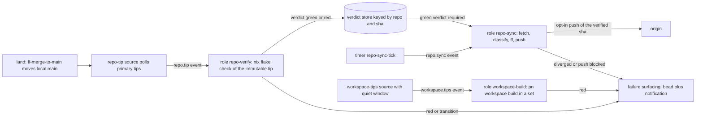
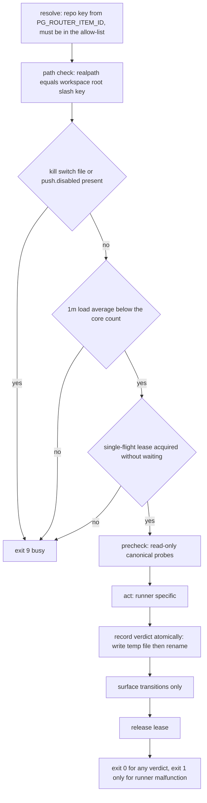

# pg-router-managed async runners: autosync, post-land check, workspace build

Status: design recommendation for operator review (no implementation; one ADR, 0108, Accepted 2026-10-27 on `pg2-ukat2`)
Date: 2026-10-23
Bead: `pg2-na2nr` (deep dive). Start condition: ruled live by the Phase 4 walk on `pg2-pla9d.26`
(operator rulings 2026-10-23: item 3 is this bead).
Sources: the bead body and acceptance criteria of `pg2-na2nr`; the ruling comments on
`pg2-pla9d.26`; `pg2-9ova0` (pn workspace resolves the canonical clone); `pg2-8uc2d` (pn workspace
flake-check --no-build, the land check); `pg2-d2yka` and `pg2-quj42` (the eval-only pre-land check,
built); `pg2-t8807` (Go cache fix, closed); the code cited in "Verified facts" below.

The key words MUST, MUST NOT, SHOULD, SHOULD NOT and MAY are to be read as in RFC 2119.

## Summary and recommendation

Build, in this order, one shared kernel and three roles, all as pg-router `command` roles driven by
the built-in `timer` and generic `command` queries. pg-router core and its adapters do not change.

| Order | Build                                                                      | Size | Why this position                                                                                       |
| ----- | -------------------------------------------------------------------------- | ---- | ------------------------------------------------------------------------------------------------------- |
| 1     | Runner kernel plus post-land verifier (runner B) plus failure surfacing    | L    | Delivers "red checks found sooner" on its own, and supplies the verdict that gates every push.          |
| 2     | Autosyncer, report-only half (runner A, fetch, fast-forward, drift report) | M    | No publishing, so no policy change. Uses the kernel.                                                    |
| 3     | Autosyncer push step (runner A, push), after ADR 0108 is Accepted          | M    | The only runner that needs a U-5 amendment. Default off, per repo, operator enabled.                    |
| 4     | Scheduled `pn workspace build` in a workforest set (runner C), optional    | M    | The only unique catch is the darwin host closure. Heavy. Build last, and only if the operator wants it. |

Drop (not built, with reasons in "Recommendation"): a scheduled full `pn workspace flake-check`,
automatic rebase of a diverged repo, a `push-inject` trigger from the land skill, the nix-slot
semaphore (stays deferred by ruling), a repo-local `.pg-router/config.toml`, and any git-hook wiring.

Three findings change the bead's premises and are called out because they affect what is built:

1. **Constraint 4 rests on something that does not exist and was ruled deferred.** The shared
   per-machine counting semaphore (the "nix-slot") was not built; operator ruling 2026-10-23 on
   `pg2-pla9d.26` item 2 keeps it deferred. This design restates constraint 4 on what exists today
   (a runner-private single-flight lease, a load check and pg-router gates) in "Constraint 4,
   restated". The bead body needs the S-1/S-2 rewrite its own comments ask for; replacement text is
   in that section.
2. **The sync problem on this machine is publishing, not rebasing.** On 2026-10-23 every one of the
   seven workspace repos is 0 commits behind its remote-tracking `origin/main` and some are far
   ahead (table in "Runner A"). Automatic rebase of a diverged repo would be code for a case that
   does not occur, and it is the one step that cannot be made safe against a concurrent land
   without changing the land skill. Divergence is surfaced, not resolved.
3. **`doCheck` of packages in the system closure is no longer a differentiator** between
   `pn workspace build` and `pn workspace flake-check`: since `pg2-pla9d.2` package builds default
   to `doCheck = false`, so a build of the closure does not run package unit tests.
   "What build catches that flake-check does not" is the module-system evaluation of the host
   (`darwinConfigurations`, which `nix flake check` does not cover) plus the realization of every
   closure member.

## Verified facts

Each fact below was read from the live code or beads on 2026-10-23, in the paths shown. Absolute
roots: the workspace is `/Volumes/gitrepos/phillipg`; this repo is
`/Volumes/gitrepos/phillipg/nix-agent-support`.

| Fact                                                                                                                                                                                                                                                                                                                                                                                                 | Evidence                                                                                                                                                               |
| ---------------------------------------------------------------------------------------------------------------------------------------------------------------------------------------------------------------------------------------------------------------------------------------------------------------------------------------------------------------------------------------------------- | ---------------------------------------------------------------------------------------------------------------------------------------------------------------------- |
| `pn workspace flake-check` runs a FULL `nix flake check` per repo in topological order, with sibling `--override-input`, with `Dir: <workspace_root>/<repo>` (the canonical clone), and takes no flag but `--terminal`.                                                                                                                                                                              | `nix-repo-base/modules/pn/internal/workspace/flake_check.go`; `nix-repo-base/modules/pn/internal/cli/workspace.go` (`workspaceFlakeCheckCmd`)                          |
| `pn workspace build` builds the TERMINAL repo only (`build_command = darwin-rebuild build --flake {terminal_nix_dir}`) with overrides for every other workspace repo, running in the canonical terminal clone, and writes `result` there.                                                                                                                                                            | `nix-repo-base/modules/pn/internal/workspace/build.go`; `/Volumes/gitrepos/phillipg/pn-workspace.toml`; `nix-ziprecruiter/.gitignore` lines 5-6 (`result`, `result-*`) |
| The workspace root resolves from `--root`, then `PN_WORKSPACE_ROOT`, then the nearest ancestor of the cwd holding `pn-workspace.toml`. An exported `PN_WORKSPACE_ROOT` therefore defeats "run it inside the set".                                                                                                                                                                                    | `nix-repo-base/modules/pn/internal/cli/workspace.go` (`resolveWorkspaceRoot`)                                                                                          |
| A workforest set is `<workforests_dir>/<branch>`: one worktree per member repo on `<branch>`, plus a copy of `pn-workspace.toml` and the lock, so `pn` run inside it resolves every repo to the SET member. `workforest add` takes `--repos` and no hooks flag, and fires each member's post-clone hooks (a `nix run install-pre-commit-hooks` per repo).                                            | `nix-repo-base/modules/pn/internal/workspace/workforest.go` (`WorkforestAdd`, `writeSetMembership`, `installSetHooks`); `workspace.go` flags                           |
| A plain git worktree gets no such resolution: `pn workspace build` from inside it validates the canonical tree (documented, closed as working-as-designed).                                                                                                                                                                                                                                          | `pg2-9ova0` close reason                                                                                                                                               |
| `pn workspace update` already isolates its work in a throwaway worktree and advances `main` only by a fast-forward (`merge --ff-only` on a clean main, a ref-only fast-forward when main is not checked out, otherwise defer). It never pushes. `pn workspace push` relocks sibling inputs, COMMITS the bump on the canonical main, then pushes, dependencies first.                                 | `nix-repo-base/docs/worktrees.md` ("Per-repo ephemeral update worktrees"); `nix-repo-base/modules/pn/internal/cli/workspace.go` (`workspacePushCmd`); `branch_sync.go` |
| `pre-land-eval` evaluates `checks`, `packages` and `devShells` drvPaths of an immutable `git+file://<abs repo>?rev=<sha>` with `--no-write-lock-file`; `darwinConfigurations` is NOT evaluated and `nix flake check` does not cover it either.                                                                                                                                                       | `nix-repo-base/modules/pg-hooks/pre-land-eval/pre-land-eval.sh` lines 10-35, 145-153; `nix-repo-base/docs/hooks.md` line 290                                           |
| FF-1c (eval-only) is wired into the land skill after FF-1b; a full `nix flake check` is NOT a land gate. FF-0a requires the canonical clone clean, on its primary branch and without `core.worktree`. FF-2b advances it with `git merge --ff-only`. FF-3 retries a lost fast-forward race, stopping at two.                                                                                          | `claude-marketplace/integrate-branch/skills/ff-merge-to-main/SKILL.md` (FF-0a, FF-1c, FF-2b, FF-3)                                                                     |
| pg-router timer query: `type = "timer"`, never blocked by any gate. `command` query: runs an argv, parses JSONL items (`id`, `type`, `title`, `metadata`, `at`, `expiresAt`, `emit`). Event de-duplication is by `id` within retention, and `expiresAt` IS the retry window.                                                                                                                         | `packages/pg-router/internal/query/timer.go`, `internal/query/command.go`; `packages/pg-router/docs/behavior/invariants.md` (INV-EVT-3, INV-EVT-4)                     |
| A `command` role (the ccpool-handler's `type = "command"`) runs an argv once in its own process group; exit 0 is success, exit 9 is the pre-accept busy decline (re-offered while the event is unexpired), any other non-zero is a failed dispatch. stdout and stderr are discarded except a 2 KiB stderr tail on failure. It receives `PG_ROUTER_ROLE`, `PG_ROUTER_ITEM_ID`, `PG_ROUTER_ITEM_TYPE`. | `packages/pg-router-ccpool-handler/internal/executor/command.go`, `itemenv.go`; `packages/pg-router/README.md` ("Re-running a transiently failed dispatch")            |
| One outstanding offer per handler; capacity is the handler's own business, so the core holds no concurrency number. `max_dispatch_retries` (cap 3) re-runs only transient failures (killed, deadline, unavailable). Roles and queries block on every gate by default.                                                                                                                                | `packages/pg-router/docs/behavior/invariants.md` (INV-CONC-1); `packages/pg-router/README.md`                                                                          |
| A timer-driven maintenance role exists as a precedent: `pg-router-disk-watchdog` (a `disk-check-tick` timer query every 5m, role `disk-watchdog` with `type = "command"`), wired in the deployment repo.                                                                                                                                                                                             | `packages/pg-router-disk-watchdog/cmd/pg-router-disk-watchdog/main.go`; `nix-ziprecruiter/modules/zm/default.nix` lines 1442-1455, 1735-1743, 2630-2648                |
| The existing source adapters (`pg-router-source-pg-connector`, `pg-router-source-pg-desk`) list beads, PRs and entity changes. None reads git.                                                                                                                                                                                                                                                       | `packages/pg-router-source-pg-connector/`, `packages/pg-router-source-pg-desk/`                                                                                        |
| `pg-rescue` runs a failure-handler chain behind a failed command; `pg-rescue-bead --dedup-query` files a deduplicated bead with `--repo-label-map` and `--backend-map`; `pg-rescue-notify` raises a macOS notification.                                                                                                                                                                              | `packages/pg-rescue/README.md` ("Default instances", "Which tracker pg-rescue-bead files in")                                                                          |
| The script-first routing design (2026-10-22) already carries one standing push ruling: a script role MAY push a rebased PR branch, `--force-with-lease` only, in its own worktree. It is recorded in a design spec, not an ADR.                                                                                                                                                                      | `docs/superpowers/specs/2026-10-22-pg-router-script-first-routing-design.md` (D5)                                                                                      |
| `pg-test-runner` already has a host-wide counting semaphore for TESTS (symlink slots, stale-owner reclaim, fail-open wait, `nice`). No nix semaphore and no "hookpoint vocabulary" artifact exists (grep of the five other repos and this one).                                                                                                                                                      | `nix-repo-base/modules/pg-test-runner/pg-test-runner/pg-test-runner.bash` lines 516-570; `config.nix`                                                                  |
| The machine has `cores = 1` and `max-jobs = 3`. The Phase 4 evidence recorded 11 cores, a load average of 5.2, 6.7 and 8.4 on 2026-10-22 against 82, 147 and 158 on 2026-10-01, and wrapped nix runs with p50 about 19 s, p95 about 530 s, p99 about 3550 s over 7 days.                                                                                                                             | `/etc/nix/nix.conf`; `pg2-pla9d.26` comment of 2026-10-22                                                                                                              |
| Cloud CI: `nix-agent-support` has only `update-flakes.yml`, `nix-ziprecruiter` has no workflow; the other repos have `ci.yml`. Scheduled and CI Actions are disabled on private repos by ruling (2026-10-05).                                                                                                                                                                                        | `<repo>/.github/workflows` listings; memory `project_private_repo_github_ci_disabled`                                                                                  |
| The employer's private monorepo is not a workspace repo: `pn-workspace.toml` lists `nix-repo-base`, `nix-ziprecruiter`, `nix-agent-support`, `nix-overlay`, `nix-personal`, `nix-support-apps` and `x`. (`nix-ziprecruiter` is the personal laptop configuration, NOT the monorepo.)                                                                                                                 | `/Volumes/gitrepos/phillipg/pn-workspace.toml`                                                                                                                         |

### Start condition

Acceptance criterion 1 required the tiering rollout first. Status against its four named parts:

- FF-2a reduction: landed (`pg2-pla9d.1`, `pg2-pla9d.3`, closed; FF-1c from `pg2-quj42`).
- Go cache fix: landed (`pg2-t8807`, closed).
- Shared lock: NOT built, and ruled "keep deferred" on 2026-10-23 (`pg2-pla9d.26` item 2: build only
  if the p99 tail is reported as a problem).
- Hookpoint vocabulary: no artifact by that name exists; the per-clone hook bundle and `pg-hooks`
  stage vocabulary (nix-repo-base `docs/hooks.md`) are what shipped.

The 2026-10-23 Phase 4 ruling that routed item 3 to this bead is the operator's decision that the
remaining tiering items are built or deliberately deferred, so this bead is live.

## Vocabulary and design patterns

- **Polling Consumer / Event Source (Observer).** A timer-driven query polls state and emits typed
  events; roles subscribe by event type. There is no push from the land skill.
- **Idempotent Receiver.** Every handler tolerates duplicates (INV-EVT-2); state is derived from git
  and a verdict store, never from the event.
- **Template Method.** One runner kernel fixes the step order (resolve, admit, precheck, act,
  record, surface, release); each runner supplies only "act".
- **Bulkhead and Admission Control (Load Shedding).** A runner-private single-flight lease plus a
  load check plus pg-router gates bound what the runners can take from interactive work. The busy
  decline (exit 9) is the shed signal.
- **Latest-wins coalescing and Debounce.** Only the newest tip is verified; a cross-repo build waits
  for a quiet window.
- **Compare-and-swap (Optimistic Concurrency).** Refs move only by fast-forward, so a lost race is
  detected by git, never by a lock the lander does not honor.
- **Saga (process manager) with no compensations.** land, then verify, then publish. Each step is
  non-destructive and re-derivable, so a failed step leaves local state untouched and needs no
  undo.
- **Memento (verdict store).** An append-only record keyed by commit sha.
- **Feature Toggle and Kill Switch.** Push is off by default, per repo, enabled in operator-owned
  deployment config, with a file kill switch.
- **Adapter.** The runners are plain commands behind the existing `command` role adapter. No new
  pg-router adapter is written.

## The three runners at a glance

| Runner                | Trigger                                                                                 | Tree it targets                                                                                                                 | Mutates                                                                      | Needs U-5 amendment           |
| --------------------- | --------------------------------------------------------------------------------------- | ------------------------------------------------------------------------------------------------------------------------------- | ---------------------------------------------------------------------------- | ----------------------------- |
| A. Autosyncer         | `timer` tick (default 15m)                                                              | The canonical clone's primary BRANCH REF (local `main` against `origin/main`). Never a working-tree edit beyond a fast-forward. | Fetches. Fast-forwards a clean, on-primary canonical clone. Pushes (opt-in). | Only the push step (ADR 0108) |
| B. Post-land verifier | `command` query emitting one `repo.tip` item per unverified tip, polled every 5m        | The canonical clone's primary-branch TIP COMMIT as an immutable `git+file://<abs>?rev=<sha>`. Never a working tree.             | Nothing in any repo. Writes the verdict store.                               | No                            |
| C. Workspace builder  | `command` query, debounced (quiet window of 3 ticks, 15m), at most once per set of tips | A coordinated WORKFOREST SET the runner creates at the current primary tips of every workspace repo, then removes.              | Creates and removes its own set and `runner-build-*` branches. Builds.       | No                            |

The ordering of the three is a pipeline, not a choice of one: B produces the verdict that A's push
step requires, and C is an independent integration check.



## pg-router fit

### Sources and roles

No pg-router change is needed: the three runners use only constructs that exist.

| pg-router construct                | Used as                                                                                                             |
| ---------------------------------- | ------------------------------------------------------------------------------------------------------------------- |
| `timer` query (never gate-blocked) | `repo-sync-tick`, emitting `repo.sync` every 15m (precedent: `disk-check-tick`, 5m)                                 |
| `command` query, jsonl             | `repo-tip-source` emitting `repo.tip`, and `workspace-tips-source` emitting `workspace.tips`                        |
| `type = "command"` role            | `repo-verify`, `repo-sync`, `workspace-build`, each an argv of one command (precedent: `disk-watchdog`)             |
| exit 9                             | "not now" (load, lease held, kill switch, canonical busy): re-offered until `expiresAt`                             |
| `expiresAt` on the item            | the retry window; the de-duplication window for the id `<repo>@<sha>`                                               |
| `max_dispatch_retries = 2`         | re-run a handler killed under overload (transient class); a red verdict is NOT a failure and is not retried         |
| default gate blocking              | `pg-router pause` and `LOW_DISK_USAGE` stop the roles with no code; the roles MUST NOT declare `non_blocking_gates` |

**Reuse of existing source adapters: none applies.** `pg-router-source-pg-connector` and
`pg-router-source-pg-desk` read the issue, PR and entity world, not git. The new source is a small
script behind the generic `command` query. The tip source emits, for each allow-listed repo whose
primary tip has no verdict, one JSONL record:

```text
{"id":"nix-repo-base@ec8c07d...","type":"repo-tip","title":"nix-repo-base tip","metadata":{"repo":"nix-repo-base","sha":"ec8c07d...","branch":"main"},"at":"<now>","expiresAt":"<now plus the retry window>"}
```

Because the id carries the sha, a re-emit on the next tick is absorbed as a duplicate while the
event is retained (INV-EVT-3) and a new tip is a new event. The handler still checks the verdict
store first (Idempotent Receiver), because the born-expired default collapses the dedup window to
about one dispatch cycle unless `expiresAt` is set.

**Trigger: polling, not push.** The land skill could call `pg-router push-inject` after FF-4. That is
rejected: it couples an agent-run skill to a daemon, fails when no core runs
(`push-inject` never starts one, ADR 0036 of this repo), would have to be best-effort, and misses
every tip move that is not a land (`pn workspace update`'s fast-forward, a manual `git pull`).
A poll of `git rev-parse refs/heads/<primary>` per repo is local and cheap and also gives
crash-resume by construction: "tips without a verdict" is derived state.

### Handler shape

One new package, `pg-repo-runner` (a bash `mkBashScript` with bats tests, the shape of
`packages/pg-rescue-push-branch`), is a facade over three subcommands: `tips` and `workspace-tips`
(sources), and `verify`, `sync`, `build` (roles), plus `status` (read the verdict store). The roles
read the repo and sha from `PG_ROUTER_ITEM_ID`, which pg-router always exports, so no argv
templating is needed. Because stdout and stderr are discarded, the handler MUST write its own run
log and verdict records under `$XDG_STATE_HOME/pg-repo-runner/`.

Every nix invocation MUST go through `pg-nix-log-wrapped` (workspace rule) and run under
`nice -n 10` (the value `pg-test-runner` uses). Binaries MUST be resolved by absolute store path, not
`PATH`, because roles may run with a strict base environment.

### Config location

| Piece                                                                                                                                     | Lives in                                                                                                                                  |
| ----------------------------------------------------------------------------------------------------------------------------------------- | ----------------------------------------------------------------------------------------------------------------------------------------- |
| The package and a home-manager module `phillipgreenii.programs.pg-repo-runner` (allow-list, per-repo flags, thresholds, kill-switch path) | `nix-agent-support` (this repo), with the module rendering `$XDG_CONFIG_HOME/pg-repo-runner/config.toml` (Nix-built, read-only)           |
| The `[[query]]` and `[[role]]` wiring and the role argv                                                                                   | The deployment repo that renders pg-router's `configText` today: `nix-ziprecruiter/modules/zm/default.nix` (`pgRouterCcpoolHandlerRoles`) |
| The failure-surfacing chain `runner-red` and its `--repo-label-map` and `--backend-map`                                                   | The pg-rescue home module (`home/programs/pg-rescue/default.nix`) plus the same deployment repo for the machine-specific maps             |

A repo-local `.pg-router/config.toml` MUST NOT be used: pg-router's repo-local config belongs to the
drain's `repoRoot` (the monorepo, whose `.git/info/exclude` hygiene note forbids committing it), and
the runners must not depend on the cwd at all (constraint 1).

Per-repo flags in the module: `repos.<name> = { verify = true; sync = true; push = false; }`. `push`
defaults to `false` everywhere. The list is the ONLY source of repos a runner may touch.

## The shared runner kernel

All three roles are the same Template Method.



- **Single-flight lease.** One lease file in the runner's state directory, shared by all three roles,
  taken without waiting (an atomic `mkdir` or `ln -s` whose content is `<pid>:<process start time>`,
  with stale-owner reclaim exactly as `pg-test-runner` does). Result: at most one runner-started nix
  invocation at a time. When the lease is held the role exits 9 and pg-router re-offers.
- **Load check.** Admit only when the 1-minute load average is below the core count (11 on this
  machine, from the Phase 4 evidence). The load at the bead's filing was 82 to 158 against 11 cores;
  today 5.2 to 8.4, so the check admits today and refuses in the 2026-10-01 regime. The threshold is
  a tunable, to be calibrated in the first bead from the sampled load while a runner runs.
- **Verdict is data.** A red verdict exits 0. A role that exits non-zero for a red check would be
  counted by pg-router as `handler-error` and feed its failure-rate alert, mixing "the repo is red"
  with "the runner is broken". Non-zero is reserved for malfunction (usage 2, other failure 1, killed).
- **Idempotent and resumable.** Every step re-derives state from git and the verdict store. A crash
  leaves at most a stale lease (reclaimed by owner liveness) and, for runner C, a throwaway set that
  the next run removes.

### Verdict store (Memento)

`$XDG_STATE_HOME/pg-repo-runner/verdicts/<repo>/<sha>.<kind>.json`, `kind` being `check` (runner B)
or `build` (runner C, keyed by the set's tip tuple). Fields: `repo`, `sha`, `kind`, `result`
(`green`, `red`, `error`), `inputs` (`locked` or `override`), `startedAt`, `finishedAt`, `exit`,
`logPath`. A verdict is valid for its sha and the lock committed in that sha.

## Runner A: autosyncer

### Evidence: where the work is

Computed on 2026-10-23 with `git rev-list --left-right --count origin/main...main` in each
canonical clone (left is behind, right is ahead). The remote-tracking refs may be stale because this
review did not fetch (no network by constraint), so "behind" needs re-reading in the first bead.

| Repo                | Behind | Ahead |
| ------------------- | ------ | ----- |
| `nix-repo-base`     | 0      | 8     |
| `nix-personal`      | 0      | 1     |
| `nix-support-apps`  | 0      | 48    |
| `nix-ziprecruiter`  | 0      | 70    |
| `nix-overlay`       | 0      | 0     |
| `nix-agent-support` | 0      | 181   |
| `x`                 | 0      | 0     |

Total ahead: 8 + 1 + 48 + 70 + 0 + 181 + 0 = 308 commits not published. Total behind: 0. The
bead's phrase "keeps each repo rebased onto upstream" describes a case that does not occur today;
the value is in the push.

### What it does (one pass per `repo.sync` event, per allow-listed repo, dependencies first)

1. Precheck, read-only (R-3): the canonical clone has no `core.worktree`, is on the primary branch,
   has an empty `git status --porcelain`, and no rebase, merge or cherry-pick in progress. If any
   fails, skip the repo this pass, record `yielded: canonical not steady`, and continue. The runner
   never repairs it (R-3: stop and report; no reset, stash or re-checkout).
2. `git fetch origin <primary>` (a remote-tracking ref update only).
3. Classify with `git rev-list --left-right --count origin/<primary>...<primary>`:

| Behind, ahead                             | Action                                                                                                                                                                                                          |
| ----------------------------------------- | --------------------------------------------------------------------------------------------------------------------------------------------------------------------------------------------------------------- |
| 0, 0                                      | Nothing.                                                                                                                                                                                                        |
| greater than 0, 0                         | `git merge --ff-only origin/<primary>` in the clean canonical clone (the same primitive as FF-2b). A refusal is recorded and not retried this pass.                                                             |
| 0, greater than 0                         | Push candidate. If `push` is off for the repo: record the ahead count in `status` and do nothing else (no bead, no notification: unpushed commits are not in themselves a problem). If on: the push step below. |
| greater than 0, greater than 0 (diverged) | Record and surface ONE deduplicated bead "diverged, resolve with `pn workspace rebase` or `/pn-workspace-sync`". The runner MUST NOT rebase.                                                                    |

### Why it never rebases

Replacing a canonical `main` with a rewritten copy cannot be done by a fast-forward. It needs a
`git rebase` or `git reset --hard` in the canonical clone. That puts the canonical clone in a
detached or mid-rebase state that FF-0a reads as an anomaly and halts a concurrent land on, and a
reset after a land advanced `main` would lose the landed commit. The land skill does not honor any
lock the runner could take, so correctness would depend on a change to the land skill. The
evidence (0 behind in 7 of 7) says the cost is not justified. `pn workspace update` (an operator
or session command) already contains the isolated-worktree rebase for the rare case. Optional
hardening, if divergence ever becomes common: a lease the land skill's FF-0a honors (listed as an
optional follow-up).

### The push step (U-5 territory)

The push MUST be, exactly:

```text
git -C <canonical clone> push origin <verified-sha>:refs/heads/<primary>
```

No `--force`, no `--force-with-lease`, no `+` refspec, no deletion, no other ref, no `--no-verify`
(pre-push hooks run; HK-2 already forbids them from invoking nix), and never `pn workspace push`,
`pn workspace update` or `pn workspace apply`. It runs only when all of these hold:

1. The ADR 0108 authorization is in effect (deployment `repos.<name>.push = true`, kill switch absent).
2. A `check` verdict with `result = green` exists for exactly `<verified-sha>` (runner B), and
   `<verified-sha>` is the current primary tip (tip-level gate; partial pushes of a green ancestor are
   not done in v1).
3. The repo's canonical precheck (step 1) passed in the same pass.
4. `origin/<primary>` is an ancestor of `<verified-sha>` (the push is a fast-forward). A remote that
   moved is "diverged" and takes the divergence branch above.

Pushing a green tip also publishes its ancestors, including an intermediate red commit that a later
commit fixed forward. This is accepted: the gate is on the tip, and history stays bisectable in git.

A push does NOT relock sibling inputs. After a dependency is pushed, a consumer's committed
`flake.lock` still pins the older sibling revision; `pn workspace push` (operator or session) is the
relock-and-publish command. Consequence for the gate: runner B checks a consumer's tip against its
LOCKED inputs, which is what a fresh clone sees. A consumer whose new code needs an unpublished
sibling change is red under locked inputs and is therefore NOT pushed; the runner surfaces
"blocked, needs sibling push and relock: run `pn workspace push`". This is the correct behavior, not
a defect: the runner never publishes a state that does not build from a clean clone.

Foundation repos (`nix-repo-base`, `nix-overlay`, `x`) have no workspace siblings, so they are
always checkable standalone and are the first beneficiaries.

### Tree and constraints

Targets the canonical clone's primary branch ref (see the compliance matrix). Opt-in repos: every
workspace repo may be listed; `push` is enabled per repo by the operator, recommended order
`nix-repo-base`, `nix-overlay`, `x`, then the consumers once they are green.

## Runner B: post-land verifier

### What it does

For each `repo.tip` event (`<repo>@<sha>`):

1. Kernel steps resolve, admit, precheck. The precheck here is only that `<sha>` still exists; the
   canonical working tree is not read.
2. Latest-wins: if the repo's current tip is not `<sha>`, record `superseded` and exit 0 without
   running nix (the newer tip has its own event).
3. Run, in the background of pg-router (the handler itself is the long process):

```text
nice -n 10 pg-nix-log-wrapped nix flake check --no-write-lock-file "git+file://<canonical abs path>?rev=<sha>"
```

The target is an immutable commit, evaluated from git objects. No working tree is read or
written, so R-1..R-3 cannot be disturbed, and the result belongs to exactly one sha. Inputs are
the locked inputs committed in that sha. This is a FULL check (it builds `checks.*`), which is
what the land path deliberately does not do (FF-1c is eval-only). 4. Record the verdict. A signal exit (128 plus a signal number) is a malfunction (role exit 1,
retried by `max_dispatch_retries = 2`), not a red verdict. Any other non-zero is `red`.
There is no "inconclusive" class and no automatic retry of a red, mirroring the 2026-10-23
failure semantics ruled for the land check on `pg2-8uc2d`. 5. Surface transitions (see "Failure surfacing").

### Tree

The canonical clone's primary-branch tip commit, as an immutable git reference. It also works when
no agent has the repo checked out, in a plain worktree, or in a workforest set, because it never
looks at any working tree.

### Open probe: result (verified 2026-10-28, bead `pg2-j0itft`)

`nix-ziprecruiter` carries a clone-time hook (in `pn-workspace.toml`) that creates a git-ignored
symlink, `modules/pg-pr-zr/pg-connector-src`, to a sibling repo's source, so a `git+file://...?rev=`
snapshot lacks that symlink (confirmed: the snapshot's store path has no `pg-connector-src`, while the
canonical working tree has the symlink). **Result: no exception is needed. `nix-ziprecruiter`
evaluates and checks from a commit snapshot, and the verifier tree stays the immutable commit for
this repo too (no runner C set is needed for it).**

Why it works: the symlink serves only local `go build`, `go test` and the commit-time preflight
script. The nix build never reads it: `modules/pg-pr-zr/build.nix` re-points the `replace =>
./pg-connector-src` vendor link at the sibling flake's `pg-connector-src` output (an input of the
flake, passed as `pgConnectorSrc`), and it filters the path with `lib.fileset.maybeMissing`.

Evidence (run against a read-only local commit, `HEAD` of the canonical clone, no network:
`--offline`, `--no-write-lock-file`; nothing in that repo was modified):

```text
SHA=eeb9c881141e68bb1d070868802a9df28dcffa7d
U="git+file:///Volumes/gitrepos/phillipg/nix-ziprecruiter?rev=$SHA"

1. nix flake metadata --offline --no-write-lock-file "$U"
   -> Path: /nix/store/vfkd05xy66vl489ywcrd7x237pql5j2b-source, Revision: eeb9c881..., every
      input resolved from the lock offline (exit 0)
2. nix flake check --no-build --offline --no-write-lock-file "$U"
   -> 137 "derivation evaluated" lines, "all checks passed!", exit 0
      (every output evaluates from the snapshot, which has no pg-connector-src)
3. nix build --offline --no-link --no-write-lock-file -L \
        "$U#checks.aarch64-darwin.pg-pr-zr-build" "$U#checks.aarch64-darwin.pg-pr-zr-go-tests"
   -> builds pg-connector-src, vendor-env, pg-pr-zr-go-tests (the full module test run printed
      "ok  .../modules/pg-pr-zr/cmd/pg-pr-cicd-captains-log") and pg-pr-zr itself, exit 0
      (the two checks that consume the symlink's path pass from the snapshot)
4. nix flake check --offline --no-write-lock-file "$U"   (the full check, builds every check)
   -> exit 1, one failure: checks.aarch64-darwin.pg-router-focus-wiring,
      "FAIL: pg-desk watch.issue.queries is [...7 queries...], want [...4 queries...]".
      That is a CONTENT failure of one check at that commit, not a snapshot effect: the same
      check built from the canonical working tree (nix build
      /Volumes/gitrepos/phillipg/nix-ziprecruiter#checks.aarch64-darwin.pg-router-focus-wiring)
      fails with the identical output path and message
      (/nix/store/hazb4rj7zsmjqmkx2prhkq653ywh8vag-check-pg-router-focus-wiring). nix stopped at
      that first failed build (no --keep-going), so the checks after it were not built by item 4;
      items 2 and 3 are the evidence that the symlink is not an input to any nix path.
```

A red verdict from this repo is therefore expected to be a real red, which is the verifier working
as designed (a red is data, exit 0), not a runner defect. This is the data F3 and F4 will see first.

## Runner C: cross-repo workspace builder

### What it does

For each `workspace.tips` event (id `workspace@<hash of the sorted repo=sha list>`):

1. Kernel steps resolve, admit. The source emits the event only when the tips tuple changed since
   the last `build` verdict AND no tip changed during the quiet window (3 timer ticks of 5m = 15m, a
   Debounce, so a burst of landings produces one build).
2. Create a set at the current tips:
   `pn workspace workforest add runner-build-<utc timestamp> <primary>` (run with
   `PN_WORKSPACE_ROOT` set explicitly to the canonical workspace root, because it is a canonical
   command).
3. Run `pn workspace build` with `PN_WORKSPACE_ROOT=<set dir>` set explicitly (the exported value
   wins over the cwd, see Verified facts) under `nice -n 10` and `pg-nix-log-wrapped`. `pn`
   wraps its own nix call; the agent rule says not to prefix `pn` itself, so the runner MUST NOT
   prefix `pn` with the wrapper.
4. Record a `build` verdict; remove the set with `pn workspace workforest remove <branch> --force`
   (the runner's own throwaway only) and delete the branches. Any set whose branch starts with
   `runner-build-` and is older than the lease owner's start is a leftover and is removed first.

### Tree

A coordinated workforest set the runner creates, never the canonical working trees and never a
plain worktree. Reasons:

- `pn workspace build` and `flake-check` resolve every repo as `<workspace_root>/<repo>`
  (`pg2-9ova0`); a set is the one mechanism where that resolution is correct and snapshot-stable.
- `darwin-rebuild build` writes a `result` symlink in the terminal repo. In the canonical clone it
  would replace the operator's own `result`; in the set it lands in a throwaway.
- Running against the canonical working trees would need a seqlock (read all tips and cleanliness
  before and after, discard on change) to attribute the verdict. A set removes that need.
- Whether `nix flake check ... --override-input` rewrites `flake.lock` in the working tree it runs in
  is not asserted here; the first bead MUST measure `git status --porcelain` after a run. In a set
  the answer cannot touch a canonical clone.

Cost, stated: `workforest add` creates one worktree per repo and fires each member's post-clone
hooks, a `nix run install-pre-commit-hooks` per repo. A `--no-hooks` option on `workforest add` is a
required follow-up in nix-repo-base before this runner is worth running.

### What it adds over B (the scheduling reason to build it at all)

See the next section. In short it is the only runner that exercises the host's module system and
realizes the whole closure with the local siblings, which is what `pn workspace apply` does next.
It also warms the store, so the operator's next apply is faster (the cost "not felt in-session").

## What `pn workspace build` catches that `flake-check` does not, and vice versa

Both run with the sibling input overrides. Read from `build.go` and `flake_check.go`, and from the
`nix flake check` contract (it builds `checks.*` and evaluates `packages`, `devShells` and
`nixosConfigurations`; `darwinConfigurations` is not covered, as `pg2-d2yka` and
`nix-repo-base/docs/hooks.md` already record).

| Aspect                                                                                                                                              | `pn workspace build` (terminal repo, `darwin-rebuild build`)                                    | `pn workspace flake-check` (every repo, `nix flake check`)           |
| --------------------------------------------------------------------------------------------------------------------------------------------------- | ----------------------------------------------------------------------------------------------- | -------------------------------------------------------------------- |
| Evaluates the host's module system (`darwinConfigurations.<host>`, home-manager, assertions, option conflicts)                                      | Yes. This is the unique catch, because `nix flake check` does not cover `darwinConfigurations`. | No.                                                                  |
| Realizes (builds) every derivation in the host closure (a package that evaluates but fails to build, a fixed-output hash mismatch, a failing patch) | Yes.                                                                                            | Only those that a `checks.*` entry depends on.                       |
| Runs package unit tests (`doCheck`)                                                                                                                 | No: `doCheck = false` by default since `pg2-pla9d.2` (ADR 0008 amendment, 2026-10-01).          | No for packages; yes for tests expressed as `checks.*` (`mkGoTest`). |
| `checks.*` (lint, `treefmt`, `go-tests`, docs and spec checks)                                                                                      | Not run.                                                                                        | Run and built. This is the unique catch.                             |
| Packages and devShells outside the host closure                                                                                                     | Not built.                                                                                      | Evaluated (derivation-checked) but not built.                        |
| Consumers other than the terminal repo                                                                                                              | Only through the terminal's closure.                                                            | Every repo, each against the local siblings.                         |
| Output written to the tree it runs in                                                                                                               | a `result` symlink in the terminal repo                                                         | possibly `flake.lock` (unverified, see Runner C)                     |

The bead's two guesses are corrected: "doCheck of packages in the system closure" does not
distinguish them any more, and "packages outside the system closure" are evaluated by
`flake-check`, not built by either.

Consequences for scheduling:

- **Checks.\* of one repo against its locked inputs** is runner B (per tip, event driven).
- **The host system with local siblings** is runner C (per debounced tuple of tips).
- A **scheduled full `pn workspace flake-check`** is dominated: B already builds the same
  `checks.*` per tip, and C covers the integration-with-overrides question better than checks with
  overrides do. It is dropped as a scheduled runner. `pn workspace flake-check --no-build`
  (`pg2-8uc2d`) remains the synchronous LAND check, and plain `pn workspace flake-check` remains an
  on-demand human command.

| Tier                   | Tool                                                         | Tree                         | Where it runs       |
| ---------------------- | ------------------------------------------------------------ | ---------------------------- | ------------------- |
| Commit                 | hooks (`pg-hooks`, `pg-test-runner`)                         | the worktree                 | in session          |
| Land                   | FF-1b hooks, FF-1c eval-only (`pg2-quj42`, then `pg2-8uc2d`) | the rebased branch commit    | in session, minutes |
| Post-land, per repo    | runner B, full `nix flake check`, locked inputs              | immutable tip commit         | async               |
| Post-land, integration | runner C, `pn workspace build`, overrides                    | a workforest set at the tips | async, debounced    |
| Publish                | runner A push, gated on B                                    | canonical primary ref        | async, opt-in       |

## Opt-in, cadence and triggers

| Question                           | Answer                                                                                                                                                                                                                          |
| ---------------------------------- | ------------------------------------------------------------------------------------------------------------------------------------------------------------------------------------------------------------------------------- |
| Which repos                        | The `repos` allow-list in the module, whose keys MUST be `pn-workspace.toml` repo keys. Recommended initial set for `verify`: all seven workspace repos. `sync` the same. `push` off until ADR 0108 is Accepted, then per repo. |
| Primary branch vs feature branches | Primary branch only, for all three. Feature branches live in agent worktrees and sets under the lander's control; publishing them is the PR flow (the script-first design, D5), not this design.                                |
| Triggers                           | A: `timer` tick, default every 15m. B: tip poll every 5m. C: tip poll every 5m plus a quiet window of 3 ticks (3 x 5m = 15m). These are initial, tunable values.                                                                |
| Latency bound for a red check      | at most the 5m poll interval, plus time waiting for admission, plus the check's own duration. The check duration is not measured here and is a required output of the first bead.                                               |
| Why a timer and not a land event   | See "Trigger: polling, not push".                                                                                                                                                                                               |
| First enablement burst             | Latest-wins means the first run verifies the 7 current tips (one per repo), not the 308 historical commits.                                                                                                                     |

## Failure surfacing

The kernel surfaces transitions, never steady states.

| Channel                                   | When                                                                                                                                                                                                                                                                                                                                                                                                                                                                                                                             | Mechanism                                                                                                                                                                                                                                                                                                             |
| ----------------------------------------- | -------------------------------------------------------------------------------------------------------------------------------------------------------------------------------------------------------------------------------------------------------------------------------------------------------------------------------------------------------------------------------------------------------------------------------------------------------------------------------------------------------------------------------- | --------------------------------------------------------------------------------------------------------------------------------------------------------------------------------------------------------------------------------------------------------------------------------------------------------------------- |
| Verdict store and `pg-repo-runner status` | always                                                                                                                                                                                                                                                                                                                                                                                                                                                                                                                           | source of truth; read-only command                                                                                                                                                                                                                                                                                    |
| pg-router event and metrics               | runner malfunction only (non-zero exit)                                                                                                                                                                                                                                                                                                                                                                                                                                                                                          | `dispatch result` WARN line with the 2 KiB stderr tail, activity ring, existing failure-rate alert. A red verdict does NOT take this path (it exits 0).                                                                                                                                                               |
| Bead (BF-1)                               | green to red on a repo's tip; `diverged`; `push blocked: needs relock`; red `build`                                                                                                                                                                                                                                                                                                                                                                                                                                              | the pg-rescue chain `runner-red` = the existing `p1-later` handler (`pg-rescue-bead --priority 1 --dedup-query`) then `notify`. One open bead per repo (dedup), a comment on each newer red sha, and a comment when green returns. The chain MUST NOT contain `fix-small` or `fix-large` (no unattended agent spend). |
| Which tracker and label                   | BF-1: the repo where the fix lands. The workspace uses one shared `pg2-` tracker, so the bead goes there with the repo label from the workspace lookup table (`base`, `agent-support`, `personal`, `support-apps`, `overlay`, `ziprecruiter`, `x`), applied by `--repo-label-map`. The tracker choice is `--backend-map` (machine-specific, in the deployment repo). If the tracker is unreachable the runner MUST NOT file elsewhere (BF-2): it keeps the transition pending in the verdict store and retries on the next pass. |
| Push notification                         | the same transitions, once per transition                                                                                                                                                                                                                                                                                                                                                                                                                                                                                        | `pg-rescue-notify` (macOS notification). No SwiftBar plugin is proposed here; if one is wanted later the `swiftbar-title-width` convention applies.                                                                                                                                                                   |

**Fix-forward.** A red tip on the primary branch is already landed, but with push gated on green it
has not left the machine. The expectation is to land a fix, whose new tip produces a new verdict;
the next green tip closes the story. The runner MUST NOT revert, reset or edit anything to repair a
red tip. The runner MAY close a bead it filed (identified by metadata `runner = pg-repo-runner`) with
the green verdict as evidence when a later tip descending from the red one is green; otherwise the
bead stays for the drain or triager.

## Constraint compliance matrix

The seven hard constraints of the bead, per runner. "Wiring" in constraint 1 means that no git hook
is installed anywhere and every path is absolute from configuration, so the same wiring serves the
canonical clone, plain worktrees and workforest sets.

| Constraint                                                               | A. Autosyncer                                                                                                                                                                                                                                                                   | B. Post-land verifier                                                                                                              | C. Workspace builder                                                                                                                                                                                              |
| ------------------------------------------------------------------------ | ------------------------------------------------------------------------------------------------------------------------------------------------------------------------------------------------------------------------------------------------------------------------------- | ---------------------------------------------------------------------------------------------------------------------------------- | ----------------------------------------------------------------------------------------------------------------------------------------------------------------------------------------------------------------- |
| 1. Worktrees and workforests                                             | Targets the canonical primary ref by absolute path from config. Never reads a cwd, installs no hook. A plain worktree or an agent's set is invisible to it. Works unchanged for all three tree kinds because it uses none.                                                      | Targets an immutable commit through `git+file://<abs>?rev=`. Independent of any working tree, so correct for all three tree kinds. | States its tree: a set it creates. Sets `PN_WORKSPACE_ROOT` explicitly to the set (the exported value would otherwise win and silently resolve the canonical clone, `pg2-9ova0`). Ignores sets it did not create. |
| 2. U-5 push authorization                                                | The fetch and fast-forward steps publish nothing. The push step is the single U-5 exposure: authorized by ADR 0108 (Accepted), per repo, default off, scope and gate defined there.                                                                                             | No push, no publish.                                                                                                               | No push. It is `build`, not `apply` or `update`, so U-5's list does not apply.                                                                                                                                    |
| 3. R-1..R-3 canonical clone                                              | Reads steady state first and skips the repo if the clone is dirty, off primary or mid-operation. Moves the clone only by `merge --ff-only`. Never rebases, resets, stashes or switches branches.                                                                                | Never writes to the canonical clone (object reads only).                                                                           | The canonical clones gain only a branch ref `runner-build-*` and git worktree metadata; their HEAD, index and working tree are untouched. The set's branches are feature branches (R-2).                          |
| 4. Machine load                                                          | See "Constraint 4, restated": single-flight lease, load check, gates, `nice`, `pg-nix-log-wrapped`.                                                                                                                                                                             | Same.                                                                                                                              | Same. Heaviest of the three; also blocked by the default `LOW_DISK_USAGE` gate.                                                                                                                                   |
| 5. Race with FF-3 landings and interactive pushes                        | Fast-forward uses the primitive FF-2b uses, so git decides the race: a lost race makes one side non-ff. FF-3 already retries the lander. Pushes name an explicit sha, so a concurrent land or manual push cannot widen them.                                                    | No race: reads one ref atomically, then works on a fixed sha.                                                                      | Branches from the tips at one moment; later landings are simply the next tuple. Yields by exit 9 under load or lease contention.                                                                                  |
| 6. No force, no failed-gate push, idempotent, no auto-resolved conflicts | No force flag of any kind; pushes only a sha with a green verdict; every step re-derives from git so a re-run is a no-op; a diverged repo is surfaced, never rebased.                                                                                                           | Idempotent by sha. Nothing to push or resolve.                                                                                     | Idempotent per tuple. Nothing to push or resolve; a crash leaves a set that the next run removes.                                                                                                                 |
| 7. Private monorepo out of scope                                         | Structurally excluded: the runner acts only on `repos` keys that are `pn-workspace.toml` repo keys, and refuses any path whose realpath is not `<workspace root>/<key>`. The monorepo is not a workspace repo and is never configured. pg-router's `repoRoot` is not consulted. | Same.                                                                                                                              | Same. The set holds only workspace repos.                                                                                                                                                                         |

### Constraint 4, restated

Constraint 4 as filed says runs MUST go through a shared counting semaphore "to be built in the
tiering rollout". That semaphore was not built and was ruled deferred. The constraint is restated
against what exists, and the replacement text for the bead body (to be applied under S-1 and S-2 by
whoever holds the bead) is:

> 4. MACHINE LOAD (restated 2026-10-23 after the Phase 4 ruling that keeps the nix-slot deferred:
>    Phillip, "#2) ok", comment of 2026-10-23 on `pg2-pla9d.26`). A runner MUST NOT start a nix
>    invocation unless (a) it holds the runner-private single-flight lease shared by all runner
>    roles, (b) the 1-minute load average is below the core count, and (c) no pg-router gate and no
>    kill-switch file is active. If any fails it MUST decline with exit 9 and let pg-router re-offer.
>    It MUST run nix under `nice -n 10` and through `pg-nix-log-wrapped`. If the nix-slot is later
>    built, the lease step is replaced by the slot with no other change.

Bound this gives, with its derivation. Three roles share one lease, so the runners start at most
1 nix invocation at a time, against the 5 or more concurrent `nix flake check` runs the bead cites.
Within that invocation nix is bounded by `max-jobs = 3` and `cores = 1`, so at most
3 build jobs x 1 core = 3 build cores, plus 1 core for single-threaded evaluation (assumption: to be
confirmed by sampling in the first bead), so at most 3 + 1 = 4 cores of 11, that is
4 / 11 = 0.364, about 36 percent, and at `nice -n 10`. Interactive nix runs are not counted by the
lease, which is why the load check exists; this is the accepted residual that the nix-slot would
close.

## ADR 0108 and the U-5 amendment

Only runner A's push step needs a policy change, so only one ADR is drafted:
`docs/adr/0108-an-operator-enabled-unattended-runner-may-publish-within-a-defined-scope.md`
(status Accepted 2026-10-27, operator ruling on `pg2-ukat2`; filed with this design as Proposed). It records:

- Why U-5 as written ("MUST NOT `git push`, `pn workspace push|update|apply` ... on own initiative
  to clear unpushed work") does not cleanly cover a daemon, and why a daemon MUST still be explicitly
  authorized and not be allowed to infer authority from the absence of a rule.
- The scope (allow-listed repos, primary branch only, fast-forward only, explicit sha, green verdict,
  steady canonical clone, default off, kill switch) as RFC 2119 clauses.
- Replacement wording for U-5, quoted in the ADR (decision 8). It was applied to
  `home/programs/agent-rules/pgii-agent-rules.md` under `pg2-rlsqq9` after acceptance; this design
  itself edits no rules file and does not edit `~/.claude/CLAUDE.md` (rendered at the operator's apply).
- The relation to the 2026-10-22 script-first push ruling (a narrower, PR-branch, force-with-lease
  case recorded only in a design spec): the ADR cites it as precedent and does not change it.

ADR number: 0108 is the next free number in this repo (the highest present is 0107, and no draft
file or open bead names 0108 as of the check in this worktree); a concurrent draft may take it, so
the lander MUST re-check `docs/adr/` on the primary branch at land time and renumber if needed.

## Recommendation

### Build, in order

1. **Kernel + runner B + surfacing (L).** Highest value per risk. It finds red tips sooner on the
   repos with no working CI (`nix-agent-support`, `nix-ziprecruiter`, and the private repos whose
   Actions are disabled) without touching any repo or any policy.
2. **Runner A, report-only half (M).** Fetch, fast-forward, classify, surface divergence. No U-5.
3. **Runner A, push step (M)** only after the operator accepts ADR 0108, and then enabled per repo,
   foundation repos first.
4. **Runner C (M)**, optional, after a `--no-hooks` option on `pn workspace workforest add` (S, in
   nix-repo-base). If the operator does not want the heavy build, stopping at step 3 loses nothing
   the bead's goal needs.

### Drop

- A scheduled full `pn workspace flake-check` (dominated, see above).
- Automatic rebase of a diverged repo (no occurrence, unsafe without a land-skill change).
- A `push-inject` trigger from the land skill (couples a skill to a daemon, misses non-land moves).
- The nix-slot semaphore (stays deferred; re-open only on the ruling's own condition).
- A repo-local `.pg-router/config.toml` and any git-hook wiring (HK-2, constraint 1).
- Feature-branch autosync and publishing (the PR flow's concern).

## Decisions for the operator

| #   | Decision                                                                                                                  | Recommendation                                                                                                                                            |
| --- | ------------------------------------------------------------------------------------------------------------------------- | --------------------------------------------------------------------------------------------------------------------------------------------------------- |
| D1  | Accept ADR 0108 (an operator-enabled runner may publish, within the stated scope).                                        | Accept, with push default off and enabled per repo. Without it, runner A stops at report-only (step 2), which is still useful.                            |
| D2  | Push action: a plain fast-forward push of the verified tip (no relock), or a `pn workspace push` equivalent that relocks. | Plain fast-forward push of a verified tip. Relock-and-publish stays with `pn workspace push` because it commits to the canonical main and so races lands. |
| D3  | Rebase of a diverged repo: automatic, or surfaced only.                                                                   | Surfaced only (0 of 7 repos behind today).                                                                                                                |
| D4  | Build runner C at all.                                                                                                    | Yes but last, and only after `workforest add --no-hooks` exists; otherwise defer it. The darwin host closure is its only unique catch.                    |
| D5  | Constraint 4 restatement in place of the nix-slot.                                                                        | Accept: lease plus load check plus gates. Do not re-open the nix-slot.                                                                                    |
| D6  | Tunables: sync tick 15m, poll 5m, quiet window 15m, load threshold equal to the core count.                               | Accept as initial values; the first bead measures and the operator adjusts.                                                                               |
| D7  | Surfacing: a bead per repo (priority 1) plus a macOS notification on transitions.                                         | Accept. No SwiftBar plugin now.                                                                                                                           |
| D8  | First enablement of push on a repo that is ahead (agent-support by 181 commits, the largest).                             | Run it report-only (dry run) for one full cycle and review the logged would-push range before enabling.                                                   |

## Follow-up implementation beads (to be filed by the orchestrator, not created here)

Every bead MUST carry the repo label of the repo where its fix lands (BF-1). The labels in the
workspace lookup table are `agent-support`, `base`, `ziprecruiter`. Each bead's acceptance
criteria MUST include an automated test of the deterministic logic against the real tool in a
hermetic fixture (V-3): real `git` against a bare local remote for fetch, classify, fast-forward and
push, and a fixture flake for the nix runs. A post-apply verification child gated with `pn:applied`
(`pb:pb-gate-lifecycle`) covers only what a test cannot (the installed daemon runs the role).

| #   | Bead                                                                                                                                                                                                    | Repo (label)    | Size | Depends on                |
| --- | ------------------------------------------------------------------------------------------------------------------------------------------------------------------------------------------------------- | --------------- | ---- | ------------------------- |
| F1  | `pg-repo-runner` package: kernel (resolve, admit, lease, load check, verdict store, `status`) and the home module with the allow-list and kill switch                                                   | `agent-support` | M    | none                      |
| F2  | Runner B: `repo-tip-source`, role `repo-verify`, immutable-tip `nix flake check`, superseded handling, the `nix-ziprecruiter` snapshot probe, calibration of load threshold and measured check duration | `agent-support` | M    | F1                        |
| F3  | Failure surfacing: pg-rescue chain `runner-red` (`p1-later`, `notify`), repo-label and backend maps, transition logic, auto-comment and auto-close of its own beads                                     | `agent-support` | S    | F1, F2                    |
| F4  | Deployment wiring in the pg-router config: queries, roles, `max_dispatch_retries`, argv, allow-list values                                                                                              | `ziprecruiter`  | S    | F2, F3                    |
| F5  | Runner A report-only: `repo-sync-tick`, role `repo-sync`, fetch, classify, fast-forward, divergence surfacing                                                                                           | `agent-support` | M    | F1, F3                    |
| F6  | Runner A push step, with the dry-run mode, the explicit-sha refspec, the green-verdict gate and the kill switch                                                                                         | `agent-support` | M    | F2, F5, ADR 0108 Accepted |
| F7  | `pn workspace workforest add --no-hooks` (and the post-clone hooks it skips)                                                                                                                            | `base`          | S    | none                      |
| F8  | Runner C: `workspace-tips-source`, role `workspace-build`, set lifecycle, leftover removal, explicit `PN_WORKSPACE_ROOT`, the `flake.lock` and `result` measurements                                    | `agent-support` | M    | F1, F7, F3                |
| F9  | Optional hardening: a canonical-clone lease the land skill's FF-0a and FF-2b honor, only if divergence becomes common                                                                                   | `agent-support` | S    | F5                        |
| F10 | Docs: a runbook for the runners (state paths, kill switch, how to read `status`), and the README of the new package                                                                                     | `agent-support` | S    | F4                        |
| F11 | Rewrite hard constraint 4 in the body of `pg2-na2nr` (S-1, S-2) with the text in "Constraint 4, restated" (orchestrator action; no code)                                                                | `agent-support` | S    | none                      |

Overall effort for steps 1 to 3 of the recommendation (F1 to F6, F10): L. Adding runner C (F7, F8): M.

## Risks and open probes

- **Consumers stay red under locked inputs until a relock.** Expected and surfaced, not hidden: the
  runner then refuses to publish a state that does not build from a clean clone. If this blocks
  most consumers most of the time, the value of automatic push shrinks and D2 should be revisited
  with that data.
- **Check duration is unmeasured.** The bound on detection latency has an unmeasured term; F2
  records the duration of each verdict.
- **Evaluation CPU assumption** (single-threaded evaluation) in the 36 percent bound; F2 samples it.
- **Stale remote-tracking refs** in the evidence table; F5 reads `behind` after a real fetch.
- **A kill switch is a file, not a gate.** `pg-router pause` also stops the roles (default gate
  blocking), and the file stops a hand-run `pg-repo-runner`.
- **Operator-created sets.** A leftover agent set whose branch happens to be named `runner-build-*`
  would be removed by runner C; the prefix is reserved and documented.

## Where each question of the bead is answered

| Bead question                                                                      | Section                                                                                   |
| ---------------------------------------------------------------------------------- | ----------------------------------------------------------------------------------------- |
| Opted-in repos, primary vs feature branches, cadence and triggers                  | "Opt-in, cadence and triggers"; "pg-router fit" (polling vs push)                         |
| Failure surfacing: pg-router event, bead per BF-1, push notification, fix-forward  | "Failure surfacing"                                                                       |
| What build catches that flake-check does not and vice versa, how often, which tree | "What `pn workspace build` catches ..."; Runner C "Tree"                                  |
| pg-router fit: source and handler design, config location, adapter reuse           | "pg-router fit" (sources and roles, handler shape, config location)                       |
| Which tree each runner targets and the seven constraints                           | "The three runners at a glance"; "Constraint compliance matrix"; "Constraint 4, restated" |
| U-5 amendment and ADR                                                              | "ADR 0108 and the U-5 amendment"; the ADR file                                            |
