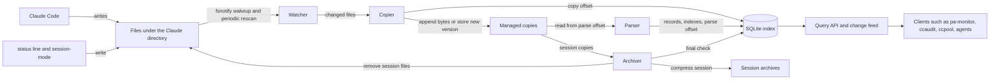
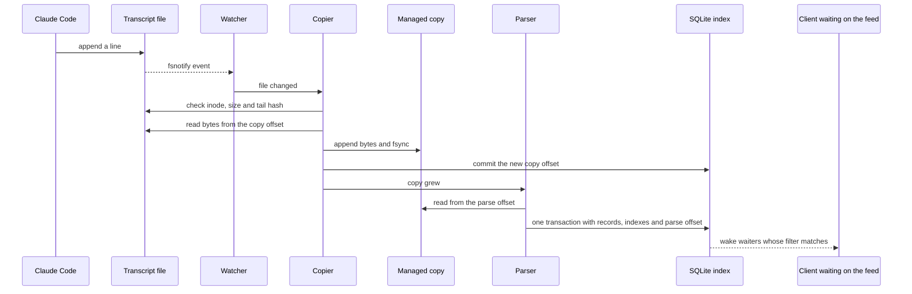
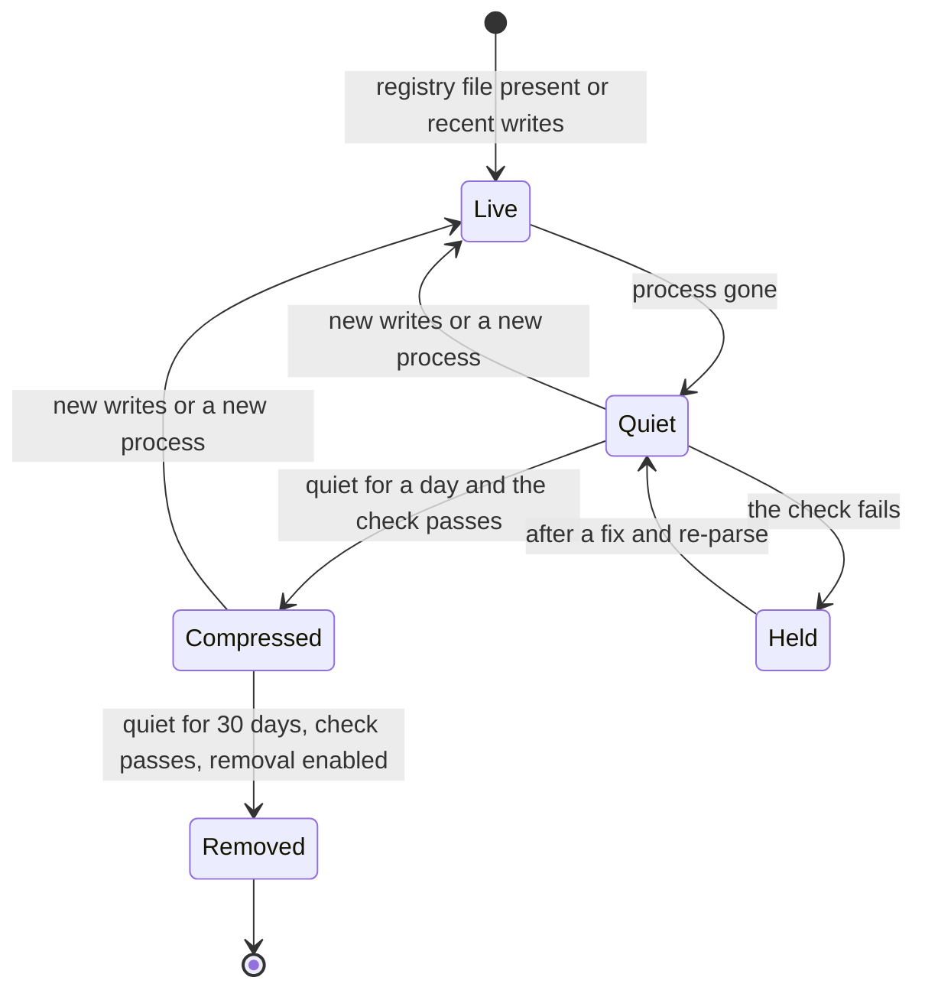

# claude-code-ingester: one owner for Claude Code session files

Status: design for operator approval (nothing built)
Date: 2026-10-28
Beads: `pg2-6z56f` (this design), `pg2-ppm4h` (session lifecycle input), `pg2-w6x9y` (pa-monitor's
per-file discovery cost, waiting on this). Cluster: `bd list --label claude-code-ingester`.
Sources: the operator rulings recorded as comments and notes on `pg2-6z56f` (2026-10-27 and
2026-10-28), the handoff `pg2-u62mu2`, and the code and on-disk inventory cited in "Current state".

The key words MUST, MUST NOT, SHOULD, SHOULD NOT and MAY are to be read as in RFC 2119.

## Summary

Build one daemon, `claude-code-ingester`, that owns the information in Claude Code's session files.
It watches the files Claude Code and the workspace's own tools write under the Claude directory,
copies every new byte into a location it manages, parses its copy into typed facts in a SQLite
index, and answers searches and serves a change feed to clients. It compresses a session's copies
once the session has been quiet for a day, and after about 30 days, behind a switch of its own,
removes the session's files from the Claude directory.

Existing tools keep working unchanged and move onto the ingester one at a time after it exists
(Strangler Fig). The ingester records facts, meaning what the files say; interpretations such as
ccaudit's error signature or pa-monitor's "awaiting input" stay in the clients (this repo's ADR
0015 applied to session files).

Size: L to XL for the first version, built in phases (see "Suggested phases").

## Intent

The operator's framing (2026-10-27): the point is one system owning the information, removing
duplicated code and fixing efficiency, with other tools layered on top. It is not driven by a
single usage pain point.

What that fixes today:

- **Fourteen readers parse the same files independently** (table in "Current readers"). Several
  re-read whole files on every poll: ccpool `send` every 250 ms, the pg-router-handlers watchdog
  every 10 s. pa-monitor walks and stats the whole tree every 5 s and keeps its offsets only in
  memory, so every restart re-reads everything in its window (`pg2-w6x9y` measured this cost).
- **Session history is being lost.** `history.jsonl` names 6,578 distinct sessions; 3,591 of them
  match none of the 6,673 transcript files on disk (method: the set of `sessionId` values in
  `history.jsonl` minus the set of `<session>.jsonl` names under `projects/`). Most are from April
  to June 2026, which fits Claude Code's 30-day default cleanup running before this repo set 365
  days on 2026-08-12 (commit `7b77fe86e`).
- **No tool keeps old versions** of the session registry or the session-mode files, and no reader
  sees the full body of large tool results (the transcript holds only a 2 KB preview).

## Goals

1. Keep a byte-exact copy of every ingested file, independent of when Claude Code deletes it.
2. Parse the copy into typed facts, with each record stamped with its parser's version, so a
   parser fix or a new field can be applied to everything already copied (re-parse).
3. Answer searches: filter, group and sum, word search, literal substring search, links between
   records, and a session timeline across all sources.
4. Serve a change feed with a durable cursor and an optional wait, so clients learn about new
   records without reading files.
5. Compress each session's copies into one archive with a manifest once the session has been quiet
   for a day, and remove the session's files from the Claude directory after about 30 days, each
   step after a check that everything was copied and parsed.
6. Report coverage: per-file copy and parse lag, bad lines, unknown keys and unknown file kinds, and
   sessions held back from archive.

## Non-goals (first version)

- Restoring an archived session for `claude --resume` (operator 2026-10-28: "lets not include the
  claude --resume capability right now"). The archive layout MUST keep enough to add it later.
- Interpretations of any kind: error signatures, `lead_cmd`, "awaiting input", burn rate, whether a
  session is "complete" (`pg2-ppm4h` question 1), excluding pool workers (`pg2-ppm4h` question 3).
- Converting existing clients. Each conversion is its own later bead.
- Importing ccaudit's existing database (operator 2026-10-27: a new store, not an existing one).
- External parser commands or plugins from other repos. Every source lives in nix-agent-support
  and is compiled in (operator 2026-10-28).
- A FUSE volume (considered and dropped; see "Approaches considered").
- Tags or other projections (`pg2-6z56f` Stage 4), and an agent-facing skill or MCP server (a
  likely later client).
- Tuning compression: levels, dictionaries, or a format beyond one sensible default (operator
  2026-10-27: capabilities first, compression later).

## Anti-goals

- **Claude Code MUST NOT depend on the ingester.** If the ingester is stopped, crashed or behind,
  every Claude Code session MUST behave exactly as it does today.
- **The ingester MUST NOT lose data it has seen.** It MUST NOT remove a file from the Claude
  directory unless the archive holding that file's bytes is written, verified and recorded.
- **The ingester MUST NOT record judgments** as if they were facts (ADR 0015).
- **Removal MUST NOT break unconverted tools.** pa-monitor `sessions` lists old sessions and ccpool
  treats "the transcript exists" as "resumable"; removing files under them is a regression.

## Constraints

- nix-agent-support is public: no employer-specific detail and no user identifier other than the
  operator's own in code, tests, fixtures or docs. Each Go module carrying fixtures owns a copy of
  the identifier-allowlist guard test.
- Pure Go. SQLite through `modernc.org/sqlite` (already used by ccaudit, pa-monitor and ccpool);
  v1.61.0's bundled SQLite has FTS5, its trigram tokenizer and JSON functions, and lets Go register
  SQL functions, but it cannot load C extensions. Go modules are built with gomod2nix.
- Claude Code owns the Claude directory (default `~/.claude`, relocated by `CLAUDE_CONFIG_DIR`) and
  changes its file formats without notice. Its own cleanup (`cleanupPeriodDays`) stays at 365 days
  as a backstop.
- Other local tools write into `projects/`: the status line appends `<session>.status.jsonl`, and
  the `session-mode` CLI rewrites `<session>.session-mode.json` and `<session>.compaction.json`.
  A workspace-move script in the private deployment flake renames whole `projects/<slug>`
  directories, so nothing may be keyed by path alone.
- `~/.claude/sessions/<pid>.<hash>.key` files (mode 0600) sit beside every registry file and are
  probably secrets.
- The daemon follows the workspace's Go daemon conventions (opt-in pprof endpoint: `docs/go-daemons.md`
  in `phillipg-nix-repo-base`) and registers its LaunchAgent the HM-scoped way pa-monitor does
  (`phillipgreenii.programs.launchdServices.userAgents`).
- Tests follow the global rules: deterministic behavior is tested against the real tool in a
  hermetic environment (real SQLite, real files, real fsnotify, a fixture Claude directory), and
  daemon-level end-to-end tests sit behind a build tag outside the unit gate (`phillipg-nix-repo-base`
  ADR 0024).

## Current state

### Files on disk (inventory 2026-10-28, counts only)

| File kind                                                                        | Count                                        | Writer                                                                                              |
| -------------------------------------------------------------------------------- | -------------------------------------------- | --------------------------------------------------------------------------------------------------- |
| `projects/{project}/{session}.jsonl` (session transcript)                        | 6,673                                        | Claude Code                                                                                         |
| `projects/{project}/{session}/subagents/agent-{agent}.jsonl`                     | 13,941                                       | Claude Code                                                                                         |
| `projects/{project}/{session}/subagents/agent-{agent}.meta.json`                 | 13,972                                       | Claude Code                                                                                         |
| `projects/{project}/{session}/tool-results/*`                                    | 8,948 (8,856 `.txt` + 91 `.json` + 1 `.bin`) | Claude Code                                                                                         |
| `projects/{project}/{session}.status.jsonl`                                      | 2,994                                        | claude-status-line (`home/programs/claude-status-line/capture-status.bash`)                         |
| `projects/{project}/{session}.session-mode.json`                                 | 885                                          | `session-mode` CLI (`packages/session-mode`), run by the `pb` plugin's commands and SessionEnd hook |
| `projects/{project}/{session}.compaction.json`                                   | 1                                            | `session-mode hook post-compact`, the `pb` plugin's PostCompact hook                                |
| `sessions/{pid}.json` (live-session registry)                                    | 22, every one a live `claude` process        | Claude Code, which deletes it at exit                                                               |
| `history.jsonl`                                                                  | 1 file, 28,858 entries, 17 MB                | Claude Code                                                                                         |
| other per-session files (`workflows/`, `scratchpad/`, agent-created directories) | about 120                                    | various                                                                                             |

`projects/` totals 21 GB (`du -sh`). Grouped by file-name session, using each group's newest
modification time:

| Sessions by last write        | Sessions | Size    |
| ----------------------------- | -------- | ------- |
| more than 30 days ago         | 3,016    | 8.5 GB  |
| in the last 30 days           | 3,942    | 13.4 GB |
| files belonging to no session | n/a      | 0.14 GB |

The rows sum to 22.0 GB, `du`'s 21G in binary units. Under the chosen design the last 30 days
always exist twice, so compressing copies after a day of quiet is what keeps the duplicate small.

No `mcp-tasks/` directory exists on this machine, though Claude Code's cleanup documentation lists
it.

Notes on the less obvious kinds:

- **`history.jsonl`** entries always carry `display`, `pastedContents`, `project`, `sessionId` and
  `timestamp` (epoch ms). It is the only place `/exit` is recorded (1,783 entries), and the only
  record for sessions whose transcripts were deleted. Of 1,771 pasted items, 1,537 refer by
  `contentHash` into `~/.claude/paste-cache` and 234 are inline.
- **`tool-results/`** holds the full output of a tool call too large for the transcript; the
  transcript's `tool_result` keeps a preview plus `Output too large (33.5KB). Full output saved to:
<path>`. Names: `toolu_<id>.*` (261, linked by `tool_use_id`), `hook-*.txt` (4,747, hook output),
  and other names (3,939, linked only by the path in the transcript).
- **`subagents/*.meta.json`** has the keys `agentType`, `description`, `requestNonInteractive`,
  `requestShape`, `spawnDepth` and `toolUseId`, linking each subagent to the tool call that spawned
  it.

### Current readers

| Reader                                     | What it reads                                                   | Pattern                                          | Persists                  |
| ------------------------------------------ | --------------------------------------------------------------- | ------------------------------------------------ | ------------------------- |
| pa-monitor daemon                          | registry, in-window transcripts and subagents, all status files | 1 s stat, 5 s rescan, in-memory offsets          | `state.db` (no offsets)   |
| pa-monitor `sessions` CLI                  | whole `projects/` tree                                          | on demand, size+mtime cache                      | summary cache             |
| pa-monitor `search` CLI                    | live sessions                                                   | on demand, full scan                             | none                      |
| pg-connector agentsession backend          | pa-monitor `sessions`/`search` output                           | on demand                                        | none                      |
| ccpool                                     | registry, one transcript                                        | 250 ms whole-file re-read in `send`, 500 ms tail | `store.db` (paths)        |
| pg-router-handlers                         | worker transcripts and subagents                                | 10 s whole-file re-read                          | event log                 |
| beads-exporter stranded pass               | transcripts written in the last 6 h                             | every 600 s, in-memory offsets                   | none                      |
| pg-ccaudit ingest                          | every `*.jsonl` (status files included by mistake)              | every 900 s, offsets in its DB                   | `transcripts.db` (6.0 GB) |
| claude-extended-tool-approver docker guard | current session's transcript                                    | per PreToolUse hook, full scan                   | path in asklog            |
| claude-status-line                         | last status line, session-mode and compaction files             | per render                                       | writes the status file    |
| session-mode                               | finds the transcript directory                                  | hooks and CLI                                    | writes its files          |
| codeburn, ccusage                          | `projects/**`                                                   | CLI and a web service                            | own caches                |
| workspace-move script                      | `cwd` of records                                                | one-shot                                         | renames directories       |
| agent instructions (`pb:unstick-beads`)    | `rg -l -F <assignee> ~/.claude/projects`                        | ad hoc                                           | none                      |

The shared Go reader is `packages/claude-transcript`. Its helpers (`IsAwaitingInput`,
`LastAssistantText`, `LastAPIError`, `OutputTokens`, `ClassifyActivity`) are interpretations over a
file and stay in clients.

## Approaches considered

### How clients read the ingester

1. **The daemon's API is the only contract; clients keep their own projections.** ccaudit keeps
   its own database, fed by the change feed with a filter, and keeps its 25 queries and its
   `signature`/`lead_cmd` code. Chosen: the store stays private, and the operator asked that the
   ingester do coarse filtering and ccaudit the rest (2026-10-27).
2. API plus versioned read-only SQL views over the store. Dropped for now: it makes the view schema
   a second contract and every ccaudit query would be rewritten. It MAY be added later if a second
   analysis client appears.
3. The store file as the contract. Dropped: it publishes the schema, and live clients would still
   need the API.

### How sources are described

1. A declarative YAML spec per source with a rule interpreter. Dropped by the operator
   (2026-10-28) as too large an effort.
2. **Go structs per source, compiled in, with struct tags naming each field's index type.**
   Chosen: everything ingested is written by Claude Code or by a tool in nix-agent-support, so Go
   imports are enough ("we can keep it that way for now").

### Where the bytes live

1. A: Claude's path holds the only copy until archive. Dropped: everything not yet archived (up to
   30 days) is lost if anything deletes or rewrites the file first, re-parsing needs two read paths,
   and the registry and session-mode files must be copied on every change anyway.
2. **B: always copy into a tool-managed location, parse from the copy, compress after a day of
   quiet, remove late.** Chosen by
   the operator (2026-10-28). A byte is at risk only for the seconds before it is copied, and
   re-parsing reads one place.
3. A FUSE volume that Claude Code writes to. Dropped after discovery (comment on `pg2-6z56f`,
   2026-10-28): on macOS 26 only macFUSE's kernel backend fully works and it needs a Recovery-mode
   security downgrade that nix-darwin cannot express; the alternatives are experimental or carry a
   paid licence for commercial use; and every Claude Code session would depend on the daemon.

### How many processes

One command monitors, copies, parses, searches and archives (operator 2026-10-28). A split
copier/parser pair was considered and dropped: both halves would need to know every file kind.

### Push or poll

Clients poll the change feed and MAY ask it to wait until a matching record arrives (long
polling). This covers every current reader's real freshness need, which is mostly much slower than
its current file-reading cadence (agent's call; see "Decisions"):

| Reader              | Reads today             | Needs                                     | Feed use              |
| ------------------- | ----------------------- | ----------------------------------------- | --------------------- |
| pa-monitor menu bar | 1 s stat, 5 s rescan    | SwiftBar refreshes every 5 to 10 s        | poll every 5 to 10 s  |
| ccpool `send`       | whole file every 250 ms | to learn quickly that one record appeared | wait for a match      |
| pg-router watchdog  | whole file every 10 s   | last activity; stalls take minutes        | poll every 30 to 60 s |
| beads-exporter      | every 600 s             | the same                                  | poll every 600 s      |
| tool approver guard | full scan per hook      | one session's tool calls now              | direct query          |
| ccaudit             | every 900 s             | batch                                     | poll the feed         |

The feed can only signal facts ("a `tool_use` named `AskUserQuestion` appeared"), never
interpretations ("this session is awaiting input"). A streaming push MAY be added later on the same
cursor.

## Design

### Architecture



The daemon is a Pipes and Filters pipeline with a durable cursor per stage. The copier and the
parser each keep their own offset per file, so either can stop, lag or be re-run without touching
the other (operator 2026-10-28). The copier is the only writer of copies and the parser the only
writer of records (Single Writer per stage, one daemon per Claude directory).



### What is ingested

The ingester MUST copy every file under the Claude directory's `projects/` tree, plus `sessions/`
and `history.jsonl`, except files on the block list (operator 2026-10-28: "the archive should take
anything which it knows it shouldn't. so a block list should be defined").

Block list, first version:

- `sessions/*.key`
- temporary files from atomic writes (`*.tmp.*`, including `.session-mode.tmp.*`)
- `.DS_Store`

The copier MUST NOT follow symbolic links; it records a link as a link. Other areas of the Claude
directory (`file-history/`, `paste-cache/`, `session-env/`, `shell-snapshots/`, `tasks/`,
`plans/`, settings and caches) are not ingested in the first version.

Every copied file is either handled by a source's parser or kept unparsed and reported as an
unparsed kind in coverage. Sources in the first version (operator 2026-10-28):

| Source                    | Files                                                                        | Mode     | Parsed into                                                                                                    |
| ------------------------- | ---------------------------------------------------------------------------- | -------- | -------------------------------------------------------------------------------------------------------------- |
| `claude-transcript`       | `projects/{project}/{session}.jsonl` and `.../subagents/agent-{agent}.jsonl` | append   | one record per line, one child record per `message.content` item                                               |
| `claude-subagent-meta`    | `.../subagents/agent-{agent}.meta.json`                                      | snapshot | one record linking the subagent to its `toolUseId`                                                             |
| `claude-tool-result-body` | `.../tool-results/*`                                                         | snapshot | one record whose body is the full output, linked to its `tool_result` by `tool_use_id` or by the saved-to path |
| `claude-history`          | `history.jsonl`                                                              | append   | one record per entry                                                                                           |
| `session-registry`        | `sessions/{pid}.json`                                                        | snapshot | one record per version, plus a deletion record                                                                 |
| `claude-status`           | `projects/{project}/{session}.status.jsonl`                                  | append   | one record per line                                                                                            |
| `session-mode`            | `projects/{project}/{session}.session-mode.json`                             | snapshot | one record per version                                                                                         |
| `session-compaction`      | `projects/{project}/{session}.compaction.json`                               | snapshot | one record per version                                                                                         |

Kept unparsed: `workflows/`, `scratchpad/`, agent-created directories, Claude Code's `.orphaned-*`
and `.superseded-*` files, `mcp-tasks/` if it appears, project-level files such as
`sessions-index.json`, and `projects/{project}/memory/`.

### Sources in Go

```go
// Package source: the contract every ingester source implements.
type Source interface {
	Name() string
	Version() int                       // bump to re-parse stored copies
	Mode() Mode                         // Append or Snapshot
	Match(path string) (Captures, bool) // e.g. project, session, agent from the path
	Parse(c Captures, raw []byte) ([]Record, error)
}
```

```go
// Package claudetranscript: Claude Code transcript lines (excerpt).
type Line struct {
	Type        string    `json:"type"        ingest:"keyword"`
	UUID        string    `json:"uuid"        ingest:"id"`
	ParentUUID  string    `json:"parentUuid"  ingest:"id"`
	SessionID   string    `json:"sessionId"   ingest:"session"`
	Timestamp   time.Time `json:"timestamp"   ingest:"time"`
	Cwd         string    `json:"cwd"         ingest:"path"`
	IsSidechain bool      `json:"isSidechain" ingest:"bool"`
	Message     *Message  `json:"message"`
}

type ToolUse struct {
	ID    string          `json:"id"    ingest:"id"`
	Name  string          `json:"name"  ingest:"keyword"`
	Input json.RawMessage `json:"input" ingest:"opaque"`
}
```

Field types and what each supports:

| Type                   | Examples                             | Queries                                       |
| ---------------------- | ------------------------------------ | --------------------------------------------- |
| `id`                   | session, uuid, `tool_use_id`         | exact and set match, links                    |
| `keyword`              | model, tool name, status             | exact and set match, group and count          |
| `path`                 | `cwd`, `file_path`                   | exact match, "under this directory", group    |
| `int`, `float`, `bool` | token counts, percentages, flags     | ranges, sums, min and max                     |
| `time`                 | any timestamp format                 | windows and ordering on one clock             |
| `text`                 | prompts, replies, thinking, titles   | word and phrase search, ranked, with snippets |
| `opaque`               | commands, tool inputs, result bodies | literal substring search; never parsed        |

Two keys have fixed roles and are always indexed: `session` joins records across sources, and
`time` is the axis for windows (the time the ingester saw the record when the file has none). A
record's identity is positional: file id, generation and byte offset (plus the item index for a
child record). Ids such as `uuid` and `tool_use_id` are ordinary `id` fields that links point at;
they are not unique (see "Session identity"). Path captures such as `{session}` and `{agent}` are
stored as `id` fields.

Each parser MUST also report keys it does not recognize, counted per source and record type in
coverage, because Go's JSON decoder drops unknown fields silently. That is how a new Claude Code
field is noticed; a parser update plus a re-parse then applies it to everything copied.

Facts only: a field is a fact if it directly reads something in a file, including Claude Code's own
markers such as the interruption sentinel; light, format-defined readings (the first word of a
`history.jsonl` slash command, the length of a body, de-duplicating usage by `message.id` because
Claude Code repeats a message's usage on each of its lines) are facts too. Anything that needs a
heuristic a client might change stays in the client.

### Copier

For every changed file the copier MUST:

1. Check identity: device and inode match, the file is not shorter, and the last few KB of the copy
   match the file at the same position.
2. For an append source, read from the copy offset to the end, append the bytes to the copy, fsync
   the copy, then commit the new copy offset. A trailing partial line is copied immediately (so a
   line cut off by a crash is still kept) and parsed only when its newline arrives.
3. For a snapshot source, read the whole file and hash it; if the hash is new, store the bytes as a
   new version with the time seen. A file that disappears gets a deletion record (Tombstone).
4. When the same inode was rewritten in place (the file is shorter, or the stored tail no longer
   matches), start a new generation of the copy from byte 0 and keep the old generation.

A file's identity is its device and inode, not its path. A renamed file or directory keeps its
inodes, so its files continue the same copies and only the recorded path changes. A path that now
holds a different inode is a new file; the old file id follows its inode to wherever it was renamed,
or gets a deletion record. This covers Claude Code renaming a transcript aside (its documentation
mentions `.orphaned-*` and `.superseded-*` files; none exist on this machine today) and writing a
new one at the old path. A file's source is decided when it is first seen and kept across renames,
so a parsed transcript renamed aside keeps its records. On startup, any copy longer than its committed offset MUST be trimmed to it and the
bytes copied again, because the copy is fsynced before the offset is committed.

A snapshot version written and replaced between two reads is lost. fsnotify keeps that window
small; it cannot close it.

### Parser

The parser reads a copy from its parse offset up to the copy offset, and commits the records, their
field indexes, their text indexes and the new parse offset in one SQLite transaction. The parse
offset MUST NOT pass the copy offset. Lines that fail to parse are counted as bad lines with their
position; parsing continues.

Re-parsing a source resets the parse offsets of its copies (or of chosen files) and replaces their
records. A re-parse can yield different or fewer records, so the feed MUST first emit a reset event
("replace every record of file X, generation Y"), then the new records with their new parser
version. The same reset event is emitted when a file starts a new generation. Client projections
drop what the reset names and take what follows.

Records of a superseded generation stay stored (they are facts about bytes that existed), but
queries and the feed return only current generations unless a request asks for old ones. Records of
a deleted file stay current; the deletion is itself a record.

### Session identity

Claude Code gives a transcript a new session id and file name on resume, compact and fork, and the
new file replays earlier events with their original `uuid`s (`packages/claude-transcript/sessions.go`).
Files that share a session id can also sit in different `projects/<slug>` directories. The ingester
therefore:

- stores each line's own `sessionId` and the file's `{session}` capture as separate facts;
- never merges files into one logical session. Merging (claude-transcript's "most frequent
  `sessionId`" rule) is a judgment that stays in clients;
- offers `distinct` on any `id` field, so a client summing tokens or counting events can de-duplicate
  replayed lines by `uuid` or usage by `message.id`;
- resolves a link such as `parentUuid` within the same file first.

The archive unit is the file-name session: `{session}.jsonl`, the `{session}/` subtree, the
`{session}.*` siblings in the same project directory, and the registry versions that name that
session id. A resume chain can therefore span several archives; each manifest lists the distinct
`sessionId` values its files carry, so a later restore can find every member. One
`sessions/<pid>.json` can name several session ids over its life (after `/clear`); each version goes
with the session it names.

The index MUST be rebuildable from the copies and archives alone: deleting the database and
re-parsing everything reproduces it.

### Store

The state directory defaults to `$XDG_DATA_HOME/claude-code-ingester` and holds:

- **copies**, named by a stable file id and generation, not by Claude path (paths change). A copy
  is uncompressed only while its session is active or within a day of its last write; after that
  its bytes live in the session's archive, and a session that wakes up continues with an
  uncompressed tail after the compressed part;
- **`index.db`**, SQLite in WAL mode, holding files and their paths over time, offsets,
  generations, records with their typed fields and their pointers (file, generation, offset,
  length) into the copies or archives, parse versions, coverage counters and archive state;
- **archives**, one compressed archive per file-name session, which MAY grow by segments when a
  session wakes up and goes quiet again.

Full file contents MUST NOT be stored in the database (operator 2026-10-28). Word search uses an
FTS5 index and substring search an FTS5 trigram index, both contentless: they hold tokens, and
snippets and bodies are read from the copies through the pointers. Only fields a source marks
`text` or `opaque` are indexed for search; whole raw lines are not (agent's call; scanning copies
covers a rare search for a field no source names).

### Query API and change feed

The daemon listens on a Unix socket in its state directory (as the pg-connector daemons do) and a
CLI wraps every operation for scripts, skills and the operator. Operations:

- **Query**: filter on any indexed field, group and aggregate, word search, substring search,
  follow links (call to result, record to parent, session to subagents and to its status, mode and
  registry records), choose returned fields or the raw bytes, order and limit.
- **Feed**: records committed after a cursor that match a filter, with a field projection and an
  optional wait of up to T. The cursor is the parser's commit sequence and is durable on the
  client's side.
- **Raw**: the bytes of a record or a file range, from a copy or an archive.
- **Coverage**: per-file copy and parse offsets and lag, bad lines, unknown keys and kinds, held
  sessions, archive counts.

Example: ccaudit's coarse filter is two feed subscriptions. One takes every `tool_use` and every
`tool_result` with `tool_use_id`, `is_error` and body length but no body (its rate denominators);
the other takes bodies only where `is_error` is true. Its "drop success bodies" rule becomes a
filter it sends.

The target latency from a write in the Claude directory to the record appearing in the feed is
about one second (pa-monitor's fast tier today).

### Session lifecycle facts

The ingester records, per session, the facts `pg2-ppm4h` asks for: every registry version (pid,
`procStart`, `startedAt`, status, `waitingFor`), the registry deletion time, `/exit` and `/clear`
entries from `history.jsonl`, and the last write time of each file. On every rescan it checks each
registry file's pid and `procStart` and records when the process is gone, because a crash leaves a
registry file behind until Claude Code's next launch clears it. Whether a session is "complete",
and whether pool workers are listed for resume, stay with clients (`pg2-ppm4h` questions 1 and 3).

### Compression and removal

Compression and removal are separate stages (operator 2026-10-28):

- **Compress** a session's copies once no live process holds the session and none of its files has
  been written for a day (`compress.after`, default 24 h). Always on.
- **Remove** the session's files from the Claude directory once it has been quiet for the removal
  age (`remove.after`, default 30 days). Off by default (`remove.enable = false`) until pa-monitor
  `sessions` and ccpool resume have moved to the ingester, because both expect old files in the
  Claude directory (agent's call). Claude Code's own cleanup stays at 365 days.



The check MUST pass for every file of the session before each stage: the copy offset equals the
size of the file in the Claude directory and the tail hash matches; the parse offset equals the
length of the copy; and no file of a parsed kind is left unparsed. A failure holds the session and
shows in coverage. Removal re-runs the check against the Claude files, because they can change
after compression.

Compression runs in this order so a crash at any point loses nothing:

1. Write the session's archive, or a new segment of it, to a temporary file, fsync it, read it back
   to verify it, and rename it into place.
2. Commit "compressed" with the archive's hash and the byte ranges it covers; records in those
   ranges now point into the archive.
3. Delete the uncompressed copy bytes the archive covers.

A compressed session that gets new writes goes back to Live. Each written file continues its copy
as an uncompressed tail after the compressed part (same file id and generation, offsets carry on),
and the next quiet day compresses the tail as another segment.

Removal runs in this order:

1. Re-run the check against the Claude files.
2. Commit "removal pending", listing each file with its inode, size and hash.
3. Delete the files from the Claude directory.
4. Commit "removed".

A restart that finds a pending removal re-checks each listed file: an unchanged file is deleted; a
file with new writes sends the session back to Live and continues its copy.

Each archive carries a manifest listing every file: its original path relative to the Claude
directory, file id, generations, size, hash, and whether it was parsed and by which source. The
manifest is what a later restore for `claude --resume` would use.

Files that belong to no single session are copied and parsed but never removed from the Claude
directory: `history.jsonl`, project-level files and `memory/`. The builder MAY compress their older
copy bytes in segments. Registry versions are keyed by session and go into that session's archive.

### Failure handling

| Scenario                                           | Outcome                                                                                                         |
| -------------------------------------------------- | --------------------------------------------------------------------------------------------------------------- |
| Ingester down for hours or days                    | No loss; copying resumes from stored offsets and catches up                                                     |
| A file deleted or rewritten before it is copied    | Only bytes written since the last copy are lost (seconds)                                                       |
| Snapshot rewritten twice between reads             | The intermediate version is lost                                                                                |
| Crash while copying                                | The copy is trimmed to its committed offset and the bytes are copied again                                      |
| Parser bug or crash                                | Copying continues; fix the parser and re-parse from the copy                                                    |
| Claude Code adds a field                           | Unknown-key counts in coverage; update the struct and re-parse                                                  |
| Project directory renamed                          | Copies continue by inode; only the recorded path changes                                                        |
| Session written again after compression            | Back to Live; the copy continues as an uncompressed tail                                                        |
| Claude writes to a session's file as it is removed | Writes after the delete are lost; every write before it was copied                                              |
| State directory full                               | Copying falls behind, nothing is deleted from the Claude directory, coverage and an alert report it             |
| Index database lost or corrupt                     | Rebuild it by re-parsing the copies and archives                                                                |
| State directory lost                               | Archives are lost; the last 30 days survive in the Claude directory, then Claude Code's 365-day cleanup applies |

### Observability and deployment

The daemon SHOULD expose metrics for copy lag, parse lag, bytes copied, bad lines, unknown keys and
kinds, held sessions and archive counts, log to a JSONL file in its state directory, and offer the
workspace's opt-in pprof endpoint. Home Manager module `home/programs/claude-code-ingester`
(`phillipgreenii.programs.claude-code-ingester`) registers the LaunchAgent on darwin; on Linux the
module MAY run it under a systemd user service or leave it unsupervised. Alert rules come after the
first deployment shows which signals matter.

### Client migration

Each client moves in its own bead after the ingester runs. `packages/claude-transcript` SHOULD gain
a record source backed by the ingester, with the files as a fallback when the ingester is down, so
moving a client that uses its helpers changes a constructor, not its logic. `pg2-w6x9y` is closed
by pa-monitor's move.

## Suggested phases

1. Copier, store, coverage and the CLI's coverage command; no parsing (M).
2. Sources and parser for the transcript, subagent and history sources; query API (L).
3. The remaining sources, links and the change feed with wait (M).
4. Compression after a day of quiet, with the manifest, the check and crash recovery (M).
5. Removal from the Claude directory, off by default, with crash recovery (S).
6. Home Manager module, LaunchAgent, metrics and logs (M).

## Decisions

Operator rulings (Phillip; verbatim text is on `pg2-6z56f`):

1. 2026-10-27: the ingester keeps everything lossless in its own store, parses at ingest, and is
   extensible to files other tools write.
2. 2026-10-27: facts in the ingester, interpretations in clients ("yes, that is the plan").
3. 2026-10-27: existing tools stay as they are and convert one at a time after the ingester is
   planned and built; a new store, not an existing one.
4. 2026-10-27: coarse filtering in the ingester, the rest in clients such as ccaudit.
5. 2026-10-28: sources are Go code compiled in; Go imports are fine because everything lives in
   nix-agent-support.
6. 2026-10-28: the unparsed bytes are kept so a missed field can be re-parsed; full file contents
   are not stored in the database.
7. 2026-10-28: B, always copy into a tool-managed location, with independent copy and parse
   offsets.
8. 2026-10-28: one command monitors, copies, parses, searches and archives.
9. 2026-10-28: archive after about 30 days, all of a session's files compressed, after a final
   check that they were fully parsed; Claude Code's cleanup stays at 365 days. This supersedes the
   2026-10-27 ruling that archive and purge were not the ingester's job. Ruling 13 splits it into
   compression after a day and removal at about 30 days.
10. 2026-10-28: no restore for `claude --resume` in the first version.
11. 2026-10-28: each archive has a manifest; the ingester takes everything except a block list.
12. 2026-10-28: the first version parses `history.jsonl`, the `tool-results` bodies and the subagent
    `meta.json` files in addition to the transcript, status, session-mode, compaction and registry
    sources.
13. 2026-10-28: compression and removal are separate stages; a session's copies are compressed
    after a day of quiet, and removal from the Claude directory (about 30 days) has its own switch.

Agent's calls, for the operator to check:

1. Clients poll the change feed with an optional wait; no streaming push in the first version.
2. Only fields marked `text` or `opaque` are search-indexed; whole raw lines are not.
3. Package and module name `claude-code-ingester`, matching the existing bead label.
4. Removal from the Claude directory is off by default until pa-monitor `sessions` and ccpool
   resume are converted; compression is always on.
5. The block list starts with `sessions/*.key`, atomic-write temporary files and `.DS_Store`;
   symbolic links are never followed.
6. Registry liveness is checked on every rescan.
7. Files belonging to no single session are copied and parsed but never archived or removed.
8. Unix socket API plus a CLI.
9. The index is rebuildable from copies and archives.
10. Record identity is positional (file, generation, offset); `uuid` is not unique, and the ingester
    never merges resumed, compacted or forked transcripts into one session.
11. The archive unit is the file-name session; a resume chain can span several archives.
12. The feed emits a reset event before re-parsed records and on a new generation; superseded
    generations are hidden from queries unless asked for.

## Left to the builder

- The database schema, copy file naming, chunk and fsync batching, and the rescan interval.
- The query and feed request syntax and the cursor encoding.
- The archive file format and its one default compression, as long as it holds the manifest and
  every file byte-exact, can be read back by byte range, and can grow by segments. Tuning comes
  later.
- Metric and log names, and the Linux supervision choice.
- Test fixtures (generic `example-*` names only, per the identifier guard).

## Open questions

- Whether `paste-cache/` (pasted content that `history.jsonl` refers to by hash) and
  `file-history/` belong in a later version.
- The size of the trigram index over tool inputs and result bodies; it should be measured on a copy
  of real data before phase 2 is finished.
