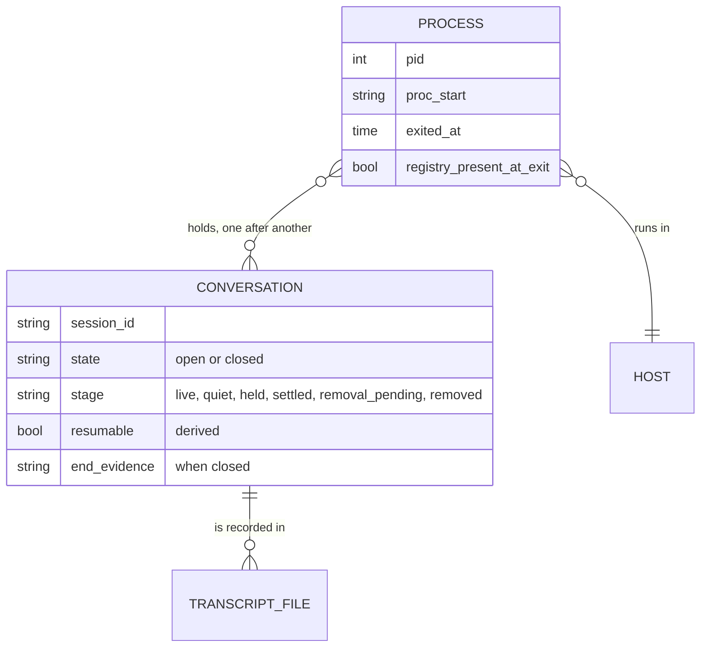
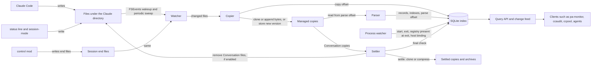
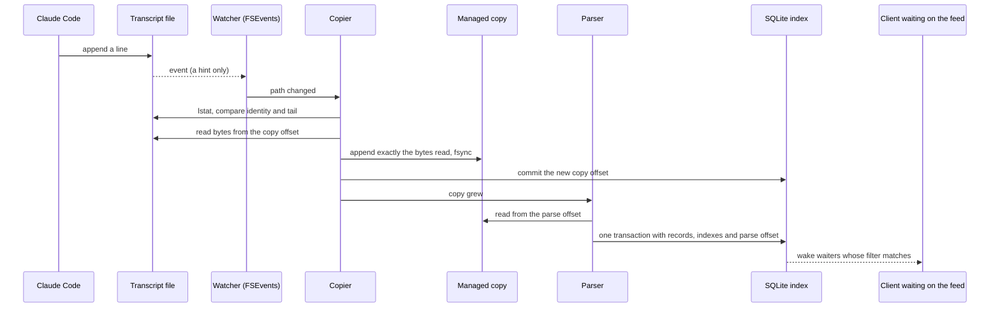
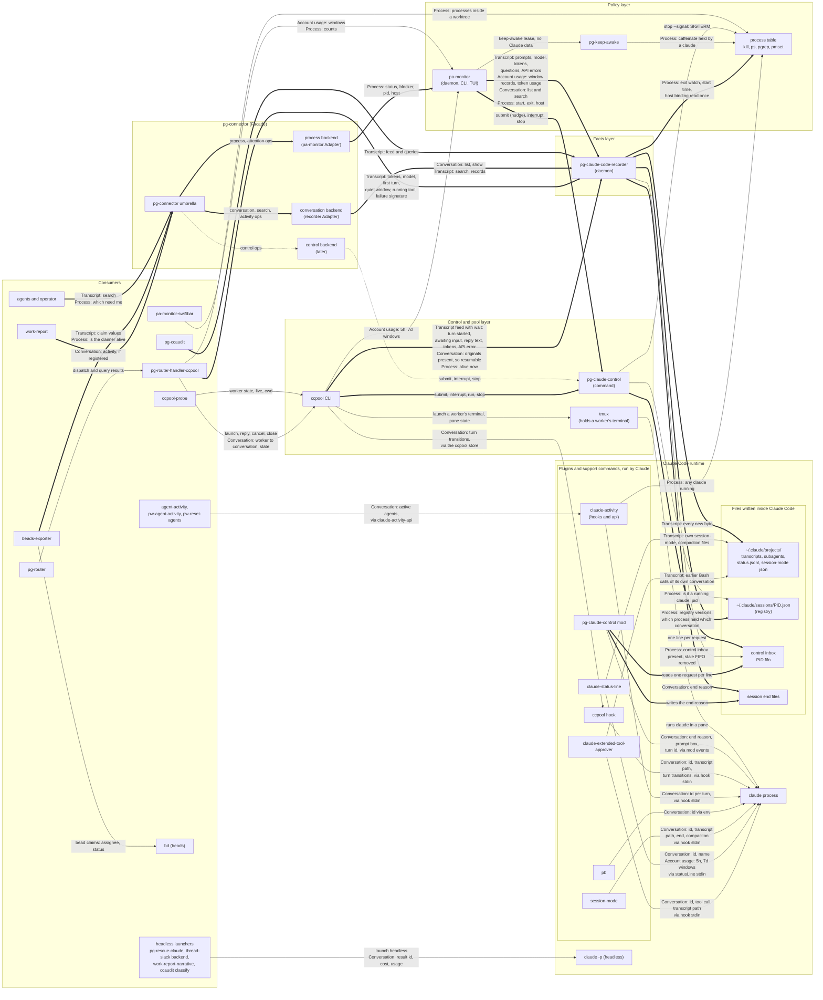
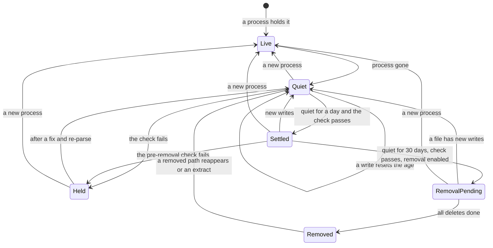
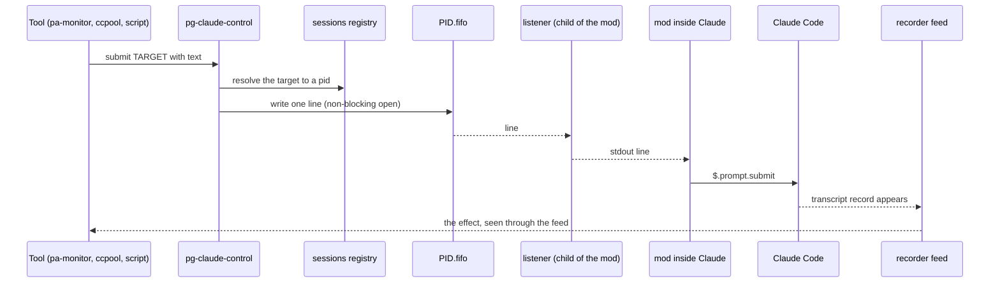

# pg-claude-code-recorder: one owner for Claude Code's Transcript, Conversation and Process facts, and one control mod

Status: design for operator approval (nothing built)
Date: 2026-10-30 (replaces the 2026-10-28 draft `claude-code-ingester-design.md`, commit `52015ba0f`)
Beads: `pg2-6z56f` (this design), `pg2-ppm4h` (session lifecycle input), `pg2-w6x9y` (pa-monitor's
per-file discovery cost, waiting on this), `pg2-u62mu2` (the handoff that produced this rewrite).
Cluster: `bd list --label pg-claude-code-recorder`.
Sources: the operator rulings recorded as comments and notes on `pg2-6z56f` (2026-10-27 to
2026-10-30), the spike evidence on the same bead, the three design reviews of the draft (same bead,
2026-10-28), and the code and on-disk inventory cited in "Current state".

The key words MUST, MUST NOT, SHOULD, SHOULD NOT and MAY are to be read as in RFC 2119.

## Summary

Build two things that together give every tool one way to learn about a Claude Code run and one way
to act on it.

1. **`pg-claude-code-recorder`**, a daemon that owns the facts in Claude Code's files. It watches
   the files Claude Code and the workspace's own tools write under the Claude directory, copies
   every new byte into a location it manages, parses its copy into typed facts in a SQLite index,
   records the facts of each Conversation and each Process, and answers searches and serves a change
   feed to clients. It settles a session's copies once the session has been quiet for a day, and
   after about 30 days, behind a switch of its own, removes the session's files from the Claude
   directory. It can extract a session back into the Claude directory so `claude --resume` works.
2. **`pg-claude-control`**, a mod (a Claude Code plugin that runs inside every Claude) plus a small
   command. The mod listens on a per-process inbox and acts on its own Claude: submit a prompt,
   interrupt, run a slash command, stop. The command is how existing tools and scripts, in any
   language, send those requests. It replaces the terminal-host adapters (tmux, cmux) the earlier
   design proposed, because the mod acts inside Claude and needs no terminal.

Existing tools keep working unchanged and move onto the recorder one at a time after it exists
(Strangler Fig). The recorder records facts, meaning what the files say; interpretations such as
ccaudit's error signature or pa-monitor's "awaiting input" stay in the clients (this repo's ADR 0015
applied to session files). pa-monitor and ccpool end up as policy only.

Size: XL in total; the recorder is L to XL and the control mod and command are M. They are
independent and built in phases (see "Suggested phases").

## Vocabulary and domain model

These five terms are the shared vocabulary (operator 2026-10-28: "pg-connector should be updated to
use these propose terms."). The bare word "session" leaves it, because it meant a conversation, a
transcript and a running process at different times.

| Term              | Meaning                                                                                                                                                                     |
| ----------------- | --------------------------------------------------------------------------------------------------------------------------------------------------------------------------- |
| **Conversation**  | What Claude Code calls a session. Its identity is its `session_id`. It is what `claude --resume` continues.                                                                 |
| **Transcript**    | The files that record one Conversation (the transcript, its subagents, tool results, status files).                                                                         |
| **Process**       | One running `claude`: a pid plus its start time (`procStart`).                                                                                                              |
| **Host**          | Where a Process takes input: a tmux pane, a cmux surface or a plain terminal. In this design it is only a fact read from the Process's environment; nothing acts on a Host. |
| **Account usage** | The 5-hour and weekly usage windows.                                                                                                                                        |



**Conversation states** (operator 2026-10-29, bead note R10: "open/close with resumablel property"):

- **open**: a live Process holds it.
- **closed**: no live Process holds it; the end evidence says how it ended.
- **resumable** is a derived yes or no, not a state: its original files are still in the Claude
  directory (or, after removal, in the recorder's archive and extractable). A closed Conversation
  can be resumable or not, and that can change without the Conversation changing.

"Active" is retired: it meant either the Process's status "working" or "a transcript was written
recently". "Alive" is a Process word.

**Lifecycle stage** is how the recorder handles a Conversation's copies. It is separate from open and closed, and `conversation.show` returns both. The legal pairs: stage `live` goes with state `open`, and every other stage goes with state `closed`.

| Stage             | Meaning                                                                                                                                                                                                |
| ----------------- | ------------------------------------------------------------------------------------------------------------------------------------------------------------------------------------------------------ |
| `live`            | open: a live Process holds the Conversation                                                                                                                                                            |
| `quiet`           | closed and not yet settled: less than `settle.after` since the recorder saw its last byte (a write resets that age); at `settle.after` the check runs and the Conversation becomes `settled` or `held` |
| `held`            | a check failed; shown in coverage; never settled or removed until the check passes                                                                                                                     |
| `settled`         | closed, quiet for `settle.after`, check passed, copies settled                                                                                                                                         |
| `removal_pending` | removal is committed and its deletes are not all done                                                                                                                                                  |
| `removed`         | the Claude files are gone; an extract or a reappearing path returns it to `quiet`                                                                                                                      |

**How a Conversation ended.** The recorder stores evidence, and a client derives the label
(operator 2026-10-29, bead note R11: "five labels look good. we can start with the proposed crash detection and
iterate later if not sufficent."):

| Evidence                                                                        | Label           |
| ------------------------------------------------------------------------------- | --------------- |
| A typed `/exit` entry in `history.jsonl`, then the registry file deleted        | exited          |
| A `/clear` entry, and the registry file now names a new session id              | cleared         |
| The registry file is already absent at the moment the Process exits, no `/exit` | closed normally |
| The registry file is still present at the moment the Process exits              | crashed         |
| The recorder was not watching the Process across its end                        | unknown         |

Measured 2026-10-30 on Claude Code 2.1.310 (darwin): SIGTERM, SIGHUP, Ctrl-D (pressed twice) and
closing the terminal each deleted the registry file and its `.key` file and left no `/exit` entry; a
typed `/exit` did the same with an entry; SIGKILL left both files behind, and they were gone within
76 seconds (what removed them, and when, was not observed), which is why the recorder checks the
file at the moment the Process exits and does not rescan for a leftover.

The label is derived from registry and history evidence alone, so it does not depend on the control mod; the mod's `end_reason` is extra detail. Precedence, first match wins:

1. A `/clear` entry, or the registry file now names a new session id: **cleared** (the Process lives on, so this needs no exit watch).
2. A typed `/exit` entry for the session: **exited**.
3. The recorder did not observe the Process's exit (it ended while the recorder was down, or before its watch was registered): **unknown**.
4. The registry file was still present when the Process exited: **crashed** (judged for the Conversation the Process held at that moment).
5. Otherwise: **closed normally** (Ctrl-D, a closed terminal, SIGTERM and SIGHUP all land here; the mod's reasons `prompt_input_exit` without a `/exit` entry and `other` both map to it).

## Intent

The operator's framing (2026-10-27): the point is one system owning the information, removing
duplicated code and fixing efficiency, with other tools layered on top. It is not driven by a
single usage pain point. The 2026-10-28 framing question widened it: tools had each taken a slice of
"what is a Claude session" (a transcript, a running process, runtime numbers, actions on it), and
the slices overlapped. The vocabulary above and the split below settle that.

What that fixes today:

- **Fourteen readers parse the same files independently** (table in "Current readers"). Several
  re-read whole files on every poll: ccpool `send` every 250 ms, the pg-router-handlers watchdog
  every 10 s. pa-monitor walks and stats the whole tree every 5 s and keeps its offsets only in
  memory, so every restart re-reads everything in its window (`pg2-w6x9y` measured this cost).
- **Conversation history is being lost.** `history.jsonl` names 6,578 distinct sessions; 3,591 of
  them match none of the 6,673 transcript files on disk (method: the set of `sessionId` values in
  `history.jsonl` minus the set of `<session>.jsonl` names under `projects/`). Most are from April
  to June 2026, which fits Claude Code's 30-day default cleanup running before this repo set 365
  days on 2026-08-12 (commit `7b77fe86e`).
- **No tool keeps old versions** of the session registry or the session-mode files, and no reader
  sees the full body of large tool results (the transcript holds only a 2 KB preview).
- **Two tools each drive terminals.** ccpool drives tmux and pa-monitor drives cmux through a bridge
  (ADR 0022: the daemon must not run cmux itself), each with its own send, key and liveness code,
  and with no shared notion of who owns a worker.

## Goals

1. Keep a byte-exact copy of every ingested file, independent of when Claude Code deletes it.
2. Parse the copy into typed facts, with each record stamped with its parser's version, so a parser
   fix or a new field can be applied to everything already copied (re-parse).
3. Answer searches: filter, group and sum, word search, literal substring search, links between
   records, and a Conversation timeline across all sources.
4. Serve a change feed with a durable cursor and an optional wait, so clients learn about new
   records without reading files.
5. Record Process and Conversation facts: when a Process started and exited, whether its registry
   file was still present at exit, its host binding, which Processes held a Conversation, and the
   end evidence (table above).
6. Settle each Conversation's copies once it has been quiet for a day, and remove its files from the
   Claude directory after about 30 days, each step after a check that everything was copied and
   parsed; extract a Conversation back into the Claude directory so `claude --resume` works.
7. Report coverage: per-file copy and parse lag, bad lines, unknown keys and unknown file kinds, and
   Conversations held back from settling.
8. Let any tool act on a running Claude (submit, interrupt, run a slash command, stop) through one
   mod and one command, independent of how the Claude was started.

## Non-goals (first version)

- Interpretations of any kind: error signatures, `lead_cmd`, "awaiting input", burn rate, whether a
  Conversation is "complete" (`pg2-ppm4h` question 1), excluding pool workers (`pg2-ppm4h` question
  3), working, blocked, idle or hung (these stay in pa-monitor).
- Converting existing clients. Each conversion is its own later bead.
- Importing ccaudit's existing database (operator 2026-10-27: a new store, not an existing one).
- External parser commands or plugins from other repos. Every source lives in nix-agent-support and
  is compiled in (operator 2026-10-28).
- A FUSE volume (considered and dropped; see "Approaches considered").
- Tags or other projections (`pg2-6z56f` Stage 4), and an agent-facing skill or MCP server (a likely
  later client).
- Tuning compression: levels, dictionaries, or a format beyond one sensible default (operator
  2026-10-27: capabilities first, compression later).
- A terminal-host adapter or a `pg-host` command for tmux or cmux (superseded by the control mod;
  operator 2026-10-30).
- The cmux sidebar status and progress ("mark"). It is a pa-monitor output, not a control operation;
  a SwiftBar capability is the better place for it, later (operator 2026-10-30).
- Controlling a plain terminal Claude without the mod, or headless `claude -p`. A Claude without the
  mod can still be stopped with a signal (see "Control mod and command").
- Moving the other hook-based plugins into the mod (see "Control mod and command", follow-ups).

## Anti-goals

- **Claude Code MUST NOT depend on the recorder.** If the recorder is stopped, crashed or behind,
  every Claude Code run MUST behave exactly as it does today. With `remove.enable` false (the default) that holds without exception; once removal is enabled, resuming a removed Conversation needs an `extract`, and so the recorder.
- **Claude Code MUST NOT depend on the control mod.** A mod that fails to load, crashes or is
  disabled MUST leave Claude Code working; only control through it is lost.
- **Control MUST NOT depend on the recorder.** A recorder outage MUST NOT stop a tool from
  submitting, interrupting or stopping a Claude; only reading facts is lost.
- **The recorder MUST NOT lose data it has seen.** It MUST NOT remove a file from the Claude
  directory unless the archive holding that file's bytes is written, verified and recorded.
- **The recorder MUST NOT record judgments** as if they were facts (ADR 0015).
- **Removal MUST NOT break unconverted tools.** pa-monitor `sessions` lists old sessions and ccpool
  treats "the transcript exists" as "resumable"; removing files under them is a regression.

## Constraints

- nix-agent-support is public: no employer-specific detail and no user identifier other than the
  operator's own in code, tests, fixtures or docs. Each Go module carrying fixtures is covered by
  the `identifier-allowlist` hook (`scripts/check-identifier-allowlist.sh`; a new module needs a
  `MODULES` row and an allowlist file).
- Pure Go for the recorder, except one darwin-only cgo file for FSEvents and the darwin system calls (`getattrlistbulk`, `clonefile`, the kqueue exit watch). Linux builds with `CGO_ENABLED=0` and uses inotify, `FICLONE` where the filesystem supports it, a plain directory walk for sweeps, and `pidfd_open` for Process exit (a one-second liveness poll that checks the start time where `pidfd_open` is unavailable); a cross-compile guard (`GOOS=linux CGO_ENABLED=0 go vet ./...`, the `pg-connector` precedent) keeps Linux building. SQLite through `modernc.org/sqlite`, already used by ccaudit, pa-monitor
  and ccpool at different versions (pa-monitor, pg-connector and pg-desk 1.61.0, work-report 1.59.0, ccpool and pg-ccaudit 1.52.0). The recorder
  takes 1.61.0, whose bundled SQLite 3.54.1 has FTS5 with `contentless_delete`, its trigram
  tokenizer and JSON functions, and lets Go register SQL functions, but it cannot load C
  extensions. Go modules are built with gomod2nix.
- File-change notification on darwin is FSEvents through a small cgo wrapper (operator 2026-10-28:
  "calls seem good"). `fsnotify` is not used: on darwin it is kqueue with one file descriptor per
  watched file, and `~/.claude` holds 85,203 files. On Linux the recorder uses inotify and MUST
  document its watch limit.
- Claude Code owns the Claude directory (default `~/.claude`, relocated by `CLAUDE_CONFIG_DIR`) and
  changes its file formats without notice. Its own cleanup (`cleanupPeriodDays`) stays at 365 days
  as a backstop.
- Other local tools write into `projects/`: the status line appends `<session>.status.jsonl`, and
  the `session-mode` CLI rewrites `<session>.session-mode.json` and `<session>.compaction.json`
  through a temporary file and a rename, so every version has a new inode. A workspace-move script
  in the private deployment flake renames whole `projects/<slug>` directories, so nothing may be
  keyed by path alone.
- The control mod's state directory (`controlStateDir`, default `$XDG_STATE_HOME/pg-claude-control`) holds the inbox and the end files. It is a second watched root: the recorder reads only `ends/` from it, checks `inbox/<pid>.fifo` for presence, and removes a stale one (its only write into that directory).
- `~/.claude/sessions/<pid>.<hash>.key` files (mode 0600) sit beside every registry file and are
  probably secrets.
- The control mod uses Claude Code's mod API as of 2.1.310. `claude plugin validate` refuses a `$`
  passed to a helper declared inside `register()`, so mod helpers MUST be top-level functions. The
  macOS `PATH` on this machine resolves `stat` to GNU coreutils (`stat -f %i` fails), so scripts MUST
  use `test -ef` and not BSD `stat` flags.
- The daemon follows the workspace's Go daemon conventions (the pprof endpoint the daemon offers and the module turns on by default: `docs/go-daemons.md`
  in `phillipg-nix-repo-base`) and registers its LaunchAgent the HM-scoped way pa-monitor does
  (`phillipgreenii.programs.launchdServices.userAgents`).
- Tests follow the global rules: deterministic behavior is tested against the real tool in a
  hermetic environment (real SQLite, real files, the real `bash`, a fixture Claude directory; real FSEvents in the integration tier), and
  daemon-level end-to-end, soak and real-Claude tests sit behind a build tag outside the unit gate
  (`phillipg-nix-repo-base` ADR 0024). See "Testing".

## Current state

### Files on disk (inventory 2026-10-28, counts only)

| File kind                                                                        | Count                                        | Writer                                                                                              |
| -------------------------------------------------------------------------------- | -------------------------------------------- | --------------------------------------------------------------------------------------------------- |
| `projects/{project}/{session}.jsonl` (session transcript)                        | 6,673                                        | Claude Code                                                                                         |
| `projects/{project}/{session}/subagents/agent-{agent}.jsonl`                     | 13,941                                       | Claude Code                                                                                         |
| `projects/{project}/{session}/subagents/agent-{agent}.meta.json`                 | 13,972                                       | Claude Code                                                                                         |
| `projects/{project}/{session}/tool-results/*`                                    | 8,948 (8,856 `.txt` + 91 `.json` + 1 `.bin`) | Claude Code                                                                                         |
| `projects/{project}/{session}.status.jsonl`                                      | 2,994                                        | claude-status-line (`home/programs/claude-status-line/capture-status.bash`)                         |
| `projects/{project}/{session}.session-mode.json`                                 | 885                                          | `session-mode` CLI (`packages/session-mode`), run by the `pb` plugin's commands and SessionEnd hook |
| `projects/{project}/{session}.compaction.json`                                   | 1                                            | `session-mode hook post-compact`, the `pb` plugin's PostCompact hook                                |
| `sessions/{pid}.json` (live-session registry)                                    | 22, every one a live `claude` process        | Claude Code, which deletes it at exit                                                               |
| `history.jsonl`                                                                  | 1 file, 28,858 entries, 17 MB                | Claude Code                                                                                         |
| other per-session files (`workflows/`, `scratchpad/`, agent-created directories) | about 120                                    | various                                                                                             |

`projects/` totals 21 GB (`du -sh`). Grouped by file-name session, using each group's newest
modification time:

| Sessions by last write        | Sessions | Size    |
| ----------------------------- | -------- | ------- |
| more than 30 days ago         | 3,016    | 8.5 GB  |
| in the last 30 days           | 3,942    | 13.4 GB |
| files belonging to no session | n/a      | 0.14 GB |

The rows sum to 22.0 GB, `du`'s 21G in binary units. Under the chosen design the last 30 days
always exist twice, so settling copies after a day of quiet is what keeps the duplicate small.

No `mcp-tasks/` directory exists on this machine, though Claude Code's cleanup documentation lists
it.

Notes on the less obvious kinds:

- **`history.jsonl`** entries always carry `display`, `pastedContents`, `project`, `sessionId` and
  `timestamp` (epoch ms). It is the only place `/exit` is recorded (1,783 entries), and the only
  record for sessions whose transcripts were deleted. Of 1,771 pasted items, 1,537 refer by
  `contentHash` into `~/.claude/paste-cache` and 234 are inline.
- **`tool-results/`** holds the full output of a tool call too large for the transcript; the
  transcript's `tool_result` keeps a preview plus `Output too large (33.5KB). Full output saved to:
<path>`. Names: `toolu_<id>.*` (261, linked by `tool_use_id`), `hook-*.txt` (4,747, hook output),
  and other names (3,939, linked only by the path in the transcript).
- **`subagents/*.meta.json`** has the keys `agentType`, `description`, `requestNonInteractive`,
  `requestShape`, `spawnDepth` and `toolUseId`, linking each subagent to the tool call that spawned
  it.

### Current readers

| Reader                                     | What it reads                                                   | Pattern                                          | Persists                  |
| ------------------------------------------ | --------------------------------------------------------------- | ------------------------------------------------ | ------------------------- |
| pa-monitor daemon                          | registry, in-window transcripts and subagents, all status files | 1 s stat, 5 s rescan, in-memory offsets          | `state.db` (no offsets)   |
| pa-monitor `sessions` CLI                  | whole `projects/` tree                                          | on demand, size+mtime cache                      | summary cache             |
| pa-monitor `search` CLI                    | live sessions                                                   | on demand, full scan                             | none                      |
| pg-connector agentsession backend          | pa-monitor `sessions`/`search` output                           | on demand                                        | none                      |
| ccpool                                     | registry, one transcript                                        | 250 ms whole-file re-read in `send`, 500 ms tail | `store.db` (paths)        |
| pg-router-handlers                         | worker transcripts and subagents                                | 10 s whole-file re-read                          | event log                 |
| beads-exporter stranded pass               | transcripts written in the last 6 h                             | every 600 s, in-memory offsets                   | none                      |
| pg-ccaudit ingest                          | every `*.jsonl` (status files included by mistake)              | every 900 s, offsets in its DB                   | `transcripts.db` (6.0 GB) |
| claude-extended-tool-approver docker guard | current session's transcript                                    | per PreToolUse hook, full scan                   | path in asklog            |
| claude-status-line                         | last status line, session-mode and compaction files             | per render                                       | writes the status file    |
| session-mode                               | finds the transcript directory                                  | hooks and CLI                                    | writes its files          |
| codeburn, ccusage                          | `projects/**`                                                   | CLI and a web service                            | own caches                |
| workspace-move script                      | `cwd` of records                                                | one-shot                                         | renames directories       |
| agent instructions (`pb:unstick-beads`)    | `rg -l -F <assignee> ~/.claude/projects`                        | ad hoc                                           | none                      |

The shared Go reader is `packages/claude-transcript`. Its helpers (`IsAwaitingInput`,
`LastAssistantText`, `LastAPIError`, `OutputTokens`, `ClassifyActivity`) are interpretations over a
file and stay in clients.

## Approaches considered

### How clients read the recorder

1. **The daemon's API is the only contract; clients keep their own projections.** ccaudit keeps
   its own database, fed by the change feed with a filter, and keeps its 25 queries and its
   `signature`/`lead_cmd` code. Chosen: the store stays private, and the operator asked that the
   recorder do coarse filtering and ccaudit the rest (2026-10-27).
2. API plus versioned read-only SQL views over the store. Dropped for now: it makes the view schema
   a second contract and every ccaudit query would be rewritten. It MAY be added later if a second
   analysis client appears.
3. The store file as the contract. Dropped: it publishes the schema, and live clients would still
   need the API.

### How sources are described

1. A declarative YAML spec per source with a rule interpreter. Dropped by the operator
   (2026-10-28) as too large an effort.
2. **Go structs per source, compiled in, with struct tags naming each field's index type.**
   Chosen: everything ingested is written by Claude Code or by a tool in nix-agent-support, so Go
   imports are enough ("we can keep it that way for now").

### Where the bytes live

1. A: Claude's path holds the only copy until archive. Dropped: everything not yet archived (up to
   30 days) is lost if anything deletes or rewrites the file first, re-parsing needs two read paths,
   and the registry and session-mode files must be copied on every change anyway.
2. **B: always copy into a tool-managed location, parse from the copy, settle after a day of
   quiet, remove late.** Chosen by
   the operator (2026-10-28). A byte is at risk only for the seconds before it is copied, and
   re-parsing reads one place.
3. A FUSE volume that Claude Code writes to. Dropped after discovery (comment on `pg2-6z56f`,
   2026-10-28): on macOS 26 only macFUSE's kernel backend fully works and it needs a Recovery-mode
   security downgrade that nix-darwin cannot express; the alternatives are experimental or carry a
   paid licence for commercial use; and every Claude Code session would depend on the daemon.

### How many processes

One command monitors, copies, parses, searches and archives (operator 2026-10-28). A split
copier/parser pair was considered and dropped: both halves would need to know every file kind.

### Push or poll

Clients poll the change feed and MAY ask it to wait until a matching record arrives (long
polling). This covers every current reader's real freshness need, which is mostly much slower than
its current file-reading cadence (agent's call; see "Decisions"):

| Reader              | Reads today             | Needs                                     | Feed use              |
| ------------------- | ----------------------- | ----------------------------------------- | --------------------- |
| pa-monitor menu bar | 1 s stat, 5 s rescan    | SwiftBar refreshes every 5 to 10 s        | poll every 5 to 10 s  |
| ccpool `send`       | whole file every 250 ms | to learn quickly that one record appeared | wait for a match      |
| pg-router watchdog  | whole file every 10 s   | last activity; stalls take minutes        | poll every 30 to 60 s |
| beads-exporter      | every 600 s             | the same                                  | poll every 600 s      |
| tool approver guard | full scan per hook      | one session's tool calls now              | direct query          |
| ccaudit             | every 900 s             | batch                                     | poll the feed         |

The feed can only signal facts ("a `tool_use` named `AskUserQuestion` appeared"), never
interpretations ("this session is awaiting input"). A streaming push MAY be added later on the same
cursor.

### How a tool acts on a running Claude

1. **Terminal adapters per host (tmux, cmux), as a library or inside the recorder.** The 2026-10-28
   proposal: a Port with one Adapter per host kind and operations to describe, snapshot, send, send
   keys, launch, terminate and annotate. Dropped (operator 2026-10-30). Each Adapter works from the
   outside, by pasting text and keystrokes into a screen, so a guarded send can only be best-effort
   (no terminal offers a compare-and-send); cmux cannot be run from a daemon (ADR 0022), so cmux
   needs a remote proxy anyway; a library needs one implementation per language; and an owner
   record has no home when "the Host keeps no store". Putting it in the recorder would make control
   depend on the recorder.
2. A `pg-host` command over those Adapters (operator 2026-10-29: "instead of a library, what about a
   client which could be used by both and be independent of the language"). Dropped once the mod
   made the Adapters unnecessary. The language-independent command idea survives as
   `pg-claude-control`.
3. **A mod inside every Claude and a command that talks to it.** Chosen (operator 2026-10-30: "with
   the mod in place, assuming the started claude has it enabled, then it doesn't matter how it is
   started"). The mod acts inside Claude, with `$.prompt.submit`, `$.turn.abort`, `$.prompt.read`
   and `$.command.run`, so it needs no terminal and does not care whether Claude runs in tmux,
   cmux, Ghostty or anything else. Measured 2026-10-30 (see "Control mod and command").

How the mod is told what to do, from the spike:

| Channel                                          | Result                                                                                                                                                                         |
| ------------------------------------------------ | ------------------------------------------------------------------------------------------------------------------------------------------------------------------------------ |
| A signal (for example SIGUSR1) then a file read  | Rejected: the mod API has no signal handling, and an unhandled signal could end Claude.                                                                                        |
| Polling an inbox directory with `$.clock`        | Works; latency is the interval; baseline only.                                                                                                                                 |
| **A child the mod spawns (FIFO listener)**       | **Chosen.** Push, no polling; a command arrives 1 to 5 ms after the write (3 runs).                                                                                            |
| The same child on a Unix socket (`nc -klU`)      | Works; 10 to 29 ms (3 runs); no benefit over the FIFO while sender identity does not matter.                                                                                   |
| Claude's own peer socket (`messagingSocketPath`) | Not used: undocumented protocol, version-coupled; a passive connect receives nothing; only another Claude's `SendMessage` was seen reaching a mod (`origin: {"kind":"peer"}`). |

### Where Process facts come from

The registry file (`sessions/<pid>.json`) gives a Process's pid, `procStart`, `startedAt`, status and
name. The recorder adds two direct observations: the Process's exit (a kqueue `NOTE_EXIT` watch on
darwin, on the pid) and, at that instant, whether the registry file is still present. Interpretations
(working, blocked, idle, hung, the blocker) stay in pa-monitor (operator 2026-10-28; the 2026-10-28
ruling on direct reads, item 14 of the operator rulings in Decisions, still holds). Measured 2026-10-29 on darwin: `NOTE_EXIT` fired for SIGKILL and SIGTERM on children
(about 1 ms), for a normal exit (1.01 s) and for SIGKILL on a process that was not a child (about
11 ms); registering a watch on a live `claude` that was not a child worked; registering on an already exited pid failed with `ESRCH`. The presence check is one `lstat` taken immediately after the event. In the spike Claude had deleted its registry file before the Process was gone, but a slow deletion would read as a crash, so the real-Claude tier measures the order.

## Design

### Architecture



The daemon is a Pipes and Filters pipeline with a durable cursor per stage. The copier and the
parser each keep their own offset per file, so either can stop, lag or be re-run without touching
the other (operator 2026-10-28). The copier is the only writer of copies and the parser the only
writer of records (Single Writer per stage, one daemon per Claude directory). One process monitors,
copies, parses, searches and settles (operator 2026-10-28; a split copier and parser pair was
considered and dropped, because both halves would need to know every file kind).



### Target data flow

Arrows point from the asking tool to the answering one. Thick arrows are new or moved, thin are
unchanged, dotted are later. This is revision 3 of the diagram the operator accepted on 2026-10-28
("this is a dense diagram, but it i was i needed"); the recorder replaces the ingester, the terminal
Host layer shrinks to ccpool's own tmux, and the control mod and command are new.



The `ENDS` node and its arrows exist only if the end-reason ruling is yes. Two rules the diagram encodes:

- **Code that runs inside Claude keeps reading hook stdin, its environment and its own
  Conversation's files directly** (operator 2026-10-28: "I want to minimize what calls claude code
  and those basically run in claude, so we probably want them to continue doing that."):
  claude-extended-tool-approver, claude-status-line, session-mode, pb, the claude-activity hooks,
  the ccpool hook and the control mod.
- **Direct versus facade.** The Claude tooling stack (pa-monitor, ccpool, pg-router-handler-ccpool,
  pg-ccaudit) reads the recorder directly; tools outside it go through pg-connector (agent's call,
  see "Decisions").

### What is ingested

The recorder MUST copy every file under the Claude directory's `projects/` tree, plus `sessions/`
and `history.jsonl`, except files on the block list (operator 2026-10-28: "the archive should take
anything which it knows it shouldn't. so a block list should be defined").

Block list, first version:

- `sessions/*.key`
- temporary files from atomic writes (`*.tmp.*`, including `.session-mode.tmp.*`)
- `.DS_Store`
- `**/node_modules/**` (agent-created trees, about 13,400 files in the spike)

The copier MUST NOT follow symbolic links; it records a link as a link. Other areas of the Claude
directory (`file-history/`, `paste-cache/`, `session-env/`, `shell-snapshots/`, `tasks/`,
`plans/`, settings and caches) are not ingested in the first version.

Every copied file is either handled by a source's parser or kept unparsed and reported as an
unparsed kind in coverage. Sources in the first version (operator 2026-10-28):

| Source                    | Files                                                                        | Mode     | Parsed into                                                                                                          |
| ------------------------- | ---------------------------------------------------------------------------- | -------- | -------------------------------------------------------------------------------------------------------------------- |
| `claude-transcript`       | `projects/{project}/{session}.jsonl` and `.../subagents/agent-{agent}.jsonl` | append   | one record per line, one child record per `message.content` item                                                     |
| `claude-subagent-meta`    | `.../subagents/agent-{agent}.meta.json`                                      | snapshot | one record linking the subagent to its `toolUseId`                                                                   |
| `claude-tool-result-body` | `.../tool-results/*`                                                         | snapshot | one record whose body is the full output, linked to its `tool_result` by `tool_use_id` or by the saved-to path       |
| `claude-history`          | `history.jsonl`                                                              | append   | one record per entry                                                                                                 |
| `session-registry`        | `sessions/{pid}.json`                                                        | snapshot | one record per version, plus a deletion record                                                                       |
| `claude-status`           | `projects/{project}/{session}.status.jsonl`                                  | append   | one record per line                                                                                                  |
| `session-mode`            | `projects/{project}/{session}.session-mode.json`                             | snapshot | one record per version                                                                                               |
| `session-compaction`      | `projects/{project}/{session}.compaction.json`                               | snapshot | one record per version                                                                                               |
| `claude-control-end`      | `<controlStateDir>/ends/{session}.{ms}.json`                                 | snapshot | one record per file: session id, end reason, time (written by the control mod; only if the end-reason ruling is yes) |

Kept unparsed: `workflows/`, `scratchpad/`, agent-created directories, Claude Code's `.orphaned-*`
and `.superseded-*` files, `mcp-tasks/` if it appears, project-level files such as
`sessions-index.json`, and `projects/{project}/memory/`.

### Sources in Go

```go
// Package source: the contract every recorder source implements.
type Source interface {
	Name() string
	Version() int                       // bump to re-parse stored copies
	Mode() Mode                         // Append or Snapshot
	Match(path string) (Captures, bool) // e.g. project, session, agent from the path
	Parse(c Captures, raw []byte) ([]Record, error)
}
```

```go
// Package claudetranscript: Claude Code transcript lines (excerpt).
type Line struct {
	Type        string    `json:"type"        ingest:"keyword"`
	UUID        string    `json:"uuid"        ingest:"id"`
	ParentUUID  string    `json:"parentUuid"  ingest:"id"`
	SessionID   string    `json:"sessionId"   ingest:"session"`
	Timestamp   time.Time `json:"timestamp"   ingest:"time"`
	Cwd         string    `json:"cwd"         ingest:"path"`
	IsSidechain bool      `json:"isSidechain" ingest:"bool"`
	Message     *Message  `json:"message"`
}

type ToolUse struct {
	ID    string          `json:"id"    ingest:"id"`
	Name  string          `json:"name"  ingest:"keyword"`
	Input json.RawMessage `json:"input" ingest:"opaque"`
}
```

Field types and what each supports:

| Type                   | Examples                             | Queries                                       |
| ---------------------- | ------------------------------------ | --------------------------------------------- |
| `id`                   | session, uuid, `tool_use_id`         | exact and set match, links                    |
| `keyword`              | model, tool name, status             | exact and set match, group and count          |
| `path`                 | `cwd`, `file_path`                   | exact match, "under this directory", group    |
| `int`, `float`, `bool` | token counts, percentages, flags     | ranges, sums, min and max                     |
| `time`                 | any timestamp format                 | windows and ordering on one clock             |
| `text`                 | prompts, replies, thinking, titles   | word and phrase search, ranked, with snippets |
| `opaque`               | commands, tool inputs, result bodies | literal substring search; never parsed        |

Two keys have fixed roles and are always indexed: `session` joins records across sources, and
`time` is the axis for windows (the time the recorder saw the record when the file has none). A
record's identity is positional: file id, generation and byte offset (plus the item index for a
child record). Ids such as `uuid` and `tool_use_id` are ordinary `id` fields that links point at;
they are not unique (see "Conversation identity"). Path captures such as `{session}` and `{agent}` are
stored as `id` fields.

### Facts only

A field is a fact if it directly reads a field in a file, including Claude Code's own markers such
as the interruption sentinel (operator 2026-10-28: the recorder's logic is limited to direct reads
of a field from a file, and any derived interpretation belongs to clients). The parser carries no
"light readings": no slash-command first word and no usage de-duplication. A field's length is a
query function, and de-duplicating usage by `message.id` is a `distinct` in the query. Anything that
needs a heuristic a client might change stays in the client.

The recorder knows nothing about pools (operator 2026-10-28). A parser MAY carry information
specific to one tool such as ccpool, parsers stay self-contained, and their concepts MUST NOT spill
into the core.

### Watcher

The watcher uses FSEvents through a small cgo wrapper on darwin and inotify on Linux, and it treats
every event as a hint:

- One FSEvents stream covers the Claude directory and `<controlStateDir>/ends` (about 9 file descriptors; 0.6 to 0.8 events per
  second measured on a live tree). Per event the watcher filters the path first, then does one
  `lstat`, then reads only the new bytes. Event flags are never trusted.
- After downtime the watcher replays FSEvents only when the gap is under about 10 minutes and the
  volume UUID is unchanged (measured history retention was about 20 minutes, and an old event id
  returned partial data silently). Otherwise it sweeps with `getattrlistbulk` (0.82 s of CPU over
  13,013 directories). It also sweeps when FSEvents reports `MustScanSubDirs` and every `sweep.interval` (default 15 minutes) as a safety net. For comparison, pa-monitor's current pattern costs 1.14 s of CPU per 5 s.
- The watcher sits behind two test seams, `Wake(path)` and `Rescan()`.
- Phase 1 has an acceptance criterion from the review of `pg2-w6x9y`: with no client attached, the copier and watcher alone MUST stay at or below 5% of one core averaged over 10 minutes on the real tree, and the whole daemon (parser and feed running) at or below 10% once phase 3 is done. The builder measures with the pprof recipe in `pg2-w6x9y` on the same host and under comparable load. pa-monitor's own post-fix figure belongs to its move in phase 9, which closes `pg2-w6x9y` with its own re-profile. The 1.14 s of CPU per 5 s above is pa-monitor's pre-fix pattern (1.14 / 5 = 0.228, about 23% of a core), not the target.

### Copier

The copier keeps a byte-exact copy of every ingested file (the block list is in "What is ingested").
It copies in one of two modes, chosen by a probe at start (operator 2026-10-28):

- **Clone mode**, when the state directory is on the same volume as the Claude directory (same
  `st_dev`) and the volume reports the clone capability (`VOL_CAP_INT_CLONE` valid and set). The
  copier uses `clonefile` with `CLONE_NOFOLLOW` (the default follows symbolic links) to a temporary
  name, then renames. A clone costs no space until the original diverges, and a deleted original
  leaves the clone intact (verified). `du` counts a clone at full size, so the recorder reports its private size with `ATTR_CMNEXT_PRIVATESIZE`. A clone seeds the managed copy, and every later append is added to the copy as bytes, as in byte mode. The copy offset after a clone is the clone's size (an `fstat` of the clone right after the clone call, fsynced), and the tail check compares the clone's last bytes with the original at that position. If the original grew meanwhile, the next read starts at that offset, so "copy exactly the bytes read" holds from the clone onward. Settle re-clones (below).
- **Byte mode**, otherwise: append the new bytes, and compress once the Conversation has been quiet
  for a day. `ENOTSUP` and `EXDEV` select byte mode and are logged at info level with the method and
  the reason. Any other errno is a fault. Byte mode is not an error.

For every changed file the copier MUST:

1. Check identity. A file's identity is its device, inode and birth time. An append file also MUST
   have grown, and the last 4,096 bytes of the copy (or the whole copy if shorter) MUST match the
   file at the same position; the recorder stores that tail's xxhash64 in the index and its bytes in a small sidecar file per file id (4,096 B x 47,000 files = 192,512,000 B, about 190 MB, kept out of the database), because after settling the tail no longer sits in a copy file.
2. For an append source, read from the copy offset, copy exactly the bytes read and fsync, then
   commit the new copy offset. The copier MUST NOT use a size observed after the read as the new
   offset, so a file appended during the copy loses nothing and duplicates nothing. A trailing
   partial line is copied at once (so a line cut off by a crash is still kept) and parsed only
   when its newline arrives.
3. For a snapshot source, read the whole file, hash it, and store the bytes as a new version with
   the time seen if the hash is new. A snapshot source is keyed by path and content hash (the registry's key is pid, `procStart` and content hash, because pids are reused), not by inode: `session-mode` and compaction files get a new inode on every write, and
   `sessions/<pid>.json` is rewritten in place, so the copier re-reads it until the JSON is valid. A
   file that disappears gets a deletion record (Tombstone).
4. When the same inode was rewritten in place (the file is shorter, or the stored tail no longer
   matches), start a new generation of the copy from byte 0 and keep the old generation.

An inode at a new path is a rename only when its birth time and the hash of its first bytes match
the file the recorder knew (APFS reused no inode in 60,000 creates, but the rule costs one hash). A
directory rename keeps its files' inodes, so their copies continue and only the recorded path
changes. Two paths to one inode (hard links) are one file with two paths. A symbolic link is
recorded as a link and never followed. A file's source is decided when it is first seen and kept
across renames, so a parsed transcript renamed aside keeps its records. A path that now holds a
different file is a new file. A missing path is a deletion only after a full sweep finds no file
with that identity elsewhere under the Claude directory. On startup, any copy longer than its
committed offset MUST be trimmed to it and the bytes copied again, because the copy is fsynced
before the offset is committed.

A snapshot version written and replaced between two reads is lost. The event stream keeps that
window small; it cannot close it. The recorder counts the versions it can infer were missed.

### Parser

The parser reads a copy from its parse offset up to the last newline within the copy offset, and
commits the records, their field indexes, their text indexes and the new parse offset in one SQLite
transaction. The parse offset MUST NOT pass the copy offset, and a torn line that is later
completed yields exactly one record, at its original offset. Lines that fail to parse are counted
as bad lines with their position and count as parsed; parsing continues.

Each parser MUST also report keys it does not recognize, counted per source and record type by
dotted path, once per distinct key with an occurrence count, because Go's JSON decoder drops unknown
fields silently. That is how a new Claude Code field is noticed; a parser update plus a re-parse
then applies it to everything copied.

Re-parsing a source resets the parse offsets of its copies (or of chosen files) and replaces their
records atomically for each file and generation: the new records appear together, at one commit,
under the new parser version. A re-parse can yield different or fewer records, so the feed MUST
first emit a reset entry ("replace every record of file X, generation Y"), as its own sequenced
entry, then the new records. The same reset entry is emitted when a file starts a new generation.
Client projections drop what the reset names and take what follows.

Records of a superseded generation stay stored (they are facts about bytes that existed), but
queries and the feed return only current generations unless a request asks for old ones. Records of
a deleted file stay current; the deletion is itself a record.

### Conversation identity

Claude Code gives a transcript a new session id and file name on resume, compact and fork, and the
new file replays earlier events with their original `uuid`s (`packages/claude-transcript/sessions.go`).
Files that share a session id can also sit in different `projects/<slug>` directories. The recorder
therefore:

- stores each line's own `sessionId` and the file's `{session}` capture as separate facts;
- never merges files into one logical Conversation. Merging (claude-transcript's "most frequent
  `sessionId`" rule) is a judgment that stays in clients;
- offers `distinct` on any `id` field, so a client summing tokens or counting events can
  de-duplicate replayed lines by `uuid` or usage by `message.id`;
- resolves a link such as `parentUuid` within the same file first.

The settle and removal unit is the file-name session: `{session}.jsonl`, the `{session}/` subtree,
the `{session}.*` siblings in the same project directory, and the registry versions that name that
session id. A resume chain can therefore span several archives; each manifest lists the distinct
`sessionId` values its files carry, so an extract can find every member. One `sessions/<pid>.json`
can name several session ids over its life (after `/clear`); each version goes with the session it
names.

### Store

The state directory defaults to `$XDG_DATA_HOME/pg-claude-code-recorder` and holds:

- **copies**, named by a stable file id and generation, not by Claude path (paths change). A copy is
  a clone or an uncompressed byte copy while its Conversation is open or within a day of its last write; after that it is a settled clone or lives in the Conversation's archive. A Conversation
  that wakes up continues with an uncompressed tail after the settled part;
- **`index.db`**, SQLite in WAL mode with `schema_version`, holding files and their paths over time,
  offsets, generations, records with their typed fields and their pointers (file, generation,
  offset, length) into the copies or archives, parse versions, coverage counters and settle state;
- **`observations.journal`**, an fsynced append-only journal of the facts that cannot be derived;
- **archives**, one compressed archive per file-name session, which MAY grow by segments when a
  Conversation wakes up and goes quiet again.

**Observations versus derived data.** File ids, generations, path history, deletion records,
snapshot seen-times, the time the recorder saw each byte, Process and Conversation facts, last-seen
alive and the feed sequence are observations: they cannot be re-derived from copies. They live in
the database and in the journal, which is how a lost database is rebuilt. Records and search indexes
are derived, so deleting them and re-parsing every copy reproduces the same records and values
(row ids and sequences may differ). A rebuild bumps the feed epoch, so clients resync (see
"Wire contract"). A change to the index schema is migrated, or the derived part is rebuilt.

**Writes.** One serialized write connection serves the copier, parser, settler and API. The feed
sequence is assigned inside the write transaction. Waiters hold no read transaction, so long polls
cannot pin the WAL; the recorder checkpoints on an interval. The commits for "settled", "removal
pending" and "removed" use `synchronous=FULL` (measured 9,000 to 12,000 commits per second), the
containing directory is fsynced after a copy file is created or an archive is renamed into place,
and a `fullfsync` precedes any delete (its cost has not been measured).

Full file contents MUST NOT be stored in the database (operator 2026-10-28: "i don't think we
should have full file contents in the db"). Word search uses an FTS5 index and substring search an
FTS5 trigram index, both contentless with `contentless_delete=1`: they hold tokens, and snippets and
bodies are read from the copies through the pointers. A plain `INSERT` over an existing rowid indexes
the row twice, so an update is a delete then an insert. A trigram query under three characters
returns nothing, and the API says so. Only fields a source marks `text` or `opaque` are indexed for
search; whole raw lines are not (agent's call; scanning copies covers a rare search for a field no
source names).

### Wire contract

The daemon listens on a Unix socket in its state directory (`recorder.sock`; the Go client reads the
path from `PG_CLAUDE_CODE_RECORDER_SOCKET`, else the default) and the command
`pg-claude-code-recorder` wraps every operation for scripts, skills and the operator. The framing is
the builder's choice, but it MUST carry a protocol version (see "Left to the builder"). Every
connection starts with a `hello` that answers `protocol_version`, `schema_version`, `epoch` and the
list of capabilities.

**Operations:**

- **query**: filter on any indexed field, group and aggregate, follow links (call to result, record
  to parent, Conversation to subagents, status, mode and registry records), choose returned fields
  or the raw bytes, order and limit. Answers `as_of`, a cursor naming the committed state it read.
- **search**: word search (ranked, with snippets) and substring search.
- **feed**: records committed after a cursor that match a filter, with a field projection and an
  optional wait.
- **snapshot**: the state at sequence S, so a new client can take it and then tail the feed after S
  (a client starting at cursor 0 after a re-parse would otherwise see half-replaced files).
- **raw**: the bytes of a record or a file range, from a copy or an archive.
- **conversation** and **process**: list and show (below).
- **coverage** and **status**: per-file copy and parse offsets and lag, bad lines, unknown keys and
  kinds, held Conversations, archive counts, and a health verdict.

**Filter language.** A filter is JSON: a leaf `{"field": F, <operator>: V}` with operators `eq`,
`in`, `range`, `under` (path), `exists`, `contains` (substring) and `match` (word), combined with
`all`, `any` and `not`. ccaudit's coarse filter (below) is two feed subscriptions, each with its own
cursor.

**Field names.** A query field is the snake_case form of a struct field's JSON key, with dots for nesting (`usage.output_tokens`, `session_id`); the Go struct tags fix it, and the excerpt in "Sources in Go" shows the file's own key names. `from` names a record set: `records` is every record type, narrowed with `type`. A source MAY declare a derived field computed from one direct read, such as `body_length` (the byte length of a body); it is not an interpretation. `hello` lists the capabilities the daemon supports, drawn from the operation names above.

**Cursor.** A cursor is the string `<epoch>:<sequence>`, opaque to clients and totally ordered within
an epoch. A reset is a sequenced entry. A filtered feed returns `next_cursor` even when nothing
matched, so a client advances past commits that do not concern it. A cursor older than the
retention floor (`feed.retention`, default 14 days of commit time; agent's call) or from an old epoch is answered with
the error `cursor_expired` and the cursor to resync from. Delivery is at least once, and clients
de-duplicate by record id (file id, generation, offset, item index).

**Wait.** `wait_ms` is at most 60,000. A wait that times out answers `{"records": [], "timed_out":
true, "next_cursor": ...}`, not an error. The daemon admits at most 256 waiters. A daemon restart
closes the connection and the client retries with the same cursor. A page holds at most `limit`
records (default 1,000, maximum 10,000) and `more: true` says another page is waiting. A wake
happens when a committed record matches the waiter's filter, with no other wake.

**Errors:** `bad_request`, `not_found`, `cursor_expired`, `busy` (admission limit), `behind` (the
recorder is catching up; a query answers anyway with `degraded: true`), `unavailable` and
`internal`. Query and feed read only committed transactions.

The target latency from a write in the Claude directory to the record appearing in the feed is
about one second (pa-monitor's fast tier today). A test measures it against a bound and reports it;
it is not a guarantee.

### Queries and results

These shapes are what clients receive (operator 2026-10-28: the design MUST show query and search
result shapes before it is finalized). Names, values and ids are illustrative.

Output tokens per model over a day, de-duplicated by message id (ccaudit-style):

```json
{
  "op": "query",
  "from": "records",
  "where": {
    "all": [
      { "field": "type", "eq": "assistant" },
      {
        "field": "time",
        "range": {
          "from": "2026-10-29T00:00:00Z",
          "to": "2026-10-30T00:00:00Z"
        }
      }
    ]
  },
  "group": ["model"],
  "aggregate": [
    {
      "fn": "sum",
      "field": "usage.output_tokens",
      "distinct": "message.id",
      "as": "output_tokens"
    },
    { "fn": "count", "as": "records" }
  ],
  "order": [{ "by": "output_tokens", "dir": "desc" }],
  "limit": 5
}
```

```json
{
  "as_of": "3:918422",
  "columns": ["model", "output_tokens", "records"],
  "rows": [
    ["example-model-a", 1843021, 6112],
    ["example-model-b", 402118, 950]
  ],
  "more": false
}
```

Word search, ranked, with a snippet read from the copy:

```json
{
  "op": "search",
  "mode": "word",
  "q": "registry file deleted",
  "where": { "field": "source", "eq": "claude-transcript" },
  "limit": 2
}
```

```json
{
  "as_of": "3:918430",
  "hits": [
    {
      "record": { "file": "f_5821", "gen": 1, "offset": 4119223, "item": 2 },
      "session_id": "example-session-1",
      "time": "2026-10-29T20:35:27Z",
      "field": "assistant_text",
      "score": 7.2,
      "snippet": "…the [registry file] was [deleted] when the process exited…"
    }
  ],
  "more": false
}
```

Substring search over a field a source marks `opaque` (tool inputs; literal, case-sensitive):

```json
{
  "op": "search",
  "mode": "substring",
  "q": "--no-verify",
  "fields": ["tool_use.input"],
  "limit": 1
}
```

```json
{
  "as_of": "3:918431",
  "hits": [
    {
      "record": { "file": "f_5821", "gen": 1, "offset": 4120001, "item": 0 },
      "session_id": "example-session-1",
      "time": "2026-10-29T20:36:02Z",
      "field": "tool_use.input",
      "match_at": 41,
      "snippet": "git commit --no-verify -m \"wip\""
    }
  ],
  "more": false
}
```

The feed, with a reset entry ahead of re-parsed records:

```json
{
  "op": "feed",
  "after": "3:918431",
  "where": { "field": "type", "in": ["tool_use", "tool_result"] },
  "project": ["session_id", "tool_use_id", "is_error", "body_length"],
  "wait_ms": 30000,
  "limit": 1000
}
```

```json
{
  "entries": [
    {
      "seq": "3:918440",
      "kind": "reset",
      "file": "f_5821",
      "gen": 1,
      "parser": "claude-transcript@7"
    },
    {
      "seq": "3:918441",
      "kind": "record",
      "record": { "file": "f_5821", "gen": 1, "offset": 120, "item": 0 },
      "fields": {
        "session_id": "example-session-1",
        "tool_use_id": "tu_1",
        "is_error": false,
        "body_length": 311
      }
    }
  ],
  "next_cursor": "3:918441",
  "more": false,
  "timed_out": false
}
```

A Conversation, with its end evidence (the recorder returns evidence; the Go client package turns it
into one of the five labels, so the labels can change without a daemon change). A Conversation ended by `/clear` has no exit of its own, because its Process lived on, so `process_exit_at` and `registry_present_at_exit` are null for it:

```json
{ "op": "conversation.show", "session_id": "example-session-1" }
```

```json
{
  "session_id": "example-session-1",
  "state": "closed",
  "stage": "settled",
  "resumable": true,
  "files": 4,
  "first_seen": "2026-10-29T20:35:27Z",
  "last_write": "2026-10-29T21:02:10Z",
  "end": {
    "history_exit_entry": false,
    "clear_entry": false,
    "registry_present_at_exit": false,
    "process_exit_at": "2026-10-29T21:02:11Z",
    "successor_session_id": null,
    "end_reason": "other",
    "watched_across_end": true
  },
  "processes": [
    {
      "pid": 18084,
      "proc_start": "Thu Oct 29 20:35:27 2026",
      "from": "2026-10-29T20:35:27Z",
      "to": "2026-10-29T21:02:11Z"
    }
  ]
}
```

A Process, with its host binding:

```json
{ "op": "process.show", "pid": 18084, "proc_start": "Thu Oct 29 20:35:27 2026" }
```

```json
{
  "pid": 18084,
  "proc_start": "Thu Oct 29 20:35:27 2026",
  "started_at": "2026-10-29T20:35:27Z",
  "exited_at": "2026-10-29T21:02:11Z",
  "registry_present_at_exit": false,
  "host": { "kind": "cmux", "address": "example-workspace/example-surface" },
  "control_mod": { "inbox_present": true },
  "conversations": [
    { "session_id": "example-session-1", "from": "2026-10-29T20:35:27Z" }
  ]
}
```

Coverage, summary first with the full per-file view behind `--json`:

```json
{ "op": "coverage", "view": "summary", "worst": 3 }
```

```json
{
  "files": 41873,
  "copy_lag_bytes_max": 0,
  "parse_lag_bytes_max": 0,
  "copy_lag_seconds_max": 0.8,
  "bad_lines": 12,
  "unknown_keys": [
    { "source": "claude-transcript", "path": "message.newField", "count": 3 }
  ],
  "unparsed_kinds": [{ "kind": "workflows", "files": 118 }],
  "held": 0,
  "settled": 3016,
  "removed": 0,
  "worst": [{ "file": "f_9000", "copy_lag_seconds": 0.8 }]
}
```

Example: ccaudit's coarse filter is two feed subscriptions. One takes every `tool_use` and every
`tool_result` with `tool_use_id`, `is_error` and body length but no body (its rate denominators);
the other takes bodies only where `is_error` is true. Its "drop success bodies" rule becomes a filter
it sends.

### Recorder command

`pg-claude-code-recorder` is the command for scripts, skills and the operator. Output is text, and
`--json` or `--jsonl` give the stable shapes above. `--client <name>` names the caller for the
recorder's per-client metrics (the `pg-task-focus` precedent). `--help` carries examples and a short
description of the Conversation states. Exit code 1 is reserved for unexpected errors:

| Code | Meaning                                    |
| ---- | ------------------------------------------ | ------------------------------------------------------------------------------------------------------- |
| 0    | success                                    |
| 1    | unexpected error                           |
| 2    | usage error                                |
| 3    | daemon offline (unreachable)               |
| 4    | not found                                  |
| 5    | degraded or behind (the answer is partial) |
| 6    | a wait timed out                           |
| \1   | 8                                          | refused: a precondition failed (removal disabled, the extract target exists or a live Process holds it) |
| 9    | `doctor` found a mismatch                  |

Subcommands: `status`, `coverage`, `conversations`, `processes`, `query`, `search`, `feed`, `raw`,
`snapshot`, `held`, `where <session>` (its stage, with the archive path and manifest entry), `find <session-id|text>` (a bead id is a text search; the recorder knows nothing about beads), `extract`, `remove`, `doctor` and `serve`. `status` prints
the health verdict in one sentence: healthy means copy lag and parse lag under 60 seconds, no
Conversation held longer than 3 days, and free space above `minFreeBytes` (defaults are the agent's calls).

`remove [<session>...]` acts on the named Conversations or, with none named, on every Conversation that is settled and older than `remove.after`; it never bypasses the age. `extract <session>` takes one session.

Notes on the subcommands that carry policy:

| Subcommand | Behavior                                                                                                                                                              |
| ---------- | --------------------------------------------------------------------------------------------------------------------------------------------------------------------- |
| `held`     | lists held Conversations with reason codes; `--retry` re-runs the check now instead of waiting for `held.recheck`                                                     |
| `remove`   | `--dry-run` prints what would go and how many GB and removes nothing; a real run is capped by `remove.maxPerRun` and `remove.maxPerHour` and needs `remove.enable`    |
| `doctor`   | compares every copy with its Claude file by full hash, checks the journal against the index and settled archives against their manifests, and exits 9 on any mismatch |
| `extract`  | the rules in "Settle, removal and extract"; `--to <dir>` writes elsewhere and never touches the Claude directory                                                      |

### Conversation and Process facts

The recorder records, per Conversation and per Process, the facts `pg2-ppm4h` asks for. Every one
is a direct read or an observation:

- every registry version (pid, `procStart`, `startedAt`, status, name, and `waitingFor` when it
  appears) and the registry deletion time;
- each Process's **exit instant**, from a kqueue `NOTE_EXIT` watch on its pid, and whether its
  registry file was **still present at that instant**;
- **last seen alive**, updated on every liveness check; after a crash it is the only fact that
  survives;
- the **host binding**, read once from the Process's environment at its start: for cmux the surface
  and workspace ids (`CMUX_SURFACE_ID`, `CMUX_WORKSPACE_ID`), for tmux the socket path from `TMUX`
  plus the pane id (`TMUX_PANE`; the pane id alone is ambiguous, because two live Processes both
  reported `%0` on different sockets), and otherwise only `TERM_PROGRAM`. Measured 2026-10-29: the
  environment of all 18 running `claude` Processes was readable with `ps eww` as the same user (16
  cmux, 2 tmux);
- whether the Process has a **control inbox** (`<pid>.fifo` present), so a client can tell a Claude
  without the mod from one with it;
- `/exit` and `/clear` entries from `history.jsonl`, and, if the end-reason ruling is yes, the **end reason** the control mod writes (below);
- the last write time of each file, and each Process's Conversation history (which Processes held
  a Conversation and when, a query over the registry versions and not a stored copy).

The recorder watches each Process from the first time it sees its registry file. After a restart it
re-registers the watch for every registry file whose pid and `procStart` still match a live process.
A Process that ended while the recorder was down, or before its watch was registered, has no exit evidence, and its Conversation is "unknown" (one that started during the downtime but ends while watched is judged normally): registering a watch on an
already exited pid fails with `ESRCH`, and that failure is the recorded fact. The recorder does not
record working, blocked, idle or hung, a blocker, whether a Conversation is "complete", or the state
at the end (mid-turn, waiting, idle); those stay in clients and are derived from the Transcript.
Whether a Conversation is listed for resume is a pa-monitor command, built after pa-monitor moves
onto the recorder (agent's proposal; see "Decisions").

### Settle, removal and extract

Settling and removal are separate stages (operator 2026-10-28); the first was called "compress" in
the 2026-10-28 draft and is renamed "settle" ("settle is fine"):

- **Settle** a Conversation's copies once no live Process holds it and none of its files has been
  written for a day (`settle.after`, default 24 h). The stage exists to waste no space. In clone
  mode it re-clones each file from the Claude original once the check shows the bytes are identical,
  which re-shares the blocks that diverged. In byte mode it compresses the copies into the
  Conversation's archive. Always on. Removal needs an archive of every file in both modes: in clone mode the removal sequence first compresses the clone into the Conversation's archive and verifies it, so a clone alone never stands in for the archive (agent's call, told to the operator and open to a veto).
- **Remove** the Conversation's files from the Claude directory once it has been quiet for the
  removal age (`remove.after`, default 30 days). Off by default (`remove.enable = false`) until
  pa-monitor `sessions` and ccpool resume have moved to the recorder, because both expect old files
  in the Claude directory (agent's call). Claude Code's own cleanup stays at 365 days.

The quiet age reads the time the recorder saw the last byte, not the file's modification time, so a
recorder that was down does not misread a long-quiet file as freshly written. Every age decision
takes an injected clock (see "Testing").



The check MUST pass for every file of the Conversation before each stage, and each clause is an
independent failing condition: the copy offset equals the size of the file in the Claude directory
and the tail hash matches; the parse offset equals the length of the copy; and no file of a parsed
kind is left unparsed (a bad line counts as parsed). Removal also compares a full-file hash of each
Claude file with the copy or archive, because the tail check misses an in-place edit that keeps the
size and the tail. A failure holds the Conversation and shows in coverage.

Settling runs in this order so a crash at any point loses nothing:

1. Write the archive, or a new segment of it (or the new clone), to a temporary file, fsync it,
   read it back to verify it, fsync the containing directory, and rename it into place.
2. Commit "settled" (`synchronous=FULL`) with the archive's hash and the byte ranges it covers;
   records in those ranges now point into the archive.
3. Delete the uncompressed copy bytes the archive covers.

A settled Conversation that gets new writes goes back to Quiet. Each written file continues its copy
as an uncompressed tail after the settled part (same file id and generation, offsets carry on), and
the next quiet day settles the tail as another segment.

Removal runs in this order: 1. Re-run the check against the Claude files and, in clone mode, write and verify the archive from the clone. 2. Commit "removal pending", listing each file with its inode, size and hash. 3. Delete the files from the Claude directory (after a `fullfsync` of the copy). 4. Commit "removed".

A restart that finds a pending removal re-checks each listed file: an unchanged file is deleted; a
file with new writes sends the Conversation back to Quiet and continues its copy. Empty project and
session directories left behind by a removal are tidied after the last file goes.

Settling writes a manifest for the Conversation (in clone mode before any archive exists), and an archive carries the same manifest. It lists every file: its original path relative to the Claude
directory, file id, generations, size, hash, and whether it was parsed and by which source.

Files that belong to no single Conversation are copied and parsed but never removed from the Claude
directory: `history.jsonl`, project-level files and `memory/`. The builder MAY compress their older
copy bytes in segments. Registry versions are keyed by session and go into that session's archive.

**Extract** (in the first version; operator 2026-10-28: "it is fine to have extract, but if doing it
is straight forward, we should all writing it to the claude directory so that a --resume would work.")
writes a Conversation back into the Claude directory. The rules, from the spike on what
`claude --resume` needs:

- refuse if the session id exists under any project directory, or a live Process holds it;
- restore byte-exact to the last recorded path;
- set each restored file's modification time to now, because Claude's cleanup looks only at
  modification time;
- register the expected paths and hashes first, so the copier attaches to the existing copies instead of copying them again. An extract counts as a write: the restored files reset the Conversation's quiet age, so it is not settled or removed again at once.

An extract and a later `claude --resume` of the restored Conversation has not been run against the
real binary. The test plan puts it in the opt-in real-Claude tier ("Testing"), and a verify bead
covers it if the tier cannot run it.

### Failure handling

| Scenario                                        | Outcome                                                                                                          |
| ----------------------------------------------- | ---------------------------------------------------------------------------------------------------------------- |
| Recorder down for hours or days                 | No loss; copying resumes from stored offsets and catches up. Clients show "daemon offline". Control still works. |
| A file deleted or rewritten before it is copied | Only bytes written since the last copy are lost (seconds); counted when detectable                               |
| Snapshot rewritten twice between reads          | The intermediate version is lost; counted when inferred                                                          |
| Crash while copying                             | The copy is trimmed to its committed offset and the bytes are copied again                                       |
| Parser bug or crash                             | Copying continues; fix the parser and re-parse from the copy                                                     |
| Claude Code adds a field                        | Unknown-key counts in coverage; update the struct and re-parse                                                   |
| Project directory renamed                       | Copies continue by inode and birth time; only the recorded path changes                                          |
| Conversation written again after settling       | Back to Quiet; the copy continues as an uncompressed tail                                                        |
| Claude writes to a file as it is removed        | Writes after the delete are lost; every write before it was copied; counted as a removal race                    |
| FSEvents gap after downtime                     | A `getattrlistbulk` sweep covers it                                                                              |
| State directory full                            | Low-space mode (below); nothing is deleted from the Claude directory; coverage and an alert report it            |
| Index database lost or corrupt                  | Rebuild: replay the observations journal, re-parse the copies and archives, bump the feed epoch                  |
| State directory lost                            | Archives are lost; the last 30 days survive in the Claude directory, then Claude Code's 365-day cleanup applies  |
| A Process ends while the recorder is down       | The Conversation's end evidence is "unknown"                                                                     |
| A Claude has no control mod                     | Reads work; `pg-claude-control` answers exit 4 for it (see "Control mod and command")                            |

### Signals

The recorder MUST ship its signals with its first deployment, because the failure table promises an
alert for a full state directory. Registration follows the workspace convention: `metricsTargets`,
`logSources`, `alertRuleFiles` and `dashboardProviders` in `darwin/modules/pg-claude-code-recorder`,
following the HM flag; the daemon-down rule uses `noDataState: Alerting` and is registered only
while the daemon is deployed, with a `deleteRules`-only twin otherwise (the `pg-connector-github`
precedent); every new rule uid is added to `pg-router-probe`'s `registeredRuleUIDs`.

| Kind   | Names                                                                                                                                                                                                                                                                                                                                                                                                                                                                                                                                                                                                                         |
| ------ | ----------------------------------------------------------------------------------------------------------------------------------------------------------------------------------------------------------------------------------------------------------------------------------------------------------------------------------------------------------------------------------------------------------------------------------------------------------------------------------------------------------------------------------------------------------------------------------------------------------------------------- |
| Metric | copy lag (bytes, seconds); parse lag; bad lines by source; unknown keys by source and type; unknown kinds; Conversations by stage (live, quiet, held, settled, removal_pending, removed); oldest held age; bytes pending settle; removal backlog (Conversations, bytes); state directory free and used bytes; last successful sweep time (heartbeat); feed waiters; private size of clones; Processes without a control inbox; **dropped bytes by reason**: inferred-missed snapshot versions, files that vanished with copy offset below the last observed size, generation restarts, removal races, copies trimmed on start |
| Log    | `session_held{reason}`, `archive_written`, `removal_pending`, `removed`, `generation_started` (warn), `parser_reset`, `copy_trimmed_on_start`, `state_dir_low`, `copy_method{method,reason}`, `process_exit{registry_present}`                                                                                                                                                                                                                                                                                                                                                                                                |
| Alert  | daemon down; copy lag; parse stuck; a Conversation held longer than N days; state directory under the free-space floor; an unknown-key burst; removal backlog                                                                                                                                                                                                                                                                                                                                                                                                                                                                 |

**Phase gate.** The daemon-down and free-space alerts MUST ship before `remove.enable` is documented
as safe to turn on. The daemon writes JSONL logs to its state directory with a size cap and
rotation (`manageLogs` defaults to on).

### Operating it

- **First run** against about 21 GB and about 47,000 files (the sum of the inventory counts): copy newest first; settle as it goes, so
  21 GB of byte copies never exist at once (in clone mode the copies cost almost nothing); throttle
  so the laptop stays usable; `status` shows copied and parsed counts and an estimate; a "caught up"
  marker is readable by clients, and a new feed subscriber starts from `snapshot`, not from the first
  record; clients can query partial data, and answers say `degraded: true` while the recorder is
  behind.
- **Held Conversations.** `held` lists them with a reason code (copy mismatch, parse behind,
  unparsed file of a parsed kind). The recorder re-checks them on an interval (default 1 hour) and
  `held --retry` forces it. A Conversation held longer than N days raises an alert. A held
  Conversation is never settled, so its duplicate does not shrink.
- **Turning removal on.** Readiness checklist: the daemon-down and free-space alerts are
  registered; `doctor` has compared every copy against the Claude files by full hash; pa-monitor
  `sessions` and ccpool resume have moved. `remove --dry-run` prints what would go and how many GB. A
  per-run and per-hour cap spreads the backlog instead of removing 3,016 Conversations at once, and
  `removal_backlog` is a metric. There is no undo other than `extract`; the documentation says so
  prominently.
- **Disk full.** `minFreeBytes` is a floor. Below it the recorder enters low-space mode: it stops backfilling Conversations it has not yet copied, settles every closed Conversation whose check passes without waiting for `settle.after` (in byte mode that compresses; in clone mode it frees little, and the recorder never enables removal by itself), keeps copying live Conversations, logs `state_dir_low` and
  alerts. If it still cannot copy, it pauses copying and keeps serving reads; it does not exit.
  Runbook: free space or raise the floor, confirm `status`, let it catch up.
- **Rebuilding the index** changes the feed epoch. Clients see `cursor_expired` and resync from
  `snapshot`; a metric counts rebuilds.
- **Configuration**: a TOML file at `$XDG_CONFIG_HOME/pg-claude-code-recorder/config.toml`, rendered
  by the Home Manager module and checked at build time, naming the Claude directory
  (`CLAUDE_CONFIG_DIR` by default), the state directory, the socket path, the block list additions
  and the intervals. A second Claude directory means a second daemon with its own state directory and
  socket.

### Control mod and command

Control of a running Claude goes through a mod inside each Claude and a command that talks to it
(operator 2026-10-30; see "How a tool acts on a running Claude"). How a Claude was started (plain,
Ghostty, cmux, tmux) no longer matters as long as the mod is enabled.



**The mod** is a Claude Code plugin named `pg-claude-control` with one hooks module and one bash
listener script. On `session.start` it spawns the listener with `$.process.spawn`; the listener is a
child of the `claude` process (measured: its parent pid is the Claude's pid), lives for the module's
life and dies with it. It acts with:

| Request                | Mod call                                                  | Measured 2026-10-30                                                                                                                                                                   |
| ---------------------- | --------------------------------------------------------- | ------------------------------------------------------------------------------------------------------------------------------------------------------------------------------------- |
| `submit <text>`        | `$.prompt.submit`                                         | Starts a turn at once when idle; a draft in the prompt box stays; the model sees it framed as "The plugin sent a message … Address the message above"; refuses text starting with `/` |
| `interrupt`            | `$.turn.abort` with the turn id tracked from `turn.start` | Cancelled a running generation; with no running turn the mod answers "no turn"                                                                                                        |
| `run <command> [args]` | `$.command.run`                                           | Ran `/status`; `run exit` ended Claude with `session.end` reason `prompt_input_exit`                                                                                                  |
| `read`                 | `$.prompt.read`                                           | Returned the draft text and cursor; needs a reply path (below)                                                                                                                        |
| `ping`                 | none                                                      | Latency probe                                                                                                                                                                         |

`stop` is `run exit`. The listener holds one FIFO, `<claude pid>.fifo`, in the inbox directory
`$XDG_STATE_HOME/pg-claude-control/inbox` (default under `~/.local/state`). The directory is user-owned
and mode 0700 (the script tightens an existing looser one and refuses one the user does not own); the
FIFO is mode 0600. The listener opens it read-write, so a writer never blocks and never sees EOF, and
a non-blocking writer gets `ENOENT` (no inbox) or `ENXIO` (nobody reading) at once. The listener has
no child processes. The wire is one line per request, at most 4,096 bytes: an optional `id=<token>`,
the verb, its argument. Verbs are a fixed table with no evaluation, and the mod ignores and logs an
unknown verb. `run` accepts only an allowlist of commands (default `exit`, `clear`, `compact`;
agent's call).

**Delivery is at most once.** There is no acknowledgement, and bytes unread in the FIFO's 64 KB
buffer when the listener dies are lost. The `id` lets the mod drop a repeat of the last 256 ids, so a
tool can retry safely (the repeat check is designed, not built or tested). A tool learns the effect from the recorder's feed. Confirmation is optional: a caller that must confirm reads the feed, or, with the recorder down, its own Conversation's transcript. A request that returns an answer (`read`) carries `reply=<path>` in a
private directory of the caller's; the mod writes the JSON result to a temporary file and renames it
to that path. That round trip is untested; the spike showed only that a mod can write files.

**Recovery, all measured 2026-10-30** (listener tested standalone with the real bash, and inside a
throwaway Claude):

- A deleted FIFO is recreated within one to three seconds; the writer sees `ENOENT` meanwhile.
- A FIFO replaced by another file is detected with `test -ef /dev/fd/3` (BSD `stat -f %i` fails on
  this machine's `PATH`) and healed the same way.
- A killed listener is noticed because its stream ends, and the mod respawns it (up to 5 tries with a
  growing pause, then logs `listener.gave_up`).
- A burst of 200 lines was received completely.
- When the Claude dies, even by SIGKILL, the listener notices within a second, removes its FIFO and
  exits, leaving no process. A stale FIFO remains only if the listener itself is killed with the
  Claude, or after a machine crash; the recorder removes `<pid>.fifo` when it sees the Process exit
  and sweeps at startup for FIFOs whose pid is not a live Process with a matching start time. A new
  Claude that reuses a pid deletes and recreates the file.

**Exposure.** A FIFO is a local file; there is no network listener, and the mod opens none. Other
users are blocked by file permissions (directory 0700, FIFO 0600). Any process running as the same
user can write to every inbox, so the user is the trust boundary. Sender identity does not matter to
the operator (2026-10-30: "identity won't matter, so we don't need the extras right now"), so the
design adds no tokens, sender checks or sandbox profile. The cheap measures stay: fixed verbs, a size
limit, the `run` allowlist, a logged line per request, the inbox under the state directory and not
`/tmp`. Refusing a symbolic link as the inbox directory is not yet in the script and MUST be added.
If sender identity ever matters, a small Go socket listener can read the sender's pid and replace the
bash listener.

**End reason** (only if the end-reason ruling is yes; if it is no, drop this paragraph, the `ends/` directory, the `claude-control-end` source and the `end_reason` field, and nothing else changes). On `session.end` the mod writes `<controlStateDir>/ends/<session-id>.<unix-ms>.json` with the
session id, the reason and the time, inside the hook's 1.5 s bound. The recorder ingests it as a
snapshot source (`claude-control-end`) and joins it to the Process through the registry versions.
Measured reasons: `prompt_input_exit` for a typed `/exit`, Ctrl-D and `run exit`; `clear` for
`/clear`; `other` for SIGTERM and SIGHUP. A SIGKILL fires no hook, which is why the recorder's
registry-at-exit rule exists. This reverses the earlier "no SessionEnd hook in the first version"
(operator 2026-10-29, bead note R11), because the mod makes it nearly free; it awaits a ruling (see "Awaiting a ruling" in "Decisions").

**The command** is `pg-claude-control` (a placeholder name). The mod is the listener and the command
is the one way to send, usable from any language:

```bash
pg-claude-control submit    <target> < text
pg-claude-control interrupt <target>
pg-claude-control run       <target> <command> [args]
pg-claude-control stop      <target> [--signal]
pg-claude-control read      <target> --json
```

This table is the control command's own; the recorder command's codes differ. A `<target>` is a pid, a session id or a name, resolved through the registry file `sessions/<pid>.json`. A bare number is a pid, a UUID-shaped string is a session id, and anything else is a name; `pid:`, `session:` and `name:` prefixes force one reading. A name or session id that matches several Processes is exit code 7. Before any write or signal the command re-reads the registry and checks that the pid's start time still equals `procStart`, and otherwise exits 3, so a reused pid never receives a request or a SIGTERM. The command opens the FIFO non-blocking, which is how exit codes 4 and 5 are told apart. Exit code 1 is reserved for unexpected errors; each specific failure has a
distinct code:

| Code | Meaning                                                                                                         | Message shape                                                                             |
| ---- | --------------------------------------------------------------------------------------------------------------- | ----------------------------------------------------------------------------------------- | ------------------------------------ |
| 0    | The line was written (not that the command took effect)                                                         |                                                                                           |
| 2    | Usage error                                                                                                     | the usual usage text                                                                      |
| 3    | No such Claude process: not in the registry, or already dead                                                    | `pid 4242 is not a running Claude`                                                        |
| 4    | **The Claude has no control mod**: its registry entry exists, no `<pid>.fifo`                                   | `Claude pid 4242 (session 9806c833…) has no control mod; restart it with the mod enabled` |
| 5    | The mod is not accepting: no reader on the FIFO, or its buffer is full                                          | `Claude pid 4242 is not reading its inbox`                                                |
| 6    | Refused by the mod; returned only for a request that carries a reply path (`read`, or any verb given `--reply`) | the mod's reason                                                                          |
| \1   | 8                                                                                                               | No reply arrived within `--timeout` (default 10 s)                                        | `pid 4242 did not answer within 10s` |

`--wait 10s` covers the short window after a launch before the mod has created its FIFO. `stop` is
the one command that works without the mod: for exit code 4 its message suggests `--signal`, an
explicit SIGTERM (measured: it ends a Claude cleanly with no host involved). A Claude started before
the mod was enabled does not have it until it restarts.

**Follow-ups, not part of this design.** Other hook-based plugins could move into the mod, matched
here only by event names; none has been read closely.

| Today                                                             | Mod equivalent                      | Verdict                                                       |
| ----------------------------------------------------------------- | ----------------------------------- | ------------------------------------------------------------- |
| session-mode's SessionEnd and PostCompact hooks (the `pb` plugin) | `session.end` and `session.compact` | candidate; small                                              |
| `claude-activity` (`claude-work-start`, `claude-work-end`)        | `turn.start` and `turn.complete`    | candidate; ends the "plugin enabled but binary missing" drift |
| `claude-tool-tracker`                                             | `tool.call` and tool result events  | candidate                                                     |
| ccpool's own hook (`notify`, `end`)                               | the same turn and session events    | candidate                                                     |
| `claude-extended-tool-approver`                                   | `tool.call` can deny                | leave as is: a security gate with its own decision data       |
| status line capture                                               | `$.ui.status`, `$.session.usage()`  | later, with the SwiftBar work                                 |

### Home Manager modules and platforms

`phillipgreenii.programs.pg-claude-code-recorder` (`home/programs/pg-claude-code-recorder`):

| Option                                  | Default                               | Meaning                                                                                   |
| --------------------------------------- | ------------------------------------- | ----------------------------------------------------------------------------------------- | ------------------------------------- |
| `enable`                                | `false`                               | install the package and the command                                                       |
| `daemon.enable`                         | `false`                               | register the LaunchAgent (opt in per host, as pa-monitor does)                            |
| `pprof.enable`                          | `true`                                | the workspace's profiling endpoint (on by default, per `docs/go-daemons.md`)              |
| `claudeDir`                             | `CLAUDE_CONFIG_DIR`, else `~/.claude` | the Claude directory                                                                      |
| \1                                      | `socketPath`                          | `<stateDir>/recorder.sock`                                                                | the Unix socket the daemon listens on |
| `logs.maxBytes`                         | `64MiB`                               | size cap before the daemon's JSONL log rotates (`manageLogs` is on by default)            |
| `blockList.extra`                       | `[]`                                  | block-list additions                                                                      |
| `settle.after`                          | `24h`                                 | quiet time before settling                                                                |
| `remove.enable`                         | `false`                               | removal from the Claude directory                                                         |
| `remove.after`                          | `30d`                                 | quiet time before removal                                                                 |
| `minFreeBytes`                          | 20 GiB                                | free-space floor for low-space mode                                                       |
| `sweep.interval`                        | `15m`                                 | backstop sweep of the Claude directory                                                    |
| `feed.retention`                        | `14d`                                 | how long feed entries (and resets) are kept, by commit time                               |
| `wait.max`, `wait.maxWaiters`           | `60s`, `256`                          | longest wait and waiter limit                                                             |
| `held.recheck`, `held.alertAfter`       | `1h`, `3d`                            | re-check interval and the age that raises the alert                                       |
| `remove.maxPerRun`, `remove.maxPerHour` | `50`, `200`                           | caps on removal, so a backlog is spread out                                               |
| `controlStateDir`                       | `$XDG_STATE_HOME/pg-claude-control`   | the control mod's inbox and end files (a second watched root)                             |
| `observability.enable`                  | follows the system option             | metrics, log source, alert rules, dashboard (in `darwin/modules/pg-claude-code-recorder`) |
| `settings`                              | `{}`                                  | extra daemon keys merged into the rendered config                                         |
| `configFile`                            | read-only                             | the rendered, build-time-checked config                                                   |

Durations in the options and the TOML file are Go duration strings with a `d` suffix for days (a day is 24 hours). An option `a.b` is the key `b` in the table `[a]`.

`phillipgreenii.programs.pg-claude-control`: `enable` (defaults to the `claude-code` module's flag, so
the plugin and the command it needs are on together; the repo's default-enabled-plugin parity check
applies), `package`, `stateDir` (default `$XDG_STATE_HOME/pg-claude-control`; the inbox and the end files are `inbox/` and `ends/` under it, and the recorder's `controlStateDir` defaults to this value) and `run.allow` (default `exit`, `clear`, `compact`). Darwin is supervised by launchd. Linux builds and
runs unsupervised, and the module asserts that and documents the inotify watch limit. The recorder has
no SwiftBar plugin in the first version (its `status` output is the surface).

### pg-connector

pg-connector adopts the vocabulary (operator 2026-10-28: "pg-connector should be updated to use these
propose terms."). Today `agentsession` (`packages/pg-connector/pkg/provider/agentsession/iface.go`,
read-only `Show` and `List`; schema in `pkg/schema/agentsession.go:14-33`) mixes Process fields
(pid, status, blocker, long idle, terminal host), Conversation fields (session id, cwd, name, model,
branch, start time) and Transcript aggregates (tokens, cost). Its backend,
`cmd/pg-connector-agentsession-pa-monitor`, serves `agentsession`, `search`, `activity` and
`attention` by running pa-monitor. The proposal, awaiting a ruling:

- a `conversation` capability backed by the recorder (also under `search.sources` and
  `activity.sources`), a `process` capability and `attention` backed by pa-monitor readings over
  recorder facts, and `agentsession` retired;
- the behavior docs change first (`docs/behavior/journeys.md`: `USECASE-AGENTSESSION-ATTENTION`,
  `INV-AGS-1`, `INV-AGS-2`), and schema versions are per capability (`phillipgreenii-nix-agent-support`
  ADR 0062, item 3);
- a `control` capability over `pg-claude-control` later, if a tool outside the Claude stack needs it;
  the earlier `host` capability is dropped.

The bead for this ("pg-connector: adopt the Conversation/Process vocabulary and split agentsession
into conversation and process capabilities", P2, labels `agent-support`, `pg-connector`,
`pg-claude-code-recorder`, blocked by `pg2-6z56f`) is not yet filed. The beads server failed
repeatedly on 2026-10-28, so run `bd search "Conversation/Process vocabulary"` for a duplicate first.

### Client migration

Each client moves in its own bead after the recorder runs. A daemon that reads the recorder has no
fallback to Claude's files: "daemon offline" is what is reported when it is offline (operator
2026-10-28: "daemon offline is what happens when off line"), which supersedes the 2026-10-28
draft's fallback sentence. Control is unaffected.

| Client                                 | Recorder down                                                                                                                                                 |
| -------------------------------------- | ------------------------------------------------------------------------------------------------------------------------------------------------------------- |
| pa-monitor                             | shows "daemon offline"; submit, interrupt and stop still work through the command                                                                             |
| ccpool                                 | fact reads (alive, turn started, resumable) fail with "daemon offline"; it refuses to dispatch when it cannot check capacity; control and tmux are unaffected |
| pg-router-handler-ccpool, ccpool-probe | the same, through ccpool                                                                                                                                      |
| beads-exporter                         | skips the transcript pass for the cycle; it judges claims by bd fields alone (`pg2-rpo30t`)                                                                   |
| pg-ccaudit                             | batch; polls again later                                                                                                                                      |
| approver docker guard                  | stays a direct read of its own Conversation (code inside Claude keeps reading directly)                                                                       |

The Go client package for daemons covers socket discovery (the environment variable, then the
default path), a connect timeout, the typed errors `ErrDown`, `ErrBehind` and `ErrCursorExpired`,
and a function that turns end evidence into one of the five labels. `packages/claude-transcript`
stays a file reader for code inside Claude. Its `SessionAlive` has no production caller; pa-monitor
(`internal/core/session/discovery.go:67-72`) and ccpool (`cmd/ccpool/registry.go:59`) inline the same
check, and the recorder's Process facts replace both. `pg2-w6x9y` is closed by pa-monitor's move,
with a re-profile (phase 1 criterion).

pa-monitor and ccpool end up as policy only (agent's proposal, awaiting a ruling). pa-monitor keeps
status and blocker, nudges, auto-resume, keep-awake, account-usage peaks, OTel, the TUI and SwiftBar,
and sends through `pg-claude-control`. ccpool keeps pool capacity, dispatch and reaping, and keeps
tmux as the holder of a worker's terminal. Their low-level reading moves to the recorder. The
sequencing is phased: pa-monitor moves only once the recorder's feed is proven.

**Related work already filed** (each its own bead, not part of this design): `pg2-mvbmwd` drops
ccusage; `pg2-cg8hff` disables codeburn; `pg2-qnjkqa` (blocks `pg2-97op8h`) drops wait-for-agents;
`pg2-fakocf` (blocks `pg2-2tm6dc`) moves the end-of-day scripts onto pg-keep-awake and drops
claude-activity's agent-activity scripts; `pg2-rpo30t` makes beads-exporter judge stranded claims by
bd fields alone.

## Testing

Mutation testing is not part of this plan. The tiers:

- **Unit** (the commit and land gate): real SQLite, real files and real inodes under a fixture `CLAUDE_CONFIG_DIR` in a temporary directory, the real `bash` for the listener, and no
  mock of any of them. Milliseconds per test, a package in seconds.
- **Integration** (`//go:build integration`, its own nix check `pg-claude-code-recorder-integration-tests`,
  and a guard `TestUnitTierHasNoIntegrationTests`): the daemon over its socket, the real binary, a
  SIGKILL mid-copy and restart, and a LaunchAgent. Never in a hook, `run-unit-tests` or pre-land.
- **Soak** (`//go:build soak`, its own check): a generated tree for first-run throughput, memory
  ceiling, WAL growth and trigram index size; the unit tier keeps a steady-state "no rework" guard.
- **Real Claude** (opt-in, never in a gate; needs a login and network): the spike scenarios as
  scripts against a throwaway `claude` in a private tmux, covering end reasons, heal and respawn,
  and an extract followed by `claude --resume`.

**Seams, the only fakes allowed:** a `Clock` (every age decision takes it; no direct `time.Now()`;
precedent `pa-monitor/internal/core/corpus/walk.go:52`); a crashpoint seam `faults.At("copy.after-fsync")`
that is a no-op in production; `Wake(path)` and `Rescan()` on the watcher; and a `ProcessTable` (the
one legitimate fake: pid, start time and liveness). Nothing replaces SQLite or the filesystem.

**Crash points, each followed by a reopen on the same state and Claude directories and a recovery
assertion:** copier after read, after append, after fsync and after offset commit; settle after the
temporary archive is written, after rename, after the "settled" commit and after a partial delete;
removal after "pending", after the first of N deletes, after the last and after "removed"; parser
before commit.

**Time:** each boundary is tested on both sides (23:59 settles nothing, 24:00 does; the 30-day
removal boundary), and each test states which timestamp it reads (the time the recorder saw the last
byte, not the file's modification time).

**Fixtures** (synthetic, generic names, hand-computed counts in a header comment): torn and bad
lines; a resume and fork trio (an original, a resume with replayed `uuid`s, a fork in another project
directory) that proves `distinct` on `uuid`, `parentUuid` resolved in the same file first, and the
same `sessionId` in two project directories giving two files and no merge; snapshot rewrites; a
block-list tree and a symbolic-link tree (including a link pointing outside the Claude directory).
Reuse the patterns of `claude-transcript/sessions_test.go` and `pg-ccaudit` `ingest_test.go`.

**What the unit tier checks, by area:**

- Copier: resume from an offset; a torn line copied at once and parsed on its newline; a shrink or a
  tail mismatch starts a new generation; a concurrent appender gives a byte-identical copy with no
  duplicated line; trim to the committed offset on startup; inode reuse (a bounded delete and create
  loop); a rename-over like `session-mode`'s; directory rename continuity; a hard link; a symbolic
  link recorded and not followed; clone mode and byte mode with the method logged.
- Parser: hand-computed records per source, unknown keys, bad lines with position, the parse offset
  bounds, the single transaction (crashpoint `parse.before-commit`), and rebuild equality (same
  records and values; row ids, sequences and cursors differ).
- Search: a substring of another word, a two-character query, case folding, rune boundaries, FTS5
  special characters (quote, `*`, `NEAR`), and that a reset leaves no stale hit.
- Feed and API: cursor resume, a wait that returns on a match and one that times out empty (on the
  fake clock), the reset ordering, a cursor across a re-parse and beyond the head, and an
  `ErrCursorExpired` answer.
- Settle and removal: the boundaries above; a live pid blocks; each check clause fails on its own;
  a crash after each step converges with no byte lost; removal is off by default; a Conversation with new writes after "pending" returns to Quiet; files belonging to no Conversation are never removed.
  A safety test snapshots the fixture Claude directory (paths, sizes, modification times, inodes)
  before and after a full run with the defaults, and proves nothing was deleted or modified.
- Process facts: registry versions and the deletion time; `/exit` from history; a dead pid whose
  start time matches and a reused pid whose start time differs; `ESRCH` on registering a watch; the
  five end labels from evidence.
- Watcher: a missed event recovered by `Rescan()` through the seams. The real FSEvents burst of 1,000 appends (copy offset equal to file size, polled to a deadline and never slept) is in the integration tier.
- Listener and command: the `listen.sh` cases measured in the spike as automated tests against the real bash in a temporary directory: reading a line and the burst of 200 are unit tests; heal, replace, stale file and parent-death cleanup wait for the one-second health check and run in the integration tier; and the command's exit codes 3 to 8 against real files and FIFOs (a reply file stands in for the mod). `claude plugin validate` runs on the mod in a nix check, `pg-claude-control-plugin-validate`, outside the unit gate.
- Operations: low-space mode (a small fixture volume or an injected free-space reader), `held` and `held --retry`, the `extract` refusals and the byte-exact restore, and `remove --dry-run` leaving the Claude directory untouched.
- Guards: the identifier allowlist (`MODULES` row and an allowlist file) and the tier split.
- Home Manager: with `enable = false` there is no LaunchAgent; `remove.enable` defaults to false;
  `settle.after` and `remove.after` have their defaults.

**Invariants a shared helper checks after every test:** the parse offset is at most the copy offset;
no copy byte was lost; the Claude directory is unchanged unless removal is enabled.

## Suggested phases

1. Watcher (FSEvents), copier with clone and byte modes, store, observations journal, coverage and
   the command's `status` and `coverage`; no parsing (M). Acceptance: the CPU criterion in "Watcher".
2. Sources and parser for the transcript, subagent and history sources; query and search (L).
3. The remaining sources, links, the change feed with wait, the wire contract and the cursor epoch,
   with the Go client package (M).
4. Conversation and Process facts: registry versions, the exit watch, host binding, end evidence, and the end-file source only if the end-reason reversal is approved (M).
5. Settle with the manifest, the check and crash recovery (M).
6. Removal off by default, extract, `held`, `doctor` and the dry run (M).
7. Home Manager module, LaunchAgent, signals, alerts and dashboards (M). The daemon-down and
   free-space alerts gate the documentation of `remove.enable` (phase 6's switch).
8. Control mod, listener, `pg-claude-control` and its Home Manager wiring (M). This phase is
   independent of phases 1 to 7 and can run in parallel; its end files feed phase 4 if the reversal is approved.
9. Client moves, each its own bead: pa-monitor (policy only; closes `pg2-w6x9y`), ccpool and the
   pg-router handlers, ccaudit, beads-exporter; the pg-connector vocabulary bead; and the resume list
   as a pa-monitor command (S to L each).

## Decisions

Operator rulings (Phillip; verbatim text is on `pg2-6z56f`):

1. 2026-10-27: the recorder keeps everything lossless in its own store, parses at ingest, and is
   extensible to files other tools write.
2. 2026-10-27: facts in the recorder, interpretations in clients ("yes, that is the plan").
3. 2026-10-27: existing tools stay as they are and convert one at a time after the recorder is
   planned and built; a new store, not an existing one.
4. 2026-10-27: coarse filtering in the recorder, the rest in clients such as ccaudit.
5. 2026-10-28: sources are Go code compiled in; Go imports are fine because everything lives in
   nix-agent-support.
6. 2026-10-28: the unparsed bytes are kept so a missed field can be re-parsed; full file contents are
   not stored in the database.
7. 2026-10-28: always copy into a tool-managed location, with independent copy and parse offsets;
   one command monitors, copies, parses, searches and settles.
8. 2026-10-28: archive after about 30 days, all of a Conversation's files, after a final check that
   they were fully parsed; Claude Code's cleanup stays at 365 days. Split into settle after a day and
   removal at about 30 days.
9. 2026-10-28: each archive has a manifest; the recorder takes everything except a block list; the
   first version parses `history.jsonl`, the `tool-results` bodies and the subagent `meta.json`
   files in addition to the transcript, status, session-mode, compaction and registry sources.
10. 2026-10-28: extract is in the first version and may write a Conversation back into the Claude
    directory so `claude --resume` works, if straightforward. This supersedes the ruling that
    restore for `--resume` was out of the first version.
11. 2026-10-28: "daemon offline is what happens when off line": clients show "daemon offline" and do
    not fall back to Claude's files.
12. 2026-10-28: copy with `clonefile` if the volume supports it, otherwise a byte copy plus
    compression after a day of quiet; a byte copy is not an error and the log says which method ran
    and why. The stage after a day of quiet is named "settle".
13. 2026-10-28: "calls seem good": poll-with-wait feed, search indexing only text and opaque fields,
    removal off by default, a cgo FSEvents wrapper on darwin.
14. 2026-10-28: the recorder's logic is limited to direct reads of a field from a file, and any derived
    interpretation belongs to clients; the recorder knows nothing about pools; parsers stay
    self-contained.
15. 2026-10-28: the design shows query and search result shapes before it is finalized.
16. 2026-10-28: the shared vocabulary (Conversation, Transcript, Process, Host, Account usage); code
    inside Claude Code keeps reading hook stdin, its environment and its own Conversation's files; the
    target data-flow diagram; one daemon owns Transcript, Conversation and Process facts and is named
    `pg-claude-code-recorder`.
17. 2026-10-29 (bead R10): a Conversation is open or closed, and resumable is a derived property.
18. 2026-10-29 (bead R11): a Conversation records evidence of how it ended and clients derive the label; the five
    labels and the "registry present at exit" crash rule stand; process history is a query.
19. 2026-10-29 (bead R12): the recorder's Process scope is start, exit with registry state, and host binding;
    interpretations stay in pa-monitor.
20. 2026-10-30 (bead R13): control of a running Claude goes through the mod and a command; no host adapter and no
    `pg-host`; stop is `run exit` with SIGTERM as the fallback; sender identity does not matter; the
    cmux sidebar leaves this tooling.

Agent's calls, for the operator to check:

1. Clients poll the change feed with an optional wait; no streaming push in the first version.
2. Only fields marked `text` or `opaque` are search-indexed; whole raw lines are not.
3. Name `pg-claude-code-recorder` (ruled); the control command's name `pg-claude-control` is a
   placeholder.
4. Removal from the Claude directory is off by default until pa-monitor `sessions` and ccpool resume
   are converted; settling is always on.
5. The block list starts with `sessions/*.key`, atomic-write temporary files, `.DS_Store` and
   `**/node_modules/**` (agent-created spike trees, about 13,400 files); symbolic links are never
   followed.
6. Files belonging to no single Conversation are copied and parsed but never archived or removed.
7. Unix socket API plus a command, with `hello` negotiation.
8. The derived index is rebuildable from copies and archives; observations are journaled.
9. Record identity is positional (file, generation, offset, item); `uuid` is not unique, and the
   recorder never merges resumed, compacted or forked transcripts into one Conversation.
10. The settle and removal unit is the file-name session; a resume chain can span several archives.
11. The feed emits a sequenced reset entry before re-parsed records and on a new generation;
    superseded generations are hidden from queries unless asked for.
12. Feed retention floor 14 days, 60 s wait cap, 256 waiters, page size 1,000 (maximum 10,000), and the
    "healthy" thresholds (60 s lag, 3 days held).
13. `run` is limited to an allowlist (`exit`, `clear`, `compact`); requests carry an `id` that the mod
    de-duplicates; `read` replies through a file.
14. In clone mode, removal first writes and verifies an archive from the clone, so removal never relies on a clone alone.
15. Defaults: `minFreeBytes` 20 GiB, `remove.maxPerRun` 50, `remove.maxPerHour` 200, `held.recheck` 1 h, `sweep.interval` 15 min, and the starting alert thresholds (copy lag over 120 s for 10 minutes, parse not advancing for 10 minutes, more than 100 new unknown keys in an hour).
16. Phase 1 CPU bounds: 5% of one core for the copier and watcher alone, 10% once the parser and feed run.

Awaiting a ruling (proposed in the 2026-10-28 and 2026-10-30 sessions, not yet answered):

- pa-monitor and ccpool become policy only, with low-level reading moving to the recorder (the
  operator asked that the command return an appropriate error when run against a Claude without the
  mod; that is built in, exit code 4).
- pg-connector splits `agentsession` into `conversation` and `process`, with direct reads for the
  Claude tooling stack and pg-connector for tools outside it (the operator's answer was cut off).
- The mod writes the end reason in the first version, reversing the "no SessionEnd hook in v1"
  ruling; other hook moves are follow-up beads.
- The resume list as a pa-monitor command built after pa-monitor moves onto the recorder.

## Left to the builder

- The database schema, copy file naming, and chunk and fsync batching.
- The wire framing, the protocol version scheme (one integer that rises on a breaking change, the `protocolVersion` precedent in `packages/pg-connector/README.md`), the request syntax inside the contract above, and the cursor encoding behind `<epoch>:<sequence>`.
- The archive file format and its one default compression, as long as it holds the manifest and every
  file byte-exact, can be read back by byte range, and can grow by segments. Tuning comes later.
- Metric and log names, and the Linux supervision choice (unsupervised unless a unit is added).
- Test fixtures (generic `example-*` names only, per the identifier guard).

## Open questions

- Whether `paste-cache/` (pasted content that `history.jsonl` refers to by hash) and `file-history/`
  belong in a later version.
- The size of the trigram index over tool inputs and result bodies; measure it on a copy of real data
  before phase 2 is finished.
- `history.jsonl` is described above as the only record of `/exit`, but a quick scan found
  `<command-name>/exit</command-name>` in at least three transcripts. Whether those are real markers or
  quoted text has not been checked.
- Whether a mod enabled through a nix-built marketplace and settings loads without the consent prompt
  (only `--plugin-dir` was tried), and what polling a listener per session costs with many sessions.
- What removes a SIGKILL leftover registry file within about 76 seconds, and exactly when.
- The cost of `fullfsync` before a delete, and FSEvents history retention across a reboot.
- Whether a `$.prompt.submit` framing ("a plugin sent a message") changes how workers should be
  prompted, and the `read` reply round trip.
- A live `claude --resume` of an extracted Conversation.
- One ADR for the domain model (Conversation, Transcript, Process, Host, Account usage) passes the
  three ADR tests and is a candidate to write once this design is approved.
