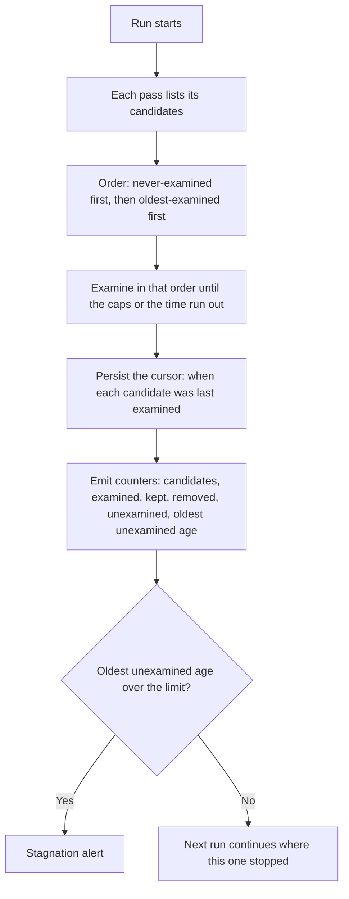

# ccpool janitor: track progress, not timeouts

**Status**: Proposed, for operator review
**Date**: 2026-11-02
**Deciders**: phillipg

The key words MUST, MUST NOT, SHOULD, SHOULD NOT and MAY in this document are to be read as in RFC 2119.

## Summary

A janitor run that cannot finish all its work inside its time budget is **not a failure**. The janitor is asynchronous, nothing waits on it, and the next run is ten minutes away. The failure to design against is **a pass that can never make progress**. Today nothing observes that, and one mechanism makes it possible. This document proposes to leave the run outcomes and the existing alerts as they are, to make every pass examine its candidates fairly, and to publish progress so that a pass that stops advancing is visible.

## Context

The janitor (`pg-router-handler-ccpool janitor`) is the scheduled home of the housekeeping a dispatch used to run inline. A launchd agent starts one run every 600 seconds. A run is single-flight and bounded by a 240 second deadline. It walks the configured roles in a rotating order and gives each role a share of the time left, which is the time remaining divided by the roles still to go. For each role it runs these passes:

| Pass                    | What it does                                                                                          | Scope                                    |
| ----------------------- | ----------------------------------------------------------------------------------------------------- | ---------------------------------------- |
| `closed_bead_reconcile` | closes ccpool sessions (and their worktrees) whose bead is closed                                     | once per pool                            |
| `default_pool`          | closes long-idle needs-input rows in the shared default pool, when their worktree is clean and pushed | once per run                             |
| `orphan_reconcile`      | reclaims or stops sessions whose handler died (expired lease)                                         | per role                                 |
| `worktree_sweep`        | removes per-bead worktrees that no session row can lead to                                            | per role                                 |
| `lock_gc`               | deletes stale lock files                                                                              | once per run, outside every role's share |

Every pass is best effort and idempotent, so any number of repeats is safe. A pass that is cut off keeps what it already reclaimed.

### What is measured and alerted today

- Gauges per run: last success time, run seconds, deadline hit, errors per pass, reclaimed per pass.
- Alerts: `pg-router-ccpool-janitor-stale` (no completed run for 30 minutes, for an hour), `pg-router-ccpool-janitor-deadline` (the deadline was hit on **every** run of the last 35 minutes, at least three runs), and `pg-router-ccpool-janitor-idle` (a pass errored on every run, or nothing was reclaimed anywhere for six hours while a pool had no free slot).
- A run is labelled `deadline` when the run's own deadline was reached, a role was skipped, or any single role's share expired during a pass. The record names the roles whose share expired (`roles_cut`).

So an occasional miss already alerts nobody: both time-based alerts require consecutive or every run.

### Evidence

The nine most recent runs at the time of writing (summed over all roles in a run; seconds):

| Run start (UTC) | Outcome   | Run time | `worktree_sweep` | `closed_bead_reconcile` | `orphan_reconcile` | Roles cut |
| --------------- | --------- | -------- | ---------------- | ----------------------- | ------------------ | --------- |
| 19:21           | deadline  | 136.4    | 77.4             | 46.9                    | 10.9               | 3         |
| 19:33           | deadline  | 90.9     | 42.0             | 3.1                     | 45.5               | 1         |
| 19:44           | completed | 64.4     | 57.3             | 6.2                     | 0.7                | 0         |
| 19:55           | deadline  | 71.7     | 67.5             | 3.2                     | 0.8                | 1         |
| 20:09           | deadline  | 210.2    | 153.4            | 20.7                    | 35.1               | 3         |
| 20:19           | completed | 34.4     | 29.9             | 3.9                     | 0.5                | 0         |
| 20:30           | completed | 45.7     | 41.0             | 4.2                     | 0.3                | 0         |
| 20:41           | completed | 35.1     | 31.3             | 3.1                     | 0.4                | 0         |
| 20:52           | completed | 44.8     | 41.1             | 3.1                     | 0.4                | 0         |

`worktree_sweep` dominates every run. The early runs after deployment were the slowest, which fits a backlog being worked off.

## Problem

Time-outs are expected. The problem is a pass that never advances. Three mechanisms can cause it, and none is visible today:

1. **Cap plus order.** `worktree_sweep` scans the worktree directory in name order, examines at most 20 entries with git per pass, and removes at most 5. A worktree that must be kept (dirty, holding unpushed commits, or in use) is examined again on every run and uses up that budget. Entries behind the kept ones are never reached. The run still finishes inside its time, so no alert fires.
2. **A nested deadline.** The sweep also carries its own 60 second deadline inside the role's share. A scan that needs longer than that can never finish, whatever the run deadline is, unless it can resume.
3. **Always cut at the same step.** A role that is cut at the same point every run never reaches the passes after that point.

## Goals and non-goals

Goals:

- Every candidate of every pass is examined within a bounded number of runs, whatever the caps and the time budget.
- An operator can see, per pass, how much is waiting and how long the oldest candidate has waited.
- A pass that stops advancing raises an alert, independent of how it stopped.

Non-goals:

- Changing the run outcomes, the 240 second deadline, the 600 second interval, or the existing three alerts.
- Choosing between parallel, turn-taking and sequential execution of roles. That is an implementation detail and is out of scope.
- Making a run finish all its work in one go.

## Design

### D1. Outcomes and existing alerts stay

A share overrun is not a failure, and its outcome string stays as it is. The `roles_cut` field keeps recording it. This avoids changing alert semantics (the reason the earlier outcome-change options were rejected, see Alternatives).

### D2. Fair examination order

A pass that examines candidates one by one (`worktree_sweep`, and any pass with a cap) MUST order its candidates by when each was last examined, never-examined first, then oldest first. The last-examined times are persisted in the handler state directory, one small file per role and pass, in the same style as the existing rotation counter. A candidate that was examined and kept goes to the back of the queue. A candidate that no longer exists is dropped from the file.

Consequences: the caps stay as per-run bounds, a cut-off scan resumes where it stopped, and a kept worktree cannot use up the budget of the ones behind it.

### D3. Progress counters

Each pass reports, per run: `candidates` (seen), `examined`, `kept`, `removed` and `unexamined` (candidates not reached). The numbers come from the scan the pass already does, so they add no work. They go into the `janitor_run` record and out as gauges next to the existing ones:

| Gauge                                          | Label  | Meaning                                                                    |
| ---------------------------------------------- | ------ | -------------------------------------------------------------------------- |
| `ccpool_janitor_candidates`                    | `pass` | candidates seen in the last run                                            |
| `ccpool_janitor_examined`                      | `pass` | candidates examined in the last run                                        |
| `ccpool_janitor_kept`                          | `pass` | candidates examined and kept in the last run                               |
| `ccpool_janitor_unexamined`                    | `pass` | candidates not reached in the last run                                     |
| `ccpool_janitor_oldest_unexamined_age_seconds` | `pass` | age of the longest-waiting candidate, measured from when it was first seen |

### D4. Stagnation alert

A new rule fires when `ccpool_janitor_oldest_unexamined_age_seconds` is above a limit for a pass. The proposed limit is six hours, which is 36 intervals and well above what a fair order needs. The rule is independent of why the pass stopped advancing, so it also covers mechanisms nobody has thought of yet. It is registered with the probe like every other rule.

### D5. Rollout and what it unblocks

Ship D2 to D4 first. Turning the inline sweeps off (so that the janitor is the only cleanup path) waits until the stagnation alert is live and quiet, because that alert is then the safety net for a janitor that silently stops advancing.

## Alternatives considered

| Alternative                                           | Why not                                                                                                                         |
| ----------------------------------------------------- | ------------------------------------------------------------------------------------------------------------------------------- |
| Count a share overrun as `completed` plus `roles_cut` | Changes alert semantics to fix a label. The time-based alerts already tolerate occasional misses, and the real gap is progress. |
| A third `partial` outcome                             | Every alert and the heartbeat would need a rule for it, for no gain over D3.                                                    |
| A separate exporter running `janitor --dry-run`       | It repeats the expensive scan (a `git status` per worktree). Measuring would cost as much as cleaning.                          |
| Raise the deadline                                    | Does not fix the cap-plus-order mechanism, and the nested 60 second sweep deadline stays.                                       |
| Run roles in parallel                                 | Useful for throughput, but not for the problem, and it is an implementation detail here.                                        |

## Behavior documents

When this is accepted, the same change MUST update `packages/pg-router-handlers/docs/behavior/invariants.md`: the janitor invariant gains the fairness rule (D2) and the progress observability rule (D3, D4), and the worktree sweep invariant states that its caps are per-run bounds applied in the fair order. The behavior documents win over this document where they disagree.

## Test plan

- A scan with more kept candidates than the examination cap, placed first in name order, still reaches a later removable candidate within a bounded number of runs (the case that cannot progress today).
- A scan cut off by its deadline resumes at the cursor on the next run and does not repeat the examined prefix.
- The counters add up: `candidates = examined + unexamined`, and `kept + removed <= examined`.
- The persisted file drops entries for candidates that disappeared, and tolerates a missing or corrupt file by treating every candidate as never examined.
- The new alert rule has promtool tests for a stuck pass and for a pass that advances.
- No mutation testing tool is part of this plan.

## Open questions

1. Is six hours the right stagnation limit?
2. Should `kept` carry a reason class (dirty, unpushed, in use) as a label, or stay a count?
3. Should the cursor files live beside the rotation counter, or in one file per pool?
