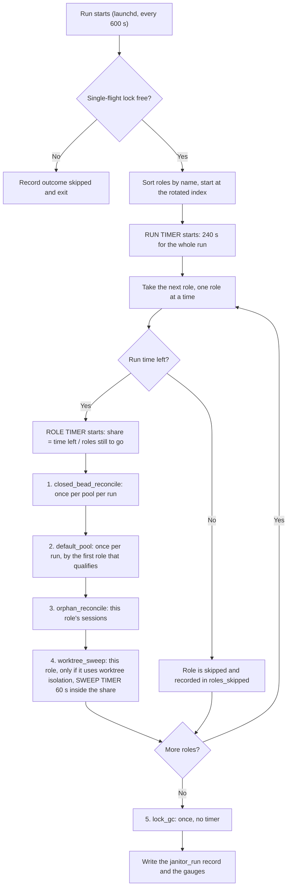
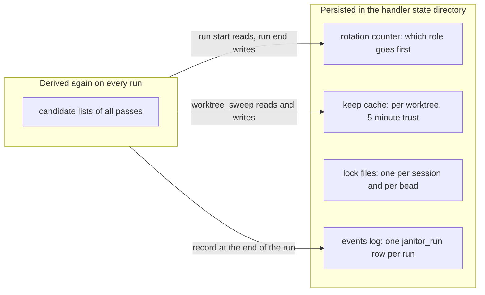

# ccpool janitor: track progress, not timeouts

**Status**: Accepted (revision 3), plan of record
**Date**: 2026-11-02, accepted 2026-11-03
**Deciders**: phillipg

Accepted by the operator on 2026-11-03, with the recommended answer on each open point: the design as written (measure first), outcomes unchanged (D1), and the clean-and-pushed guard for role pools (D7).

The key words MUST, MUST NOT, SHOULD, SHOULD NOT and MAY in this document are to be read as in RFC 2119.

## Summary

A janitor run that cannot finish all its work inside its time budget is **not a failure**. The janitor is asynchronous, nothing waits on it, and the next run is ten minutes away. The failure to design against is **a pass that makes no progress and nobody can tell**. Today the janitor records how many things each pass reclaimed, but not how many candidates it saw, examined or skipped, so "nothing to do" and "did not get to it" look the same. This document proposes to **measure first**: record per-pass, per-role candidate counters and phase timings, publish them as gauges, and alert when the oldest candidate has gone unexamined for hours. Fair ordering of candidates is a conditional second step, taken only if the counters show candidates left unexamined run after run.

## What one run does

Roles run **one after another**, never at the same time. The passes of one role also run in the order shown. Three timers nest: the run timer (240 s), the role timer (a share of what is left of the run), and, inside `worktree_sweep`, its own 60 s timer. A pass cut off by a timer keeps what it already reclaimed, and every pass is safe to repeat. The rotation moves the first role each run, so every role takes a turn at the biggest share.

### The passes and their candidates

A **candidate** is a thing a pass looks at to decide whether to act. Candidates are never stored: each pass derives them again from the live system on every run.

| Pass                    | Candidates are                                                                                                   | Where the list comes from                                                                                             | Natural age   | Per-pass limits                                  | History kept today                                             |
| ----------------------- | ---------------------------------------------------------------------------------------------------------------- | --------------------------------------------------------------------------------------------------------------------- | ------------- | ------------------------------------------------ | -------------------------------------------------------------- |
| `closed_bead_reconcile` | idle or needs-input sessions of one pool whose bead is closed                                                    | one `ccpool list` of the pool, then a bead lookup per session                                                         | last activity | none (one interrupted teardown is retried first) | none                                                           |
| `default_pool`          | the same, in ccpool's shared default pool, and only those idle 7 days or more whose worktree is clean and pushed | one `ccpool list` of the default pool                                                                                 | idle age      | none                                             | none                                                           |
| `orphan_reconcile`      | sessions of this role whose supervision lease has expired                                                        | the pool listing                                                                                                      | lease expiry  | none                                             | none                                                           |
| `worktree_sweep`        | directories under the worktree directory that no session row leads to                                            | a directory listing, the pool listing, and one `lsof` of all processes' working directories when any candidate exists | directory age | 20 examined with git and 5 removed per role pass | keep cache: one small file per worktree, trusted for 5 minutes |
| `lock_gc`               | lock files and keep-cache files in the handler's lock directory                                                  | a directory listing                                                                                                   | file age      | none                                             | none                                                           |

Only `worktree_sweep` has per-candidate limits and history, so it is the only pass where "the candidates it never reached" can exist.

### Why `default_pool` is a separate pass

`default_pool` is the closed-bead check applied to the **default pool**, which no role owns. Every role's own pool already gets the same check through `closed_bead_reconcile`, once per pool, so the other pools are covered. The default pool needs a stricter version because its rows may belong to a person (ccpool's reaper spares needs-input rows for a human) and the teardown force-removes the session's worktree: it therefore waits 7 days of idleness and checks that the worktree is clean and pushed. Role pools run the check with only the clean-and-pushed part of that guard (D7).

### What persists between runs

The keep cache's 5 minute trust is shorter than the 10 minute interval, so it helps the later roles of the same run (they share the worktree directory and the lock directory) but not the next run.

## Evidence

The latest run at the time of writing (57.6 s, outcome completed, 8 roles, nothing reclaimed by the three passes shown). Time per pass per role, from the `sweep_pass` rows:

| Role                  | `closed_bead_reconcile` | `orphan_reconcile` | `worktree_sweep` |
| --------------------- | ----------------------- | ------------------ | ---------------- |
| review                | 0.5 s                   | 0.3 s              | 12.2 s           |
| worker                | 0.7 s                   | 0.1 s              | 11.8 s           |
| drain-zr              | 0.3 s                   | 0.2 s              | 17.1 s           |
| drain-pg2             | 4.7 s                   | 0.5 s              | 0.0 s            |
| zr-escalation-triager | not shown               | 0.3 s              | 0.0 s            |
| pg2-split-triager     | not shown               | not shown          | 0.0 s            |

Roles without worktree isolation finish `worktree_sweep` instantly. The three roles with isolation take 12 to 17 s each and reclaim nothing. Why is **not known**: the pass does a directory listing, a pool listing, one `lsof` (0.6 s when measured on an idle machine), and up to 20 git examinations. Nothing records how many candidates there were or which step took the time. Earlier runs after deployment took 90 to 210 s and were cut by the role timers, which fits a backlog being worked off.

## Problem

1. **No visibility into progress.** A run that reclaimed nothing is either finished or stuck, and the record cannot say which.
2. **Possible repeated work.** The keep cache expires before the next run, so a kept worktree is probably examined with git again on every run. Whether that is the 12 to 17 s is not measured.
3. **Possible fixed cost per role.** Three roles that share one worktree directory each pay the same 12 to 17 s. A per-pass fixed cost (listing, `lsof`) repeated per role is possible and is not measured.
4. **A pass that could starve.** The cap of 20 examinations per role pass, with candidates taken in name order, could leave later candidates unexamined if more than 20 uncached candidates exist. The keep cache and the later roles of the same run probably hide this today. It is a risk to watch, not a measured fact.

## Goals and non-goals

Goals:

- An operator can see, per pass and per role, how many candidates exist, how many were examined, how many were skipped as cached, how many were kept and how many were removed, and how long each phase took.
- A candidate that goes unexamined for hours raises an alert, whatever the cause.
- Repeated or fixed costs are visible so they can be removed with evidence.

Non-goals:

- Changing the run outcomes, the 240 second deadline, the 600 second interval, or the existing three alerts.
- Choosing between parallel, turn-taking and sequential execution of roles.
- Making a run finish all its work in one go.

## Design

### D1. Outcomes and existing alerts stay

A role timer expiring is not a failure and its outcome string stays as it is. The record keeps naming the roles whose share expired (`roles_cut`). The existing alerts already need consecutive or every-run misses.

### D2. Per-pass, per-role counters and phase timings

Every pass reports, per role and per run: `candidates` (seen), `examined`, `cached` (skipped by the keep cache), `kept`, `removed` and `unexamined` (seen but not reached because a limit or a timer ended the pass). `worktree_sweep` also reports the time of each phase: `list_ms` (directory and pool listing), `probe_ms` (the `lsof` call) and `scan_ms` (the git examinations). The numbers come from work the pass already does. They are written into the `janitor_run` record, and published as gauges:

| Gauge                                          | Labels                  | Meaning                                                           |
| ---------------------------------------------- | ----------------------- | ----------------------------------------------------------------- |
| `ccpool_janitor_candidates`                    | `pass`, `role`          | candidates seen in the last run                                   |
| `ccpool_janitor_examined`                      | `pass`, `role`          | candidates examined                                               |
| `ccpool_janitor_cached`                        | `pass`, `role`          | candidates skipped as cached                                      |
| `ccpool_janitor_kept`                          | `pass`, `role`          | candidates examined and kept                                      |
| `ccpool_janitor_unexamined`                    | `pass`, `role`          | candidates not reached                                            |
| `ccpool_janitor_phase_seconds`                 | `pass`, `role`, `phase` | time of one phase                                                 |
| `ccpool_janitor_oldest_unexamined_age_seconds` | `pass`                  | age of the longest-waiting candidate, from when it was first seen |

### D3. Stagnation alert

A new rule fires when `ccpool_janitor_oldest_unexamined_age_seconds` is above six hours (36 intervals) for a pass. It is independent of why the pass stopped advancing. It is registered with the probe like every other rule.

### D4. Remove repeated cost, guided by D2

When D2 shows the cost, apply the matching fix: keep-cache trust longer than the run interval (so a kept worktree is not re-examined every run), or one `lsof` and one listing per run shared by the roles that scan the same directory.

### D5. Fair order, only if needed

If D2 shows `unexamined` above zero on consecutive runs, `worktree_sweep` MUST take uncached candidates oldest-examined-first. The record of when each candidate was last examined is **per candidate** (one entry per worktree, in the same place as the keep cache), shared by all roles. It is not a cursor per pass and not per role. The other passes have no limits, so they need no ordering.

### D6. Rollout

Ship D2 and D3 first. Turning the inline sweeps off (so the janitor is the only cleanup path) waits until the counters have run for long enough to show the janitor reaching every candidate.

### D7. Role pools keep a worktree that holds unpushed work

`closed_bead_reconcile` MUST NOT force-remove a role pool session's worktree when that worktree is dirty or holds a commit beyond its upstream (or, with no upstream, beyond the canonical clone's HEAD), the same check the default pool runs. It keeps the session, counts the candidate as `kept`, and examines it again on the next run. Role pools take only this part of the default pool's guard: the 7 day idle wait stays specific to the default pool, whose rows may belong to a person.

## Alternatives considered

| Alternative                                                | Why not                                                                                                                            |
| ---------------------------------------------------------- | ---------------------------------------------------------------------------------------------------------------------------------- |
| Count a role-timer overrun as `completed` plus `roles_cut` | Changes alert semantics to fix a label. The time-based alerts already tolerate occasional misses.                                  |
| A third `partial` outcome                                  | Every alert and the heartbeat would need a rule for it, for no gain over D2.                                                       |
| A separate exporter running `janitor --dry-run`            | It repeats the expensive scan. Measuring would cost as much as cleaning; D2 gets the same numbers from the scan that already runs. |
| A cursor per pass, built now                               | The one pass with limits already has per-candidate history, and the cost is not yet known to come from ordering.                   |
| Run roles in parallel                                      | An implementation detail, and not what the evidence points to.                                                                     |

## Behavior documents

When this is accepted, the same change MUST update `packages/pg-router-handlers/docs/behavior/invariants.md`: the janitor invariant gains the counters and the stagnation alert (D2, D3), and the worktree sweep invariant states the order rule if D5 is taken. The behavior documents win over this document where they disagree.

## Test plan

- Counters add up: `candidates = examined + cached + unexamined` for `worktree_sweep`, and `kept + removed <= examined`.
- A pass cut by a timer reports a non-zero `unexamined` and the next run continues.
- The oldest-unexamined age grows while a candidate is not reached and resets when it is examined.
- The new alert rule has promtool tests for a stuck pass and for a pass that advances.
- If D5 is taken: a scan with more kept candidates than the examination cap, placed first in name order, still reaches a later removable candidate within a bounded number of runs.
- D7: a role pool session whose bead is closed and whose worktree is dirty, or holds a commit beyond its upstream (or the canonical clone's HEAD), is kept and counted; a clean, pushed one is torn down (real git over a throwaway repository).
- No mutation testing tool is part of this plan.

## Open questions

1. Is six hours the right stagnation limit?
2. Should `kept` carry a reason class (dirty, unpushed, in use) as a label, or stay a count?

Resolved: role pools take the clean-and-pushed guard, without the idle wait (D7).
