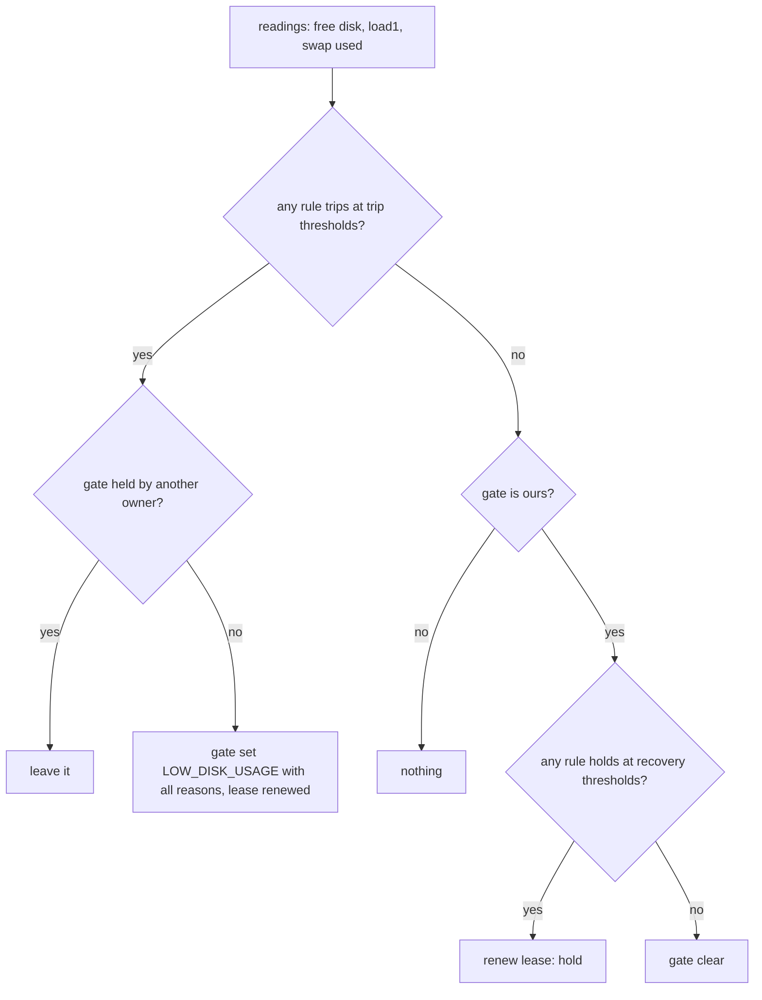

# pg-router: resource-pressure dispatch gate (disk, load, swap) — design

> Superseded by design v14 of pg-router resources and levels (ADR 0122): the gate mechanism and the disk-watchdog are removed.

- **Status**: Draft for operator review. Implemented in `packages/pg-router-disk-watchdog`; not applied to any machine.
- **Date**: 2026-11-04
- **Builds on**: `docs/investigations/2026-10-09-desk-pr-stall.md` (the LOW_DISK_USAGE gate, C1);
  `packages/pg-router/MIGRATION.md` (gate semantics, `non_blocking_gates`).

The key words MUST, MUST NOT, SHOULD, SHOULD NOT and MAY in this document are to be read as in RFC 2119.

## 1. Problem

On 2026-11-03 the kernel watchdog panicked (`watchdog timeout: no checkins from watchdogd in 92 seconds`).
Root-volume free space fell from 44.8 GB to 2.56 GB in 86 minutes under unattended agent work (about
37.9 GB of "agent other" writes), while the 1-minute load average sat between 76 and 283 on 11 cores
(about 7 to 26 per core) from about 05:57Z.

## 2. Why the existing gate did not stop it

The mechanism is a **Watchdog** role (`pg-router-disk-watchdog`, fed by a 5 minute `timer` query) that
sets the generic `LOW_DISK_USAGE` gate below `--min-free` (deployed 20 GiB, recover 25 GiB, lease 7
minutes). Evidence from the router's own log and event store (`~/.local/state/pg-router/`):

- The gate **did** engage: `launchd-stderr.log` shows `LOW_DISK_USAGE` set at 2026-11-03T03:18:22-05:00
  (08:18:22Z). Router dispatch of the workers had already thinned from about 07:20Z in `events.jsonl`.
  Free space at that moment was already far under the floor: at the observed burn rate (42 GB in 86
  minutes, roughly 0.5 GB per minute, a linear estimate) 20 GiB was crossed near 07:50Z, so the set came
  about half an hour after the crossing, and only about 8 minutes before the 2.56 GB low at 08:26:30Z.
- Causes, ranked by how well the evidence supports them:
  1. **The gate stops new dispatch only.** Sessions already running keep writing. The 17 GiB that
     disappeared between the 20 GiB floor and 2.56 GB was in-flight agent work (Claude Code, Gradle,
     nix builds) that no gate can reach. A floor of 20 GiB leaves too little margin for that tail at
     0.5 GB per minute: 20 GiB is under 40 minutes of burn, minus the latencies below.
  2. **Detection latency.** Cadence is 5 minutes, and a host at load 76 to 283 on 11 cores delays the
     watchdog's own dispatch (the timer fires through the same router, then `statfs` and two
     `pg-router` CLI calls on a saturated host). A slow pass directly lengthens the unprotected window.
  3. **No load or swap rule.** Load per core above about 7 and a growing swap file were the early signal
     (from 05:57Z, long before the disk floor), and nothing watched them.
  4. **Volume and coverage were not the cause.** The watchdog measures `/` (an APFS container pool, which
     the agent writes compete for), and the gate covers every role except the watchdog family, ccpool
     included. Per-worktree `MinFreeBytes` (INV-CCH-8) also refuses a new worktree under its floor. The
     gap is the in-flight tail and the missing early signals, not a missed role or volume.

What this note cannot show: why the set was late by the half hour above (starved watchdog versus a lapsed
lease versus a different cause); the gate history before 03:18 is not in the retained log. The design
below does not depend on resolving it, because it adds a higher floor and earlier, independent signals.

## 3. Requirements

| ID  | Requirement                                                                                                                                                             |
| --- | ----------------------------------------------------------------------------------------------------------------------------------------------------------------------- |
| R-1 | Dispatch MUST be hard-stopped when free space on the measured volumes falls below a floor, with a default well above 5 GB.                                              |
| R-2 | Dispatch MUST be paused when 1-minute load average per core exceeds a limit.                                                                                            |
| R-3 | Dispatch MUST be paused when swap in use exceeds a limit while free space is below a second ceiling (defaults: 10 GiB swap, 20 GiB free).                               |
| R-4 | Every threshold MUST be configurable and MUST have a default; a rule MAY be disabled by setting its threshold to zero (the disk floor MAY NOT).                         |
| R-5 | The rules MUST extend the existing gate mechanism: no new daemon, no new gate TYPE, no new deployment wiring beyond the thresholds.                                     |
| R-6 | A probe that fails (load, swap) MUST NOT stop dispatch and MUST NOT fail the pass; an unmeasurable disk still fails the pass and leaves the gate untouched (as before). |
| R-7 | Recovery MUST use hysteresis on every rule so a host hovering at a limit does not flap the gate.                                                                        |
| R-8 | The decision MUST be a pure function over injected readings so a unit test needs no disk, clock or process.                                                             |

## 4. Design

A **Specification** set evaluated by one pure function, `pressure(cfg, readings, recovering)`, feeding the
unchanged set, renew, hold and clear protocol of the watchdog (**State Machine** over the one gate).

| Rule | Trips when                                             | Recovers when (all must hold)                       | Default                               |
| ---- | ------------------------------------------------------ | --------------------------------------------------- | ------------------------------------- |
| disk | free < `--min-free`                                    | free >= `--recover-free` (min-free times 1.25)      | 30 GiB (was 20 GiB), recover 37.5 GiB |
| load | load1 / cores > `--max-load-per-core`                  | load1 / cores <= 0.8 times the limit                | 4.0 per core                          |
| swap | swap used > `--swap-max` AND free < `--swap-disk-free` | swap <= 0.8 times max OR free >= 1.25 times ceiling | 10 GiB swap, 20 GiB free              |

Decisions:

- **One gate TYPE.** All three rules set `LOW_DISK_USAGE`, with the tripped reasons joined in the gate
  description (`pg-router gate list` shows which). A new TYPE would have to be added to
  `non_blocking_gates` of every role that keeps the machine observable (the watchdog family and the
  maintenance roles) in the deployment repo, and a role missed there would deadlock: it would be blocked
  by the very gate it must clear. Reusing the TYPE needs no wiring change. The cost is a name that
  understates load and swap pressure; the description carries the truth. A later rename is a pure
  deployment decision.
- **Disk floor raised to 30 GiB by default.** The 20 GiB deployed value left under 40 minutes of the
  observed burn. 30 GiB buys time for the in-flight tail; it is still small on a healthy 1 TB laptop. The
  deployed value comes from the deployment repo's config, which passes `--min-free` explicitly and MUST be
  raised there (see section 6).
- **Readings.** Free space as before (`statfs`, lowest of the `--path` list). Load and swap by
  `sysctl -n vm.loadavg` and `sysctl -n vm.swapusage` under a 10 second timeout; cores from the Go
  runtime. Probes are injected, so tests substitute readings.
- **Failure posture.** A load or swap probe error is logged to stderr and that rule is skipped for the
  pass (R-6): a guard must not stop dispatch because its own sensor failed. The disk reading keeps its
  existing fail-closed-to-no-change behavior.
- **Another owner's gate** is never taken over or cleared, for any rule, exactly as before.

## 5. Tests

Unit tests, single process, injected readings and a fake `pg-router` (`pressure_test.go`, plus the
existing `watchdog_test.go`): each rule trips and recovers; load exactly at its limit does not trip;
swap alone and tight disk alone do not trip the swap rule; the hard stop is independent of load and swap;
reasons combine in one description; hysteresis holds an owned gate in the band and creates none; probe
failures are skipped; disabled rules never trip; another owner's gate is left alone; the sysctl parsers
accept real output and reject garbage. A hand-applied negative control (a manual mutant of the swap
conjunction and of the load comparison, each reverted) is recorded in the commit report, not run by a
mutation tool.

## 6. Not done here (seams)

- **Deployment values and cadence** live in the ZR deployment repo's `disk-check-tick` timer (5m) and the
  `disk-watchdog` role arguments (`--min-free 20GiB`, `--recover-free 25GiB`). They MUST be raised to the
  new floor and the tick SHOULD be shortened to 1m so a loaded host is caught sooner. Those are
  `needs-more-repos` edits and an operator apply; until then the old deployed floor still governs disk,
  while the new load and swap rules take their defaults.
- **Running sessions are not stopped.** The gate cannot reach work already in flight (cause 1). Shedding
  those (a signal to the ccpool sessions, or a per-session write budget) is a separate design; this note
  only moves the dispatch stop earlier and adds the early signals.
- **Late-gate root cause** (section 2) remains unresolved for lack of retained gate history; the
  watchdog's pass duration could be emitted as a metric to settle it on the next incident.
