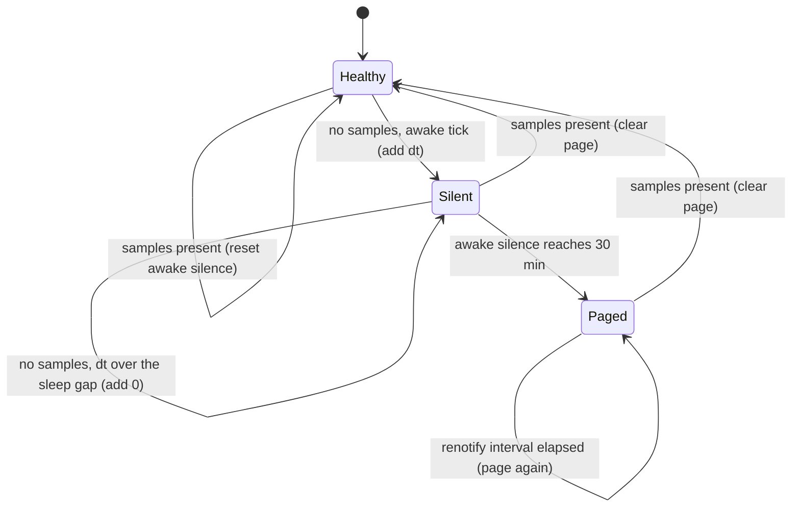

# pg-router: a dead-man's switch for "the observability stack is absent" — design

- **Status**: Draft for operator review. Implemented as code and config; not applied to any machine.
- **Date**: 2026-11-04
- **Builds on**: `docs/investigations/2026-11-04-pr-changed-queue-backlog.md` (addendum, window 1);
  `docs/superpowers/specs/2026-10-12-pg-router-sleep-aware-metrics-design.md` (the awake-time rule).

The key words MUST, MUST NOT, SHOULD, SHOULD NOT and MAY in this document are to be read as in RFC 2119.

## 1. Problem

After an unclean reboot with no console login, the router, Prometheus, otelcol, Loki and Grafana
were all down for 4 h 17 m. Every liveness rule is deliberately quiet on no data (`noDataState: OK`,
gated on awake gauges that were absent), and nothing outside the stack was watching. A monitor that
runs inside the thing it monitors cannot report that the thing is gone.

## 2. Requirements

| ID  | Requirement                                                                                                                                  |
| --- | -------------------------------------------------------------------------------------------------------------------------------------------- |
| H-1 | An independent heartbeat MUST page when no Prometheus sample for any job has arrived for 30 minutes of awake time.                           |
| H-2 | It MUST stay quiet across laptop sleep: time the host spent asleep MUST NOT count toward the 30 minutes.                                     |
| H-3 | It MUST NOT depend on Prometheus, Grafana, otelcol, Loki or the router for detection or for delivery.                                        |
| H-4 | It SHOULD start at boot, not at console login, because the observed outage was a boot with no login.                                         |
| H-5 | A page MUST fire once per outage (not every minute) and MUST re-fire at a bounded interval while the outage lasts; a recovery MUST clear it. |
| H-6 | The decision logic MUST be a pure function over injected time and probe results, so a unit test needs no clock, network or process.          |

## 3. Design

A **Watchdog** pattern: a one-shot command `pg-router-heartbeat`, run once a minute by a launchd
_daemon_ (system domain, `StartInterval`), keeps a small **Memento** state file and decides with a
pure **State Machine**.

### 3.1 Probe

The probe asks Prometheus `count(last_over_time(up[5m]))` over HTTP (`/api/v1/query`, default
`http://127.0.0.1:9090`). "Samples present" is a non-empty result with a value above zero. A
refused connection, a timeout, a non-200 status or an empty result all mean "no samples": that is the
exact condition being detected, so a probe failure is never an error exit and never silences the page.
Only the process failing to read its own state file is reported as an error.

### 3.2 Sleep awareness (H-2)

The existing rules read the awake gauges that live in the stack, which is absent in this scenario, so
the heartbeat carries its own sleep accounting. launchd `StartInterval` does not fire while the host
sleeps, so after a wake the gap between this tick and the last recorded tick is far larger than the
interval. A tick whose gap exceeds `--max-gap` (default 3 minutes, three intervals) is treated as
"the host slept or the heartbeat was not running": it adds **zero** to the awake silence. A normal tick adds
the gap. Example: 20 minutes of silence, a 6 hour sleep, then 5 more minutes counts 20 + 0 + 5 = 25
minutes, not 6 h 25 m, so no page. The first tick after a wake cannot page on its own, because it
contributes nothing.

Trade-off, accepted: a heartbeat daemon that is itself not running for longer than `--max-gap` is
indistinguishable from sleep, and under-counts. launchd keeps the job (`RunAtLoad`, not `KeepAlive`
because it is a one-shot), so this only happens while the host is off or asleep.

A clock step backwards (negative gap) adds zero as well.

### 3.3 Delivery (H-3, H-4)

The page runs a configurable `--notify-command` (argv, with `{message}` replaced) and also writes the
message to `<state-dir>/alert` for anyone looking on the machine. Nothing is sent through Grafana
or the `grafana-notifier` banner path, which is part of the dead stack.

The module's default command posts a macOS notification into the console user's session
(`launchctl asuser` with `osascript`), which is delivered at the next login. With no console session
at all (the observed outage), no on-machine channel can reach the operator in real time. An
off-machine channel (a push or webhook the operator holds a credential for) is an **open operator
decision**; the `--notify-command` seam takes one without a code change, and the module exposes it as
an option. This change does not choose one and makes no outbound connection.

### 3.4 Where it runs

The stack is user LaunchAgents; the heartbeat is a `launchd.daemons` entry (runs as root-owned
system job from boot, `RunAtLoad`, `StartInterval = 60`) set via
`phillipgreenii.programs.pg-router-heartbeat` in `darwin/modules/pg-router-heartbeat`, off by default.
It only reads `127.0.0.1` and writes its state under `/var/db/pg-router-heartbeat`.

### 3.5 State file

JSON `{lastRun, silenceSeconds, pagedAt}`. A missing or unreadable file is a fresh start (zero
silence, not paged). The file is written atomically (temp file and rename).

## 4. Test plan

- Table tests of the pure `step` function: reset on samples, accumulation over normal ticks, no
  accumulation over a sleep-sized gap, page at exactly 30 minutes and not before, page once, re-page
  after the renotify interval, clear on recovery, negative gap.
- A run-level test with a fake probe, fake clock, fake notifier and a temp state dir: 29 minutes of
  silence, a sleep gap, then silence again does not page; sustained awake silence pages once.
- Probe test against `httptest.Server` (loopback, in-process): present, empty, 500, refused.
- Negative control: hand-apply one mutant (count the sleep gap) and show the sleep test fails.

All are single-process unit tests that run in milliseconds.

## 5. Out of scope

Starting the stack at boot instead of at login, and the choice of an off-machine channel, are
separate operator decisions (see the investigation's proposed follow-ups).
