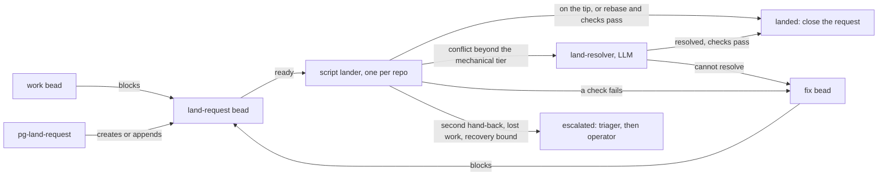
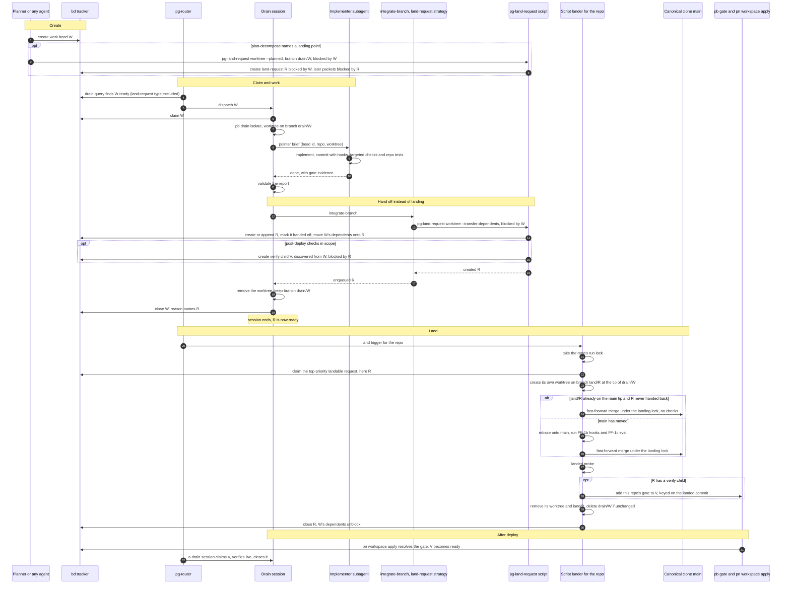
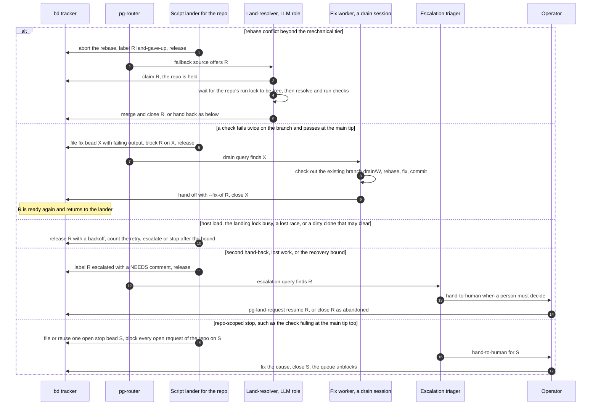
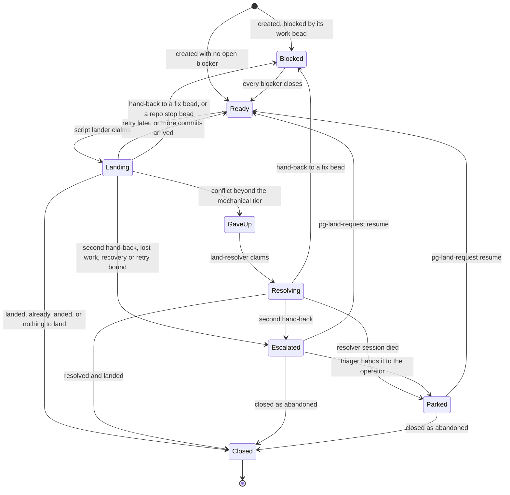

# Single lander per repo: land-request beads, a script-first lander and a land-resolver — design

- **Status**: Draft for operator review (revision of 2026-11-06). Nothing is implemented. Do not decompose until the
  operator approves.
- **Date**: 2026-11-04; revised 2026-11-06 after a fourth review, the operator's rulings on it, and two rounds of
  independent review of the revision.
- **Builds on**: `claude-marketplace/pb/skills/drain-one/references/land.md` (today's per-worker LAND step);
  `claude-marketplace/integrate-branch/skills/ff-merge-to-main/SKILL.md` (FF-0 to FF-4);
  `packages/integrate-branch-support` (FF-1b, the pre-land reuse marker, FF-4a);
  `docs/adr/0089-drain-roles-apply-the-shared-pb-drain-one-skill.md` (one pool per tracker, `close-or-release`); the
  deployment repo's script-first rescue roles (`resolve-conflict-script` and `fix-ci-script`, command roles that hand
  an item they give up on to an LLM role through a fallback source).
- **Operator rulings** (Phillip, 2026-10-28, 2026-11-04 and 2026-11-06) are quoted in the tracker bead that opened this
  design; section 19 lists the ones that shaped this document. Rule ids such as B-1, B-2, B-5, D-2, D-5, D-9, D-10,
  P-5, LV-5 and LV-7 are the operator rules in the global agent rules and the `beads-lifecycle` skill;
  `claude-marketplace/pb/skills/drain-one/references/rules.md` repeats the ones drain uses.

The key words MUST, MUST NOT, SHOULD, SHOULD NOT and MAY in this document are to be read as in RFC 2119.

## 1. Problem

Every drain worker lands its own work. Each landing rebases, runs the pre-land hooks over the branch diff (FF-1b) and
the eval-only check (FF-1c), and fast-forwards the primary branch. Two workers landing into one repo at the same time
race: the slower one finds main advanced, starts again from the rebase, and gives up after the handler's retry bound
(FF-3 stops at the second consecutive lost race). Several fixes treat the symptom (a passing hook run carried across a
rebase, a cap on per-project test time). None removes the cause, which is that many sessions compete to advance one
branch.

## 2. Goals and non-goals

Goals:

1. Exactly one agent at a time advances a repo's primary branch through the landing path.
2. A worker finishes by leaving a branch and a land-request, then ends its turn; its worktree is removed.
3. A landing that needs no judgment costs git plus the checks and starts no LLM session.
4. A landing that needs judgment goes to an LLM once; a problem neither can fix is handed back or escalated, and
   nothing loops without a bound.
5. The landing procedure has one deterministic implementation that every caller uses, so changing how landing works
   touches only it and the two scripts of sections 5 and 8.

Non-goals:

- Pull requests (section 13).
- Changing how work is selected, claimed or implemented.
- Batching several branches into one check run (a merge train). Section 11 states the serial cap as a known limit and
  names the signal that would reopen the question.

## 3. Overview

The design combines these patterns:

- A **Work Queue** with a **Single Consumer** per repo, the repos isolated from each other (a **Bulkhead**).
- The queue item is a **Command Message**: a `land-request` bead, created by an **Idempotent Receiver**
  (`pg-land-request`).
- A request is handled by a **Chain of Responsibility**: the script lander, then the land-resolver (an LLM role), then a
  fix worker, then the escalation triager and the operator. Each link handles what it can, passes the rest on and ends
  its turn.
- Two per-repo locks (each a **Mutex**): the landing lock inside the one landing implementation, so no caller races
  another's merge; and the lander's run lock, so at most one lander run per repo exists even across a daemon crash.



Readiness comes from the dependency graph. No label or status flag marks "ready to land": a request becomes ready when
its blockers close, and a hand-back blocks it again. Labels route a ready request: `land-gave-up` sends it to the
land-resolver instead of the script lander, and every label of the escalated and human label sets (rule LV-5) takes it
out of both landers' reach (sections 8.1 and 9.1).

### 3.1 Typical path



### 3.2 Off the typical path



## 4. The land-request bead

### 4.1 Type and routing

`land-request` MUST be a registered custom bead type (added to the `types.custom` configuration alongside
`merge-request`, in each tracker that holds land-requests). `types.custom` is one comma-separated list, so registration
MUST read, extend and write it back. The type is deliberately not `merge-request`: that type already names a bead that
tracks a real pull request or merge request, and sharing the type would make "land" and "merge" ambiguous.

The type is the routing key: the landers select `land-request` beads, and every queue that offers ordinary work MUST
exclude the type so a worker never claims one (the full list is in section 16). Each request also carries its repo label
(BF-1: file it in the tracker of the repo where the change lands). A request MUST NOT carry `has-acceptance-criteria`.

### 4.2 Identity and fields

The identity of a land-request is the pair **(repo root, branch)**, not a patch-id. At most one open UNCLAIMED
land-request SHOULD exist per pair (section 5.1 explains why a duplicate is harmless). The bead carries, as metadata:

| Field             | Meaning                                                                                                                                                                                                                                        |
| ----------------- | ---------------------------------------------------------------------------------------------------------------------------------------------------------------------------------------------------------------------------------------------- |
| `repo_root`       | Absolute path of the canonical clone.                                                                                                                                                                                                          |
| `branch`          | Branch holding the work. The lander lands the branch's commits ahead of primary as of its claim.                                                                                                                                               |
| `planned`         | `true` for a request plan-decompose created before the work existed.                                                                                                                                                                           |
| `handed_off`      | `true` once a worker's handoff (not a planning call) has named the request. A planned request without it never lands (section 8.2 step 2).                                                                                                     |
| `patch_ids`       | `git patch-id --stable` values. Each handoff records the branch's commits ahead of primary; the lander replaces the list, under the landing lock just before its merge, with the ids of the commits it merges. Never a commit SHA (rule CR-1). |
| `attempts`        | Recoveries of a claim left by a run that died, since the last `resume`; the third escalates (section 8.4). Ordinary claims and releases never change it.                                                                                       |
| `retries`         | Retry-later releases since the last `resume` (section 8.3). `retry_cause` records the last one's cause (for a busy lock, with the lock's owner) and how many consecutive retries had that same cause.                                          |
| `outcome`         | Written by the closing routine when the request closes: `landed`, `nothing-to-land`, `abandoned` or `forced`. Section 8.2 step 2 reads it on closed requests of the same pair.                                                                 |
| `not_before`      | Earliest time a lander offers the request again after a retry-later release. A metadata backoff, not a bd deferral: an automated deferral MUST be one day (rule D-10), far longer than a retry needs.                                          |
| `resumed_at`      | Time of the last `pg-land-request resume`; hand-backs are counted from it (section 10).                                                                                                                                                        |
| `ready_since`     | Stamped by the lander source the first time it sees the request ready; cleared when the request leaves the ready set. Drives the queue-age gauge (section 15).                                                                                 |
| `verify_children` | Ids of the verify children created at handoff (section 14).                                                                                                                                                                                    |
| `set_branch`      | For a workforest member: the set's branch name, so a set's requests can be listed together.                                                                                                                                                    |

The label `land-gave-up`, set by the script lander, routes a request to the land-resolver. It is a new label, not the
rescue roles' `script-gave-up`, which the label vocabulary reserves for `pg-rescue`'s give-up handler; `land-gave-up` and
`land-stop` (section 8.3) are added to that vocabulary (section 16). The number of hand-backs is not stored: it is the
number of fix beads whose `land_request` metadata names this request (section 10), so no crash can leave it wrong. Every
`bd list` this design relies on (fix beads, closed requests, stop beads) MUST pass `--all --limit 0`, because `bd list`
otherwise omits closed beads and stops at 50 rows, and every `bd ready` MUST pass `--limit 0`.

A patch-id is a hash of a diff including its context lines. A spike on 2026-11-04 showed that a clean rebase onto a main
that changed lines far from the change leaves it unchanged, while a main that changed a line within the three lines of
context gives the commit a new patch-id. So `patch_ids` is a record for crash recovery and the absent-branch check,
never proof that a commit landed; the proof is that the landed tip is an ancestor of primary (section 8.2).

A request takes its priority from the work bead it is blocked by (the highest, if several), copied once at creation. The
lander claims landable requests in priority order, then by `ready_since`. A fix bead takes its request's priority.

### 4.3 Lifecycle



`Parked` is a request carrying `human` (after `hand-to-human`, or the resolver's `on_failure`, section 9.4); it sits in
the operator's queue. `pg-land-request resume` (section 5.2) is the one way back: in one update it removes every label of
the escalated and human sets, resets `attempts`, `retries`, `retry_cause` and `not_before`, and sets `resumed_at`, so a
request the
operator has fixed does not re-escalate on its next transient failure.

## 5. `pg-land-request`

Two bash scripts ship in one package, `packages/pg-land` of this repo: `pg-land-request` (this section) and
`pg-land-lander` (section 8). They are built with the repo's bash packaging framework with completions and tldr pages,
and tested with bats. They use the bd flags `--type`, `--exclude-type`, `--external-ref`, `--metadata-field`,
`--if-status` and `--if-assignee`, so the package also carries a bd-flag check like the one `packages/beads-exporter`
has.

`pg-land-request` is the only supported way for an agent or plan-decompose to create, extend or close a request.

### 5.1 Contract

- **Enablement.** The creating subcommands (`worktree`, `workforest`) act only in a clone whose
  `pgii-integrate-branch.strategy` git config is `land-request` (section 7.3), read at call time. Anywhere else they
  create nothing and print `not-used` with `next: land-as-before`. `close`, `resume` and `status` always act, so a request
  opened before a rollback can still be closed after it.
- **Idempotent.** The script finds the open, unclaimed land-request for the same (repo root, branch). If one exists, it
  appends any `patch_ids` it does not already hold; if none exists, it creates one, with its blocking edges in the same
  `bd create` call, so a new request is never ready before it is blocked. Every call, an append included,
  then re-asserts all of its effects (the blocking edges, dependent transfer, the parent link, `handed_off`, verify
  children), each idempotently, before it reports success, so a retry after a crash completes a half-done handoff. A
  closed request never matches, so new commits on an already-landed branch open a new request. A request that is in
  progress (claimed by a lander) never matches either: an append during a landing creates a new request for the pair,
  which the lander leaves open when it closes the old one (section 8.2 step 9).
- **Matching a planned request.** A worker's handoff also matches an open planned request blocked by the same work bead.
  If the planned request names a branch the worker did not use, the script re-points it to the worker's branch instead
  of creating a second request, so a work bead never has two requests.
- **Race-safe.** Two agents may call it at once for the same pair. The script MUST hold a per-(repo, branch) lock around
  the lookup and the create, and MUST set a deterministic external reference, formatted
  `land:<first 16 hex of sha256(repo_root, NUL, branch)>` (computed with `shasum -a 256` on macOS). The lock is a
  directory created atomically under `<git-common-dir>/pg-land-request/` holding the owner's pid and process start time
  (macOS has no `flock` by default). A waiter MAY steal it only when that pid is gone, the pid now belongs to a process
  with a different start time (a reused pid), or the lock is older than 10 minutes, a limit far above a `bd` call. The
  other locks of this design (the landing lock, the run lock) use the same shape WITHOUT the age rule, because their
  holders legitimately hold them for tens of minutes: they are stolen only when the owner pid is gone or reused. Every
  lock is published with its owner file already inside it (written to a temporary directory, then renamed into place),
  and a steal MUST be atomic (rename the stale directory aside, re-read the owner of what was renamed, then publish), so a
  waiter never displaces a lock another waiter has just taken; if what was renamed turns out to be a live owner's lock,
  the waiter renames it back and keeps waiting.
- **Duplicates are harmless.** The tracker does NOT enforce uniqueness of the external reference (verified 2026-11-04
  against a real `bd` in a throwaway database: two creates with one reference both succeeded), so the lock is the only
  preventive guard. A duplicate can only come from a create that bypassed the lock or from the append-during-landing
  rule above. It causes no wrong landing: the lander lands the branch through whichever request it reaches first, and the
  other then finds the branch already landed or nothing ahead of primary and closes (section 8.2 step 2). The periodic
  reconcile (section 15) still reports any pair with two open unclaimed requests. No automatic repair is attempted.
- **Validation.** Unless `--planned` is given, the branch MUST exist, and every patch-id named with `--patch-id` MUST be
  among the commits of the branch ahead of primary; otherwise the script exits 3 and names the offender. A branch with
  nothing ahead of primary prints `nothing-to-land` and exits 0, so a worker whose work needed no code change closes its
  bead without a request.
- **Planned requests.** `--planned --branch NAME` creates a request (`planned`, not `handed_off`) for a branch that does
  not exist yet and skips validation. Plan-decompose uses it at decomposition time with the branch the packet's worker
  will use, records that branch on the packet (metadata `land_branch`), which `pb drain isolate` then checks out
  (section 16), and makes the request a child of the packet's parent. A planned request on a shared branch MUST be
  blocked by every packet that shares the branch.
- **Dependents.** `--transfer-dependents` (on in the worker handoff) adds the request as a blocker of every bead the work
  bead blocks, except the request itself and any bead that already blocks the request directly or transitively (which
  would form a cycle: two packets on one shared branch, the second depending on the first), and makes the request a child
  of the work bead's parent when it has one, so an epic cannot close before the code lands (bd refuses to close a parent
  with an open child). It never blocks a parent on its own child (rule D-9).
- **Fix handoff.** `--fix-of REQUEST` is the handoff of a fix bead (section 10): it appends to that request, even though
  the request is blocked, and transfers no dependents. (Transferring them would make the request a blocker of itself,
  because the fix bead blocks the request.) If the request is closed, the call creates nothing and exits 3 with
  `next: escalate`, so a fix for an abandoned request never lands.
- **Post-deploy checks.** `--post-deploy-file FILE` creates a verify child for the work bead (section 14) and records its
  id in the request's `verify_children`.
- **Closing.** Every path that closes a request goes through one routine, used by `pg-land-request close` and by both
  landers. Before the close it settles each verify child (section 14), adding the landed repo's gate or closing the child
  as moot when nothing of it will land, and closes the request's open fix beads as moot. It writes `outcome` in the
  closing update. No path closes a request and leaves a verify child ungated and ready, or a fix bead that could later
  land the same work again.
- **Repo stop at creation.** When the repo has an open stop bead (section 8.3), a new request is created blocked by it,
  so it waits with the rest of the queue instead of rediscovering the stop through its own checks.
- **Tracker.** It resolves the tracker from the repo root with the workspace's repo-to-tracker lookup (the one rule BF-1
  uses); `--tracker-root DIR` overrides it, and an unresolved tracker exits 2. A tracker without the `land-request` type
  exits 6.
- **Creation outside the script.** A request made by hand bypasses the lock. Agents MUST use the script.

### 5.2 Interface

| Item         | Specification                                                                                                                                                                                                                                                                                                                                                                   |
| ------------ | ------------------------------------------------------------------------------------------------------------------------------------------------------------------------------------------------------------------------------------------------------------------------------------------------------------------------------------------------------------------------------- |
| `worktree`   | `pg-land-request worktree [--branch B] [--blocked-by BEAD]... [--patch-id ID]... [--planned] [--transfer-dependents \| --fix-of REQUEST] [--post-deploy-file FILE]`                                                                                                                                                                                                             |
| `workforest` | `pg-land-request workforest --set-root DIR [--blocked-by BEAD]... [--post-deploy-file FILE] [--abandon]`                                                                                                                                                                                                                                                                        |
| `status`     | `pg-land-request status [--set-branch B]`: one row per open request (section 15).                                                                                                                                                                                                                                                                                               |
| `resume`     | `pg-land-request resume ID`: removes the escalated and human labels, resets `attempts`, `retries`, `retry_cause` and `not_before`, and sets `resumed_at`, in one update (section 4.3).                                                                                                                                                                                          |
| `close`      | `pg-land-request close ID --reason TEXT (--landed \| --abandon \| --force)`: `--landed` finds the landed commits from the branch tip or the recorded `patch_ids` and gates the verify children; `--abandon` runs section 12's abandon handling; `--force` records the close as unverified and closes ungated verify children as moot. It refuses a request that is in progress. |
| Defaults     | The branch is the current branch; the repo root is the parent of `git rev-parse --git-common-dir`; patch-ids default to the commits ahead of primary.                                                                                                                                                                                                                           |
| Output       | One line on stdout: `land-request: <created\|appended\|unchanged\|nothing-to-land\|not-used> <bead-id or -> next: <none\|land-as-before\|retry\|fix-input\|escalate>`.                                                                                                                                                                                                          |
| `--abandon`  | For a workforest set: closes every open request of the set as abandoned, downstream first, with the handling of section 12.                                                                                                                                                                                                                                                     |

| Exit      | Meaning                                          | Stderr says                                 | Caller's next action                                                         |
| --------- | ------------------------------------------------ | ------------------------------------------- | ---------------------------------------------------------------------------- |
| 0         | Success, including `not-used`, `nothing-to-land` | Nothing (the output line is on stdout)      | Follow `next:`                                                               |
| 2         | Usage error or unresolved tracker                | The flag or lookup that failed              | Fix the call; do not retry unchanged                                         |
| 3         | Validation failure                               | The patch-id or branch at fault and the fix | `fix-input`: re-run without `--patch-id`, or recreate the branch             |
| 4         | Tracker unavailable                              | The `bd` error                              | `retry` at most twice, then treat as STUCK                                   |
| 5         | Lock timeout                                     | The lock path and its owner pid             | `retry` at most twice, then treat as STUCK                                   |
| 6         | The tracker has no `land-request` type           | The tracker root                            | STUCK: the type must be registered first                                     |
| Any other | Unexpected failure                               | The error                                   | STUCK: escalate the work bead through `pb:drain-stuck`; never a bare release |

A drain worker MUST NOT end on a bare release of its work bead after a failed call: under `close-or-release` a bare
release is re-offered within a minute. STUCK's escalate exit keeps the bead open and out of the drain queue.

### 5.3 The `workforest` subcommand

It creates one land-request per member repo of the set and wires each to be blocked by the requests of its upstream
repos, in the dependency order the workspace land plan already computes. A re-run extends the existing requests as in
5.1. Section 12 covers the rest.

### 5.4 Who calls it

- `integrate-branch`'s `land-request` handler (section 7.3), which every landing caller reaches. Agents do not call the
  script directly to land work; they invoke `integrate-branch` as today.
- Plan-decompose runs `pg-land-request worktree --planned` at each landing point the plan names, with the work packet as
  the blocker, and wires a later packet that builds on the change as blocked by the request the script printed. Example:
  packet A adds a flag and packet B uses it; the plan names a landing point after A, the script prints
  `created <request-id>`, and B is blocked by both A and that request. If the script printed `not-used`, no request
  exists, B is blocked by A alone, and A lands as today.
- The operator and the triager use `status`, `resume` and `close`.

## 6. The worker handoff

A drain worker finishes by running, in order:

1. Everything it does today before landing: the commit hooks, the targeted checks and the repo's tests (the
   implementer's gates in `references/delegate.md`). It does NOT run FF-1b or FF-1c (operator ruling, 2026-11-06); those
   belong to whoever lands. As today, the drain session decides whether the change needs post-deploy verification and
   whether the terminal host's `pn workspace apply` deploys it (the scope rule of `references/post-deploy-gate.md`).
2. `integrate-branch`, as today. In a repo whose strategy is `land-request`, its handler runs
   `pg-land-request worktree --transfer-dependents --blocked-by <work bead>` (with `--fix-of REQUEST` instead of
   `--transfer-dependents` for a fix bead, and `--post-deploy-file` when step 1 found post-deploy checks in scope) and
   reports `enqueued <request>`. In any other repo the handler lands as today. On `nothing-to-land` the worker skips to
   step 4; on an error it follows the exit table of section 5.2.
3. Removing its worktree while keeping the branch, with `wtdone --keep-branch` (a new flag that runs `wtdone`'s liveness
   guard and teardown but not its branch deletion). The branch is the durable artifact. The lander works on a branch of
   its own (section 8.2), so this step is hygiene, not a precondition of landing. For a workforest set the worker removes
   each member worktree this way, and the set root once it is empty; it does not run `cleanup-workforest`, which keeps
   worktrees that have not landed.
4. Closing the work bead, with a close reason that names the branch and the request and says that landing is tracked by
   the request.

The request exists, blocked by the work bead, before the work bead closes, so it never appears ready early. A failure in
step 2 leaves the work bead open and the work recoverable; a retry of step 2 completes whatever the failed call left
undone (section 5.1).

**What "closed" now means.** Closing a work bead no longer means the code reached main. `--transfer-dependents` makes
every bead that waited on the work bead also wait on the request, an epic cannot close before its request closes, and
`audit-worktrees` treats a branch named by an open request as owned (section 16). A work bead closed for any reason,
including as moot, makes its request ready; the lander then closes the request as nothing to land if the branch has no
commits ahead, and a planned request that was never handed off is not landed (section 8.2 step 2).

**`pb:drain-one` step 6.** In a `land-request` repo the drain session invokes `integrate-branch` itself and does not
dispatch a lander subagent, because enqueueing takes one script call. Step 7 (FINISH) keeps its outcomes, except that a
`done-pending-apply-verification` bead gets its verify child at handoff through `--post-deploy-file`, which uses a new
mode of `pb gate attach-verified-child` (section 14), instead of today's call after the landing. Step 6's pinned-session
check applies only where the drain still lands.

## 7. `integrate-branch`: one landing implementation and the `land-request` strategy

### 7.1 `integrate-branch-land`

A new command, `integrate-branch-land`, in `packages/integrate-branch-support`, becomes the one implementation of the
deterministic steps of `ff-merge-to-main`: FF-0's preconditions (the canonical clone on its primary branch and clean, no
`core.worktree` anomaly), FF-1's rebase, FF-1b, FF-1c, FF-2b's fast-forward merge in the canonical clone, FF-3's bounded
retry, and FF-4's bundle refresh and teardown. Today only FF-1b (`integrate-branch-support --prek-branch-diff`), FF-1c
(`pre-land-eval`) and FF-4 (`--bundle-refresh`, `wtdone`) are commands; the rest is prose in the skill. This continues
the direction the tool already took for FF-1b ("made testable here rather than as inline skill prose"). It is a separate
command in the same package, not a mode of `integrate-branch-support`, because it mutates the repo while
`integrate-branch-support` is advisory, and the tool approver classifies a command, not a mode (section 19 records this
as a refinement of the approved "new mode").

The command runs in the worktree of the branch it lands and prints one machine-readable outcome line: `landed <tip>`,
`nothing-to-land`, `conflict <paths>` or `stopped:<reason> [detail=<token>]` with today's reason vocabulary plus
`stopped:land-lock-busy`, `stopped:hooks-unavailable`, and three reasons for FF-0's halts, which today's skill reports
only in prose: `stopped:canonical-dirty`, `stopped:canonical-off-primary` and `stopped:core-worktree-anomaly`. For
`stopped:precommit-branch-diff-failed` the detail token
classifies the failure from `pg-hooks`' exit status and `pg-test-runner`'s output: `hook-failed` (a hook failed, exit
10), `runner-cap` (a project hit its time cap), `runner-no-slot` (no test slot within the wait) or `hook-error` (any other
`pg-hooks` failure, such as a usage error). It never asks: judgment stays with its caller. Options:

- `--skip-checks-on-tip`: when, after the landing lock is taken, the branch is already based on the primary tip, merge
  without running FF-1b and FF-1c (operator ruling, 2026-11-06, carrying out the round-2 ruling of 2026-11-04). An
  interactive landing keeps today's behaviour unless the operator rules otherwise.
- `--resolve-mechanical`: on every rebase stop whose only conflicted path is a `flake.lock`, resolve it with the
  procedure `ff-merge-to-main` already requires (take one side, then `nix flake update` the conflicted inputs named in the
  conflict markers, never a bare `nix flake lock`, which leaves pinned inputs stale; report which side was taken) and
  continue the rebase. Today that procedure lives inside the `pg-rescue-flake-lock-conflict` failure handler, which is not
  callable on its own; it is factored into one shared helper that both call. Version 1 treats no other path as
  mechanical (section 19 records this narrowing). The helper runs under a 10-minute timeout.
- `--on-conflict leave|abort`: `leave` (the default) stops with the rebase in progress, as today, so an interactive
  caller can resolve it in place; `abort` aborts the rebase and reports `conflict <paths>`.
- `--require-hooks`: treat a missing or broken hook bundle, or a missing `pg-hooks`, as `stopped:hooks-unavailable`
  instead of today's notice-and-continue, so an unattended landing never skips FF-1b silently.
- `--pre-merge-hook CMD`: run CMD under the landing lock just before FF-2b, with the rebased tip and its commits'
  patch-ids, so a caller can record them before main moves; a non-zero exit stops the landing before the merge.
- `--max-attempts N`: FF-3's bound (default 2, as today).
- `--check-timeout MINUTES`: the timeout for each of FF-1b and FF-1c (section 8.3).
- `--no-teardown`: skip FF-4b's worktree and branch teardown (the interception `land-workforest` performs today; the
  lander does its own cleanup). FF-4a's bundle refresh, which starts only when the landed diff touched the hook inputs and
  never fails a landing, still runs after every successful merge, so a `land-workforest` landing now gets the refresh it
  skips today.

The `ff-merge-to-main` skill then calls the command and keeps only judgment (resolving a reported conflict, the
interactive "stop and ask" outcomes). An LLM caller (the skill, the land-resolver) MUST run the command through `bgrun`
and `bgwait`, because a lock wait plus two checks outlasts the Bash tool's 10-minute cap. Its behaviour for every current
caller MUST be unchanged except that a landing now waits for the landing lock and can report `stopped:land-lock-busy`,
which callers treat like a lost race (transient: `pb:drain-one` re-dispatches at most once). Tests MUST pin each current
outcome before the skill switches over (section 17), and the skill's stop-reason table and `land-workforest`'s report map
gain the new reasons. After a successful landing, the skill closes the pair's open request, if one exists, with
`pg-land-request close --landed`, so a direct landing never leaves a stale request or an ungated verify child. If that
request is in progress (a lander claimed it meanwhile), `close` refuses; the skill then comments on the request that the
branch landed directly, and the lander, whose rebase now drops every commit as already upstream, closes it as landed
(section 8.2 step 2).

### 7.2 The landing lock

`integrate-branch-land` MUST hold a per-repo landing lock from FF-1 through FF-2b, and only while it runs: a directory
created atomically at `<git-common-dir>/integrate-branch/land.lock`, in the lock shape of section 5.1. A waiter waits up
to 45 minutes, which is above the longest recorded pair of check runs (FF-1b max 15.2 minutes plus FF-1c max 20.8
minutes is 36 minutes, section 11), then exits with `stopped:land-lock-busy`. An interactive holder running FF-3's second
attempt can hold it longer; the waiter then retries later, which costs time but nothing else. A live but hung holder is
never stolen; the script lander turns a lock held by the same owner across three consecutive waits into a repo stop
(section 8.3).

Every caller of `integrate-branch-land` takes the lock: the skill (interactive and operator landings), the script lander
and the land-resolver. So "exactly one agent at a time advances the primary branch" (goal 1) holds for every caller of
the landing path, not only for the queue. A writer that bypasses it (a hand-made merge on main, a pull from the remote)
is not covered; FF-3's bounded retry and the lander's retry-later row (section 8.3) handle a race with one.

### 7.3 The `land-request` strategy

`integrate-branch` already dispatches on `pgii-integrate-branch.strategy` to a sibling handler skill of the same name,
and a declared strategy wins. A new handler skill, `integrate-branch:land-request`, runs `pg-land-request` and reports
`enqueued <request>`, `nothing-to-land` or the script's error; it never lands. Setting a clone's strategy to
`land-request` is the per-repo switch: there is no separate setting. A repo whose strategy is `pull-request` keeps it
(section 13).

Because a declared strategy wins, a caller that must land now does not go through the dispatcher: it invokes the
`integrate-branch:ff-merge-to-main` handler skill directly. That is the only way to bypass the queue, and
`pb:drain-one`'s rule that a drain never names a handler stays in force for drains.

### 7.4 Callers

| Caller                                                                              | In a repo whose strategy is `land-request`                                                                                                                                                        |
| ----------------------------------------------------------------------------------- | ------------------------------------------------------------------------------------------------------------------------------------------------------------------------------------------------- |
| `pb:drain-one` step 6                                                               | Enqueues through `integrate-branch`; FINISH as in section 6.                                                                                                                                      |
| `session-wrapup`                                                                    | Enqueues; reports the request as the landing record; removes the worktree with `wtdone --keep-branch`.                                                                                            |
| `land-workforest` for agent work                                                    | When every member uses `land-request`: one `pg-land-request workforest` call. Otherwise it invokes `ff-merge-to-main` directly for every member, as today (section 12).                           |
| `land-workforest --direct`, used by `/pn-workspace-update` and `/pn-workspace-sync` | A new flag those operator commands pass: it invokes `ff-merge-to-main` directly for every member, so the operator's own flows stay synchronous; the landing lock serialises them with the lander. |
| `audit-worktrees`                                                                   | Treats a branch named by an open request as owned; enqueues the work an open bead vouches for.                                                                                                    |
| An interactive session                                                              | Enqueues by default. When the operator wants a change landed now, the agent invokes `ff-merge-to-main` directly; the lock keeps that safe.                                                        |
| The script lander and the land-resolver                                             | Call `integrate-branch-land` directly.                                                                                                                                                            |

## 8. The script lander

### 8.1 Role, trigger and run lock

One pg-router command role per repo, `lander-<repo-label>`, binds the event type `land.<repo-label>` and runs
`pg-land-lander land --repo <repo-label>` through `pg-router-handler-command`, with `max_dispatch_retries = 0` (the
script handles its own retries, as the deployment already pins for its script-first roles). Its claims use the literal
actor `lander-<repo-label>`, a role actor like the drain roles' `pgii-pool__drain-<tracker>`, never the operator's name
(rule B-5).

**The event is a trigger, not a request.** The router queues events first in, first out, so an event per request would
land requests in the order they were first listed, not by priority, and would offer requests that have since closed.
Instead, the source, `land-source-<repo-label>`, a command source that runs `pg-land-lander source --repo <repo-label>`
every 60 seconds, emits one trigger item (id `land:<repo-label>`) when the repo has landable work, and each run picks its
request itself (section 8.2 step 1). Landable work is any of: a ready `land-request` carrying the repo label, without
`land-gave-up` or any label of the escalated and human sets (rule LV-5), whose `not_before` has passed; a request of the
repo `in_progress` under the lander's actor (a dead run's claim); or a planned request never handed off whose blockers
have all closed. While the repo is held by the land-resolver (section 9.2) the source emits nothing. The same source run
stamps `ready_since` and publishes the gauges of section 15. An extra trigger finds nothing to do and ends at once.

**The run lock.** Every lander run holds a per-repo run lock, `<git-common-dir>/pg-land-lander/run.lock` in the lock
shape of section 5.1, for its whole run. A triggered run that finds the lock held by a live process exits 0 at once; the
resolver's `land --resolved` waits for it instead (up to 45 minutes, then it reports `lock-busy`). The router keeps one
outstanding offer per role (INV-CONC-1), but the command handler's process can outlive a daemon that is killed hard, so
the router alone cannot prove that no earlier run is still working; the run lock can, which is what makes claim recovery
safe (section 8.4).

This repo ships the scripts, the generic role and source definitions, and the alert clauses with their rule tests; the
deployment repo declares one source and one role per repo.

**Interface.** Every subcommand takes `--repo <repo-label>` and resolves the canonical clone and the tracker from it with
the workspace lookup BF-1 uses.

| Subcommand                                      | Does                                                                                                       |
| ----------------------------------------------- | ---------------------------------------------------------------------------------------------------------- |
| `source --repo L`                               | Prints the trigger item or nothing (section 8.1), stamps `ready_since`, publishes the gauges (section 15). |
| `land --repo L`                                 | One triggered run (section 8.2).                                                                           |
| `land --repo L --request ID --resolved`         | The resolver's deterministic tail, from step 4, under the resolver's actor (section 9.3).                  |
| `worktree create\|remove --repo L --request ID` | Creates or removes `land/<request>` and its worktree (section 8.2 step 3).                                 |

Exit 0 means the run handled its outcome and recorded it in the tracker, whatever the outcome; 2 is a usage error; 4 the
tracker was unavailable before anything was claimed; any other exit is an unexpected failure that the router reports as a
failed dispatch. `land --resolved` additionally prints one outcome line (`landed`, `handed-back`, `escalated`,
`retry-later`, `lock-busy`, `conflict <paths>`), so the resolver never reads an early exit as a success.

The command handler gives the script little: exit 0 is success, exit 9 a busy decline that the router re-offers only
within the event's retry window, any other exit a handler error; it keeps only a stderr tail on failure, applies no
timeout and no completion mode, and is cancelled at daemon shutdown (INV-CMA-5). The script therefore records every
outcome in the tracker itself, exits 0 for every outcome it handled (as the script-first rescue roles do, so that only a
real crash shows as a failed dispatch), enforces its own timeouts, logs to its own file (section 8.5), and on a
termination signal releases its claim if it has not merged yet (best effort; section 8.4 covers the rest). A run MUST end
within a self-imposed limit of 150 minutes (section 8.3, Bounds); past it, the script releases the request as a retry.

### 8.2 Algorithm

0. **Take the run lock** (section 8.1); if a live run holds it, exit.
1. **Choose and claim.** If a request of the repo is `in_progress` under the lander's actor, it is a dead run's claim:
   recover it (section 8.4). Otherwise, if the repo is held (section 9.2), exit. Otherwise, if the repo has an open stop
   bead, block every landable request on it that lacks the edge and exit, so no check runs against a known-broken repo.
   Otherwise claim the landable request with the highest priority, then the oldest `ready_since`, with the guarded form
   (`--if-status open --if-assignee ""`); a claim that fails because someone else took it moves on to the next
   candidate. With nothing to claim, exit. An ordinary claim changes no counter. Every later write of the run is guarded
   by `--if-status in_progress --if-assignee <actor>`, so a request that was closed or abandoned meanwhile is never
   reopened.
2. **Re-check and verify.** The lander re-reads the request; if it now carries `land-gave-up` or a label of the
   escalated or human sets, has an open blocker, or has a future `not_before`, the lander releases it with no counter
   change and moves on. Then:
   - A planned request that was never handed off: if its branch is absent or has nothing ahead of primary, close it as
     nothing to land; otherwise escalate it, because the branch holds work no worker handed off (it may be partial).
   - The branch is absent: if the recorded `patch_ids` are all among the patch-ids of primary's last 500 commits, or a
     closed request of the same pair whose `outcome` is `landed` closed after this one was created, the landing already
     happened, so close the request (section 14 gates its verify children from those commits). If no patch-id is
     recorded, close it as nothing to land. Otherwise escalate: the work may be lost.
   - The branch has at least one commit ahead and every one is patch-equivalent to a commit of primary (`git cherry`
     lists none with `+`): the change landed by another route; close the request as landed, gating from the primary
     commits `git cherry` matched.
   - No commit ahead at all: if the recorded `patch_ids` are on primary, the change landed, so close the request as
     landed; otherwise close it as nothing to land.
   - When step 4 reports `nothing-to-land` because the rebase dropped every commit as already upstream, the change also
     landed by another route (a rebase drops a commit only when an upstream commit has the same patch): close the request
     as landed, gating from those upstream commits, never as nothing to land.
3. **Create the lander's own worktree** on a temporary branch `land/<request>` at the branch's current tip, with
   `pg-land-lander worktree create`. Any leftover worktree or `land/<request>` branch from an earlier run is removed
   first, so a run never lands stale code. The lander never checks out the request's branch, so a worktree that still
   holds that branch does not block it.
4. **Land** with `integrate-branch-land`, passing `--on-conflict abort`, `--resolve-mechanical`, `--require-hooks`,
   `--no-teardown`, `--max-attempts 1`, `--check-timeout 30` and a `--pre-merge-hook` that records the ids, plus
   `--skip-checks-on-tip` only when no fix bead was ever filed for the request (a request that came back from a fix bead
   always re-runs the checks). The pre-merge hook writes the commits' patch-ids into the request's `patch_ids` under the
   landing lock, before main moves.
5. **Verify the landing.** The landed tip MUST be an ancestor of primary (`git merge-base --is-ancestor`, the `landed?`
   probe).
6. **Gate.** For each verify child in `verify_children` that has no gate for this repo yet, add one with
   `pb gate create --blocks <child> --repo <repo-key> --commit <landed tip>` (section 14), run from the canonical clone. A
   failure here MUST NOT be followed by a close: the run ends holding its claim, and the next run's recovery finishes
   from this step (section 8.4; `attempts` bounds it).
7. **Clean up the lander's side.** Remove the lander's worktree and `land/<request>`.
8. **Retire the request's branch.** Delete it with a compare-and-delete
   (`git update-ref -d refs/heads/<branch> <tip from step 3>`) only when no worktree holds it; the compare fails, and the
   branch is kept, if a commit arrived after step 3. `wtdone` cannot do this, because a rebased branch is not an ancestor
   of main and `git branch -d` refuses it. A branch still held by a worktree is left for its holder or
   `audit-worktrees`.
9. **Close** the request through the closing routine (section 5.1). If the branch gained commits after step 3 and no
   other open request exists for the pair, release the request instead (status `open`, assignee cleared, in one update)
   so the next run lands the rest. If an append during the landing created another request for the pair, close this one;
   the other lands the rest.

A run that ends with the request neither closed nor released has failed rule B-1, except at step 6 by design; section 8.4
recovers both. On every other exit, a release included, the lander removes its worktree and `land/<request>` before it
ends, so no leftover temporary branch outlives the run (the resolver recreates them when it needs them).

### 8.3 Outcomes

`pg-land-lander` maps each outcome to one action, and never files a fix bead for a problem a fix worker cannot fix.

| Outcome                                                                                                                                                                                                                                           | Action                                                                                                                                                                                                                                                                                                      |
| ------------------------------------------------------------------------------------------------------------------------------------------------------------------------------------------------------------------------------------------------- | ----------------------------------------------------------------------------------------------------------------------------------------------------------------------------------------------------------------------------------------------------------------------------------------------------------- |
| `landed`, already landed, or nothing to land                                                                                                                                                                                                      | Close the request through the closing routine.                                                                                                                                                                                                                                                              |
| The re-check of step 2 failed                                                                                                                                                                                                                     | Release the request at once, no counter change.                                                                                                                                                                                                                                                             |
| The branch gained commits during the run                                                                                                                                                                                                          | Release the request; it is landable again at once.                                                                                                                                                                                                                                                          |
| `conflict <paths>` (beyond the mechanical tier), or the mechanical helper failed or timed out                                                                                                                                                     | Add `land-gave-up` and release (section 9).                                                                                                                                                                                                                                                                 |
| `stopped:precommit-branch-diff-failed detail=hook-failed`                                                                                                                                                                                         | Re-run FF-1b once on the branch (a flaky test passes the second time; then land). If it fails again, run the same hooks over the same changed files at the primary tip in a clean worktree: if they pass there, hand back (fix bead, section 10); if they fail there too, main itself is broken: repo stop. |
| `stopped:eval-failed` (FF-1c)                                                                                                                                                                                                                     | Run `pre-land-eval` at the primary tip: if it passes there, hand back; if it fails there too, repo stop.                                                                                                                                                                                                    |
| `stopped:precommit-branch-diff-failed detail=runner-cap` or `detail=runner-no-slot`; a check over its own timeout; `stopped:land-lock-busy`; a lost race to an outside writer; the pre-merge hook failed (a tracker error); the run limit reached | Retry later: release with `retries` incremented, `retry_cause` set and `not_before` set 10 minutes ahead; after the third retry since the last `resume`, escalate. The third consecutive `stopped:land-lock-busy` retry naming the same lock owner (counted in `retry_cause`) is a repo stop instead.       |
| `stopped:precommit-branch-diff-failed detail=hook-error`                                                                                                                                                                                          | Escalate.                                                                                                                                                                                                                                                                                                   |
| `stopped:hooks-unavailable`                                                                                                                                                                                                                       | Repo stop (the hook bundle needs a rebuild).                                                                                                                                                                                                                                                                |
| `stopped:canonical-dirty`                                                                                                                                                                                                                         | Retry later; the second consecutive retry with this cause (counted in `retry_cause`) becomes a repo stop (another session may be committing, so the first may clear).                                                                                                                                       |
| `stopped:canonical-off-primary`, `stopped:core-worktree-anomaly`                                                                                                                                                                                  | Repo stop.                                                                                                                                                                                                                                                                                                  |
| The lander's own worktree cannot be created                                                                                                                                                                                                       | Remove the leftovers and retry once, then escalate.                                                                                                                                                                                                                                                         |
| `stopped:rebase-refused`, `stopped:rebase-indeterminate`, or any outcome the lander does not recognise                                                                                                                                            | Escalate.                                                                                                                                                                                                                                                                                                   |
| The branch is absent and its work is not on primary; a planned request's unhanded work                                                                                                                                                            | Escalate.                                                                                                                                                                                                                                                                                                   |
| A second hand-back since the last `resume` would be needed                                                                                                                                                                                        | Escalate instead (rule P-5).                                                                                                                                                                                                                                                                                |

**Repo stop.** The lander looks for an OPEN stop bead of the repo (label `land-stop`, metadata `repo_root`); if none is
open, it creates one, labelled `escalated` and `land-stop`, with a `NEEDS:` comment naming the cause and the command that
shows it. A stop bead that was closed is never reused, so closing one without fixing the cause makes the next failure
file a fresh one rather than a no-op edge. The lander blocks this and every other open request of the repo on the stop
bead (rule D-2) and releases the request; requests created later are blocked on it at creation (section 5.1), and step 1
blocks any it finds unblocked. The queue stops with one escalation, not one per request; closing the stop bead unblocks
every request.

**Bounds.** The self-imposed 150-minute limit of section 8.1, not a sum of step bounds, is a run's bound: a run that
reaches it stops its current step and releases the request as a retry-later with the cause `run-limit`. Within it, a lock
wait lasts at most 45 minutes, each check run 30 minutes (above the longest recorded run of each, FF-1b 15.2 minutes and
FF-1c 20.8 minutes, section 11), and the mechanical helper 10 minutes per conflict stop. The 10-minute backoff and the
bound of three retries are starting values: a host-load spike usually clears within one median check run, and three
retries span at least 30 minutes. A flaky FF-1b gets one re-run; FF-1c is an evaluation and gets none.

**Escalation.** An escalation is the `escalated` label plus a comment in the `NEEDS:` format of rule LV-7 (`SCOPE` or
`DECISION`), in one update that also releases the claim. Example:

```text
NEEDS: DECISION: the branch drain/x is gone and two of its three recorded patch-ids are not on
main, so its work may be lost. Reproduce: git -C /abs/canonical log --oneline -n 50 main. The lander
changed nothing. Restore the branch, then run pg-land-request resume, or close the request as abandoned.
```

### 8.4 Stale claims and crashes

A run that dies (crash, signal, daemon shutdown or a hard-killed daemon) can leave its request `in_progress` under the
lander's actor. `bd ready` does not return an `in_progress` bead, so the source counts such a claim as landable work
(section 8.1), and the next run recovers it even when no other request is queued. That run holds the run lock, so the
claim cannot belong to a live run.

Recovery: the request's `attempts` is incremented, and at the third recovery since the last `resume` the request is
escalated with a `NEEDS:` comment (a request that kills its run every time cannot loop). Otherwise, if the request's
`land/<request>` branch exists and its tip is an ancestor of primary, or its recorded `patch_ids` are on primary (the
pre-merge hook wrote them before the merge), the merge happened, so the lander finishes steps 5 to 9 (the gate step skips
a repo already gated, so a re-run adds no duplicate); otherwise it removes the leftover worktree and temporary branch and
runs the request from step 2.

A landing lock or run lock left by a dead pid is stolen by the next waiter (section 5.1). No claim lease and no
handler-side reclaim are needed.

### 8.5 Environment and logging

The role runs behind a pg-wrap spec whose PATH carries every tool the script runs by bare name (`git`, `bd`, `jq`,
`shasum`, `pb`, `nix`, `pn`, `pg-hooks`, `pre-land-eval`, `integrate-branch-land`, `pg-land-request` (the closing
routine), the shared `flake.lock` helper, `wtdone`, `bgrun`, `bgwait`, `ccpool`), as the deployment's other script-first
roles do; `bgrun` matters because FF-4a's
bundle refresh starts through it and is otherwise silently skipped. A tool missing from that PATH fails the role
silently, so the deployment's wrap checks MUST cover it. The source run, which publishes the gauges, needs the
observability emitter environment, which a strict base environment drops, as the deployment's repo-runner queries already
provide.

The script appends two JSON records per run to `$XDG_STATE_HOME/pg-land-lander/<repo-label>.jsonl`: one at the start and
one at the end, with the request, the outcome, the time spent waiting for the lock and in the rebase, FF-1b, FF-1c and the
merge, whether the run took the on-tip path, and any conflicted paths. A start record without an end record marks a run
that was killed. Because the command handler keeps only a stderr tail on failure, this log is the per-landing record, and
it measures what section 11 needs: the check time, the on-tip rate and the conflict rate.

## 9. The land-resolver

### 9.1 Role and fallback source

One pg-router role for the workspace, `land-resolver`, is backed by a ccpool session (`pg-router-handler-ccpool`) with
its own pool of one session, completion mode `close-or-release`, the literal role actor `pgii-pool__land-resolver` (the
handler's claim latch and orphan reconcile both recognise only the role's configured actor), and the drain roles' session
budget of two hours. Because it serves every repo, it uses `path` isolation at the workspace root (no per-item
worktree), and no precheck that requires `has-acceptance-criteria`, which a request never carries (section 4.1). It runs
behind a pg-wrap spec whose PATH carries `pg-land-lander`, `pg-land-request`, `integrate-branch-land`, the shared
`flake.lock` helper, `git`, `bd`, `jq`, `shasum`, `pb`, `nix`, `pn`, `pg-hooks`, `pre-land-eval`, `wtdone`, `bgrun` and
`bgwait`, with matching tool grants (section 16). It applies the landing skill, which now carries only judgment: resolving
a conflict and writing a hand-back.

Its source, `land-resolve-source`, lists every 60 seconds the ready `land-request` beads labelled `land-gave-up`,
excluding any label of the escalated and human sets and any whose `not_before` is in the future, across all repos, and
emits `land-resolve.ready` per request. It selects the complement of the lander sources' set, so a request is offered to
exactly one consumer, as the rescue roles' fallback source does. Unlike the lander, the resolver keeps one event per
request: a ccpool role completes per bead, so its event must name one; its queue holds only given-up requests, so order
matters little; and its guarded claim and its re-read of the request drop an event whose request has since closed or
changed.

### 9.2 The repo hold

While a land-request of a repo is `in_progress`, labelled `land-gave-up` and not labelled `human`, that repo is held:
its lander source emits no trigger, and a lander run that reaches step 1 exits. Before the resolver rebases, it waits
until the repo's run lock is free, so a lander run that was already in flight when the resolver claimed finishes first.
From then on no lander moves main under the resolution, which is what breaks the conflict loop (section 10). A hold whose
claim is older than the session budget plus 30 minutes is ignored, because the handler's budget stop and orphan reconcile
should already have ended it; the run-time alert of section 15 reports it.

The hold begins only when the resolver claims; between the script lander's give-up and that claim, other requests of the
repo may land, and the resolver rebases onto whatever main is when it starts. The resolver does not hold the landing lock
while it resolves, so an operator who lands directly in the same repo during a resolution can move main; section 9.3
step 4 absorbs that. Because no wall-clock budget applies to a medium resolution yet (operator ruling, 2026-11-04), a
hold can last up to the session budget.

### 9.3 Algorithm

1. Claim the request (guarded, under the resolver's actor); read it and the lander's last log records for that request
   (the conflicted paths).
2. Wait for the repo's run lock to be free (section 9.2), then create its worktree with `pg-land-lander worktree create`,
   on the same `land/<request>` scheme.
3. Rebase onto primary and resolve the conflict: a small or medium resolution in one attempt. No line-count threshold
   applies; the checks are the test (operator ruling, 2026-11-04).
4. Run `pg-land-lander land --repo <repo-label> --request <request> --resolved` through `bgrun` and `bgwait`: the
   deterministic tail of
   section 8.2 from step 4, under the resolver's actor, with the checks always run because the diff changed. If main moved
   during the resolution (an outside writer; the tail reports a lost race or a new conflict), the resolver rebases and
   resolves again, at most twice within its session. On success the tail closes the request and removes `land-gave-up`
   in the closing update.
5. If the resolution fails, a check fails or the rebase limit is reached, hand back (section 10), removing
   `land-gave-up` in the same update. A second hand-back escalates instead. A retry-later outcome releases the request
   with its backoff and keeps `land-gave-up`, so the resolver's source offers it again after `not_before`.

### 9.4 Completion and failure

`close-or-release` counts the dispatch done when the request is closed, or when the session has ended and the request
was handed back: the handler recognises a give-back by the claim latch it set when it saw the request `in_progress` under
the role's actor, or, after a handler restart lost the latch, by a mark on the request (`escalated`, `human`, a future
deferral or an open blocker; `releaseMark` in `packages/pg-router-handlers/internal/complete/complete.go`). The resolver's
hand-back (an open blocker) and escalation (`escalated`) both carry a mark, so neither earns a strike even after a
handler restart. A retry-later release carries no mark, so after a handler restart that lost the latch it can earn one
first strike (which writes only a label); that is accepted because a restart during a resolver run is rare.

A session that dies holding its claim gets the role's `on_failure`, applied in the same update that releases the claim.
This design sets `add-human`, the drain roles' value: a crashed resolver parks its request with the operator, which is
acceptable because the resolver runs only on conflicts. (A death from a usage limit or an API outage releases the claim
without `human`.) The request keeps `land-gave-up`, so after `pg-land-request resume` it returns to the resolver.

## 10. Hand-backs and the loop

The loop to avoid is: a lander hits a conflict, files a fix and waits; by the time the fix lands, main has moved and the
next rebase conflicts again. The design breaks it in three places:

1. **The landers resolve what they can.** The script lander resolves `flake.lock` conflicts. The land-resolver resolves
   small and medium conflicts while it holds the repo, so no other lander moves main under its resolution.
2. **A hand-back returns the branch current.** The fix bead's task is to rebase the branch onto current primary,
   resolve or fix, finish as any worker does, and hand off with `--fix-of <request>`.
3. **A second hand-back escalates** (rule P-5). The count is the number of the request's fix beads created after its
   `resumed_at` (or ever, before any resume).

**Filing a hand-back, idempotently.** The lander or resolver first looks for an OPEN fix bead whose `land_request` names
the request and reuses it (a crash after an earlier filing). Otherwise it creates one with the external reference
`landfix:<request>:<n>`, where n is the number of the request's fix beads ever filed plus one, so a number is never
reused after a `resume`. It then adds the edge `<request> --blocked-by <fix bead>` and releases the request with the
assignee cleared in one update (rules D-5, B-2 and B-3), and ends. A crash between any two steps is repaired by the next
run, which finds the same open fix bead and completes the edge and the release. No process stays alive, so nothing races
with the fix worker.

**The fix bead.** It MUST be a `task` carrying the request's repo and project labels, `has-acceptance-criteria` (which
the drain query requires) and acceptance criteria ("the branch is rebased onto current primary, the failing check
passes, and the fix is handed off with `--fix-of <request>`"); metadata `land_request` and `branch`; the request's
priority; and, in its description, the conflict or failure, the failing output and the command that reproduces it. The
script lander fills a fixed template; the resolver fills the same fields. The drain isolation step MUST check out the
branch named in the fix bead's metadata, not cut a new one from primary; otherwise the handoff would open a second
request for a different branch while the first stays blocked. A fix worker that finds the branch gone escalates the fix
bead.

If the fix bead closes without changing the branch, the request unblocks and the lander tries again, with the checks
(a fix bead now exists); the cap bounds that. If the fix bead is itself escalated, the request stays blocked; the
blocked-on-fix alert (section 15) reports it.

## 11. Capacity

Measurements of 2026-11-06:

- **Demand.** This repo had 703 fast-forward landings on main from 2026-10-23 to 2026-11-06 (the `merge` entries of
  main's reflog): a median of 55 per active day, a maximum of 94, and 62 percent of the 1,126 landings across the
  workspace's six repos. By hour, 702 of them (one was a pull from the remote) fell in 219 active hours, a mean of
  702 / 219 = 3.2 per active hour; 58 active hours had five or more, 33 had six or more, and the busiest two had ten.
- **Check time.** The bgrun records of 2026-11-03 to 2026-11-06, which include waits for a test slot, give FF-1b a
  median of 3.0 minutes, a 90th percentile of 7.6 and a maximum of 15.2 (157 runs), and FF-1c a median of 1.4 minutes,
  a 90th percentile of 4.2 and a maximum of 20.8 (179 runs).
- **Serial cost.** A rebased landing costs about FF-1b plus FF-1c: 3.0 + 1.4 = 4.4 minutes at the medians, so
  60 / 4.4 ≈ 14 landings an hour; 7.6 + 4.2 = 11.8 minutes at the 90th percentiles, so 60 / 11.8 ≈ 5 an hour (adding
  percentiles overstates the 90th percentile of the sum). A branch already on the tip costs seconds.
- **Reuse.** The existing pre-land pass marker (`<git-common-dir>/integrate-branch/pre-land-pass/<branch>`) reused a pass
  in 1 of 66 recorded decisions. Of those 66, 27 never reached the question of what main had gained (the branch had
  changed, 22; the marker was older than six hours, 4; the hook bundle changed, 1). Of the 39 that did, 38 re-ran the
  checks: main gained a file the branch depends on (18), main gained a shared path outside every project (12), or a
  branch path lay outside a Go module, which the rule cannot judge (8). So the worker does not run the checks before
  handing off (operator ruling, 2026-11-06), and the lander does not count on the marker; the marker still carries a
  pass across the lander's own retries of one request, because `land/<request>` keeps its name.

**Significance rule.** The 2026-11-04 ruling asks the lander to run today's checks when a rebase was significant enough
to cause a problem. This design adopts the simplest rule the data supports, in line with the 2026-11-06 ruling that the
checks stay on the lander: a branch already on the primary tip, for a request that has never been handed back, is
insignificant and lands without checks; every rebase is treated as significant, because the workspace's only measured
significance rule judged 38 of the 39 rebases it could assess significant. The lander's log (section 8.5) records the
conflict and on-tip rates that a finer rule would need.

**Known limit.** A repo lands about 5 to 14 rebased branches an hour. At median check times no measured hour exceeds
that; at 90th-percentile check times the hours with six or more landings, 33 of 219 or 15 percent, queue briefly, and the
queue drains in the following hours. The landers of all repos also share the host's two `pg-test-runner` slots
(`maxConcurrentRuns = 2`) with every commit-hook run, so busy hours in two repos slow both. The oldest-ready alert of
section 15 is the signal to revisit this limit; batching several ready requests of one repo into one check run (a merge
train) is the lever then, and nothing in this design prevents a later lander from claiming several requests at once.

## 12. Workforest sets

One land-request per member repo, each blocked by the requests of its upstream repos (`pg-land-request workforest`). The
set's workspace validation (`validate-workforest`) stays a worker step before the handoff, as today. Each repo's lander
lands its own request with the same algorithm; the dependency edges give the set's order, so a hand-back or escalation
upstream holds every downstream request and the set cannot land out of order.

**Abandon.** A stalled set has an exit: the operator resumes a request after the fix lands, or closes it as abandoned.
`pg-land-request workforest --abandon` closes every open request of the set, downstream first, so an abandoned upstream
never leaves a downstream request permanently blocked. Closing a request as abandoned (here or with
`pg-land-request close --abandon`) closes its ungated verify children and its open fix beads as moot and labels every
other bead it was blocking `escalated`, with a `NEEDS:` comment that its prerequisite will not land, so no dependent starts
on code that is not on main. An abandon is refused while the request is in progress, so a landing in flight is never abandoned
mid-merge.

**Gates.** The set's post-deploy checks become one verify child blocked by every member's request. Each member's lander
adds its own repo's gate when it lands (section 14), so the child needs no "most-downstream" member and survives a member
that turns out to have nothing to land.

Limits:

- Each repo's checks run against that repo's own primary, so a downstream repo is not re-validated against an upstream
  conflict resolution. The worker's set validation before the handoff is the only cross-repo check, as it is today.
- `land-workforest` defers teardown until every member has landed because a post-clone hook could create a gitignored
  link from one member into a sibling's set worktree. Today the workspace's hooks only set per-clone git config, install
  the hook bundle and run gate checks, all of which a plain worktree shares through the common git dir, so the lander's
  worktree needs nothing more. If a future hook adds a cross-member link, `pg-land-lander worktree create` MUST run it.
- A partial landing (an upstream member on main, a downstream member abandoned) has no automatic revert, as with today's
  partial-block policy in `land-workforest`.
- A set whose members do not all use the `land-request` strategy lands as today: `land-workforest` invokes
  `ff-merge-to-main` for every member (section 7.4). Version 1 does not mix the two in one set.
- All requests of a set live in the one tracker of the shared workspace database, so the edges between them are
  same-database edges. A set that spans separate trackers is not supported.

## 13. Pull-request repos stay as they are

Operator ruling (2026-11-04): this design covers landing only, no pull requests. A repo whose strategy is `pull-request`
keeps it and keeps today's per-worker path in `pb:drain-one` (push the branch, open or update a draft pull request). The
`land-request` strategy applies only to repos that land by fast-forward, and `pg-land-request` prints `not-used` with
`next: land-as-before` in any repo whose strategy is not `land-request`. A later design can tie pull requests in through
the `merge-request` type, which already stays open for as long as the pull request does; nothing here blocks that.

## 14. Post-deploy gates

Today the post-deploy gate is attached after the landing and pinned to the landed commit
(`claude-marketplace/pb/skills/drain-one/references/post-deploy-gate.md`), which this design keeps, split across two
moments so that it is idempotent and works for a set:

1. **At handoff**, when the drain session's scope judgment (section 6 step 1) says the change needs post-deploy
   verification, `pg-land-request --post-deploy-file` creates the verify child with a new mode of
   `pb gate attach-verified-child` that blocks the child on the request instead of gating it. The child is linked
   `discovered-from` the work bead, as today, and MUST NOT be a parent-child child of it (an open child would stop the
   work bead from closing, while the child waits on the request, which waits on the work bead). It carries the work
   bead's labels, the checks as its description and its acceptance criteria. The mode uses today's deferred-first
   sequence, ordered: create the child deferred, add the blocking edge on the request, prove the child absent from
   `bd ready`, clear the deferral, and prove it absent again (now held by the edge). Its id goes into the request's
   `verify_children`. The child cannot become ready while the request is open.
2. **At closing**, the closing routine (section 5.1) settles each child before the request closes. After a landing it
   adds this repo's gate with `pb gate create --blocks <child> --repo <repo-key> --commit <landed tip>`, skipping a repo
   the child already has a gate for, so the gate keys on the commit that actually landed and never needs re-keying after
   a rebase. `pg-land-request close --landed` finds the landed commits from the branch tip or from the recorded
   `patch_ids` (the patch-id lookup of the `beads-lifecycle` skill's commit-reference rule) and does the same. When a
   request closes without landing anything (nothing to land, abandoned, forced), the routine closes as moot each of its
   children that has no gate and no other open request blocking it.

`pb gate` resolves the workspace from its working directory, so the landers run it from the canonical clone. The scope
text of `references/post-deploy-gate.md` and `references/rules.md`, which today requires the strategy `ff-merge-to-main`,
MUST also accept `land-request`.

## 15. Operator view, observability and alerts

**Operator view.** `pg-land-request status` prints one row per open request: bead id, repo, branch, state (blocked,
ready, landing, with the resolver, escalated, parked), time ready, claim age, hand-backs, `attempts`, `retries`, the
blocking fix or stop bead, and for an escalated request the first line of its `NEEDS:` comment. `--set-branch B` limits
it to one workforest set. The operator's actions are: `pg-land-request resume` after fixing the cause; close a request as
abandoned (or `--abandon` a set); close one that was landed by hand with `pg-land-request close --landed` (or `--force`
when its ids no longer match); close a repo stop bead after fixing the cause. The periodic reconcile reports a pair with
two open unclaimed requests, and the unstick sweep reports a request blocked or claimed for more than a day.

**Signals.** Each lander source run publishes gauges for its repo through `ccpool emit-gauge` (the mechanism the repo
runners use), labelled with the repo label:

| Gauge                                                                | Meaning                                                                         |
| -------------------------------------------------------------------- | ------------------------------------------------------------------------------- |
| `pg_land_ready`                                                      | Landable requests for the lander                                                |
| `pg_land_oldest_ready_seconds`                                       | Age of the oldest landable request, from its `ready_since`, not its creation    |
| `pg_land_held`                                                       | 1 while the repo is held by the resolver                                        |
| `pg_land_gave_up`                                                    | Requests waiting for the resolver                                               |
| `pg_land_escalated` and `pg_land_oldest_escalated_seconds`           | Escalated requests of the repo, and the oldest one's age                        |
| `pg_land_stopped` and `pg_land_stop_age_seconds`                     | 1 while an open stop bead exists for the repo, whatever its labels, and its age |
| `pg_land_blocked_on_fix` and `pg_land_oldest_blocked_on_fix_seconds` | Requests blocked on a fix bead, and the oldest one's age                        |

Parked requests (labelled `human`) are not alerted on their own: they are already in the operator's queue. A stop bead
is alerted whatever its labels, because it stops the whole repo. The lander's log (section 8.5) carries per-landing step
times and the on-tip and conflict rates, and the router reports each role's run duration.

**New alerts** (thresholds are starting values):

- The oldest landable request has waited more than three hours. A ten-landing hour at the 90th-percentile rate of five an
  hour leaves five queued, about 5 × 11.8 = 59 minutes of work, so three hours is beyond two such peak hours back to back.
  Time during a resolver hold counts, because it is real waiting; a hold near its limit on top of a backlog can trip the
  alert, which is the signal wanted.
- An escalated request is older than 30 minutes, or a stop bead has been open for more than 30 minutes.
- A request has been blocked on a fix bead for more than four hours.
- A lander or resolver run has been in flight for more than three hours (a lander run ends within 150 minutes,
  section 8.1; a resolver session within its two-hour budget), from the router's in-flight and run-duration metrics
  (`pg_router_listener_in_flight`, `pg_router_run_seconds`). It is new: the existing `pg-router-role-busy-long` alert
  watches busy declines over four hours, not a run in flight.

Each new alert comes with its promtool rule test, in the same change.

**Wiring each new role** (in the same change as the role):

- `pg-router-queue-stalled` and `pg-router-queue-depth-growing` in `packages/pg-router/grafana/alerting/alerts.yaml`: ONE
  `label_replace` clause for every lander role, with a regex capture (`land[.](.+)` to `lander-$1`, the form
  `pg-router-pool-full-idle` already uses), so this public repo names no private repo; and one clause for the resolver
  (`land-resolve.ready` to `land-resolver`). Each comes with its promtool rule tests and the pinned role list in
  `packages/pg-router/internal/alertrules/queue_stalled_test.go`. The queue-stalled rule already ignores a role with a
  dispatch in flight, so it needs no longer window. A lander source emits no trigger while its repo is held, so a hold
  does not read as a stall, and no lander role belongs on the exempt list.
- `pg-router-ccpool-no-launch-while-queued` and `pg-router-pool-full-idle`: the resolver's event type and pool, because it
  is a ccpool role. The lander roles are command roles and need neither.
- The deployment's wiring check requires every bound (role, type) pair to have a clause or an exemption.

**Escalation triager.** Its dispatch query (`escalated-work`, `ready --label escalated --exclude-label human`, defined
in the deployment's beads backend configuration and documented in `packages/ccpool-probe/cmd/ccpool-probe/connector.go`)
is label-based, so an escalated request or stop bead reaches it with no query change. Its prompt MUST treat a
`land-request` and a stop bead as landing problems: never split them, never land a request itself, read the `NEEDS:`
comment, use `pg-land-request resume` once the cause is fixed, and hand a `DECISION` to the operator with
`hand-to-human`. This prompt check gates the rollout (section 18).

## 16. What changes

| Area                                                              | Change                                                                                                                                                                                                                                                                                                                                         |
| ----------------------------------------------------------------- | ---------------------------------------------------------------------------------------------------------------------------------------------------------------------------------------------------------------------------------------------------------------------------------------------------------------------------------------------- |
| `packages/pg-land` (new)                                          | `pg-land-request` and `pg-land-lander`, with completions, tldr pages, bats tests and a bd-flag check (sections 5 and 8).                                                                                                                                                                                                                       |
| `integrate-branch-support`                                        | New command `integrate-branch-land`: the one implementation of FF-0 to FF-4's deterministic steps, with the landing lock, the outcome classifier and the options of section 7.1.                                                                                                                                                               |
| Label vocabulary                                                  | `docs/guides/bead-label-vocabulary.md` (and ADR 0105's index of it) gains `land-gave-up` and `land-stop`; `script-gave-up` keeps its meaning.                                                                                                                                                                                                  |
| `pg-rescue-flake-lock-conflict`                                   | Its `flake.lock` procedure factored into a shared helper that it and `integrate-branch-land` both call.                                                                                                                                                                                                                                        |
| `ff-merge-to-main` skill                                          | Calls `integrate-branch-land` through `bgrun` and keeps only judgment; current callers' behaviour unchanged except the lock wait and the new stop reasons; closes the pair's open request after a direct landing. The `flake.nix` guard `test-no-full-flake-check-land-mandate`, which pins the skill's FF-1b and FF-1c text, changes with it. |
| `integrate-branch`                                                | New `land-request` strategy and handler skill; its callers learn the `enqueued` outcome (section 7.4).                                                                                                                                                                                                                                         |
| `pb:drain-one`                                                    | Step 6 enqueues in a `land-request` repo without a lander subagent; FINISH creates verify children through `--post-deploy-file`; the rule that a bead stays open while a set member is unlanded is replaced by the request edges.                                                                                                              |
| `pb:drain-lander`                                                 | Retired for `land-request` repos; kept for the others.                                                                                                                                                                                                                                                                                         |
| `pb drain isolate`                                                | Checks out the branch named in a fix bead's `branch` or a packet's `land_branch` metadata.                                                                                                                                                                                                                                                     |
| `pb gate`                                                         | `attach-verified-child` gains the mode of section 14 (child blocked on requests, `discovered-from` the work bead).                                                                                                                                                                                                                             |
| `pb unstick`                                                      | Its drainable test treats a `land-request` as landing work, not drain work, so a request blocked on a fix bead is reported.                                                                                                                                                                                                                    |
| `wtdone`                                                          | New `--keep-branch` flag.                                                                                                                                                                                                                                                                                                                      |
| `wtaudit`, `audit-worktrees` (in `nix-repo-base`)                 | A branch named by an open request is owned, not abandoned or unlanded work; `land/*` branches belong to the landers and are skipped.                                                                                                                                                                                                           |
| `land-workforest` (in `nix-repo-base`)                            | `--direct` for the operator's workspace commands; one `pg-land-request workforest` call for an all-`land-request` set; the new stop reasons in its report map.                                                                                                                                                                                 |
| `/pn-workspace-update`, `/pn-workspace-sync` (in `nix-repo-base`) | Pass `--direct` to `land-workforest`.                                                                                                                                                                                                                                                                                                          |
| `session-wrapup`                                                  | Handles `enqueued`.                                                                                                                                                                                                                                                                                                                            |
| plan-decompose                                                    | Creates `--planned` requests at landing points as children of the docket, records `land_branch` on packets, and wires dependents to the requests (section 5.4); its beads binding excludes the `land-request` type when it lists a docket's packets, so reconcile, report and release-set ignore requests.                                     |
| Queues that offer work                                            | Exclude the `land-request` type: `/drain-beads`' claim, drill-down and termination queries and their `claude-marketplace/pb/queues.json` mirror; the deployment's drain query (`--exclude-type`) and the drain worker prompt's own type check, which the query's comment says to keep in step; and the `/unblock-human-beads` queues.          |
| Tool approver                                                     | Command specs and help hashes for `pg-land-request`, `pg-land-lander` and `integrate-branch-land` under `packages/claude-extended-tool-approver/internal/embeddedspecs/data/`, and grants for the drain roles (`pg-land-request`) and the resolver (the tools of section 9.1), so unattended sessions are not denied.                          |
| `references/post-deploy-gate.md`, `references/rules.md`           | The gate scope accepts the `land-request` strategy (section 14).                                                                                                                                                                                                                                                                               |
| Escalation triager                                                | Its prompt treats requests and stop beads as landing problems and uses `pg-land-request resume` (a rollout gate).                                                                                                                                                                                                                              |
| pg-router                                                         | Generic definitions here; the deployment declares per repo one land source and one lander command role (`max_dispatch_retries = 0`), and once one fallback source and the land-resolver ccpool role (section 9.1).                                                                                                                             |
| Alerts                                                            | One regex clause for the lander roles and one for the resolver, rule tests, the pinned role list, and the new alerts (section 15).                                                                                                                                                                                                             |
| `types.custom`                                                    | `land-request` added to each tracker's list that holds requests.                                                                                                                                                                                                                                                                               |
| Docs                                                              | Behavior docs, glossary terms, an ADR and its index row, in the order of section 18.                                                                                                                                                                                                                                                           |

## 17. Tests

Unit tests (fast, single process, a real `bd` in a hermetic database and real git from the shared fixture library, no
mocks of either):

- `pg-land-request`: idempotence and append; a repeated call completing a handoff a crash left half done (dependents,
  parent link, `handed_off`, verify child); an append to a claimed request creating a new one; re-pointing a planned
  request whose branch the worker did not use; `--fix-of` (no dependent transfer, no self-block); the validation exits
  and their messages; `--planned`, including a shared branch blocked by every packet and the docket parent link;
  `--transfer-dependents` skipping a bead that already blocks the request (no cycle) and never blocking a parent on its
  own child; `nothing-to-land`; `not-used` for a pull-request repo and for a fast-forward repo without the strategy; the
  strategy read at call time; priority inheritance; `--post-deploy-file` creating a `discovered-from` verify child that is
  never ready while the request is open, and the work bead still closing; `resume` resetting the counters and starting a
  new hand-back count; `close --landed` gating the verify children, `--abandon` (verify children and open fix beads
  closed as moot, other dependents escalated, refused while in progress) and `--force`; `close`, `resume` and `status`
  acting in a clone whose strategy is no longer `land-request`; `--fix-of` on a closed request exiting 3; a request
  created while the repo has an open stop bead being blocked by it; the request created with its blocking edge in one
  call; workforest edges and `--abandon` order; `status`; exits 4 and 5 (tracker unavailable, lock timeout) and 6 (no
  type); type registration preserving the other types; the hand-back count reading closed fix beads (`--all --limit 0`).
- Races, as bats with background jobs: two concurrent calls for one pair; a forced duplicate that closes after the first
  request lands; the `pg-land-request` lock stolen only when its pid is dead, reused by another process, or over ten
  minutes old; a landing lock or run lock never stolen by age while its holder lives; two waiters stealing one stale
  lock, of which exactly one wins, and a waiter never displacing a lock another has just published.
- `integrate-branch-land`: the outcome line for a clean rebase, a `flake.lock` conflict resolved through the shared
  helper (including two such stops in one multi-commit rebase), a non-mechanical conflict with `--on-conflict abort` and
  with `leave`, and a branch on the tip with and without `--skip-checks-on-tip`, the tip judged after the lock is taken;
  the detail tokens for a hook failure, a runner cap, a missing slot and another `pg-hooks` error; `--require-hooks`
  with a missing bundle; the pre-merge hook running under the lock and stopping the landing on failure; the landing lock
  (two concurrent calls serialise, a dead or reused-pid holder's lock is stolen, a busy lock past the wait exits
  `stopped:land-lock-busy`); `--max-attempts`; `--check-timeout`; `--no-teardown` skipping only the teardown while the
  bundle refresh still runs; FF-0's stops. Before the skill switches to the command, tests MUST pin the skill's
  current outcome for each of today's callers.
- `pg-land-lander`: the source (one trigger when work exists; the type, repo label, `land-gave-up`, escalated and human
  label-set and `not_before` filters; a request held under its own actor and an orphaned planned request counting as
  work; nothing while the repo is held, ignoring a hold older than the budget; `ready_since` stamping; the gauges); the
  run lock (a live earlier run, including one left by a hard-killed daemon, makes a new run exit); choosing by priority
  then `ready_since`; `land` for every row of section 8.3 and every step of 8.2, in git and bd only, including the step 2
  re-check, the planned-without-handoff cases, the `git cherry` already-landed case and guarded writes that never reopen
  a closed request; an open stop bead stopping a run before any check; ordinary claims and releases leaving `attempts`
  alone and the third retry being reached; the dirty-clone and same-lock-owner rules reading `retry_cause`; the
  `nothing-to-land` cases closing as landed when the recorded ids are on primary; removal of `land/<request>` on every
  release path; the on-tip skip only when no fix bead exists; recovery of a claim left by a run killed before the
  merge, after the merge, and after the gate (no duplicate gate), and the third recovery escalating; a SIGTERM mid-run
  releasing the claim; the self-imposed run limit; a leftover worktree after a hand-back being recreated from the current
  tip; the branch cases (held by another worktree and left alone, moved after the claim so the compare-and-delete keeps
  it and the request is released, deleted with its ids on primary or a closed landed request of the pair so the request
  closes, deleted with neither so the request escalates); the flaky re-run; the primary-tip re-run on the same changed
  files turning a main-wide failure into a repo stop; repo stop bead creation, reuse of an open one and a fresh one after
  a closed one; idempotent fix-bead filing after a crash between filing and the edge, and a fresh number after a
  `resume`; the fix-bead template's fields; the log's start and end records.
- `pb drain isolate` honouring `branch` and `land_branch`; the new `attach-verified-child` mode; `wtdone --keep-branch`;
  `wtaudit` treating a branch named by an open request as owned and skipping `land/*`; `pb unstick` treating a request
  as landing work; the plan-decompose binding's exclusion of the type; the `land --resolved` outcome line and its wait
  for the run lock.
- The queue exclusions of the type, the lander and resolver source filters, and the triager query reaching an escalated
  request and a stop bead, as `bd` invocations over a fixture.
- The alert clauses, through promtool rule tests and the pinned role list.

Integration tests (behind their own opt-in check, never in the unit gate):

- A lander command role dispatched by a real router against a throwaway repo: a direct land, a rebased land, a hand-back
  and the fix worker's return, a second hand-back escalating, and a daemon restart mid-run with no other request queued,
  recovered by the next trigger.
- A drain session's handoff end to end: `pb:drain-one` step 6 enqueueing, FINISH creating the verify child, and the
  worktree removed with the branch kept; `session-wrapup` handling `enqueued`; `audit-worktrees` enqueueing the work an
  open bead vouches for; the `ff-merge-to-main` skill's direct landing closing the pair's open request with its gates.
- `land-workforest`: an all-`land-request` set enqueued with one call, and `--direct` landing a set synchronously.
- The resolver: a real ccpool session resolving a medium conflict and landing; waiting for an in-flight lander run before
  rebasing; a crashed resolver's `on_failure` path and the hold ending once its request carries `human`;
  `close-or-release` recognising a hand-back and an escalation without a strike; a lander run for another request of the
  same repo exiting during the hold.
- A load scenario: several concurrent workers and one lander, with overlapping and disjoint files, asserting that every
  branch lands exactly once, no request or work bead keeps a claim, and no two merges overlap.
- Rollback with open requests.

A new or changed role MUST also pass the deployment repo's isolated wiring smoke test and be exercised live once before
it carries real work.

## 18. Rollout, rollback and documentation order

Documentation follows the repo's rule that behavior docs come first: (1) a new behavior-doc set for the landing contract
under `docs/behavior/` (a README with its invariants, journeys, and glossary terms for land-request, script lander,
land-resolver, landing lock, run lock, repo hold, hand-back, repo stop, retry-later and resume), stating this design's
rules as RFC 2119 requirements. The router and handler behavior docs (`packages/pg-router/docs/behavior`,
`packages/pg-router-handlers/docs/behavior`) need no change for the roles themselves, because they configure existing
handlers and an existing completion mode; (2) an ADR recording that per-repo landing supersedes the worker-lands part of
ADR 0089's drain-role pattern, cited as "ADR 0089's Context" and not by section sign, plus its `index.md` row; (3) code.

A phased rollout then proceeds:

1. `integrate-branch-land` with the landing lock and the shared `flake.lock` helper, and the `ff-merge-to-main` skill
   switched to it with every current caller's behaviour pinned by tests, plus the tool-approver specs for the new command.
   This step is useful on its own: the lock serialises today's per-worker landings, although each worker still waits for
   its turn.
2. Register the type and the new labels, write `pg-land-request` with its tests and specs, add the `land-request`
   strategy handler, and make every caller change of section 16 that takes effect only under that strategy: the queue
   exclusions, `pb:drain-one` step 6 and FINISH, `session-wrapup`'s `enqueued`, `audit-worktrees` (in `nix-repo-base`)
   and `wtaudit`,
   `wtdone --keep-branch`, the `pb` changes, retiring `pb:drain-lander` for `land-request` repos, and, in
   `nix-repo-base`, `land-workforest --direct` with `/pn-workspace-update` and `/pn-workspace-sync` passing it. No repo
   uses the strategy yet, so none of these changes behaviour. They MUST all land before step 4: once a repo's strategy is
   `land-request`, a declared strategy wins, so a caller not yet changed would enqueue where it means to land.
3. Write `pg-land-lander`; add the lander source and role for one low-volume repo, the resolver's fallback source and
   role, the alert clauses and the gauges; check the triager prompt; exercise both roles live. The triager check gates
   the next step.
4. Set that repo's strategy to `land-request`.
5. Extend repo by repo, then add plan-decompose's planned requests.

The strategy is read when `integrate-branch` runs, so a repo either enqueues or lands as today, never both. Rollback sets
the repo's strategy back to `ff-merge-to-main` and pauses its lander role; the operator lands any open request by
invoking `ff-merge-to-main` directly (which closes the request and gates its verify children, section 7.1) or leaves it
for the lander when it resumes. Turning the strategy on without a running lander leaves requests ready and unconsumed;
the oldest-ready alert catches that. A worker whose handoff fails leaves its work bead open, so no branch is left without
an owner.

## 19. Operator rulings and established facts

Rulings that settled the design's questions:

1. 2026-11-04: landing-ready is a separate land bead, blocked by the work bead, carrying what to land (section 4).
2. 2026-11-04: one lander per repo; for a workforest, one land bead per repo blocked on its upstream lands (section 12).
3. 2026-11-04: the lander lands directly when it can; if it must rebase, it decides whether the rebase was significant
   enough to cause a problem and then runs today's checks; it resolves simple and medium conflicts itself when the
   checks pass, and otherwise files a fix bead, blocks its own request on it, releases and ends (sections 8 to 11; the
   significance rule adopted is in section 11).
4. 2026-11-04: plan-decompose creates land beads at landing points, and any agent may through one script (section 5).
5. 2026-11-04: landing only, no pull requests (section 13); a second hand-back escalates (section 10); no wall-clock
   budget for a medium conflict resolution yet (section 9.2); the worker does what it does today (section 6); drain
   queries exclude the type (section 4.1).
6. 2026-11-06: the pre-land checks stay on the lander's serial path; the worker does not run them before handing off;
   a branch already on the primary tip lands without re-running them (sections 6, 7.1, 8.2 and 11). The exception for a
   request that has been handed back before (it always re-runs the checks) is this document's own refinement, not part
   of the ruling.
7. 2026-11-06: no merge train in version 1; the serial cap is a stated known limit with an oldest-ready alert
   (section 11).
8. 2026-11-06: the lander is a script-first command role per repo, with a shared LLM land-resolver for conflicts beyond
   the mechanical tier, and the deterministic landing steps have one implementation (sections 7 to 9). Two refinements
   of what was approved await the operator's confirmation: the one implementation is a separate command,
   `integrate-branch-land`, in the `integrate-branch-support` package rather than a mode of `integrate-branch-support`
   (section 7.1); and the mechanical tier covers `flake.lock` only, not other lockfiles or generated files, because
   no other regeneration procedure is defined yet (section 7.1).

Facts established by spikes and review, against real tools and the repo's source (2026-11-04 and 2026-11-06):

- A custom type registers per tracker with `bd config set types.custom`, and `bd create -t land-request` then works.
- `bd list` filters by `--type`, `--external-ref` (exact) and `--metadata-field key=value`, and by default omits closed
  beads and stops at 50 rows; `bd ready` filters by `--type` and `--exclude-type` and never returns an `in_progress`
  bead.
- The label vocabulary reserves `script-gave-up` for `pg-rescue`'s give-up handler (section 4.2).
- The tracker accepts two beads with one external reference (section 5.1).
- A rebase onto changed neighbouring lines changes a commit's stable patch-id (section 4.2).
- `integrate-branch` dispatches on the declared strategy to a sibling handler skill, and a declared strategy wins.
- The pre-land reuse marker lives in the common git dir, keyed by branch, and its reuse rule rarely fires at this repo's
  landing rate (section 11).
- The command handler maps exit 0, exit 9 and any other exit to success, busy and error, keeps only a stderr tail on
  failure, applies no timeout, is cancelled at daemon shutdown, and its process can outlive a hard-killed daemon; the
  router keeps one outstanding offer per role and queues events first in, first out (section 8.1).
- `close-or-release` sets its claim latch only for the role's configured actor and recognises a give-back by the latch
  or, after a restart, by `escalated`, `human`, a future deferral or an open blocker (section 9.4).
- `wtdone` deletes a branch only with `git branch -d`, which refuses a rebased branch (section 8.2 step 8).
- `pb gate create --blocks` adds a gate to an existing bead; `pb gate attach-verified-child` links its child
  `discovered-from` the implementation bead and accepts one that is already closed.
- `ff-merge-to-main` requires `nix flake update` of the conflicted inputs for a `flake.lock` conflict, never a bare
  `nix flake lock` (section 7.1).
- The deployment's drain query requires the `has-acceptance-criteria` label (section 10).
- The escalation triager's dispatch query is label-based (section 15).
- The workspace's post-clone hooks create no cross-member links today (section 12).

Still to confirm during implementation: that the triager's prompt treats a request and a stop bead as landing problems
(section 15); and that a live exercise of the resolver confirms the settle rule for a hand-back and an escalation.

## 20. Alternatives considered

- **A label on the work bead.** Rejected by the operator: a stored flag someone must remember to clear, and it mixes
  "work" with "landing".
- **A child bead of the work bead.** Equivalent to a land-request but tied to one work item; a branch with several work
  beads would need several children, and the lander would land the same branch more than once.
- **An LLM-driven lander per repo** (this design's earlier revision: a ccpool session per landing, following the landing
  skill). Replaced by the operator's ruling of 2026-11-06. It pays a session start-up on every landing (about 55 a day in
  this repo), puts every landing under the `close-or-release` settle rules, and a pool of one does not guarantee one
  consumer, because a session waiting for input does not count against `max_sessions` (ADR 0072).
- **Workers run the checks before handing off, and the lander reuses the pass.** Rejected (operator ruling, 2026-11-06):
  the reuse rule reused a pass in 1 of 66 recorded decisions, so the checks would usually run twice.
- **A merge train in version 1.** Deferred (section 11).
- **One event per request.** Not used: the router's first-in, first-out queue would ignore priority and offer requests
  that had already closed. A trigger per repo, with the run choosing its request, replaces it (section 8.1).
- **A stored hand-back counter.** Not used: a crash between filing a fix bead and writing the counter would leave it
  wrong. The count is derived from the fix beads (section 10).
- **A queue entry in the beads-exporter for the queue-age signal.** Not used: its oldest series is based on creation time,
  so a planned request or one returning from a fix bead would read as old the moment it became ready, and its queue list
  is a mirror of the `pb` commands' queues. The lander source's own gauges replace it (section 15).
- **A bd deferral for retry-later.** Not used: an automated deferral must be one day (rule D-10); the `not_before`
  backoff does the job in minutes.
- **Releasing a request untouched after a lost race.** Rejected: the router would re-offer it at once. The retry-later
  row, with a backoff and a bound, replaces it.
- **Keeping per-worker landing and tightening the retry bound.** Leaves the race in place. (The landing lock of rollout
  step 1 alone would serialise per-worker landings, but each worker would hold its session open while it waits.)
