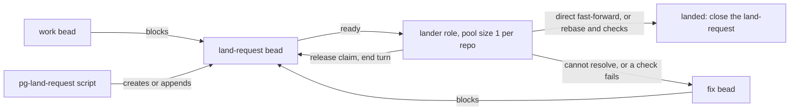
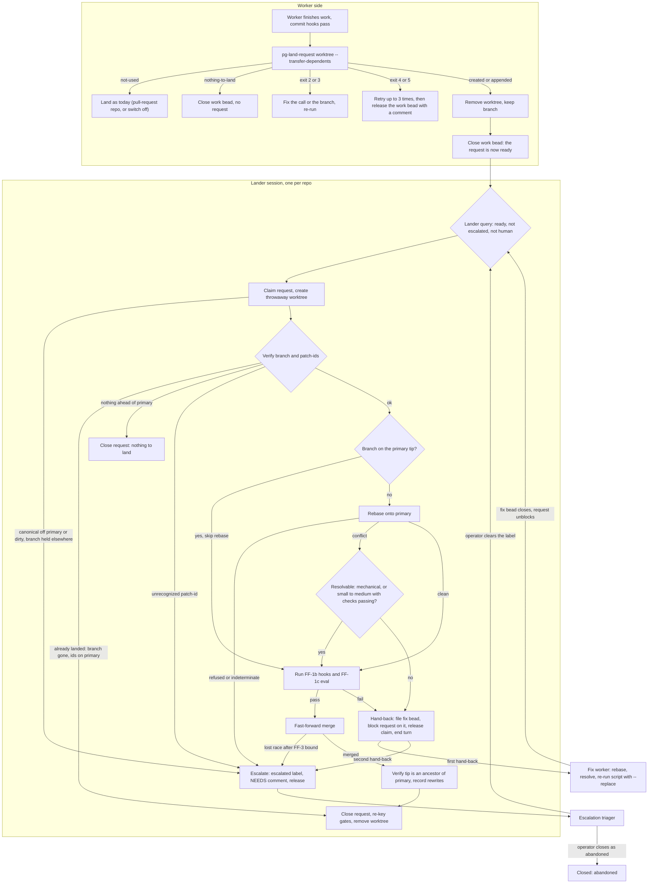
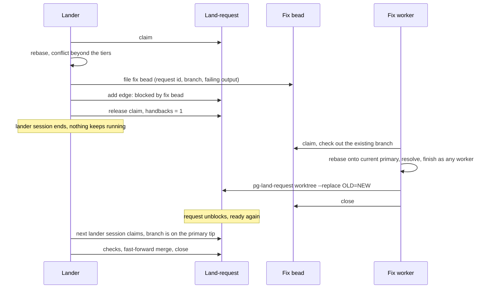
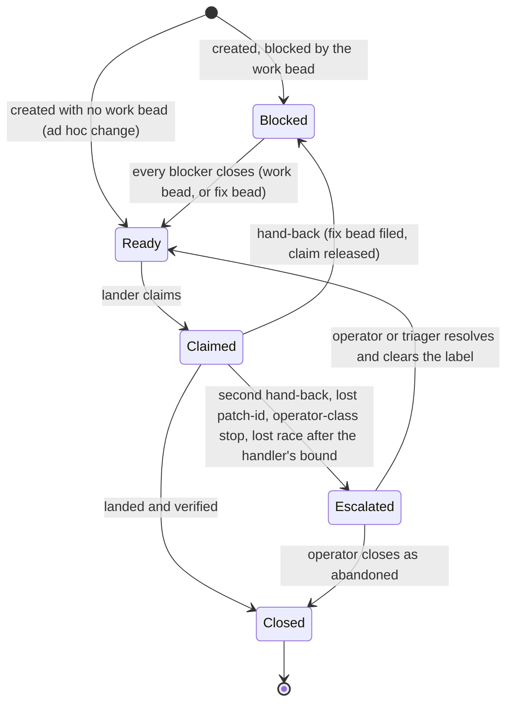

# Single lander per repo: land-request beads, a lander role and a landing skill — design

- **Status**: Draft for operator review. Nothing is implemented. Do not decompose until the operator approves.
- **Date**: 2026-11-04
- **Builds on**: `claude-marketplace/pb/skills/drain-one/references/land.md` (today's per-worker LAND step);
  `claude-marketplace/integrate-branch/skills/ff-merge-to-main/SKILL.md` (FF-0 to FF-4);
  `docs/adr/0089-drain-roles-apply-the-shared-pb-drain-one-skill.md` (one pool per tracker, `close-or-release`).
- **Operator rulings** (Phillip, 2026-10-28 and 2026-11-04) are quoted in the tracker bead that opened this
  design; this document restates their consequences, and section 16 lists the rulings that settled its
  questions. Rule ids such as B-1, B-2, D-5, P-5 and LV-7 are the operator rules in the global agent rules and
  the `beads-lifecycle` skill; `claude-marketplace/pb/skills/drain-one/references/rules.md` repeats the ones
  drain uses.

The key words MUST, MUST NOT, SHOULD, SHOULD NOT and MAY in this document are to be read as in RFC 2119.

## 1. Problem

Every drain worker lands its own work. Each landing runs a rebase, the pre-land hook run (FF-1b, 10 to 25
minutes under host load) and a fast-forward merge. Two workers landing into one repo at the same time
therefore race: the slower one finds main advanced, restarts, and gives up after the handler's retry bound.
Several fixes treat the symptom (a carried-over hook run across a rebase, a cap on per-project test time).
None removes the cause, which is that many sessions compete to advance one branch.

## 2. Goals and non-goals

Goals:

1. Exactly one agent at a time advances a repo's primary branch through the landing path.
2. A worker finishes by leaving a branch and a work item for the lander, then ends its turn; its worktree is
   removed.
3. A lander that cannot land cheaply hands the problem back and ends its turn; it never sits in a loop with
   a worker.
4. Landing logic lives in two small scripts and one skill, so changing how landing works touches only those.

Non-goals:

- Pull requests. This design covers landing only; a repo whose strategy is `pull-request` keeps today's
  path (section 10).
- Replacing `integrate-branch`. The lander reuses its handlers and its advisory command.
- Changing how work is selected, claimed or implemented.

## 3. Overview

The pattern is a **Work Queue** with a **Single Consumer** per repo, isolated from the other repos' consumers
(a **Bulkhead** between repos). The queue item is a **Command Message**: a `land-request` bead. The script
that creates it is an **Idempotent Receiver**.



Readiness comes from the dependency graph. No label or status flag marks "ready to land": the land-request
becomes ready when its blockers close, and a hand-back blocks it again. The `escalated` label marks a
request that needs triage, and the lander's query excludes it (section 7.1).

### 3.1 End-to-end flow

The good path runs from "Worker finishes" straight down to "Closed". Every other exit is a failure path:
either the worker's own input or tracker problem (top group), a hand-back to a fix worker (left loop), or an
escalation to the triager and operator (right loop).



The hand-back loop in time order, for the failure the design cares most about (a conflict the lander cannot
resolve):



## 4. The land-request bead

### 4.1 Type and routing

`land-request` MUST be a registered custom bead type (added to the `types.custom` configuration alongside
`merge-request`, in each tracker that holds land-requests). It is deliberately not `merge-request`: that
type already names a bead that tracks a real pull request or merge request, and sharing the type would make
"land" and "merge" ambiguous.

The type is the routing key: the lander role's source query selects ready `land-request` beads, and every
drain query MUST exclude the type so a worker never claims one. Each bead also carries its repo label
(`BF-1`: file it in the tracker of the repo where the change lands).

### 4.2 Identity and fields

The identity of a land-request is the pair **(repo root, branch)**, not a patch-id. At most one OPEN
land-request exists per pair. The bead carries, as metadata:

| Field        | Meaning                                                                                                       |
| ------------ | ------------------------------------------------------------------------------------------------------------- |
| `repo_root`  | Absolute path of the canonical clone.                                                                         |
| `branch`     | Branch holding the work. The lander lands the whole branch tip.                                               |
| `patch_ids`  | Growing list of `git patch-id --stable` values agents reported as done. Never a commit SHA.                   |
| `rewrites`   | JSON object mapping old to new patch-ids; an old id with no successor maps to `dropped` (already on primary). |
| `handbacks`  | Count of fix beads the lander has filed for this request.                                                     |
| `set_branch` | For a workforest member: the set's branch name, so a set's requests can be listed together.                   |

A patch-id is a hash of a diff including its context lines. A spike on 2026-11-04 showed that a clean rebase
onto a main that changed lines far from the change leaves it unchanged, while a main that changed a line
within the three lines of context gives the commit a new patch-id. So `patch_ids` is a record for gates and
a consistency check, never proof that a commit landed; the proof is that the landed tip is an ancestor of
primary (section 7.3). A request takes its priority from the work bead it is blocked by (the highest, if
several), copied once at creation, and the lander claims ready requests in priority order, then age.

### 4.3 Lifecycle



A crash between filing the fix bead's blocking edge and releasing the claim leaves a claimed, blocked
request. That state is harmless and is recovered like any dead lander's claim (section 7.4).

## 5. The scripts

Two bash scripts ship in one package, `packages/pg-land` of this repo, built with the repo's bash packaging
framework with completions and tldr pages, and tested with bats. Each uses the bd flags it relies on
(`--type`, `--exclude-type`, `--external-ref`, `--metadata-field`), so the package also carries a bd-flag
check like the one `packages/beads-exporter` has.

`pg-land-request` is the only supported way for an agent or plan-decompose to create or extend a request;
section 5.1 to 5.4 specify it. `pg-land-lander` is the lander's helper, with the testable logic (section 7.2).

### 5.1 `pg-land-request` contract

- **Idempotent.** The script finds an open land-request with the same (repo root, branch). If it exists, the
  script appends any `patch_ids` it does not already hold and exits 0. If none exists, it creates one. A
  closed request never matches, so new commits on an already-landed branch open a new request. A repeated
  call changes nothing and reports nothing as an error.
- **Race-safe.** Two agents may call it at once for the same pair. The script MUST hold a per-(repo, branch)
  lock around the lookup and the create, and MUST set a deterministic external reference, formatted
  `land:<first 16 hex of sha256(repo_root, NUL, branch)>` (computed with `shasum -a 256` on macOS). The lock
  is a directory created atomically under `<git-common-dir>/pg-land-request/` holding the owner's pid and
  start time (macOS has no `flock` by default). A waiter MAY steal it only when the pid is gone or the lock
  is older than 10 minutes, a limit far above a `bd` call, so a slow holder keeps its lock.
- **Duplicate repair.** The tracker does NOT enforce uniqueness of the external reference (verified
  2026-11-04 against a real `bd` in a throwaway database: two creates with one reference both succeeded), so
  the lock is the only preventive guard. After each create the script lists open requests with that
  reference (`bd list --external-ref <ref> --type land-request`). If it finds more than one, the lowest id
  wins; the script moves the loser's blocker edges, `patch_ids` and `rewrites` onto the winner and then
  closes the loser as a duplicate. The lookup also cross-checks `--metadata-field` on `repo_root` and
  `branch`.
- **Creation outside the script.** A bead made by hand bypasses the lock. Agents MUST use the script, and
  the periodic reconcile (section 11) lists any pair with two open requests.
- **Validation.** Unless `--planned` is given, the branch MUST exist, and every patch-id to record MUST be
  among the commits of the branch ahead of primary; otherwise the script exits 3 and names the offender. A
  branch with nothing ahead of primary prints `nothing-to-land` and exits 0, so a worker whose work needed no
  code change closes its bead without a request. An append while the lander holds the branch checked out can
  only name commits already on the tip, because no worktree can add a commit to a branch another worktree
  holds; if the branch was moved by other means or deleted by a landing, the script exits 3 and says so.
- **Planned requests.** `--planned --branch NAME` creates a request for a branch that does not exist yet and
  skips validation. Plan-decompose uses it at decomposition time with the branch name the packet's worker
  will use (the drain branch for that packet, or the shared branch the plan names for a group of packets);
  the worker's handoff then appends its patch-ids to the same request.
- **Dependents.** `--transfer-dependents` (on in the worker handoff) adds the request as a blocker of every
  bead that the work bead blocks, and makes the request a child of the work bead's parent when it has one,
  so an epic cannot complete before the code lands. It never blocks a parent on its own child (rule D-9).
- **Rewrite map.** `--replace OLD=NEW` (repeatable) replaces a recorded patch-id and records the pair in
  `rewrites`, so a fix worker keeps the list honest.
- **Tracker.** It resolves the tracker from the repo root with the workspace's repo-to-tracker lookup (the
  one rule BF-1 uses), `--tracker-root DIR` overrides it, and an unresolved tracker exits 2.

### 5.2 `pg-land-request` interface

| Item         | Specification                                                                                                                                                                                         |
| ------------ | ----------------------------------------------------------------------------------------------------------------------------------------------------------------------------------------------------- |
| `worktree`   | `pg-land-request worktree [--branch B] [--blocked-by BEAD]... [--patch-id ID]... [--replace OLD=NEW]... [--planned] [--transfer-dependents]`                                                          |
| `workforest` | `pg-land-request workforest --set-root DIR [--blocked-by BEAD]... [--abandon]`                                                                                                                        |
| `status`     | `pg-land-request status [--set-branch B]`: one row per open request (section 11).                                                                                                                     |
| `close`      | `pg-land-request close ID --reason TEXT`: closes an open request after someone landed it by hand; verifies the branch tip is on primary or the branch is gone.                                        |
| Defaults     | The branch is the current branch; the repo root is the parent of `git rev-parse --git-common-dir`; patch-ids default to the commits ahead of primary.                                                 |
| Output       | One line: `land-request: <created\|appended\|unchanged\|appended-claimed\|nothing-to-land\|not-used> <bead-id or -> next: <none\|land-as-before\|retry\|fix-input\|escalate>`.                        |
| Enablement   | Off unless the clone's git config `pgii-integrate-branch.landRequests` is `true`. When off, or when the strategy is `pull-request`, it creates nothing and prints `not-used`, `next: land-as-before`. |
| `--abandon`  | For a workforest set: closes every open request of the set as abandoned, with a reason, downstream first.                                                                                             |

| Exit | Meaning                                          | Stderr says                                 | Worker's next action                                                 |
| ---- | ------------------------------------------------ | ------------------------------------------- | -------------------------------------------------------------------- |
| 0    | Success, including `not-used`, `nothing-to-land` | The one-line output                         | Follow `next:`                                                       |
| 2    | Usage error or unresolved tracker                | The flag or lookup that failed              | Fix the call; do not retry unchanged                                 |
| 3    | Validation failure                               | The patch-id or branch at fault and the fix | `fix-input`: re-run without `--patch-id`, or recreate the branch     |
| 4    | Tracker unavailable                              | The `bd` error                              | `retry` up to three times, then release the work bead with a comment |
| 5    | Lock timeout                                     | The lock path and its owner pid             | `retry` as for exit 4                                                |

### 5.3 The `workforest` subcommand

It creates one land-request per member repo of the set and wires each to be blocked by the landings of its
upstream repos, in the dependency order the workspace land plan already computes. A re-run extends the
existing requests as in 5.1. The set's workspace validation (`validate-workforest`) stays a worker step
before the handoff, as today; the lander validates each repo on its own.

### 5.4 Who calls it

- Plan-decompose runs `pg-land-request worktree --planned` at each landing point the plan names, with the
  work packet as the blocker, and wires a later packet that builds on the change as blocked by the request
  the script printed. Example: packet A adds a flag and packet B uses it; the plan names a landing point after
  A, the script prints `created tst-x1`, and B is blocked by both A and `tst-x1`. If the script printed
  `not-used`, no request exists, B is blocked by A alone, and A's packet text says to land as before.
- Any other agent calls it when its work is ready. The rule for an agent in doubt is: run the script. Running
  it twice is harmless, and where requests are not used it exits 0 with `next: land-as-before`, which the
  agent MUST then follow.

## 6. The worker handoff

A worker finishes by running, in order:

1. Everything it does today before landing (its commit hooks and validation). A worker does not run the
   pre-land checks today, and does not start; those stay with the party that lands.
2. `pg-land-request worktree --transfer-dependents`, with the work bead as blocker. On `not-used` the worker
   lands as today and stops here; on `nothing-to-land` it skips to step 4; on an error it follows the exit
   table in section 5.2.
3. Removing its worktree while keeping the branch, with a command that keeps the branch, not one that
   deletes both. The branch is the durable artifact. This precedes the next step because the lander cannot
   check out a branch that another worktree still holds. For a workforest set the handoff removes each member
   worktree this way, and the set root once it is empty; it does not run `cleanup-workforest`, which keeps
   worktrees that have not landed.
4. Closing the work bead, whose close reason names the branch and the land-request id and states that
   landing is tracked by the request.

Ordering matters: the request exists before the work bead closes, so a blocked request never appears
ready early, and the worktree is gone before the request can become ready. A failure in step 2 or 3 leaves
the work bead open and the work recoverable.

**What "closed" now means.** Closing the work bead no longer means the code reached main. The handoff's
`--transfer-dependents` makes every bead that waited on the work bead also wait on the request, and an
epic cannot complete before its request closes. A work bead closed for any reason, including as moot,
makes its request ready; the lander then closes it as nothing to land if the branch has no commits ahead.
A post-deploy gate keyed on a patch-id can still be filed at handoff, and the lander re-keys it after a
rewrite (section 7.3, step 9).

## 7. The lander role and the landing skill

### 7.1 Role

One pg-router role per repo, applying the shared landing skill, with a pool of size 1. This follows the
drain-role pattern (one pool per tracker, here per repo) and gives the single-consumer guarantee.

- **Source query.** Ready `land-request` beads carrying the repo's label, in the repo's tracker, excluding
  `escalated` and `human`. An escalated request is open and unblocked, so without the exclusion the router
  would re-offer it at once and the lander would repeat the failure it just escalated.
- **Event type.** The source emits `land.<repo-label>`; the role is `lander-<repo-label>`.
- **Mechanism versus deployment.** This repo ships the skill, the scripts, the generic role definition and
  the alert-rule clause with its rule test; the deployment repo declares one role entry per repo, as it does
  for drain roles today.
- **Completion.** The role uses the `close-or-release` mode of ADR 0089's decision on that mode. The dispatch
  is done when the request is closed, or when the session has ended and the request was handed back (open or
  deferred, unassigned). The handler recognizes a give-back in two ways (the use case that settles a session
  that ended, in the handler's behavior docs): the claim latch it set when it saw the request `in_progress`
  under the role's own actor, or, after a handler restart lost the latch, a mark on the request (`human`, a
  future deferral date or an open blocker). A lander always claims first, so the latch covers both a
  hand-back and an escalation. The `escalated` label is not one of the restart marks: if the handler
  restarts while a lander is mid-session and the lander then escalates, the request can read as an unclaimed
  end and earn a first strike, which leaves it as it is, and a second would add `human`, which an escalated
  request is headed for anyway. A hand-back behind an open blocker has the mark. A bare release with no claim
  and no mark would earn a `drain-unclaimed-end` strike, so the lander never ends that way: a lost race is
  retried inside the session and then escalated (section 7.5), not released.
- **Claim identity.** The session claims with an actor id of the form `<session-id>-lander`, the role's own
  actor, so the mode's assignee-aware latch recognizes the claim.
- **Timeout.** The session timeout MUST exceed the longest pre-land run; the drain roles' two hours is the
  starting point.

The single consumer cannot remove every race: a person or a workspace automation can still push to main
directly, so the skill keeps the handler's own retry bound (FF-3) for a lost fast-forward.

### 7.2 The helper script

`pg-land-lander` holds the logic that tests must reach without a model: `worktree create|remove REQUEST`
(derive the path from the branch, reuse a clean leftover, remove and recreate otherwise), `verify REQUEST`
(the step 2 predicate), `record-rewrites REQUEST --before FILE --after FILE` (pair old and new patch-ids by
position and write differing pairs and `dropped` ids into `rewrites`), and `classify CODE` (print the action
for a handler outcome, section 7.5). The skill calls these and carries only judgment: choosing a conflict
tier and writing a fix bead.

### 7.3 Algorithm

0. **Create a throwaway worktree** with `pg-land-lander worktree create`. The handler rebases, hooks and
   merges from a worktree, and the worker removed its own. A clean leftover at the derived path from a
   crashed run is reused; any other is removed and recreated. The handler's own cleanup (FF-4) removes the
   worktree and the branch on a successful landing; on any other exit the lander removes the worktree and
   keeps the branch.
1. **Read the request**: `patch_ids` and `rewrites`.
2. **Verify** with `pg-land-lander verify`. If the branch is absent and every listed id is reachable from
   primary (patch-ids of `git log -p` over the primary's recent commits) or appears in `rewrites`, the
   landing already happened: a previous run crashed after the merge. Go to step 8's close. Otherwise the
   branch MUST exist. A listed id absent from the branch's commits, from `rewrites` and from primary's
   recent history is unrecognized and escalates, because a rewrite outside the record is indistinguishable
   from lost work. A branch with nothing ahead of primary closes the request as nothing to land.
3. **Direct land.** If the branch is already based on the primary tip and the canonical clone is in
   steady state, skip the rebase and go to step 5.
4. **Rebase** onto the primary branch.
5. **Run the checks.** Run today's checks, FF-1b (pre-land hooks) and FF-1c (eval-only), exactly as the
   handler does, including its existing carry-over of a passing hook run across an insignificant rebase
   (the `preLandReuse` criteria, enabled per clone). This design adds no significance rule of its own; the
   only difference from today is that one session, not many, runs this step for a repo.
6. **Resolve conflicts within bounds** (section 8), then re-run the checks if the diff changed.
7. **Merge** with the handler's fast-forward step.
8. **Verify and close.** The landed tip the handler reports MUST be an ancestor of primary (`git merge-base
--is-ancestor <tip> <primary>`, the `landed?` probe). Then run `record-rewrites` with the patch-ids of the
   branch's commits before and after, and close the request with the rewrite map in the close comment.
9. **Re-key gates.** A post-deploy gate keyed on an old patch-id would never resolve after a rewrite, so the
   lander MUST re-key or refile every gate named for a key of `rewrites`.

A lander that finishes with the request neither closed nor released has failed rule B-1.

### 7.4 Crash recovery

A pool of size 1 stalls the repo if a lander dies holding a claim. The router's existing orphan reconcile
and restart handling for ccpool roles (ADRs 0083 and 0085) recover a dead session's claim; the unstick
sweep is the backstop. A rerun after a crash is safe because step 2 recognizes an already-landed branch and
step 0 reclaims a leftover worktree.

### 7.5 Stop reasons

`pg-land-lander classify` maps each handler outcome to one action, and the lander never files a fix bead for
a problem a fix worker cannot fix.

| Handler outcome                                                                  | Action                                               |
| -------------------------------------------------------------------------------- | ---------------------------------------------------- |
| `stopped:rebase-conflict` beyond the tiers in section 8                          | Hand back (fix bead)                                 |
| `stopped:precommit-branch-diff-failed` (FF-1b hook failure)                      | Hand back (fix bead)                                 |
| `stopped:eval-failed` (FF-1c)                                                    | Hand back (fix bead)                                 |
| `stopped:worktree-dirty`, `stopped:rebase-in-progress` in the lander's worktree  | Remove and recreate the worktree once, then escalate |
| `stopped:rebase-refused`, `stopped:rebase-indeterminate`, `stopped:wrong-branch` | Escalate                                             |
| Canonical clone off primary or dirty, `core.worktree` anomaly (FF-0a)            | Escalate; no fix bead                                |
| Lost fast-forward race, after FF-3's two attempts                                | Escalate                                             |
| Branch checked out in another worktree                                           | Escalate                                             |
| Listed patch-id unrecognized                                                     | Escalate                                             |

`stopped:no-pr-host` and `stopped:ambiguous-remote` belong to the pull-request handler and are out of scope.
The handler's "stop and ask the user" outcomes are rewritten for an unattended lander as an escalation. An
escalation is the existing `escalated` label plus a comment in the `NEEDS:` format of rule LV-7 (`SCOPE` or
`DECISION`), in one update that also releases the claim. Example comment:

```text
NEEDS: DECISION: canonical clone nix-agent-support is dirty (packages/x/y.go modified), so the
fast-forward merge cannot run. Reproduce: git -C /abs/canonical status --short. The lander did not
touch the clone. Clear the dirty tree, then remove the escalated label.
```

The triager's dispatch query `escalated-work` is `ready --label escalated --exclude-label human`, defined
in the deployment's beads backend configuration. It filters by label and not by type, so an escalated
`land-request` already reaches the triager (verified 2026-11-04 from the query's documented definition in
`packages/ccpool-probe/cmd/ccpool-probe/connector.go`) and no query change is needed. Two checks remain,
both gating step 2 of rollout because without them an escalation could be mishandled: the triager's prompt
MUST treat a `land-request` as a landing problem (no splitting, since a request has no scope to split), and
the escalation must reach the operator as a `DECISION` when the cause is operator-class.

## 8. Conflicts and the hand-back loop

The loop to avoid is: lander hits a conflict, files a fix, waits, retries, hits a new conflict. Two measures
break it.

1. **The lander resolves what it can.** Three tiers:
   - _Mechanical_: a lockfile (take either side, regenerate it with the repo's own command) and generated
     files.
   - _Small or medium_: any resolution the lander can make in one attempt where the repo's pre-land checks
     pass afterwards. If the checks pass, the lander lands. No line-count threshold applies; the checks are
     the test.
   - _Hand-back_: everything else, and any attempt whose checks fail. A failure of FF-1b or FF-1c while the
     lander is mid-way through a resolution is a failed attempt: it abandons the resolution and hands back.
2. **The fix returns the branch current.** The fix bead's task is: rebase the branch onto current primary,
   resolve, finish as any worker does, then re-run `pg-land-request worktree` with `--replace` for each
   rewritten patch-id. The returning branch is then usually already based on the primary tip and takes the
   direct path. The fix bead MUST carry the request's id and the branch name in its metadata and the
   conflict or failure in its description, with the failing output and the reproduce command. The drain
   isolation step MUST check out that existing branch, not cut a new one from primary; otherwise the script
   would open a second request for a different branch while the first stays blocked. The fix bead takes the
   request's priority.

On a hand-back the lander files the fix bead, adds the edge `land-request --blocked-by fix` first, then
releases its claim with the assignee cleared in one call (rules D-5 and B-2), increments `handbacks`, and
ends its turn. No process stays alive, so nothing races with the fix worker. A second hand-back on the same
request MUST escalate the request instead of filing another fix (rule P-5), with the findings in a comment.
`handbacks` belongs to one request, which lives for one landing, so it needs no reset.

If the fix bead closes without changing the branch, the request unblocks and the lander tries again; the
`handbacks` cap bounds that. If the fix bead is itself escalated, the request stays blocked, and the unstick
sweep reports it after a day.

The lander does no deep repair: a failing check that is not a conflict follows the same hand-back path.

## 9. Workforest sets

One land-request per member repo, each blocked by the land-requests of its upstream repos. One lander per
repo handles its own request, using the same algorithm and a throwaway worktree of its own repo; the
dependency edges give the set's ordering. A hand-back in one repo blocks that repo's request and, through
the edges, every downstream request, so the set cannot land out of order.

A stalled fix would hold the whole set indefinitely, so an escalated request has an exit: the operator
clears the label after the fix lands, or closes the request as abandoned. `pg-land-request workforest
--abandon` closes every open request of the set, downstream first, so an abandoned upstream never leaves a
downstream request permanently blocked. The unstick sweep reports a land-request blocked for longer than
one day; the sweep's selection of this type is part of the implementation.

A limit remains: each repo's checks run against that repo's own primary, so a downstream repo is not
re-validated against an upstream rewrite made by a conflict resolution. The worker's set validation before
the handoff is the only cross-repo check, as it is today.

All requests of a workforest set live in the one tracker of the shared workspace database, so the blocks
edges between them are same-database edges. A set that spans separate trackers is not supported.

## 10. Pull-request repos stay as they are

Operator ruling (2026-11-04): this design covers landing only, no pull requests. A repo whose
`integrate-branch-support` strategy is `pull-request` keeps today's per-worker path in `pb:drain-one`
(push the branch, open or update a draft pull request). The script MUST detect that strategy, create
nothing, and print `not-used` with `next: land-as-before`, so an agent that runs it "in doubt" in such a
repo is not misled. A later design can tie pull requests in through the `merge-request` bead type, which
already stays open for as long as the pull request does; nothing here blocks that.

## 11. Operator view

`pg-land-request status` prints one row per open request: bead id, repo, branch, state (blocked, ready,
claimed, escalated), age, `handbacks`, the blocking fix bead id, and for an escalated request the first
line of its `NEEDS:` comment. `--set-branch B` limits it to one workforest set. The operator's actions are:
clear the `escalated` label after fixing the cause; close a request as abandoned (or `--abandon` for a set);
close one that was landed by hand with `pg-land-request close`. The periodic reconcile reports a pair with two
open requests, and the unstick sweep reports a request blocked or stale-claimed for more than a day.

## 12. What changes

| Area                    | Change                                                                                                                                                                                                                                                                   |
| ----------------------- | ------------------------------------------------------------------------------------------------------------------------------------------------------------------------------------------------------------------------------------------------------------------------ |
| `pb:drain-one`          | Step 6 (LAND) stops dispatching a lander where requests are enabled; it runs the worker handoff (section 6). Isolation checks out an existing branch for a fix bead. The rule that a bead is not closed while a set member is unlanded is replaced by the request edges. |
| `integrate-branch`      | Handlers stay. The landing skill invokes them; the advisory command tells the script which repos use requests.                                                                                                                                                           |
| plan-decompose          | Runs `pg-land-request worktree --planned` at landing points and wires dependents to the request (section 5.4).                                                                                                                                                           |
| Drain queries and roles | Exclude the `land-request` type.                                                                                                                                                                                                                                         |
| Escalation triager      | Its prompt treats a `land-request` as a landing problem (a rollout gate); its query needs no change.                                                                                                                                                                     |
| pg-router               | One lander role per repo; an alert-rule clause and rule test per role in this repo's alert files (section 14).                                                                                                                                                           |
| Worker brief            | A worker never lands where requests are enabled; it hands off.                                                                                                                                                                                                           |
| `pb:drain-lander`       | Retired for the worker path; the lander role applies the landing skill. Its worktree-pinning check moves into the skill, since a pinned lander fails the same way.                                                                                                       |
| `types.custom`          | `land-request` registered in each tracker that holds requests.                                                                                                                                                                                                           |
| Docs                    | Behavior docs, glossary terms, an ADR and its index row, written in the order of section 15.                                                                                                                                                                             |

## 13. Tests

Unit tests (fast, single process, a real `bd` in a hermetic database and real git from the shared fixture
library, no mocks):

- `pg-land-request`: idempotence, append, `--replace`, the validation exits and their messages, `--planned`,
  `nothing-to-land`, `not-used` for a pull-request repo and for a clone with the switch off, the switch read
  at call time, priority inheritance, `--transfer-dependents`, workforest edges and `--abandon` ordering,
  `status` output, `close`, and type registration in a fresh tracker.
- Races, as bats with background jobs: two concurrent calls for one pair; a forced duplicate (a create made
  past the lock) repaired with the loser's edges and ids merged into the lowest id; a stale lock stolen only
  when its pid is dead or it is over ten minutes old.
- `pg-land-lander`: `classify` over every handler stop code; `verify` over the already-landed case, the
  lost-id case and nothing-to-land, in git only; `record-rewrites` over a rebase that changes a patch-id, one
  that does not, and one that drops a commit; worktree create, reuse of a clean leftover, recreate of a
  dirty one, and removal with the branch kept.
- The drain-query exclusion of the type and the lander query's exclusion of `escalated` and `human`, as `bd`
  invocations over a fixture.
- The conflict tiers, against real rebases that produce a lockfile conflict, a resolvable conflict and an
  unresolvable one, driven through the helper's mechanical tier; the judgment tier belongs to the skill and is
  covered by the integration tier.

Integration tests (behind their own opt-in check, never in the unit gate): a full lander session against a
throwaway repo; hand-back through a fix bead with the isolation change; the second hand-back escalating; the
`close-or-release` marks for a hand-back and an escalation, so no strike is earned; crash after the merge
and before the close; the lost-race escalation; gate re-keying; the alert-rule clause and rule test; and the
triager's handling of an escalated land-request. A new or changed role MUST also be exercised live once before it carries real
work.

## 14. Observability

The router already reports queue depth, throughput, failures, last-progress age and per-run duration per
role, so a lander role gets those without new code. Bead-derived signals come from the existing
`packages/beads-exporter`, not from a new sweep or counter:

| Signal                          | Source                                                                                                       | Owner repo                  |
| ------------------------------- | ------------------------------------------------------------------------------------------------------------ | --------------------------- |
| Queue depth, oldest request age | A `queues` entry in the exporter for `--type land-request`, giving its candidate and oldest-timestamp series | this repo (exporter config) |
| Escalated requests              | The exporter's by-label count of `escalated`, filtered to the type                                           | this repo                   |
| Hand-backs per request          | The `handbacks` metadata, shown by `status`; no metric                                                       | this repo                   |
| Time per landing                | The router's per-run duration for the role                                                                   | existing                    |
| Lost races, crash recoveries    | The lander's log lines and the router's orphan-reconcile log; no metric                                      | existing                    |

The exporter classifies a bead by state before type; only types that `bd ready` never returns (such as
`merge-request`) fall into its `tracking` state. A `land-request` is returned by `bd ready` when ready (the
2026-11-04 spike listed it under `bd ready --type land-request`), so it is classified ready, blocked or
in progress like any work bead, and a `queues` entry may filter on `--type` because that flag is on the
exporter's spawn-only allowlist. Each lander role MUST get a clause in the alert rules' role-to-event-type chain (not an
entry on the exempt list, which holds only runner roles whose queue is non-empty by design) and a case under
the rule tests, in the same change as the role; the clause maps `land.<repo-label>` to `lander-<repo-label>`.
The queue-stalled window for a lander role MUST be at least the role's session timeout (two hours), because
one landing legitimately holds the queue's head for many minutes.

## 15. Rollout, rollback and documentation order

Documentation follows the repo's rule that behavior docs come first: (1) a new behavior-doc set for the
landing contract under `docs/behavior/` (README with its invariants, journeys, glossary terms for
land-request, lander, hand-back and escalation), stating this design's rules as RFC 2119 requirements. The
router and handler behavior docs (`packages/pg-router/docs/behavior`, `packages/pg-router-handlers/docs/behavior`)
need no change for the role itself, because it is configuration of an existing completion mode; (2) an ADR recording that the lander role supersedes the worker-lands part of ADR
0089's drain-role pattern, cited as "ADR 0089's Context" and not by section sign, plus its `index.md` row;
(3) code. A phased rollout then proceeds:

1. Register the type, write the two scripts with their tests, and add the per-clone switch (default off).
2. Write the landing skill and the lander role for one repo, check the escalation triager's prompt, add the
   alert clause, and exercise the role live once. The triager-prompt check gates the next step.
3. Turn the switch on for that repo, after which `pb:drain-one` step 6 hands off instead of landing.
4. Extend to the remaining repos, then to plan-decompose.

The switch is read when a worker's handoff starts, so a repo is either handing off or landing as today,
never both. Rollback sets the switch off and pauses the lander role; open requests are landed by the
operator through `integrate-branch` and then closed with `pg-land-request close`. Turning the switch on
without the lander role leaves requests ready and unconsumed, so the queue-age series from section 14 is the
alert for it. A worker whose script call fails leaves its work bead open, so no branch exists without an
owner.

## 16. Operator rulings and remaining checks

Rulings of 2026-11-04 that settled the draft's questions:

1. Landing only, no pull requests (section 10).
2. A second hand-back on one request escalates (section 8).
3. No wall-clock budget for a medium conflict resolution yet; the first rollout shows whether one is needed.
4. A worker does what it does today; only the party that lands changes (section 6).
5. Drain queries can exclude a bead type, so the `land-request` exclusion in section 4.1 stands.

Facts established by spikes on 2026-11-04, against a real `bd` and a real `git` in throwaway fixtures:

- A custom type registers per tracker with `bd config set types.custom`, and `bd create -t land-request`
  then works.
- `bd list` filters by `--type`, `--external-ref` (exact) and `--metadata-field key=value`; `bd ready`
  filters by `--type` and `--exclude-type`.
- The tracker accepts two beads with one external reference (section 5.1 handles that).
- The `close-or-release` completion mode exists (section 7.1).
- A rebase onto changed neighboring lines changes a commit's stable patch-id (section 4.2).

Settled by the second spike on 2026-11-04, from the repo's own source:

- The escalation triager's dispatch query is label-based (`ready --label escalated --exclude-label human`),
  so a `land-request` reaches it without a query change (section 7.5).
- The `close-or-release` settle rule recognizes a give-back by the claim latch, or after a restart by
  `human`, a future deferral or an open blocker, and the `escalated` label is not a restart mark
  (section 7.1).
- The beads-exporter classifies by state first, so the new type needs no special handling (section 14).
- The router and handler behavior docs need no change; the landing contract gets a new set (section 15).

Still to confirm during implementation: that the triager's prompt treats a `land-request` as a landing
problem and never tries to split it, and that a live exercise of the role confirms the settle rule for a
hand-back and an escalation.

## 17. Open review findings (third review round, 2026-11-05)

Two fresh reviewers, with throughput and continued flow as the lens, found the control plane sound and the
throughput story incomplete. These findings are NOT yet folded into the sections above; the design is not
ready for approval until the operator rules on the first three and the rest are applied.

Decisions for the operator:

1. **Where the check time sits.** A worker that runs no pre-land checks (the 2026-11-04 ruling that a worker
   does what it does today) puts every 10 to 25 minute FF-1b and FF-1c run on the lander's serial path. That
   caps a repo at about 2.4 to 6 landings per hour, so a stream of 11 per hour (an assumption) grows the queue
   without bound. The reviewers' recommendation: the worker runs the pre-land checks before handoff, in
   parallel and off the critical path, and records the passing run on the request, so the lander usually
   reuses it and lands in seconds. That reopens the ruling.
2. **Batching.** Whether v1 includes a merge-train tier (rebase k ready branches into one tip, run one check,
   fast-forward all, bisect on failure), or states the serial cap as a known limit. At k of 4 and 15 minutes
   per check the capacity is about four times the serial cap.
3. **Session shape.** Whether one lander session drains all ready requests in priority order, keeping a warm
   per-repo worktree, instead of one session per request. The spec currently reads as one per request and
   pays session start, skill load and a cold worktree on every landing.

Defects to apply:

- `--transfer-dependents` on a fix worker's handoff makes the request block itself (the fix bead blocks the
  request and the request is added as a blocker of what the fix bead blocks); exclude the request and define
  a distinct fix handoff. A returning fix is not "usually on the primary tip" under load.
- An empty `patch_ids` with an absent branch must close as nothing to land, not as already landed, and a
  planned request on a shared branch must be blocked by every packet that shares the branch.
- A repo-scoped stop (dirty canonical clone, a person's push) escalates once per request, N times for N
  queued requests; add a repo-level circuit breaker. A lost race against an external push should retry past
  two attempts.
- Out-of-band landers (`session-wrapup`, `land-workforest`, `audit-worktrees`, direct `integrate-branch`)
  still advance main and race the lander; make them enqueue a request or honor a per-repo lock.
- Dependents wait on queue time plus check time; allow a stacked dependent branch and age priorities.
- A hung check holds the pool for the whole two-hour session; add a per-check timeout inside the skill.
- Worker exit-code handling needs a bound (two attempts per non-zero exit), an `any other code` row, and a
  route through the park/escalate path, because a bare release of an open bead is re-offered within a minute.
- The alert section is wrong: the queue-stalled rule already ignores a running dispatch, so the two-hour
  window must be dropped; add alerts for oldest ready request age, an escalated request older than 30
  minutes, a request blocked on a fix bead for hours, and a lander running past a bound. List every alert
  file that needs a clause (more than one chain) and the isolated wiring smoke test the repo requires.
- Tests: add a load scenario (several concurrent workers, one lander, overlapping and disjoint files,
  asserting every branch lands once and no worker keeps a claim) in the opt-in tier; name the missing tests
  (handoff ordering, exit-code behavior, `preLandReuse` with a rebased lander, claim order, slow lock
  holder, the drain query list that mirrors the exporter's queues, rollback with open requests).
- Operator view: add claim age and phase to `status`, a dashboard panel, and a rollback listing; the fix
  bead gets a priority floor and an instruction for a fix worker that finds the branch gone.

## 18. Alternatives considered

- **A label on the work bead.** Rejected by the operator: a stored flag someone must remember to clear, and
  it mixes "work" with "landing".
- **A child bead of the work bead.** Equivalent to a land-request but tied to one work item; a branch with
  several work beads would need several children, and the lander would land the same branch more than once.
- **Releasing a request untouched after a lost race.** Rejected: under `close-or-release` a bare release
  reads as an unclaimed end and earns strikes that park the request, and the router would re-offer it at
  once. The handler's own bound and an escalation replace it.
- **Keeping per-worker landing and tightening the retry bound.** Leaves the race in place.
