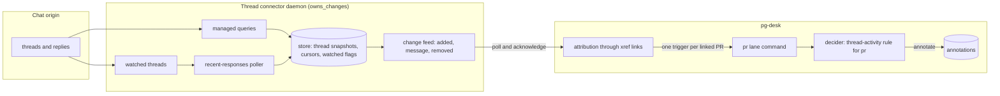
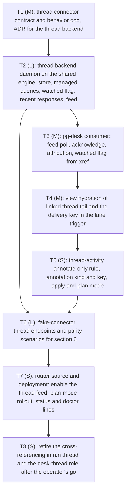

# Thread support for tracked PRs: a stateful thread connector feeds an annotate-only decider rule

- **Status**: Draft 1 for operator review. Not approved. One item needs the operator's explicit approval: the
  proposed consuming rule (section 11, open item A1).
- **Date**: 2026-11-04
- **Owner**: the operator
- **Follows**: the PR lane refactor design (`2026-10-20-pr-lane-refactor-design.md`, section 6.6 and the section 13
  row V6-1), which deferred thread support; ADR 0077 (entity change flow, row S20: no thread decider on day one);
  ADR 0090 (a connector MAY be stateful and own its changes); ADR 0106 (change emission for watched entities
  only); the GitHub daemon design (`2026-10-09-pg-connector-github-daemon-design.md`); the issue change emission
  design (`2026-10-20-issue-change-emission-per-backend-design.md`); the shared change-engine hoist design
  (`2026-10-22-connectord-shared-change-engine-hoist-design.md`); ADR 0116 (the PR lane is one composed command
  driven by change events).

The key words MUST, MUST NOT, SHOULD, SHOULD NOT and MAY in this document are to be read as in RFC 2119. This
repository is public: the document names no employer, workspace, channel or person; the operator is "the operator".
Files under `docs/superpowers/specs/` are provenance, not durable citation targets.

## 1. The operator's ruling

The operator ruled on 2026-11-04 (Phillip, verbatim): "threads will be implemented in a similar way as github and
jira. it will pull in threads and have managed queries and will have watched threads and will pull in recent
responses and emit changes."

This supersedes the earlier framing in which the operator had to name a consuming rule before a design could start.
The trigger feed is settled by the ruling. The operator did NOT name a consuming decider rule; this document proposes
one (section 5) and the operator approves or changes it at design review (section 11).

Ruling 6 of the PR lane program ("threads that belong to tracked PRs MUST be supported") still stands, and this
design delivers it. The deferral of 2026-10-22 (V6-1) was caused by there being nothing to assert: no rule consumed
thread data and no feed existed. Both gaps are closed here.

## 2. Problem

Two meanings of "thread" exist. GitHub review threads are PR conversation data, already covered by hydration and the
feedback rules. The chat-thread entity (a chat thread linked to a PR) is the subject here. Today:

- the `thread` type has no change feed (`thread changes` is refused for lack of an owner);
- no decider rule reads thread data (ADR 0077 S20); the PR view lists linked threads as `mentions` links and
  nothing consumes them;
- the legacy `run thread` command and the `desk-thread` role cross-reference a thread to the PRs its text names,
  re-run interpretation for each, and write zero work items.

The consequence is that a reviewer's message on a thread about a tracked PR is invisible to the lane.

## 3. Design: a stateful thread connector (Repository + Observer, as for GitHub and Jira)

The thread connector follows the stateful-connector pattern of ADR 0090, reusing the shared change-engine, change-feed,
query-runner and watched-query shapes of the hoist. It is a daemon-backed backend that declares `owns_changes` for the
`thread` type. pg-desk stays the single emitter of the lane's events (as ADR 0106 keeps it for `issue.changed`) and
consumes the feed, acknowledges it, and attributes it to PRs.

### 3.1 Managed queries

A managed query is a configured search that the connector runs on its own schedule to discover threads (for example
threads that mention the configured identity, or threads that mention a pull request URL). It is the discovery half:
a thread first seen through a managed query is stored and emits an `added` change. The connector owns the query
schedule and the cost accounting for its origin's rate limit, as the GitHub and Jira daemons do for theirs. The query
set is configuration of the connector, rendered from a module option (ADR 0090 item 5).

### 3.2 Watched threads

A thread is watched when a consumer asks the connector to watch it, by the same flag-per-entity shape the PR and issue
backends use. The connector stores the flag. pg-desk sets the flag when a thread is linked to a PR that is itself
tracked (an `xref` row of `(pr, thread)` exists), and clears it when the last such link is gone or the PR is closed.
The connector emits change events for watched threads only (the ADR 0106 rule), plus the `added` event for a thread a
managed query discovers for the first time, so that pg-desk can attempt linking.

### 3.3 Recent responses

For each watched thread the connector pulls the replies newer than its stored cursor, at a cadence it owns (fast
while a thread is active, slower when idle, bounded by a per-origin budget). Each new message is stored by its
origin message id. The cursor is the highest message id the connector has stored for the thread; it is the connector's
own state (ADR 0090 item 2), not pg-desk's.

### 3.4 Change events

The feed emits, per consumer, one record per change with a stable delivery key:

| Kind      | Meaning                                                    | Delivery key                  |
| --------- | ---------------------------------------------------------- | ----------------------------- |
| `added`   | a managed query found a thread not seen before             | thread id                     |
| `message` | a new message (a reply, or a new root) on a watched thread | thread id plus message id     |
| `removed` | the origin no longer returns the thread                    | thread id plus a tombstone id |

An edited message is NOT a change in this design (section 9, non-goals). The consumer polls and acknowledges through
the umbrella exactly as for PR and issue feeds; the connector owns the cursor, so an unacknowledged record is
redelivered, which is why the acceptance in section 6 depends on a stable delivery key and an idempotent consumer.

## 4. Trigger

The trigger is exactly this thread activity, delivered through the thread connector's change feed:

1. A `message` change on a watched thread. This is the only activity that reaches the consuming rule.
2. An `added` change from a managed query. This does not reach the rule. It makes pg-desk run attribution
   (the existing cross-referencing of a thread to the PRs its text names, moved off `run thread` onto the feed) and,
   if a tracked PR is named, create the link and set the watched flag. The first `message` change then follows from
   the watched thread's recent-responses poll.
3. A `removed` change clears the watched flag and the link evidence; it triggers no rule.

For each `message` change, pg-desk resolves the thread's linked tracked PRs by the `xref` reverse lookup and starts the
lane command once per linked PR, passing the change's delivery key as the item key (the lane command already accepts a
delivery key so that a redelivery is detected; ADR 0116). A thread that links to no tracked PR produces no lane
invocation.

## 5. Consuming rule (proposed)

A new decider rule, `thread-activity`, registered for entity type `pr` (the registry of ADR 0077 S9, which keeps the
decider contract generic by type and ships only PR rules today). It is a pure function of the view, as every rule is:
it never calls the connector and writes nothing except through the actions the decider applies.

**Input.** The PR view lists linked threads (`mentions` links) and, for each, the hydrated tail of the thread: the
messages newer than the lane's last recorded thread cursor for that PR, each with message id, author, timestamp and
text. Hydration of linked threads is a read through the thread connector's store, not a call to the origin. The view
MUST carry the delivery key of the triggering message.

**Output (first step: annotate only).** For each new message that the view shows and the PR has not yet annotated, the
rule proposes exactly one `annotate` action: a `thread-activity` annotation on the PR carrying thread id, message id,
author, timestamp and a short excerpt. The annotation key is `(pr, thread id, message id)`, so applying the same action
twice writes once. The rule creates no work item, closes nothing, and never opens or reopens a review item.

**Why annotate first.** An annotation is visible in `pg-desk pr show` and to the operator's focus surfaces, costs
nothing to undo, and exercises the whole path (feed, attribution, view, decider, apply, idempotence) with no side
effect on the tracker. It also lets the operator watch real thread traffic before any message is allowed to open
work. This follows the rollout of the PR lane itself (plan mode first, then apply).

**What a later review-request rule would add.** A second rule, `thread-review-request`, also registered for `pr`,
would read the same view and propose a `create` action for a review work item when a new message on a linked thread
asks for a review of that PR, keyed `(pr, head sha, thread id, message id)` so that one message yields at most one
item and a re-delivery yields none. It needs three things the first step does not: a decision procedure for "this
message asks for a review" (deterministic phrase and mention matching versus a model-assisted classification, an
open decision, A2 in section 11), a rule on what happens when a review item for that head already exists (annotate,
do not duplicate), and an operator-visible plan mode before apply. It MUST NOT ship in the same change as the
annotate-only rule.

## 6. Acceptance

The following MUST hold; each row is a scenario in the packets of section 8.

| Case                                                    | Given                                                                       | Then                                                                                        |
| ------------------------------------------------------- | --------------------------------------------------------------------------- | ------------------------------------------------------------------------------------------- |
| One message, one annotation                             | a watched thread linked to one tracked PR receives one new message          | exactly one `thread-activity` annotation exists on that PR, and no work item is created     |
| One message, two linked PRs                             | the thread links to two tracked PRs                                         | exactly one annotation on each PR (one per link), none elsewhere                            |
| Re-delivery yields none                                 | the same change record is delivered again (unacknowledged, or replayed)     | no second annotation; the second lane run reports no change; counters of writes do not move |
| Re-delivery after a crash between apply and acknowledge | the lane applied the annotation, then the process died before acknowledging | the redelivered record applies nothing                                                      |
| Unlinked thread yields none                             | a thread (from a managed query) names no tracked PR                         | no lane invocation, no annotation, no work item; the thread is stored and not watched       |
| Link removed                                            | the PR is closed or the link is cleared                                     | the thread is unwatched; later messages on it emit no change                                |
| Edited message                                          | an existing message is edited at the origin                                 | no change record and no annotation (non-goal)                                               |
| Origin unavailable                                      | the origin read fails retryably                                             | the connector reports unavailable (retryable), emits nothing, and no annotation is written  |

The policy behind the table: the rule MUST be idempotent on `(pr, thread id, message id)`; the delivery key MUST be
stable across redelivery; and the consumer MUST acknowledge only after the apply succeeded.

## 7. Components touched (design level)

- **Thread connector backend (new daemon-backed backend of the `thread` type).** Built on the shared change
  engine, feed and watched-query shape; adds managed queries, the recent-responses poller and the origin adapter.
  The origin adapter is a new, separate module from the legacy stateless thread provider, which stays as is.
- **pg-desk consumer.** Polls the thread feed through the umbrella, attributes `added` threads to PRs, maintains the
  watched flag from the `xref` table, and starts the lane command per linked PR for a `message` change.
- **PR view and decider.** The view gains the hydrated thread tail for linked threads; the decider gains the
  `thread-activity` rule; the apply layer gains the `thread-activity` annotation kind with its key.
- **Fake connector and parity harness.** The fake connector gains thread endpoints (list by managed query, show,
  recent responses, watch and unwatch, feed poll and acknowledge), and the parity harness gains thread scenarios
  (section 8, packet T6).

## 8. Proposed packet decomposition (outline only)

This is an outline for the operator's review. Packets are NOT filed until the proposed rule is approved (section 11).
Sizes are t-shirt sizes. `desk-thread` and `run thread` MUST remain untouched until the last packet lands (section 10).

| Packet | Size | Outline                                                                                                                                                                |
| ------ | ---- | ---------------------------------------------------------------------------------------------------------------------------------------------------------------------- |
| T1     | M    | Behavior doc for the thread backend (feed kinds, delivery keys, cursors, budget, `status`), and the ADR that adds the thread type to the set of change-owning backends |
| T2     | L    | The daemon-backed backend; reuses the hoisted engine; unit tests per invariant, including cursor and redelivery                                                        |
| T3     | M    | Consumer side in pg-desk; moves attribution onto the feed while the legacy command keeps working beside it                                                             |
| T4     | M    | The linked-thread tail in the PR view; the lane command takes the thread change's delivery key                                                                         |
| T5     | S    | The proposed rule, annotate only, with plan mode and the idempotent annotation key; ships in plan mode                                                                 |
| T6     | L    | New L packet: fake-connector thread endpoints, a parity scenario for each row of section 6, and a record of the identifier allowlist check for the new fixtures        |
| T7     | S    | Registry and module options; lane line on `status` and `doctor`; flip plan to apply only on the operator's word                                                        |
| T8     | S    | Only after T7 has run in apply for an agreed period: remove thread cross-referencing from `run thread` and retire `desk-thread`                                        |

The ordering is forward-only. The shared-library hoist and the GitHub and Jira cutovers have landed, so no edge to
them remains.

## 9. Non-goals

- Edited-message and reaction changes, and deleted single messages (only whole-thread removal is a change).
- Any work item created from a thread message (the later rule, section 5).
- A write path to the chat origin (no posting, no resolving).
- Changing the GitHub review-thread handling, which stays in hydration and the feedback rules.
- Threads linked to issues. The same feed would serve an issue rule later; this design wires `pr` only.

## 10. Rollout and the untouched legacy path

The legacy `run thread` command and the `desk-thread` role MUST NOT be modified, disabled or removed by packets T1 to
T7. They keep their current behavior (cross-reference and interpret, zero work items) while the new path runs beside
them in plan mode, which makes the two comparable on live traffic. T8 is the only packet that touches them and it
MUST NOT start without the operator's explicit go recorded after a period of apply-mode operation. Rollback of T5 to
T7 is setting the lane mode for the rule back to plan and listing the annotations written since the flip marker.

## 11. Open items and approvals

| Id  | Item                                                                                                                                                                                        | Needs                          |
| --- | ------------------------------------------------------------------------------------------------------------------------------------------------------------------------------------------- | ------------------------------ |
| A1  | **Approval item.** The operator approves, or changes, the proposed consuming rule: `thread-activity`, registered for `pr`, annotate-only first (section 5). No packet is filed before this. | The operator, at design review |
| A2  | How a later review-request rule decides that a message asks for a review: deterministic matching or a model-assisted classification.                                                        | The operator, later            |
| A3  | Whether a managed query set is configured per deployment or has a built-in default (identity mentions, pull request URL mentions).                                                          | The operator, at review        |
| A4  | The mechanism by which the lane command receives the thread delivery key (an item argument as for PR changes, or a thread-specific flag). To be pinned in packet T4 against ADR 0116.       | Packet author                  |

## 12. Alternatives considered

- **Attribution only, no feed (reuse `run thread` links).** Rejected by the ruling: the operator chose a stateful
  connector with managed queries, watched threads and recent responses.
- **A stateless thread provider polled by the router.** Rejected for the same reason, and because per-thread cursors
  and rate budgeting belong to the connector that knows its origin (ADR 0090).
- **Open a review work item from the first step.** Deferred: it has no accepted decision procedure (A2) and would add
  side effects before the feed has run on live traffic.
