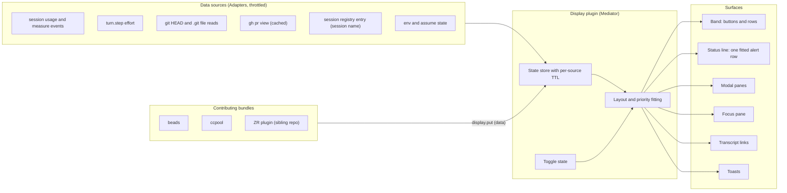
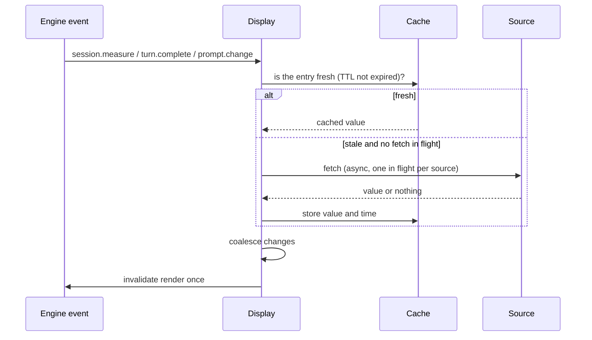
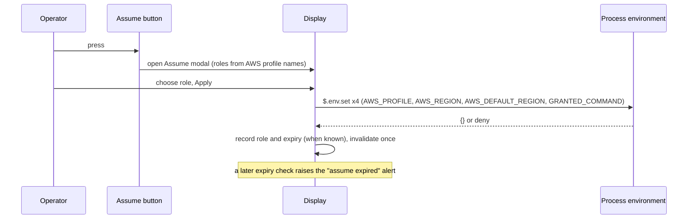

# Display layer design: a mod-based session display

Status: reviewed 2026-11-06 (see "Review"). All 21 decisions are `accepted`;
D3, D10 and D14 by operator ruling the same day.
Date: 2026-11-05. Claude Code version the findings come from: 2.1.314.

## Intent

The shell status line (ten part scripts, one subprocess per part, joined with
`" | "`) carries more than the operator needs at a glance, cannot offer
actions, and cannot be extended without editing a part list. The operator wants
a display where:

- the always-needed facts are compact,
- facts that matter only sometimes appear only then,
- detail is one click away,
- other bundles (beads, ccpool, a ZR plugin in a sibling repo) contribute items
  without editing shared scripts,
- buttons smooth workflow edges that today need an exit and resume, such as
  assuming a role, changing the model, or wrapping up a session.

## Goals, non-goals, anti-goals

Goals:

- One owner of layout, ordering, throttling and toggles (a Mediator).
- Colors, multiple rows, wrapping and buttons for information and actions.
- Every data source MUST be throttled and MAY be empty on first draw.
- A simple extension point for other plugins, and a simple extension point for
  transcript links.

Non-goals:

- Session naming, a CETA daemon, vim mode, thinking indicator, `claude-hook-router`
  (all dropped by the operator).
- Replacing CETA or the safety hooks; this design covers display only.
- pg-desk integration beyond a Focus pane that lists items (a later phase).

Anti-goals (a failure even if it technically works):

- A display that spawns a process per render, or polls `git` from every session
  (the operator has hit git lock contention from many sessions running git).
- A display whose alerts exist only where the user can collapse them away.
- An empty or no-op `statusLine` command kept as a data collector (operator
  ruling: avoid it).

## Constraints from the spikes

Verified live on Claude Code 2.1.314 unless marked "docs".

| #   | Finding                                                                                                                                                                                                                                                                                                                                                                                                                                                                                                                                                                                                                                                                           | Consequence                                                                                                                                                                                  |
| --- | --------------------------------------------------------------------------------------------------------------------------------------------------------------------------------------------------------------------------------------------------------------------------------------------------------------------------------------------------------------------------------------------------------------------------------------------------------------------------------------------------------------------------------------------------------------------------------------------------------------------------------------------------------------------------------- | -------------------------------------------------------------------------------------------------------------------------------------------------------------------------------------------- |
| F1  | A mod's `$.ui.status` is one plain-text row per plugin, prefixed by the engine with a warning glyph and the plugin's manifest `name`. Newlines draw as a replacement glyph; ANSI escapes show literally; long text is cut with an ellipsis; no ordering control; an updated line moves to the bottom of the mod lines. `displayName` and `title` manifest keys are ignored.                                                                                                                                                                                                                                                                                                       | The status line is for short, focused alerts only, and one plugin SHOULD own all of them as one line it fits itself.                                                                         |
| F2  | The shell `statusLine` setting accepts only `{ type: "command", command: <string> }`; `null`, `""` and `{}` are rejected; an empty `command` string loads and draws no shell row. In this repo a null option is a deliberate no-op that leaves an already-written `statusLine` in the user settings file.                                                                                                                                                                                                                                                                                                                                                                         | The shell line is retired by setting the `statusLine` option to `{ type = "command"; command = ""; }`, which the option already accepts; a delete filter is optional cleanup, not a blocker. |
| F3  | The band above the prompt is one site. Two plugins returning their own trees do not both draw: the first answering plugin wins. A plugin that awaits `next(e)` and nests the result composes (two stacked rows, both buttons worked). The band supports color, background color, bold, dim, emoji and Nerd Font glyphs, several rows, and re-wraps with width. The band hook sees the live width.                                                                                                                                                                                                                                                                                 | One plugin owns the band and draws other bundles' rows from pushed data; it also nests `next(e)` so a band from another plugin is not lost.                                                  |
| F4  | The engine's own collapse control hides the whole band; a plugin's toggle cannot undo it.                                                                                                                                                                                                                                                                                                                                                                                                                                                                                                                                                                                         | An alert MUST NOT live only in the band.                                                                                                                                                     |
| F5  | Several panes can be open at once; they become tabs; the last opened is active. A pane opened `holdToasts` holds every toast until it closes. A modal pane takes focus; Tab and arrows walk its buttons; Esc and a dismiss button close it. Tabs were tested with two panes from one plugin; behavior across plugins, and a modal beside the Focus pane, is untested.                                                                                                                                                                                                                                                                                                             | Modals and the Focus pane are panes.                                                                                                                                                         |
| F6  | `$.config.set({ key: "model", value })` switches the model and the display follows. There is no effort row. `$.prompt.fill` puts text in the prompt box without sending. `$.prompt.submit` from a command does not start a turn until the next user input.                                                                                                                                                                                                                                                                                                                                                                                                                        | The model button applies directly; the effort and wrap-up buttons pre-fill the prompt.                                                                                                       |
| F7  | `$.env.set` on fixed string-literal names is visible to later child processes and to `!` shell commands; a headless run set and unset both a made-up name and `AWS_PROFILE` with no denial, and an interactive `!` command saw a made-up name; `AWS_PROFILE` was not tried interactively. A model-run Bash call was not directly confirmed.                                                                                                                                                                                                                                                                                                                                       | An assume action can set a fixed list of variables.                                                                                                                                          |
| F8  | A render hook can rewrite assistant-message markdown so ids become links; a click opened them.                                                                                                                                                                                                                                                                                                                                                                                                                                                                                                                                                                                    | Transcript links are feasible.                                                                                                                                                               |
| F9  | `$.session.usage()` gives context window at start and, after the first model response, tokens and percent; it gives rate limits and cost; only the five-hour limit was seen live, the seven-day kind and "a whole-point move" are docs-only, and the list was empty in one session. A `session.measure` event fires at start and after each turn and names what changed (verified for context, rate limits and cost). Effort is readable from the `turn.step` event after the first model request. `$.session.repo()` gives root, remote and `internal`, plus a `name` that was null in every run; no branch. `$.session.messages()` entries carry only role, text and tool uses. | Context, limits, cost, model and effort need no external collector. Session name has no documented mod source.                                                                               |
| F10 | A hook on a streaming event (`turn.step`) MUST be an async generator delegating with `yield* next(e)`. A method on a plugin-added noun takes exactly one object argument and returns a Promise (verified live); that only plain data crosses plugin boundaries is from the docs, and a callback across the boundary was not tried. A hook that throws is skipped alone; a failed hot reload keeps the previous version loaded.                                                                                                                                                                                                                                                    | The `pgd` noun is data in, Promise out, one object per call. Contributions are data, not callbacks.                                                                                          |
| F11 | The recorder (`pg-claude-code-recorder`) indexes transcript `custom-title` records by session; its `query` command returned them with the session id and time (observed live, 2026-11-05). The field that holds the title text was not found: `customTitle` was rejected as an unknown field.                                                                                                                                                                                                                                                                                                                                                                                     | Session name is optional and read through the recorder.                                                                                                                                      |
| F12 | `$.process.run` runs a command without a shell. `$.fs` reads files (docs). `$.ui.invalidate` redraws, capped at 10 per second (docs).                                                                                                                                                                                                                                                                                                                                                                                                                                                                                                                                             | File reads and the recorder CLI are the data paths; invalidation is cheap but MUST still be coalesced.                                                                                       |

## Approaches considered

- **A. Display owns one band and one alert line; other bundles push data to it
  through a noun (chosen).** One place for layout, ordering, toggles and
  throttling. Costs a contribution API to maintain.
- **B. Each bundle draws its own band.** Rejected by F3: only the first
  answering plugin draws.
- **C. Keep the shell status line and add one band.** Rejected by the operator:
  the shell line is going away, and keeping it as a hidden data collector is an
  anti-goal.

## Architecture

The Display plugin is a Mediator over three kinds of collaborator. Engine events
reach it as an Observer subscription; the `pgd` noun is a Registry of
contributions; each data source is an Adapter behind a Cache-Aside entry; link
rules are a list of Strategies; and each button is a Command with one action.



Refresh flow, applying Cache-Aside with a per-source TTL:



## Surfaces and placement

| Item                                                      | Surface                                                                      | Lifetime and toggle         |
| --------------------------------------------------------- | ---------------------------------------------------------------------------- | --------------------------- |
| Session name, or session id when no name                  | Band button 1, opens the Info modal                                          | Always                      |
| Model and effort                                          | Band button 2, label `Model · effort`, opens the Model modal                 | Always                      |
| Context percent                                           | Band button 3, label `ctx N%`, colored by level, opens the Context modal     | Always                      |
| Session mode (`RUNNING`, `STOPPING`, `DONE`, wrapping up) | Band button 4, opens the Session mode modal                                  | Only while a mode is active |
| Assume                                                    | Band button 5; label `Assume`, then the current role; opens the Assume modal | Always                      |
| Focus                                                     | Band button 6; opens and closes the Focus pane                               | Always                      |
| Wrap up                                                   | Band button 7; pre-fills the wrap-up command in the prompt box               | Always                      |
| Repo, worktree, branch, PR review state                   | Info modal, one item per line                                                | On demand                   |
| Version, actor, cost, both limits in full                 | Info and Context modals                                                      | On demand                   |
| Beads, Jira, threads, PRs                                 | Focus pane only (never the band)                                             | Pane open or closed         |
| Alerts (see below)                                        | Status line, one fitted row                                                  | Only while true             |
| Events (compacted, worker finished)                       | Toast                                                                        | Seconds                     |
| Bead and Jira ids in replies                              | Transcript links                                                             | Always                      |

Rules:

- The band MUST contain only actions and short labels; it MUST NOT carry a row
  that reads "no X". An item whose condition is false MUST NOT be drawn.
- Alerts MUST appear in the status line, not only in the band (F4).
- The Focus pane MAY also hold items from other bundles; nothing from it MUST
  be drawn in the band.

### Alerts (status line)

One aggregated row, prefixed by the engine `⚠ <plugin name>:`. The plugin that
owns it SHOULD be named so the prefix reads well; the plugin is named `pgd`
(D3), in its manifest, its marketplace entry and its directory.
The row lists only items whose condition is true, highest priority first, and
MUST drop the lowest-priority items itself when the width runs out instead of
letting the engine cut text mid-word.

| Alert               | Condition (proposed thresholds, tunable)           | Phase |
| ------------------- | -------------------------------------------------- | ----- |
| dolt unavailable    | The beads server probe fails (needs `beads` on)    | 1     |
| Rate limit near cap | five-hour or seven-day used percent at or above 80 | 1     |
| Context excessive   | context percent at or above 80                     | 1     |
| Wrapping up         | a wrap-up mode is active (needs the mode source)   | 2     |
| Assume expired      | an assumed role's expiry has passed (needs assume) | 4     |

In the busy mockup below, `[ dev ]` is the Assume button after a role is set.
Before a role is set the same button reads `[ Assume ]`.

pg-router and ccpool failures are NOT alerts here; the operator ruled they are
handled other ways.

### Mockups

Quiet session (no alerts, no active mode):

```text
 [ f4e6ce80 ] [ Sonnet · med ] [ ctx 12% ] [ Assume ] [ Focus ] [ Wrap up ]                [-]
 ───────────────────────────────────────────────────────────────────────────────────────────
 ❯
 ───────────────────────────────────────────────────────────────────────────────────────────
  ⏵⏵ auto mode on (shift+tab to cycle)
```

Busy session:

```text
 [ drain-bead-pg2-4yy4 ] [ Sonnet · med ] [ ctx 88% ] [ drain-beads: RUNNING ] [ dev ] [ Focus ] [ Wrap up ]  [-]
 ──────────────────────────────────────────────────────────────────────────────────────────────────────────
 ❯
 ──────────────────────────────────────────────────────────────────────────────────────────────────────────
  ⚠ pgd: wrapping up · 5h limit 83% · ctx 88% · assume expired
  ⏵⏵ auto mode on (shift+tab to cycle)
```

The mockups are drawn at about 100 columns. Behavior at about 80 columns was
observed in the spike only for the band wrapping and the status row truncating,
not for these exact layouts.

Info modal:

```text
 ┌ Info ──────────────────────────────────────────────────────────── ✕ ┐
 │ name        drain-bead-pg2-4yy4                                     │
 │ session id  f4e6ce80-6dd3-48c4-b6a6-6d1663ff0d9a                    │
 │ actor       f4e6ce80-…                                              │
 │ version     2.1.314                                                 │
 │ repo        phillipgreenii/nix-agent-support                        │
 │ worktree    /Volumes/gitrepos/phillipg/nix-agent-support/.worktrees │
 │ branch      example-branch                                          │
 │ PR          #412 (changes requested)                                │
 │                                                  [ Close ]          │
 └─────────────────────────────────────────────────────────────────────┘
```

## Modals

Each band button opens its own modal pane (F5):

| Modal             | Items, one per line                                                                                                                          | Actions                                                                                                                        |
| ----------------- | -------------------------------------------------------------------------------------------------------------------------------------------- | ------------------------------------------------------------------------------------------------------------------------------ |
| Info              | name, session id, actor, version, repo, worktree, branch, PR with review state colored                                                       | Close                                                                                                                          |
| Model and effort  | model choices (current marked), effort choices (current marked, blank until the first turn)                                                  | Apply: model through `$.config.set` (F6); effort pre-fills `/effort <level>` in the prompt box for the operator to send; Close |
| Context and usage | context percent and tokens, last compaction, five-hour limit with reset time, seven-day limit with reset time (each only when present), cost | Close                                                                                                                          |
| Session mode      | mode, state, detail                                                                                                                          | Stop (runs `session-mode set-status stopping`); Close                                                                          |
| Assume            | role choices read from the AWS profile names, current role, expiry when known                                                                | Apply (sets the variable list, F7); Clear; Close                                                                               |

The Focus pane is a list, one row per item, each row `kind  id  title  [ open ]`
where `open` follows the item's `url` when it has one. Rows are ordered by the
contributor's `priority`, then by time added. An empty pane reads `Nothing
tracked for this session.`

A modal MUST NOT use `holdToasts` unless it is short-lived. The Wrap up button
opens no modal; it pre-fills the prompt.

Where two surfaces show the same fact, one source MUST feed both, so the label
and its modal never disagree.

## Contribution API

Display adds one noun, `pgd`, in `engine.create`, with a types contract.
Per F10, every method takes one object and returns a Promise, and only data
crosses the boundary.

| Method       | Argument                                          | Effect                                                                                                                                                    |
| ------------ | ------------------------------------------------- | --------------------------------------------------------------------------------------------------------------------------------------------------------- |
| `pgd.put`    | `{ id, surface, priority, text, color?, ttlMs? }` | Adds or replaces a contribution. `surface` is `alert` (a short string in the status line) or `focus` (an item in the Focus pane, with an optional `url`). |
| `pgd.remove` | `{ id }`                                          | Removes it.                                                                                                                                               |

A contribution with `ttlMs` expires on its own; a contribution that stops
refreshing disappears. Contributors push when their state changes; Display never
calls back into a contributor. How a contributed action (a button press) runs
is open (see "Open items").

The ZR plugin in the sibling repo depends on the Display plugin and calls
`pgd.put`, replacing its part scripts.

## Data sources and throttling

Every source MUST follow these rules:

- It MUST be fetched at most once per interval and one fetch in flight at a time.
- It MUST NOT block a draw; a draw uses the last cached value or nothing.
- A missing value on first draw is fine; the value is drawn when it arrives.
- A change MUST be compared with the cached value and MUST NOT trigger a redraw
  when equal; redraws MUST be coalesced.
- A failed fetch MUST back off and MUST NOT spin.

| Source                     | Mechanism                                                                                            | Refresh (proposed defaults)                                                                                                                                     |
| -------------------------- | ---------------------------------------------------------------------------------------------------- | --------------------------------------------------------------------------------------------------------------------------------------------------------------- |
| Context, limits, cost      | `session.measure` event, then `usage()`                                                              | Event-driven; no polling                                                                                                                                        |
| Model                      | `$.session.model()`                                                                                  | On `config.set` and session start                                                                                                                               |
| Effort                     | `turn.step` event                                                                                    | Update on change; blank until the first turn                                                                                                                    |
| Branch, worktree           | Read `.git/HEAD` and the `.git` file through `$.fs`; no `git` command                                | After `turn.complete` and `session.compact`, and when `$.session.cwd()` differs (read on those events; no cwd-change event exists); at most once per 10 seconds |
| PR number and review state | `gh pr view` through `$.process.run` with branch and repo passed explicitly                          | At most every 5 minutes, and once when the branch changes; shared across sessions through the store if available                                                |
| Session name (phase 4)     | The session's own entry in `~/.claude/sessions/<pid>.json` through `$.fs` (D10)                      | Found once at start; re-read after `turn.complete`, at most once per 10 seconds                                                                                 |
| Session mode (phase 2)     | `session-mode show` through `$.process.run`, with `CLAUDE_CODE_SESSION_ID` passed in the run's `env` | On `turn.complete` and after a stop action; at most once per 10 seconds                                                                                         |
| Assume state               | Process environment and a stored expiry                                                              | On assume actions and on a one-minute check                                                                                                                     |
| dolt availability          | A cheap probe                                                                                        | At most every 30 seconds, while the alert row is enabled (not tied to the band being shown)                                                                     |

Visibility and timers. A source that feeds an alert MUST keep running while the
band is collapsed (F4), because the alert row is the surface that survives a
collapse. A source that feeds only the band or a modal MUST stop its timer while
that surface is not drawn. An idle session (no event for five minutes) multiplies
every interval by four until the next event.

Git lock avoidance is a requirement: the display MUST NOT run `git` commands.
`gh pr view` runs read-only git plumbing internally; its lock impact was not
measured, which the cache interval is meant to make negligible.

## Toggles

- The band and each modal are panes or a band; a toggle MUST be reachable from a
  button, a slash command, and the engine's own collapse control (F4).
- The Focus button toggles the Focus pane.
- A toggle's state is an atom that survives a hot reload of the plugin (verified).
- Context-button color is by level: normal, yellow, red (proposed thresholds 60
  and 80).

## Transcript links

A render hook on assistant-message text rewrites matches into markdown links.
Rules come from a list in the plugin's options; adding a link type is adding
an entry:

```toml
[[link]]
name = "jira"
pattern = '\bZR-\d+\b'
url = "https://example.invalid/browse/{0}"
```

`pattern` is a regular expression, `url` is a template where `{0}` is the match.
Rules apply in list order; a span already rewritten by an earlier rule MUST NOT
be matched again, and text inside a code span or code block MUST NOT be
rewritten. A rewrite changes only what is drawn. Bead ids have no link target for now
(operator, 2026-11-05: "bead links point no where for now"), so the shipped list
MUST NOT contain a bead entry until a target exists.

## Assume

The Assume button is labeled `Assume` until a role is set, then shows the
current role. `assume` is the `granted` command-line tool. In a shell after
`assume dev/developers-dev` the environment holds exactly four new variables:
`AWS_PROFILE`, `AWS_REGION`, `AWS_DEFAULT_REGION` and `GRANTED_COMMAND` (the
profile name). It holds no access key or session token, so the credentials come
from the profile (SSO or a credential process), not from exported keys.

Proposed mechanism: Apply sets those four variables with `$.env.set` (names are
string literals in source) and does not run `assume`, so a later AWS call in the
session resolves credentials from the profile. The role list is the profile names
in the operator's AWS config, read once. When the role's expiry passes, an alert
row appears.

Open, and MUST be verified before phase 4 builds this: that setting the four
variables is enough for an agent's AWS call to authenticate; where the expiry
comes from (no expiry variable exists in the environment); and what happens when
the SSO login has lapsed. A process run has a 30-second default timeout and a
ten-minute maximum (docs), so a browser login MAY fit if the call passes an
explicit timeout.



## Coexistence and retirement of the shell status line

1. Display ships and runs alongside the shell line (both draw; mod alerts appear
   above the shell rows).
2. The ZR parts move to `pgd.put` in the sibling repo, on its own schedule.
3. Once the ZR plugin has adopted the contract, the shell line is retired by
   setting the `statusLine` option to `{ type = "command"; command = ""; }`
   (verified to load and draw no shell row, F2) and, after that, removing the
   part scripts. A delete filter for the stale `statusLine` key is optional
   cleanup, not a blocker. Until then `statusLine` MAY stay.

## Packaging, scope and fallbacks

Packaging. Display is a new mod under the committed `claude-marketplace/` tree,
default-enabled like the existing control and tracker mods, with a Home Manager
module that installs the binaries and settings it needs (the `pg-claude-control`
module is the precedent). The nix wiring and a parity check come with it.

Plugin name and directory (D3). Everything is named `pgd` (for "pg display";
operator ruling, Phillip, 2026-11-06, verbatim: "go with pgd (of pg display). it
is short and won't conflict with anything from claude. rename everything
everywhere."): the mod directory `claude-marketplace/pgd`, the manifest name and
the marketplace entry name (so the three agree as the marketplace parity check
requires), the Home Manager option namespace `phillipgreenii.programs.pgd`, the
module path `home/programs/pgd/`, the log directory `$XDG_STATE_HOME/pgd/` and the
check names `test-pgd-*`. A name starting `claude-` cannot be used:
`claude plugin validate` (Claude Code 2.1.314) refuses it as reserved. The
skeleton first shipped as `status` (the plugin) and `claude-display` (the module);
the rename to `pgd` is its own packet. The `pgd` noun and the `pgd_*`
metric names keep their names unless the operator rules otherwise.

Host access and the registration shape. `claude plugin validate` (Claude Code
2.1.314) refuses a module that passes `$` itself as an argument ("$ itself is
passed as an argument (bound, passed, spread, returned or read); $ is always
spelled $.noun.event(...) at the call site") and a generic forwarder such as
`env.get: k => $.env.get(k)` ("$.env.get takes a literal name as its first
argument"). So the mod's one hooks module, `claude-marketplace/status/hooks/register.ts`,
builds a host facade inside its `session.start` hook: an object of closures, one
purpose-named member per `$` call the mod needs (`process.run`, `fs.read`,
`fs.write`, `http.fetch`, `config.set` today; `ui.invalidate`, `session.usage`,
`session.model`, `session.cwd` and the like when a source needs them), each member
spelled as a `$.noun.method(...)` call site. The facade, never `$`, is what the
mod's code receives: `registerComponents(options, host)`, `initSources(host, ...)`,
every source starter and every source's `fetch` (`fetch: ({ host }) => ...`); a
test passes a stub host that records its calls. A component that needs another
`$` member adds one closure to the facade in `register.ts`. Event hooks
(`session.measure`, `turn.step`, `turn.complete`, `session.compact`, `config.set`)
take `$` from their own callback and write results with `setValue`; they MAY live
in a module other than `register.ts` that receives `on` as an argument, and a
timer or async path outside a callback reaches `$` only through the facade.
Checked 2026-11-06 with `claude plugin validate` on throwaway copies of the mod:
(1) a facade with `ui.invalidate` and `session.usage`/`model`/`cwd`/`id` closures
built in `session.start`, plus `session.measure`, `session.compact` and
`turn.complete` hooks registered by a second file through `on` passed as an
argument and calling `$.session.usage()` and `$.ui.invalidate()` directly,
passes (calls listed as `$.session.cwd, $.session.id, $.session.model,
$.session.usage, $.ui.invalidate`); (2) `$` passed to an arrow function in
another file is refused ("$ is passed to "poke", a name bound to a function
expression, outside the hook's own file"); (3) `$` passed to a function
declaration in another file passes ("$.ui.invalidate (via poke)"), which the
design does not rely on; (4) a second entry in `hooks.json` `modules` is refused
("hooks.json `modules` names one hooks module per plugin; a second entry is
refused"); (5) a `session.compact` hook without a `.catch` draws only the
warning "gating hook without .catch".

Scope calls (the builder MAY rely on these):

- Display renders what bundles push and what its own sources read. It does not
  fetch beads, Jira or threads itself. The `pgd` noun (its `alert` and
  `focus` surfaces and its types contract) ships in phase 2, so phase 3 (ZR
  adoption) and phase 4 (the Focus pane) both build on it. The Focus pane ships
  in phase 4 with an empty state; the beads bundle's own push is a follow-on.
- Contributed buttons are out of scope: the `pgd` noun carries data only
  (`alert` and `focus` surfaces) and has no action field. Adding one is a
  follow-on once a mechanism is found.
- The `session-mode` tool already has the commands the mode button needs:
  `session-mode show` prints the session's record (exit 2 when there is none)
  and `session-mode set-status stopping` marks it stopping. Both read the session
  id from `CLAUDE_CODE_SESSION_ID`, which the mod MUST pass in the process run's
  `env` from `$.session.id()`. No change to the tool is needed.
- The findings guide's doc lives in this repo's `docs/guides/`, and its skill
  ships through the agent-support plugin set, both in phase 1.
- The ZR migration is out of scope. This work publishes the `pgd` noun's
  types contract and one documented example; the sibling repo adopts it later.
  Phase 3 is therefore gated on that adoption: its in-repo parts (the switch to
  the empty `statusLine` command and the removal of the part scripts) wait for it.
- Retiring the shell line is the settings option change described under
  "Coexistence and retirement". A delete filter for the stale key is optional.
- The wrap-up button pre-fills the wrap-up skill's slash command; the exact text
  is confirmed when the button is built.
- A button inside Display's own plugin (the band and modals) runs its action in
  the plugin. Only a button contributed by another bundle needs the open
  mechanism in "Open items".

Session mode. The mode, state and detail come from the same record the shell
line reads today (`session-mode` writes a `<session_id>.session-mode.json`
file next to the transcript). The mod MUST read it through `session-mode show`,
because the transcript directory has no documented mod path. The stop action
runs `session-mode set-status stopping`.

Fallbacks (cut lines). None of these sources blocks the others, and a failed
source MUST leave only its own item blank:

| Source fails           | Result                                                   |
| ---------------------- | -------------------------------------------------------- |
| `.git` file reads      | Branch and worktree rows are omitted from the Info modal |
| Session registry read  | The first button shows the session id                    |
| `gh pr view`           | The PR row is omitted                                    |
| Session mode read      | The mode button is not drawn                             |
| Assume expiry source   | The button shows the role and raises no expiry alert     |
| A contribution expires | Its item disappears; nothing else changes                |

## Efficiency architecture

Pulling data and drawing it are separate layers (a Producer and Consumer joined
by a cache, drawn Cache-Aside), so a redraw never causes a fetch.

- **Source layer.** Each source owns its interval, its single in-flight fetch, its
  backoff and its cached value with a fetch time. A source fetches only when its
  entry is stale and something needs it, never because a draw happened. The
  interval is the rate at which the source is expected to change, not the rate
  at which the screen can redraw.
- **Draw layer.** A draw MUST read cached values only. A draw MUST NOT start a
  fetch, spawn a process or read a file. The engine caps invalidation at ten per
  second; Display MUST still invalidate only when a cached value changed
  (compared by value) and MUST coalesce several changes into one invalidate.
- **Shared sources across sessions.** Many sessions run at once, and most of
  their facts are the same: the PR for a branch, the dolt probe, the rate limits.
  A source whose value is not specific to one session SHOULD be shared. The
  plugin's `$.store` is one JSON file under the user's Claude configuration
  directory that every session of the plugin reads, so it MAY hold a shared
  entry `{ value, fetchedAt }`; a session that finds a fresh entry MUST use it
  and MUST NOT fetch. How safe concurrent writers are, and how quickly one
  session sees another's write, is not documented and is an open item. A
  per-source cache file under the user's state directory, written whole and
  replaced atomically, is the fallback. A single daemon that owns the shared
  fetches is a later option and MUST NOT be built first.
- **Session-specific sources** (context, effort, mode) stay in memory per session
  and are event-driven (`session.measure`, `turn.step`).
- **Idle sessions** SHOULD do less: a session with no event for five minutes
  multiplies its intervals by four until the next event, and a source that feeds
  only a surface that is not drawn MUST NOT drive a timer (the alert sources are
  the exception; see "Visibility and timers").

## Phasing

Each phase ships and is useful on its own; later phases MAY be deferred behind
a capability that is not yet available.

| Phase | Content                                                                                                                                                                                                                                                                                                                                                                                                                                     | Depends on                                                                             |
| ----- | ------------------------------------------------------------------------------------------------------------------------------------------------------------------------------------------------------------------------------------------------------------------------------------------------------------------------------------------------------------------------------------------------------------------------------------------- | -------------------------------------------------------------------------------------- |
| 1     | Display only, matching today's shell line: the band shows plain labels (session id, model and effort, context) and the status row shows alerts (limits, context, dolt). No buttons and no contribution path. The shell line keeps running beside it. Includes the source layer, cache, throttling, the opt-in switches (defaults match today's shell line: all on), counters with a no-op exporter, the OTLP spike, and the findings guide. | none                                                                                   |
| 2     | Buttons with modals and panes for what the shell line already shows: Info (version, repo, worktree, branch, PR), Context and usage, Session mode (with stop). The labels from phase 1 become buttons. Ships the `pgd` noun (`alert` and `focus` surfaces) and its types contract, and the "wrapping up" alert.                                                                                                                              | phase 1                                                                                |
| 3     | Retire the shell implementation: after the ZR plugin has adopted the `pgd` contract (sibling repo, the operator's schedule), set `statusLine` to the empty command and remove the part scripts. The settings delete filter is optional cleanup.                                                                                                                                                                                             | phase 2; ZR adoption (sibling repo)                                                    |
| 4     | New capabilities, each independent of phase 3: the model and effort modal, Wrap up, Assume, transcript links, session name (the session registry entry), and the Focus pane.                                                                                                                                                                                                                                                                | phase 2; Assume needs the open assume items; Focus items from pg-desk wait for pg-desk |

Phases 3 and 4 both follow phase 2 and MAY proceed in either order or together.
The OTLP check in phase 1 is a spike: if the route is not allowed, phase 1 ships
counters and the no-op exporter only, and no emitter command is built.

Anything that cannot be verified when its phase starts (for example the
session-name source or the assume expiry) MUST be deferred to a later phase
without blocking the others.

## Observability

Metrics, errors and logs MUST be part of phase 1, not added later.

What the mod framework offers (from the docs; none of it was run):

- `$.telemetry.log` writes first-party analytics rows to Anthropic, and a
  "collector" record reaches the operator's collector only when the engine
  itself raised it. A plugin cannot send its own metrics through it.
- `$.http.fetch` posts through the host to any http or https address the
  organization's web policy allows, and takes a `socketPath` for a unix socket.
  A mod MAY therefore post OpenTelemetry protocol data (OTLP over HTTP) to a
  local collector, subject to that policy.
- `$.process.run` MAY run a small emitter command, as a fallback.
- Logs: `$.ui.log` is a transcript row, not a log sink. A log written to a file
  with `$.fs.write` is the available route, and the recorder or the log
  pipeline MAY collect it.

Requirements (proposed): record, per source, fetch duration, fetch count, cache
hits and misses, and errors by kind; per draw, duration and count; export them
through one exporter module that stays a no-op unless an endpoint is configured
and that never blocks a draw. Whether OTLP over `$.http.fetch` works under this
machine's managed web policy MUST be verified before relying on it; if it does
not, the exporter falls back to a small emitter command, and what it takes to
add first-class mod telemetry becomes a separate follow-on for the operator to
rule on.

Names (proposed, so a builder does not invent them):

- Metrics, each labeled by `source` where it applies: `pgd_fetch_total`,
  `pgd_fetch_errors_total{kind}`, `pgd_fetch_duration_seconds`,
  `pgd_cache_hits_total`, `pgd_cache_misses_total`,
  `pgd_draw_total{surface}`, `pgd_draw_duration_seconds{surface}`,
  `pgd_invalidate_total`, `pgd_invalidate_coalesced_total`.
- Logs: one JSON line per event (time, level, source, message, error kind) to
  `$XDG_STATE_HOME/pgd/<session-id>.log`, rotated by size (the
  builder picks the cap) and never read on a draw.

## Opt-in components

Every component is opt-in, as the shell line's parts are today. A component that
is off MUST register nothing: no band button, no modal, no source, no timer, no
alert, no command and no `$.env.set` name. A disabled feature costs nothing at
runtime.

| Component        | Off means                                                    |
| ---------------- | ------------------------------------------------------------ |
| beads            | No dolt alert, no beads contributions or Focus rows          |
| assume           | No Assume button, modal, expiry alert, source or `$.env.set` |
| session mode     | No mode button, modal or stop action                         |
| PR status        | No `gh` source, no PR row                                    |
| recorder name    | No session registry read; the id is shown                    |
| transcript links | No render hook                                               |
| model and effort | No button or modal                                           |
| Focus pane       | No button, pane or contribution storage                      |
| ccpool, ZR       | Not Display's concern; those bundles do not push             |

The switches are options in the Home Manager module (rendered into the plugin's
options), each defaulting to the operator's choice. Proposed option names under
`phillipgreenii.programs.pgd`: `enable`, `components.beads`,
`components.assume`, `components.sessionMode`, `components.prStatus`,
`components.sessionName`, `components.links`, `components.modelEffort`,
`components.focus`, plus `links` (the link list) and `alerts.thresholds`. Display reads them in
`register`, so a disabled component never loads. A bundle that is turned off
(beads, ccpool) MUST stop pushing, and Display MUST drop what it already holds
when the contribution expires.

## Mod findings guide (a deliverable)

The spike findings MUST NOT be lost. This work delivers a guide, as a doc in the
repo and a skill shipped through the agent-support plugin set, so a later agent
does not repeat the spike. It MUST state the Claude Code version the findings
were observed on (2.1.314) and be dated, and it MUST separate what was verified
live from what comes only from the docs. The findings table in this design is its
seed. The doc is `docs/guides/claude-code-mods.md`, and the skill is named
`claude-code-mods` in the agent-support plugin set. It is a phase 1 deliverable and MUST be updated whenever a later phase
learns something new.

## Session name hypothesis

The hypothesis that the name is set only after the first turn was tested and did
not hold: after a turn and a tool call, the name did not appear in the inputs of
`session.start`, `session.measure`, `prompt.submit`, `turn.start`, `tool.call`
or `turn.complete`, the props of the band, mode, hint, spinner and duration
render sites, the `/config` rows, full usage, the surface, the version, or the
message list. A wider test found two readable sources and no name field:

- **The `claude` process's arguments** hold `-n <name>`, readable with one
  `ps` call through `$.process.run`. It reflects the name given at launch only;
  after `/rename` the arguments did not change.
- **The transcript file** holds the title in `custom-title` records (the last
  one wins), and `$.fs.read` read a 674 KB transcript. A read copies the whole
  file and is rejected over 4 MiB, which a long session passes, so the
  transcript MUST NOT be the routine source.
- The process environment, the message-level render props and the command-output
  rows carried the name only where a row quoted the command text.

Chosen route (proposed): read the launch name once at start from the process
arguments; refresh a renamed name from the recorder (an indexed query) on a slow
interval, and only while the first button is drawn; fall back to the session
id. The recorder's title field name and the cost of its query remain open. Whether
a rename can be detected by hooking the built-in `/rename` command was not tested.

## Verification

Each phase is verified by automated tests that stay in the repo, run in a hermetic
environment against the real tool wherever the tool's own behavior matters (a mock
of `session-mode` or `gh` does not count). Unit tests are fast and single-process;
anything slow, many-process or end-to-end sits behind an opt-in with its own check
and MUST NOT run in the unit gate. Mutation testing is not part of any step.

Tools: the mod framework's test runner (`claude plugin test <mod folder>` with
`*.test.ts` files and its `mock`), `claude plugin validate`, bats for shell, and
nix checks under `tests/` (the `pg-claude-control` module's check is the pattern).

| Phase | Tests the builder MUST provide                                                                                                                                                                                                                                                                                                                                                                                                                                                                                                                                                                                                                                                                         |
| ----- | ------------------------------------------------------------------------------------------------------------------------------------------------------------------------------------------------------------------------------------------------------------------------------------------------------------------------------------------------------------------------------------------------------------------------------------------------------------------------------------------------------------------------------------------------------------------------------------------------------------------------------------------------------------------------------------------------------ |
| 1     | Cache: TTL hit and miss, one fetch in flight, backoff on failure; a draw starts no fetch, process or file read; redraw only on a changed value, with coalesced invalidates; alert fitting and priority drop by width, and no "no X" row; context color thresholds; effort blank until the first turn; each opt-in switch off registers no button, command, hook, timer or `$.env.set`; the `.git` parser against fixture files (branch, detached head, worktree pointer file); an assertion that no `git` command is run; the no-op exporter never blocks; `claude plugin validate` passes; a nix check that renders the module options; a check that the findings guide names the Claude Code version |
| 2     | One test per button opening its modal and the one-item-per-line content of each; `session-mode show` and `set-status stopping` run against the real tool in a throwaway directory with the session id passed in `env`; the mode button hidden when no mode is active; every row of the Fallbacks table; `pgd.put` and `pgd.remove` with `ttlMs` expiry; the types contract compiles against the documented example                                                                                                                                                                                                                                                                                     |
| 3     | A nix eval check that the `statusLine` option set to the empty command renders and that other settings keys are untouched; the part scripts are gone with no dangling references (a repository search is a test)                                                                                                                                                                                                                                                                                                                                                                                                                                                                                       |
| 4     | Link rules: several entries, list order, no bead entry, no rewrite inside code; the registry-entry reader against sample registry files; model switch through `config.set`; the effort and wrap-up pre-fills; the assume Apply setting exactly the four names and the expiry alert; an empty Focus pane                                                                                                                                                                                                                                                                                                                                                                                                |

Opt-in, slow or many-session checks (the shared-store test with several real
processes, a soak of many sessions) sit behind a build tag or switch with their own
check.

Live-only items cannot be unit tests and MUST each be tracked as a separate
verification item, with evidence from a real session: the engine collapse control
hiding the band; a link click; modal focus walk; `$.env.set` seen by a model-run
Bash call; AWS authentication after Apply; the OTLP route under the managed web
policy; a real `/rename`;
the real wrap-up; cross-plugin tab behavior; and the layout at 80 columns.

## Decisions

| #   | Decision                                                                         | Status                |
| --- | -------------------------------------------------------------------------------- | --------------------- |
| D1  | One Display plugin owns the band and the alert line (approach A)                 | accepted              |
| D2  | No `statusLine` collector; sources are mod APIs and file reads (F9, F12)         | accepted              |
| D3  | Alerts are one fitted status row; the plugin is named `pgd` everywhere           | accepted (ruling)     |
| D4  | Band order: name or id, model and effort, context, mode, assume, Focus, Wrap up  | accepted              |
| D5  | Each button opens its own modal pane                                             | accepted              |
| D6  | Session mode modal has a stop action                                             | accepted              |
| D7  | Context button colored by level                                                  | accepted              |
| D8  | Contributions are pushed data through the `pgd` noun                             | accepted              |
| D9  | No `git` command; read `.git` files; `gh` cached for PR state                    | accepted              |
| D10 | Session name optional: the session registry entry, id fallback                   | accepted (ruling)     |
| D11 | Link types are a regex plus URL template list                                    | accepted              |
| D12 | Effort and wrap-up buttons pre-fill the prompt; model applies directly           | accepted              |
| D13 | Pulling is separate from drawing; a draw reads cache only                        | accepted              |
| D14 | Shared sources go through the plugin store, one key per source; no file fallback | accepted (ruling)     |
| D15 | Four phases; shell line retired in phase 3; new capabilities in phase 4          | accepted              |
| D16 | Metrics, errors and logs ship in phase 1 through one no-op-by-default exporter   | accepted (route open) |
| D17 | Every component is opt-in and registers nothing when off                         | accepted              |
| D18 | A mod findings guide, with the Claude Code version, is a phase 1 deliverable     | accepted              |
| D19 | The shell line is retired by the empty `statusLine` command, after ZR adoption   | accepted              |
| D20 | The `pgd` noun ships in phase 2; phases 3 and 4 follow phase 2 independently     | accepted              |
| D21 | The mode button reads `session-mode show`; no change to that tool                | accepted              |

## Review (2026-11-06)

An agent review, delegated by the operator, checked each decision against the
mod API types shipped with Claude Code 2.1.314, the sources of the tools the
design calls, and three spikes run that day. Eighteen decisions were accepted as
written. D3, D10 and D14 each had a defect in how it would be built; the
operator ruled on all three the same day (see "Operator rulings"). Work packets
written against D3, D10 or D14 MUST be reconciled with those rulings before they
are worked.

### New findings

| #   | Finding                                                                                                                                                                                                                                                                                                                                                                                                                                                                                                                                                                                                                               | Evidence                                                                                                        |
| --- | ------------------------------------------------------------------------------------------------------------------------------------------------------------------------------------------------------------------------------------------------------------------------------------------------------------------------------------------------------------------------------------------------------------------------------------------------------------------------------------------------------------------------------------------------------------------------------------------------------------------------------------- | --------------------------------------------------------------------------------------------------------------- |
| F13 | `$.fs.stat` and `$.fs.read` read a linked worktree's `.git` file and then its `gitdir`'s `HEAD` and `commondir`, all outside the working directory, with no denial. A detached worktree's `HEAD` is a bare commit id. In a main checkout `.git` is a directory, and reading it fails with `EISDIR`.                                                                                                                                                                                                                                                                                                                                   | Headless spike: a throwaway repository with a branch worktree and a detached one                                |
| F14 | `gh pr view <branch> -R <owner>/<repo> --json ...` makes one API call and runs no `git`: it exited 0 with `git` absent from `PATH`, while a bare `gh pr view` in the same state failed with "unable to find git executable in PATH".                                                                                                                                                                                                                                                                                                                                                                                                  | `gh` 2.103.3, a closed PR in a private scratch repository                                                       |
| F15 | `$.store` re-reads its file on every call and replaces it by rename on every `set`. Three concurrent sessions writing 50 distinct keys each kept 150 of 150 keys in two runs; a same-key race ended in valid JSON holding the last writer's value; a session saw another session's write within about 100 ms (its polling interval). The file is `~/.claude/plugins/store/<plugin>_<source>-<hash>.json`.                                                                                                                                                                                                                             | Headless spike; a small sample, not a stress test                                                               |
| F16 | `$.fs.write` overwrites a file in place (the inode is kept), and `$.fs` has no rename, move or delete.                                                                                                                                                                                                                                                                                                                                                                                                                                                                                                                                | Headless spike with a hard link; the types file                                                                 |
| F17 | Claude Code keeps a session registry file, `~/.claude/sessions/<pid>.json`, for headless and interactive sessions alike, holding `sessionId`, `name`, `nameSource` and `nameSince`. With `-n <name>` the entry's `name` is that name and `nameSource` is `user`; without it the name is derived from the working directory and `nameSource` is `derived`. A name change rewrites the entry (`name`, `nameSource`, `formerNames`, `nameSince`), and a failed update logs "applied locally but the session registry record was not updated"; `nameSource` takes `derived`, `auto`, `user` or `collision`. A live `/rename` was not run. | Headless spike, four runs; the rename path read from the Claude Code 2.1.314 bundle; the format is undocumented |
| F18 | `claude plugin validate` accepts a `plugin.json` `name` that differs from its marketplace entry and folder, with no warning; how install resolves such a plugin is untested. No plugin in this repository's marketplace differs today (18 checked), and `lib/claude-marketplace.nix` in `phillipg-nix-repo-base` keys each `enabledPlugins` entry by the `plugin.json` name.                                                                                                                                                                                                                                                          | `validate` on a throwaway marketplace; `jq` over this repository's marketplace                                  |

### Notes on accepted decisions

- D9: F13 settles the open item on reading `.git` through `$.fs`. F14 corrects
  "Git lock avoidance": with the branch and repository passed explicitly,
  `gh pr view` runs no `git` and cannot contend for a git lock. The PR source
  MUST keep passing both, and its tests MUST assert that the argument vector
  carries `-R` and the branch. The live check of the `gh` lock impact is then
  moot.
- D16: accepted with the route still open; the phase 1 OTLP spike decides it.
- D21: `session-mode` resolves the session from `CLAUDE_SESSION_ID` first and
  `CLAUDE_CODE_SESSION_ID` second. Sessions export only the second today, so
  passing `CLAUDE_CODE_SESSION_ID` is enough.
- D4 and D7: the band order and the thresholds are preferences, accepted as
  proposed; changing them later is cheap.
- Alert fitting (D3's row, whatever the name): `$.ui.status` takes no width, and
  a `ui.render` hook learns the width from `e.viewport.columns`. The band hook is
  not a reliable source while the engine has collapsed the band (F4), so Display
  SHOULD also read the width from a pass-through hook (one returning `next(e)`
  unchanged) on a site that keeps drawing then, such as `PromptHint` or
  `SessionMode`; which site always draws is unverified and belongs to the live
  collapse check. The engine's own ellipsis is the fallback.

### Operator rulings (Phillip, 2026-11-06)

**D3: the plugin is `pgd`, everywhere.** Ruling, verbatim: "D3, go with pgd (of
pg display). it is short and won't conflict with anything from claude. rename
everything everywhere." The defect it settles: the manifest name, the marketplace
entry and the folder MUST be one name, because `lib/claude-marketplace.nix` in
`phillipg-nix-repo-base` keys each `enabledPlugins` entry by the manifest name
(F18), and a name starting `claude-` is reserved. The alert row reads `⚠ pgd:`.
Every name this design or its packets gave the plugin, the module, the option
namespace, the checks and the log directory is `pgd` (see "Packaging, scope and
fallbacks").

**D3 follow-up: the noun, the metrics and the session-name option.** Asked
whether the noun and its metric names also take the new name, the ruling,
verbatim: "1) yes, i said rename it everywhere." Asked whether the option named
for the recorder becomes the session-name option: "2) yes, it should have never
been recorder name." So the noun is `pgd` (`pgd.put`, `pgd.remove`,
`types/pgd.d.ts`), the metrics are `pgd_*`, and the option is
`components.sessionName`. Display stays as the prose name of the layer.

**D10: the session name comes from the session registry.** Ruling, verbatim:
"D10, if this is a quick/fast check, then do it." The check (whether a rename
rewrites the entry) was answered from the Claude Code 2.1.314 bundle (F17), so
the route stands. The source is the session's own registry entry, found once at
start by listing `~/.claude/sessions/` and matching `sessionId` against
`$.session.id()`, then re-read after `turn.complete` at most once per 10
seconds. The entry's `name` is shown whatever its `nameSource` (`user`, `auto`,
`derived` or `collision`; follow-up ruling below); the session id is shown only
until a name can be read, and the Info modal keeps the full session id as its
own row. This drops the
`ps` call, the question of how the mod finds its process id, and the recorder
title-field spike. The registry is undocumented Claude Code state, so the
findings guide MUST record it with the Claude Code version. Whether the recorder,
which already ingests this file, should become the name source is a separate
research item.

**D10 follow-up: always show the name.** The bundle shows every entry carries a
name: `derived` comes from the working directory, `auto` is generated for a
background job, `user` comes from `-n` or `/rename`, and `collision` is a
requested name altered because another session held it. Ruling, verbatim: "if
there is always a name, then we will always show the name then. info can still
show the uuid. with that said, we should still code it so that if a name can't
be detected, though it sounds like that isn't possible, then we will used id. ie
maybe the pid.json wasn't been written yet, or omsething else causes a miss to
happen, we can use ID until the name cna be loaded." So the source supplies the
entry's `name` for any `nameSource`; an entry not written yet, a missing,
malformed or other-session entry, or an unreadable registry gives the session id
until a later read finds the name.

**D14: one `$.store` key per shared source, and no file fallback.** Ruling,
verbatim: "D14, yes, use the store. sounds like it was designed for this."
Shared entries go in `$.store` under one key per source (`shared:<id>`, or
`shared:<id>:<key>` for a keyed source), never as one map under a single key: a
get, merge and set of one map across sessions loses other sessions' entries,
while per-key sets lost none (F15). Last writer wins per key, which a cache
tolerates. The atomic-file fallback cannot be built with `$.fs` (F16), so it is
dropped: when `$.store` fails, the session fetches for itself, unshared. The
opt-in multi-process check MUST drive real sessions against `$.store` (several
headless `claude -p` runs with a test mod), not plain processes against a file.
Values stay small, because every `set` rewrites the whole store, which is capped
at 4 MiB.

### Open items closed by this review

- `$.fs` reads `.git/HEAD` and the worktree pointer file: yes (F13).
- The plugin store under concurrent writers, and how fresh another session's
  write is: safe per key, visible within about 100 ms (F15).
- The git-lock impact of `gh pr view`: none when branch and repository are
  passed (F14).
- The recorder's title field: not needed (D10).
- Whether a rename can refresh the name on demand: the registry entry is
  rewritten on a name change (F17); the button re-reads it after each turn.

## Open items to verify

Items the 2026-11-06 review closed are listed under "Open items closed by this
review".

- `reviewDecision` from `gh pr view` on a real PR (its git-lock impact is none,
  F14).
- Whether a contributed button press can run an action (data cannot carry a
  callback; a command name or event may be needed).
- A model-run Bash call seeing a variable from `$.env.set`.
- Whether OTLP over `$.http.fetch` is allowed under the managed web policy, and
  what first-class mod telemetry would take.
- Whether the `PromptHint` or `SessionMode` sites accept a colored multi-row
  tree (not needed for this design), and which of them keeps drawing while the
  band is collapsed (the alert row's width source).
- The assume expiry source and whether the four variables suffice (see "Assume"),
  the wrap-up command text, and the alert thresholds. Bead links are deferred
  until a target exists.

## What is left to the builder

Package layout, plugin manifest and types contract, the state schema and
store use, the log rotation cap, the exact wording of alert text, and the nix
wiring that installs the plugin. The migration of the ZR parts belongs to the
sibling repo.
