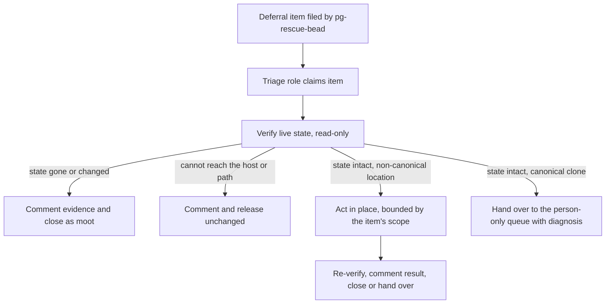

# pg-rescue: a consumer for deferral items that point at live, left-in-place state

- **Status**: Proposed, pending operator ratification.
- **Date**: 2026-11-05
- **Builds on**: `docs/superpowers/specs/2026-10-02-pg-rescue-design.md` (section 8.3 and follow-up
  row 5).

The key words MUST, MUST NOT, SHOULD, SHOULD NOT and MAY in this document are to be read as in RFC 2119.

## 1. Problem

`pg-rescue-bead` files a self-contained work item when a wrapped command fails and no earlier handler
resolved it. By design (R5 of the pg-rescue design, and the operator ruling of 2026-10-02 that state
is left as it is) the wrapper never cleans up. The item therefore points at live state, for example a
working copy stopped in the middle of a rebase, and ends with the line `state was left as-is at
<time>`.

No existing consumer fits that item:

- The drain loop always isolates its work in a fresh worktree. A fresh worktree does not contain the
  stopped rebase, so it cannot do the work.
- The workspace's canonical-clone rule R-3 makes a canonical clone that is off its primary branch or
  dirty a stop-and-report condition, with no reset, re-checkout, stash or workaround.

This document recommends a consumer and answers four questions. One part of the answer conflicts
with R-3 if read the wrong way, so that part is written as an open question (section 7) and not
decided here.

## 2. What the producer gives a consumer today

| Fact                                       | Where it lives today                       | Machine-readable |
| ------------------------------------------ | ------------------------------------------ | ---------------- |
| Item came from pg-rescue                   | label `pg-rescue`                          | yes              |
| Same failure again                         | metadata `pg_rescue_fingerprint`           | yes              |
| Host, working directory, command, exit     | body, plain lines                          | no (prose)       |
| When the state was last observed           | body line `state was left as-is at <time>` | no (prose)       |
| What the state looked like when it stopped | nothing                                    | not recorded     |

The last row is the gap. A consumer cannot tell whether the live state still matches the report,
because the report carries no snapshot of it.

## 3. Question A: which consumer works these items

Options considered, each judged on the force it must resolve (work in place, versus an agent that is
bounded by R-3):

| Option                           | Verdict         | Reason                                                                                                                                                                                                |
| -------------------------------- | --------------- | ----------------------------------------------------------------------------------------------------------------------------------------------------------------------------------------------------- |
| Drain variant                    | Rejected        | The drain loop's defining step is isolation into a fresh worktree. A variant that skips isolation drops the property the loop relies on, and the loop's queue selection is shared by other consumers. |
| Person-only `human` queue item   | Part of it      | Correct for state in a canonical clone (section 6), but alone it wastes the cases an agent can handle safely and gives the person no diagnosis.                                                       |
| Dedicated pg-router command role | **Recommended** | A Command-pattern role with its own queue selector, bound to the item, with a read-only default. It can verify, classify and route, and it can hand over to a person with a prepared diagnosis.       |

Recommendation: a **triage role** (a command role under pg-router, following the pattern in
`docs/superpowers/specs/2026-10-22-pg-router-script-first-routing-design.md`) that works an item in
two stages.

1. **Verify** (read-only, section 5). Always runs. Its outcome picks a branch.
2. **Act** (only on a path where in-place work is permitted, section 6). Otherwise **Hand over**: the
   role comments its diagnosis on the item and moves it to the person-only queue.

The role is a Strategy over the location class of the state, so adding a class later changes one
table row and not the role.

## 4. Question B: how the consumer recognises an item

**Recommendation: label plus typed metadata, not body parsing.**

- The consumer MUST select on the `pg-rescue` label and a non-closed status.
- The consumer MUST read its facts from item metadata. It MUST NOT parse the body: the body is
  operator-editable prose and the template is replaceable by `--body-template`.
- The producer (`pg-rescue-bead`) SHOULD be extended to write these metadata keys at filing time, in
  the same call that writes `pg_rescue_fingerprint`:

| Key                    | Content                                                                  |
| ---------------------- | ------------------------------------------------------------------------ |
| `pg_rescue_host`       | host the failure happened on                                             |
| `pg_rescue_cwd`        | absolute working directory                                               |
| `pg_rescue_filed_at`   | RFC 3339 UTC time the item was filed                                     |
| `pg_rescue_state`      | snapshot of the live state (section 5.1), as a compact JSON object       |
| `pg_rescue_state_kind` | location class: `canonical-clone`, `worktree`, `other-dir`, `not-a-repo` |

- An item that lacks `pg_rescue_state` (filed before the change, or by a template that opted out)
  MUST be treated as unverifiable: the consumer routes it to the person-only queue and does not act.
- A dedup hit (`Updated <id>`) comments on the existing item. The consumer MUST treat the item's
  metadata as describing the FIRST filing and the latest comment's state block as the most recent
  observation, and MUST verify against the most recent one.

## 5. Question C: how the consumer re-verifies the live state

This is the premise-freshness step. The report is a claim about the past; the consumer MUST NOT act
until a fresh read-only probe agrees with it.

### 5.1 The snapshot

For a path inside a git repository the producer records, and the verifier recomputes, the same
fields:

- the toplevel path and whether it is the canonical clone or a linked worktree
- the current branch (or `detached`), and the `HEAD` object id
- any in-progress operation marker (rebase, merge, cherry-pick, bisect), by the presence of the
  corresponding git state directory
- a digest of `git status --porcelain=v2` output (a count and a hash, never file contents)

All probes are read-only git plumbing and porcelain. The consumer MUST NOT run the failed command
again to "see if it still fails": that is not read-only and can change the state.

### 5.2 The verification outcomes

| Observation                                                    | Outcome       | Action                                                                          |
| -------------------------------------------------------------- | ------------- | ------------------------------------------------------------------------------- |
| Host differs from this machine, or path unreachable            | `unreachable` | Comment and release unchanged. MUST NOT act.                                    |
| Path gone, or no in-progress marker and a clean tree           | `resolved`    | Comment the evidence and close as moot.                                         |
| Marker present and `HEAD` and status digest equal the snapshot | `intact`      | Proceed to the location-class rule (section 6).                                 |
| Anything else (new commits, different digest, other operation) | `drifted`     | Comment the difference and hand over to a person. MUST NOT act on a stale plan. |

The consumer MUST re-run the same probe immediately before any mutation and abort to `drifted` if it
no longer reads `intact` (a check-then-act guard). The probe and the mutation SHOULD be the only
two steps between which a person could intervene, and the window SHOULD be kept short.

## 6. Question D: fit with R-3 and the 2026-10-02 ruling

The 2026-10-02 ruling says the wrapper leaves state as it is. That binds the PRODUCER: nothing in
this design changes it. The wrapper, and every handler in the chain, continues to leave state alone.

R-3 binds any agent that finds a canonical clone off its steady state: stop and report, with no
reset, re-checkout, stash or workaround. Read literally, a consumer that repairs a stopped rebase in
a canonical clone breaks R-3. So the rule for the consumer is a table keyed by the location class
recorded in `pg_rescue_state_kind`:

| Location class    | Consumer MAY act in place?         | Basis                                                                                                                          |
| ----------------- | ---------------------------------- | ------------------------------------------------------------------------------------------------------------------------------ |
| `worktree`        | Yes, after `intact`                | R-3 and R-2 govern the canonical clone. A linked worktree is the agent's own working area, and R-4 already directs work there. |
| `other-dir`       | Yes, after `intact`                | Not a canonical clone. The item's scope still bounds the action.                                                               |
| `not-a-repo`      | Verify only, then hand over        | No git probe can prove it is unchanged beyond existence.                                                                       |
| `canonical-clone` | **No. Open question (section 7).** | Acting is exactly what R-3 forbids.                                                                                            |

For a `canonical-clone` item the recommended behaviour inside R-3 is: verify, then hand over with a
diagnosis, and never mutate the clone. What the diagnosis can contain without touching the clone is
part of the open question.

## 7. Open question for the operator (single, labelled)

**OPEN QUESTION: may an agent ever change a canonical clone in place to resolve a pg-rescue
deferral item, and if not, what may it prepare instead?**

This is the only point where the recommendation touches R-3 and the 2026-10-02 ruling. The
design does not decide it.

| Option | Description                                                                                                                                                                                                                               | R-3 and the ruling                                                 |
| ------ | ----------------------------------------------------------------------------------------------------------------------------------------------------------------------------------------------------------------------------------------- | ------------------------------------------------------------------ |
| **A**  | Never. A canonical-clone item is person-only. The consumer verifies and hands over a text diagnosis.                                                                                                                                      | Compatible with both.                                              |
| **B**  | Prepare out of place, person applies. In a fresh linked worktree at the recorded `HEAD`, the consumer reproduces the resolution and records it as a patch or branch. The person applies it to the clone with one command, or discards it. | Compatible: the clone is never touched by an agent.                |
| **C**  | Narrow in-place allowance. For a short operator-ratified allowlist of lossless operations (for example finishing a rebase whose conflicts are provably trivial), the consumer acts after an `intact` probe.                               | Conflicts with R-3 as written. Would need an R-3 exception ruling. |

**Recommended option: B.** It keeps R-3 and the ruling intact, and it still saves the person the
diagnosis and the work, which is the cost the item exists to defer. Option A is the fallback if B
proves unreliable (a resolution reproduced in a worktree might not match the stopped state exactly).
Option C SHOULD NOT be adopted unless B is shown to be inadequate, because it would turn a
stop-and-report rule into a conditional one.

Until the operator rules, the consumer MUST behave as option A.

## 8. Policies

- The consumer MUST NOT mutate any path before an `intact` verification, and MUST re-verify
  immediately before each mutation.
- The consumer MUST NOT act on a `canonical-clone` item before the operator rules on section 7.
- The consumer MUST NOT run the original failing command as a probe.
- The consumer MUST comment every verification outcome on the item, including the observed values, so
  the item is a record of what was found.
- The consumer MUST NOT hardcode machine-specific data (hosts, repo-to-tracker maps). It MUST take
  them from arguments or configuration, as `pg-rescue-bead` does.
- Queue selectors of other consumers (the drain loop and similar) SHOULD exclude items carrying the
  `pg-rescue` label whose `pg_rescue_state_kind` is `canonical-clone`, so a general worker does not
  claim an item it cannot safely work.
- The producer's behaviour of leaving state alone MUST NOT change.

## 9. Follow-up implementation work

Ordering is as listed; items 1 and 2 are independent of the open question.

1. **Producer snapshot.** `pg-rescue-bead` writes `pg_rescue_host`, `pg_rescue_cwd`,
   `pg_rescue_filed_at`, `pg_rescue_state` and `pg_rescue_state_kind`, and updates the dedup path to
   append a fresh state block. Tests run against a real throwaway git repository.
2. **Verifier library.** A read-only probe that recomputes the snapshot and returns one of the four
   outcomes of section 5.2, with tests against real git states (stopped rebase, clean, drifted,
   missing path).
3. **Triage role.** A pg-router command role that claims `pg-rescue` items, runs the verifier,
   comments the outcome, closes `resolved` items, releases `unreachable` items and hands over
   `drifted`, `not-a-repo` and unverifiable items. It behaves as option A for `canonical-clone`.
   Depends on 1 and 2.
4. **Act path for non-canonical locations.** The `worktree` and `other-dir` rows of section 6,
   with the check-then-act guard. Depends on 3.
5. **Queue exclusion.** Confirm and, if needed, change the drain queue selector so canonical-clone
   `pg-rescue` items are not claimed by a general worker. Depends on 1.
6. **Operator decision on section 7.** Depends on nothing; gates any canonical-clone act or prepare
   behaviour beyond option A.
