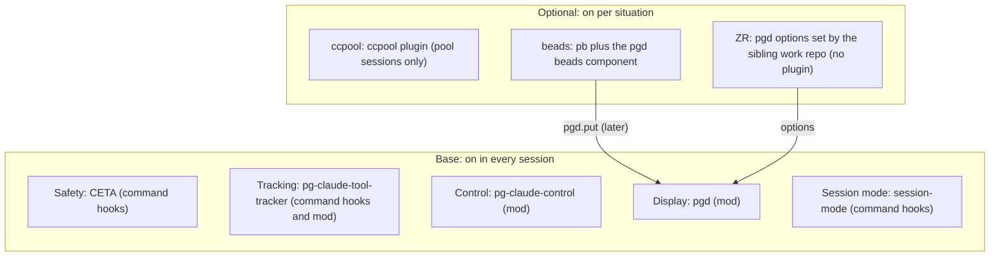

# Mod and plugin bundles: grouping and boundary rules

Status: approved by the operator, 2026-11-09 (see "Approval").
Date: 2026-11-07, updated 2026-11-09. Claude Code version the findings come from: 2.1.314.
Companion design: `docs/superpowers/specs/2026-11-05-display-layer-design.md` (pgd).

The key words "MUST", "MUST NOT", "REQUIRED", "SHALL", "SHALL NOT", "SHOULD",
"SHOULD NOT", "RECOMMENDED", "NOT RECOMMENDED", "MAY", and "OPTIONAL" in this
document are to be interpreted as described in BCP 14 (RFC 2119, RFC 8174) when,
and only when, they appear in all capitals, as shown here.

## Intent

The Claude Code customizations that run code inside a session (command hooks and
mods) grew one plugin at a time. The operator wants them grouped into named
bundles so that:

- each group can be switched on for the situations it serves (every session, pool
  sessions, a tracker, a work machine),
- the issue tracker can be swapped by switching one bundle, not by hunting through
  plugins (partly, until the session that evaluates skill plugins: the beads-only
  skill plugins stay enabled, see "beads" below),
- work-specific code stays in the private sibling work repo, because this repo is
  public,
- there is one written rule for when a command hook may sit beside a mod.

## Scope

In scope: every plugin that runs code in a session, through command hooks in
`hooks/hooks.json` or a mod (a hooks module named under `modules`). Today these are
CETA (`pg-claude-extended-tool-approver`), `pg-claude-tool-tracker`, `pg-claude-control`,
`pgd`, `pb` and the ccpool plugin. The note also places one planned member, a
`session-mode` plugin, and records that the ZR bundle needs no plugin (see "ZR").
`pb` stays in scope
after its hooks move to `session-mode`, when it no longer runs code in a session,
because the operator named it the beads bundle's plugin (ruling quoted under
"beads").

Out of scope:

- Skill-only plugins. Operator ruling (Phillip, 2026-11-07, verbatim): "right now
  we are only focused on the mods we planned out. other plugins/skills/... will be
  evaluate/merged/... in a differnet session".
- Earlier rulings this note does not reopen (operator, 2026-11-04 and 2026-11-05):
  CETA's evaluation logic stays Go and unchanged; `--no-verify` handling stays in
  CETA; rtk output minimizing stays a CETA input processor; `claude-memory-autocommit`
  stays as is; `claude-hook-router` is being removed and is ignored here; the CETA
  daemon is dropped.

## What a bundle is

A bundle is a named group of existing plugins, plus any pgd component switch the
note assigns to it, that share one enable condition. Plugins are not merged: each
keeps its own manifest, hooks module and version. (Operator ruling, 2026-11-07:
option "a".)

A plugin's enablement already follows two inputs: its manifest `defaultEnabled`
(or a per-plugin override) AND the fail-closed `requires` gate, which enables a
plugin only when every feature its manifest lists under `requires` is on
(`home/programs/claude-marketplaces/default.nix`; this repo's `CLAUDE.md`,
"Fail-closed `requires`"). A bundle's switch is therefore a feature option its
members require or default from, not a new mechanism. Aligning the beads members
with that switch is a follow-up (see "Follow-up work"); until it lands they differ:
pgd's `components.beads` defaults to true and `pb` requires `pb` and
`session-mode`, while `phillipgreenii.programs.beads.enable` and
`phillipgreenii.programs.pb.enable` default to false.

## Approaches considered

- **A. A bundle is a named group of existing plugins with one enable condition
  (chosen).** It gives the organization and the switches without a migration, and
  it keeps the tracker and control plugins "as is", as the draft asked.
- **B. One plugin per bundle.** Rejected. `claude plugin validate` allows one hooks
  module per plugin (pgd design, "Packaging, scope and fallbacks", check 4), so
  merging CETA, the tracker and control into one Safety plugin would force their mod
  code into one module and rename plugins, for nothing A does not already give.

For the scope there were three options: code-running plugins only; those plus the
skill plugins tied to a bundle's tool; or every plugin in exactly one bundle. The
operator chose the first for now (ruling above).

## The bundles

| Bundle       | Members                                               | Enable condition                               | Command hooks (classic events)                                                                                                 | Native mod events                                                                                                                                              |
| ------------ | ----------------------------------------------------- | ---------------------------------------------- | ------------------------------------------------------------------------------------------------------------------------------ | -------------------------------------------------------------------------------------------------------------------------------------------------------------- |
| Safety       | CETA                                                  | Every session                                  | PreToolUse, PermissionRequest, PostToolUse, PermissionDenied, PostToolUseFailure, SessionEnd                                   | None                                                                                                                                                           |
| Tracking     | `pg-claude-tool-tracker`                              | Every session                                  | PreToolUse, PostToolUse, PostToolUseFailure, PermissionRequest, PermissionDenied                                               | `session.start`, `tool.call`, `tool.check`, `ui.render`, `session.end`                                                                                         |
| Control      | `pg-claude-control`                                   | Every session                                  | None                                                                                                                           | `session.start`, `turn.start`, `turn.complete`, `session.end`                                                                                                  |
| Display      | `pgd`                                                 | Every session; each component opt-in           | None                                                                                                                           | `engine.create` (the `pgd` noun), `session.start`, `session.measure`, `turn.complete`, `session.compact`, `config.set`, `command.run`, `ui.render`, `ui.close` |
| Session mode | `session-mode` (new; its hooks move out of `pb`)      | Every session                                  | SessionEnd, PostCompact (decided: stay command hooks, see "Placement findings")                                                | None yet                                                                                                                                                       |
| ccpool       | the ccpool plugin (`packages/ccpool/ccpool-plugin`)   | Pool sessions only                             | SessionStart, Stop, StopFailure, SessionEnd, Notification (`permission_prompt`, `idle_prompt`), PreToolUse (`AskUserQuestion`) | None                                                                                                                                                           |
| beads        | `pb`; pgd's `components.beads` switch                 | `phillipgreenii.programs.beads.enable` is true | None (after the session-mode hooks leave `pb`)                                                                                 | None yet; the later Focus-row push is `pb`'s mod                                                                                                               |
| ZR           | no plugin; ZR settings of pgd options such as `links` | Work machines (set by the sibling repo)        | None                                                                                                                           | None (pgd's own hooks read the options)                                                                                                                        |

The machine-readable form of the Members column is `docs/mod-bundles.json`; the
check `test-mod-bundle-membership` reads it and enforces G1 for every plugin in this
repo that runs code in a session. Keep the two in step.

The table shows the layout after the moves this note records: the two
session-mode hooks (SessionEnd and PostCompact) live in the `session-mode`
plugin's `hooks/hooks.json` (moved out of `pb` on 2026-11-09).
The event lists are read from each plugin's `hooks/hooks.json` and its hooks
module on 2026-11-07. "None yet" means the member has no native mod hook today and
may gain one later. The beads row
names an existing plugin, `pb`; the ZR row names configuration, not a plugin.

### Base: on in every session

Every base member MUST be enabled on every consumer that enables
`phillipgreenii.programs.claude-code`. Plugin enablement and binary install are
two separate axes, which the `requires` gate ties together (this repo's
`CLAUDE.md`, "Claude Code Rule / Skill / Plugin Delivery"):

- Plugin enablement: every base member's manifest sets `defaultEnabled: true`. A
  member whose hooks call a bare command lists that command's feature under
  `requires`, so the plugin is on only where the binary is: CETA requires
  `claude-extended-tool-approver` and the tracker requires `claude-tool-tracker`.
  The new `session-mode` plugin MUST set `defaultEnabled: true` and MUST require
  `session-mode`.
- Binary install: the tracker's and `session-mode`'s Home Manager modules default
  `enable` to `claude-code.enable`. CETA's program option is a plain
  `mkEnableOption` (`home/programs/claude-extended-tool-approver/default.nix`), so
  each consumer enables it in its named cutover block; without that block both
  CETA's binary and, through `requires`, its plugin stay off.

Every base member MUST load and MUST NOT fail in headless `claude -p` sessions as
well as interactive ones (mods load headless: verified 2026-11-05 with
`pg-claude-control`). It need not draw or record everything there: pgd draws
nothing headless, and the tracker's render hook (`tracker.running`) fires only in
interactive sessions.

- **Safety (CETA) stays command hooks only.** Operator ruling, 2026-11-07: option
  "a". Reason: CETA's logic stays Go and the daemon is dropped, so a native
  `tool.call` hook would still run the binary through `$.process.run` on every tool
  call, which is the same process spawn the command hook does. No native counterpart
  has been verified for three of its events (PermissionRequest, PermissionDenied,
  PostToolUseFailure), nor whether a native hook can auto-approve a call or rewrite
  its input the way PreToolUse does for rtk. Running a command hook and a mod side by
  side also risks deciding one call twice. A native port is reopened only for a concrete gain:
  speed, or a moment only a mod can see.
- **Tracking (`pg-claude-tool-tracker`) stays as is.** It ships command hooks and a mod
  together. One headless Bash call produced distinct record kinds from the two paths
  (`tracker.pre_tool` and `tracker.post_tool` from the hooks; `tracker.call_start`,
  `tracker.call_end` and `tracker.check` from the mod), one of each per tool call,
  plus one `tracker.session_end` from the mod per session, so it does not
  double-log (verified 2026-11-05).
- **Control (`pg-claude-control`) stays as is.** A native mod only.
- **Display (`pgd`)** is the one plugin that draws the band, the alert line, the
  modals and the Focus pane (pgd design). Its components are opt-in. Two points the
  draft left open are settled by the accepted pgd design:
  - Location (repo, worktree, branch, PR review state) stays in pgd, as rows of the
    Info modal; the PR row is the `prStatus` component.
  - Vim mode does not keep the shell `statusLine` command: vim mode was dropped from
    the display, and the shell line retires through the empty `statusLine` command
    after ZR adoption (pgd decision D19).
- **Session mode (`session-mode`) is a base member of its own.** Operator ruling,
  2026-11-07, verbatim: "(a) for session-mode". Its two hooks, `session-mode hook
session-end` (flips a stale running record to finished when the session ends) and
  `session-mode hook post-compact` (writes the compaction marker), move out of `pb`
  into a default-enabled `session-mode` plugin. Reason: session mode is not
  beads-only. The beads drain commands and `wrap-up-session` both set modes, pgd's
  mode button reads them, and the compaction marker is read by the shell status line
  and ingested by `pg-claude-code-recorder`. Inside the beads bundle, switching beads off would stop
  wrap-up mode's end-of-session backstop and the recorder's compaction feed. The
  `session-mode` Home Manager module already defaults `enable` to
  `claude-code.enable`, so the bare `session-mode` command is installed wherever the
  plugin is enabled.

### ccpool: pool sessions only

The ccpool bundle is already one plugin, `packages/ccpool/ccpool-plugin`, holding
every ccpool hook, including the autonomous-only `AskUserQuestion` deny (operator
ruling, 2026-11-04: all ccpool hooks in one bundle). It is not in the marketplace:
the ccpool launcher always passes it with `--plugin-dir`, so it loads only in pool
sessions. The remaining work is the native-event check for Stop, StopFailure and
Notification (placement follow-up). ccpool does not push to pgd today (it may
contribute later); the operator ruled that pool failures are handled other ways
(pgd design, "Alerts (status line)").

### beads: on where `phillipgreenii.programs.beads.enable` is true

`pb` is the beads plugin. Operator ruling, 2026-11-07, verbatim: "`pb` should be the
"beads" plugin. the `b` in `pb` was for beads." The bundle is `pb` plus pgd's
`components.beads` switch (the dolt alert and beads Focus rows). Switching the bundle
off MUST turn off both. When the beads push into pgd's Focus pane is built, it
becomes `pb`'s mod, not a new plugin. A tracker swap replaces this bundle and leaves
the base untouched.

`phillipgreenii.programs.beads.enable` is the beads bundle's switch; no new option
is added. The switch follow-up makes every member follow it:

- the `pb` plugin, through the `requires` gate: `pb` already requires the `pb` and
  `session-mode` features, so it is off wherever `phillipgreenii.programs.pb.enable`
  is off. The follow-up makes `pb.enable` default to `beads.enable`, or adds `beads`
  to `pb`'s `requires` (its manifest lists `beads` under `uses` today),
- `phillipgreenii.programs.pb.enable`, which installs the `pb` binary the `pb`
  skills call,
- pgd's `phillipgreenii.programs.pgd.components.beads`, which defaults to true
  today and SHOULD default to `beads.enable`.

The tracker swap stays partial until the skill-plugin session. The beads-only
skill plugins (`beads-lifecycle`, `bead-grooming`, `wayfinder-beads`,
`beads-dolt-doctor`) stay enabled when the bundle is off, because skill-only
plugins are out of scope by ruling (see "Scope").

### ZR: work machines, in the sibling work repo

The ZR bundle is configuration only: the sibling work repo sets pgd options from
its own Home Manager configuration on work machines, and ships no plugin that runs
code in a session. The boundary was first accepted on the operator's instruction
(2026-11-07, verbatim: "continue with your recommendatinos") as a ZR mod pushing a
production-profile alert; the operator then ruled out any profile alert
(2026-11-09, below), which removed the mod.

- The link rule is set through pgd's `links` option, so it needs no plugin code.
- The sibling work repo's own status-line parts either map to pgd options or are
  dropped. That mapping is recorded by the sibling repo's own follow-up, not here.
- The AWS profile is shown only by pgd's Assume button, colored by the profile name;
  there is no profile alert. Operator rulings (Phillip, 2026-11-09, verbatim):
  "going forward, only the button will exist and it will be dimmed when nothing
  set, if "contains dev", then it can be green if it contains prod, then it should
  be yellow, if set, but some other value, then make it yellow." and, correcting
  it, "typo, prod should be red. thanks for clarifying." and "it doesn't matter if
  assume was set in the session or before it started, if the agent running will
  have access to systems due to the assume, then it should be shown and color
  coded." The button's rules live in the pgd design ("Assume").
- The migration runs on the sibling repo's schedule and gates pgd's phase 3
  (retiring the shell line). Nothing work-specific is added to this repo: the color
  rule matches the generic words "dev" and "prod".
- Phase 3 MUST NOT wait for the whole Assume work (its modal, Apply and expiry
  alert, which wait on live verifications). It MUST wait for the Assume button's
  display slice (label and color from the profile the session runs with), so the
  profile stays visible once the shell line is gone. This supersedes the earlier
  reading of the operator's 2026-11-07 ruling, option "a" (do not wait for Assume),
  under which only a production alert would have shown in between.

## Rules

Bundle membership:

- **G1** Every in-scope plugin in this repo MUST belong to exactly one bundle. A
  plugin added here later that runs code in a session MUST be added to the table
  above in the same change that adds it. The ZR row records configuration only; a
  plugin the sibling work repo adds later is recorded and checked there.
- **G2** Members of a bundle MUST share its enable condition. Turning a bundle off
  MUST turn off every member, including any pgd component switch the bundle owns, and
  MUST NOT turn off a member of another bundle.
- **G3** A bundle that is off MUST leave nothing running in the session: no command
  hook, no mod hook, no `pgd.put` contribution. Enablement takes effect at session
  start, so a bundle switched off never has a contribution held.
- **G4** Work-specific code and configuration MUST live in the sibling work repo.
  This repo publishes only generic contracts, such as the `pgd` noun's types.
- **G5** A contributing mod SHOULD put every contribution with a `ttlMs`, so that a
  contribution whose contributor stops refreshing goes stale and expires. pgd
  expires only a contribution that carries one
  (`claude-marketplace/pgd/hooks/contributions.ts`); one put without it lasts until
  the session ends.

Command hook beside a mod:

- **H1** New in-session code SHOULD use native mod events.
- **H2** A plugin MUST use a command hook for any moment that has no native event. A
  user-tier mod MUST NOT rely on `classic.*` hooks: where managed settings seat the
  built-in security plugin outermost, user-tier `classic.*` mod hooks are skipped,
  so a mod cannot reach those moments at all. First recorded by the in-repo spike
  `docs/investigations/2026-10-13-claude-code-mods-spike.md` ("`classic.*` events
  never reach a user mod on this machine", Claude Code 2.1.296); re-observed
  2026-11-05 on Claude Code 2.1.314.
- **H3** A plugin MAY ship command hooks beside its mod (operator ruling, 2026-11-05).
  An existing command hook MAY stay where a native event exists until porting gives a
  concrete gain, as with CETA.
- **H4** When one plugin handles one moment with both a command hook and a mod hook,
  the two MUST record or decide different things. They MUST NOT make the same
  decision or write the same fact. The tracker's distinct record kinds per tool call
  are the model. Across plugins, an observer MAY record a decision another plugin
  made: the tracker's `tracker.check` records the verdict the permission chain
  resolved, which is the verdict CETA decided when CETA's `PreToolUse` hook decided
  the call (`packages/claude-tool-tracker/docs/event-kinds.md`, "`tracker.check`
  (`tool.check`)").
- **H5** Only pgd draws the band and the alert line. Another bundle MUST contribute
  through `pgd.put` and MUST NOT answer the band site or set its own `$.ui.status`
  line (pgd design findings F1 and F3).
- **H6** A command hook MUST invoke a bare command whose binary is installed wherever
  the plugin is enabled: the command MUST be in the closed `binaryOwners` list of
  `checks.<system>.test-claude-plugin-binary-default-parity`, and the plugin MUST
  list the owning feature under `requires` (this repo's `CLAUDE.md`, "Mechanical
  check"). The check cannot prove a consumer enabled the feature. When the
  session-mode hooks move, the new `session-mode` plugin MUST require
  `session-mode`.

## Placement findings (2026-11-09)

Read from Claude Code 2.1.318's own `claude-code.d.ts` (the declarations the
`plugin-authoring` skill writes). No live headless probe was run: the types
decide each question, and a native `Notification` or `Stop` moment cannot be
forced in a `claude -p` run without a model call.

**session-mode: the two hooks stay command hooks.**

- `PostCompact` has no native counterpart. `session.compact` fires when the
  conversation is _about to be_ compacted (and for `precompute`), so it cannot say
  that a compaction happened; its `trigger` is not the classic `manual|auto` value
  the marker file and the recorder read (ADR 0096).
- `session.end` exists, but a mod could only reach the CLI through `$.process.run`,
  the same one process spawn the command hook costs, and the `SessionEnd` payload
  fields the CLI reads (`transcript_path`) are the classic ones. Splitting the two
  hooks across mechanisms buys nothing (H1 is SHOULD; H3 allows the command hook).
- The plugin therefore ships `hooks/hooks.json` only, no module.

**ccpool: nothing changes (native-event check recorded).**

| Classic event | Native counterpart                                                               | Verdict        |
| ------------- | -------------------------------------------------------------------------------- | -------------- |
| Stop          | `turn.complete` (`reason` answer, aborted, refusal, error; also fires per agent) | Not equivalent |
| StopFailure   | None; `turn.complete` with `reason: "error"` carries no API error class          | None           |
| Notification  | None; `ui.notify` only hears notifications a plugin raised                       | None           |

`turn.complete` hears subagent turns and an aborted turn, while `Stop` is the
main loop's stop, and `StopFailure` carries the classified API error
(`SDKAssistantMessageError`) that ccpool's `hook fail` reads. Notification
(`permission_prompt`, `idle_prompt`) has no native event. Under H2 all of them
stay command hooks, and the ccpool plugin stays as one `--plugin-dir` plugin.

## Follow-up work

1. **Hook placement** (already filed; its text is amended to this note). Move the
   two session-mode hooks out of `pb` into the new `session-mode` plugin, and decide
   whether they stay command hooks or become native `session.end` and
   `session.compact` hooks. For ccpool, record the native-event check for Stop,
   StopFailure and Notification; the bundle is already one plugin, so any change is
   packaging only.
2. **Bundle switches** (new). Make the beads members follow the existing
   `phillipgreenii.programs.beads.enable`: `phillipgreenii.programs.pb.enable`
   (which, through `requires`, gates the `pb` plugin) and
   `phillipgreenii.programs.pgd.components.beads` (see "beads"). ccpool gets no
   switch: its launcher's `--plugin-dir` already gates it. The base set gets no
   switch: it is always on with `claude-code`. The ZR bundle is configuration the
   sibling work repo sets. The work SHOULD include a check that every in-scope
   plugin appears in exactly one bundle (G1).
3. **Assume button display slice** (new, pgd). The Assume button's label and color
   from the profile the session runs with, before the modal, Apply and expiry
   alert (pgd design, "Assume"). pgd phase 3 waits on it.
4. **ZR configuration** (new, in the sibling work repo's tracker label). Set pgd's
   options from the sibling repo, and map or drop its own status-line parts. pgd
   phase 3 waits on it.

## What is left to the builder

- The switch wiring: how `phillipgreenii.programs.beads.enable` sets each beads
  member, and the form of the G1 check. ccpool and the base set get no switch, and
  the ZR bundle's switch lives in the sibling work repo.
- The `session-mode` plugin's manifest and directory. Naming the directory
  `claude-marketplace/session-mode` keeps one project label for the project: this
  repo's `CLAUDE.md` ("Beads Labels") makes a project label the basename of the
  top-level directory under `packages/` or `claude-marketplace/`, so the same
  basename as `packages/session-mode` gives the same label.

## Approval

Approved by the operator (Phillip, 2026-11-09, verbatim: "approved") after two
independent agent reviews of this note, with the rulings recorded above.
