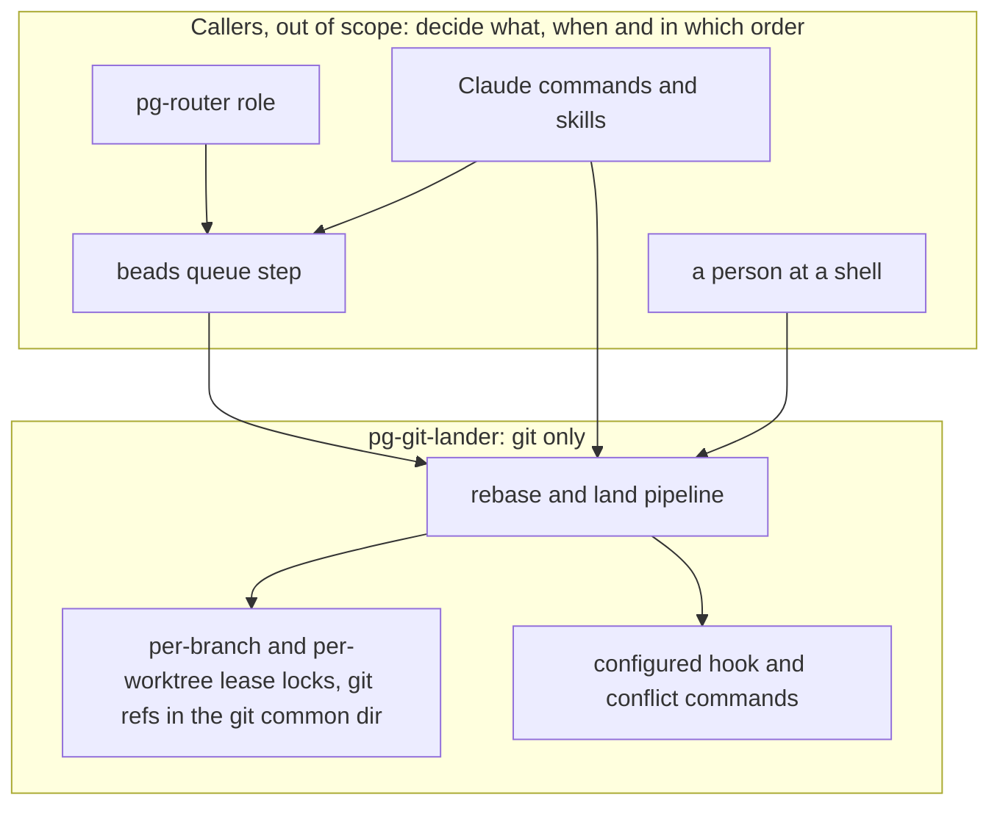
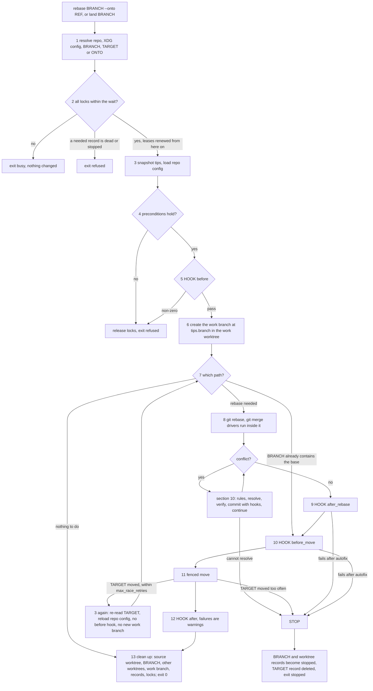
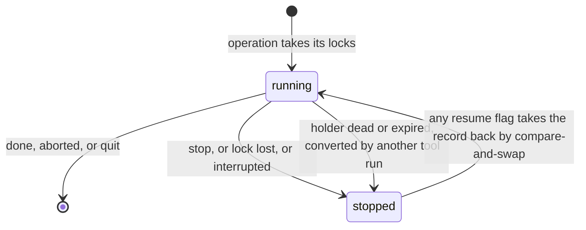

# `pg-git-lander`: lock-safe rebase and land — design

- **Status**: Draft for operator review (2026-11-07, revised the same day after two independent reviews). Nothing is
  implemented. Do not decompose until the operator approves.
- **Scope**: the tool only. The callers that decide what to land, when and in which order (a beads queue step, pg-router
  roles, Claude commands such as `/drain-beads` and `/audit-worktrees`, the `integrate-branch` handlers, a person at a
  shell) are out of scope. They appear only where they shape the tool's interface (section 17). The caller-side design,
  `docs/superpowers/specs/2026-11-04-single-lander-per-repo-design.md`, is kept as the reference for that usage.
- **Builds on**: `claude-marketplace/integrate-branch/skills/ff-merge-to-main/SKILL.md` (today's FF-0 to FF-4 landing
  steps); `packages/integrate-branch-support` (FF-1b's runner and the FF-4a bundle refresh); `docs/hooks.md` in
  `phillipg-nix-repo-base` (the `pg-hooks` stages, the `pre-land` pseudo-stage and `pre-land-eval`).
- **Operator rulings** (Phillip, 2026-11-06, 2026-11-07, 2026-11-09 and 2026-11-10) are cited where they apply. The
  sections that carry them are 2, 7.2, 7.3, 8.8, 11 (the introduction, 11.1 and 11.3), 12.3, 13.1, 13.3, 15.1, 16, 17
  and 21. Sections 19 and 20 are kept only so that numbering stays stable.

The key words MUST, MUST NOT, SHOULD, SHOULD NOT and MAY in this document are to be read as in RFC 2119.

## 1. Problem

Landing is a skill today. `ff-merge-to-main` describes its deterministic steps in prose, and every agent that lands
re-executes them. Several agents landing into one repo race for the primary branch: the slower one finds it advanced,
starts again from its rebase, and gives up at the second lost race. Rebasing is no safer. Agents rebase with plain git,
nothing stops two of them from rewriting the same branch at once, and the machine-wide `flake.lock` merge driver keeps
"the current side", which during a rebase is the upstream, so a branch's own `flake.lock` change is dropped without a
conflict stop.

`pg-git-lander` is one deterministic command that performs a rebase or a land safely. It takes per-branch locks, so
operations that write the same branch take turns while unrelated operations run in parallel. It resolves conflicts only
through commands its configuration names. It runs configured hook commands at fixed points. On any failure it stops the
way `git rebase` does, and leaves `--continue`, `--skip`, `--abort` and `--quit` to its caller.

## 2. Goals and non-goals

Goals:

1. At most one operation at a time writes a given branch through the tool.
2. Operations that write different branches run in parallel.
3. A holder that crashed blocks others for about one second (same host) or one lease (another host). A holder whose step hangs blocks others until that
   step's timeout, after which it stops cleanly. A holder whose whole process is wedged blocks others for at most its
   lease.
4. The tool behaves the same whether a person, a Claude session or a pg-router role runs it, and needs no daemon.
5. Every conflict resolution and every check is a configured command or one of git's own merge drivers. With no
   configuration, a conflict stops.
6. A stop never leaves a branch half-moved: no ref of BRANCH or TARGET moves before the move stage, and the move is
   fenced.
7. Every decision the tool made can be inspected afterwards without reading git's internals (outcome, `status`,
   `log`, events).

Non-goals:

- Choosing what to land, queueing, ordering, retry policy or tracker updates (the callers).
- Pull requests, fetching and pushing. The tool works on local refs; a caller fetches and pushes.
- Coordination across machines. Locks live in one clone's git common dir.
- Merge commits. A land fast-forwards TARGET to a rebased BRANCH and never creates a merge commit.
- A configurable stop action or WIP commits. A stop is a stop (operator ruling, 2026-11-06).
- Deciding which checks a repo needs. The repo's configuration names them.

## 3. Terms

| Term          | Meaning                                                                                                                |
| ------------- | ---------------------------------------------------------------------------------------------------------------------- |
| BRANCH        | The local branch an operation rewrites (`rebase`) or lands (`land`).                                                   |
| ONTO          | The commit a `rebase` replays BRANCH onto, resolved once from a ref when the operation starts.                         |
| TARGET        | The local branch a `land` fast-forwards. Defaults to the repo's primary branch.                                        |
| main worktree | The clone's main working tree: the first entry of `git worktree list --porcelain`. Its root is "the repo".             |
| operation     | One `rebase` or `land` invocation, identified by an operation id (`op_id`).                                            |
| stage         | Where an operation is: `locked`, `preparing`, `rebasing`, `after_rebase`, `before_move`, `moving`, `after`, `cleanup`. |
| stop          | The end of an operation that did not complete. Its record stays, in state `stopped`, until a caller resolves it.       |
| refusal       | The end of an operation whose preconditions failed before it changed anything.                                         |
| DW            | Destination worktree: where TARGET is checked out (`land` only; needed only when something uses it, section 11.1).     |
| SW            | Source worktree: where BRANCH lives. The only worktree that is ever removed (section 11.3).                            |
| WW            | Work worktree: where the tool rebases, resolves and runs hooks. One worktree MAY hold several roles.                   |
| work branch   | `pg-git-lander/<op_id>`: the real branch the tool rebases in the WW, created at BRANCH's tip (section 11.2).           |
| placeholder   | `pg-git-lander/idle/<name>`: the branch a kept SW is parked on after a land (section 11.3).                            |

The primary branch is, in order: the XDG configuration's `primary`; the branch `refs/remotes/origin/HEAD` names; `main`.

## 4. Overview



The tool reads no tracker and knows no caller. A caller MAY pass opaque `--context KEY=VALUE` pairs; the tool records
them with the operation, hands them to every command it runs, and never interprets them. Callers MUST NOT pass secrets
as context: context values are stored in lock records, and `git push --mirror` and mirror backups copy
`refs/pg-git-lander/`.

## 5. Command-line interface

### 5.1 Synopsis

```text
pg-git-lander rebase BRANCH --onto REF [--source-worktree PATH] [--work-worktree PATH]
                     [--wait DURATION] [--context KEY=VALUE]... [--json]
pg-git-lander land   BRANCH [--into TARGET] [--target-worktree PATH] [--source-worktree PATH] [--work-worktree PATH]
                     [--keep-source-worktree] [--keep-source-branch]
                     [--wait DURATION] [--context KEY=VALUE]... [--json]
pg-git-lander rebase [BRANCH] --continue | --skip | --abort | --quit [--wait DURATION] [--json]
pg-git-lander land   [BRANCH] --continue | --skip | --abort | --quit [--wait DURATION] [--json]
pg-git-lander status [BRANCH] [--json]
pg-git-lander log    OP_ID | BRANCH [--tail N]
pg-git-lander config check [--file PATH] [--json]
```

- Every form accepts `--repo PATH`: any path inside the clone or one of its worktrees (default: the current directory).
- BRANCH and TARGET are local branch names. BRANCH equal to TARGET is a usage error. The worktree flags and the keep
  flags are explained in sections 11.1 and 11.3; `--keep-source-worktree` and `--keep-source-branch` with `rebase` are a
  usage error.
- `--onto REF` names the commit to replay BRANCH onto, like the argument of `git rebase REF` (git's `<upstream>`), not
  like git's own `--onto` option. It accepts any commit-ish and is resolved once.
- `--wait` overrides `lock.wait` for this invocation.
- With `--continue`, `--skip`, `--abort` or `--quit`, BRANCH MAY be omitted when the current directory is the stopped
  operation's work worktree. The operation word MUST match the stopped operation (refusal `operation-mismatch`), and
  `--context` and the worktree and keep flags are not accepted, and the `PGL_*` input variables (section 11.1) are not
  read: a resumed operation keeps its original context, roles and flags, which the operation record persists (section
  8.2).
- Every next-step command the tool prints repeats `--repo` when the invocation used it.

## 6. Outcomes, reasons and what a caller does next

### 6.1 Exit codes

Every invocation ends with exactly one outcome. With `--json` the tool prints one JSON object on stdout (section
14.1); otherwise one line, plus the exact next commands after a stop or refusal. Progress goes to stderr.

| Exit | Outcomes                                                                                              | Meaning                                                                                                                                                                                          |
| ---- | ----------------------------------------------------------------------------------------------------- | ------------------------------------------------------------------------------------------------------------------------------------------------------------------------------------------------ |
| 0    | `landed`, `rebased`, `up-to-date`, `nothing-to-land`, `aborted`, `quit`, `status`, `log`, `config-ok` | Done. No record of this operation remains (after `quit` the worktree and the work branch remain).                                                                                                |
| 1    | `internal-error`                                                                                      | Unexpected failure before any lock was taken. Exit 1 never carries a branchable meaning.                                                                                                         |
| 2    | `usage-error`, `config-error`                                                                         | Bad arguments, or the XDG configuration (or `config check`'s file) is invalid. Nothing changed.                                                                                                  |
| 3    | `busy`                                                                                                | A lock was not obtained within the wait. Nothing changed. The JSON names the holder. Always retryable.                                                                                           |
| 4    | `stopped`                                                                                             | The operation stopped and its record is `stopped` (section 6.3). An unexpected failure after locking is a stop with reason `internal-error`, never exit 1, so a record never dangles unreported. |
| 5    | `refused`                                                                                             | A precondition failed (section 6.2). No ref, worktree or record changed, except for `holder-died`.                                                                                               |

`up-to-date` is a `rebase` whose BRANCH already contains ONTO. `nothing-to-land` is a `land` where TARGET already holds
every change of BRANCH, by ancestry or because the rebase dropped every commit as already upstream (the outcome's
`dropped_commits` lists them).

### 6.2 Refusal reasons (exit 5)

| Reason                     | When                                                                                                                                                                                                                                                                                                                                                                                                                                                | Next                                                                                                                                                           |
| -------------------------- | --------------------------------------------------------------------------------------------------------------------------------------------------------------------------------------------------------------------------------------------------------------------------------------------------------------------------------------------------------------------------------------------------------------------------------------------------- | -------------------------------------------------------------------------------------------------------------------------------------------------------------- |
| `stopped-pending`          | BRANCH has a stopped record, or a worktree the operation needs is held by a stopped operation. The outcome's `blocking_op` names it.                                                                                                                                                                                                                                                                                                                | `--continue`, `--skip`, `--abort` or `--quit` on that operation.                                                                                               |
| `target-stopped`           | TARGET has a stopped record (for example a stopped `rebase` of TARGET itself).                                                                                                                                                                                                                                                                                                                                                                      | Resolve that operation first.                                                                                                                                  |
| `holder-died`              | A record this operation needs was `running` with a dead or expired holder; it has just been converted to `stopped` (section 8.6). The only refusal that changes a record.                                                                                                                                                                                                                                                                           | `--continue` or `--abort` on the converted operation.                                                                                                          |
| `unreadable-lock`          | A lock ref does not point at a readable record of a supported schema.                                                                                                                                                                                                                                                                                                                                                                               | Inspect with `status`; a person removes the ref.                                                                                                               |
| `no-worktree`              | A worktree the operation needs cannot be found (section 11.1): a `land` that needs the DW as a root or for its move (TARGET is checked out nowhere, no `--target-worktree`, and the current directory is not a worktree of this clone), or a `rebase` whose BRANCH is checked out nowhere, with no `--source-worktree`, run from a path that is not a worktree of this clone.                                                                       | Pass `--target-worktree` or `--source-worktree`, or run from a worktree.                                                                                       |
| `not-a-worktree`           | A chosen worktree is not a worktree of this clone. The outcome names the role.                                                                                                                                                                                                                                                                                                                                                                      | Name a worktree listed by `git worktree list`.                                                                                                                 |
| `dirty`                    | A chosen worktree has tracked changes, or holds a rebase or other operation that no record accounts for (`detail` `foreign-rebase`). The outcome names the role (source, destination or work).                                                                                                                                                                                                                                                      | Commit or discard the changes, or finish the foreign operation, then run again.                                                                                |
| `target-worktree-mismatch` | `--target-worktree` names a place other than the worktree where TARGET is checked out (a `land` whose TARGET is checked out somewhere).                                                                                                                                                                                                                                                                                                             | Drop `--target-worktree`, or name TARGET's own worktree.                                                                                                       |
| `source-worktree-mismatch` | BRANCH is checked out somewhere, and `--source-worktree` names a place other than that worktree.                                                                                                                                                                                                                                                                                                                                                    | Drop `--source-worktree`, or name BRANCH's own worktree.                                                                                                       |
| `cwd-would-be-removed`     | The source worktree was derived, it was on BRANCH when the tool started, the current directory is inside it, and `--keep-source-worktree` is not set (section 11.3). Nothing has been locked or changed.                                                                                                                                                                                                                                            | Run from another path; pass `--source-worktree <path>` to confirm the removal; or pass `--keep-source-worktree`.                                               |
| `main-worktree-removal`    | A `land` whose source worktree is the main worktree (the first entry of `git worktree list --porcelain`, never judged from branch names), it was on BRANCH when the tool started (a main worktree reached only by the cascade, as in scenario 4, is restored, never removed), and `--keep-source-worktree` is not set (the tool never removes the main worktree).                                                                                   | Pass `--keep-source-worktree`.                                                                                                                                 |
| `namespace-collision`      | BRANCH or TARGET is `pg-git-lander` or is under `pg-git-lander/`.                                                                                                                                                                                                                                                                                                                                                                                   | Use another branch name.                                                                                                                                       |
| `switch-refused`           | Switching a worktree to the work branch failed, for example on an untracked file that collides with a tracked one. The outcome names the path; everything is restored.                                                                                                                                                                                                                                                                              | Move or delete the file, then run again.                                                                                                                       |
| `unsupported-layout`       | The clone is bare, `core.worktree` is set, or the work worktree uses sparse checkout.                                                                                                                                                                                                                                                                                                                                                               | Not supported in version 1.                                                                                                                                    |
| `no-git-identity`          | git has no committer identity (`git var GIT_COMMITTER_IDENT` fails).                                                                                                                                                                                                                                                                                                                                                                                | Configure `user.name` and `user.email` for the environment the tool runs in.                                                                                   |
| `untrusted-config`         | The repo file names commands and the repo is not trusted (section 12.3).                                                                                                                                                                                                                                                                                                                                                                            | Trust the repo in the XDG file, or set `ignore_repo_config = true`.                                                                                            |
| `repo-config-error`        | The repo file does not parse or holds an invalid value. The outcome names the file, line, key and layer.                                                                                                                                                                                                                                                                                                                                            | Fix the file on TARGET (`land`) or on the primary branch (`rebase`), section 12.2, or set `ignore_repo_config = true` for the repo.                            |
| `before-hook-refused`      | A `before` hook exited non-zero, exited 75 or timed out (sections 13.1 and 13.3).                                                                                                                                                                                                                                                                                                                                                                   | As the hook's output says.                                                                                                                                     |
| `nothing-stopped`          | A resume flag found no stopped operation for BRANCH or the current directory.                                                                                                                                                                                                                                                                                                                                                                       | None.                                                                                                                                                          |
| `operation-mismatch`       | A resume flag's operation word differs from the stopped operation's.                                                                                                                                                                                                                                                                                                                                                                                | Use the stopped operation's word.                                                                                                                              |
| `cannot-resume`            | `--continue` cannot proceed; the outcome's `detail` says why: `unresolved` (unmerged paths in the work worktree), `markers-left` (a staged or committed resolution still holds conflict markers), `rebase-state-missing` (git's rebase is neither in progress nor finished in a way the record can account for) or `worktree-mismatch` (the work worktree is missing, belongs to another operation, or its HEAD is not one the record can explain). | For `unresolved` and `markers-left`, resolve and `git add` the paths, then `--continue`; otherwise `--abort` (which tolerates a missing worktree) or `--quit`. |
| `lost-to-concurrent`       | A concurrent `--continue`, `--skip`, `--abort` or `--quit` took the stopped record first.                                                                                                                                                                                                                                                                                                                                                           | None; read that invocation's outcome.                                                                                                                          |

### 6.3 Stop reasons (exit 4)

| Reason                | Stages                                                       | Retryable | Valid next                                  |
| --------------------- | ------------------------------------------------------------ | --------- | ------------------------------------------- |
| `conflict`            | `rebasing`                                                   | no        | `--continue`, `--skip`, `--abort`, `--quit` |
| `resolve-failed`      | `rebasing`                                                   | no        | as `conflict`                               |
| `max-conflict-rounds` | `rebasing`                                                   | no        | `--abort`, `--quit`                         |
| `hook-failed`         | `after_rebase`, `before_move`                                | no        | `--continue`, `--abort`, `--quit`           |
| `commit-rejected`     | `rebasing`, `after_rebase`, `before_move`                    | no        | `--continue`, `--abort`, `--quit`           |
| `transient`           | `rebasing`, `after_rebase`, `before_move`                    | yes       | `--continue` later, or `--abort`            |
| `timeout`             | any after `before` (at `before` it is `before-hook-refused`) | yes       | `--continue` later, or `--abort`            |
| `interrupted`         | any                                                          | yes       | `--continue`, `--abort`                     |
| `race`                | `moving`                                                     | yes       | `--continue`, `--abort`                     |
| `branch-moved`        | `moving` (`rebase` only)                                     | no        | `--abort`                                   |
| `checkout-changed`    | `moving`                                                     | yes       | `--continue`, `--abort`                     |
| `move-unverified`     | `moving`                                                     | no        | `--abort`                                   |
| `lock-lost`           | any                                                          | yes       | `--continue`, `--abort`                     |
| `holder-died`         | any (set by another process, 8.6)                            | yes       | `--continue`, `--abort`                     |
| `git-error`           | any                                                          | no        | `--abort`, `--quit`                         |
| `internal-error`      | any after locking                                            | no        | `--abort`                                   |

`resolve-failed` carries a `detail` in the outcome: `resolver-failed` (a resolver exited non-zero other than 75),
`verify-failed` (the rule's verify command failed after its resolver ran) or `markers-left` (a resolver left conflict
markers); its output is in `log_tail`. `git-error` covers git failing in a way the tool does not interpret, for example
a `pre-rebase` hook refusing; git's message is in `log_tail`. A hook's non-zero exit, exit 75 or timeout has a different
effect by point (section 13.3): at `before` it is the refusal `before-hook-refused`, at `after_rebase` and `before_move`
a stop, and at `after` the warning `after-hook-failed`. The other reasons are defined where the step that raises
them is described (sections 6.4, 7, 8.6 to 8.8, 10 and 13).

Warnings appear in an exit-0 outcome's `warnings` and in the human line: `after-hook-failed`,
`branch-not-deleted` (a land kept BRANCH because it no longer equals `tips.branch` (reason `moved`) or TARGET does not contain the result (reason `not-contained`), section 7.2),
`branch-not-moved` (a kept BRANCH could not be moved to the result and stays at its old tip, section 11.3),
`source-worktree-not-removed` (with git's reason; the SW is parked on the placeholder, section 11.3),
`work-in-destination` (the WW is the main worktree and BRANCH is not checked out there), `undefined-merge-driver`,
`unknown-repo-config-key` and `config-changed` (a resume ran under a different configuration). `config check` also
warns `lossy-merge-driver`, `relative-command-path` and `command-not-found` (section 12.5).

### 6.4 Signals

On SIGINT, SIGTERM or SIGHUP the tool MUST:

1. let a fenced ref transaction or a `git merge --ff-only` that has already started finish (these take milliseconds);
2. otherwise send SIGTERM to the current step's process group, then SIGKILL after 5 seconds;
3. release the locks as in section 8.7 steps 2 and 3, with reason `interrupted`;
4. print the outcome and exit 4.

A second signal makes the tool exit at once; its record stays `running`, and the next tool run converts it
(`holder-died`). Section 17 tells agents to run long landings detached so that a tool timeout in the agent does not
send these signals at all.

## 7. The pipeline



### 7.1 Steps

1. **Resolve.** The tool resolves the git common dir (`git rev-parse --path-format=absolute --git-common-dir`) and the
   main worktree, loads the XDG configuration (section 12), and resolves BRANCH, and TARGET for a `land` or ONTO for a
   `rebase`. BRANCH MUST exist; BRANCH equal to TARGET, or a missing TARGET, is a usage error. BRANCH or TARGET in the
   tool's namespace is refused with `namespace-collision` here, because that refusal needs no lock. ONTO MUST be
   resolved once, here. The three worktree roles are chosen now (section 11.1) and the fail-fast check of section 11.3 runs, because
   the worktrees' locks are part of step 2.
2. **Lock.** The tool takes the operation's locks (section 8.5). A lock that stays held by a live, fresh holder for the
   whole wait ends in `busy`. A needed lock whose record is `stopped` ends in `stopped-pending` or `target-stopped`; one whose holder is dead or expired is converted (section 8.6) and ends in `holder-died`. From here a
   renewal loop keeps every lease fresh.
3. **Snapshot and configure.** Under the locks the tool records `tips.branch` (BRANCH's tip, the only content the
   operation lands) and, for a `land`, `tips.target` (TARGET's tip). It then loads the repo file from `tips.target` for a
   `land` or from the local primary branch's tip for a `rebase` (section 12.2), and records the configuration's digest.
4. **Preconditions.** The tool refuses (section 6.2), releasing its locks, when the layout is unsupported, git has no
   committer identity, the repo file is untrusted (section 12.3) or does not parse, or a worktree role fails the checks
   of section 11.1. Those checks, and the cascade itself, run again here because the locks are now held, and before any
   switch. The test "TARGET is checked out nowhere" (sections 8.8 and 11.1) is evaluated once, here, on the starting
   state; when the DW is also the WW, step 6 later switches it away from TARGET, which does not change the evaluated
   answer. The tool logs `core.attributesFile`, `core.hooksPath` and every `merge.*.driver` setting git resolves
   (section 9.4).
5. **Hook `before`.** Runs in the main worktree by default, at the start, before any worktree is switched and before the
   work branch is created. A non-zero exit, exit 75 or a timeout is a refusal, `before-hook-refused`, because nothing has
   changed yet. It runs once per operation: a return to step 3 after a race does not repeat it.
6. **Prepare.** The tool records each worktree's starting state (branch name, or detached oid) in the BRANCH record
   and creates the work branch `pg-git-lander/<op_id>` at `tips.branch`, checked out in the WW (section 11.2). A
   switch that fails on an untracked-file collision is the refusal `switch-refused`. A return to step 3 after a race does
   not repeat this step.
7. **Decide the path.**
   - `land`: TARGET contains `tips.branch` gives `nothing-to-land` (step 13, BRANCH retired as in section 7.2);
     `tips.branch` contains `tips.target` skips the rebase (step 10); otherwise rebase onto `tips.target`.
   - `rebase`: `tips.branch` contains ONTO gives `up-to-date` (step 13); otherwise rebase onto ONTO.
8. **Rebase.** In the work worktree the tool runs `git rebase <base>` on the work branch with the pinned options of
   section 9.1. git runs its merge drivers and its `pre-rebase` hook as usual. Each conflict stop goes through section 10.
   A rebase that stops for any other reason ends in a stop with reason `git-error`. A rebase that drops every
   commit as already upstream makes a `land` `nothing-to-land` (by `patch`); a dropped commit is listed in the
   outcome's `dropped_commits`.
9. **Hook `after_rebase`.** Runs only when step 8 replayed at least one commit onto a base that differs from BRANCH's
   merge base.
10. **Hook `before_move`.** Runs for every operation that will move a ref, including the fast-forward path.
11. **Move** (section 8.8). The tool first writes the intent marker and `expected_result` to the record (section 8.2).
    For a `rebase`, BRANCH moves to the result (the work branch's tip) by the mechanism of section 11.3. For a `land`,
    TARGET fast-forwards to the result: when TARGET is checked out nowhere and the result descends from TARGET's current
    tip, by `git update-ref refs/heads/<TARGET> <result> <old>` with no worktree (the proof is the ancestry check plus the
    compare-and-swap on `<old>`, section 8.8); otherwise through the destination worktree. BRANCH and the source worktree are disposed of in step 13 (section 7.2). If
    TARGET moved since `tips.target`, the tool returns to step 3: it re-reads TARGET, reloads the repo file, and rebases
    the current work branch (not `tips.branch`, so resolutions made so far are kept) onto the new tip, then runs
    `after_rebase` and `before_move` again (not `before`, which step 5 ran once, and not step 6). After `max_race_retries` such returns (default 2) it stops with `race`. A `git merge --ff-only` that
    fails while TARGET still equals `tips.target` is not a race (an untracked-file collision, a git hook): the tool
    re-reads TARGET to tell the two apart, does not count it as `race`, and stops with `git-error`. For a `rebase`, a
    BRANCH that no longer equals `tips.branch` stops with `branch-moved`.
12. **Hook `after`.** A failure here MUST NOT stop the operation, because the move already happened; it is the warning
    `after-hook-failed`.
13. **Clean up.** The tool disposes of the source worktree, then BRANCH, restores every other switched worktree and
    deletes the work branch (section 7.2 gives the order and the rule that retires BRANCH), deletes the operation's
    records and then releases every lock. The locks stay held until here because cleanup runs after the `after` hooks and
    needs them.

At every stage boundary the tool records `stage`, `stage_started_at` and `tips.result` (the work branch's tip) in
the BRANCH record, so a resume can tell whether the worktree is still the one it left. The stages cover the steps as
follows:

| Stage          | Steps                                                                                     |
| -------------- | ----------------------------------------------------------------------------------------- |
| `locked`       | 3 to 5: snapshot, preconditions and the `before` hook (steps 1 and 2 leave no record yet) |
| `preparing`    | 6 and 7: preparing the work branch and deciding the path                                  |
| `rebasing`     | 8                                                                                         |
| `after_rebase` | 9                                                                                         |
| `before_move`  | 10                                                                                        |
| `moving`       | 11                                                                                        |
| `after`        | 12                                                                                        |
| `cleanup`      | 13                                                                                        |

### 7.2 BRANCH and the source worktree after the move

Once the result is in place (TARGET for a `land`, BRANCH for a `rebase`), step 13 disposes of the source worktree, BRANCH,
the other worktrees and the work branch in this order. The source worktree comes first because git refuses to delete a
branch that is checked out in a worktree, and the tool never deletes a branch checked out anywhere (section 18). Every
action is idempotent and recorded, so `--continue` can repeat any of them (section 7.3). The rules for each action are
in section 11.3.

1. **The source worktree, only a worktree that was on BRANCH when the tool started.** Removed, parked on the
   placeholder branch, or left on BRANCH, as the flags of section 11.3 say. A failure to remove it is the warning
   `source-worktree-not-removed`; the outcome stays `landed`.
2. **BRANCH, `land`.** Without `--keep-source-branch`, BRANCH is deleted by a fenced compare-and-delete with
   `tips.branch` as the expected value (the equivalent of `git branch -D`: a rebased BRANCH is not an ancestor of TARGET,
   so `git branch -d` would refuse). This is the only place that states the retirement rule. The delete happens only if
   BRANCH still equals `tips.branch` and TARGET contains the result (for `nothing-to-land` by ancestry, `tips.branch`);
   `git cherry` is not used, because a resolution or an autofix commit changes patch ids (operator ruling, 2026-11-10).
   If BRANCH no longer equals `tips.branch` (a writer that bypassed the tool committed to it, for example from another
   worktree), or TARGET does not contain the result, BRANCH is kept and the warning `branch-not-deleted` (reason `moved`
   or `not-contained`) says that its new commits were not landed. `nothing-to-land` with `--keep-source-branch` leaves
   BRANCH where it is. With `--keep-source-branch`, BRANCH is moved to the result (section 11.3). A `rebase` always
   moves BRANCH to the result.
3. **Every other worktree the tool switched** (the DW, a work worktree that was not on BRANCH) is switched back to its
   recorded starting state.
4. **The work branch** `pg-git-lander/<op_id>` is deleted, and the records are deleted.

The outcome reports what happened in `branch_fate` (`deleted`, `moved`, `kept`), `worktree_fate` (`removed`, `kept`,
`remove-failed` with the reason), `old_branch_tip` (BRANCH's tip before the operation, printed so that a person can find
the commits; no ref keeps it, operator ruling 2026-11-10: "the work is done") and `restored`.

### 7.3 Resuming: `--continue`, `--skip`, `--abort`, `--quit`

Every resume flag, `--quit` included, first takes the stopped BRANCH record back by compare-and-swap (`stopped` to
`running`, with itself as the owner). If another invocation took it first, the resume is refused with
`lost-to-concurrent`. `--quit` stops after this step: with the record taken it deletes the operation's records (the
worktree records are `stopped` and held by nobody). The other flags then take the operation's other locks; if they are
busy past the wait, the flag swaps the record back to its stopped state and exits `busy`, so a resume never strands a
record in `running`. Resume flags need only the built-in lock defaults and the XDG file, so `--abort` and `--quit` work
even when the repo file is broken.

Whether a stop is in progress is read from the worktree's rebase state (`git status`, the rebase directory), never from
the work branch ref: during a conflict stop the ref still holds the old tip and the worktree is detached.

**`--continue`** reloads the configuration (the warning `config-changed` reports a different digest), re-runs the role
checks of section 11.1, checks that the work worktree is the recorded one (else `cannot-resume` with
`worktree-mismatch`), resets the race and autofix counters (`conflict_rounds` is kept: the bound of
`max_conflict_rounds` covers the whole operation), and resumes from the start of the recorded stage. At the `after`
stage or later, a source worktree that is already gone counts as done (no `worktree-mismatch`), so the `after` hooks
and the record cleanup can finish. The `PGL_*` variables and the flags are not read on resume: the record holds the
roles, the keep flags and the context.

| Stage                                                                                                                                   | What `--continue` does                                                                                                                                                                                                                                                                                                                                                                                                                                                                                                                                                |
| --------------------------------------------------------------------------------------------------------------------------------------- | --------------------------------------------------------------------------------------------------------------------------------------------------------------------------------------------------------------------------------------------------------------------------------------------------------------------------------------------------------------------------------------------------------------------------------------------------------------------------------------------------------------------------------------------------------------------- |
| `rebasing`, git's rebase still in progress                                                                                              | Unmerged paths: refused `cannot-resume` (`unresolved`). Leftover conflict markers in a resolved path (the marker check of section 10.3 step 1, because `git rebase --continue` accepts staged markers): refused `cannot-resume` (`markers-left`). Otherwise, when the index differs from HEAD, the tool commits the resolution with `git commit -C <replayed commit>`; when the resolution leaves the replayed commit empty, it runs `git rebase --skip` and lists the commit in `dropped_commits`. Then `git rebase --continue` and the conflict loop of section 10. |
| `rebasing`, no rebase in progress, the work branch tip equals `tips.branch`                                                             | The rebase never started or was aborted by hand (for example a `pre-rebase` hook refused it): the tool starts the rebase again.                                                                                                                                                                                                                                                                                                                                                                                                                                       |
| `rebasing`, no rebase in progress, the work branch contains the base and differs from `tips.branch`                                     | The caller finished the rebase with git by hand: the tool records `tips.result` and continues at `after_rebase`.                                                                                                                                                                                                                                                                                                                                                                                                                                                      |
| `rebasing`, anything else                                                                                                               | Refused `cannot-resume` (`rebase-state-missing`).                                                                                                                                                                                                                                                                                                                                                                                                                                                                                                                     |
| `locked`, `preparing`                                                                                                                   | Only stops that leave a record reach these stages (`interrupted`, `lock-lost`, `holder-died`, `git-error`, `internal-error`, and `timeout` of a git command at `preparing`). `before-hook-refused` and `switch-refused` are refusals that leave no record, so there is nothing to resume: run the operation again. At `locked`, `--continue` repeats steps 3 to 5 (snapshot, preconditions, the `before` hook); at `preparing`, it removes a half-created work branch, if any, and repeats steps 6 and 7.                                                             |
| `after_rebase`, `before_move`                                                                                                           | The work branch tip MUST equal `tips.result` or descend from it (the caller committed a fix), else `cannot-resume` (`worktree-mismatch`). The hook point runs again from its first hook.                                                                                                                                                                                                                                                                                                                                                                              |
| `moving`, any `--continue`-able stop before the move (`race`, `lock-lost`, `interrupted`, `holder-died`, `checkout-changed`, `timeout`) | If TARGET already equals the record's `expected_result` (section 8.2), the move happened before the crash: continue as for `moving` after the move. Otherwise back to step 3 with the work branch tip as the content to land.                                                                                                                                                                                                                                                                                                                                         |
| `moving` after the move, `after`, `cleanup`                                                                                             | The tool runs the remaining `after` hooks and the cleanup of section 7.2, skipping what is already done.                                                                                                                                                                                                                                                                                                                                                                                                                                                              |

A `git rebase` step that was killed is counted as done by `git rebase --continue`, so a resume at `rebasing` after a
crash SHOULD re-validate the tree and prefer `--abort` and a clean restart, unless the step is a known pick.

**`--skip`** is valid only at `rebasing` with git's rebase in progress. It runs `git rebase --skip`, lists the dropped
commit, and continues as `--continue` does.

**`--abort`**, when no move happened, MUST leave BRANCH and TARGET where the operation found them. Nothing moves before
step 11, so nothing needs restoring there. It aborts git's rebase if one is in progress, switches every worktree back to its recorded
starting state (a branch name, or a detached oid), deletes the work branch, and deletes the records. Edits made on the
work branch while a conflict stop waited are lost (operator ruling 2026-11-10: no guard). A missing worktree is skipped
and reported as `missing: true` on that worktree's object in the outcome. For a record whose move already happened
(`expected_result` reached), `--abort` only finishes the cleanup of section 7.2 and says so (`moved_already`); it does
not undo the move. `move-unverified` is a post-move stop whose valid next step is `--abort`; it leaves BRANCH
unretired (section 8.8).

**`--quit`** deletes the operation's records and leaves every worktree and the work branch exactly as they are, git's
rebase included, so a caller can finish with plain git, for example by committing partial work. This differs from
`git rebase --quit`, which drops git's rebase state; `pg-git-lander --quit` stops only the tool's tracking. Its hint
names the worktree, the `git rebase --continue` and `git rebase --abort` commands for it, and `git switch -C BRANCH <work
branch>` for putting BRANCH on the result. The work branch left by `--quit` becomes the caller's to delete; `status`
keeps listing it until then.

## 8. Locks

### 8.1 Why git refs

A lock needs an atomic create-if-absent and a compare-and-swap. `flock` frees a crashed holder's lock at once, but it
cannot detect a hung holder and nobody can take it over. A file or directory lock needs a hand-built steal protocol
(the caller-side spec's `mkdir` lock needed one). `git update-ref <ref> <new> <old>` is already a compare-and-swap
register in the git common dir, which every worktree shares, and `git update-ref --stdin` transactions let lock checks
and branch moves succeed or fail together.

Experiments in throwaway repos (git 2.54.0) confirmed:

| Step                                                                     | Result                                                                             |
| ------------------------------------------------------------------------ | ---------------------------------------------------------------------------------- |
| Create a lock ref with the zero oid as the expected old value            | Succeeded; a second creator failed with "reference already exists".                |
| Renew with the holder's current record as the expected value             | Succeeded.                                                                         |
| Take over with a record read before the holder renewed                   | Refused: "is at … but expected …".                                                 |
| Read the lock from another worktree                                      | Same record.                                                                       |
| One transaction: `verify` the lock and `update refs/heads/main`          | Moved `main` when the lock matched; when it did not, failed and left `main` alone. |
| `git log --all` with a ref pointing at a blob                            | Unaffected.                                                                        |
| A correct renewal while another process's `update-ref` held the ref lock | Failed with "Unable to create '…/main.lock': File exists"; the ref was unchanged.  |

The last row is why a failed compare-and-swap alone never means a lost lock (section 8.4).

### 8.2 Lock refs and records

- A branch lock, for BRANCH or TARGET, is `refs/pg-git-lander/locks/heads/<branch>`.
- A worktree lock is `refs/pg-git-lander/locks/worktrees/<name>`, where `<name>` is the basename of the worktree's
  private git dir (`git rev-parse --git-dir` gives `<common>/worktrees/<name>`), or `_main` for the main worktree.
  git's own name is canonical, so case and symlink differences in a typed path cannot give one worktree two locks.
- Every operation locks each distinct worktree it uses (SW, DW and WW), by admin name (section 11.1).
- An admin lock is `refs/pg-git-lander/locks/admin/<name>`. It guards the rotation of the events file
  (`<name>` is `events`, section 14.6). It is taken alone and only for the rename, so it is never part of an operation's
  ordered set of locks (section 8.5). Its record carries only `schema`, `role` (`admin`), `state`, `owner` and `lease`.
- Each lock ref points at a blob holding one JSON record. There is no other lock file.

A BRANCH record carries the operation's whole state:

```json
{
  "schema": 1,
  "role": "branch",
  "state": "running",
  "op_id": "20261107T101500Z-3f9c2a",
  "operation": "land",
  "branch": "feature/x",
  "target": "main",
  "owner": {
    "host": "laptop.local",
    "pid": 41721,
    "pid_start": 1794132898,
    "token": "b1c49e0d7a6f4c21",
    "tool_version": "26.11.07"
  },
  "lease": { "renewed_at": "2026-11-07T10:15:10Z", "ttl_s": 30 },
  "worktrees": [
    {
      "admin": "feature-x",
      "path": "/src/example/.worktrees/feature-x",
      "roles": ["source", "work"],
      "start": { "branch": "feature/x" }
    },
    {
      "admin": "_main",
      "path": "/src/example",
      "roles": ["destination"],
      "start": { "branch": "main" }
    }
  ],
  "work_branch": "pg-git-lander/20261107T101500Z-3f9c2a",
  "placeholder_branch": "pg-git-lander/idle/feature-x",
  "keep": {
    "source_worktree": false,
    "source_branch": false,
    "removal_consent": true
  },
  "move": { "intent": null, "expected_result": null },
  "started_at": "2026-11-07T10:15:00Z",
  "stage": "rebasing",
  "stage_started_at": "2026-11-07T10:15:02Z",
  "current_command": {
    "argv0": "git",
    "pid": 41790,
    "started_at": "2026-11-07T10:15:02Z",
    "deadline": "2026-11-07T10:25:02Z"
  },
  "tips": {
    "branch": "4c2e…",
    "target": "9a10…",
    "onto": null,
    "result": "4c2e…"
  },
  "attempts": { "conflict_rounds": 0, "race_retries": 0, "autofix": {} },
  "config_digest": "sha256:…",
  "context": { "request": "R-17" },
  "stop": null
}
```

Each `worktrees` entry holds the worktree's path, its git admin name (`_main` for the main worktree), its roles (one
worktree MAY hold several) and its starting state: `{"branch": name}` or `{"detached": oid}`. `keep` holds the two keep
flags and the removal consent of section 11.3, because `--continue` accepts no flags. Before the move (step 11) the tool
writes `move` as `{"intent": "moving", "expected_result": <oid>}` and only then moves, so a crash after the fast-forward
but before the record is updated is recognised: TARGET equal to `expected_result` means the move happened, it is not
reported as `nothing-to-land`, and a resume continues after the move (section 7.3).

A stopped record has `"state": "stopped"`, `"lease": null` and a `stop` object
`{ "reason", "retryable", "at", "stage", "paths", "message", "moved_already" }`. Hook output is never stored in a
record (section 14.7). A TARGET record and a worktree record carry only `schema`, `role`, `state`, `op_id`, `branch`
(the operation's BRANCH), `owner` and `lease`. On a stop the BRANCH and worktree records all become `stopped`; the
TARGET record is deleted.



A record that cannot be parsed, a lock ref that does not point at a blob, or a `schema` newer than the tool supports
MUST be treated as held by a live holder: never taken over or converted, reported by `status` as `unreadable`, and
answered with the refusal `unreadable-lock`.

### 8.3 Acquire, renew and wait

- **Acquire.** Write the record as a blob (`git hash-object -w`), then `git update-ref <lock> <blob> <zero oid>`. A
  waiter MUST attempt this only after a read showed the lock absent, so waiters do not hold git's ref lock on every poll.
- **Renew.** Every third of the lease (`lock.lease_ttl / 3`, 10 s by default), write a new record with a new `renewed_at` and swap it in with the
  holder's current record as the expected value. Renewal MUST run only while the current step (a git command, a hook
  or a resolver) is within its timeout, so a stuck step lets its lease lapse. The holder MUST track the time of its
  last successful renewal on a monotonic clock.
- **Wait.** A waiter reads the lock once a second, for at most the wait (default `lock.wait`, 60 s):

  | Lock state                                                                                                        | Waiter                                                                                    |
  | ----------------------------------------------------------------------------------------------------------------- | ----------------------------------------------------------------------------------------- |
  | absent                                                                                                            | acquires                                                                                  |
  | `running`, owner on this host, pid gone or now with a different start time (a zombie counts as gone)              | converts or takes over at once (section 8.6)                                              |
  | `running`, and this waiter has seen the same record oid unchanged for `lock.lease_ttl` on its own monotonic clock | treats the lease as expired: converts or takes over                                       |
  | `running`, otherwise                                                                                              | keeps waiting; prints the holder's operation, stage and elapsed time to stderr every 10 s |
  | `stopped`                                                                                                         | refuses (`stopped-pending` or `target-stopped`)                                           |

  Expiry is judged by watching, not by comparing `renewed_at` with the waiter's wall clock, so a wall-clock step, a
  host that slept (holders and waiters wake together, and holders renew within a third of the lease), or a holder on
  another host with a skewed clock never expires a live lease. `renewed_at` is informational.

### 8.4 A failed compare-and-swap

A failed `git update-ref` does not by itself mean the lock changed hands: git also fails while another process holds
the ref's `.lock` file or `packed-refs.lock` (section 8.1). After any failed lock write the tool MUST re-read the ref:

- the value changed: the lock was taken (by a waiter's conversion or takeover);
- the value is unchanged: retry with jittered backoff, up to 5 times. A holder whose renewals keep failing MUST stop
  with `lock-lost`, moving nothing, before its last successful renewal is two thirds of `lock.lease_ttl` old by its
  monotonic clock.

A `.lock` file under `refs/pg-git-lander/` older than 60 seconds is left by a git process
that was killed; git holds ref locks for milliseconds. The tool MAY remove such a file in its own namespace. It MUST NOT
remove one under `refs/heads/`; `status` reports both kinds.

### 8.5 Which locks an operation takes

| Operation                  | Locks                                                                                                                  |
| -------------------------- | ---------------------------------------------------------------------------------------------------------------------- |
| `rebase BRANCH --onto REF` | BRANCH and each distinct SW and WW. REF is read once and never locked.                                                 |
| `land BRANCH`              | TARGET, BRANCH and each distinct SW, DW and WW the operation uses (the DW is locked when it is a root or is switched). |

The tool takes its locks in ascending ref-name order (worktree locks by admin name), all or nothing, and re-runs the
cascade and the dirty and is-a-worktree checks of section 11.1 once it holds them, before any switch: when one is held, it releases those it holds,
waits a random 0 to 500 ms, and tries again until the wait runs out. Acquiring in one global order is what rules out
deadlock between, for example, landing X into `main` and rebasing `main`; the release-and-retry bounds live-lock.

So two landings onto `main` take turns; a landing onto `main`, a rebase of an unrelated branch and a landing onto
`release` run in parallel; and a landing of X and a rebase of X take turns because both lock X. A stopped `rebase` of
`main` holds `main`'s lock in the BRANCH role, so landings onto `main` are refused with `target-stopped` until it is
resolved.

### 8.6 Takeover and conversion

A record whose holder is dead or whose lease expired (section 8.3) is handled by role:

- **TARGET role:** replaced by a compare-and-swap against the stale record the waiter read. No operation state lives
  there.
- **BRANCH role:** never taken over silently, because its rebase may be half done. In one `update-ref --stdin`
  transaction the waiter swaps in a `stopped` copy with reason `holder-died` and does the same to the worktree record
  it names, and deletes its TARGET record if that still holds the dead owner. The waiter's own operation is refused with
  `holder-died`.
- **Worktree role:** never taken over alone. The waiter converts the BRANCH record the worktree record names, and the
  worktree records, as above. The waiter's own operation is refused with `holder-died`.

Every conversion is logged and emitted as a `holder_converted` event.

### 8.7 Losing a lock

A holder learns that it lost a lock from a renewal (section 8.4) or from a fence check (section 8.8). It MUST then, at
once:

1. kill the current step's process group and stop touching the worktrees;
2. swap its BRANCH record and its worktree records to `stopped` with reason `lock-lost` (reason `interrupted` when the
   cause is a signal, section 6.4), each only if it is still its own;
3. delete its TARGET record, if it is still its own;
4. exit 4. The outcome says which records it no longer owned.

### 8.8 Fencing the move

Every write to BRANCH or TARGET MUST be made in a `git update-ref --stdin` transaction that also `verify`s the
holder's current lock records, except a fast-forward of a TARGET that is checked out in the DW (normally the main
worktree's primary branch) and the `reset --keep` of a kept BRANCH (section 11.3). These two are the only exceptions: the
BRANCH move by `update-ref` (BRANCH checked out nowhere), the BRANCH compare-and-delete (section 7.2) and the TARGET
move of a TARGET checked out nowhere are all such transactions. git cannot fold the two exceptions into a transaction,
so the tool MUST, in this order:

1. run a transaction that only verifies its lock records (for a TARGET checked out nowhere this step is folded into the
   move's own transaction, described below the list);
2. confirm, by its monotonic clock, that its last successful renewal is less than two thirds of `lease_ttl` old, else
   stop with `lock-lost` without moving;
3. confirm that the DW's `HEAD` is the symbolic ref `refs/heads/<TARGET>`, and that the DW has no tracked changes,
   else stop with `checkout-changed` without moving. The DW's HEAD is TARGET only when the DW is not the WW: when it
   is, the tool first switches the DW from the work branch back to TARGET (under the DW's lock, which it holds because
   it is switching), and that switch is how this step is satisfied. If the switch or a later step fails, the tool
   switches the DW back to the work branch before it stops or retries;
4. run `git merge --ff-only <result>` (the work branch's tip) in the DW. A fast-forward can only add commits: if another writer moved
   TARGET in between, git refuses, and that is the race path of step 11;
5. confirm that `refs/heads/<TARGET>` equals the result, else stop with `move-unverified`. BRANCH MUST NOT be retired
   after `move-unverified`.

**A TARGET checked out nowhere** (operator ruling, 2026-11-10) needs no worktree. The test is evaluated once, at step 4
of section 7.1, on the starting state; when the DW is the WW, step 6 later switches it away from TARGET, which does not
change the evaluated answer. The tool reads TARGET's current tip, proves that the result descends from it (`git
merge-base --is-ancestor`), and moves TARGET with `git update-ref refs/heads/<TARGET> <result> <old>` in one transaction
that also `verify`s the lock records, where `<old>` is the tip just read: the ancestry check proves the move only adds
commits, and the compare-and-swap on `<old>` proves that nothing moved TARGET between the check and the write (a changed
TARGET is the race path of step 11). The renewal check of step 2 applies first. Step 1 is folded into this transaction,
steps 3 and 4 are skipped, and step 5 confirms the result. If the proof cannot be made (the ancestry check fails, or
TARGET turns out to be checked out somewhere), the move goes through the DW as in the list above, and a result that does
not descend from TARGET's tip is the race path.

A BRANCH that is checked out in a worktree other than the WW is moved only by `git -C <that worktree> reset --keep
<result>` run alone, after the same lock verification and renewal check, and only if the worktree is still clean; it is
never moved by `update-ref` underneath a checkout (section 11.3).

**Known limit.** A holder that is stopped with `SIGSTOP` after step 2 can resume and move a checked-out TARGET with an
expired lease, because git offers no way to fence a fast-forward in a checked-out branch (a TARGET checked out nowhere is
fenced by its transaction). The same holds for the `reset --keep` that moves a kept BRANCH checked out in another
worktree (section 11.3). A fast-forward-only move still refuses a
result that does not descend from TARGET, so a stale holder cannot overwrite newer commits. It can only add a
descendant.

### 8.9 Cost and hygiene

Each renewal writes one small blob, which becomes unreachable at the next renewal and is pruned by `git gc` after
`gc.pruneExpire`. An operation that takes seconds renews at most once or twice. Lock refs live outside `refs/heads` and
`refs/tags`, so default refspecs never push them and `git branch` never shows them; `git push --mirror` and mirror
backups do copy them (section 4).

## 9. Running git

### 9.1 Pinned options

Every git command the tool runs MUST carry these options, whatever the user's configuration says:

```text
-c rerere.enabled=false -c rerere.autoUpdate=false
-c rebase.backend=merge -c rebase.autoStash=false -c rebase.updateRefs=false -c rebase.autoSquash=false
-c core.editor=true -c sequence.editor=true
-c gc.auto=0 -c maintenance.auto=false
```

rerere is pinned off because an experiment against a real user configuration (`rerere.enabled` and
`rerere.autoUpdate` both true) showed a repeated conflict stopping the rebase with no unmerged paths ("Staged … using
previous resolution"). The tool would then commit and continue a resolution no configured command made, against goal
5, and a wrong manual resolution recorded before an `--abort` would come back on the next run. Automatic garbage
collection is pinned off so a landing never stalls on it.

Everything else is inherited on purpose: merge drivers and the attributes files that name them, `core.hooksPath`,
commit signing, the user's identity, and filters such as LFS.

### 9.2 Environment

git and the processes it starts (merge drivers, commit hooks, `pre-rebase`, filters) MUST get the tool's own
environment minus the variables that would point git at another repository: `GIT_DIR`, `GIT_WORK_TREE`,
`GIT_INDEX_FILE`, `GIT_OBJECT_DIRECTORY`, `GIT_ALTERNATE_OBJECT_DIRECTORIES`, `GIT_COMMON_DIR`,
`GIT_CEILING_DIRECTORIES`, `GIT_PREFIX` and `GIT_NAMESPACE`. A narrower allowlist (for example `PATH`, `HOME` and
`SSH_AUTH_SOCK` only) MUST NOT be used: a hook or driver then loses `XDG_CONFIG_HOME`, `TMPDIR`, `GIT_CONFIG_GLOBAL` or
`GNUPGHOME`, and an attribute whose driver git cannot see falls back to a plain text merge without any error, which is
the `flake.lock` failure this tool exists to remove. If the implementation uses `x/gitclient`, it MUST use it with this
environment rather than its default allowlist.

### 9.3 Timeouts

Every git command runs in its own process group under a fixed 10-minute timeout. At the timeout the tool kills
the group and stops with `timeout`. This covers a merge driver, a slow commit hook, a signing prompt waiting for input,
or a `git switch` fetching LFS content.

### 9.4 Merge-driver diagnostics

At step 4 the tool logs `core.attributesFile`, `core.hooksPath` and every `merge.*.driver` git resolves. For every
conflicted path, and every path git reported as auto-merged, it logs `git check-attr merge -- <path>`. When an attribute
names a driver that has no `merge.<name>.driver`, the outcome carries the warning `undefined-merge-driver`, because git
then falls back to a text merge silently.

## 10. Conflict resolution

### 10.1 Order

1. git's own merge drivers run inside the rebase (section 9), for example a syntax-aware driver such as mergiraf. The
   tool does nothing special for them; paths they merge are logged.
2. For each path git still reports as conflicted (`git diff --name-only --diff-filter=U`), the tool takes the first
   conflict rule whose glob matches, else `conflict_default`, else none.
3. If any conflicted path has no command, the tool runs no command at all and stops with `conflict`, so the stopped
   worktree shows git's conflict untouched.

### 10.2 Matching and grouping

A glob is matched against the repo-relative path: `*` matches within one path segment and `**` across segments. Rules
are tried in this order, and the first match wins for each path: the XDG `[[repo]]` entry's rules, then the repo
file's rules, then the XDG `[defaults]` rules. Each rule has an id, `<layer>:<index>:<glob>` (for example
`repo-file:2:packages/*/go.sum`), used in the log, the outcome and the events.

| `run_per`        | Runs                                     | Working directory        |
| ---------------- | ---------------------------------------- | ------------------------ |
| `file` (default) | once per matched path                    | the work worktree's root |
| `dir`            | once per directory holding matched paths | that directory           |

Rules run in the order above; within a rule, paths and directories run in sorted order.

### 10.3 The resolver contract

A resolver gets the common environment (section 13.2) plus:

| Variable                        | Value                                                                                                                       |
| ------------------------------- | --------------------------------------------------------------------------------------------------------------------------- |
| `PG_GIT_LANDER_PATH`            | The single path (`run_per = "file"` only)                                                                                   |
| `PG_GIT_LANDER_DIR`             | The directory (`run_per = "dir"` only)                                                                                      |
| `PG_GIT_LANDER_BASE_FILE`       | A temporary file with the common ancestor's version (index stage 1), or empty when that side has no such path (`file` only) |
| `PG_GIT_LANDER_ONTO_FILE`       | The version on the side being replayed onto (stage 2), or empty (`file` only)                                               |
| `PG_GIT_LANDER_BRANCH_FILE`     | The replayed commit's version (stage 3), or empty (`file` only)                                                             |
| `PG_GIT_LANDER_REPLAYED_COMMIT` | The commit being replayed                                                                                                   |
| `PG_GIT_LANDER_RULE`            | The rule's id                                                                                                               |

The names say which side is which on purpose: during a rebase git's "ours" is the side being replayed onto, which is how
a keep-ours driver drops a branch's change.

A resolver writes the resolved content to the working-tree path (or deletes the path) and exits 0. The tool then:

1. MUST check every matched path for a conflict block: a line starting with seven `<` followed by a space, and later a
   line starting with seven `>` followed by a space. A lone line of seven `=` (a Markdown underline) is not a marker.
   A block left behind stops the operation with `resolve-failed` (`detail` `markers-left`);
2. stages the paths (`git add`, or `git rm` for a deleted path);
3. runs the rule's `verify` command, if any, with the same working directory; a non-zero exit stops with
   `resolve-failed` (`detail` `verify-failed`).

A resolver exiting 75 stops with `transient`; any other non-zero exit with `resolve-failed` (`detail`
`resolver-failed`).

When every conflicted path is resolved, the tool commits the resolution itself with `git commit -C <replayed commit>`,
which keeps the original message and author and runs git's commit hooks when `run_git_hooks` is true, and then runs
`git rebase --continue`. When the resolution leaves the replayed commit empty (`git commit -C` would fail with "nothing
to commit"), the tool runs `git rebase --skip` instead and lists the commit in `dropped_commits`. An experiment on
2026-11-07 (git 2.54.0) showed why the tool commits itself: when `git rebase --continue` makes the commit, git runs
neither `pre-commit` nor `commit-msg`, while `git commit -C` runs both, after which the rebase continues normally.

### 10.4 Bounds

Each resolver and verify command runs under its `timeout` (default 10 minutes, as for every hook, resolver and verify
command), in its own process group. The number of conflict stops in one operation is bounded by `max_conflict_rounds` (default 10); beyond it the
operation stops with `max-conflict-rounds`.

## 11. Worktrees and the work branch

The tool never creates a worktree. It uses worktrees that already exist, or that the caller names, and refuses
otherwise (operator ruling, 2026-11-10). There is no pool, no temporary worktree and no configured worktree list.

### 11.1 Roles and selection

An operation uses up to three worktrees, in three roles. One worktree MAY hold several roles.

| Role                    | Meaning                                                                                   | Chosen in this order                                                                                                                                                                                                               |
| ----------------------- | ----------------------------------------------------------------------------------------- | ---------------------------------------------------------------------------------------------------------------------------------------------------------------------------------------------------------------------------------- |
| destination worktree DW | The worktree where TARGET is checked out; the result goes to TARGET there. A `land` only. | The worktree where TARGET is checked out; else `--target-worktree`; else the current directory, if it is a worktree of this clone; else none. A DW found only by the flag or the current directory is a fallback root (see below). |
| source worktree SW      | The worktree where BRANCH lives; the only worktree that is ever removed.                  | The worktree where BRANCH is checked out; else `--source-worktree`; else for a `land` the DW; for a `rebase` the current directory, if it is a worktree of this clone; else refusal `no-worktree`.                                 |
| work worktree WW        | The worktree where the tool rebases, resolves and runs hooks.                             | `--work-worktree`; else the SW; else the DW.                                                                                                                                                                                       |

The cascade means that when the caller passes only a target, or nothing, one worktree does everything. A `rebase`
operation has no TARGET and no DW: its cascade is the SW, then the WW only, and a BRANCH checked out nowhere with no
`--source-worktree` uses the current directory when it is a worktree of this clone (the same fallback as a `land`;
operator ruling, 2026-11-10), else refuses with `no-worktree`. The DW is required only when something needs it: as the
fallback root of the SW or the WW, or for a `git merge --ff-only` move (section 8.8). A `land` whose TARGET is checked out
nowhere and whose result descends from TARGET's tip repoints TARGET with `update-ref` and uses no DW, so a DW found only
by `--target-worktree` or the current directory is then neither checked, locked nor switched. Each flag has an environment variable
(`PGL_TARGET_WORKTREE`, `PGL_SOURCE_WORKTREE`, `PGL_WORK_WORKTREE`) that is used when the flag is absent. A caller SHOULD
prefer the flags. The variable names MUST NOT start with `PG_GIT_LANDER_`, which is the namespace the tool sets for hooks
(section 13.2): a tool run nested inside a hook would otherwise inherit the outer operation's roles.

Rules:

- When BRANCH is checked out somewhere, `--source-worktree` naming a place other than that worktree is refused with
  `source-worktree-mismatch`. When BRANCH is checked out nowhere, the flag simply names the SW.
- When TARGET is checked out somewhere, `--target-worktree` naming a place other than that worktree is refused with
  `target-worktree-mismatch`, symmetric to the rule above.
- "TARGET is checked out nowhere" is evaluated once, at step 4 of section 7.1, on the starting state (section 8.8).
- Every chosen worktree MUST be a worktree of this clone (`git worktree list --porcelain`), else `not-a-worktree`; MUST
  have no tracked changes, else `dirty` (the outcome names the role); and MUST hold no rebase, merge or other operation in
  progress that no record accounts for (`dirty` with `detail` `foreign-rebase`).
- The cascade and these checks run once at step 1 to fail early, and again at step 4 after the locks are taken and before
  any switch, because a worktree can change while the tool waited.
- The primary-checkout rule is not the tool's: when the destination is a primary checkout, the callers' agent
  instructions require the agent to pass a source or work worktree (section 17). The tool only warns
  `work-in-destination` when the WW is the main worktree and BRANCH is not checked out there.

### 11.2 The work branch

The tool rebases a real branch, `pg-git-lander/<op_id>`, created at `tips.branch` and checked out in the WW with
`git switch -c`. Resolutions, hooks and autofix commits all happen there. BRANCH is untouched until the end of the
operation. There is no detached HEAD for the work and no separate copy of TARGET.

- The WW's starting state (a branch name, or a detached oid) is recorded and restored at the end (section 11.3).
- `pg-git-lander` itself, and anything under `pg-git-lander/`, MUST NOT be BRANCH or TARGET: the ref `pg-git-lander`
  cannot coexist with `pg-git-lander/<op_id>` (git's ref collision). The operation is refused with `namespace-collision`.
- Switching the WW to the work branch can fail when an untracked file collides with a tracked one of `tips.branch`; the
  operation is refused with `switch-refused`, naming the path, with everything restored.
- While git's rebase is in progress the worktree is detached and the work branch ref still holds the old tip, so a stop is
  detected from the worktree's rebase state (section 7.3), never from the ref.
- After a resolution the tool MUST itself check for leftover conflict markers (the marker check of section 10.3 step 1),
  because `git rebase --continue` accepts staged markers.
- When the WW is also the DW, the work branch is checked out where TARGET normally is. Before the fast-forward the tool
  switches the DW back to TARGET (section 8.8 step 3); if a later step fails it switches to the work branch again.
- `status` lists any `pg-git-lander/*` branch no record names, and the worktrees on them (section 14.3).

### 11.3 The end state, the keep flags and fail fast

Every worktree the tool switched is restored to its starting state. The exception is the SW, which is where BRANCH
lived: a typical `land` deletes BRANCH and removes the SW, but only a worktree that was on BRANCH when the tool started is
ever removed. A spare worktree named as the SW is restored and kept.

| Flags                                         | BRANCH                     | Source worktree (if it was on BRANCH) |
| --------------------------------------------- | -------------------------- | ------------------------------------- |
| none                                          | deleted                    | removed                               |
| `--keep-source-worktree`                      | deleted                    | parked on the placeholder branch      |
| `--keep-source-branch`                        | moved to the result        | removed                               |
| `--keep-source-worktree --keep-source-branch` | moved to the result        | left on BRANCH, clean, at the result  |
| `rebase` (the keep flags are a usage error)   | always moved to the result | left on BRANCH, clean, at the result  |

`nothing-to-land` is retired as a `land` with no result: BRANCH is deleted and the SW removed or parked as above, and
with `--keep-source-branch` BRANCH stays where it is.

**Fail fast.** Before taking any lock or changing anything, the tool MUST refuse when the SW was derived (BRANCH was
checked out there when the tool started; `--source-worktree` was not passed), the current directory is the SW or inside it, and
`--keep-source-worktree` is not set. The refusal, `cwd-would-be-removed`, names the problem (the current directory would
be removed) and the three fixes: run from another path; pass `--source-worktree <path>` to confirm the removal; pass
`--keep-source-worktree`. An explicit `--source-worktree` counts as consent. The consent and both keep flags are
persisted in the operation record (section 8.2), because `--continue` accepts no flags. The main worktree is never
removed: a derived or explicit SW that is the main worktree and was on BRANCH when the tool started, without
`--keep-source-worktree`, is refused with `main-worktree-removal`; a main worktree reached only by the cascade (for
example the DW of scenario 4) is restored, never removed. The main worktree is found with git only (the first entry of `git worktree list --porcelain`,
the checkout that holds the `.git` directory), never from branch names: the tool has no notion of a protected or primary
branch for this. A `rebase` removes nothing, so this is a `land` refusal.

**Removing the SW.** The tool MUST change directory to the repository root first (removing the current directory leaves a
dangling one), and MUST run plain `git worktree remove` without `--force`. git refuses on tracked changes or untracked,
non-ignored files, removes a worktree holding only ignored files, refuses a locked worktree (which needs `-f -f`, never
used). The main worktree never reaches this step, because `main-worktree-removal` refused the operation up front. A worktree that contains another worktree is refused or warned, never forced,
because `--force` on the outer one deletes the inner one's uncommitted work. The tool never runs `git clean`. A
failure is the warning `source-worktree-not-removed` with git's reason, the outcome stays `landed` (operator ruling,
2026-11-10: a worktree can be cleaned up after the fact), and the SW is parked on the placeholder instead (or, with
`--keep-source-branch`, left on BRANCH at the result as in the last two rows above).

**The placeholder.** `--keep-source-worktree` without `--keep-source-branch` parks the SW on
`pg-git-lander/idle/<worktree admin name, sanitised>`, based on the landed TARGET, so the worktree reads as merged for
cleanup. If the branch exists, the tool re-points it with `git switch -C` run inside its own worktree (git refuses it from
any other worktree). It MUST NOT use `git branch --merged` to tell a stale placeholder from a fresh one: it lists a
placeholder both before and after TARGET advances. The callers' agent instructions MUST say what the placeholder is,
that nobody works in it, and that it may be deleted (section 17).

**Moving a kept BRANCH to the result R** (operator ruling 2026-11-10: the operator would have rebased and merged BRANCH by
hand, so BRANCH ends equal to R; a fast-forward does not exist after a rebase):

- BRANCH is checked out nowhere (the SW is the WW, sitting on the work branch): `git update-ref refs/heads/BRANCH R OLD`
  (compare-and-swap, OLD being `tips.branch`) in one `--stdin` transaction that also `verify`s the lock records (section
  8.8), then `git switch BRANCH` in that worktree, which leaves a clean status. If the SW is to be removed, it is removed
  first and only then is BRANCH moved.
- BRANCH is checked out in a worktree W1 that is not the WW: if W1 is still clean, run `git -C W1 reset --keep R` alone.
  The tool MUST NOT run `update-ref` first and `reset` after: that leaves staged reverse changes and silently reverts the
  move on disk. `reset --keep` refuses on an edit to a file the move changes (`Entry '<f>' not uptodate. Cannot merge.`)
  and on an untracked file that R also tracks (`Untracked working tree file '<f>' would be overwritten by merge.`); it
  keeps unrelated unstaged edits.
- On any divergence, dirt or refusal: the warning `branch-not-moved` (BRANCH left at its old tip), and the outcome stays
  `landed`. There is no up-front refusal. For a `rebase`, a move that fails is the stop `checkout-changed`, because a destination that does not contain the landed commits cannot be reported complete.

### 11.4 Layouts

- A bare clone, or a clone with `core.worktree` set (today's FF-0a anomaly), is refused with `unsupported-layout`. A
  clone made with `--separate-git-dir` is supported: the git common dir and the main worktree are both resolved from
  git.
- Sparse checkout in the work worktree is refused with `unsupported-layout` in version 1.
- Submodules: their gitlinks rebase as ordinary tree entries; the tool never updates submodule working trees. A gitlink
  conflict is handled like any other path.
- LFS and other filters work through git when their executables are on PATH; otherwise git fails and the operation
  stops with `git-error`.

## 12. Configuration

### 12.1 Files and layers

- **XDG file**: `$XDG_CONFIG_HOME/pg-git-lander/config.toml` (default `~/.config/pg-git-lander/config.toml`), holding
  `[defaults]` and `[[repo]]` entries. An entry matches when its `root` resolves to the same git common dir as the
  operation's repo, so any worktree path matches its clone's entry.
- **Repo file**: `.pg-git-lander.toml` at the repository root.
- **Layers, key by key:** built-in defaults, then XDG `[defaults]`, then the repo file, then the XDG `[[repo]]` entry. A
  hook list (`hooks.<operation>.<point>`) is replaced as a whole by a later layer. Conflict rules combine in the order of
  section 10.2.
- **No configuration** means built-in defaults: no hooks and no conflict rules, so every conflict stops.

### 12.2 What is read when

- The keys needed before any lock exists come from the built-in defaults and the XDG file only: `primary`, `lock.*`,
  `trust_repo_config` and `ignore_repo_config`. The repo file cannot set them.
- After locking, at step 3, the repo file is read from TARGET's tip for a `land` and from the local primary branch's tip
  for a `rebase`. It is never read from BRANCH, from ONTO, from a remote-tracking ref or from a working tree, so neither
  a branch nor a fetched ref can change the rules it is processed under. A branch that edits the file is processed under
  the old rules; the new rules apply from the next operation.
- The repo file is read again at every return to step 3 (a race) and at `--continue`.

### 12.3 Trust (operator ruling, 2026-11-07)

Commands named in a repo file (`run`, `resolve`, `verify`) MUST run only when the XDG entry for that repo sets
`trust_repo_config = true`, for the same reason git refuses merge drivers named in a committed `.gitattributes`. For a
repo that is not trusted, a repo file that names commands makes the operation refuse with `untrusted-config`, whose
hint quotes the XDG line to add. Refusing is the only behaviour (operator ruling, 2026-11-09: "refuse sounds
correct"); a repo file that names no commands is applied as usual. The allow process is that the operator adds a repo
entry with `trust_repo_config = true` to the XDG config file, supplied by nix / Home Manager (the
`phillipgreenii.programs.pg-git-lander` module of section 16). A trust or allow subcommand is NOT part of version 1
(section 21; operator, 2026-11-09: it "sounds good" but "i don't want to get bogged down with that now").

`ignore_repo_config = true` in an XDG entry makes the tool skip the repo file entirely: the escape when a broken or
too-new repo file on TARGET would otherwise block every landing, including the one that fixes it.

### 12.4 Keys

| Key                         | Where     | Type                                                    | Default                             | Meaning                                                                                                     |
| --------------------------- | --------- | ------------------------------------------------------- | ----------------------------------- | ----------------------------------------------------------------------------------------------------------- |
| `root`                      | XDG entry | path                                                    | required                            | Any path inside the clone.                                                                                  |
| `trust_repo_config`         | XDG entry | bool                                                    | `false`                             | Run commands named in the repo file.                                                                        |
| `ignore_repo_config`        | XDG entry | bool                                                    | `false`                             | Skip the repo file entirely.                                                                                |
| `primary`                   | XDG       | branch                                                  | `origin/HEAD`'s branch, else `main` | The default TARGET.                                                                                         |
| `lock.lease_ttl`            | XDG       | duration                                                | `30s`                               | Lease length; the holder renews every third of it.                                                          |
| `lock.wait`                 | XDG       | duration                                                | `60s`                               | How long a waiter waits for a live holder before `busy`.                                                    |
| `run_git_hooks`             | all       | bool                                                    | `true`                              | Commits the tool makes run git's commit hooks; `false` passes `--no-verify` to the tool's own commits only. |
| `max_race_retries`          | all       | int                                                     | `2`                                 | Returns to step 3 after TARGET moved.                                                                       |
| `max_conflict_rounds`       | all       | int                                                     | `10`                                | Conflict stops allowed in one operation.                                                                    |
| `autofix.attempts`          | all       | int                                                     | `2`                                 | Runs per hook (or tries per commit) before a stop; 2 means one fix commit and one more run that must pass.  |
| `hooks.<operation>.<point>` | all       | list of hook entries                                    | empty                               | `<operation>` is `rebase` or `land`; `<point>` is `before`, `after_rebase`, `before_move` or `after`.       |
| `[[conflict]]`              | all       | rule: `glob`, `run_per`, `resolve`, `verify`, `timeout` | none                                | Conflict rules (section 10).                                                                                |
| `conflict_default`          | all       | rule without `glob`                                     | none                                | Used for any conflicted path no rule matches.                                                               |

A hook entry is `{ run = [argv], timeout = duration, skip_exit_codes = [int], cwd = "worktree" | "repo", env = { } }`.
`cwd` defaults to `worktree` (the WW), except at `before`, which runs before the work branch exists and defaults to
`repo` (the main worktree). A missing `timeout` is 10 minutes (section 10.4).

### 12.5 `config check`

`config check` validates the XDG file and the repo file as the next operation would read them; `--file PATH` validates
an uncommitted repo file, so a fix can be checked before it lands. Every error names the file, the line, the key and
the layer.

- In the XDG file, `config check` MUST reject unknown keys, malformed globs and durations, an empty `run` or `resolve`
  argv, and a `root` that is not inside a git clone.
- In the repo file, unknown keys are warnings (`unknown-repo-config-key`), so a file written for a newer tool version
  does not block landings; every other error is the refusal `repo-config-error` at run time.
- It MUST warn about a relative command path (`relative-command-path`, section 18) and a configured command not found
  on PATH (`command-not-found`).
- It MUST warn (`lossy-merge-driver`) when a `merge.*.driver` setting or a `merge=` attribute names a driver that keeps
  one side whole (a keep-ours driver such as `flake-lock-keep-ours`), because during a rebase "ours" is the upstream and
  the branch's own change to that file is dropped without a conflict stop (section 16).

### 12.6 Examples

```toml
# $XDG_CONFIG_HOME/pg-git-lander/config.toml
[defaults.lock]
lease_ttl = "30s"
wait      = "60s"

[[repo]]
root = "/src/example-repo"
trust_repo_config = true

[[repo]]
root = "/src/very-large-repo"
ignore_repo_config = true
```

```toml
# .pg-git-lander.toml at the root of /src/example-repo, read from TARGET's tip (land) or the primary branch's tip (rebase)
[autofix]
attempts = 2

[hooks.land]
before      = [{ run = ["pg-hooks-ensure-bundle"], timeout = "15m" }]
before_move = [
  { run = ["pg-hooks", "run", "pre-land"], timeout = "20m", skip_exit_codes = [13, 127] },
  { run = ["pre-land-eval", ".", "HEAD"], timeout = "25m" },
]
after       = [{ run = ["pg-hooks-ensure-bundle", "--background"] }]

[[conflict]]
glob    = "flake.lock"
resolve = ["pg-merge-flake-lock"]

[[conflict]]
glob    = "packages/*/go.sum"
resolve = ["pg-merge-go-sum"]

[[conflict]]
glob    = "packages/*/gomod2nix.toml"
run_per = "dir"
resolve = ["./update-deps.sh"]
verify  = ["go", "build", "./..."]
```

The helper commands in the second file (`pg-hooks-ensure-bundle`, `pg-merge-flake-lock`, `pg-merge-go-sum`) are
illustrative; they are configuration, not part of the tool. The `./update-deps.sh` rule is a relative command path, so
`config check` warns `relative-command-path` for it (and `command-not-found` while the script does not exist): that is
acceptable only for a trusted repo (section 18). A rule for a file that a global merge driver already claims
fires only for conflicts that driver leaves behind (section 16 covers `flake.lock`).

## 13. Hooks

### 13.1 Hook points

| Point          | Runs                                                                                                                                                        | Locks held                                                                           | Typical use                                    | A non-zero exit               |
| -------------- | ----------------------------------------------------------------------------------------------------------------------------------------------------------- | ------------------------------------------------------------------------------------ | ---------------------------------------------- | ----------------------------- |
| `before`       | At the start, after the preconditions, before any worktree is switched and before the work branch is created; once per operation, not again on a race retry | all                                                                                  | Repair the hook bundle; refuse by local policy | refusal `before-hook-refused` |
| `after_rebase` | After a rebase that replayed commits onto a moved base; never on the fast-forward path                                                                      | all                                                                                  | Checks that matter only when the base moved    | autofix, else stop            |
| `before_move`  | Immediately before the move, on every path that moves a ref                                                                                                 | all, including TARGET's                                                              | The repo's land-time checks (FF-1b, FF-1c)     | autofix, else stop            |
| `after`        | After the move                                                                                                                                              | all, released at step 13 of section 7.1 (cleanup runs after the hook and needs them) | Refresh the hook bundle, notify                | warning `after-hook-failed`   |

Hooks run in list order. A hook point holds every lock of the operation while its hooks run, so a `land`'s
`before_move` serialises landings onto the same TARGET for the hooks' duration (operator ruling, 2026-11-07: accepted
for version 1). Other landings onto that TARGET wait for at most their wait and then exit `busy`; they see the holder's
operation and stage on stderr and in the `busy` outcome.

### 13.2 The command environment

Every hook, resolver and verify command gets the environment of section 9.2 and additionally:

| Variable                                             | Value                                                                                            |
| ---------------------------------------------------- | ------------------------------------------------------------------------------------------------ |
| `PG_GIT_LANDER_OPERATION`                            | `rebase` or `land`                                                                               |
| `PG_GIT_LANDER_OP_ID`                                | The operation id                                                                                 |
| `PG_GIT_LANDER_HOOK`                                 | The hook point, or `conflict` for a resolver or verify command                                   |
| `PG_GIT_LANDER_REPO`                                 | The main worktree's root                                                                         |
| `PG_GIT_LANDER_GIT_COMMON_DIR`                       | The git common dir                                                                               |
| `PG_GIT_LANDER_WORK_WORKTREE`                        | The work worktree                                                                                |
| `PG_GIT_LANDER_SOURCE_WORKTREE`                      | The source worktree                                                                              |
| `PG_GIT_LANDER_DESTINATION_WORKTREE`                 | The destination worktree (`land` only)                                                           |
| `PG_GIT_LANDER_WORK_BRANCH`                          | The work branch (empty at `before`)                                                              |
| `PG_GIT_LANDER_BRANCH`, `PG_GIT_LANDER_BRANCH_START` | BRANCH and `tips.branch`                                                                         |
| `PG_GIT_LANDER_TARGET`, `PG_GIT_LANDER_TARGET_TIP`   | TARGET and `tips.target` (`land` only)                                                           |
| `PG_GIT_LANDER_ONTO`                                 | The commit being rebased onto                                                                    |
| `PG_GIT_LANDER_RESULT`                               | The work branch's tip (`after_rebase`, `before_move`, `after`)                                   |
| `PG_GIT_LANDER_BASE_MOVED`                           | `true` when a rebase replayed commits onto a moved base, else `false`                            |
| `PG_GIT_LANDER_CONTEXT_<KEY>`                        | Each `--context` pair; KEY upper-cased, every character other than a letter or digit becomes `_` |

All of these are set by step 3, so the `before` hook gets the tips and the worktrees too. The tool's own inputs
(`PGL_TARGET_WORKTREE`, `PGL_SOURCE_WORKTREE`, `PGL_WORK_WORKTREE`, section 11.1) deliberately do not use the
`PG_GIT_LANDER_` prefix, so a tool run started from a hook does not inherit the outer operation's roles.

### 13.3 The exit-code contract (operator ruling, 2026-11-07)

| Exit                        | Effect                                                                                                                                                                       |
| --------------------------- | ---------------------------------------------------------------------------------------------------------------------------------------------------------------------------- |
| 0                           | Pass.                                                                                                                                                                        |
| listed in `skip_exit_codes` | Skipped; the outcome lists the hook, its exit code and the last lines of its stderr.                                                                                         |
| 75 (`EX_TEMPFAIL`)          | Stop `transient`.                                                                                                                                                            |
| 126 or 127                  | The tool reports a command it could not execute as 126 and one it could not find as 127, as a shell would, so `skip_exit_codes` can name them. Otherwise a failure as below. |
| any other non-zero          | Failure: autofix applies when the work worktree has tracked changes (section 13.4), else stop `hook-failed`.                                                                 |
| timeout                     | The tool kills the command's process group and stops with `timeout`.                                                                                                         |

The effect of a failure depends on the hook point (section 13.1). At `before`, any non-zero exit, exit 75 or a timeout is
the refusal `before-hook-refused` (nothing has changed, so there is no stop); the autofix and `transient` rows above
apply at `after_rebase` and `before_move`. At `after`, a failure of any kind is the warning `after-hook-failed`, and an
`after` failure never stops the operation because the move already happened (section 7.1 step 12).

A hook's stdout and stderr go to the operation log; the outcome's `log_tail` carries the last 50 lines, without the
`hint:` lines git prints (such as "run git rebase --continue"), which would send an agent to the wrong command.

### 13.4 Autofix

A hook that modifies tracked files, such as a formatter, is normal. The tool handles it in two places:

- **At `after_rebase` and `before_move`.** After any hook, pass or fail, that leaves tracked changes in the work
  worktree, the tool stages them (`git add -u`), commits them with the fixed message `style: apply {hook} fixes made during {operation}` (`{hook}` names the hook point; `--context` values MUST NOT appear in it, because commit messages are durable history), and runs the same hook again. Each
  run counts as one attempt for that hook; after `autofix.attempts` runs without a clean pass the operation stops with
  `hook-failed`. A hook that fails and leaves nothing changed stops at once.
- **A git commit hook rejecting a commit the tool makes** (a conflict resolution or an autofix commit) and leaving
  changes behind: the tool stages the changes again and retries the same commit, up to `autofix.attempts` tries, then
  stops with `commit-rejected`.

Untracked files a hook creates are never committed; the log lists them. The default of two attempts matches the
operator's example: the lander commits the fixes, retries, and stops if it fails again.

## 14. Observability and user experience

### 14.1 The outcome object

Every outcome has every field below, `null` or empty when it does not apply, so a caller parses one shape. The object
carries `schema` (1); a change that removes or renames a field MUST bump it.

| Field                                                      | Content                                                                                                            |
| ---------------------------------------------------------- | ------------------------------------------------------------------------------------------------------------------ |
| `schema`, `outcome`, `exit`                                | The schema version, the outcome word and the exit code                                                             |
| `op_id`, `operation`, `branch`, `target`, `onto`           | The operation                                                                                                      |
| `reason`, `detail`, `retryable`, `stage`                   | For a stop or refusal (sections 6.2 and 6.3); `detail` only for `resolve-failed`, `cannot-resume` and `dirty`      |
| `next`                                                     | The exact commands that are valid now, with `--repo` when it was given                                             |
| `hint`                                                     | One sentence: what to do                                                                                           |
| `holder`                                                   | For `busy`: `op_id`, `operation`, `branch`, `stage`, `pid`, `host`, `age_s`                                        |
| `blocking_op`                                              | For `stopped-pending`, `target-stopped`, `holder-died`: the operation(s) in the way, with reason and next commands |
| `paths`                                                    | Conflicted paths, for a conflict stop                                                                              |
| `source_worktree`, `destination_worktree`, `work_worktree` | Each: `name`, `path`, `missing` (`destination_worktree` is null for a `rebase`)                                    |
| `role`                                                     | For `dirty` and `not-a-worktree`: the worktree role at fault (`source`, `destination` or `work`)                   |
| `path`                                                     | For `switch-refused`: the path that collides                                                                       |
| `config_error`                                             | For `repo-config-error`: `file`, `line`, `key` and `layer`                                                         |
| `work_branch`, `placeholder_branch`                        | The branch names; `placeholder_branch` is null unless a source worktree was parked                                 |
| `branch_fate`                                              | `deleted`, `moved` or `kept`                                                                                       |
| `worktree_fate`                                            | `removed`, `kept` or `remove-failed` with the reason                                                               |
| `old_branch_tip`                                           | BRANCH's tip before the operation. Printed for a person; no ref keeps it                                           |
| `restored`                                                 | The worktrees the tool switched back to their starting state, each with that state                                 |
| `tips`                                                     | `branch`, `target`, `onto`, `result`                                                                               |
| `landed_commit`                                            | The commit TARGET now points at, after `landed`                                                                    |
| `path_taken`                                               | `fast-forward`, `rebase` or `nothing`                                                                              |
| `stats`                                                    | `duration_ms` (total), `rebased_commits`, `autofix_commits`, `conflict_rounds`, `race_retries`                     |
| `dropped_commits`                                          | Commits a rebase or `--skip` dropped                                                                               |
| `resolved`                                                 | Each resolution: `commit`, `path`, `rule` (id) or `driver` (for a merge driver), `result`                          |
| `autofix`                                                  | Each autofix commit: `hook`, `commit`, `files`                                                                     |
| `skipped_hooks`                                            | `point`, `index`, `exit`, `stderr_tail`                                                                            |
| `warnings`                                                 | Warning words with details (section 6.3); `branch-not-deleted` carries `reason`, `moved` or `not-contained`        |
| `moved_already`, `config_changed`                          | Resume details                                                                                                     |
| `log`, `log_tail`                                          | The log's id (for `pg-git-lander log`) and its last 50 lines without git hints                                     |

### 14.2 Human output

Without `--json` the tool prints one line and, after a stop or refusal, the commands that resolve it. Messages MUST name
the branch, the lock holder where relevant, the worktree and the exact next command:

```text
landed feature/x into main at 9b3f2c1 (rebased 3 commits, 1 autofix commit, 6.2 s)
```

```text
busy: main is held by land feature/y (before_move, pid 41730, 2m10s); nothing changed
```

```text
stopped: land feature/x: conflict in docs/guide.md, no conflict rule matches
  work worktree: /src/example/.worktrees/feature-x   (work branch pg-git-lander/20261107T101500Z-3f9c2a)
  resolve and `git add` the files there, then:  pg-git-lander land feature/x --continue
  drop the replayed commit instead:             pg-git-lander land feature/x --skip
  give up:                                      pg-git-lander land feature/x --abort
  keep the worktree and work branch, stop tracking: pg-git-lander land feature/x --quit
```

While waiting for a lock the tool prints the holder's operation, stage and elapsed time to stderr every 10 seconds.

### 14.3 `status`

`status` lists, for the clone, or for one BRANCH:

- every lock ref: role, operation, BRANCH, state, `op_id`, stage and `stage_started_at`, the running command (`argv0`,
  `pid`, deadline), owner pid and host, age, lease freshness as this run observes it (`fresh`, `unobserved`, `dead`,
  `foreign-host`), and `unreadable` records;
- every stopped operation: reason, since when, worktree, context, the log id and the next commands;
- every `pg-git-lander/*` branch that no record names (orphans, for example left by `--quit`), and the worktrees that
  are on them;
- stale `.lock` files in the tool's ref namespace and under `refs/heads/`;
- the configuration files in effect and whether the repo is trusted.

`status` changes nothing and exits 0 unless it cannot read the repo. Its `--json` object has its own `schema` field and
the lists above.

### 14.4 `log`

`pg-git-lander log OP_ID|BRANCH [--tail N]` prints an operation's log (for BRANCH, the log of its current or most
recent operation), so neither a person nor an agent needs to read files under `.git/`.

### 14.5 The operation log

Each operation writes `<git-common-dir>/pg-git-lander/logs/<op_id>.log`, mode 0600 in a 0700 directory: timestamped lines
for every git command (argv, exit code, duration), every hook, resolver and verify command (argv, the names but not the
values of the variables it added, exit code, duration, full output), every lock event, and the merge-driver diagnostics
of section 9.4. At the start of each invocation the tool prunes logs older than 14 days or beyond 200 MB in total,
oldest first, and MUST NOT prune a log that any lock record names.

### 14.6 Events

Each operation appends JSON lines to `<git-common-dir>/pg-git-lander/events.jsonl`. Every line carries `ts`, `repo`,
`host`, `pid`, `tool_version`, `op_id`, `operation`, `branch` and `target`, and is written with one `write` call on a
file opened with `O_APPEND`. The tool rotates the file at 20 MB, keeping one archive, by renaming it while holding the
lock ref `refs/pg-git-lander/locks/admin/events`; a writer that raced the rename appends to the archive, which is
harmless.

| Event              | Fields                                                                                                                   |
| ------------------ | ------------------------------------------------------------------------------------------------------------------------ |
| `op_start`         | `context`, the worktrees with roles and starting states, `work_branch`, `placeholder_branch`, `keep`, `config_digest`    |
| `stage`            | `stage`, `previous_stage`, `duration_ms` of the previous stage                                                           |
| `lock_wait`        | `lock`, `holder` (`op_id`, `stage`), `waited_ms`, `result` (`acquired`, `busy`)                                          |
| `race_retry`       | `attempt`, `old_target_tip`, `new_target_tip`                                                                            |
| `hook`             | `point`, `index`, `argv0`, `exit`, `duration_ms`, `result` (`pass`, `skipped`, `autofix`, `failed`)                      |
| `holder_converted` | `lock`, `previous_owner`, `why` (`dead`, `expired`)                                                                      |
| `conflict`         | `paths`, `rule`, `result`                                                                                                |
| `op_end`           | `outcome`, `reason`, `retryable`, `stage`, `path_taken`, `stats`, `branch_fate`, `worktree_fate`, `restored`, `warnings` |

The events are the per-operation record a caller MAY ship to a log pipeline.

### 14.7 Sensitive data

- Hook `env` values are never logged; only their names are.
- Hook output goes to the log file and the outcome, never into a lock record (secrets in `--context`: section 4).
- The logs directory is 0700 and each log 0600.

## 15. Testing

### 15.1 Seams

The implementation MUST expose these seams so unit tests are hermetic and fast:

| Seam          | Production                                                                              | Unit tests                                                                                    |
| ------------- | --------------------------------------------------------------------------------------- | --------------------------------------------------------------------------------------------- |
| `Runner`      | `x/cmdrun` executing configured commands                                                | `cmdruntest.Fake`, asserting `Call.Args`, `Call.Env` and `Dir`                                |
| `Clock`       | wall and monotonic clocks, timers                                                       | an injected clock that the test advances                                                      |
| `Liveness`    | pid and start-time probe (`sysctl kern.proc.pid` on macOS, `/proc/<pid>/stat` on Linux) | a fake that marks pids dead, alive, or reused                                                 |
| `GitEnv`      | the environment of section 9.2                                                          | built from a fixture `HOME`, `XDG_CONFIG_HOME` and `GIT_CONFIG_GLOBAL`, never the developer's |
| `ConfigPaths` | `$XDG_CONFIG_HOME/pg-git-lander/`                                                       | a fixture directory                                                                           |
| `Host`        | the host name                                                                           | a fixed name, or a foreign one for foreign-host tests                                         |

git itself is never faked: unit tests run real git in `x/gittest` fixtures. Scripts that git runs (commit hooks,
`pre-rebase`, merge drivers) are real scripts planted in the fixture's hooks path or attributes, because git, not the
tool, runs them. Every test that asserts a guard SHOULD be shown once to fail with the guard removed (a hand-applied
negative control).

**The scenario harness** (operator ruling 2026-11-10: a scenario suite verifies the common scenarios). The scenarios of
section 15.3 are integration tests, not unit tests: they start the real binary and real git. They MUST sit behind the
build tag `integration` with their own check, `pg-git-lander-integration-tests`, and MUST NOT run in the unit gate. The
harness:

- **Hermetic and real.** The real `pg-git-lander` binary and real git. `HOME` and the XDG directories live under a
  temporary directory; `GIT_CONFIG_GLOBAL` names a fixture file with an identity, `init.defaultBranch=main` and no
  signing; `GIT_CONFIG_NOSYSTEM=1`; author and commit dates are fixed so that commit ids are stable.
- **Fixtures.** The repository shapes `ahead`, `diverged`, `conflict`, `merged`, `cherry-picked`, `lockfile` and `origin` are built
  ONCE per test process with `git fast-import`, then copied for each scenario (`cp -c` on macOS) into a per-test
  temporary directory. Worktrees are then added with `git worktree add`. The `origin` shape is a bare remote cloned into
  the fixture; the test advances the remote and runs `git fetch`.
- **A declarative table.** Each scenario is `{shape, worktree layout, config, flags, hook scripts, steps, expected}`.
- **Expected state.** A subset of the outcome JSON, plus a snapshot: the refs, each worktree's HEAD and
  `status --porcelain`, and the TARGET's tree hash (not its commit id, so a rebase does not change the expectation).
- **A post-condition after EVERY scenario.** No lock refs; no `pg-git-lander/*` branches unless the scenario expects a
  stopped operation; no records; every worktree clean; `git fsck --no-dangling` exits 0 with empty output.
- **Deterministic races and crashes, no sleeps.** Hook scripts and marker files do the work: a hook commits to TARGET once,
  guarded by a marker; a hook creates a marker and blocks, the test `SIGKILL`s the tool, then resumes it; a barrier file
  makes two operations overlap.
- **Budget.** About 0.2 to 0.5 s per scenario, tier 1 under 20 s, the whole suite about 2 minutes, run as
  `nice -n 10 go test -p 4`.

### 15.2 Unit tests

Unit tests run real git in fixtures and assert the behaviour of sections 6 to 14. They cover, per area:

- **Locks and fencing:** acquisition, renewal, waiting and ordering (section 8.3 to 8.5) including the no-blind-create
  rule and a failed renewal with the value unchanged; liveness (dead, reused and zombie pids; expiry by observation on
  an injected monotonic clock; foreign hosts); takeover and conversion by role (section 8.6); unreadable records;
  `lock-lost` and every fence failure of section 8.8 (`checkout-changed`, `move-unverified`).
- **Pipeline:** each path (fast-forward, rebase, `nothing-to-land`, `up-to-date`), ONTO resolved once, the pinned
  options of section 9.1 against a hostile fixture configuration, `race` (with `max_race_retries`), `branch-moved`, a
  `git merge --ff-only` failure that is not a race (an untracked-file collision, a git hook) being told apart by
  re-reading TARGET, the intent marker and `expected_result` after a crash, and every precondition refusal.
- **Conflicts:** glob and layer order, `run_per` `file` and `dir`, the stage files, the stop with no rule, resolver
  failure and exit 75, conflict markers without a false positive for a Markdown underline, the resolution commit
  running real commit hooks (and not with `run_git_hooks = false`), an empty resolution, `max-conflict-rounds`, a real
  merge driver with the environment it needs, and `undefined-merge-driver`.
- **Hooks:** each point runs only where specified, the environment of section 13.2 as a golden test, the exit-code
  contract, autofix and its bound, commit-hook retry, and that `--context` values never reach a commit message.
- **Resume:** for every stop reason before the move, `--abort` restores the start state (a post-move stop, among them
  `move-unverified`, only finishes the cleanup of section 7.2); `--quit` takes the stopped record by compare-and-swap;
  `--continue` after a manual resolution, after
  hand-run git, after `holder-died` and after a `busy` resume, and with the source worktree already removed; `--skip`,
  `--quit`, `cannot-resume` for each `detail` (including `markers-left`), `lost-to-concurrent`, `nothing-stopped`,
  `operation-mismatch`, and `--abort` with a broken repo file or missing worktree.
- **Configuration:** layering, trust and `ignore_repo_config`, the repo file read from the right tip and reloaded after
  a race, `repo-config-error`, unknown keys, and every `config check` error and warning including `--file` and the
  lossy `keep-ours` driver warning.
- **Worktrees:** the role cascade of section 11.1 as a table (each role, with a `rebase` having no DW and falling back to the current directory, and a TARGET checked out nowhere), the fail-fast
  condition (derived or explicit, inside a subdirectory, with and without `--keep-source-worktree`), the placeholder
  name sanitising, the namespace collision, and that the keep flags and the consent are persisted in the record.
- **Output:** a golden JSON outcome for every outcome, refusal and stop reason; golden `status --json`; `log`; the exact
  next commands in human hints; event fields; and that hook env values and hook output never reach a log line or a
  record they must not.

### 15.3 Integration tests (tag `integration`, check `pg-git-lander-integration-tests`, not in the unit gate)

These need real processes, so they are not unit tests. They use leases of at least 1 second. The first group exercises
the process-level behaviour of the locks:

- Eight real processes land eight branches into one TARGET at once, retrying `busy`: every branch lands, TARGET's
  history is linear, every commit is present, no lock ref remains, and every line of `events.jsonl` parses.
- `SIGKILL` the holder in the middle of a rebase and reap it: the next invocation reports `holder-died`, and `--abort`
  restores the start state.
- `SIGSTOP` the holder for longer than its lease: a waiter converts its record; after `SIGCONT` the old holder ends with
  `lock-lost` and moves nothing.
- `SIGTERM` during a long `before_move` hook: the hook's process group dies, the record is `stopped` with
  `interrupted`, TARGET's lock is released, and `--continue` then lands.
- A hook that spawns a grandchild and runs past its timeout: the whole process group is killed.
- A configured command that does not exist exits as 127 and one without execute permission as 126, so
  `skip_exit_codes` matches them.
- The real environment reaches hooks, resolvers and git's own children (a planted commit hook and merge driver record
  what they see).
- `--continue` and `--abort` started together on one stopped operation: exactly one wins, the other gets
  `lost-to-concurrent`.
- Landings into two TARGETs and a rebase of an unrelated branch overlap in time, shown by rendezvous hooks that each wait
  for the others' marker files rather than by timestamps.

The scenario suite (harness of section 15.1) follows. A scenario passes when the outcome and the snapshot match its
expectation and the post-condition holds. Tier 1 covers the common cases; tier 2 covers failures, crashes and unusual
layouts.

| #   | Tier | Scenario                                                                                                                                                 | Expected                                                                                                                                                                                                                                        |
| --- | ---- | -------------------------------------------------------------------------------------------------------------------------------------------------------- | ----------------------------------------------------------------------------------------------------------------------------------------------------------------------------------------------------------------------------------------------- |
| 1   | 1    | Fast-forward land from BRANCH's own worktree, `--source-worktree` passed                                                                                 | TARGET is BRANCH's tip; BRANCH deleted; worktree removed                                                                                                                                                                                        |
| 2   | 1    | Land that needs a rebase                                                                                                                                 | Linear, rebased result; BRANCH and its worktree gone                                                                                                                                                                                            |
| 3   | 1    | BRANCH checked out nowhere; a spare clean worktree passed as the source                                                                                  | Spare restored and kept; BRANCH deleted                                                                                                                                                                                                         |
| 4   | 1    | One worktree does everything (a plain clone, TARGET checked out, BRANCH not)                                                                             | Lands; the worktree is back on TARGET; warning `work-in-destination`                                                                                                                                                                            |
| 5   | 1    | `--keep-source-worktree`                                                                                                                                 | The worktree stays, parked on the placeholder                                                                                                                                                                                                   |
| 6   | 1    | `--keep-source-branch`                                                                                                                                   | BRANCH equals the result; worktree removed                                                                                                                                                                                                      |
| 7   | 1    | Both keep flags                                                                                                                                          | The worktree is on BRANCH at the result, clean                                                                                                                                                                                                  |
| 8   | 1    | `rebase` operation                                                                                                                                       | BRANCH is the result; TARGET unchanged                                                                                                                                                                                                          |
| 9   | 1    | `rebase` when BRANCH is up to date                                                                                                                       | `up-to-date`; nothing changes                                                                                                                                                                                                                   |
| 10  | 1    | BRANCH already merged                                                                                                                                    | `nothing-to-land`; BRANCH deleted and the SW removed per section 11.3 (BRANCH kept where it is with `--keep-source-branch`)                                                                                                                     |
| 11  | 1    | Patches already upstream                                                                                                                                 | `nothing-to-land` by patch; `dropped_commits` listed                                                                                                                                                                                            |
| 12  | 1    | Conflict, resolved by hand, `--continue`, also from a different cwd                                                                                      | Lands                                                                                                                                                                                                                                           |
| 13  | 1    | Conflict then `--abort`                                                                                                                                  | Every ref and worktree back to the start; no work branch                                                                                                                                                                                        |
| 14  | 1    | Conflict resolved by a configured resolver (a fake script)                                                                                               | Lands without stopping                                                                                                                                                                                                                          |
| 15  | 1    | A hook fails at `before_move`; fix; `--continue`                                                                                                         | BRANCH and TARGET untouched at the failure; lands after the fix                                                                                                                                                                                 |
| 16  | 1    | Hook autofix                                                                                                                                             | The autofix commit is in the result                                                                                                                                                                                                             |
| 17  | 1    | Fail fast: the derived SW is the cwd, and a subdirectory of it                                                                                           | The message names the three fixes; nothing changed; each fix works                                                                                                                                                                              |
| 18  | 1    | Dirty SW, dirty DW, a path that is not a worktree                                                                                                        | Refusal; nothing changed                                                                                                                                                                                                                        |
| 19  | 1    | Lock held by a live process                                                                                                                              | `busy`; nothing changed                                                                                                                                                                                                                         |
| 20  | 2    | TARGET moved once during `before_move`                                                                                                                   | One retry; resolutions kept; `race_retries=1`                                                                                                                                                                                                   |
| 21  | 2    | TARGET moves on every try                                                                                                                                | Stopped `race` after 2 retries; BRANCH and TARGET untouched; everything restored after `--abort`                                                                                                                                                |
| 22  | 2    | Two lands onto the same TARGET started together                                                                                                          | Both land, serialized; TARGET linear                                                                                                                                                                                                            |
| 23  | 2    | `kill -9` at `rebasing`, at `before_move` and right after the move, then resume                                                                          | Completes or aborts cleanly; a land after the move is not reported as `nothing-to-land`                                                                                                                                                         |
| 24  | 2    | Stale TARGET-role lock from a dead holder                                                                                                                | The next land takes the TARGET record over and finishes                                                                                                                                                                                         |
| 25  | 2    | `--quit` after a conflict                                                                                                                                | Locks released, records gone, git's rebase state left                                                                                                                                                                                           |
| 26  | 2    | Resolver fails or leaves markers                                                                                                                         | `resolve-failed`, `detail=markers-left`                                                                                                                                                                                                         |
| 27  | 2    | Real mergiraf and the lockfile rule (skipped if mergiraf is absent)                                                                                      | Resolved                                                                                                                                                                                                                                        |
| 28  | 2    | `after` hook fails                                                                                                                                       | `landed` with a warning                                                                                                                                                                                                                         |
| 29  | 2    | Source worktree removal fails (untracked file, locked, nested)                                                                                           | `landed` with `source-worktree-not-removed`; parked on the placeholder                                                                                                                                                                          |
| 30  | 2    | BRANCH checked out in a worktree other than the WW, move needed                                                                                          | Updated in place with `reset --keep` when clean; `branch-not-moved` warning when dirty or refused                                                                                                                                               |
| 31  | 2    | `--source-worktree` given but BRANCH checked out elsewhere                                                                                               | Refusal                                                                                                                                                                                                                                         |
| 32  | 2    | BRANCH under `pg-git-lander/`                                                                                                                            | Refusal                                                                                                                                                                                                                                         |
| 33  | 2    | Keep flags with `rebase`                                                                                                                                 | Usage error                                                                                                                                                                                                                                     |
| 34  | 2    | Unsupported layouts (bare, `core.worktree`); no git identity                                                                                             | Clear refusals                                                                                                                                                                                                                                  |
| 35  | 2    | Untrusted repo config with commands; trusted; `ignore_repo_config`                                                                                       | Refusal; applied; ignored                                                                                                                                                                                                                       |
| 36  | 2    | Observability: golden outcome JSON for landed, stopped, busy and race                                                                                    | The events file has the events of section 14.6; `status` shows a stopped operation and orphan work branches                                                                                                                                     |
| 37  | 2    | One-off migration check, not part of the standing suite: parity with the old flow, the same fixtures through `integrate-branch-support` and the new tool | The same final TARGET tree                                                                                                                                                                                                                      |
| 38  | 1    | `rebase` with BRANCH checked out nowhere and no flag: run from a worktree, then from a path that is not one                                              | From a worktree: the current directory is the source and work worktree, BRANCH is the result. Otherwise: refusal `no-worktree`, nothing changed                                                                                                 |
| 39  | 1    | `land` with TARGET checked out nowhere, BRANCH in its own worktree, no `--target-worktree`                                                               | TARGET moved by `update-ref` with the old value; no worktree switched; the DW is not locked; `landed`                                                                                                                                           |
| 40  | 2    | A commit added to BRANCH from another worktree during the operation (a `before_move` hook)                                                               | BRANCH kept at its new tip, warning `branch-not-deleted` (reason `moved`), outcome `landed`; the SW is removed or parked as the flags say, and BRANCH is not deleted                                                                            |
| 41  | 2    | Pull, with an `origin` fixture: `rebase main --onto origin/main` after the remote advanced and `fetch`                                                   | `main` is the local commits replayed on `origin/main`; the main worktree is back on `main`, clean                                                                                                                                               |
| 42  | 2    | Stale BRANCH-role lock from a dead holder; a waiter arrives                                                                                              | The record is converted to `stopped`, the waiter is refused `holder-died` (section 8.6); `--continue` or `--abort` on the converted operation then works                                                                                        |
| 43  | 2    | Refusal `main-worktree-removal`: a `land` whose SW is the main worktree holding BRANCH, no `--keep-source-worktree`                                      | Refusal; nothing locked or changed; with `--keep-source-worktree` it lands and parks the main worktree                                                                                                                                          |
| 44  | 2    | `stopped-pending` and `target-stopped`: a stopped `rebase` of `main`, then a `land` into `main`, then a `land` of `main`                                 | `target-stopped` for the first, `stopped-pending` for the second; both name `blocking_op`; resolving the `rebase` unblocks them                                                                                                                 |
| 45  | 2    | `branch-moved`: a commit added to BRANCH from another worktree during a `rebase`                                                                         | Stop `branch-moved`; `--abort` is the only next step and restores everything                                                                                                                                                                    |
| 46  | 2    | `checkout-changed` and `move-unverified` at the DW, including the DW being the WW (switched away from the work branch and back)                          | `checkout-changed` when the DW's HEAD or tree changed (`--continue` after the fix lands); `move-unverified` when TARGET is not the result (`--abort` only, BRANCH not retired); in the DW=WW case the DW is back on the work branch at the stop |
| 47  | 2    | `max-conflict-rounds` and `--skip`                                                                                                                       | After the bound the stop is `max-conflict-rounds` with only `--abort` and `--quit` valid; `--skip` drops the replayed commit and lists it in `dropped_commits`                                                                                  |
| 48  | 2    | `cannot-resume` details (`unresolved`, `markers-left`, `rebase-state-missing`, `worktree-mismatch`) and `operation-mismatch`                             | Each refusal carries its `detail`; the stopped record is unchanged; a `rebase` word against a stopped `land` is `operation-mismatch`                                                                                                            |
| 49  | 2    | `transient`: a resolver exits 75, and a hook exits 75                                                                                                    | Stop `transient`, retryable; `--continue` later resumes; a `before` hook exiting 75 is the refusal `before-hook-refused`                                                                                                                        |
| 50  | 2    | `undefined-merge-driver`, `config-changed` and `work-in-destination`                                                                                     | Each warning appears in the outcome: an attribute naming a driver with no definition; a repo file changed between a stop and `--continue`; a WW that is the main worktree with BRANCH elsewhere                                                 |
| 51  | 2    | `--abort` after the move reached `expected_result`, and `--continue` with the SW already removed                                                         | `--abort` only finishes the cleanup and reports `moved_already`, TARGET stays at the result; `--continue` counts the missing SW as done and finishes the `after` hooks and the cleanup                                                          |
| 52  | 2    | `nothing-to-land` with each keep flag (none, `--keep-source-worktree`, `--keep-source-branch`, both)                                                     | BRANCH and the SW fate follow section 11.3 and never a move; with `--keep-source-branch` BRANCH stays where it is                                                                                                                               |
| 53  | 2    | `target-worktree-mismatch` and `source-worktree-mismatch`                                                                                                | Both are refusals; nothing locked or changed; the flag naming BRANCH's or TARGET's own worktree works                                                                                                                                           |
| 54  | 2    | `--quit` taking the stopped record, and two `--quit` or a `--quit` and a `--continue` started together                                                   | `--quit` takes the record by compare-and-swap and deletes the records; the loser gets `lost-to-concurrent`; the worktree and the work branch stay                                                                                               |

### 15.4 Still to verify

To verify before or during implementation:

- `pg-hooks run pre-land` from the work branch in the work worktree.
- The `prevent-main-rebase` pre-rebase hook passes a rebase of the work branch `pg-git-lander/<op_id>` (expected:
  `pre-rebase` receives the upstream argument and the work branch, which is not the primary branch).
- mergiraf runs as a merge driver inside the tool's rebase with the environment of section 9.2.

## 16. Packaging and rollout

- A Go module, `packages/pg-git-lander`, built with `mkGoApp` and `gomod2nix`, with `checks.<system>.pg-git-lander-go-tests`
  for the unit tier and `checks.<system>.pg-git-lander-integration-tests` for the integration tier.
- A `--help` text, a tldr page, shell completions and a README.
- A home-manager module, `phillipgreenii.programs.pg-git-lander`, that installs the binary and renders the XDG
  configuration from Nix options.
- **The `flake.lock` driver.** The tool inherits git's merge drivers (section 9.1). While the machine-wide
  `flake-lock-keep-ours` driver is installed, the tool's own rebases would also drop a branch's `flake.lock` change, and
  a `flake.lock` conflict rule would never fire. No repo that tracks a `flake.lock` switches its rebases or landings to
  the tool until the driver is gone, and the driver MUST be removed in the same rollout step in which agents start
  rebasing through the tool (step 2 below). The operator ruled on 2026-11-09: "drop the keep-ours merge drive[r] in a
  single commit so that [it] could be rolled back if lander doesn't work as we hoped." The removal MUST therefore be
  ONE dedicated commit, separate from every other rollout change, so that it can be reverted alone. The narrow XDG
  `git_config` passthrough is not adopted.
- **Rollout order:**
  1. Build the tool with its tests, and try `config check` against real repos with the intended configuration,
     changing nothing.
  2. In one step: agents rebase with `pg-git-lander rebase`, `ff-merge-to-main` delegates its FF-0 to FF-4 steps to
     `land`, FF-1c is configured as a `before_move` hook and the `pgii-integrate-branch.preLandEval` git config key is
     retired, and the `flake-lock-keep-ours` driver is removed. The driver removal is its own commit, separate from the
     other changes of this step.

## 17. How callers use it (informative)

Agents SHOULD run `land` detached (`bgrun`, or the harness's background mode) and wait for its outcome: a `before_move`
hook can run for minutes, longer than an agent's foreground command timeout. A caller killed anyway produces an
`interrupted` stop (section 6.4), which `--continue` resumes.

Agent instructions (the caller-side documents) MUST say four things that the tool deliberately does not enforce:

- **Primary checkout.** When the destination is a primary checkout (the main worktree, with the primary branch checked
  out), the agent MUST pass a source or work worktree, so that conflicts and hooks do not run in the primary checkout
  (operator ruling, 2026-11-10). The tool only warns `work-in-destination`.
- **Removal consent.** An agent running inside the branch's own worktree MUST either run from another path, pass
  `--source-worktree <path>` to confirm that the worktree is removed, or pass `--keep-source-worktree`; the tool refuses
  otherwise (section 11.3).
- **Pull.** A `rebase` of the primary branch onto its remote leaves the main worktree on the work branch while a conflict
  stop waits. The agent SHOULD avoid that by passing `--work-worktree <another clean worktree>` (the main worktree,
  where the branch is checked out, is then moved by `reset --keep`, section 11.3), and MUST otherwise resolve or
  `--abort` the stop before doing anything else in the main worktree.
- **The placeholder.** After `--keep-source-worktree` the worktree sits on `pg-git-lander/idle/<name>`. It is a parking
  branch based on TARGET: nobody works in it, and it MAY be deleted.

| Caller                              | Invocation                                                                | Handling                                                                                                                                                                                                                                                                     |
| ----------------------------------- | ------------------------------------------------------------------------- | ---------------------------------------------------------------------------------------------------------------------------------------------------------------------------------------------------------------------------------------------------------------------------- |
| `ff-merge-to-main`, interactive     | `pg-git-lander land BRANCH --source-worktree <the branch's own worktree>` | On a conflict stop the agent resolves in the work worktree and runs `--continue` or `--skip`, or runs `--abort`.                                                                                                                                                             |
| Beads queue step                    | `pg-git-lander land BRANCH --context request=<id> --json`                 | `landed`: close the request. `busy`, a retryable stop, or `holder-died`: `--abort` if stopped, release with a backoff. Any other stop: `--abort`, file a fix issue with the outcome's `paths`, `hint` and `log_tail`.                                                        |
| Bring a branch up to date with main | `pg-git-lander rebase BRANCH --onto main`                                 | The caller's own stop handling. BRANCH ends equal to the result.                                                                                                                                                                                                             |
| Pull from the remote                | `git fetch`, then `pg-git-lander rebase main --onto origin/main`          | An ordinary `rebase` of a checked-out BRANCH: the source and work worktree are where `main` is checked out, the main worktree, which must be clean. Its starting state is restored; a conflict stop leaves it on the work branch until resolved or aborted (see Pull above). |

FF-1b and FF-1c move into a repo's `before_move` hooks (section 12.6). Where that differs from today:

| Today                                                                                 | As a hook                                | Requirement                                                                                                                                                  |
| ------------------------------------------------------------------------------------- | ---------------------------------------- | ------------------------------------------------------------------------------------------------------------------------------------------------------------ |
| FF-1b tells a host-load timeout (`runner-cap`, `runner-no-slot`) from a real failure. | A hook exits non-zero.                   | `pg-hooks` or `pg-test-runner` returns 75 for those cases (a change outside this tool).                                                                      |
| `pg-hooks` exits 13 (no bundle) or 127 (not installed) and FF-1b skips with a notice. | Non-zero stops.                          | `skip_exit_codes = [13, 127]` (the tool maps a missing command to 127), or a `before` hook that rebuilds the bundle.                                         |
| A fixer rewriting a file fails FF-1b.                                                 | Autofix commits it and re-runs.          | None.                                                                                                                                                        |
| `pg-hooks run pre-land` diffs the primary branch against HEAD.                        | Runs in the work worktree at the result. | Verify it on the work branch (section 15.4); a TARGET other than the primary needs a base option taken from `PG_GIT_LANDER_TARGET_TIP`.                      |
| Runs in a drain session's environment.                                                | Runs in the caller's environment.        | The caller's PATH carries `bd`, `go`, `pg-test-runner` and the rest; `config check` warns about any missing command.                                         |
| Runs outside any lock.                                                                | `before_move` runs under TARGET's lock.  | Landings onto one TARGET are serial for the hooks' duration: at the measured medians (FF-1b 3.0 min, FF-1c 1.4 min), 60 / (3.0 + 1.4) ≈ 14 landings an hour. |
| FF-1c evaluates against the sibling repos' local checkouts.                           | Same.                                    | A concurrent landing or a dirty clone in a sibling repo can change what it sees, as today.                                                                   |
| FF-1c is enabled per clone by `pgii-integrate-branch.preLandEval`.                    | Enabled by the hook's presence.          | Retire the git config key after the switch.                                                                                                                  |
| FF-1b's pass marker lets a retry skip a re-run.                                       | No equivalent.                           | None: the marker was reused in 1 of 66 recorded decisions.                                                                                                   |

## 18. Security

- Commands come only from configuration; trust and the source of the repo file are in section 12.3.
- A relative command path (for example `./update-deps.sh`) runs a file from the work worktree, which holds the branch's
  content. That is acceptable only for a trusted repo; `config check` warns about every relative command.
- The tool never pushes, never creates a worktree, never deletes a branch checked out anywhere, never discards tracked
  changes (it refuses on a dirty worktree instead), never runs `git clean` or `git worktree remove --force`, never removes the main worktree (found with git alone, section 11.3), never
  moves a branch underneath a checkout (a kept BRANCH checked out elsewhere is moved only by `reset --keep` in a clean
  worktree, section 11.3), and never forces a ref, with one carve-out: `git switch -C` re-points a stale placeholder
  branch inside its own worktree (section 11.3). Every other ref write is a compare-and-swap.
- Lock refs can be written by any process with write access to the repo, which is the same trust the repo itself needs.

## 19. Operator rulings that shaped this design

Rulings are cited where they apply; the header lists the sections that carry them. Nothing further is recorded here.

## 20. Open questions for the operator

None remain. The operator rulings of 2026-11-10 settled the questions this section held, and each is stated where it
belongs (the sections the header lists). The names this rewrite chose (the `PGL_*` inputs, the
refusal reasons and the warnings) are accepted. Only approval of the design as a whole, asked in the status line,
is pending.

## 21. Alternatives considered

- **`git reset --keep` to move a branch checked out elsewhere**, rejected on 2026-11-07 because it carries unrelated local
  edits over and is not a compare-and-swap. Accepted on 2026-11-10 only for the kept-BRANCH move of section 11.3, alone,
  under the locks, in a worktree that is still clean, with a warning instead of a refusal when it cannot be done.
- **A pool, temporary or fixed work worktree, and a detached HEAD for the work.** Replaced on 2026-11-10 by the roles and
  the work branch of section 11: the tool never creates a worktree.
- **A guard against commits made on the work branch while a conflict stop waits, and a kept ref to the old tip of BRANCH.**
  Not adopted (operator rulings, 2026-11-10): edits are lost on `--abort`, and no old-tip ref is kept after a land.
- **Inheriting all of the user's git configuration.** rerere and rebase settings would make resolutions no configured
  command made; replaced by the pinned options of section 9.1.
- **Running `before_move` checks while holding only BRANCH's lock, then re-checking TARGET.** Allows parallel checks but
  re-runs them under heavy churn; deferred past version 1.
- **A trust or allow subcommand** (for example `pg-git-lander trust`) that writes `trust_repo_config = true` for a repo.
  Deferred future option, not in version 1; the allow process is the Nix-managed XDG entry of section 12.3.
