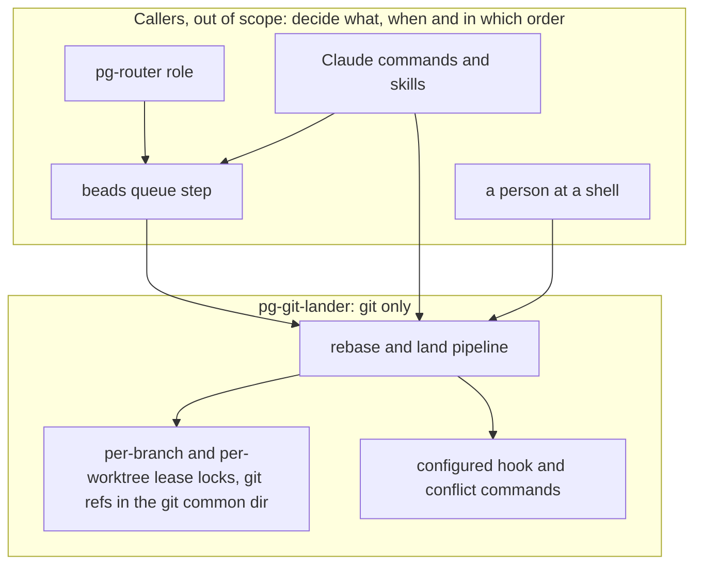
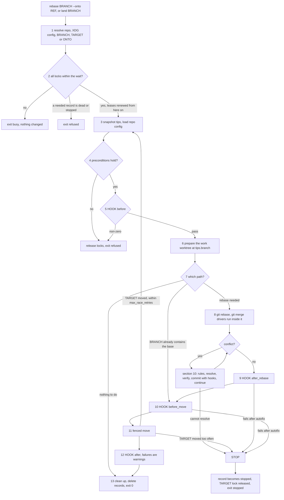
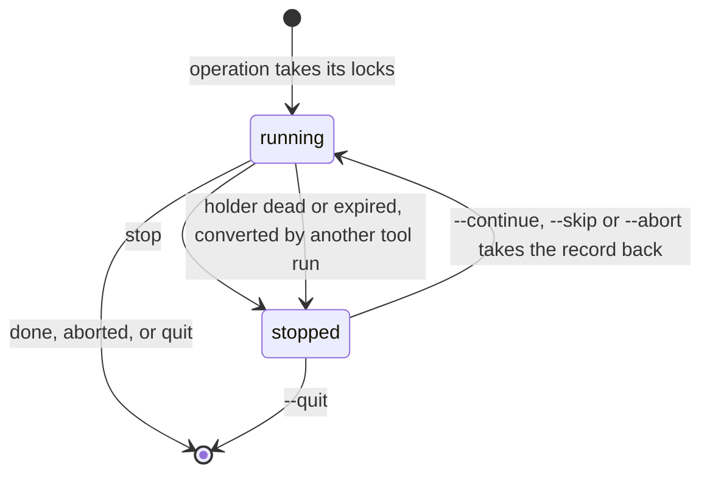

# `pg-git-lander`: lock-safe rebase and land — design

- **Status**: Draft for operator review (2026-11-07, revised the same day after two independent reviews). Nothing is
  implemented. Do not decompose until the operator approves.
- **Scope**: the tool only. The callers that decide what to land, when and in which order (a beads queue step, pg-router
  roles, Claude commands such as `/drain-beads` and `/audit-worktrees`, the `integrate-branch` handlers, a person at a
  shell) are out of scope. They appear only where they shape the tool's interface (section 17). The caller-side design,
  `docs/superpowers/specs/2026-11-04-single-lander-per-repo-design.md`, is kept as the reference for that usage.
- **Builds on**: `claude-marketplace/integrate-branch/skills/ff-merge-to-main/SKILL.md` (today's FF-0 to FF-4 landing
  steps); `packages/integrate-branch-support` (FF-1b's runner and the FF-4a bundle refresh); `docs/hooks.md` in
  `phillipg-nix-repo-base` (the `pg-hooks` stages, the `pre-land` pseudo-stage and `pre-land-eval`).
- **Operator rulings** (Phillip, 2026-11-06 and 2026-11-07) are quoted verbatim in the tracker issue that opened this
  design; section 19 lists the ones that shaped this document. Section 20 lists the questions still open.

The key words MUST, MUST NOT, SHOULD, SHOULD NOT and MAY in this document are to be read as in RFC 2119.

## 1. Problem

Landing is a skill today. `ff-merge-to-main` describes its deterministic steps in prose, and every agent that lands
re-executes them. Several agents landing into one repo race for the primary branch: the slower one finds it advanced,
starts again from its rebase, and gives up at the second lost race. Rebasing is no safer. Agents rebase with plain git,
nothing stops two of them from rewriting the same branch at once, and the machine-wide `flake.lock` merge driver keeps
"the current side", which during a rebase is the upstream, so a branch's own `flake.lock` change is dropped without a
conflict stop.

`pg-git-lander` is one deterministic command that performs a rebase or a land safely. It takes per-branch locks, so
operations that write the same branch take turns while unrelated operations run in parallel. It resolves conflicts only
through commands its configuration names. It runs configured hook commands at fixed points. On any failure it stops the
way `git rebase` does, and leaves `--continue`, `--skip`, `--abort` and `--quit` to its caller.

## 2. Goals and non-goals

Goals:

1. At most one operation at a time writes a given branch through the tool.
2. Operations that write different branches run in parallel.
3. A holder that crashed blocks others for about one poll interval. A holder whose step hangs blocks others until that
   step's timeout, after which it stops cleanly. A holder whose whole process is wedged blocks others for at most its
   lease.
4. The tool behaves the same whether a person, a Claude session or a pg-router role runs it, and needs no daemon.
5. Every conflict resolution and every check is a configured command or one of git's own merge drivers. With no
   configuration, a conflict stops.
6. A stop never leaves a branch half-moved: no ref moves before the move stage, and the move is fenced.
7. Every decision the tool made can be inspected afterwards without reading git's internals (outcome, `status`,
   `log`, events).

Non-goals:

- Choosing what to land, queueing, ordering, retry policy or tracker updates (the callers).
- Pull requests, fetching and pushing. The tool works on local refs; a caller fetches and pushes.
- Coordination across machines. Locks live in one clone's git common dir.
- Merge commits. A land fast-forwards TARGET to a rebased BRANCH and never creates a merge commit.
- A configurable stop action or WIP commits. A stop is a stop (operator ruling, 2026-11-06).
- Deciding which checks a repo needs. The repo's configuration names them.

## 3. Terms

| Term          | Meaning                                                                                                                |
| ------------- | ---------------------------------------------------------------------------------------------------------------------- |
| BRANCH        | The local branch an operation rewrites (`rebase`) or lands (`land`).                                                   |
| ONTO          | The commit a `rebase` replays BRANCH onto, resolved once from a ref when the operation starts.                         |
| TARGET        | The local branch a `land` fast-forwards. Defaults to the repo's primary branch.                                        |
| main worktree | The clone's main working tree: the first entry of `git worktree list --porcelain`. Its root is "the repo".             |
| operation     | One `rebase` or `land` invocation, identified by an operation id (`op_id`).                                            |
| lock record   | The JSON document a lock ref points at: an owner, a lease and, for the BRANCH role, the operation's state.             |
| stage         | Where an operation is: `locked`, `preparing`, `rebasing`, `after_rebase`, `before_move`, `moving`, `after`, `cleanup`. |
| stop          | The end of an operation that did not complete. Its record stays, in state `stopped`, until a caller resolves it.       |
| refusal       | The end of an operation whose preconditions failed before it changed anything.                                         |
| work worktree | The checkout the tool works in (section 11). It is never where the result goes.                                        |

The primary branch is, in order: the XDG configuration's `primary`; the branch `refs/remotes/origin/HEAD` names; `main`.

## 4. Overview

The design combines these patterns:

- **Template Method.** `rebase` and `land` share one fixed pipeline whose variable steps are hook points and conflict
  rules (section 7).
- **Lease-based Mutex over a Compare-and-Swap register.** Each lock is a git ref that changes only through
  `git update-ref` with an expected old value. A holder renews its lease; a waiter that has watched a record go
  unrenewed for a whole lease, or whose holder's pid is gone, takes it over or converts it (section 8).
- **Fencing token.** Every ref the tool moves is moved in a git ref transaction that also verifies the mover's lock
  records, or, where git cannot fold the move into a transaction, between a verifying transaction and a post-move check
  (section 8.8).
- **Chain of Responsibility.** Each conflicted path goes to the first matching conflict rule, else the default rule,
  else the operation stops (section 10).
- **Command.** Hook and resolver commands are argument vectors with a fixed environment and exit-code contract
  (section 13).
- **State machine.** An operation record is `running` or `stopped`, and records its stage (section 8.2).



The tool reads no tracker and knows no caller. A caller MAY pass opaque `--context KEY=VALUE` pairs; the tool records
them with the operation, hands them to every command it runs, and never interprets them. Callers MUST NOT pass secrets
as context: context values are stored in lock records (section 14.7).

## 5. Command-line interface

### 5.1 Synopsis

```text
pg-git-lander rebase BRANCH --onto REF [--worktree PATH] [--wait DURATION] [--context KEY=VALUE]... [--dry-run] [--json]
pg-git-lander land   BRANCH [--into TARGET] [--worktree PATH] [--wait DURATION] [--context KEY=VALUE]... [--dry-run] [--json]
pg-git-lander rebase [BRANCH] --continue | --skip | --abort | --quit [--wait DURATION] [--json]
pg-git-lander land   [BRANCH] --continue | --skip | --abort | --quit [--wait DURATION] [--json]
pg-git-lander status [BRANCH] [--json]
pg-git-lander log    OP_ID | BRANCH [--tail N]
pg-git-lander config check [--file PATH | --ref REF] [--json]
pg-git-lander config show [--json]
```

- Every form accepts `--repo PATH`: any path inside the clone or one of its worktrees (default: the current directory).
- BRANCH and TARGET are local branch names. BRANCH equal to TARGET is a usage error.
- `--onto REF` names the commit to replay BRANCH onto, like the argument of `git rebase REF` (git's `<upstream>`), not
  like git's own `--onto` option. It accepts any commit-ish and is resolved once.
- `--wait` overrides `lock.wait` for this invocation.
- With `--continue`, `--skip`, `--abort` or `--quit`, BRANCH MAY be omitted when the current directory is the stopped
  operation's work worktree. The operation word MUST match the stopped operation (refusal `operation-mismatch`), and
  `--context` is not accepted: a resumed operation keeps its original context.
- Every next-step command the tool prints repeats `--repo` when the invocation used it.

### 5.2 `--dry-run`

`--dry-run` takes no lock and changes no ref, worktree or lock record. It evaluates the preconditions of step 4 and
reports any refusal they would produce, the path the operation would take (fast-forward, rebase or nothing to do), and
the conflicting paths `git merge-tree --write-tree` predicts, with the rule (section 10.2) that would handle each. The
prediction covers the combined change, not each replayed commit, and does not predict commits a rebase would drop as
already upstream; the outcome says so. `git merge-tree --write-tree` writes unreachable objects, which `git gc`
prunes.

## 6. Outcomes, reasons and what a caller does next

### 6.1 Exit codes

Every invocation ends with exactly one outcome. With `--json` the tool prints one JSON object on stdout (section
14.1); otherwise one line, plus the exact next commands after a stop or refusal. Progress goes to stderr.

| Exit | Outcomes                                                                                                         | Meaning                                                                                                                                                                                          |
| ---- | ---------------------------------------------------------------------------------------------------------------- | ------------------------------------------------------------------------------------------------------------------------------------------------------------------------------------------------ |
| 0    | `landed`, `rebased`, `up-to-date`, `nothing-to-land`, `aborted`, `quit`, `dry-run`, `status`, `log`, `config-ok` | Done. No record of this operation remains (except after `quit`, which leaves the worktree to the caller).                                                                                        |
| 1    | `internal-error`                                                                                                 | Unexpected failure before any lock was taken. Exit 1 never carries a branchable meaning.                                                                                                         |
| 2    | `usage-error`, `config-error`                                                                                    | Bad arguments, or the XDG configuration (or `config check`'s file) is invalid. Nothing changed.                                                                                                  |
| 3    | `busy`                                                                                                           | A lock was not obtained within the wait. Nothing changed. The JSON names the holder. Always retryable.                                                                                           |
| 4    | `stopped`                                                                                                        | The operation stopped and its record is `stopped` (section 6.3). An unexpected failure after locking is a stop with reason `internal-error`, never exit 1, so a record never dangles unreported. |
| 5    | `refused`                                                                                                        | A precondition failed (section 6.2). No ref, worktree or record changed, except for `holder-died`.                                                                                               |

`up-to-date` is a `rebase` whose BRANCH already contains ONTO. `nothing-to-land` is a `land` where TARGET already holds
every change of BRANCH, by ancestry or because the rebase dropped every commit as already upstream; the outcome field
`nothing_to_land_by` says which (`ancestry` or `patch`).

### 6.2 Refusal reasons (exit 5)

| Reason                 | When                                                                                                                                                                      | Next                                                                         |
| ---------------------- | ------------------------------------------------------------------------------------------------------------------------------------------------------------------------- | ---------------------------------------------------------------------------- |
| `stopped-pending`      | BRANCH has a stopped record. The outcome's `blocking_op` names it.                                                                                                        | `--continue`, `--skip`, `--abort` or `--quit` on that operation.             |
| `target-stopped`       | TARGET has a stopped record (for example a stopped `rebase` of TARGET itself).                                                                                            | Resolve that operation first.                                                |
| `holder-died`          | A record this operation needs was `running` with a dead or expired holder; it has just been converted to `stopped` (section 8.6). The only refusal that changes a record. | `--continue` or `--abort` on the converted operation.                        |
| `pool-stopped`         | Every pool worktree is held by a stopped operation. `blocking_op` lists them.                                                                                             | Resolve one of them.                                                         |
| `unreadable-lock`      | A lock ref does not point at a readable record of a supported schema.                                                                                                     | Inspect with `status`; a person removes the ref.                             |
| `checkout-dirty`       | A checkout the operation must work in or move has tracked changes.                                                                                                        | Commit or discard them, then run again.                                      |
| `branch-checked-out`   | `--worktree` names a place other than the worktree where BRANCH is checked out.                                                                                           | Drop `--worktree`, or name BRANCH's own worktree.                            |
| `worktree-unsuitable`  | `--worktree` is a checkout of another branch, or TARGET's checkout.                                                                                                       | Name BRANCH's checkout or a dedicated detached worktree.                     |
| `worktree-busy`        | A pool or fixed worktree holds a rebase or tracked changes that no record accounts for.                                                                                   | A person cleans it up.                                                       |
| `unsupported-layout`   | The clone is bare, `core.worktree` is set, or the work worktree uses sparse checkout.                                                                                     | Not supported in version 1.                                                  |
| `no-git-identity`      | git has no committer identity (`git var GIT_COMMITTER_IDENT` fails).                                                                                                      | Configure `user.name` and `user.email` for the environment the tool runs in. |
| `untrusted-config`     | The repo file names commands, the repo is not trusted, and the policy is `refuse` (section 12.3).                                                                         | Trust the repo in the XDG file, or set `untrusted_repo_config = "ignore"`.   |
| `repo-config-error`    | The repo file does not parse or holds an invalid value. The outcome names the file, line, key and layer.                                                                  | Fix the file on TARGET, or set `ignore_repo_config = true` for the repo.     |
| `before-hook-refused`  | A `before` hook exited non-zero (section 13.1).                                                                                                                           | As the hook's output says.                                                   |
| `nothing-stopped`      | A resume flag found no stopped operation for BRANCH or the current directory.                                                                                             | None.                                                                        |
| `operation-mismatch`   | A resume flag's operation word differs from the stopped operation's.                                                                                                      | Use the stopped operation's word.                                            |
| `unresolved`           | `--continue` found unmerged paths in the work worktree.                                                                                                                   | Resolve and `git add` them, then `--continue`.                               |
| `rebase-state-missing` | `--continue` found git's rebase neither in progress nor finished in a way the record can account for.                                                                     | `--abort`.                                                                   |
| `worktree-mismatch`    | The work worktree is missing, belongs to another operation, or its HEAD is not one the record can explain.                                                                | `--abort` (which tolerates a missing worktree) or `--quit`.                  |
| `lost-to-concurrent`   | A concurrent `--continue`, `--skip` or `--abort` took the record first.                                                                                                   | None; read that invocation's outcome.                                        |

### 6.3 Stop reasons (exit 4)

| Reason                | Stages                                    | Retryable | Valid next                                  | Hint                                                                                                                     |
| --------------------- | ----------------------------------------- | --------- | ------------------------------------------- | ------------------------------------------------------------------------------------------------------------------------ |
| `conflict`            | `rebasing`                                | no        | `--continue`, `--skip`, `--abort`, `--quit` | Resolve the listed paths in the worktree, `git add` them, then `--continue`; `--skip` drops the replayed commit.         |
| `resolve-failed`      | `rebasing`                                | no        | as `conflict`                               | A resolver failed; its output is in `log_tail`. Resolve by hand or `--abort`.                                            |
| `verify-failed`       | `rebasing`                                | no        | as `conflict`                               | The rule's verify command failed after its resolver ran.                                                                 |
| `markers-left`        | `rebasing`                                | no        | as `conflict`                               | A resolver left conflict markers.                                                                                        |
| `max-conflict-rounds` | `rebasing`                                | no        | `--abort`, `--quit`                         | Too many conflict stops in one operation.                                                                                |
| `hook-failed`         | `after_rebase`, `before_move`             | no        | `--continue`, `--abort`, `--quit`           | Fix the cause in the worktree and commit there, then `--continue` re-runs the hook point.                                |
| `commit-rejected`     | `rebasing`, `after_rebase`, `before_move` | no        | `--continue`, `--abort`, `--quit`           | A git commit hook rejected a commit the tool made, even after autofix.                                                   |
| `transient`           | `rebasing`, `after_rebase`, `before_move` | yes       | `--continue` later, or `--abort`            | A command exited 75.                                                                                                     |
| `timeout`             | any                                       | yes       | `--continue` later, or `--abort`            | A command or git step ran past its timeout and was killed.                                                               |
| `interrupted`         | any                                       | yes       | `--continue`, `--abort`                     | The tool received SIGINT, SIGTERM or SIGHUP (section 6.4).                                                               |
| `race`                | `moving`                                  | yes       | `--continue`, `--abort`                     | TARGET kept moving; `--continue` rebases the current result onto TARGET's new tip.                                       |
| `branch-moved`        | `moving` (`rebase` only)                  | no        | `--abort`                                   | BRANCH moved outside the tool after the operation started; `--abort`, then rebase its new tip.                           |
| `checkout-changed`    | `moving`                                  | yes       | `--continue`, `--abort`                     | TARGET's checkout gained tracked changes, or its HEAD no longer names TARGET, after the preconditions passed.            |
| `move-unverified`     | `moving`                                  | no        | `--abort`                                   | The move could not be confirmed (section 8.8); BRANCH is kept. A person checks TARGET.                                   |
| `lock-lost`           | any                                       | yes       | `--continue`, `--abort`                     | Another process took one of this operation's locks.                                                                      |
| `holder-died`         | any (set by another process, 8.6)         | yes       | `--continue`, `--abort`                     | The holder crashed or was wedged; its state was preserved.                                                               |
| `git-error`           | any                                       | no        | `--abort`, `--quit`                         | git failed in a way the tool does not interpret (for example a `pre-rebase` hook refused); its message is in `log_tail`. |
| `internal-error`      | any after locking                         | no        | `--abort`                                   | A defect in the tool; the log names it.                                                                                  |

Warnings appear in an exit-0 outcome's `warnings` and in the human line: `after-hook-failed`, `branch-checked-out` and
`branch-moved` (a land kept BRANCH, section 7.2), `untrusted-commands-ignored`, `undefined-merge-driver`,
`unknown-repo-config-key`, `config-changed` (a resume ran under a different configuration).

### 6.4 Signals

On SIGINT, SIGTERM or SIGHUP the tool MUST:

1. let a fenced ref transaction or a `git merge --ff-only` that has already started finish (these take milliseconds);
2. otherwise send SIGTERM to the current step's process group, then SIGKILL after 5 seconds;
3. set the BRANCH record to `stopped` with reason `interrupted`, if the record is still its own, and release the
   TARGET lock;
4. print the outcome and exit 4.

A second signal makes the tool exit at once; its record stays `running`, and the next tool run converts it
(`holder-died`). Section 17 tells agents to run long landings detached so that a tool timeout in the agent does not
send these signals at all.

## 7. The pipeline



### 7.1 Steps

1. **Resolve.** The tool resolves the git common dir (`git rev-parse --path-format=absolute --git-common-dir`) and the
   main worktree, loads the XDG configuration (section 12), and resolves BRANCH, and TARGET for a `land` or ONTO for a
   `rebase`. BRANCH MUST exist; BRANCH equal to TARGET, or a missing TARGET, is a usage error. ONTO MUST be resolved
   once, here. The work worktree is chosen now (section 11.1), because its lock is part of step 2.
2. **Lock.** The tool takes the operation's locks (section 8.5). A lock that stays held by a live, fresh holder for the
   whole wait ends in `busy`. A needed lock whose record is `stopped` ends in `stopped-pending`, `target-stopped` or
   `pool-stopped`; one whose holder is dead or expired is converted (section 8.6) and ends in `holder-died`. From here a
   renewal loop keeps every lease fresh.
3. **Snapshot and configure.** Under the locks the tool records `tips.branch` (BRANCH's tip, the only content the
   operation lands) and, for a `land`, `tips.target` (TARGET's tip). It then loads the repo file from `tips.target` for a
   `land` or from the local primary branch's tip for a `rebase` (section 12.2), and records the configuration's digest.
4. **Preconditions.** The tool refuses (section 6.2), releasing its locks, when the layout is unsupported, git has no
   committer identity, the repo file is untrusted under the `refuse` policy or does not parse, or a checkout it must
   work in or move has tracked changes. It logs `core.attributesFile`, `core.hooksPath` and every `merge.*.driver`
   setting git resolves (section 9.4).
5. **Hook `before`.** Runs in the main worktree. A non-zero exit is a refusal, `before-hook-refused`, because nothing
   has changed yet.
6. **Prepare** the work worktree (section 11): a detached HEAD at `tips.branch`.
7. **Decide the path.**
   - `land`: TARGET contains `tips.branch` gives `nothing-to-land` (step 13, BRANCH retired as in section 7.2);
     `tips.branch` contains `tips.target` skips the rebase (step 10); otherwise rebase onto `tips.target`.
   - `rebase`: `tips.branch` contains ONTO gives `up-to-date` (step 13); otherwise rebase onto ONTO.
8. **Rebase.** In the work worktree the tool runs `git rebase <base>` on the detached HEAD with the pinned options of
   section 9.1. git runs its merge drivers and its `pre-rebase` hook as usual. Each conflict stop goes through section 10. A rebase that stops for any other reason ends in a stop with reason `git-error`. A rebase that drops every
   commit as already upstream makes a `land` `nothing-to-land` (by `patch`); a dropped commit is listed in the
   outcome's `dropped_commits`.
9. **Hook `after_rebase`.** Runs only when step 8 replayed at least one commit onto a base that differs from BRANCH's
   merge base.
10. **Hook `before_move`.** Runs for every operation that will move a ref, including the fast-forward path.
11. **Move** (section 8.8). For a `rebase`, BRANCH moves to the result. For a `land`, TARGET fast-forwards to the
    result, then BRANCH is retired (section 7.2). If TARGET moved since `tips.target`, the tool returns to step 3:
    it re-reads TARGET, reloads the repo file, and rebases the current result (not `tips.branch`, so resolutions made
    so far are kept) onto the new tip. After `max_race_retries` such returns it stops with `race`. For a `rebase`, a
    BRANCH that no longer equals `tips.branch` stops with `branch-moved`.
12. **Hook `after`.** A failure here MUST NOT stop the operation, because the move already happened; it is the warning
    `after-hook-failed`.
13. **Clean up.** The tool removes a temporary work worktree, deletes the operation's records (which releases the
    pool or fixed worktree) and releases every lock.

At every stage boundary the tool records `stage`, `stage_started_at` and `tips.result` (the work worktree's HEAD) in
the BRANCH record, so a resume can tell whether the worktree is still the one it left.

### 7.2 BRANCH after a land

`land.branch_after` decides what happens to BRANCH once TARGET contains it:

- `delete` (default): a fenced compare-and-delete with `tips.branch` as the expected value;
- `move`: point BRANCH at the landed commit, also a fenced compare-and-swap;
- `keep`: leave BRANCH where it is.

Before deleting, the tool MUST check `git worktree list --porcelain`: `git update-ref -d` deletes a branch checked out
in another worktree without complaint. A BRANCH checked out anywhere is never deleted. When the land worked in place
(section 11.3), BRANCH already sits on the landed commit with HEAD attached to it. When BRANCH is checked out somewhere
else, it is kept, with the warning `branch-checked-out`. If BRANCH no longer equals `tips.branch` (a writer that
bypassed the tool committed to it), the compare fails, BRANCH is kept, and the warning `branch-moved` says that its new
commits were not landed.

### 7.3 Resuming: `--continue`, `--skip`, `--abort`, `--quit`

A resume flag first takes the stopped BRANCH record back by compare-and-swap (`stopped` to `running`, with itself as the
owner). If another invocation took it first, the resume is refused with `lost-to-concurrent`. It then takes the
operation's other locks; if they are busy past the wait, it swaps the record back to its stopped state and exits
`busy`, so a resume never strands a record in `running`. Resume flags need only the built-in lock defaults and the XDG
file, so `--abort` and `--quit` work even when the repo file is broken.

**`--continue`** reloads the configuration (the warning `config-changed` reports a different digest), checks that the
work worktree is the recorded one (else `worktree-mismatch`), resets the race and autofix counters, and resumes from
the start of the recorded stage:

| Stage                                                                                    | What `--continue` does                                                                                                                                                                                                                                                                                                                                    |
| ---------------------------------------------------------------------------------------- | --------------------------------------------------------------------------------------------------------------------------------------------------------------------------------------------------------------------------------------------------------------------------------------------------------------------------------------------------------- |
| `rebasing`, git's rebase still in progress                                               | Unmerged paths: refused `unresolved`. Otherwise, when the index differs from HEAD, the tool commits the resolution with `git commit -C <replayed commit>`; when the resolution leaves the replayed commit empty, it runs `git rebase --skip` and lists the commit in `dropped_commits`. Then `git rebase --continue` and the conflict loop of section 10. |
| `rebasing`, no rebase in progress, HEAD equals `tips.branch`                             | The rebase never started or was aborted by hand (for example a `pre-rebase` hook refused it): the tool starts the rebase again.                                                                                                                                                                                                                           |
| `rebasing`, no rebase in progress, HEAD contains the base and differs from `tips.branch` | The caller finished the rebase with git by hand: the tool records `tips.result` and continues at `after_rebase`.                                                                                                                                                                                                                                          |
| `rebasing`, anything else                                                                | Refused `rebase-state-missing`.                                                                                                                                                                                                                                                                                                                           |
| `after_rebase`, `before_move`                                                            | HEAD MUST equal `tips.result` or descend from it (the caller committed a fix), else `worktree-mismatch`. The hook point runs again from its first hook.                                                                                                                                                                                                   |
| `moving` (`race`, `lock-lost`, `interrupted` before the move)                            | Back to step 3 with the current HEAD as the content to land.                                                                                                                                                                                                                                                                                              |
| `moving` after the move, `after`, `cleanup`                                              | The record says `moved_already: true`: the tool runs the remaining `after` hooks and cleans up.                                                                                                                                                                                                                                                           |

**`--skip`** is valid only at `rebasing` with git's rebase in progress. It runs `git rebase --skip`, lists the dropped
commit, and continues as `--continue` does.

**`--abort`** MUST leave BRANCH and TARGET where the operation found them. Nothing moves before step 11, so nothing
needs restoring there. It aborts git's rebase if one is in progress, then:

- in place (section 11.3): re-attaches HEAD to BRANCH, which is still at `tips.branch`;
- a pool or fixed worktree: checks out `tips.branch` detached and discards tracked changes (the tool owns that worktree);
- a temporary worktree: removes it.

It then deletes the records. A missing worktree is skipped and reported as `worktree_missing: true`. For a record that
says `moved_already`, `--abort` only cleans up and says so.

**`--quit`** deletes the operation's records and leaves the work worktree exactly as it is, git's rebase included, so a
caller can finish with plain git, for example by committing partial work. This differs from `git rebase --quit`, which
drops git's rebase state; `pg-git-lander --quit` stops only the tool's tracking. Its hint names the worktree, the
`git rebase --continue` and `git rebase --abort` commands for it, and `git switch -C BRANCH` for putting BRANCH on the
result. A temporary worktree left by `--quit` becomes the caller's to remove; `status` keeps listing it until then.

## 8. Locks

### 8.1 Why git refs

A lock needs an atomic create-if-absent and a compare-and-swap. `flock` frees a crashed holder's lock at once, but it
cannot detect a hung holder and nobody can take it over. A file or directory lock needs a hand-built steal protocol
(the caller-side spec's `mkdir` lock needed one). `git update-ref <ref> <new> <old>` is already a compare-and-swap
register in the git common dir, which every worktree shares, and `git update-ref --stdin` transactions let lock checks
and branch moves succeed or fail together.

Experiments in throwaway repos (git 2.54.0) confirmed:

| Step                                                                     | Result                                                                             |
| ------------------------------------------------------------------------ | ---------------------------------------------------------------------------------- |
| Create a lock ref with the zero oid as the expected old value            | Succeeded; a second creator failed with "reference already exists".                |
| Renew with the holder's current record as the expected value             | Succeeded.                                                                         |
| Take over with a record read before the holder renewed                   | Refused: "is at … but expected …".                                                 |
| Read the lock from another worktree                                      | Same record.                                                                       |
| One transaction: `verify` the lock and `update refs/heads/main`          | Moved `main` when the lock matched; when it did not, failed and left `main` alone. |
| `git log --all` with a ref pointing at a blob                            | Unaffected.                                                                        |
| A correct renewal while another process's `update-ref` held the ref lock | Failed with "Unable to create '…/main.lock': File exists"; the ref was unchanged.  |

The last row is why a failed compare-and-swap alone never means a lost lock (section 8.4).

### 8.2 Lock refs and records

- A branch lock, for BRANCH or TARGET, is `refs/pg-git-lander/locks/heads/<branch>`.
- A worktree lock is `refs/pg-git-lander/locks/worktrees/<name>`, where `<name>` is the basename of the worktree's
  private git dir (`git rev-parse --git-dir` gives `<common>/worktrees/<name>`), or `_main` for the main worktree.
  git's own name is canonical, so case and symlink differences in a typed path cannot give one worktree two locks.
- Every operation locks its work worktree, whether in place, pooled, fixed or temporary.
- Each lock ref points at a blob holding one JSON record. There is no other lock file.

A BRANCH record carries the operation's whole state:

```json
{
  "schema": 1,
  "role": "branch",
  "state": "running",
  "op_id": "20261107T101500Z-3f9c2a",
  "operation": "land",
  "branch": "feature/x",
  "target": "main",
  "owner": {
    "host": "laptop.local",
    "pid": 41721,
    "pid_start": 1794132898,
    "token": "b1c49e0d7a6f4c21",
    "tool_version": "26.11.07"
  },
  "lease": { "renewed_at": "2026-11-07T10:15:10Z", "ttl_s": 30 },
  "worktree": {
    "name": "20261107T101500Z-3f9c2a",
    "path": "/src/example/.worktrees/pg-git-lander/20261107T101500Z-3f9c2a",
    "kind": "temp"
  },
  "started_at": "2026-11-07T10:15:00Z",
  "stage": "rebasing",
  "stage_started_at": "2026-11-07T10:15:02Z",
  "current_command": {
    "argv0": "git",
    "pid": 41790,
    "started_at": "2026-11-07T10:15:02Z",
    "deadline": "2026-11-07T10:25:02Z"
  },
  "tips": {
    "branch": "4c2e…",
    "target": "9a10…",
    "onto": null,
    "result": "4c2e…"
  },
  "attempts": { "conflict_rounds": 0, "race_retries": 0, "autofix": {} },
  "config_digest": "sha256:…",
  "context": { "request": "R-17" },
  "stop": null
}
```

A stopped record has `"state": "stopped"`, `"lease": null` and a `stop` object
`{ "reason", "retryable", "at", "stage", "paths", "message", "moved_already" }`. Hook output is never stored in a
record (section 14.7). A TARGET record and a worktree record carry only `schema`, `role`, `state`, `op_id`, `branch`
(the operation's BRANCH), `owner` and `lease`. On a stop the BRANCH and worktree records both become `stopped`; the
TARGET record is deleted.



A record that cannot be parsed, a lock ref that does not point at a blob, or a `schema` newer than the tool supports
MUST be treated as held by a live holder: never taken over or converted, reported by `status` as `unreadable`, and
answered with the refusal `unreadable-lock`.

### 8.3 Acquire, renew and wait

- **Acquire.** Write the record as a blob (`git hash-object -w`), then `git update-ref <lock> <blob> <zero oid>`. A
  waiter MUST attempt this only after a read showed the lock absent, so waiters do not hold git's ref lock on every poll.
- **Renew.** Every `lock.renew_every` (default 10 s), write a new record with a new `renewed_at` and swap it in with the
  holder's current record as the expected value. Renewal MUST run only while the current step (a git command, a hook
  or a resolver) is within its timeout, so a stuck step lets its lease lapse. The holder MUST track the time of its
  last successful renewal on a monotonic clock.
- **Wait.** A waiter reads the lock every `lock.poll` (default 1 s), for at most the wait (default `lock.wait`, 60 s):

  | Lock state                                                                                                        | Waiter                                                                                    |
  | ----------------------------------------------------------------------------------------------------------------- | ----------------------------------------------------------------------------------------- |
  | absent                                                                                                            | acquires                                                                                  |
  | `running`, owner on this host, pid gone or now with a different start time (a zombie counts as gone)              | converts or takes over at once (section 8.6)                                              |
  | `running`, and this waiter has seen the same record oid unchanged for `lock.lease_ttl` on its own monotonic clock | treats the lease as expired: converts or takes over                                       |
  | `running`, otherwise                                                                                              | keeps waiting; prints the holder's operation, stage and elapsed time to stderr every 10 s |
  | `stopped`                                                                                                         | refuses (`stopped-pending`, `target-stopped`, or tries the next pool member)              |

  Expiry is judged by watching, not by comparing `renewed_at` with the waiter's wall clock, so a wall-clock step, a
  host that slept (holders and waiters wake together, and holders renew within `renew_every`), or a holder on another
  host with a skewed clock never expires a live lease. `renewed_at` is informational.

`lock.lease_ttl` MUST be at least twice `lock.renew_every`; `config check` rejects anything shorter.

### 8.4 A failed compare-and-swap

A failed `git update-ref` does not by itself mean the lock changed hands: git also fails while another process holds
the ref's `.lock` file or `packed-refs.lock` (section 8.1). After any failed lock write the tool MUST re-read the ref:

- the value changed: the lock was taken (by a waiter's conversion or takeover);
- the value is unchanged: retry with jittered backoff (up to `lock.cas_retries`, default 5). A holder whose renewals keep
  failing MUST stop with `lock-lost`, moving nothing, before its last successful renewal is `lease_ttl - renew_every`
  old by its monotonic clock.

A `.lock` file under `refs/pg-git-lander/` older than `lock.stale_ref_lock` (default 60 s) is left by a git process
that was killed; git holds ref locks for milliseconds. The tool MAY remove such a file in its own namespace. It MUST NOT
remove one under `refs/heads/`; `status` reports both kinds.

### 8.5 Which locks an operation takes

| Operation                  | Locks                                                            |
| -------------------------- | ---------------------------------------------------------------- |
| `rebase BRANCH --onto REF` | BRANCH and the work worktree. REF is read once and never locked. |
| `land BRANCH`              | TARGET, BRANCH and the work worktree.                            |

The tool takes its locks in ascending ref-name order, all or nothing: when one is held, it releases those it holds,
waits a random 0 to 500 ms, and tries again until the wait runs out. Acquiring in one global order is what rules out
deadlock between, for example, landing X into `main` and rebasing `main`; the release-and-retry bounds live-lock.

So two landings onto `main` take turns; a landing onto `main`, a rebase of an unrelated branch and a landing onto
`release` run in parallel; and a landing of X and a rebase of X take turns because both lock X. A stopped `rebase` of
`main` holds `main`'s lock in the BRANCH role, so landings onto `main` are refused with `target-stopped` until it is
resolved.

### 8.6 Takeover and conversion

A record whose holder is dead or whose lease expired (section 8.3) is handled by role:

- **TARGET role:** replaced by a compare-and-swap against the stale record the waiter read. No operation state lives
  there.
- **BRANCH role:** never taken over silently, because its rebase may be half done. In one `update-ref --stdin`
  transaction the waiter swaps in a `stopped` copy with reason `holder-died` and does the same to the worktree record
  it names, and deletes its TARGET record if that still holds the dead owner. The waiter's own operation is refused with
  `holder-died`.
- **Worktree role:** never taken over alone. The waiter converts the BRANCH record the worktree record names, and the
  worktree record, as above. A pool then tries its next member; any other operation is refused with `holder-died`.

Every conversion is logged and emitted as a `holder_converted` event.

### 8.7 Losing a lock

A holder learns that it lost a lock from a renewal (section 8.4) or from a fence check (section 8.8). It MUST then, at
once:

1. kill the current step's process group and stop touching the work worktree;
2. swap its BRANCH record to `stopped` with reason `lock-lost`, if the record is still its own;
3. delete its TARGET record, if it is still its own;
4. exit 4. The outcome says which records it no longer owned.

### 8.8 Fencing the move

Every write to BRANCH or TARGET MUST be made in a `git update-ref --stdin` transaction that also `verify`s the
holder's current lock records, except a fast-forward of a TARGET that is checked out in a worktree (normally the main
worktree's primary branch). git cannot fold that into a transaction, so the tool MUST, in this order:

1. run a transaction that only verifies its lock records;
2. confirm, by its monotonic clock, that its last successful renewal is less than `lease_ttl - renew_every` old, else
   stop with `lock-lost` without moving;
3. confirm that the checkout's `HEAD` is the symbolic ref `refs/heads/<TARGET>`, and that the checkout has no tracked
   changes, else stop with `checkout-changed` without moving;
4. run `git merge --ff-only <result>` in that checkout. A fast-forward can only add commits: if another writer moved
   TARGET in between, git refuses, and that is the race path of step 11;
5. confirm that `refs/heads/<TARGET>` equals the result, else stop with `move-unverified`. BRANCH MUST NOT be retired
   after `move-unverified`.

A BRANCH that is checked out is only ever moved in place, where it is the work worktree (section 11.3): the
transaction moves the ref, and the tool then re-attaches HEAD to it with `git symbolic-ref`. The tool never moves a
branch underneath another checkout.

### 8.9 Cost and hygiene

Each renewal writes one small blob, which becomes unreachable at the next renewal and is pruned by `git gc` after
`gc.pruneExpire`. An operation that takes seconds renews at most once or twice. Lock refs live outside `refs/heads` and
`refs/tags`, so default refspecs never push them and `git branch` never shows them; `git push --mirror` and mirror
backups do copy them (section 14.7).

## 9. Running git

### 9.1 Pinned options

Every git command the tool runs MUST carry these options, whatever the user's configuration says:

```text
-c rerere.enabled=false -c rerere.autoUpdate=false
-c rebase.backend=merge -c rebase.autoStash=false -c rebase.updateRefs=false -c rebase.autoSquash=false
-c core.editor=true -c sequence.editor=true
-c gc.auto=0 -c maintenance.auto=false
```

rerere is pinned off because an experiment against a real user configuration (`rerere.enabled` and
`rerere.autoUpdate` both true) showed a repeated conflict stopping the rebase with no unmerged paths ("Staged … using
previous resolution"). The tool would then commit and continue a resolution no configured command made, against goal
5, and a wrong manual resolution recorded before an `--abort` would come back on the next run. Automatic garbage
collection is pinned off so a landing never stalls on it.

Everything else is inherited on purpose: merge drivers and the attributes files that name them, `core.hooksPath`,
commit signing, the user's identity, and filters such as LFS.

### 9.2 Environment

git and the processes it starts (merge drivers, commit hooks, `pre-rebase`, filters) MUST get the tool's own
environment minus the variables that would point git at another repository: `GIT_DIR`, `GIT_WORK_TREE`,
`GIT_INDEX_FILE`, `GIT_OBJECT_DIRECTORY`, `GIT_ALTERNATE_OBJECT_DIRECTORIES`, `GIT_COMMON_DIR`,
`GIT_CEILING_DIRECTORIES`, `GIT_PREFIX` and `GIT_NAMESPACE`. A narrower allowlist (for example `PATH`, `HOME` and
`SSH_AUTH_SOCK` only) MUST NOT be used: a hook or driver then loses `XDG_CONFIG_HOME`, `TMPDIR`, `GIT_CONFIG_GLOBAL` or
`GNUPGHOME`, and an attribute whose driver git cannot see falls back to a plain text merge without any error, which is
the `flake.lock` failure this tool exists to remove. If the implementation uses `x/gitclient`, it MUST use it with this
environment rather than its default allowlist.

### 9.3 Timeouts

Every git command runs in its own process group under `git_timeout` (default 10 minutes). At the timeout the tool kills
the group and stops with `timeout`. This covers a merge driver, a slow commit hook, a signing prompt waiting for input,
or `git worktree add` fetching LFS content.

### 9.4 Merge-driver diagnostics

At step 4 the tool logs `core.attributesFile`, `core.hooksPath` and every `merge.*.driver` git resolves. For every
conflicted path, and every path git reported as auto-merged, it logs `git check-attr merge -- <path>`. When an attribute
names a driver that has no `merge.<name>.driver`, the outcome carries the warning `undefined-merge-driver`, because git
then falls back to a text merge silently.

## 10. Conflict resolution

### 10.1 Order

1. git's own merge drivers run inside the rebase (section 9), for example a syntax-aware driver such as mergiraf. The
   tool does nothing special for them; paths they merge are logged and counted (`driver_merge` events).
2. For each path git still reports as conflicted (`git diff --name-only --diff-filter=U`), the tool takes the first
   conflict rule whose glob matches, else `conflict_default`, else none.
3. If any conflicted path has no command, the tool runs no command at all and stops with `conflict`, so the stopped
   worktree shows git's conflict untouched.

### 10.2 Matching and grouping

A glob is matched against the repo-relative path: `*` matches within one path segment and `**` across segments. Rules
are tried in this order, and the first match wins for each path: the XDG `[[repo]]` entry's rules, then the repo
file's rules, then the XDG `[defaults]` rules. Each rule has an id, `<layer>:<index>:<glob>` (for example
`repo-file:2:packages/*/go.sum`), used in the log, the outcome and the events.

| `run_per`        | Runs                                     | Working directory        |
| ---------------- | ---------------------------------------- | ------------------------ |
| `file` (default) | once per matched path                    | the work worktree's root |
| `dir`            | once per directory holding matched paths | that directory           |
| `all`            | once, with every matched path            | the work worktree's root |

Rules run in the order above; within a rule, paths and directories run in sorted order.

### 10.3 The resolver contract

A resolver gets the common environment (section 13.2) plus:

| Variable                        | Value                                                                                                                       |
| ------------------------------- | --------------------------------------------------------------------------------------------------------------------------- |
| `PG_GIT_LANDER_PATHS`           | The matched paths, repo-relative, one per line                                                                              |
| `PG_GIT_LANDER_PATH`            | The single path (`run_per = "file"` only)                                                                                   |
| `PG_GIT_LANDER_DIR`             | The directory (`run_per = "dir"` only)                                                                                      |
| `PG_GIT_LANDER_BASE_FILE`       | A temporary file with the common ancestor's version (index stage 1), or empty when that side has no such path (`file` only) |
| `PG_GIT_LANDER_ONTO_FILE`       | The version on the side being replayed onto (stage 2), or empty (`file` only)                                               |
| `PG_GIT_LANDER_BRANCH_FILE`     | The replayed commit's version (stage 3), or empty (`file` only)                                                             |
| `PG_GIT_LANDER_REPLAYED_COMMIT` | The commit being replayed                                                                                                   |
| `PG_GIT_LANDER_RULE`            | The rule's id                                                                                                               |

The names say which side is which on purpose: during a rebase git's "ours" is the side being replayed onto, which is how
a keep-ours driver drops a branch's change.

A resolver writes the resolved content to the working-tree path (or deletes the path) and exits 0. The tool then:

1. MUST check every matched path for a conflict block: a line starting with seven `<` followed by a space, and later a
   line starting with seven `>` followed by a space. A lone line of seven `=` (a Markdown underline) is not a marker.
   A block left behind stops the operation with `markers-left`;
2. stages the paths (`git add`, or `git rm` for a deleted path);
3. runs the rule's `verify` command, if any, with the same working directory; a non-zero exit stops with
   `verify-failed`.

A resolver exiting 75 stops with `transient`; any other non-zero exit with `resolve-failed`.

When every conflicted path is resolved, the tool commits the resolution itself with `git commit -C <replayed commit>`,
which keeps the original message and author and runs git's commit hooks when `run_git_hooks` is true, and then runs
`git rebase --continue`. When the resolution leaves the replayed commit empty (`git commit -C` would fail with "nothing
to commit"), the tool runs `git rebase --skip` instead and lists the commit in `dropped_commits`. An experiment on
2026-11-07 (git 2.54.0) showed why the tool commits itself: when `git rebase --continue` makes the commit, git runs
neither `pre-commit` nor `commit-msg`, while `git commit -C` runs both, after which the rebase continues normally.

### 10.4 Bounds

Each resolver and verify command runs under its `timeout` (default `command_timeout`, 10 minutes), in its own process
group. The number of conflict stops in one operation is bounded by `max_conflict_rounds` (default 10); beyond it the
operation stops with `max-conflict-rounds`.

## 11. Work worktrees

### 11.1 Selection

The work worktree is where the tool rebases, resolves and runs hooks; the result goes to the BRANCH or TARGET ref
(section 8.8). It is chosen in this order:

1. **BRANCH is checked out** in some worktree: that worktree, in place (section 11.3). It MUST have no tracked changes.
   A `--worktree` naming any other place is refused with `branch-checked-out`.
2. **`--worktree PATH`**: PATH MUST be a dedicated detached worktree of this clone (a fixed worktree). A checkout of
   another branch, or TARGET's checkout, is refused with `worktree-unsuitable`; the tool never detaches someone else's
   checkout.
3. **`worktrees = [...]`** in the XDG configuration: a pool of fixed worktrees. The tool takes the first whose lock is
   free; it skips members held by stopped operations; when every member is stopped it refuses with `pool-stopped`, and
   when the rest are busy it waits and may exit `busy`. A very large repository is the case for a pool: it avoids
   repeated full checkouts, and the pool's size sets how many operations run there at once.
4. Otherwise **a temporary worktree** at `<worktree_root>/<op_id>`, created detached, removed when the operation
   completes, kept while it is stopped. `worktree_root` defaults to `<main worktree>/.worktrees/pg-git-lander`. Before
   creating anything there the tool MUST make sure `/.worktrees/pg-git-lander/` is listed in
   `<git-common-dir>/info/exclude`: a local, uncommitted ignore file every worktree shares. It re-checks and appends
   with `O_APPEND`; a duplicate line from a concurrent run is harmless.

The temporary worktree deliberately does not live inside the git dir. git accepts a worktree there (verified
2026-11-07), but agents' tool approvers commonly refuse edits under `.git/`, which would make a stopped conflict hard
for an agent to resolve in place.

### 11.2 Preparing a pool or fixed worktree

The tool MUST NOT discard work it cannot account for. A pool or fixed worktree that holds a rebase in progress or
tracked changes, and that no record names, is refused with `worktree-busy`. Otherwise the tool checks out `tips.branch`
detached. It keeps untracked and ignored files, such as build caches, and never runs `git clean`.

### 11.3 In place

When BRANCH is checked out (an agent's own worktree, or the main worktree for a `rebase` of the primary branch), the
tool works there. It detaches HEAD at `tips.branch`, rebases, and at the move step moves BRANCH with the fenced
transaction and re-attaches HEAD with `git symbolic-ref HEAD refs/heads/<BRANCH>`. Conflicts appear where the caller
already works, as with `git rebase`. On a stop, HEAD stays detached in the middle of the rebase, as git leaves it; git
then no longer protects BRANCH from `git branch -D`, and the BRANCH lock protects it only against the tool. `--abort`
re-attaches HEAD to BRANCH.

A `land` in place fast-forwards TARGET to the result and leaves BRANCH on the same commit, with HEAD attached.

### 11.4 Layouts

- A bare clone, or a clone with `core.worktree` set (today's FF-0a anomaly), is refused with `unsupported-layout`. A
  clone made with `--separate-git-dir` is supported: the git common dir and the main worktree are both resolved from
  git.
- Sparse checkout in the work worktree is refused with `unsupported-layout` in version 1.
- Submodules: their gitlinks rebase as ordinary tree entries; the tool never updates submodule working trees. A gitlink
  conflict is handled like any other path.
- LFS and other filters work through git when their executables are on PATH; otherwise git fails and the operation
  stops with `git-error`.

## 12. Configuration

### 12.1 Files and layers

- **XDG file**: `$XDG_CONFIG_HOME/pg-git-lander/config.toml` (default `~/.config/pg-git-lander/config.toml`), holding
  `[defaults]` and `[[repo]]` entries. An entry matches when its `root` resolves to the same git common dir as the
  operation's repo, so any worktree path matches its clone's entry.
- **Repo file**: `.pg-git-lander.toml` at the repository root.
- **Layers, key by key:** built-in defaults, then XDG `[defaults]`, then the repo file, then the XDG `[[repo]]` entry. A
  hook list (`hooks.<operation>.<point>`) is replaced as a whole by a later layer. Conflict rules combine in the order of
  section 10.2.
- **No configuration** means built-in defaults: no hooks and no conflict rules, so every conflict stops.

### 12.2 What is read when

- The keys needed before any lock exists come from the built-in defaults and the XDG file only: `primary`, `lock.*`,
  `worktrees`, `worktree_root`, `git_timeout`, `trust_repo_config`, `untrusted_repo_config` and `ignore_repo_config`.
  The repo file cannot set them.
- After locking, at step 3, the repo file is read from TARGET's tip for a `land` and from the local primary branch's tip
  for a `rebase`. It is never read from BRANCH, from ONTO, from a remote-tracking ref or from a working tree, so neither
  a branch nor a fetched ref can change the rules it is processed under. A branch that edits the file is processed under
  the old rules; the new rules apply from the next operation.
- The repo file is read again at every return to step 3 (a race) and at `--continue`.

### 12.3 Trust (operator ruling, 2026-11-07)

Commands named in a repo file (`run`, `resolve`, `verify`) MUST run only when the XDG entry for that repo sets
`trust_repo_config = true`, for the same reason git refuses merge drivers named in a committed `.gitattributes`. For a
repo that is not trusted:

- a repo file that names commands makes the operation refuse with `untrusted-config`, whose hint quotes the XDG line to
  add. The XDG option `untrusted_repo_config = "ignore"` instead lets the operation proceed with those commands ignored:
  the outcome then carries the warning `untrusted-commands-ignored` with each command, and the human line says so;
- of the repo file's other keys, only an allowlist applies: `autofix.message`, `autofix.attempts`,
  `max_conflict_rounds` and `max_race_retries`. An untrusted file MUST NOT replace hook lists, add conflict rules,
  change `run_git_hooks` or change any timeout.

`ignore_repo_config = true` in an XDG entry makes the tool skip the repo file entirely: the escape when a broken or
too-new repo file on TARGET would otherwise block every landing, including the one that fixes it.

### 12.4 Keys

| Key                         | Where     | Type                                                    | Default                                             | Meaning                                                                                                     |
| --------------------------- | --------- | ------------------------------------------------------- | --------------------------------------------------- | ----------------------------------------------------------------------------------------------------------- |
| `root`                      | XDG entry | path                                                    | required                                            | Any path inside the clone.                                                                                  |
| `trust_repo_config`         | XDG entry | bool                                                    | `false`                                             | Run commands named in the repo file.                                                                        |
| `untrusted_repo_config`     | XDG       | `refuse`, `ignore`                                      | `refuse`                                            | What an untrusted repo file with commands does (section 12.3).                                              |
| `ignore_repo_config`        | XDG entry | bool                                                    | `false`                                             | Skip the repo file entirely.                                                                                |
| `primary`                   | XDG       | branch                                                  | `origin/HEAD`'s branch, else `main`                 | The default TARGET.                                                                                         |
| `lock.renew_every`          | XDG       | duration                                                | `10s`                                               | Lease renewal interval.                                                                                     |
| `lock.lease_ttl`            | XDG       | duration                                                | `30s`                                               | Lease length; at least twice `renew_every`.                                                                 |
| `lock.wait`                 | XDG       | duration                                                | `60s`                                               | How long a waiter waits for a live holder before `busy`.                                                    |
| `lock.poll`                 | XDG       | duration                                                | `1s`                                                | How often a waiter re-reads a lock.                                                                         |
| `lock.cas_retries`          | XDG       | int                                                     | `5`                                                 | Retries of a lock write that failed with the value unchanged.                                               |
| `lock.stale_ref_lock`       | XDG       | duration                                                | `60s`                                               | Age at which a `.lock` file in the tool's ref namespace counts as stale.                                    |
| `worktrees`                 | XDG       | list of paths                                           | empty                                               | Pool of fixed work worktrees.                                                                               |
| `worktree_root`             | XDG       | path                                                    | `<main worktree>/.worktrees/pg-git-lander`          | Where temporary work worktrees go.                                                                          |
| `git_timeout`               | XDG       | duration                                                | `10m`                                               | Timeout for every git command.                                                                              |
| `run_git_hooks`             | all       | bool                                                    | `true`                                              | Commits the tool makes run git's commit hooks; `false` passes `--no-verify` to the tool's own commits only. |
| `command_timeout`           | all       | duration                                                | `10m`                                               | Default timeout for hook, resolver and verify commands.                                                     |
| `max_race_retries`          | all       | int                                                     | `2`                                                 | Returns to step 3 after TARGET moved.                                                                       |
| `max_conflict_rounds`       | all       | int                                                     | `10`                                                | Conflict stops allowed in one operation.                                                                    |
| `autofix.attempts`          | all       | int                                                     | `2`                                                 | Runs per hook (or tries per commit) before a stop; 2 means one fix commit and one more run that must pass.  |
| `autofix.message`           | all       | template                                                | `style: apply {hook} fixes made during {operation}` | Message of an autofix commit.                                                                               |
| `land.branch_after`         | all       | `delete`, `move`, `keep`                                | `delete`                                            | What happens to BRANCH after a land (section 7.2).                                                          |
| `hooks.<operation>.<point>` | all       | list of hook entries                                    | empty                                               | `<operation>` is `rebase` or `land`; `<point>` is `before`, `after_rebase`, `before_move` or `after`.       |
| `[[conflict]]`              | all       | rule: `glob`, `run_per`, `resolve`, `verify`, `timeout` | none                                                | Conflict rules (section 10).                                                                                |
| `conflict_default`          | all       | rule without `glob`                                     | none                                                | Used for any conflicted path no rule matches.                                                               |
| `logs.keep`                 | XDG       | duration                                                | `14d`                                               | Operation logs older than this are pruned.                                                                  |
| `logs.max_mb`               | XDG       | int                                                     | `200`                                               | Size cap for the logs directory, oldest first.                                                              |

A hook entry is `{ run = [argv], timeout = duration, skip_exit_codes = [int], cwd = "worktree" | "repo", env = { } }`.
`cwd` defaults to `worktree`, except at `before`, which runs before the work worktree exists and defaults to `repo`
(the main worktree).

A template may use `{hook}`, `{operation}`, `{files}` (the changed paths, space-separated, at most ten, then `…`) and
`{count}`. Templates MUST NOT expand `--context` values: commit messages are durable history, and caller identifiers do
not belong in them.

### 12.5 `config check` and `config show`

`config check` validates the XDG file and the repo file as the next operation would read them; `--file PATH` validates
an uncommitted repo file and `--ref REF` the file at another commit, so a fix can be checked before it lands. Every
error names the file, the line, the key and the layer.

- In the XDG file, `config check` MUST reject unknown keys, malformed globs and durations, an empty `run` or `resolve`
  argv, a lease shorter than twice its renewal interval, and a `root` that is not inside a git clone.
- In the repo file, unknown keys are warnings (`unknown-repo-config-key`), so a file written for a newer tool version
  does not block landings; every other error is the refusal `repo-config-error` at run time.
- It MUST warn about a relative command path (section 18), commands ignored as untrusted, and a configured command not
  found on PATH.

`config show` prints the effective configuration and, for every key, the layer that set it.

### 12.6 Examples

```toml
# $XDG_CONFIG_HOME/pg-git-lander/config.toml
[defaults.lock]
renew_every = "10s"
lease_ttl   = "30s"
wait        = "60s"

[[repo]]
root = "/src/example-repo"
trust_repo_config = true

[[repo]]
root = "/src/very-large-repo"
worktrees = ["/src/very-large-repo-lander-1", "/src/very-large-repo-lander-2"]
```

```toml
# .pg-git-lander.toml at the root of /src/example-repo, read from TARGET's tip (land) or the primary branch's tip (rebase)
[autofix]
attempts = 2
message  = "style: apply {hook} fixes made during {operation} ({files})"

[hooks.land]
before      = [{ run = ["pg-hooks-ensure-bundle"], timeout = "15m" }]
before_move = [
  { run = ["pg-hooks", "run", "pre-land"], timeout = "20m", skip_exit_codes = [13, 127] },
  { run = ["pre-land-eval", ".", "HEAD"], timeout = "25m" },
]
after       = [{ run = ["pg-hooks-ensure-bundle", "--background"] }]

[[conflict]]
glob    = "flake.lock"
resolve = ["pg-merge-flake-lock"]

[[conflict]]
glob    = "packages/*/go.sum"
resolve = ["pg-merge-go-sum"]

[[conflict]]
glob    = "packages/*/gomod2nix.toml"
run_per = "dir"
resolve = ["./update-deps.sh"]
verify  = ["go", "build", "./..."]
```

The helper commands in the second file (`pg-hooks-ensure-bundle`, `pg-merge-flake-lock`, `pg-merge-go-sum`) are
illustrative; they are configuration, not part of the tool. A rule for a file that a global merge driver already claims
fires only for conflicts that driver leaves behind (section 16 covers `flake.lock`).

## 13. Hooks

### 13.1 Hook points

| Point          | Runs                                                                                   | Locks held                | Typical use                                    | A non-zero exit               |
| -------------- | -------------------------------------------------------------------------------------- | ------------------------- | ---------------------------------------------- | ----------------------------- |
| `before`       | After the preconditions, before the work worktree is prepared                          | all                       | Repair the hook bundle; refuse by local policy | refusal `before-hook-refused` |
| `after_rebase` | After a rebase that replayed commits onto a moved base; never on the fast-forward path | all                       | Checks that matter only when the base moved    | autofix, else stop            |
| `before_move`  | Immediately before the move, on every path that moves a ref                            | all, including TARGET's   | The repo's land-time checks (FF-1b, FF-1c)     | autofix, else stop            |
| `after`        | After the move                                                                         | all, released right after | Refresh the hook bundle, notify                | warning `after-hook-failed`   |

Hooks run in list order. A hook point holds every lock of the operation while its hooks run, so a `land`'s
`before_move` serialises landings onto the same TARGET for the hooks' duration (operator ruling, 2026-11-07: accepted
for version 1). Other landings onto that TARGET wait for at most their wait and then exit `busy`; they see the holder's
operation and stage on stderr and in the `busy` outcome.

### 13.2 The command environment

Every hook, resolver and verify command gets the environment of section 9.2 and additionally:

| Variable                                             | Value                                                                                            |
| ---------------------------------------------------- | ------------------------------------------------------------------------------------------------ |
| `PG_GIT_LANDER_OPERATION`                            | `rebase` or `land`                                                                               |
| `PG_GIT_LANDER_OP_ID`                                | The operation id                                                                                 |
| `PG_GIT_LANDER_HOOK`                                 | The hook point, or `conflict` for a resolver or verify command                                   |
| `PG_GIT_LANDER_REPO`                                 | The main worktree's root                                                                         |
| `PG_GIT_LANDER_GIT_COMMON_DIR`                       | The git common dir                                                                               |
| `PG_GIT_LANDER_WORKTREE`                             | The work worktree (empty at `before`)                                                            |
| `PG_GIT_LANDER_BRANCH`, `PG_GIT_LANDER_BRANCH_START` | BRANCH and `tips.branch`                                                                         |
| `PG_GIT_LANDER_TARGET`, `PG_GIT_LANDER_TARGET_TIP`   | TARGET and `tips.target` (`land` only)                                                           |
| `PG_GIT_LANDER_ONTO`                                 | The commit being rebased onto                                                                    |
| `PG_GIT_LANDER_RESULT`                               | The work worktree's HEAD (`after_rebase`, `before_move`, `after`)                                |
| `PG_GIT_LANDER_BASE_MOVED`                           | `true` when a rebase replayed commits onto a moved base, else `false`                            |
| `PG_GIT_LANDER_CONTEXT_<KEY>`                        | Each `--context` pair; KEY upper-cased, every character other than a letter or digit becomes `_` |

All of these are set by step 3, so the `before` hook gets the tips too.

### 13.3 The exit-code contract (operator ruling, 2026-11-07)

| Exit                        | Effect                                                                                                                                                                       |
| --------------------------- | ---------------------------------------------------------------------------------------------------------------------------------------------------------------------------- |
| 0                           | Pass.                                                                                                                                                                        |
| listed in `skip_exit_codes` | Skipped; the outcome lists the hook, its exit code and the last lines of its stderr.                                                                                         |
| 75 (`EX_TEMPFAIL`)          | Stop `transient`.                                                                                                                                                            |
| 126 or 127                  | The tool reports a command it could not execute as 126 and one it could not find as 127, as a shell would, so `skip_exit_codes` can name them. Otherwise a failure as below. |
| any other non-zero          | Failure: autofix applies when the work worktree has tracked changes (section 13.4), else stop `hook-failed`.                                                                 |
| timeout                     | The tool kills the command's process group and stops with `timeout`.                                                                                                         |

A hook's stdout and stderr go to the operation log; the outcome's `log_tail` carries the last 50 lines, without the
`hint:` lines git prints (such as "run git rebase --continue"), which would send an agent to the wrong command.

### 13.4 Autofix

A hook that modifies tracked files, such as a formatter, is normal. The tool handles it in two places:

- **At `after_rebase` and `before_move`.** After any hook, pass or fail, that leaves tracked changes in the work
  worktree, the tool stages them (`git add -u`), commits them with `autofix.message`, and runs the same hook again. Each
  run counts as one attempt for that hook; after `autofix.attempts` runs without a clean pass the operation stops with
  `hook-failed`. A hook that fails and leaves nothing changed stops at once.
- **A git commit hook rejecting a commit the tool makes** (a conflict resolution or an autofix commit) and leaving
  changes behind: the tool stages the changes again and retries the same commit, up to `autofix.attempts` tries, then
  stops with `commit-rejected`.

Untracked files a hook creates are never committed; the log lists them. The default of two attempts matches the
operator's example: the lander commits the fixes, retries, and stops if it fails again.

## 14. Observability and user experience

### 14.1 The outcome object

Every outcome has every field below, `null` or empty when it does not apply, so a caller parses one shape. The object
carries `schema` (1); a change that removes or renames a field MUST bump it.

| Field                                                 | Content                                                                                                                            |
| ----------------------------------------------------- | ---------------------------------------------------------------------------------------------------------------------------------- |
| `schema`, `outcome`, `exit`                           | The schema version, the outcome word and the exit code                                                                             |
| `op_id`, `operation`, `branch`, `target`, `onto`      | The operation                                                                                                                      |
| `reason`, `retryable`, `stage`                        | For a stop or refusal (sections 6.2 and 6.3)                                                                                       |
| `next`                                                | The exact commands that are valid now, with `--repo` when it was given                                                             |
| `hint`                                                | One sentence: what to do                                                                                                           |
| `holder`                                              | For `busy`: `op_id`, `operation`, `branch`, `stage`, `pid`, `host`, `age_s`                                                        |
| `blocking_op`                                         | For `stopped-pending`, `target-stopped`, `pool-stopped`, `holder-died`: the operation(s) in the way, with reason and next commands |
| `paths`                                               | Conflicted paths, for a conflict stop                                                                                              |
| `worktree`                                            | `name`, `path`, `kind` (`in-place`, `pool`, `fixed`, `temp`), `missing`                                                            |
| `tips`                                                | `branch`, `target`, `onto`, `result`                                                                                               |
| `landed_commit`                                       | The commit TARGET now points at, after `landed`                                                                                    |
| `path_taken`                                          | `fast-forward`, `rebase` or `nothing`                                                                                              |
| `nothing_to_land_by`                                  | `ancestry` or `patch`                                                                                                              |
| `counts`                                              | `rebased_commits`, `dropped_commits`, `autofix_commits`, `conflict_rounds`, `race_retries`                                         |
| `dropped_commits`                                     | Commits a rebase or `--skip` dropped                                                                                               |
| `resolved`                                            | Each resolution: `commit`, `path`, `rule` (id) or `driver` (for a merge driver), `result`                                          |
| `autofix`                                             | Each autofix commit: `hook`, `commit`, `files`                                                                                     |
| `skipped_hooks`                                       | `point`, `index`, `exit`, `stderr_tail`                                                                                            |
| `warnings`                                            | Warning words with details (section 6.3)                                                                                           |
| `ignored_untrusted`                                   | Commands ignored under `untrusted_repo_config = "ignore"`                                                                          |
| `moved_already`, `config_changed`, `worktree_missing` | Resume details                                                                                                                     |
| `prediction`                                          | For `--dry-run`: `path`, `refusal`, `paths`, `rules`, `limits`                                                                     |
| `durations_ms`                                        | `lock_wait`, `rebase`, `resolve`, `hooks`, `move`, `total`                                                                         |
| `log`, `log_tail`                                     | The log's id (for `pg-git-lander log`) and its last 50 lines without git hints                                                     |

### 14.2 Human output

Without `--json` the tool prints one line and, after a stop or refusal, the commands that resolve it. Messages MUST name
the branch, the lock holder where relevant, the worktree and the exact next command:

```text
landed feature/x into main at 9b3f2c1 (rebased 3 commits, 1 autofix commit, 6.2 s)
```

```text
busy: main is held by land feature/y (before_move, pid 41730, 2m10s); nothing changed
```

```text
stopped: land feature/x: conflict in docs/guide.md, no conflict rule matches
  worktree: /src/example/.worktrees/pg-git-lander/20261107T101500Z-3f9c2a
  resolve and `git add` the files there, then:  pg-git-lander land feature/x --continue
  drop the replayed commit instead:             pg-git-lander land feature/x --skip
  give up:                                      pg-git-lander land feature/x --abort
  keep the worktree and stop tracking it:       pg-git-lander land feature/x --quit
```

While waiting for a lock the tool prints the holder's operation, stage and elapsed time to stderr every 10 seconds.

### 14.3 `status`

`status` lists, for the clone, or for one BRANCH:

- every lock ref: role, operation, BRANCH, state, `op_id`, stage and `stage_started_at`, the running command (`argv0`,
  `pid`, deadline), owner pid and host, age, lease freshness as this run observes it (`fresh`, `unobserved`, `dead`,
  `foreign-host`), and `unreadable` records;
- every stopped operation: reason, since when, worktree, context, the log id and the next commands;
- temporary worktrees under `worktree_root` that no record names (left by `--quit`);
- stale `.lock` files in the tool's ref namespace and under `refs/heads/`;
- the configuration files in effect, whether the repo is trusted, and any ignored untrusted commands.

`status` changes nothing and exits 0 unless it cannot read the repo. Its `--json` object has its own `schema` field and
the lists above.

### 14.4 `log`

`pg-git-lander log OP_ID|BRANCH [--tail N]` prints an operation's log (for BRANCH, the log of its current or most
recent operation), so neither a person nor an agent needs to read files under `.git/`.

### 14.5 The operation log

Each operation writes `<git-common-dir>/pg-git-lander/logs/<op_id>.log`, mode 0600 in a 0700 directory: timestamped lines
for every git command (argv, exit code, duration), every hook, resolver and verify command (argv, the names but not the
values of the variables it added, exit code, duration, full output), every lock event, and the merge-driver diagnostics
of section 9.4. At the start of each invocation the tool prunes logs older than `logs.keep` or beyond `logs.max_mb`,
oldest first, and MUST NOT prune a log that any lock record names.

### 14.6 Events

Each operation appends JSON lines to `<git-common-dir>/pg-git-lander/events.jsonl`. Every line carries `ts`, `repo`,
`host`, `pid`, `tool_version`, `op_id`, `operation`, `branch` and `target`, and is written with one `write` call on a
file opened with `O_APPEND`. The tool rotates the file at 20 MB, keeping one archive, by renaming it while holding the
lock ref `refs/pg-git-lander/locks/admin/events`; a writer that raced the rename appends to the archive, which is
harmless.

| Event                 | Fields                                                                                |
| --------------------- | ------------------------------------------------------------------------------------- |
| `op_start`            | `context`, `worktree_kind`, `config_digest`                                           |
| `config_loaded`       | `layers`, `trusted`, `ignored_untrusted`, `warnings`                                  |
| `lock_wait`           | `lock`, `waited_ms`, `result` (`acquired`, `busy`, `refused`)                         |
| `holder_converted`    | `lock`, `previous_owner`, `why` (`dead`, `expired`)                                   |
| `step`                | `name`, `duration_ms`, `result`                                                       |
| `driver_merge`        | `path`, `driver`                                                                      |
| `conflict`            | `paths`, `rule`, `result`                                                             |
| `hook`                | `point`, `index`, `exit`, `duration_ms`, `result` (`pass`, `skip`, `autofix`, `fail`) |
| `op_resume`           | `flag` (`continue`, `skip`), `stopped_for_ms`, `from_stage`                           |
| `op_abort`, `op_quit` | `stopped_for_ms`, `stage`                                                             |
| `op_end`              | `outcome`, `reason`, `retryable`, `stage`, `path_taken`, `durations_ms`, `counts`     |

The events are the per-operation record a caller MAY ship to a log pipeline. They answer the questions the design needs
measured: operations per hour per TARGET, lock wait percentiles, the fast-forward rate, merge-driver and conflict-rule
success by path and rule, autofix rates, stop reasons, how stops get resolved and how long operations sit stopped, and
hook durations.

### 14.7 Sensitive data

- Hook `env` values are never logged; only their names are.
- Hook output goes to the log file and the outcome, never into a lock record. Lock records hold branch names, paths,
  pids, a host name, timings and context values; `git push --mirror` and mirror backups copy `refs/pg-git-lander/`, so
  callers MUST NOT put secrets in `--context`.
- The logs directory is 0700 and each log 0600.

### 14.8 What callers can alert on

The tool raises no alerts. Its signals for a caller are a stopped record older than a threshold (`status --json`), the
`busy` rate and `holder_converted` events (`events.jsonl`), and `timeout` and `interrupted` stops.

## 15. Testing

### 15.1 Seams

The implementation MUST expose these seams so unit tests are hermetic and fast:

| Seam          | Production                                                                              | Unit tests                                                                                    |
| ------------- | --------------------------------------------------------------------------------------- | --------------------------------------------------------------------------------------------- |
| `Runner`      | `x/cmdrun` executing configured commands                                                | `cmdruntest.Fake`, asserting `Call.Args`, `Call.Env` and `Dir`                                |
| `Clock`       | wall and monotonic clocks, timers                                                       | an injected clock that the test advances                                                      |
| `Liveness`    | pid and start-time probe (`sysctl kern.proc.pid` on macOS, `/proc/<pid>/stat` on Linux) | a fake that marks pids dead, alive, or reused                                                 |
| `GitEnv`      | the environment of section 9.2                                                          | built from a fixture `HOME`, `XDG_CONFIG_HOME` and `GIT_CONFIG_GLOBAL`, never the developer's |
| `ConfigPaths` | `$XDG_CONFIG_HOME/pg-git-lander/`                                                       | a fixture directory                                                                           |
| `Host`        | the host name                                                                           | a fixed name, or a foreign one for foreign-host tests                                         |

git itself is never faked: unit tests run real git in `x/gittest` fixtures. Scripts that git runs (commit hooks,
`pre-rebase`, merge drivers) are real scripts planted in the fixture's hooks path or attributes, because git, not the
tool, runs them. Every test that asserts a guard SHOULD be shown once to fail with the guard removed (a hand-applied
negative control).

### 15.2 Unit tests

- **Locks:** acquire when absent; a waiter does not write while the lock is held (no blind creates); `busy` after an
  injected wait; renewal swaps; a failed renewal with the value unchanged is retried, not treated as lost; a renewal that
  finds another value ends in `lock-lost`, kills the step and moves nothing; the holder stops before its lease could
  lapse when renewals keep failing; a dead pid, a reused pid and a zombie count as dead; a lease is expired only after
  `lease_ttl` of unchanged observation on the injected monotonic clock, and a wall-clock jump alone expires nothing; a
  foreign-host record is judged by observation only; a stopped record refuses (`stopped-pending`, `target-stopped`); a
  dead BRANCH holder is converted together with its worktree record in one transaction; a dead worktree holder is never
  taken over alone and a pool skips to its next member; `pool-stopped`; an unreadable record or `schema` 2 is treated as
  held; acquisition order is ascending (asserted on the order of lock writes) and a failure mid-acquisition leaves no
  partial lock ref; a stale `.lock` file in the tool's namespace is removed and one under `refs/heads/` is not;
  `lease_ttl` shorter than twice `renew_every` is a config error.
- **Fencing:** a fenced move with a stale record fails and leaves the branch alone; a TARGET checkout whose HEAD was
  detached or switched after the precondition check stops with `checkout-changed` without moving; a renewal older than
  `lease_ttl - renew_every` stops with `lock-lost` before the merge; a post-move mismatch stops with `move-unverified`
  and keeps BRANCH.
- **Pipeline:** land by fast-forward; land with a clean rebase; `nothing-to-land` by ancestry and by patch; `up-to-date`;
  ONTO is resolved once even when a `before` hook advances the ref; `rebase.updateRefs`, `autoStash` and rerere stay off
  when the fixture's global configuration turns them on; a `pre-rebase` refusal ends in `git-error` and `--abort` then
  restores everything; an in-place rebase re-attaches BRANCH; an in-place land leaves BRANCH and TARGET on the result; a
  dirty in-place worktree is refused; a TARGET checkout dirtied by a `before_move` hook stops with `checkout-changed`; a
  TARGET moved by a fixture writer before the move leads to a race return that rebases the current result and lands;
  more moves than `max_race_retries` stop with `race`; a `rebase` whose BRANCH moved stops with `branch-moved`;
  `land.branch_after` `delete`, `move` and `keep`; a BRANCH checked out elsewhere is kept with `branch-checked-out`; a
  BRANCH moved by an outside writer is kept with `branch-moved`; BRANCH equal to TARGET and a missing TARGET exit 2;
  `no-git-identity`; `unsupported-layout` for a bare clone, `core.worktree` and sparse checkout.
- **Conflicts:** glob matching with `*` and `**`, and first-match order across the three layers; `run_per` `file`, `dir`
  and `all` with their working directories and variables (asserted on the fake's calls); the base, onto and branch stage
  files hold the right versions, including a side that deleted the path; a path with no rule stops with git's conflict
  untouched and no command run; a resolver exiting non-zero or 75; `markers-left` for a real block and no false
  positive for a Markdown `=======` underline; `verify-failed`; the resolution commit runs real `pre-commit` and
  `commit-msg` scripts planted in the fixture, and with `run_git_hooks = false` the planted scripts provably do not run;
  an empty resolution is skipped and listed; `max-conflict-rounds`; a real merge-driver script resolves a conflict inside
  the tool's rebase with `XDG_CONFIG_HOME` and `TMPDIR` visible to it; an attribute naming an undefined driver gives
  `undefined-merge-driver`.
- **Hooks:** each point runs only where specified (`after_rebase` never on the fast-forward path); a golden test of
  every environment variable; exit 0, a skip code, 75, another code; autofix after a failing and after a passing hook
  that changed files; the attempt bound; a commit rejected by a planted commit hook is retried; untracked files are never
  committed; an `after` failure is a warning and the land stands; a `before` failure is a refusal with no record;
  `--context` values never reach a commit message.
- **Resume:** for every stop reason in section 6.3, `--abort` leaves BRANCH and TARGET at their start tips, removes a
  temporary worktree, re-attaches an in-place HEAD and leaves no lock ref; `--continue` after a manual resolution
  completes; `--continue` with unmerged paths is refused and the record stays `stopped`; `--continue` after the caller
  ran `git rebase --continue`, `git rebase --abort` or `git commit` by hand behaves as the table in section 7.3 says;
  `--continue` after `holder-died` resumes from the recorded stage; a `--continue` that ends `busy` leaves the record
  `stopped`; `--continue` reports `config-changed`; a record with `moved_already` only finishes; `--skip`; `--quit` leaves
  the worktree and git's rebase state and removes the records; `worktree-mismatch` when the pool worktree was reused;
  every flag inferred from the current directory; `nothing-stopped`; `operation-mismatch`; `--abort` with a broken repo
  file and with a missing worktree.
- **Configuration:** key-by-key layering; hook lists replaced, conflict rules combined; locking keys ignored in the repo
  file; the repo file read from TARGET's tip for a land and the primary branch's tip for a rebase, and reloaded after a
  race (a fixture branch that adds a hook to the file does not get it run); `untrusted-config` by default and the
  `ignore` policy's warnings; an untrusted file cannot empty a hook list or change `run_git_hooks`;
  `ignore_repo_config`; `repo-config-error` names the file, line and key; unknown repo-file keys warn; every
  `config check` error and warning, including `--file` and `--ref`; `config show` names each key's layer.
- **Worktrees:** a temporary worktree is created under `worktree_root`, listed once in `info/exclude`, removed on success
  and kept on a stop; pool selection; a fixed worktree with an unaccounted rebase or tracked changes is refused; ignored
  files survive reuse; `--worktree` at another branch's checkout or at TARGET's checkout is refused; worktree lock names
  come from git's own worktree names.
- **Output:** a golden JSON outcome for every outcome and every refusal and stop reason, asserting field values; golden
  `status --json` for fresh, unobserved, dead, foreign-host and unreadable locks, stopped operations, worktrees left by
  `--quit` and stale `.lock` files; `log` and `log --tail`; the human hints contain the exact next commands, with
  `--repo` when given; `log_tail` has no `hint:` lines; each event type is written with the right field values; hook env
  values do not appear in the log; no lock record contains hook output; log pruning never removes a log a record names;
  `--dry-run` creates no lock ref, reports a precondition refusal, and on a multi-commit fixture states its limits where
  its prediction differs from a real run.

### 15.3 Integration tests (tag `integration`, check `pg-git-lander-integration-tests`, not in the unit gate)

These need real processes, so they are not unit tests. They use leases of at least 1 second.

- Eight real processes land eight branches into one TARGET at once, retrying `busy`: every branch lands, TARGET's
  history is linear, every commit is present, no lock ref remains, and every line of `events.jsonl` parses.
- `SIGKILL` the holder in the middle of a rebase and reap it: the next invocation reports `holder-died`, and `--abort`
  restores the start state.
- `SIGSTOP` the holder for longer than its lease: a waiter converts its record; after `SIGCONT` the old holder ends with
  `lock-lost` and moves nothing.
- `SIGTERM` during a long `before_move` hook: the hook's process group dies, the record is `stopped` with
  `interrupted`, TARGET's lock is released, and `--continue` then lands.
- A hook that spawns a grandchild and runs past its timeout: the whole process group is killed.
- A configured command that does not exist exits as 127 and one without execute permission as 126, so
  `skip_exit_codes` matches them.
- The real environment reaches hooks, resolvers and git's own children (a planted commit hook and merge driver record
  what they see).
- `--continue` and `--abort` started together on one stopped operation: exactly one wins, the other gets
  `lost-to-concurrent`.
- Landings into two TARGETs and a rebase of an unrelated branch overlap in time, shown by rendezvous hooks that each wait
  for the others' marker files rather than by timestamps.

### 15.4 Facts verified, and still to verify

Verified with git 2.54.0 in throwaway repos (2026-11-06 and 2026-11-07, by this design's author and its reviewers):
the lock behaviour of section 8.1, including the failed renewal under ref-lock contention; a worktree inside the git dir
works and is invisible to the main worktree's status; `pre-rebase` receives only the upstream argument when HEAD is
detached; `git commit -C` during a stopped rebase runs `pre-commit` and `commit-msg`, after which the rebase continues;
`git rebase --continue` making the commit runs neither; an empty resolution makes `git commit -C` fail with "nothing to
commit"; rerere with `autoUpdate` stages a recorded resolution without leaving unmerged paths; `update-ref -d` deletes a
branch checked out in another worktree; `git merge-tree --write-tree` writes objects; `reset --keep` carries an
unrelated local edit over instead of refusing (so the design does not use it).

Still to verify before or during implementation:

- `pg-hooks run pre-land` from a detached HEAD in a temporary work worktree.
- The `prevent-main-rebase` pre-rebase hook passes a rebase of a detached HEAD (expected from the argument above).
- mergiraf runs as a merge driver inside the tool's rebase with the environment of section 9.2.

## 16. Packaging and rollout

- A Go module, `packages/pg-git-lander`, built with `mkGoApp` and `gomod2nix`, with `checks.<system>.pg-git-lander-go-tests`
  for the unit tier and `checks.<system>.pg-git-lander-integration-tests` for the integration tier.
- A `--help` text, a tldr page, shell completions and a README.
- A home-manager module, `phillipgreenii.programs.pg-git-lander`, that installs the binary and renders the XDG
  configuration from Nix options.
- **The `flake.lock` driver.** The tool inherits git's merge drivers (section 9.1). While the machine-wide
  `flake-lock-keep-ours` driver is installed, the tool's own rebases would also drop a branch's `flake.lock` change, and
  a `flake.lock` conflict rule would never fire. The operator ruled that the driver goes once the tool works; it MUST be
  removed in the same rollout step in which agents start rebasing through the tool (step 3 below), not later. Until
  then, no repo that tracks a `flake.lock` switches its rebases or landings to the tool. Section 20 asks whether to add a
  narrow escape instead.
- **Rollout order:**
  1. The tool with its tests.
  2. `config check` and `--dry-run` used against real repos with the intended configuration, changing nothing.
  3. In one step: agents rebase with `pg-git-lander rebase`, `ff-merge-to-main` delegates its FF-0 to FF-4 steps to
     `land`, and the `flake-lock-keep-ours` driver is removed.
  4. The beads queue step and the pg-router roles of the caller-side design call `land` (out of scope here).
  5. Once FF-1c is configured as a `before_move` hook, the `pgii-integrate-branch.preLandEval` git config key is
     retired.
- **Rollback:** a caller that has not switched keeps today's path. The tool's footprint is the refs under
  `refs/pg-git-lander/`, the files under `<git-common-dir>/pg-git-lander/`, the worktrees under `worktree_root`, and one
  line in `<git-common-dir>/info/exclude`; all can be removed.

## 17. How callers use it (informative)

Agents SHOULD run `land` detached (`bgrun`, or the harness's background mode) and wait for its outcome: a `before_move`
hook can run for minutes, longer than an agent's foreground command timeout. A caller killed anyway produces an
`interrupted` stop (section 6.4), which `--continue` resumes.

| Caller                              | Invocation                                                            | Handling                                                                                                                                                                                                              |
| ----------------------------------- | --------------------------------------------------------------------- | --------------------------------------------------------------------------------------------------------------------------------------------------------------------------------------------------------------------- |
| `ff-merge-to-main`, interactive     | `pg-git-lander land BRANCH` from the branch's own worktree (in place) | On a conflict stop the agent resolves in place and runs `--continue` or `--skip`, or runs `--abort`.                                                                                                                  |
| Beads queue step                    | `pg-git-lander land BRANCH --context request=<id> --json`             | `landed`: close the request. `busy`, a retryable stop, or `holder-died`: `--abort` if stopped, release with a backoff. Any other stop: `--abort`, file a fix issue with the outcome's `paths`, `hint` and `log_tail`. |
| Bring a branch up to date with main | `pg-git-lander rebase BRANCH --onto main`                             | The caller's own stop handling.                                                                                                                                                                                       |
| Pull from the remote                | `git fetch`, then `pg-git-lander rebase main --onto origin/main`      | Runs in place in the main worktree, which must be clean.                                                                                                                                                              |

FF-1b and FF-1c move into a repo's `before_move` hooks (section 12.6). Where that differs from today:

| Today                                                                                 | As a hook                                | Requirement                                                                                                                                                  |
| ------------------------------------------------------------------------------------- | ---------------------------------------- | ------------------------------------------------------------------------------------------------------------------------------------------------------------ |
| FF-1b tells a host-load timeout (`runner-cap`, `runner-no-slot`) from a real failure. | A hook exits non-zero.                   | `pg-hooks` or `pg-test-runner` returns 75 for those cases (a change outside this tool).                                                                      |
| `pg-hooks` exits 13 (no bundle) or 127 (not installed) and FF-1b skips with a notice. | Non-zero stops.                          | `skip_exit_codes = [13, 127]` (the tool maps a missing command to 127), or a `before` hook that rebuilds the bundle.                                         |
| A fixer rewriting a file fails FF-1b.                                                 | Autofix commits it and re-runs.          | None.                                                                                                                                                        |
| `pg-hooks run pre-land` diffs the primary branch against HEAD.                        | Runs in the work worktree at the result. | Verify it on a detached HEAD (section 15.4); a TARGET other than the primary needs a base option taken from `PG_GIT_LANDER_TARGET_TIP`.                      |
| Runs in a drain session's environment.                                                | Runs in the caller's environment.        | The caller's PATH carries `bd`, `go`, `pg-test-runner` and the rest; `config check` warns about any missing command.                                         |
| Runs outside any lock.                                                                | `before_move` runs under TARGET's lock.  | Landings onto one TARGET are serial for the hooks' duration: at the measured medians (FF-1b 3.0 min, FF-1c 1.4 min), 60 / (3.0 + 1.4) ≈ 14 landings an hour. |
| FF-1c evaluates against the sibling repos' local checkouts.                           | Same.                                    | A concurrent landing or a dirty clone in a sibling repo can change what it sees, as today.                                                                   |
| FF-1c is enabled per clone by `pgii-integrate-branch.preLandEval`.                    | Enabled by the hook's presence.          | Retire the git config key after the switch.                                                                                                                  |
| FF-1b's pass marker lets a retry skip a re-run.                                       | No equivalent.                           | None: the marker was reused in 1 of 66 recorded decisions.                                                                                                   |

## 18. Security

- Commands come only from configuration. Commands in a repo file run only for a trusted repo (section 12.3), and the
  repo file is read from TARGET's tip or the local primary branch's tip, never from the branch being processed or a
  fetched ref.
- A relative command path (for example `./update-deps.sh`) runs a file from the work worktree, which holds the branch's
  content. That is acceptable only for a trusted repo; `config check` warns about every relative command.
- The tool never pushes, never deletes a branch checked out anywhere, never discards tracked changes in a checkout it
  did not create (it refuses instead), never moves a branch underneath another checkout, and never forces a ref: every
  ref write is a compare-and-swap.
- Lock refs can be written by any process with write access to the repo, which is the same trust the repo itself needs.

## 19. Operator rulings that shaped this design

Quoted from the tracker issue that opened this design (Phillip):

- 2026-11-06: "For a given repository, there should only be one agent doing a land at a time. … it can't rely on
  pg-router to work … hopefully, most situations will be handled with a deterministic script which could be run by
  itself or pg-router or from within a claude session."
- 2026-11-06: "On this machine there is a merge support tool which is syntactically aware … we should lean on it. …
  some files are actually derived files like lockfiles. So if there is a always correct rule of, just regenerate the
  file, the that could also be deterministic."
- 2026-11-06: "If a lander can rebase and land, then it should just do it. No additional checks. … If there is high
  risk for the repo, then the repo should specify hooks which will be run regardless of what lander does." And: when a
  hook modifies files, "the lander should be able to commit those changes and retry. We should be able to configure
  the message for that and how many times to try, default to 2".
- 2026-11-06: "the lander should be self sufficient enough that it can install/update/fix hooks if that is
  deterministic to do."
- 2026-11-06: "the tool is only responsible for landing, which i think would include locks. Any queueing/ordering
  should be handled by beads (or at least outside of the tool). `pg-git-lander` is what i would choose for the tool
  name." Configuration outside the repo; a glob-to-command mapping for conflicts with an optional verify command and a
  commit message template; "conflict resolution should only fire if it is specified."
- 2026-11-06: "this tool should be used for both land and rebase"; git-style `--continue` and `--abort`; "if this land
  tool works, we can drop the 'keep-ours'"; "lock_wait to be shorter and have the process refresh leases"; the worktree
  "could be specified either in config or as argument".
- 2026-11-06: "we can use git-common-dir"; configuration "could live in xdg config or in the repo itself"; lease timings
  "should be configurable"; "not just a lock per repo, but a lock per branch"; "on error, it just stops, (nothing to
  config), then the --abort --quit --continue options are used"; WIP commits are not core functionality.
- 2026-11-07: the trust gate for repo-file commands, `before_move` hooks under TARGET's lock for version 1, and the hook
  exit-code contract were accepted ("your decisions are fine").

## 20. Open questions for the operator

1. **The `flake.lock` transition.** Section 16 removes the `flake-lock-keep-ours` driver in the same step in which
   agents start rebasing through the tool, so no repo with a `flake.lock` can adopt the tool before that step. The
   alternative is a narrow, XDG-only `git_config` table whose entries the tool passes as `-c` options (for example to
   disable that one driver for the tool's own rebases), which would let repos adopt the tool one at a time. This revives
   a form of the override the operator ruled unnecessary on 2026-11-06, so it is not in the design. Recommendation: keep
   the single combined step.
2. **The default trust policy.** The design refuses an untrusted repo file that names commands
   (`untrusted_repo_config = "refuse"`), because ignoring them silently drops a repo's land-time checks. The ruling of
   2026-11-07 settled that such commands do not run; it did not settle refusing versus ignoring. Recommendation: keep
   `refuse` as the default.

## 21. Alternatives considered

- **`flock`.** Frees a crashed holder at once, but cannot detect a hung holder or be taken over (section 8.1).
- **A lock file or directory with a steal protocol.** Needs pid and start-time checks plus an atomic rename dance, and
  still cannot fence a branch move. Git ref transactions give both.
- **Lock files in `$XDG_STATE_HOME`.** Rejected by the operator in favour of the git common dir.
- **One lock per repo.** Serialises unrelated rebases and landings onto other branches; replaced by per-branch locks.
- **Lease expiry by wall clock.** A clock step, a host waking from sleep, or a foreign host's skew would expire live
  leases; replaced by watching a record go unrenewed on the waiter's monotonic clock.
- **Subcommands `continue` and `abort`.** Git-style flags are what people and agents already know.
- **A configurable stop action and an on-stop callback.** Replaced by stopping like git and leaving the choice to the
  caller.
- **A separate LLM conflict-resolver role.** A configured conflict command (or `conflict_default`) MAY call an LLM; it
  runs under the operation's locks, so TARGET cannot move under the resolution.
- **`git reset --keep` to move a branch checked out elsewhere.** It carries unrelated local edits over instead of
  refusing, and is not a compare-and-swap; replaced by working in place.
- **Inheriting all of the user's git configuration.** rerere and rebase settings would make resolutions no configured
  command made; replaced by the pinned options of section 9.1.
- **Running `before_move` checks while holding only BRANCH's lock, then re-checking TARGET.** Allows parallel checks but
  re-runs them under heavy churn; deferred past version 1.
- **A temporary worktree inside the git dir.** Works, but agents' tool approvers commonly refuse edits there.
- **Merge commits instead of fast-forwards.** Out of scope: the workspace lands linear history.
