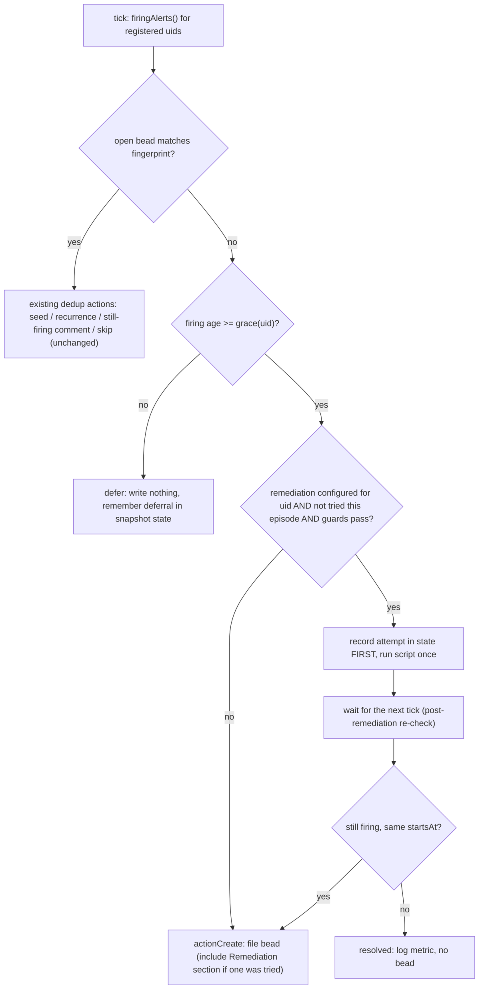

# Probe alerts: pre-escalation grace period and one-shot remediation — design

- **Status**: Draft for operator review. Design only; nothing here is implemented.
- **Date**: 2026-11-07
- **Origin**: the 7-day review of the alert-to-bead escalation loop (2026-10-30 to 2026-11-07).
  Of 50 closed probe-filed beads, 23 closed as self-resolved or transient and 12 mention a restart.
- **Builds on**: `docs/superpowers/specs/2026-09-22-pg-router-ccpool-escalation-design.md` (the probe
  and triager architecture, the fingerprint scheme, the "nothing new" rule) and the probe code in
  `packages/pg-router-probe/cmd/pg-router-probe/` (`run.go`, `dedup.go`, `snapshot.go`,
  `fingerprint.go`, `grafana.go`).
- **Not to be confused with**: `docs/superpowers/specs/2026-10-10-escalations-design.md`, whose
  "escalation" is a menu-bar reminder. This document concerns the alert-to-bead escalation only.

The key words MUST, MUST NOT, SHOULD, SHOULD NOT and MAY in this document are to be read as in RFC 2119.

> Pointer: ADR 0122 records the replacement of gates by levels of resources (`INV-LVL`, `INV-SEN`, `INV-ADM`); where this document says a pass is skipped by a gate, read an unmet level requirement.

## 1. Problem

`pg-router-probe run` ticks every 30 minutes. Each tick it lists the Grafana alert instances that are
firing for the registered rule uids and, for any with no open bead, files an `escalated` bead for the
triager. Many of those alerts clear without any fix:

| Pattern (evidence from the closed beads)                                        | Real cause                                              |
| ------------------------------------------------------------------------------- | ------------------------------------------------------- |
| router queue-stalled, failure-rate, role-stalled, ccpool-no-launch-while-queued | apply-time router restart or recorder outage            |
| ccrec daemon-down, ccrec heartbeat-stale, connector daemon-down                 | host slept (daemon healthy) or recorder restart         |
| connector beads bd-timeouts                                                     | host load, cleared on its own                           |
| repo-runner tips-stale                                                          | disk-pressure gate (`LOW_DISK_USAGE`), no restart helps |

Two independent ideas address this. They differ greatly in risk, so they are specified separately and
MUST be rolled out separately.

1. **Grace period** (a Debounce / Hysteresis in front of bead creation): do not file until the alert
   has been firing long enough that "self-resolved" is unlikely. Safe: it only delays a ticket.
2. **Remediation** (a Self-Healing / Auto-Remediation step): run one safe script, then re-check.
   Riskier: it mutates the host.

## 2. Where the step runs

Three placements were considered.

| Option                                                         | Grace period                                  | Remediation                                         | Verdict                   |
| -------------------------------------------------------------- | --------------------------------------------- | --------------------------------------------------- | ------------------------- |
| A. In the probe (`pg-router-probe run`, before `actionCreate`) | Works: no bead exists yet, so none is avoided | Works: the probe already owns per-fingerprint state | **Recommended**           |
| B. A command-type pre-triager role bound to `escalated.pg2`    | Does NOT work: the bead is already filed      | Works, but a bead exists even when the fix works    | Rejected                  |
| C. Raise the Grafana rule `for:` durations                     | Works                                         | No                                                  | Rejected as the mechanism |

Reasoning:

- The goal of the grace period is to avoid creating the 23 self-resolved beads. Only a placement
  upstream of creation (A or C) achieves that. Option B would still create, comment on and close the
  bead.
- Option C changes the rule for every consumer (dashboards, other contact points, the triage
  instructions) to suit one consumer, and cannot carry per-uid remediation. The probe is the one
  component that is already per-uid, already holds per-fingerprint episode state, and already
  decides create versus comment versus skip.
- Option A keeps the existing Pipes-and-Filters shape: the probe gains one more filter stage
  between "finding" and "dedup action", and one injected collaborator (`runDeps.remediate`), in the
  same Dependency Injection style as `fetchAlerts` and `createIssue`.



A pre-triager role (option B) MAY still be useful later for a different job, remediation that needs
an LLM's judgment, but that is out of scope here.

## 3. Grace period

### 3.1 Mechanism

Grace is measured from the alert's own `startsAt` (Grafana sets it when the rule leaves Pending and
starts firing, so the rule's `for:` is already spent). The probe MUST evaluate

```text
firing_age = now - startsAt
file only if firing_age >= grace(rule_uid)
```

This needs no new persisted state for the decision: the alert instance carries `startsAt`. If the alert
resolves before a later tick, it never appears in `firingAlerts`, so no bead is ever filed.

Because the probe ticks every 30 minutes, an alert first seen at age 5 minutes with a 30-minute grace
is deferred to the next tick (age about 35 minutes). Effective delay is therefore grace rounded up to
the next tick, bounded by grace plus one tick (at most 60 minutes for a 30-minute grace). This is
acceptable because a bead is a ticket, not a page. It MUST be stated in the probe's `--help` and in the
bead body (`Since:` already records the true `startsAt`).

Rules:

- The grace gate applies only where there is NO open matching bead. A matched open bead keeps today's
  seed, recurrence and still-firing behavior unchanged.
- Grouped rules (`defaultGroupRuleUIDs`) apply the gate per label set, so a group bead is created by
  its first label set to pass grace; later label sets join as episodes (`actionJoin`).
- **Flap guard**: an alert that fires, clears and re-fires with a fresh `startsAt` never reaches its
  grace and would never be filed. The probe MUST bypass grace when `alertState` already records 3 or
  more episodes for the fingerprint in the last 24 hours (the state already keeps episode start times
  for 7 days). Deferred episodes MUST be recorded in that list, as "deferred", so a flapper is visible.
- A uid with no table entry MUST use grace 0 (today's behavior), so a newly registered rule is never
  silently delayed until someone classifies it.
- Severity or a rule label MUST NOT be able to extend grace beyond the table; a rule label
  `escalation: human` (already read by the probe) MUST force grace 0 for that instance.

### 3.2 Defaults per rule uid

Rule: a uid whose own `for:` is already 30 minutes or more, or whose failure is a data-integrity or
configuration fault that does not self-heal, gets 0. A uid whose evidence shows restart, host-sleep or
load transients gets 30 minutes (one full tick plus the rule's own `for:`). Nothing exceeds 30 minutes
in this first version; a 60-minute class MAY be added once the metrics in section 7 justify it.

The built-in `registeredRuleUIDs` (45 uids) are listed first. The last three rows are uids named by the
review evidence that are NOT in the built-in list and reach the probe through the deployment's own
`--rule-uid` list (that list replaces the built-in one; see the probe's header comment). The
implementation MUST reconcile this table with the deployment's list and a test MUST fail when a
registered uid has no table row (so classification cannot silently lapse; a missing row would otherwise
fall back to 0).

| Rule uid                                         | Rule `for:` | Grace | Rationale                                                         |
| ------------------------------------------------ | ----------- | ----- | ----------------------------------------------------------------- |
| `pg-router-liveness-down`                        | 5m          | 30m   | apply-time router restart; sleep                                  |
| `pg-router-queue-stalled`                        | 5m          | 30m   | evidence: cleared within about 30 min after apply/recorder outage |
| `pg-router-queue-depth-growing`                  | 15m         | 30m   | burst after restart                                               |
| `pg-router-queue-slow-growth`                    | 30m         | 0     | 6h trend, already slow                                            |
| `pg-router-failure-rate`                         | 10m         | 30m   | evidence: transient after apply                                   |
| `pg-router-budget-stops`                         | 0m          | 0     | repeated hard stops are a real condition                          |
| `pg-router-upstream-killed`                      | 0m          | 0     | rule is already sustained-only (10 in 30m)                        |
| `pg-router-event-dispatch-failed`                | 5m          | 30m   | retry window may still recover                                    |
| `pg-conn-jira-daemon-down`                       | 2m          | 30m   | sleep, restart                                                    |
| `pg-conn-jira-query-stale`                       | 5m          | 30m   | follows daemon or upstream blip                                   |
| `pg-conn-jira-consumer-stuck`                    | 5m          | 30m   | follows restart                                                   |
| `pg-conn-jira-settle-holding`                    | 5m          | 30m   | transient hold                                                    |
| `pg-conn-jira-tracked-over`                      | 10m         | 30m   | threshold flutter                                                 |
| `pg-conn-jira-rows-no-kind`                      | 2m          | 0     | data-shape fault, does not self-heal                              |
| `pg-conn-jira-store-aside`                       | 1m          | 0     | store fault                                                       |
| `pg-conn-jira-auth-failing`                      | 1m          | 0     | credential fault, a person must act                               |
| `pg-conn-jira-unavailable`                       | 10m         | 30m   | origin blip                                                       |
| `pg-conn-jira-rate-limited`                      | 5m          | 30m   | self-clearing                                                     |
| `pg-conn-jira-below-floor`                       | 5m          | 30m   | burst allowance refills                                           |
| `pg-desk-ingest-failed-old`                      | 10m         | 30m   | retried ingest                                                    |
| `pg-desk-watched-source-not-observed`            | 10m         | 30m   | follows connector blip                                            |
| `pg-desk-issue-unflagged-members`                | 10m         | 30m   | converges on next poll                                            |
| `pg-desk-issue-orphan-read-lag`                  | 10m         | 30m   | follows connector blip                                            |
| `pg-conn-beads-budget-denied`                    | 5m          | 30m   | host load                                                         |
| `pg-conn-beads-bd-timeouts`                      | 5m          | 30m   | evidence: cleared under host load                                 |
| `pg-ccrec-daemon-down`                           | 2m          | 30m   | evidence: host sleep or recorder restart                          |
| `pg-ccrec-heartbeat-stale`                       | 5m          | 30m   | evidence: host sleep                                              |
| `pg-ccrec-copy-lag`                              | 10m         | 30m   | catches up after restart                                          |
| `pg-ccrec-parse-stuck`                           | 10m         | 30m   | catches up                                                        |
| `pg-ccrec-held-old`                              | 10m         | 30m   | catches up                                                        |
| `pg-ccrec-format-drift`                          | 15m         | 0     | upstream format change, never self-heals                          |
| `pg-ccrec-data-loss`                             | 1m          | 0     | integrity                                                         |
| `pg-ccrec-removal-due`                           | 30m         | 0     | already slow                                                      |
| `pg-ccrec-doctor-mismatch`                       | 5m          | 0     | integrity                                                         |
| `pg-ccrec-control-inbox-gone`                    | 10m         | 0     | structural                                                        |
| `pg-ccrec-crash-share`                           | 15m         | 0     | crash loop must surface (see 4.3)                                 |
| `pg-ccrec-removal-stuck`                         | 10m         | 30m   | retried                                                           |
| `pg-ccrec-settle-tick-slow`                      | 15m         | 30m   | load                                                              |
| `pg-ccrec-field-type-mismatch`                   | 1m          | 0     | integrity                                                         |
| `pg-ccrec-blocked-no-space`                      | 1m          | 0     | disk pressure, never remediated                                   |
| `pg-ccrec-cpu-high`                              | 30m         | 0     | already slow                                                      |
| `pg-ccrec-wal-large`                             | 15m         | 30m   | checkpoints                                                       |
| `pg-ccrec-loop-stalled`                          | 10m         | 30m   | follows restart or sleep                                          |
| `pg-ccrec-request-slow`                          | 15m         | 30m   | load                                                              |
| `pg-ccrec-schema-rebuild-required`               | 1m          | 0     | a person must act                                                 |
| `pg-router-role-stalled` (deployment list)       | 5m          | 30m   | evidence: transient after apply                                   |
| `pg-router-ccpool-no-launch-while-queued` (dep.) | 15m         | 30m   | evidence: transient after apply                                   |
| `pg-repo-runner-tips-stale` (deployment list)    | 5m          | 0     | disk pressure; waiting does not help, never remediated            |

The same table MUST also carry a row for each connector daemon-down uid the deployment registers (for
example the GitHub daemon's `pg-conn-github-daemon-down`): grace 30m.

Where the table lives: a Go map in the probe (`graceByRuleUID`) plus a repeatable
`--grace <uid>=<duration>` flag that overrides entries and `--grace-default` for unlisted uids
(default 0). Config in code with an override flag follows the probe's existing `--rule-uid` and
`--group-rule-uid` pattern, so the deployment can retune without a rebuild of the probe.

Expected effect, from the evidence: the 23 self-resolved or transient beads fall almost entirely in
the 30m rows (router, ccrec and connector daemon rows), so grace alone is expected to avoid most of
them. That is a hypothesis to verify with the metrics in section 7, not a measured fact.

## 4. Remediation

### 4.1 Candidate scripts

Remediation is a Strategy keyed by rule uid, each strategy a small allow-listed script the probe
invokes through an injected `remediate` function. There are exactly three candidates.

| Id  | Script (argv, no shell)                                                            | Applies to uids                                                             | Status       |
| --- | ---------------------------------------------------------------------------------- | --------------------------------------------------------------------------- | ------------ |
| R1  | `launchctl kickstart gui/<uid>/<recorder label>` (no `-k`)                         | `pg-ccrec-daemon-down`, `pg-ccrec-heartbeat-stale`, `pg-ccrec-loop-stalled` | candidate    |
| R2  | `launchctl kickstart gui/<uid>/<connector daemon label>` (no `-k`), one per daemon | each connector `...-daemon-down` uid (GitHub and Jira daemons)              | candidate    |
| R3  | none for the router                                                                | all `pg-router-*` uids                                                      | **rejected** |

Notes:

- Labels are `com.phillipg.pg-claude-code-recorder` (plus the `instance` suffix for a second
  directory), `com.phillipg.pg-connector-github-daemon` and
  `com.phillipg.pg-connector-issue-jira-daemon`. The script resolves the label from a fixed
  uid-to-label table, never from alert labels.
- `kickstart` without `-k` starts a job that is not running and does nothing to a running one. That is
  deliberately weaker than `-k` (kill and restart): it fixes "daemon is down" and cannot kill a healthy
  daemon that merely looks stale. A stalled-but-running daemon (`heartbeat-stale`, `loop-stalled`)
  needs `-k` to change anything. `-k` is therefore a separate, later decision and MUST NOT be enabled
  in the first version; until then those two uids gain nothing from R1 and SHOULD stay grace-only.
  Only `pg-ccrec-daemon-down` and the connector `daemon-down` uids benefit from plain `kickstart`.
- R3: the router's own launchd job MUST NOT be killed, unloaded or restarted by an agent or automated
  step (standing workspace ruling). Router alerts are cleared by grace only.
- The evidence says most daemon alerts were sleep artifacts with a healthy daemon. Remediation would
  have changed nothing for them. That is why grace is the primary mechanism and remediation is
  optional and last.

### 4.2 Never remediated

The following MUST NEVER trigger any remediation, enforced by a deny rule in the remediation selector
that is checked before the allow table (Fail-Safe Default: a uid is remediable only if it appears in
the allow table AND not in the deny set):

- Disk-pressure alerts: `pg-repo-runner-tips-stale` (caused by the `LOW_DISK_USAGE` gate),
  `pg-ccrec-blocked-no-space`, `pg-ccrec-wal-large`, and any alert whose labels or evidence name the
  `LOW_DISK_USAGE` gate or a free-space condition. A restart does not free disk and can add load or
  write-ahead growth.
- Integrity alerts: `pg-ccrec-data-loss`, `pg-ccrec-doctor-mismatch`, `pg-ccrec-field-type-mismatch`,
  `pg-ccrec-schema-rebuild-required`, `pg-ccrec-format-drift`.
- Credential alerts: any `...-auth-failing`.
- Crash-loop alerts: `pg-ccrec-crash-share`.
- All `pg-router-*` uids (R3).

### 4.3 Risks and guards

| Risk                                                            | Guard (all MUST hold before a script runs)                                                                                                                                                                                                                                                                                                                      |
| --------------------------------------------------------------- | --------------------------------------------------------------------------------------------------------------------------------------------------------------------------------------------------------------------------------------------------------------------------------------------------------------------------------------------------------------- |
| Masking a crash loop: a restart hides a daemon that keeps dying | Read `launchctl print` for the job. Skip and file the bead if the last exit status is nonzero, or the job's start count rose 3 or more times in the last hour. Also keep `pg-ccrec-crash-share` on the deny list.                                                                                                                                               |
| Restart during `pn workspace apply`                             | Skip while an apply is in progress, and skip when the job's own start time is under 15 minutes old (apply or a recent restart already restarted it). The exact in-progress marker (an apply lock or state file) MUST be identified at implementation time; if none is reliable, the start-age guard alone is NOT sufficient and remediation MUST stay disabled. |
| Host just woke from sleep: the daemon is healthy                | Skip and defer one more tick when the host woke less than 10 minutes ago (the sleep-aware metrics design already derives wake time). Do not count that deferral against grace.                                                                                                                                                                                  |
| Restart loses in-flight work or causes data loss                | Only daemons whose design tolerates SIGTERM and restart are allow-listed; each candidate MUST be confirmed against its own daemon docs at implementation time.                                                                                                                                                                                                  |
| Script runs on a machine that does not own the daemon           | Run only when the label is loaded in the probe's own user domain; a not-found result is a recorded no-op, never an error loop.                                                                                                                                                                                                                                  |
| Script hangs                                                    | Hard timeout (30s); a timeout counts as the attempt and the bead is filed on the next failing tick.                                                                                                                                                                                                                                                             |
| Remediation hides a systemic fault by "always working"          | Count outcomes (section 7). If one uid is remediated successfully in 3 or more episodes within 7 days, the probe MUST file a bead anyway ("recurring, self-healed by remediation") so a root cause gets investigated.                                                                                                                                           |

### 4.4 Rollout

Remediation MUST ship disabled (`--remediate` off) after grace has run for at least one week and the
section 7 metrics show which uids still produce beads that a restart would have cleared. Enabling
remediation per uid is an operator decision, one uid at a time. This design does not decide to enable
any.

## 5. Once-per-episode guard

- **Key**: the existing alert fingerprint, `<rule-uid>|<sorted key=value labels>` (the
  `grafanaAlertFingerprint` output, with the `escalation` and `grafana_folder` labels excluded), the same
  key the probe already uses for its per-label-set state. For a grouped rule the per-label-set
  fingerprint is still the key (not `group:<uid>`), so each label set is remediated at most once.
- **Episode**: one value of the alert's `startsAt` for that fingerprint (the probe already treats a
  changed `startsAt` as a new episode).
- **Where state lives**: the probe's own snapshot file
  (`~/.local/state/pg-router-probe/snapshot.json`, `alerts` map, `alertState`), NOT bead metadata.
  This is the existing choice and reasoning in `snapshot.go` (a metadata write bumps the bead's
  `updated_at`, and the data is the probe's bookkeeping). Remediation happens before any bead exists, so
  bead metadata is not even available.
- **New fields on `alertState`**, additive and `omitempty`, without bumping `snapshotVersion`
  (the same convention the file already follows):

```go
// alertState additions (design sketch, not implemented)
RemediatedStartsAt time.Time `json:"remediated_starts_at,omitzero"` // episode a script was run for
RemediatedAt       time.Time `json:"remediated_at,omitzero"`
RemediationID      string    `json:"remediation_id,omitempty"`      // R1, R2
RemediationOutcome string    `json:"remediation_outcome,omitempty"` // ok, failed, timeout, skipped:<guard>
DeferredStartsAt   time.Time `json:"deferred_starts_at,omitzero"`   // episode seen but held by grace
```

- **Rule**: the probe MUST run a script for a fingerprint only if
  `RemediatedStartsAt != startsAt`. It MUST persist the attempt (State Memento written atomically,
  as the snapshot already is) BEFORE invoking the script, so a crash between the two never causes a
  second try (at-most-once, not at-least-once). A failed or timed-out attempt is still an attempt.
- **A lost snapshot** (missing, corrupt or version-mismatched, treated as "no baseline" today) would
  forget an attempt and allow one repeat. That is bounded (one extra restart per live episode) and
  MUST be accepted and documented rather than solved with a second store.
- **Logging on the bead**: when a bead is filed after an attempt, the body MUST include a
  `Remediation:` line naming the id, time and outcome (the body renderer already reserves a
  `Remediation:` section). When the alert resolves after an attempt no bead exists, so the outcome is
  recorded only in the snapshot, the probe log and metrics.

## 6. Interaction with existing behavior

- Dedup (`matchExisting`, closed-bead lookup, group keys) and the exit-code convention stay unchanged.
  A deferred finding is not an error; the run still exits 0.
- A deferred or remediated finding MUST NOT write `pg_router_escalation_*` metadata (no bead).
- The probe's own failure alerts and its degraded-check handling are untouched. If Grafana is
  unreachable, no grace decision is possible and the existing degraded path applies.
- If the probe tick is delayed (host asleep), the first tick after wake sees a large firing age and files
  immediately. That is acceptable: a long sleep that also left an alert firing with a stale `startsAt`
  is better filed; the wake-time guard above only suppresses remediation, not filing.

## 7. Observability and acceptance

The probe SHOULD emit counters, labelled by rule uid, so the design's hypothesis is measurable:

- `deferred` (alert seen, held by grace), `resolved_in_grace` (a deferred episode that no longer fires
  next tick), `filed_after_grace`, `flap_bypass`.
- `remediation_attempted`, `remediation_resolved` (alert gone the tick after), `remediation_still_firing`,
  `remediation_skipped{guard}`.

Acceptance criteria for the implementation, each to be a deterministic unit test against the real probe
code with fake Grafana and fake `remediate` collaborators (the probe already injects its side effects):

1. A firing alert younger than its grace creates no bead and writes no bead metadata; the same alert
   resolved at the next tick creates none either.
2. The same alert past grace creates exactly one bead; an unlisted uid files at first sight.
3. A fingerprint with 3 or more episodes in 24 hours bypasses grace.
4. A matched open bead is not affected by grace.
5. A remediable uid runs its script exactly once per `startsAt`, across repeated ticks and across a
   process restart (state reloaded from the snapshot), and again for a new `startsAt`.
6. Every uid in the deny set (4.2) never reaches `remediate`, including when a stray allow-table entry
   names it.
7. Each guard in 4.3 skips the script and records `skipped:<guard>`.
8. The filed bead body contains the `Remediation:` line when an attempt preceded it.
9. Every registered uid has a grace row (the table-completeness test from section 3.2).

## 8. Alternatives considered

- **Raise the rule `for:` values** (option C): rejected as the mechanism (section 2); it affects every
  consumer and cannot carry remediation.
- **Triager-side auto-close of self-resolved beads**: this is what happens today and costs a bead, an
  LLM session and a closing comment each time. It remains the fallback for what grace lets through.
- **An in-run sleep** (wait 10 minutes inside one probe tick, then re-check): rejected; it holds a
  role slot, the run has a command timeout, and the tick period already provides the delay for free
  through the `startsAt` age check.
- **Always `kickstart -k`**: rejected for the first version (section 4.1); restarting healthy daemons on
  a stale-looking metric is the highest-risk variant.

## 9. Open decisions for the operator

1. Approve the 0 / 30m table, in particular which `for:` 5 to 15 minute uids should instead be 0.
2. Whether remediation is wanted at all, given that the evidence shows most daemon alerts were
   sleep artifacts with a healthy daemon (grace alone clears them).
3. If yes: whether `kickstart -k` for stalled-but-running daemons is ever allowed (section 4.1).
4. The apply-in-progress signal for the guard in 4.3 (an implementation question that decides whether
   remediation can ship at all).
