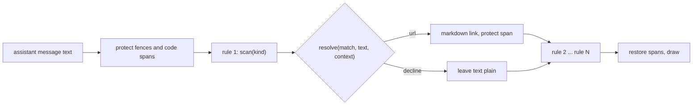

# pgd link resolvers: context-aware transcript links

Status: draft 1, 2026-11-09, for operator review. Nothing here is built.
Package: `claude-marketplace/pgd` (hooks in `hooks/links.ts`, Home Manager module in
`home/programs/pgd/default.nix`). Public repo: no employer-specific names, hosts or keys in
code, tests, comments or docs; deployments supply them as data.

## Intent

Transcript links today are a list of `{ name, pattern, url }` rules: a regular expression finds
text and a URL template turns the whole match into a link. That cannot know things the session
knows. `PR #123` could belong to any repo, so a template cannot build its URL. A key shaped like
`UTF-8` or `SHA-256` matches a Jira rule, and a `src/foo.go:42` reference has no rule at all.

The operator wants links that use context: the GitHub situation of the session (which repo, which
other repos are known), the issue-tracker keys that are allowed, and file references. Regular
expressions stay available as one rule kind, but they stop being the main mechanism.

## Operator rulings (Phillip, 2026-11-09)

- On the goal: "REGEX alone is not going to be helpful. it can remain as an option, but I think
  knowing the github situation and allowable JIRA keys would make things better."
- On file references: "i like the idea of linking to file:line both locally and remotely would
  be nice."
- On local versus remote: "assume local, no need to check if it exists or not. if there isn't
  enouh in the token to know remote vs local, assume local."
- On the link form: "just make it a link and lets see what the current tools do."
- On the build approach: option A, named resolvers (see Approaches).

## Goals, non-goals, anti-goals

Goals:

- Rule kinds `github-pr`, `jira` and `file-ref`, each with its own scanner and resolver, plus the
  existing `regex` kind unchanged in behavior.
- A link is drawn only when the resolver can build a correct URL; otherwise the text stays plain.
- Deployment data (allowed issue keys, tracker base URL, known repos) comes from configuration;
  the shipped list stays empty.
- Every resolver is a pure function of the match, the surrounding text and a context snapshot, so
  it is unit-testable with no host.

Non-goals:

- No existence check for a file, a PR or an issue (operator ruling above).
- No network call from the render path; no lookup of whether a PR exists.
- No user-supplied code in configuration. Configuration selects a kind and passes data.
- Bare `#123` is not linked (see "Calls I made").

Anti-goals (a failure even if it technically works):

- A link to the wrong repo or the wrong tracker. A wrong link is worse than no link.
- Rewriting text inside code spans or fenced blocks, or text an earlier rule already rewrote.
- A render hook that blocks, awaits, or costs noticeably more per draw than today's.

## Current state

- `links.ts`: the `ui.render` hook on `AssistantMessage` rewrites matches of each rule in list
  order. Fences and code spans, and every earlier rewrite, are swapped for placeholder characters
  during the pass so a later rule cannot match inside them. The URL takes the whole match,
  percent-encoded, as `{0}`.
- The hook is synchronous. Host reads (`host.session.cwd()`, `host.session.repo()`) are async,
  so the display already caches them through the source layer (`source.ts`: cache-aside,
  throttling, backoff) and redraws with `$.ui.invalidate('ui.render')`.
- `pr.ts` `repoSlugOf` turns `host.session.repo()` (`{ name, remote }`) into `owner/repo`;
  `gitHead.ts` reads the branch and worktree from `.git` through `host.fs`.
- Verified live 2026-11-09 on Claude Code 2.1.318: a rewritten match is drawn as a terminal
  hyperlink and ctrl+click opens it (plain click is consumed by tmux mouse mode).

## Approaches

A. Named resolvers (chosen by the operator). A rule is `{ kind, name, options }`. Each built-in
kind has a scanner that finds candidates and a resolver that returns a URL or declines. The
regex kind keeps `pattern` and `url`. Rules still apply in list order through the existing
protected-span pass. Trade-off: two kinds can both claim a token (`src/ABC-12.go:5`); list
order settles it, and the shipped default order puts `file-ref` first.

B. One tokenizer pass that finds every candidate for every kind, settles overlaps once, then
dispatches to resolvers. Trade-off: one place for overlap, but it replaces the rewrite
pipeline and needs an adapter for regex rules. More to build and test.

C. An optional `resolver` field on today's rules: the regex still finds candidates and a
resolver approves each. Trade-off: smallest change, but the regex stays the primary
mechanism, which the operator ruled out.

## Design (approach A)

### Rule format and compatibility

Options JSON `links` becomes a list of objects with an optional `kind` (default `regex`, so every
existing `{ name, pattern, url }` entry keeps working unchanged) and a kind-specific `options`
object. The Home Manager option gains `kind` and a `settings` attribute set rendered as that
`options` object; the builder chooses the exact Nix typing. An unknown kind or an invalid options
object skips that rule only and writes one `warn` log line naming the rule, as an invalid regex
rule does today.

### Context snapshot

The render hook reads one synchronous snapshot, filled by a `linkContext` source and refreshed at
session start, after `turn.complete` and on a working-directory change, with an invalidate when
it changes: `cwd`, `repoSlug` (`owner/repo` of the session repo, via `repoSlugOf`), `home` when
the host exposes one, and `knownRepos` (the session repo plus the configured `github.repos`).

Where it lives and how it is read: the snapshot is a module-level value in a new
`hooks/linkContext.ts`, written only by the source's fetch and read through a getter, the same
pattern as the memoized repo slug in `pr.ts`. `linkHook` reads the snapshot and passes it as a
third argument, `rewriteLinks(text, rules, context)`, so `rewriteLinks` stays a pure function of
its arguments and tests inject a context object directly. A rule whose kind needs no context
(`regex`, `jira`) ignores it.

Where the GitHub data lives: one top-level options object `github` with `host` (default
`github.com`) and `repos` (a list of `owner/repo`); it is not repeated per rule. `github-pr` and
the remote form of `file-ref` both read it through the snapshot's `knownRepos` and the snapshot's
`githubHost`.

Before the snapshot has loaded: forms that carry everything in the token still link (an explicit
`owner/repo#123`, a configured-key issue link, an absolute file path, an explicit remote
`owner/repo:path:line` whose repo is in `github.repos`). Everything else declines with the reason
`no-context`, including a relative file path; the resolver never guesses a base directory.

### Kind `github-pr`

Options: none of its own; it reads the top-level `github` options through the context snapshot.

Scanner (case-insensitive): `owner/repo#N`; `PR N`, `PR #N`, `pull request N`, `pull request #N`
and `pull #N`. A bare `#N` is not scanned. Only the number is the link text for the keyword
forms, as today; the whole `owner/repo#N` is the link text for the explicit form.

Repo resolution, first hit wins: (1) the explicit `owner/repo` in the token; (2) the nearest
earlier mention in the same message of a known repo, by `owner/repo` or by bare repo name when
exactly one known repo has that name, scanning back at most one paragraph; (3) the session
repo's slug; (4) decline. URL: `https://<host>/<owner>/<repo>/pull/<N>`.

### Kind `jira`

Options: `baseUrl` (required, for example `https://tracker.example/browse`), `keys` (required
list of allowed project keys). The scanner is built from the allowlist: `\b(?:K1|K2|...)-[0-9]+\b`,
case-sensitive, keys regex-escaped. An empty or missing `keys` makes the rule inactive (decline
reason `no-key`): it never guesses. A candidate is also rejected when it touches a path or
identifier character: directly preceded or followed by `/`, `\` or `_`, or followed by `.` and a
word character, or followed by `:` and a digit (so `src/ABC-12.go:5` is left to `file-ref` even
when `jira` is listed first). The `github-pr` scanner applies the same adjacency rejection. URL: `<baseUrl>/<match>`. The kind name stays `jira` because that is the tracker the
first deployment uses; nothing else in the code is tracker-specific.

### Kind `file-ref`

Scanner: a path followed by `:line` and optionally `:col`, where the path has a `/` or ends in a
file extension and `line` is digits. It must not match inside a URL (`http://host:80`), a time
(`12:30`) or a `file:///` URL already present.

Local form (the default; operator ruling): an absolute path is used as is; a relative path is
joined onto `cwd` from the context snapshot (declined as `no-context` before it loads); `~/`
expands from the snapshot's `home`, and is declined as `no-context` when the host exposes none.
No existence check. The URL comes from `options.localTemplate`, default
`file://{path}:{line}` with `{path}`, `{line}` and `{col}` available, so the form can change to
`file://{path}#L{line}` or an editor scheme (`vscode://file/{path}:{line}:{col}`) by data alone.
The first deployment's job is to learn what the operator's terminal does with the default.

Remote form: only when the token itself names a known repo: `owner/repo:path:line` where
`owner/repo` is in `knownRepos`. The scanner splits at the FIRST `:`; the text before it is the
prefix, checked against `knownRepos`; a path that itself contains `:` is out of scope. URL:
`https://<host>/<owner>/<repo>/blob/HEAD/<path>#L<line>`; a `:col` is dropped silently (GitHub
has no column anchor) and `#L<line>-L<line2>` is not supported. Any other prefix, including
something that looks like `a/b/c.go:5`, makes the whole token a local relative path. A token
with no `:digits` suffix, such as `owner/repo#123`, is never a `file-ref`.

### Kind `regex`

Today's behavior exactly: JavaScript `RegExp` with flag `g`, whole match percent-encoded into
`{0}`, a match of zero length skipped, an invalid pattern or template skips the rule.

### Shipped defaults

The module ships an empty `links` list. Order is list order only, never sorted by kind: the
README documents the recommended order for a deployment (`file-ref`, `github-pr`, then `jira`) and
the deployment sets it. The adjacency rejection above keeps a wrong order from producing a wrong
link.

### Cost and observability

The render hook runs on every draw of every message, so rewriting is memoized: the result for a
message is cached by (text, rule list, snapshot version) in a small bounded cache (64 entries),
and the snapshot version changes only when a refresh changes the snapshot. A cache hit does no
scanning.

Counters `pgd_links_rewritten_total{kind}` and `pgd_links_declined_total{kind,reason}` count only
on a cache miss, so a redraw of the same message does not inflate them. Reasons: `no-repo` (the
snapshot has loaded but yields no repo for a PR), `no-context` (the snapshot has not loaded, or
lacks `cwd` or `home`), `no-key` (an empty issue-key allowlist), `invalid` (a bad options object).
They go through the existing metrics path; there is no per-link log line.

### Options parsing

`parseOptions` ignores unknown fields. A rule of kind `regex` without `pattern` or `url`, an
unknown `kind`, or a kind with invalid options is skipped alone with one `warn` line naming the
rule, as an invalid regex rule is today.

## Testing

- Unit tests per kind over the pure scan and resolve functions with real strings: positive and
  negative tables (the false positives named in this document: `UTF-8`, `SHA-256`, `PRs 7`,
  `a/b/c.go:5`, `12:30`, `http://host:80`), code-span and fence protection, overlap order, decline
  paths, and the unchanged regex kind (the existing `links.test.ts` stays green).
- An options-parsing test for the new fields and for the compatibility rule that an entry without
  `kind` is a regex rule.
- A Nix evaluation check that the Home Manager option accepts the new shape and renders it into
  the options JSON.
- An end-to-end test with the real Claude Code binary in tmux, opt-in and not part of the unit
  gate: it needs a reply with fixed text. Preferred route: a local stub server behind
  `ANTHROPIC_BASE_URL`, which keeps it hermetic and free of model calls. Whether the binary
  accepts a stub server under the account's authentication is unverified; a short spike decides,
  and the fallback is a test over the real render hook with canned draw events.

## Calls I made (correct any)

- Bare `#123` is not linked: it appears in headings, step numbers and issue lists too often.
- A bare `PR #123` with no repo in the message falls back to the session repo's remote, because
  that is usually right; the operator has not ruled on it.
- Remote file links use `HEAD` (GitHub resolves it to the default branch), not the local sha,
  because the local commit may be unpushed.
- `file://{path}:{line}` as the first local form, an experiment per the operator's ruling.
- Counter names, decline reasons, and counting on cache misses only.
- One top-level `github` options object, not per-rule repo lists.
- A relative file path or a `~/` path declines when the context is missing; no guessed base.
- Rule order is list order only; adjacency rejection protects against a wrong order.
- Unknown option fields are ignored; a malformed rule skips alone with a `warn`.

## Open items

- What the operator's terminal and tools do with `file://<path>:<line>`; this decides the final
  default for `localTemplate`. It does not block the build: the first version ships the default
  above and the template changes by data alone.
- Whether the deployment repo should contribute `github.repos` from the workspace's repo list
  instead of a hand-written list. Not in this change.
- The end-to-end test is in scope as a time-boxed spike first (does the binary accept a stub
  server); the fallback test over the real render hook is the committed deliverable.

## Left to the builder

Nix typing of `settings`; the exact paragraph window for the repo-mention scan; the source
refresh trigger set for the context snapshot; whether `~/` expansion has a host source.
