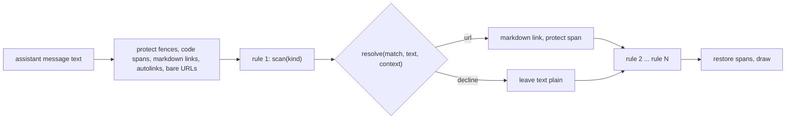

# pgd link resolvers: context-aware transcript links

Status: draft 3, 2026-11-09, packets filed. Draft 2 folded in an independent review of draft 1
(stale-link and refresh-trigger blockers, protected spans, `file-ref` safety, counters, test
gaps). Draft 3 folds in a review of the packets against the code: uppercase `PR` only, the
`ABC-1/ABC-2` exception to the path rule, snapshot seeding from the options before the first
fetch, `{path}` including its leading slash, and `{col}` defaulting to 1. Nothing here is built.
Package: `claude-marketplace/pgd` (hooks in `hooks/links.ts`, Home Manager module in
`home/programs/pgd/default.nix`). Public repo: no employer-specific names, hosts or keys in
code, tests, comments or docs; deployments supply them as data.

## Intent

Transcript links today are a list of `{ name, pattern, url }` rules: a regular expression finds
text and a URL template turns the whole match into a link. That cannot know things the session
knows. `PR #123` could belong to any repo, so a template cannot build its URL. A key shaped like
`UTF-8` or `SHA-256` matches a Jira rule, and a `src/foo.go:42` reference has no rule at all.

The operator wants links that use context: the GitHub situation of the session (which repo, which
other repos are known), the issue-tracker keys that are allowed, and file references. Regular
expressions stay available as one rule kind, but they stop being the main mechanism.

## Operator rulings (Phillip, 2026-11-09)

- On the goal: "REGEX alone is not going to be helpful. it can remain as an option, but I think
  knowing the github situation and allowable JIRA keys would make things better."
- On file references: "i like the idea of linking to file:line both locally and remotely would
  be nice."
- On local versus remote: "assume local, no need to check if it exists or not. if there isn't
  enouh in the token to know remote vs local, assume local."
- On the link form: "just make it a link and lets see what the current tools do."
- On the build approach: option A, named resolvers (see Approaches).

## Goals, non-goals, anti-goals

Goals:

- Rule kinds `github-pr`, `jira` and `file-ref`, each with its own scanner and resolver, plus the
  existing `regex` kind unchanged in behavior.
- A link is drawn only when the resolver can build a correct URL; otherwise the text stays plain.
- Deployment data (allowed issue keys, tracker base URL, known repos) comes from configuration;
  the shipped list stays empty.
- Every resolver is a pure function of the match, the surrounding text and a context snapshot, so
  it is unit-testable with no host.

Non-goals:

- No existence check for a file, a PR or an issue (operator ruling above).
- No network call from the render path; no lookup of whether a PR exists.
- No user-supplied code in configuration. Configuration selects a kind and passes data.
- Bare `#123` is not linked (see "Calls I made").

Anti-goals (a failure even if it technically works):

- A link to the wrong repo or the wrong tracker. A wrong link is worse than no link.
- Rewriting text inside code spans or fenced blocks, or text an earlier rule already rewrote.
- A render hook that blocks, awaits, or costs noticeably more per draw than today's.

## Current state

- `links.ts`: the `ui.render` hook on `AssistantMessage` rewrites matches of each rule in list
  order. Fences and code spans, and every earlier rewrite, are swapped for placeholder characters
  during the pass so a later rule cannot match inside them. The URL takes the whole match,
  percent-encoded, as `{0}`.
- The hook is synchronous. Host reads (`host.session.cwd()`, `host.session.repo()`) are async,
  so values the hook needs are cached by sources (`source.ts`: cache-aside, throttling, backoff)
  and the display redraws with `$.ui.invalidate('ui.render')`. A source with no `feeds` runs no
  timer; `gitHead.ts` re-reads `cwd` only when a `turn.complete` forces a refresh, throttled to
  10 seconds.
- `pr.ts` `repoSlugOf` turns `host.session.repo()` (`{ name, remote }`) into `owner/repo`, but
  the slug itself is a private module variable read once at start; it is not refreshed. The
  design below gives the link context its own re-read.
- `links.ts` uses the whole regex match as the link text, escapes `\`, `[`, `]` and backtick in
  it, and percent-encodes the whole match into `{0}`. Protected spans are fences and code spans
  only. `compile()` logs a `warn` for an invalid rule on every `rewriteLinks` call.
- `host.env.home()` (`register.ts`) reads `$HOME`.
- Verified live 2026-11-09 on Claude Code 2.1.318: a rewritten match is drawn as a terminal
  hyperlink and ctrl+click opens it (plain click is consumed by tmux mouse mode).

## Approaches

A. Named resolvers (chosen by the operator). A rule is `{ kind, name, options }`. Each built-in
kind has a scanner that finds candidates and a resolver that returns a URL or declines. The
regex kind keeps `pattern` and `url`. Rules still apply in list order through the existing
protected-span pass. Trade-off: two kinds can both claim a token (`src/ABC-12.go:5`); list
order settles it, and the README recommends `file-ref` first (the shipped list is empty).

B. One tokenizer pass that finds every candidate for every kind, settles overlaps once, then
dispatches to resolvers. Trade-off: one place for overlap, but it replaces the rewrite
pipeline and needs an adapter for regex rules. More to build and test.

C. An optional `resolver` field on today's rules: the regex still finds candidates and a
resolver approves each. Trade-off: smallest change, but the regex stays the primary
mechanism, which the operator ruled out.

## Design (approach A)

### Rule format and compatibility

Options JSON `links` becomes a list of objects with an optional `kind` (default `regex`, so every
existing `{ name, pattern, url }` entry keeps working unchanged) and a kind-specific `options`
object. Required changes, all part of this work:

- `PgdLink` in `types.ts` becomes a union by kind; `PgdOptions` and `DEFAULT_OPTIONS` gain a
  top-level `github` object; `parseOptions` accepts them and its link filter (today it drops any
  entry without `pattern` and `url`) validates per kind.
- The Home Manager module (`home/programs/pgd/default.nix`) gains `kind`, a `settings` attribute
  set rendered as `options`, and a top-level `github` option; `pattern` and `url` become
  `nullOr` with nulls stripped from the rendered JSON, and the fixed `inherit` list that builds
  the rendered options (line 23) gains `github`. An entry without `kind` must still render
  exactly as today.
- Validation: `jira.baseUrl` must be an `http` or `https` URL; `jira.keys` entries must match
  `^[A-Z][A-Z0-9_]*$`; `github.repos` entries must match `^[^/\s]+/[^/\s]+$`; `localTemplate`
  must follow the scheme rules under `file-ref`.
- A rule that fails validation, an unknown `kind`, or an inactive rule (an empty `keys`) is
  skipped alone with ONE `warn` line when the options load, naming the rule. Rules are compiled
  once per options set, not on every `rewriteLinks` call.

### Context snapshot

The render hook reads one synchronous snapshot with these fields: `cwd`, `repoSlug` (`owner/repo`
of the session repo, via `repoSlugOf`), `home` (from `host.env.home()`), `githubHost`,
`githubOwners` and `knownRepos` (the session repo plus the configured `github.repos`).

Where it lives: a module-level value in a new `hooks/linkContext.ts`, written only by a
`linkContext` source's fetch and read through a getter. `linkHook` passes it as an OPTIONAL third
argument, `rewriteLinks(text, rules, context?)`, so `rewriteLinks` stays a pure function of its
arguments, existing callers and tests keep working, and new tests inject a context object. A
kind that needs no context (`regex`, `jira`) ignores it.

Refresh triggers (named, because the source layer has none of its own): the source refreshes,
forced past the throttle, at `session.start` and on every `turn.complete`, and re-reads BOTH
`host.session.cwd()` and `host.session.repo()` each time (it does not copy the one-shot slug in
`pr.ts`). A directory or repo change is therefore seen at the next turn boundary, so a link
resolved in the same turn as the change can use the previous directory: accepted, as a turn is
the unit the reply is written in. The snapshot changes only when a refreshed value differs, and
then invalidates `ui.render`.

Where the GitHub data lives: one top-level options object `github` with `host` (default
`github.com`) and `repos` (a list of `owner/repo`); it is not repeated per rule.

Before the first fetch has finished: the snapshot is seeded synchronously from the options at
`session.start` (after the options are set), with `githubHost`, `githubOwners` and `knownRepos`
taken from `github.repos`; the fetch then adds `cwd`, `repoSlug` and `home`. So forms that carry
everything in the token still link before the fetch (an explicit `owner/repo#123` whose owner is
known, an issue key from the allowlist, an absolute file path, an explicit remote
`owner/repo:path:line` whose repo is in `github.repos`). Everything else declines with the
reason `no-context`, including a relative file path; the resolver never guesses a base
directory. Repo and owner comparisons are case-insensitive (GitHub names are), and the link keeps
the case the text used.

Resolved links are final. The memo (see "Cost and observability") is keyed by the message text
and the rule set only, never by the snapshot version, and a message whose rewrite linked is never
re-resolved. After a directory or repo change, old messages keep the links they were given
against the old context; only a message that DECLINED with `no-context` is left out of the memo
and tried again on the next draw. This is why the first paint of a resumed session, before the
snapshot loads, links only the token-complete forms and fills in the rest as the snapshot
arrives.

### Kind `github-pr`

Options: `sessionRepoFallback` (boolean, default `false`); the rest comes from the top-level
`github` options through the context snapshot.

Scanner: `owner/repo#N`; `PR N` and `PR #N` with `PR` in UPPERCASE only (a lowercase `pr 5 times`
is prose, not a reference); `pull request N`, `pull request #N` and `pull #N` in any case. A bare
`#N` is not scanned. The link text is the WHOLE token (`PR 12`, not just
`12`), which is a bigger click target and matches the explicit form and what a regex rule gives.

Repo resolution, first hit wins:

1. The explicit `owner/repo` in the token, only when its owner is the owner of at least one
   known repo; otherwise decline as `unknown-repo` (so `src/utils#3` is never linked).
2. The nearest earlier mention in the same message and paragraph of a known repo written in full
   as `owner/repo`. A bare repo name (`api`, `docs`) is never matched.
3. Only when `sessionRepoFallback` is `true`: the session repo's slug.
4. Otherwise decline as `no-repo`.

The fallback defaults to off because a wrong repo is the worst outcome and an assistant working in
one repo often discusses another. A deployment whose sessions mostly discuss their own repo turns
it on. URL: `https://<host>/<owner>/<repo>/pull/<N>`, built from validated segments.

### Kind `jira`

Options: `baseUrl` (required, for example `https://tracker.example/browse`), `keys` (required
list of allowed project keys). The scanner is built from the allowlist: `\b(?:K1|K2|...)-[0-9]+\b`,
case-sensitive, keys regex-escaped. An empty or missing `keys` makes the rule inactive (one
`warn` at options load): it never guesses. A candidate is rejected (decline reason `adjacent`)
when it sits in a path: directly preceded by `/` or `\`, or followed by `.` and a word character,
or followed by `:` and a digit (so `src/ABC-12.go:5` is left to `file-ref` even when `jira` is
listed first). One exception keeps `ABC-1/ABC-2` linking both keys: a `/` that is itself
immediately preceded by a complete allowlisted key-number token does not trigger the
"preceded by `/`" rejection; `a/ABC-12` stays plain. The `github-pr` scanner applies the same
rejection. URL: `<baseUrl>/<match>`. The kind name stays `jira` because that is the tracker the
first deployment uses; nothing else in the code is tracker-specific.

### Kind `file-ref`

Scanner: a path followed by `:line`, then optionally `:col` or a range `-line2`, where `line` is
digits and the path either contains a `/` or is a `name.ext` with an alphabetic extension of 1 to
8 characters. It rejects, as plain text: anything inside a URL or an existing markdown link; a
time (`12:30`); a host-like token (`api.example.com:8080`, `10.0.0.1:443`: a name with no `/`
whose extension is a common top-level domain such as `com`, `net`, `org`, `io`, `dev`, or whose
dotted parts are all digits); and a token adjacent to a word character on either side. Trailing
punctuation (`.`, `,`, `;`, `)`) after the digits is not part of the token, and a leading `(` is
not part of the path, so `(foo.go:42).` links `foo.go:42`. A range links to the first line and
the link text includes the whole range.

Local form (the default; operator ruling): an absolute path is used as is; a relative path is
joined onto `cwd` from the context snapshot (declined as `no-context` before it loads) with `.`
and `..` segments normalized; `~/` expands from the snapshot's `home` and is declined as
`no-context` when it is absent. No existence check. The URL comes from `options.localTemplate`,
default `file://{path}:{line}` with `{path}`, `{line}` and `{col}` available, so the form can
change to `file://{path}#L{line}` or an editor scheme (`vscode://file{path}:{line}:{col}`) by
data alone. `{path}` is the absolute path INCLUDING its leading `/`, so `file://{path}` gives
`file:///abs/p` and an editor template writes `vscode://file{path}`. When the token has no column,
`{col}` is `1` (a template never renders `undefined`). The first deployment's job is to learn what the operator's terminal does with the
default.

Safety of the template and the path. Assistant text can come from a prompt injection, and a
ctrl+click opens the target, so: the template's scheme must be in a short allowlist (`file`,
`vscode`, `vscode-insiders`, `cursor`, `zed`); it must contain `{path}`; each path segment is
percent-encoded with `encodeURIComponent`, and `( ) ! ' *` are encoded as well (that function
leaves them as is, and `)` would end the markdown link early), with `/` kept; spaces are
encoded; and under the `file` scheme a path whose extension is one macOS launches or runs
(`app`, `command`, `pkg`, `dmg`, `sh`, `workflow`, `terminal`, `tool`) is declined as `unsafe`.

Remote form: only when the token itself names a known repo: `owner/repo:path:line` where
`owner/repo` is in `knownRepos`. The scanner splits at the FIRST `:`; the text before it is the
prefix, checked against `knownRepos`; a path that itself contains `:` is out of scope. URL:
`https://<host>/<owner>/<repo>/blob/HEAD/<path>#L<line>` with the path segments encoded as above
(so a `#` in a path stays in the path, not the fragment); a `:col` is dropped silently (GitHub has
no column anchor) and a range uses its first line. Any other prefix, including something that
looks like `a/b/c.go:5` or a known owner with an unknown repo, makes the whole token a local
relative path. A token with no `:digits`
suffix, such as `owner/repo#123`, is never a `file-ref`. When `github-pr` and `file-ref` could
both claim a token, the rule listed first wins; the two scanners do not overlap on the forms
above, because `#N` has no `:digits` and `owner/repo:path:N` has no `#`.

### Protected spans and link text

Before any rule runs, besides fences and code spans, the pass also protects existing markdown
links (`[text](url)`), autolinks (`<https://...>`) and bare URLs (`https?://\S+`), so an
assistant-written `[ZR-12](https://...)` or a URL with `#12` in it is never nested or rewritten.
The link-text escaping gains `_`, `*` and `<` (it escapes `\`, `[`, `]` and backtick today), so
`__init__.py:12` shows as written and is not read as bold. This changes the text of regex rules
too, which is a fix; a test pins it.

### Kind `regex`

Today's behavior exactly: JavaScript `RegExp` with flag `g`, whole match percent-encoded into
`{0}`, a match of zero length skipped, an invalid pattern or template skips the rule.

### Shipped defaults

The module ships an empty `links` list. Order is list order only, never sorted by kind: the
README documents the recommended order for a deployment (`file-ref`, `github-pr`, then `jira`) and
the deployment sets it. The adjacency rejection above keeps a wrong order from producing a wrong
link.

### Cost and observability

The render hook runs on every draw of every message, so rewriting is memoized: the result for a
message is cached by (text, rule set) in a small bounded cache (64 entries, least recently used).
The key does not include the snapshot (see "Context snapshot": a message that linked keeps its
links, and a message that declined with `no-context` is not stored). A cache hit does no
scanning. The cache has a reset function for tests so test order cannot matter.

A message that is still streaming is re-scanned as it grows, so a token can change as it
completes (`foo.go:4`, then `foo.go:42`). The link text and URL then change with it; this is
accepted, because the hook cannot tell a partial token from a whole one.

Counters (names to be added to `METRIC_NAMES`), labelled by `kind` and by the rule `name` (a set
bounded by configuration): `pgd_links_resolved_total{kind,rule}` and
`pgd_links_declined_total{kind,rule,reason}`. They count resolutions on cache misses, which is an
approximation, not a count of unique links: a streaming message is a miss on every chunk, an
evicted message is counted again when it is redrawn, and a `no-context` decline later followed by
a link counts once in each. They answer "is this kind ever linking, and why does it decline",
not "how many links did the operator see".

Decline reasons, each reachable at resolve time: `no-context` (the snapshot is not loaded or
lacks `cwd` or `home`), `no-repo` (no repo found for a PR), `unknown-repo` (an explicit
`owner/repo` whose owner is unknown), `adjacent` (the path or identifier adjacency rejection),
`unsafe` (a launchable file type under the `file` scheme). Rule problems (an unknown kind, bad
options, an empty allowlist) are not counter reasons: they are the one `warn` at options load.

Logging: the first decline per (kind, reason) in a session writes one `debug` line carrying the
kind and the reason and none of the message text; there is no per-link line.

### Options parsing

`parseOptions` ignores unknown fields and treats a JSON `null` as absent. Per-kind validation is
under "Rule format and compatibility".

## Testing

- Unit tests per kind over the pure scan and resolve functions with real strings: positive and
  negative tables, code-span and fence protection, overlap order, decline paths, and the
  unchanged regex kind (the existing `links.test.ts` stays green; `rewriteLinks` keeps working
  with two arguments). Negative cases that MUST be plain text: `UTF-8`, `SHA-256`, `PRs 7`,
  `pr 5 times`, `a/b/c.go:5` (local, relative), `12:30`, `http://host:80`, `api.example.com:8080`,
  `10.0.0.1:443`, `[ZR-1](https://h/x)`, `https://h/foo/bar#12`, `src/utils#3`, `../x:3` (links,
  normalized), `ZR-1/ZR-2` (both link), `src/ABC-12.go:5` with `jira` listed before `file-ref`,
  and a launchable file under the `file` scheme. Cases that must link: `foo.go:42.`,
  `(foo.go:42)`, `foo.go:42-50`, `__init__.py:3` (underscores escaped), `app/(g)/page.tsx:3`
  (parentheses encoded), `~/x.go:1` with and without `home`.
- Stale-state tests for the snapshot and the memo: a snapshot change followed by a redraw of a
  message that already linked (must not change); a `no-context` decline followed by a load (must
  link on the next draw); eviction at the 64-entry boundary; counters across streamed prefixes
  of one message; and the counts after a redraw.
- An options-parsing test for the new fields, for `null` as absent, and for the compatibility
  rule that an entry without `kind` is a regex rule.
- A Nix evaluation check that the Home Manager option accepts the new shape, renders it into the
  options JSON, and still renders an old `{ name, pattern, url }` entry exactly as before.
- An end-to-end test with the real Claude Code binary in tmux, opt-in and not part of the unit
  gate: it needs a reply with fixed text. Preferred route: a local stub server behind
  `ANTHROPIC_BASE_URL`, which keeps it hermetic and free of model calls. The assertion reads the
  pane with `tmux capture-pane -p -e`, which keeps the OSC 8 hyperlink sequence (verified on
  2026-11-09: it showed `ESC]8;id=...;https://example.com/browse/TKT-123`), so the URL itself is
  checked, not only the text. Whether the binary accepts a stub server under the account's
  authentication is unverified; a short spike decides (the spike must say how authentication is
  satisfied), and the fallback is a test over the real render hook with canned draw events,
  which proves the pure function and the hook but not the host.

## Calls I made (correct any)

- Bare `#123` is not linked: it appears in headings, step numbers and issue lists too often.
- A bare `PR #123` with no `owner/repo` in the message declines by default; the session repo
  fallback is an option, `sessionRepoFallback`, default `false` (changed after review: a wrong
  repo is the worst outcome). Operator ruling (Phillip, 2026-11-09), verbatim: "1) yes. if no
  session repo, then don't render." So the first deployment turns the fallback on, and with no
  session repo the reference stays plain text (decline `no-repo`); the shipped default stays off.
- The keyword PR forms link the whole token (`PR 12`), not just the number.
- Existing markdown links, autolinks and bare URLs are protected from rewriting; link-text
  escaping gains `_`, `*` and `<`.
- A link that was resolved is final: the memo ignores later snapshot changes.
- The `file` scheme declines macOS-launchable file types, and the template scheme is allowlisted.
- Remote file links use `HEAD` (GitHub resolves it to the default branch), not the local sha,
  because the local commit may be unpushed.
- `file://{path}:{line}` as the first local form, an experiment per the operator's ruling.
- Counter names, decline reasons, and counting resolutions on cache misses (an approximation,
  stated as such).
- One top-level `github` options object, not per-rule repo lists.
- A relative file path or a `~/` path declines when the context is missing; no guessed base.
- Rule order is list order only; adjacency rejection protects against a wrong order.
- Unknown option fields are ignored; a malformed rule skips alone with a `warn`.

## Open items

- What the operator's terminal and tools do with `file://<path>:<line>`; this decides the final
  default for `localTemplate`. It does not block the build: the first version ships the default
  above and the template changes by data alone.
- Whether the deployment repo should contribute `github.repos` from the workspace's repo list
  instead of a hand-written list. Not in this change.
- The end-to-end test is in scope as a time-boxed spike first (does the binary accept a stub
  server); the fallback test over the real render hook is the committed deliverable.

## Left to the builder

Nix typing of `settings`; the exact set of top-level-domain extensions the host-like rejection
uses; the exact launchable-extension list; and the order in which the scanners run inside one
rule.
