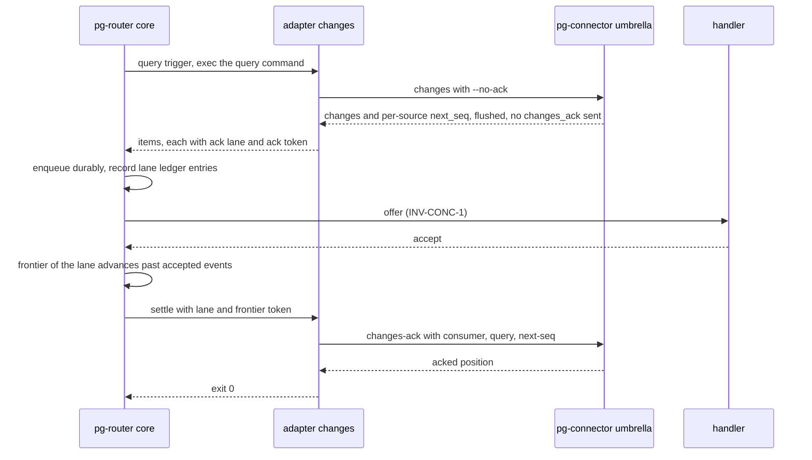
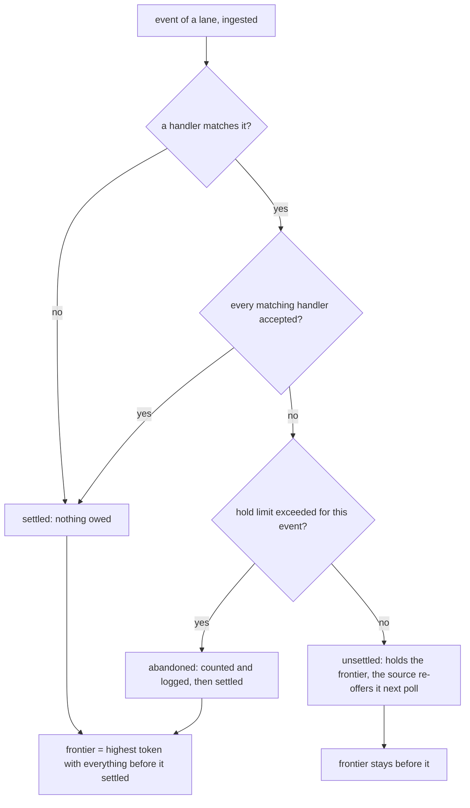

# pg-router source acknowledgement after handler acceptance: design

- **Status**: Proposed: awaiting operator approval. Nothing is implemented. Do not decompose until the operator
  approves.
- **Date**: 2026-11-11.
- **Scope**: the `INTF-SOURCE` contract of pg-router (a new core-to-source acceptance report), the
  `pg-router-source-pg-connector` adapter's use of `pg-connector changes --no-ack` and `changes-ack`, and the event-id
  digest rule of that adapter. The live behavior-docs sets are NOT edited by this document. The exact text to apply
  after approval is in section 4 and section 9.
- **Operator ruling that fixes the direction**: Phillip, 2026-11-04, human triage, verbatim: "operator concern
  (2026-10-29) that missing events is a big deal favours (b), which closes both loss paths, with at-least-once
  duplicates absorbed by INV-EVT-3 dedup." Option (b) is therefore the chosen design: the cursor of a cursor-feed
  source is acknowledged only after handler acceptance. Options (a) (ack after durable enqueue) and (c) (keep ack at
  emit) are not designed here.
- **Builds on**: `packages/pg-router/docs/behavior/interfaces.md` ("Event delivery", `INTF-SOURCE`, `ingest-event`),
  `packages/pg-router/docs/behavior/invariants.md` (`INV-EVT-1` to `INV-EVT-4`, `INV-CONC-1`, `INV-FAIL-1`),
  `packages/pg-router/docs/decisions/observability.md` (`DEC-OBS-13`),
  `packages/pg-router-source-pg-connector/docs/behavior/README.md`, and `packages/pg-connector/docs/behavior/interfaces.md`
  (`INTF-WIRE-ACK-1`, `INTF-WIRE-ACK-2`).

The key words MUST, MUST NOT, SHOULD, SHOULD NOT and MAY in this document are to be read as in RFC 2119.

## 1. Problem

The pg-connector `changes` umbrella acknowledges a consumer's cursor (it sends `changes_ack`) as soon as it has flushed
its answer, unless `--no-ack` is passed. `pg-router-source-pg-connector changes` never passes `--no-ack`. The cursor
therefore advances at emit, before pg-router has accepted anything.

Two loss paths follow:

1. **Expired and never accepted.** An event that expires unaccepted (past `expiresAt`, `INV-EVT-4`, or never
   dispatched) is not re-emitted by any later `changes` call, because the next call polls from the already advanced
   cursor. It is lost until that entity changes again. `--retry-window` only bounds pg-router's own retries.
2. **Adapter failure after ack.** If the adapter fails after `pg-connector` has already acknowledged (for example a JSON
   decode error on the answer, or a crash between the umbrella's flush and the adapter's print), the batch is
   acknowledged but never reaches the core.

The current state is pinned in three places, all verified against the tree this design was drafted from:

| Pin                                                                                          | Location                                                                                             |
| -------------------------------------------------------------------------------------------- | ---------------------------------------------------------------------------------------------------- |
| Ruling "Cursor advance is at emit, not at accept"                                            | `packages/pg-router-source-pg-connector/docs/behavior/README.md`, line 64                            |
| Added-row digest rule that relies on ack-at-emit ("one `added` row is printed at most once") | same file, lines 88 to 97 (the sentence starts at line 95)                                           |
| Test `TestChanges_NeverPassesNoAck_CursorAdvancesAtEmitSoExpiredEventsAreNotReplayed`        | `packages/pg-router-source-pg-connector/cmd/pg-router-source-pg-connector/changes_test.go`, line 849 |

The pg-router contract today has no acknowledgement back to a source. `INTF-SOURCE` assumes a pull source re-derives
current truth on its next query trigger ("Event delivery", last bullet). A cursor-feed source breaks that assumption:
its next call returns only what is after its cursor. This design gives such a source the one thing it lacks, which is a
report of what the core has finished with.

### 1.1 Goals

1. An event produced by a cursor-feed source is not lost while any matching handler may still accept it.
2. A failure of the adapter after the umbrella answered never advances the cursor.
3. The core stays ignorant of what the source is (`GOAL-MIN-1`): it handles an opaque lane and an opaque token and
   never learns that they are a backend name and a log position.
4. The cost (cursor held back, redelivery) is bounded and visible.

### 1.2 Non-goals

- Exactly-once delivery. The result is at-least-once, absorbed by `INV-EVT-3` and `INV-EVT-2`.
- A change for pull sources that re-derive truth on every query. They need no acknowledgement and are unaffected.
- A change to push sources (`ingest-event`). A push source already learns acceptance from the `ingest-event` reply
  (`accepted` count), and holds its own cursor if it has one.
- Replay of events that were lost before this design lands.

## 2. Terms

- **Cursor-feed source**: a source whose answer is the part of a change log after a per-consumer cursor, so a change
  the source has acknowledged is never offered again. `pg-connector changes` for a backend that owns its changes is the
  only one today.
- **Lane**: an opaque string an event carries that names one independent ordered feed inside a query. The adapter sets
  it to the backend name, because each backend has its own cursor. The core never parses it.
- **Token**: an opaque string an event carries that names its position in its lane. The adapter sets it to the
  position the backend is acknowledged with (section 4.2). The core never parses it.
- **Settled**: an event is settled for the report when nothing more is owed to it: every handler that matches it has
  accepted it (`INV-EVT-1`), or no handler matches it (nothing was owed, `INV-DISP-3`), or it was abandoned by the hold
  limit (section 5.3).
- **Frontier**: for one lane of one query, the highest token such that every event of that lane up to and including it,
  in the order the source emitted them, is settled.
- **Settlement report**: the core invoking the query's `settle` invocation with a lane and its frontier token.

## 3. Overview



What changes, in one line each:

- The adapter passes `--no-ack`, prints a lane and a token on each item, and gains a `settle` subcommand that performs
  `changes-ack`.
- The core gains a per-lane ledger, computes the frontier from acceptance, and calls the query's `settle` invocation
  when the frontier advances.
- The digest of an `added` row without a revision marker is derived from the row's `seq`, not from the adapter's emit
  time, because redelivery is now normal.

## 4. The `INTF-SOURCE` change: the settlement report (item 1)

### 4.1 Decisions

- **DEC-ACK-1: Settlement report as a Command invocation.** The core reports settlement by running a second opaque
  command declared on the query, in the way it already runs `command`. This keeps "adding a source is configuration"
  and the one-opaque-invocation rule of `INTF-SOURCE`: the core does not learn what the source does with the report.
  A source with no `settle` command is not a cursor-feed source and behaves exactly as today.
- **DEC-ACK-2: Opaque lane and token on the event.** The core needs to know which events of one query belong to the same
  ordered feed, and how far it may report. Both are supplied by the source as opaque strings on the event, so the core
  never interprets a source's cursor.
- **DEC-ACK-3: The frontier, not each event, is reported.** A cursor is a position, not a set. Reporting only the
  frontier is also what keeps the report cheap and idempotent.
- **DEC-ACK-4: Bounded hold.** A lane's frontier MUST NOT be held back longer than the query's `ack_hold_limit`
  (section 5.3). Past it, the oldest unsettled event is abandoned, counted and logged, never silently.

### 4.2 Exact behavior-doc text to apply after approval

Each block below is the exact text for one file. Insert positions are given before each block.

In `packages/pg-router/docs/behavior/interfaces.md`, in the event-shape list of `INTF-SOURCE` (after the `payload`
bullet), add:

```markdown
- `ack` — **optional**, a source's handle for the acknowledgement report below: an object with exactly two string
  fields, `lane` and `token`. The core never matches on it and never interprets either string; it keeps both with the
  event, durably, for as long as the event counts toward its lane's frontier. An event without `ack` takes no part in
  the settlement report.
```

In the same file, in the "Event delivery" section, replace the final bullet ("a **pull source** re-derives current
truth ...") with:

```markdown
- a **pull source** re-derives current truth on its next **query trigger**, unless it is a **cursor-feed source** (see
  "Acknowledgement of a cursor-feed source" under `INTF-SOURCE`), which is told what the core has finished with and
  re-offers anything it was not told about; a **push-only source**'s events are now **durable through their
  retention** (no longer lost on a core restart), lost only if nothing accepts them before they expire.
```

In the same file, after "The query-reply contract carries events or a deferral, and nothing else" and its diagram, add a
new subsection:

```markdown
**Acknowledgement of a cursor-feed source.** A source whose answer is the part of a log after a per-consumer cursor
cannot re-derive truth on its next trigger, so it MUST NOT advance that cursor until the core says the events it
produced are settled. A `[[query]]` of such a source declares a **`settle`** invocation (a command, run exactly as the
query's own command is, `strict_base_env` included) and MAY declare **`ack_hold_limit`** (a duration; see below). Both
are absent for every other source, and a source that declares neither behaves as before.

- **Lane and token.** Each event the source emits carries `ack.lane` and `ack.token` (event shape, above). A lane is
  one independent ordered feed of the query. Within one lane the order of emission is the order of tokens.
- **Settled.** An event is settled when every handler that matches it has accepted it (`INV-EVT-1`), or no handler
  matches it (nothing was owed, `INV-DISP-3`), or the hold limit abandoned it. An event that expired while a matching
  handler never accepted it is NOT settled (`INV-EVT-4` retires it from the queue, not from its lane).
- **Report.** When the frontier of a lane advances, the core runs the `settle` invocation with `--lane <lane>
--through <token>` appended, where `<token>` is the token of the highest event such that it and every earlier event of
  the lane are settled. The core MUST NOT report a token past an unsettled event. The report is **idempotent** (the same
  frontier reported twice is harmless) and carries no event ids.
- **A failed report is not an error for the event.** A `settle` that exits non-zero or times out is logged and counted
  (`pg_router_source_settle_failures_total`, labelled by query), and is retried at the next frontier evaluation, which
  runs on every settlement and on every query trigger of that query. Events are never re-enqueued by a failed report.
- **Hold limit.** The core MUST NOT hold a lane's frontier behind an unsettled event for longer than the query's
  `ack_hold_limit` (default 24 hours, and MUST NOT be shorter than the longest retry window the query's source applies;
  the source's own window is opaque to the core, so config validation checks only that the limit is greater than zero).
  Measured from the first moment the core ingested that event's id on that lane, past the limit the core
  **abandons** the event: it counts `pg_router_source_ack_abandoned_total` (labelled by query and event type), logs the
  event id, and treats the event as settled for the frontier. This is a bounded, visible loss and the only one the
  design permits.
- **Redelivery is expected.** While a lane's frontier is held, the source re-offers every event after the last reported
  token on each poll. The core's de-duplication (`INV-EVT-3`) absorbs the re-offer of an event it still holds. To make
  that absorption cover the hold, an accepted event's id is retained until its lane's frontier has passed it (amendment
  to `INV-EVT-3` below).
- **Restart.** The lane ledger is durable. After a restart the core rebuilds each lane's frontier from the durable
  queue and ledger and re-evaluates the report, so a crash between acceptance and report loses nothing.
```

In `packages/pg-router/docs/behavior/invariants.md`, add to `INV-EVT-3` (append to the end of the paragraph):

```markdown
**Lane retention.** An accepted event that carries an `ack` lane (`INTF-SOURCE`, "Acknowledgement of a cursor-feed
source") MUST keep its `id` in the retained id set until its lane's frontier has passed it, or until the lane's hold
limit abandons the oldest unsettled event, whichever comes first, even when its own final attempts are complete. The
dedup window of such an event is therefore bounded by the hold limit, not by its own retention.
```

In the same file, add a new invariant after `INV-EVT-7`:

```markdown
- **`INV-EVT-8`** — **A cursor-feed source's cursor moves only on settlement.** For a source that declares a `settle`
  invocation, the core MUST report a lane's frontier only for events that are settled and every earlier event of that
  lane settled, and MUST NOT report any position on any other basis (not an expiry, not a drop of a retired event, not
  a timeout of the report). The one exception is the hold limit, which abandons an event visibly and counts it. Delivery
  is at-least-once end to end: a crash between acceptance and report, a failed report, or a held frontier re-offers
  events, and `INV-EVT-2` and `INV-EVT-3` absorb them.
```

In `packages/pg-router/docs/behavior/glossary.md`, add terms `cursor-feed source`, `lane`, `token`, `frontier` and
`settlement report` with the definitions of section 2 of this document.

### 4.3 What the contract deliberately does not say

- The core does not learn that a lane is a backend or that a token is a log position, and it does not order tokens
  against one another: order is the order of emission within a lane (so the core need not compare tokens).
- The report carries no list of settled ids, so a source never has to hold a set.
- Pull sources that re-derive truth are untouched.

## 5. Who acks, and when (item 2)

### 5.1 The caller of `changes-ack` is the adapter, driven by the core's report

The umbrella no longer acknowledges: the adapter passes `--no-ack` (`INTF-WIRE-ACK-1`). The only caller of
`pg-connector <type> changes-ack` is the adapter's new `settle` subcommand, which the core runs, never the core directly.

```markdown
pg-router-source-pg-connector settle <type> [<query>] --consumer <id> [--beads-dir <path>] --lane <backend> --through <token>
```

It runs `pg-connector <type> changes-ack --consumer <id> [--query <query>] --next-seq <N> --backend <lane> --output json`,
where `<N>` is derived from the token (section 5.2), prints nothing on stdout, and exits 0 on success. A non-zero exit
(including a refused or failed `changes_ack`) is the failure the core logs and retries. The `--backend <lane>` argument
pins the acknowledgement to the one backend whose cursor the lane names (`changes-ack` accepts `--backend`,
`INTF-WIRE-ACK-2`).

### 5.2 What a token is

For each source row of a `changes` answer, the adapter assigns the lane (the backend name) and tokens as follows:

- Each item's token is its own `seq`, rendered as a decimal string.
- The **last** item of a lane in the call carries the source row's scanned `next_seq` instead of its own `seq`, because
  `next_seq` is the position the umbrella acknowledges (`INTF-WIRE-ACK-2`: "the scanned `next_seq` of a `sources[]` row,
  not the `seq` of the last change returned"). Acknowledging `next_seq` once the last item is settled also moves the
  cursor past scanned rows that produced no change.

Open question (section 11, OQ-1): whether a mid-batch `seq` is a valid `next_seq` for the daemon (that is, whether the
daemon's position after processing a change is exactly that change's `seq`), or whether the adapter should withhold
mid-batch tokens (give only the final item of a call a token, so the frontier moves a whole call at a time). The second
is simpler and never wrong, at the cost of holding more behind one unsettled event.

### 5.3 Head-of-line and how far back it may hold

Per-handler FIFO (`INV-CONC-1`: one outstanding offer per handler) means a handler that keeps declining holds up every
event behind its head. Under this design the same event also holds up the lane's frontier, because the frontier cannot
pass an unsettled event.

- **What holds the cursor.** Exactly the events a matching handler has not accepted and that are still owed an attempt
  or have expired un-accepted. A handler that accepts promptly never holds anything.
- **How far back.** At most `ack_hold_limit` behind the newest event, per lane, measured from the first ingest of the
  oldest unsettled event's id. After that the oldest unsettled event is abandoned, counted and logged, and the
  frontier moves to the next unsettled one (which then has its own age). The default is 24 hours, four times the 6 hour
  retry window of a deployment that passes `--retry-window 6h`, so a handler outage shorter than 24 hours loses nothing.
- **What redelivery costs while held.** Each poll re-offers every event after the reported token. Events still held by
  the core are absorbed by `INV-EVT-3`. An event that the core retired un-accepted is offered again as a fresh
  event (a new attempt window, `at` and `expiresAt` of the new emit), which is the replay this design exists to
  provide. The cost is one extra `pg-connector changes` payload per poll proportional to the held backlog.
- **Fan-out.** One handler's decline holds back events another handler already accepted, and an event another handler
  accepted is not re-run for it: its id is retained in the lane ledger (`INV-EVT-3` amendment), so the redelivered copy
  is a duplicate and dropped.



## 6. Crash between accept and ack (item 3)

The window: a handler accepts, the core records acceptance and then the frontier advances, then the core runs `settle`.
A crash can fall at three points.

| Crash point                                                       | State on restart                                                   | Outcome                                                                                                              |
| ----------------------------------------------------------------- | ------------------------------------------------------------------ | -------------------------------------------------------------------------------------------------------------------- |
| After accept, before the durable record is written                | the event is retained and unaccepted                               | re-offered, the handler tolerates the duplicate (`INV-EVT-2`, the "narrow crash window" `INTF-SOURCE` already names) |
| After the durable record, before `settle` is run                  | the lane ledger shows the event settled, the report was never sent | the core re-evaluates the frontier at start and sends the report                                                     |
| After `changes_ack` succeeded, before the core records the report | the daemon cursor already moved, the core thinks it did not        | the core re-sends the same frontier, which the daemon treats as a position it already holds (see OQ-2)               |

In all three the worst case is a redelivery to the core and to a handler, and never a loss. Redelivery is absorbed twice:
by `INV-EVT-3` while the id is retained (the lane retention amendment extends this across the hold), and by handler
idempotence (`INV-EVT-2`) when the id is no longer retained. The second is the existing contract: this design does not
make handlers any less idempotent than they must already be, it makes duplicates somewhat more likely.

## 7. The adapter-failure loss path (item 4)

With `--no-ack` the umbrella never acknowledges, so nothing the adapter fails to deliver is ever acknowledged. Every
adapter failure after the umbrella answered (JSON decode error, a `seq` or `kinds` of the wrong type, a crash while
printing, the core killing the adapter on its timeout) leaves the cursor where it was, and the next poll delivers the
same rows again. The adapter MUST exit non-zero for those failures exactly as it does today.

One adapter behavior is added to keep a quiet query's position moving (`INTF-WIRE-ACK-2` requires it): when a call
returns no change for any source, the adapter itself acknowledges each succeeded source's `next_seq` (with
`changes-ack`) before exiting 0. This is safe because the cursor is held at the frontier: a poll with no change after the
cursor means nothing is unsettled behind it. A source whose status is not `succeeded`, or any call that fails, is never
acknowledged.

## 8. The added-row digest rule (item 5)

Today, for an `added` row whose entity carries neither `head_sha` nor `version`, the digest input carries the adapter's
emit time (`emitted_at`, milliseconds) as a last key, so a re-entry of the entity into the query is offered again. That
rule rests on one sentence: "the cursor advances at emit ... so one `added` row is printed at most once and a later
`added` row for the same entity is always a new entry, never a re-report".

Under ack-after-accept that sentence is false. A held frontier re-prints the same `added` row on every poll, each with a
new `emitted_at`, hence a fresh id that passes `INV-EVT-3` and re-runs every handler. The digest rule MUST change in the
same design.

**Revised rule.** For a row of a `pg-connector changes` answer whose change kind is `added` and whose entity carries
neither `head_sha` nor `version`, the digest input carries the row's own `seq` as the last key, `seq`, in place of
`emitted_at`. A row with no `seq` (a backend that does not own its changes, and so is not a cursor-feed source and
keeps ack at emit) keeps `emitted_at` and keeps today's invariant, restated as holding for those rows only.

Why `seq` is the right discriminator:

- A redelivered row is the same log row, so it has the same `seq` and the same id, and is absorbed.
- A re-entry of an entity into the query is a new log row with a new `seq`, so it is offered again, which is the reason
  `emitted_at` was there.
- `seq` is already decoded and printed on `metadata.seq` by the adapter.

Consequences, to state rather than discover:

- The README line that says none of `seq`, `kinds` or `fields` reaches the digest MUST be narrowed to `kinds` and
  `fields`, plus `seq` for every row except an `added` row without a revision marker.
- The id of such an `added` row is no longer a function of the content a handler sees alone: it also depends on `seq`.
  That is acceptable because the id is opaque to handlers.
- Ids of such rows change on deploy. Anything retained under an old id is not de-duplicated against the new id once, at
  the cutover. This is one duplicate per held `added` row at the cutover and is bounded by the poll in flight.
- For `changed` rows and rows with a revision marker nothing changes: the id stays a content digest, so repeated or
  redelivered rows coalesce.

## 9. The adapter README text to apply after approval

In `packages/pg-router-source-pg-connector/docs/behavior/README.md`, replace the paragraph that starts "Cursor advance is
at emit, not at accept" with:

```markdown
**Cursor advance is at settlement, not at emit (ruling).** This adapter always passes `--no-ack`, so `pg-connector
  changes` flushes its answer and acknowledges nothing. Each printed item carries `ack` `{lane, token}` (lane is the
backend name, token the position to acknowledge, section "Settlement" below), and pg-router acknowledges by running
`settle`, which sends `changes-ack`, once every event up to that token has been accepted by every handler that matches
it (pg-router `INV-EVT-8`). Delivery is at-least-once: a poll re-prints every row after the last acknowledged position,
so an event that expired un-accepted, or a batch the adapter failed to print, is offered again at the next poll.
A poll that returns no change acknowledges each succeeded source's `next_seq` itself. Pinned by
`TestChanges_AlwaysPassesNoAck_CursorAdvancesOnlyOnSettle`.
```

In the same file, replace the last sentence of the `--retry-window` bullet that begins "The invariant this relies on:" with:

```markdown
    The invariant this relies on: a re-printed row is the same log row, so it has the same `seq`, hence the same id, and the
    router absorbs it (INV-EVT-3), while a later `added` row for the same entity is a new log row with a new `seq`.
```

and replace the clause "the adapter's emit time, at millisecond precision (`emitted_at`, one instant per invocation), as a
last key `emitted_at`" with "the row's own `seq`, as a last key `seq` (a row with no `seq`, which is not a cursor-feed
row, keeps the adapter's emit time at millisecond precision as a last key `emitted_at`)".

Add a `settle` bullet to the adapter's subcommand list with the text of section 5.1, and a `Settlement` paragraph with the
text of section 5.2.

## 10. Measure (item 6)

The signal the operator already named is `pg_router_listener_expired_pending{role,type}` (`DEC-OBS-13`): one count per
(event, listener) whose retention ended while that listener matched it and never accepted it. Verified against
`packages/pg-router/docs/decisions/observability.md` and `interfaces.md` ("listener_expired_pending"): a counter,
unit `{event}`, exposed as `pg_router_listener_expired_pending_total`, no alert, counted once per retirement.

- **Before (baseline).** Every count for a pull `pr.changed` source is a loss that nothing replays, because the cursor
  had already passed it. Read `increase(pg_router_listener_expired_pending_total{type="pr.changed"}[7d])` per `role` for
  the baseline, per role so that a single stuck handler is visible.
- **After.** Each count is now a retirement, not a loss: the same row is re-offered at the next poll with a new window.
  The counter MUST therefore be expected to stay at or above baseline during a handler outage (a redelivered row
  expires again and counts again), so a flat counter is not the success criterion.
- **The loss signal after the change** is the new `pg_router_source_ack_abandoned_total{query,type}`. Success is:
  `increase(pg_router_source_ack_abandoned_total[7d])` stays 0 across a 7 day window containing at least one dispatcher
  outage shorter than `ack_hold_limit`, while `expired_pending` over the same window is non-zero (events expired and
  were replayed, not lost).
- **Cost signals**: `pg_router_source_settle_failures_total{query}` (failed reports) and the existing
  `listener_oldest_pending_age` (a held frontier shows as a growing oldest age).

Metric names in this section are proposals, to be settled in the observability decision record when the design is
approved, with the same cardinality bound as `DEC-OBS-13` (no event id, session or bead as a label).

## 11. Open questions for the operator

- **OQ-1: mid-batch tokens.** Does the daemon accept a change's own `seq` as a position to acknowledge, or only a
  `next_seq`? If only `next_seq`, give tokens to the last item of each call only (section 5.2); the design still works,
  and the frontier moves one whole call at a time. This is answerable from the pg-connector daemon's code, and the first
  packet below settles it before anything else depends on it.
- **OQ-2: backward and repeated acknowledgements.** Does the daemon accept an acknowledgement of a position it already
  holds (a re-send after a crash), and does it refuse a lower one? The report is idempotent by design, so the answer
  decides only whether a re-send logs an error.
- **OQ-3: default `ack_hold_limit`.** 24 hours is proposed (section 5.3). The operator may prefer longer, since
  abandonment is the one place the design still loses an event.
- **OQ-4: reset of the consumer.** `--reset` replays history. The core MUST drop the lane ledger for that query when the
  operator resets the consumer, or stale tokens would be reported. Whether the reset is observable to the core (the
  adapter would have to say so) or an operator step is not settled here.

## 12. Draft packet list for the later decomposition (item 7)

Ordered; each is a self-contained work packet candidate. The decomposition itself waits for operator approval.

1. **Settle OQ-1 and OQ-2 by reading the daemon**: record the answers in the design. Gate for packets 3 and 4.
2. **Behavior docs**: apply sections 4.2 and 9 to the pg-router and adapter behavior sets, add the decision record for
   `DEC-ACK-1` to `DEC-ACK-4` and the metrics, and update the glossary and traceability. No code.
3. **Core acceptance callback (pg-router)**: event field `ack`, lane ledger (durable, restart-safe), frontier
   computation from `INV-EVT-1` acceptance, `settle` invocation with idempotent re-send, hold limit and abandonment,
   `INV-EVT-3` lane retention, the three metrics, config keys `settle` and `ack_hold_limit` with validation. Tests:
   frontier never passes an unsettled event, crash points of section 6 (kill and restart a core between each step),
   abandonment at the limit, failed report retried.
4. **Adapter: `--no-ack`, lane and token, `settle`, empty-poll ack (pg-router-source-pg-connector)**: pass `--no-ack`
   always, print `ack` on every cursor-feed item, add the `settle` subcommand, acknowledge a no-change poll, rewrite the
   pinning test. Tests against a fake `pg-connector`, as the existing tests do.
5. **Rewrite of the pinning test**: `TestChanges_NeverPassesNoAck_CursorAdvancesAtEmitSoExpiredEventsAreNotReplayed`
   becomes `TestChanges_AlwaysPassesNoAck_CursorAdvancesOnlyOnSettle`, asserting `--no-ack` is present on every
   `changes` call and `changes-ack` appears only from `settle` (and from the empty-poll case).
6. **Digest rule**: switch an `added` row without a revision marker to `seq` (section 8), keep `emitted_at` for rows
   without `seq`, update the digest tests: a re-printed row gets the same id, a re-entry (new `seq`) gets a new id, two
   calls of different `emitted_at` for one `seq` give one id.
7. **Regression test for the adapter-failure path**: a fake `pg-connector` returns a decodable-then-bad answer (for
   example a `seq` that is a string) after "flushing"; the test asserts exit non-zero, nothing on stdout, `--no-ack` was
   on the call, and no `changes-ack` was sent, so the next call would redeliver.
8. **End-to-end check, behind an opt-in switch (not in the unit gate)**: a real pg-router and a fake dispatcher that
   declines for longer than the retry window then accepts, asserting the event is delivered once after the outage and
   `ack_abandoned_total` stays 0. A packet to run it against `main` after deploy is gated on the change being applied.
9. **Measure rollout**: add the before/after queries of section 10 to the operator dashboard or runbook, record the
   baseline before the deploy.

Dependencies: 1 before 3 and 4; 2 before 3 and 4; 3 and 4 before 8; 5 and 7 ride with 4; 6 rides with 4 and must land in
the same change as 4, since `--no-ack` without the digest change would let redelivery duplicate `added` rows.

## 13. Alternatives considered

- **(a) Ack after durable enqueue.** The adapter would acknowledge once the core durably ingested the batch (push mode
  via `ingest-event`, or a new enqueued callback). It closes the adapter-failure loss path but not the
  expired-unaccepted path, which the operator ruled is the one that matters.
- **(c) Keep ack at emit** and size `--retry-window` to the longest dispatcher outage, with the periodic sweep as a
  backstop. Cheapest, but a missed event is still lost, which the operator ruled against.
- **Per-event acknowledgement instead of a frontier.** A cursor is a position, so per-event acks would need the source to
  hold a set of settled-but-not-reportable positions and rebuild them after a restart. The frontier keeps the state in the
  core, which already holds the durable queue.
- **Stateful adapter that remembers accepted ids.** The adapter is a one-shot exec; keeping state there would split the
  durable truth across two processes.

## 14. Risks

- **Head-of-line cost is real.** A single handler that never accepts one event holds every event behind it in that lane
  until the hold limit. The limit bounds the damage and the abandonment counter makes the damage visible. A smaller
  per-event or per-handler bound is the knob if this bites.
- **More duplicates reach handlers.** At-least-once with a held frontier means more redelivery than before. It is
  absorbed by `INV-EVT-3` while ids are retained, and by `INV-EVT-2` after, so a non-idempotent handler is the thing that
  breaks. Handlers of cursor-feed events SHOULD be audited for idempotence before the deploy.
- **A new core feature.** The lane ledger, frontier and report are new state in the core. Its restart behavior is the
  riskiest part, which is why packet 3 names the crash points explicitly.
