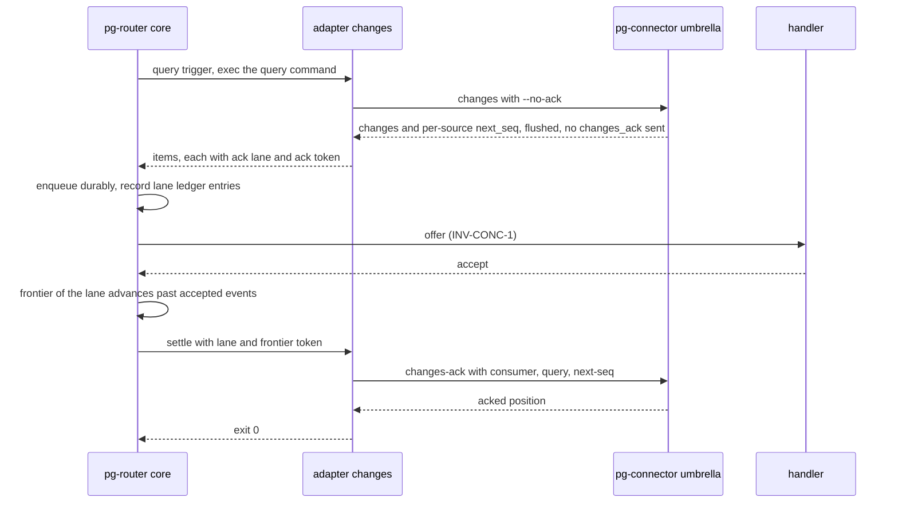
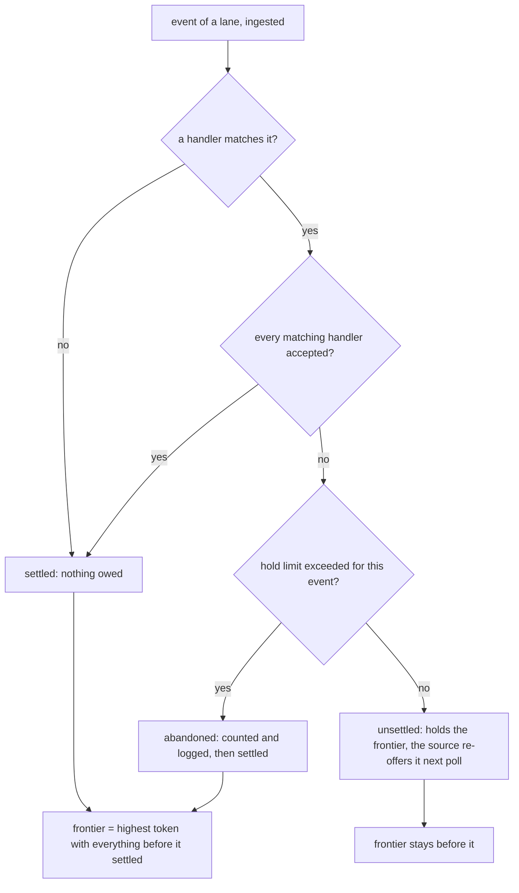

# pg-router source acknowledgement after handler acceptance: design

- **Status**: Accepted (operator approval, Phillip, 2026-11-20, verbatim: "approved"). Nothing is implemented.
- **Date**: 2026-11-11.
- **Scope**: the `INTF-SOURCE` contract of pg-router (a new core-to-source acceptance report), the
  `pg-router-source-pg-connector` adapter's opt-in use of `pg-connector changes --no-ack` and `changes-ack`, and the event-id
  digest rule of that adapter. The live behavior-docs sets are NOT edited by this document. The exact text to apply
  after approval is in section 4 and section 9.
- **Operator ruling that fixes the direction**: Phillip, 2026-11-04, human triage, verbatim: "operator concern
  (2026-10-29) that missing events is a big deal favours (b), which closes both loss paths, with at-least-once
  duplicates absorbed by INV-EVT-3 dedup." Option (b) is therefore the chosen design: the cursor of a cursor-feed
  source is acknowledged only after handler acceptance. Options (a) (ack after durable enqueue) and (c) (keep ack at
  emit) are not designed here.
- **Revision**: revised 2026-11-18 after a read-only adversarial review against `main` (verdict: approve with changes).
  Each finding is applied in the text or answered in "Review 2026-11-18" at the end. The status, option (b), the
  ruling above and the shape of `ack` (`{lane, token}`) are unchanged.
- **Builds on**: `packages/pg-router/docs/behavior/interfaces.md` ("Event delivery", `INTF-SOURCE`, `ingest-event`),
  `packages/pg-router/docs/behavior/invariants.md` (`INV-EVT-1` to `INV-EVT-4`, `INV-CONC-1`, `INV-FAIL-1`),
  `packages/pg-router/docs/decisions/observability.md` (`DEC-OBS-13`),
  `packages/pg-router-source-pg-connector/docs/behavior/README.md`, and `packages/pg-connector/docs/behavior/interfaces.md`
  (`INTF-WIRE-ACK-1`, `INTF-WIRE-ACK-2`).

The key words MUST, MUST NOT, SHOULD, SHOULD NOT and MAY in this document are to be read as in RFC 2119.

## 1. Problem

The pg-connector `changes` umbrella acknowledges a consumer's cursor (it sends `changes_ack`) as soon as it has flushed
its answer, unless `--no-ack` is passed. `pg-router-source-pg-connector changes` never passes `--no-ack`. The cursor
therefore advances at emit, before pg-router has accepted anything.

Two loss paths follow:

1. **Expired and never accepted.** An event that expires unaccepted (past `expiresAt`, `INV-EVT-4`, or never
   dispatched) is not re-emitted by any later `changes` call, because the next call polls from the already advanced
   cursor. It is lost until that entity changes again. `--retry-window` only bounds pg-router's own retries.
2. **Adapter failure after ack.** If the adapter fails after `pg-connector` has already acknowledged (for example a JSON
   decode error on the answer, or a crash between the umbrella's flush and the adapter's print), the batch is
   acknowledged but never reaches the core.

The current state is pinned in three places, all verified against the tree this design was drafted from:

| Pin                                                                                          | Location                                                                                             |
| -------------------------------------------------------------------------------------------- | ---------------------------------------------------------------------------------------------------- |
| Ruling "Cursor advance is at emit, not at accept"                                            | `packages/pg-router-source-pg-connector/docs/behavior/README.md`, line 64                            |
| Added-row digest rule that relies on ack-at-emit ("one `added` row is printed at most once") | same file, lines 88 to 97 (the sentence starts at line 95)                                           |
| Test `TestChanges_NeverPassesNoAck_CursorAdvancesAtEmitSoExpiredEventsAreNotReplayed`        | `packages/pg-router-source-pg-connector/cmd/pg-router-source-pg-connector/changes_test.go`, line 852 |

The pg-router contract today has no acknowledgement back to a source. `INTF-SOURCE` assumes a pull source re-derives
current truth on its next query trigger ("Event delivery", last bullet). A cursor-feed source breaks that assumption:
its next call returns only what is after its cursor. This design gives such a source the one thing it lacks, which is a
report of what the core has finished with.

### 1.1 Goals

1. An event produced by a cursor-feed source is not lost while any matching handler may still accept it.
2. A failure of the adapter after the umbrella answered never advances the cursor of a query that declares settlement.
3. The core stays ignorant of what the source is (`GOAL-MIN-1`): it handles an opaque lane and an opaque token and
   never learns that they are a backend name and a log position.
4. The cost (cursor held back, redelivery) is bounded and visible.

### 1.2 Non-goals

- Exactly-once delivery. The result is at-least-once, absorbed by `INV-EVT-3` and `INV-EVT-2`.
- A change for pull sources that re-derive truth on every query. They need no acknowledgement and are unaffected.
- A change to push sources (`ingest-event`). A push source already learns acceptance from the `ingest-event` reply
  (`accepted` count), and holds its own cursor if it has one.
- Replay of events that were lost before this design lands.

## 2. Terms

- **Cursor-feed source**: a source whose answer is the part of a change log after a per-consumer cursor, so a change
  the source has acknowledged is never offered again. `pg-connector changes` for a backend that owns its changes is the
  only one today.
- **Lane**: an opaque string an event carries that names one independent ordered feed inside a query. The adapter sets
  it to the backend name, because each backend has its own cursor. The core never parses it.
- **Token**: an opaque string an event carries that names its position in its lane. The adapter sets it to the
  position the backend is acknowledged with (section 4.2). The core never parses it.
- **Settled**: an event is settled for the report when nothing more is owed to it: every handler that matches it has
  accepted it (`INV-EVT-1`), or no handler matches it (nothing was owed, `INV-DISP-3`), or it was abandoned by the hold
  limit (section 5.3). Accepted means the listener returned `Accepted: true`. A transient failure with a retry left is
  NOT accepted (the event is handed back as a pre-accept decline), so it holds the frontier. A terminal failure with no
  retry left IS accepted and settles; what happens to the work after acceptance stays with the existing delivery
  contract (`INV-EVT-2` and the loss-after-acceptance decisions already recorded), not with this design.
- **Ledger**: for one lane of one query, the list of events (id, token, first-seen time) emitted by the latest
  successful poll of that lane, plus the settlement state of each id the core still holds. Settlement is looked up by
  event id, never by comparing tokens. A newer successful poll REPLACES the list; an event of the old list that the new
  one does not contain is no longer owed to the lane, because the source has already acknowledged past it.
- **Frontier**: for one lane of one query, the highest token such that every event of that lane up to and including it,
  in the order the source emitted them, is settled.
- **Settlement report**: the core invoking the query's `settle` invocation with a lane and its frontier token.

## 3. Overview



What changes, in one line each:

- When, and only when, a query declares settlement, the adapter passes `--no-ack`, prints a lane and a token on each
  item, and a new `settle` subcommand performs `changes-ack`. The opt-in is a flag on the adapter's `changes`
  subcommand (`--deferred-ack`, section 5.1), refused for a backend that does not own its changes.
- The core gains a per-lane ledger, computes the frontier from acceptance, and calls the query's `settle` invocation
  when the frontier advances.
- A query that declares settlement MUST give each item a stable per-change id (`--retry-window`, or `seq` in the
  digest), because redelivery is now normal and a bare entity id would drop a genuine new change (section 8).

## 4. The `INTF-SOURCE` change: the settlement report (item 1)

### 4.1 Decisions

- **DEC-ACK-1: Settlement report as a Command invocation.** The core reports settlement by running a second opaque
  command declared on the query, in the way it already runs `command`. This keeps "adding a source is configuration"
  and the one-opaque-invocation rule of `INTF-SOURCE`: the core does not learn what the source does with the report.
  A source with no `settle` command is not a cursor-feed source and behaves exactly as today: on a query that declares
  no `settle`, the core ignores an `ack` object on an event (no ledger, nothing held, nothing run).
- **DEC-ACK-2: Opaque lane and token on the event.** The core needs to know which events of one query belong to the same
  ordered feed, and how far it may report. Both are supplied by the source as opaque strings on the event, so the core
  never interprets a source's cursor.
- **DEC-ACK-3: The frontier, not each event, is reported.** A cursor is a position, not a set. Reporting only the
  frontier is also what keeps the report cheap and idempotent.
- **DEC-ACK-4: Bounded hold.** A lane's frontier MUST NOT be held back longer than the query's `ack_hold_limit`
  (section 5.3). Past it, the oldest unsettled event is abandoned, counted and logged, never silently.

### 4.2 Exact behavior-doc text to apply after approval

Each block below is the exact text for one file. Insert positions are given before each block.

In `packages/pg-router/docs/behavior/interfaces.md`, in the event-shape list of `INTF-SOURCE` (after the `payload`
bullet), add:

```markdown
- `ack` — **optional**, a source's handle for the acknowledgement report below: an object with exactly two string
  fields, `lane` and `token`. The core never matches on it and never interprets either string; it keeps both with the
  event, durably, for as long as the event counts toward its lane's frontier. An event without `ack` takes no part in
  the settlement report. Events that enter by `ingest-event`, by a push inject or by a redrive carry no `ack` and the
  core never synthesizes one, so they never hold a lane.
```

In the same file, amend the paragraph "One opaque invocation, not a menu of source kinds" (the section that starts
"There is exactly **one** source contract") by appending:

```markdown
A cursor-feed source adds one more opaque invocation, the query's `settle` command, which the core runs with a lane and
a token and never interprets. "One invocation" therefore means: one invocation to pull, and, for a source that keeps a
cursor, one to report; the core still learns nothing about what either does.
```

In the same file, amend the paragraph "The query-reply contract carries events or a deferral, and nothing else" by
changing "and nothing else" to "and nothing else, except that an event MAY carry the optional `ack` handle (event
shape, above)". The reply itself is unchanged; `ack` is part of an event.

In the same file, in the "Event delivery" section, replace the final bullet ("a **pull source** re-derives current
truth ...") with:

```markdown
- a **pull source** re-derives current truth on its next **query trigger**, unless it is a **cursor-feed source** (see
  "Acknowledgement of a cursor-feed source" under `INTF-SOURCE`), which is told what the core has finished with and
  re-offers anything it was not told about; a **push-only source**'s events are now **durable through their
  retention** (no longer lost on a core restart), lost only if nothing accepts them before they expire.
```

In the same file, after "The query-reply contract carries events or a deferral, and nothing else" and its diagram, add a
new subsection:

```markdown
**Acknowledgement of a cursor-feed source.** A source whose answer is the part of a log after a per-consumer cursor
cannot re-derive truth on its next trigger, so it MUST NOT advance that cursor until the core says the events it
produced are settled. A `[[query]]` of such a source declares a **`settle`** invocation (a command, run exactly as the
query's own command is, `strict_base_env` included) and MAY declare **`ack_hold_limit`** (a duration; see below). Both
are absent for every other source, and a source that declares neither behaves as before.

- **Lane and token.** Each event the source emits carries `ack.lane` and `ack.token` (event shape, above). A lane is
  one independent ordered feed of the query. Within one lane the order of emission is the order of tokens.
- **Settled.** An event is settled when every handler that matches it has accepted it (`INV-EVT-1`), or no handler
  matches it (nothing was owed, `INV-DISP-3`), or the hold limit abandoned it. An event that expired while a matching
  handler never accepted it is NOT settled (`INV-EVT-4` retires it from the queue, not from its lane).
- **Ledger and restart.** The ledger of a lane is the emitted list of its latest successful poll. A newer successful
  poll of the same lane replaces the list (the source's own cursor has by then moved past what it no longer lists). A
  re-emitted event keeps the settlement already recorded for its id, and takes the token of the newest poll, since the
  token is only used to build the report. The core never compares tokens: the frontier is the token of the last event in
  list order whose predecessors are all settled. What is persisted for a restart is the list (id, token, first-seen
  time) and the settled ids; after a restart the core re-evaluates the frontier from them and from the durable queue.
- **At most one report in flight per lane.** The core runs at most one `settle` per lane at a time; frontier advances
  during a run are coalesced into one follow-up report with the newest frontier.
- **Refused events are unsettled.** An event the core refuses at ingest (`log_full`, `log_unwritable`, an unknown type,
  a malformed event; `invariants.md`, `INV-DISP-3` and its neighbors) is never enqueued, so no queue entry holds it. The
  ledger still lists it, as unsettled, and its hold clock starts the first time the core sees its id on that lane. The
  frontier therefore neither passes it (no loss) nor holds forever: `ack_hold_limit` abandons it visibly like any
  other.
- **Report.** When the frontier of a lane advances, the core runs the `settle` invocation with `--lane <lane>
--through <token>` appended, where `<token>` is the token of the highest event such that it and every earlier event of
  the lane are settled. The core MUST NOT report a token past an unsettled event. The report is **idempotent** (the same
  frontier reported twice is harmless) and carries no event ids.
- **A failed report is not an error for the event.** A `settle` that exits non-zero or times out is logged and counted
  (`pg_router_source_settle_failures_total`, labelled by query), and is retried at the next frontier evaluation, which
  runs on every settlement and on every query trigger of that query. Events are never re-enqueued by a failed report.
- **Hold limit.** The core MUST NOT hold a lane's frontier behind an unsettled event for longer than the query's
  `ack_hold_limit` (default 24 hours, and MUST NOT be shorter than the longest retry window the query's source applies;
  the source's own window is opaque to the core, so config validation checks only that the limit is greater than zero).
  Measured from the first moment the core saw that event's id on that lane (ingested, or refused at ingest), past the limit the core
  **abandons** the event: it counts `pg_router_source_ack_abandoned_total` (labelled by query and event type), logs the
  event id, and treats the event as settled for the frontier. This is a bounded, visible loss and the only one the
  design permits.
- **Declared with a stable id.** A query that declares `settle` MUST have an item id that is stable per change and
  distinct per change (section 8); config validation cannot check this (the id is the source's), so the adapter refuses
  `--deferred-ack` without `--retry-window` (section 5.1).
- **Fan-out re-open.** A duplicate hit (`INV-EVT-3`) on a retained lane event that is still unsettled MUST re-open
  attempts, with a new `at` and `expiresAt` window, for the handlers that have not accepted it, and MUST NOT re-run a
  handler that already accepted it. Without this, an event accepted by one handler and expired without another is
  retained, its re-offer is dropped, the other handler never gets it and the lane waits for the hold limit.
- **Redelivery is expected.** While a lane's frontier is held, the source re-offers every event after the last reported
  token on each poll. The core's de-duplication (`INV-EVT-3`) absorbs the re-offer of an event it still holds. To make
  that absorption cover the hold, an accepted event's id is retained until its lane's frontier has passed it (amendment
  to `INV-EVT-3` below).
- **Restart.** The lane ledger is durable. After a restart the core rebuilds each lane's frontier from the durable
  queue and ledger and re-evaluates the report, so a crash between acceptance and report loses nothing.
```

In `packages/pg-router/docs/behavior/invariants.md`, add to `INV-EVT-3` (append to the end of the paragraph):

```markdown
**Lane retention.** An accepted event that carries an `ack` lane (`INTF-SOURCE`, "Acknowledgement of a cursor-feed
source") MUST keep its `id` in the retained id set until its lane's frontier has passed it, or until the lane's hold
limit abandons the oldest unsettled event, whichever comes first, even when its own final attempts are complete. The
dedup window of such an event is therefore bounded by the hold limit, not by its own retention. A duplicate hit on a
retained event that is still unsettled re-opens attempts for the handlers that have not accepted it (see the fan-out
re-open rule of `INTF-SOURCE`).
```

In the same file, add a new invariant after `INV-EVT-9` (`INV-EVT-8` and `INV-EVT-9` were ratified on main after this design was first written, so the new settlement invariant takes the next free id):

```markdown
- **`INV-EVT-10`** <!-- uuid: 7ec4604c-764f-4fac-b0f8-b1e3fe8789bb --> — **A cursor-feed source's cursor moves only on settlement.** For a source that declares a `settle`
  invocation, the core MUST report a lane's frontier only for events that are settled and every earlier event of that
  lane settled, and MUST NOT report any position on any other basis (not an expiry, not a drop of a retired event, not
  a timeout of the report). The one exception is the hold limit, which abandons an event visibly and counts it. Delivery
  is at-least-once end to end: a crash between acceptance and report, a failed report, or a held frontier re-offers
  events, and `INV-EVT-2` and `INV-EVT-3` absorb them.
```

In `packages/pg-router/docs/behavior/glossary.md`, add terms `cursor-feed source`, `lane`, `token`, `frontier` and
`settlement report` with the definitions of section 2 of this document.

### 4.3 What the contract deliberately does not say

- The core does not learn that a lane is a backend or that a token is a log position, and it does not order tokens
  against one another: order is the order of emission within a lane (so the core need not compare tokens).
- The report carries no list of settled ids, so a source never has to hold a set.
- Pull sources that re-derive truth are untouched.

## 5. Who acks, and when (item 2)

### 5.1 The caller of `changes-ack` is the adapter, driven by the core's report

Deferred acknowledgement is an opt-in of one query, not a default of the adapter. The adapter's `changes` subcommand
gains `--deferred-ack`, which the operator sets on exactly the queries that declare `settle`. With it the adapter passes
`--no-ack` (`INTF-WIRE-ACK-1`) and the umbrella no longer acknowledges. Without it nothing changes, so the deployed
queries that read a backend that does not declare `owns_changes` (the beads feeds are the live example) keep working:
the umbrella marks such a row `disabled` under `--no-ack` and, when it is the only backend, fails the call
`invalid_argument`. The adapter MUST refuse `--deferred-ack` (exit non-zero, a message that names the backend) for a
backend that does not own its changes, and MUST refuse it without `--retry-window` (section 8). The only caller of
`pg-connector <type> changes-ack` is the adapter's new `settle` subcommand, which the core runs, never the core directly.

```markdown
pg-router-source-pg-connector settle <type> [<query>] --consumer <id> --lane <backend> --through <token>
```

It runs `pg-connector <type> changes-ack --consumer <id> [--query <query>] --next-seq <N> --backend <lane> --output json`,
where `<N>` is derived from the token (section 5.2), prints nothing on stdout, and exits 0 on success. A non-zero exit
(including a refused or failed `changes_ack`) is the failure the core logs and retries. The `--backend <lane>` argument
pins the acknowledgement to the one backend whose cursor the lane names (`changes-ack` accepts `--backend`,
`INTF-WIRE-ACK-2`). `--beads-dir` is not offered on `settle`: it has no use for an `owns_changes` backend.

### 5.2 What a token is

For each source row of a `changes` answer, the adapter assigns the lane (the backend name) and tokens as follows:

- Each item's token is its own `seq`, rendered as a decimal string.
- The **last** item of a lane in the call carries the source row's scanned `next_seq` instead of its own `seq`, because
  `next_seq` is the position the umbrella acknowledges (`INTF-WIRE-ACK-2`: "the scanned `next_seq` of a `sources[]` row,
  not the `seq` of the last change returned"). Acknowledging `next_seq` once the last item is settled also moves the
  cursor past scanned rows that produced no change.

A mid-batch `seq` is a valid token (answer of the former OQ-1, from the code): the feed's `Ack` treats `next_seq` as
"received everything up to here", a value at or below the stored position is a no-op, a value above the log head is
refused, and a poll returns the rows after the stored position in ascending `seq`. A row's own `seq` is therefore an
exact position. The adapter MUST emit each lane in the umbrella's order, ascending, without coalescing or reordering
rows (an entity changed twice in one poll is two items), because the core's frontier is list order.

### 5.3 Head-of-line and how far back it may hold

Per-handler FIFO (`INV-CONC-1`: one outstanding offer per handler) means a handler that keeps declining holds up every
event behind its head. Under this design the same event also holds up the lane's frontier, because the frontier cannot
pass an unsettled event.

- **What holds the cursor.** Exactly the events a matching handler has not accepted and that are still owed an attempt
  or have expired un-accepted. A handler that accepts promptly never holds anything.
- **How far back.** At most `ack_hold_limit` behind the newest event, per lane, measured from the first time the core
  saw the oldest unsettled event's id (ingest or refusal). After that the oldest unsettled event is abandoned, counted and logged, and the
  frontier moves to the next unsettled one (which then has its own age). The default is 24 hours, four times the 6 hour
  retry window of a deployment that passes `--retry-window 6h`, so a handler outage shorter than 24 hours loses nothing. `ack_hold_limit` MUST be shorter than the daemon's
  `change_log_retention` (14 days by default), or a held cursor would fall off the log and get `cursor_expired`; the
  core cannot see that value, so the deployment's configuration check owns it.
- **Page-size stall.** A poll returns at most `feed.DefaultLimit` rows (500). While the frontier is held with more than
  500 matching rows behind it, every poll returns the same first 500 rows, and rows beyond them are not seen until the
  hold limit abandons the oldest. This is a deliberate bound, not a bug, and it is visible: the router-side frontier-age
  gauge (section 10) grows and the poll's `truncated` flag is set. It is the reason the hold limit stays short enough
  to be a cap rather than a wish.
- **What redelivery costs while held.** Each poll re-offers every event after the reported token. Events still held by
  the core are absorbed by `INV-EVT-3`. An event that the core retired un-accepted is offered again as a fresh
  event (a new attempt window, `at` and `expiresAt` of the new emit), which is the replay this design exists to
  provide. The cost is one extra `pg-connector changes` payload per poll proportional to the held backlog.
- **Fan-out.** One handler's decline holds back events another handler already accepted. The id of an event another
  handler accepted is retained (`INV-EVT-3` amendment), so a handler that accepted it is not re-run; a duplicate hit on
  it re-opens attempts only for the handlers that have not accepted it (the fan-out re-open rule of section 4.2), so a
  second handler is not starved by the first one's acceptance.



## 6. Crash between accept and ack (item 3)

The window: a handler accepts, the core records acceptance and then the frontier advances, then the core runs `settle`.
A crash can fall at three points.

| Crash point                                                       | State on restart                                                   | Outcome                                                                                                              |
| ----------------------------------------------------------------- | ------------------------------------------------------------------ | -------------------------------------------------------------------------------------------------------------------- |
| After accept, before the durable record is written                | the event is retained and unaccepted                               | re-offered, the handler tolerates the duplicate (`INV-EVT-2`, the "narrow crash window" `INTF-SOURCE` already names) |
| After the durable record, before `settle` is run                  | the lane ledger shows the event settled, the report was never sent | the core re-evaluates the frontier at start and sends the report                                                     |
| After `changes_ack` succeeded, before the core records the report | the daemon cursor already moved, the core thinks it did not        | the core re-sends the same frontier, which the daemon treats as a no-op (section 11)                                 |

In all three the worst case is a redelivery to the core and to a handler, and never a loss. Redelivery is absorbed twice:
by `INV-EVT-3` while the id is retained (the lane retention amendment extends this across the hold), and by handler
idempotence (`INV-EVT-2`) when the id is no longer retained. The second is the existing contract: this design does not
make handlers any less idempotent than they must already be, it makes duplicates somewhat more likely.

## 7. The adapter-failure loss path (item 4)

With `--no-ack` the umbrella never acknowledges, so nothing the adapter fails to deliver is ever acknowledged. Every
adapter failure after the umbrella answered (JSON decode error, a `seq` or `kinds` of the wrong type, a crash while
printing, the core killing the adapter on its timeout) leaves the cursor where it was, and the next poll delivers the
same rows again. The adapter MUST exit non-zero for those failures exactly as it does today.

One adapter behavior is added, for a `--deferred-ack` call only, to keep a quiet query's position moving (`INTF-WIRE-ACK-2` requires it): when a call
returns no change for any source, the adapter itself acknowledges each succeeded source's `next_seq` (with
`changes-ack`) before exiting 0. This is safe because the cursor is held at the frontier: a poll with no change after the
cursor means nothing is unsettled behind it. A source whose status is not `succeeded`, or any call that fails, is never
acknowledged.

## 8. The item id under redelivery (item 5)

Both daemons set `version` on every change row, so the existing `added`-row rule (a digest of the emit time for an
`added` row with neither `head_sha` nor `version`) does not fire for them; rewriting it is not the hazard. The hazard is
the id itself. Without `--retry-window` the item id is the bare entity id. Under the lane retention amendment of
`INV-EVT-3`, an entity id retained while its lane's frontier is held makes a NEW change of that entity, arriving in a
later poll while the frontier is held, a duplicate. The core drops it and the source's cursor passes it: a silent loss.

**Rule.** A query that declares `settle` MUST use per-change ids. The adapter refuses `--deferred-ack` without
`--retry-window` (section 5.1), so every item id is `<entity id>@<12 hex>` of a change digest. The digest already keys
on `version` and `head_sha`, so two different changes of one entity differ, and a redelivered row (same entity, same
version) has the same id and is absorbed. For the rare row with neither marker the digest input carries the row's own
`seq` as its last key, in place of the emit time (`emitted_at`), so a redelivered row is the same id and a re-entry (a
new log row, new `seq`) is a new id; a row without `seq` cannot occur under `--deferred-ack` (the backend owns its
changes). A query without `--deferred-ack` keeps today's rule and today's invariant.

Consequences, to state rather than discover:

- The README line that says none of `seq`, `kinds` or `fields` reaches the digest MUST be narrowed to `kinds` and
  `fields`, plus `seq` for an `added` row without a revision marker under `--deferred-ack`.
- Ids of such rows change on deploy for a query that opts in. Anything retained under an old id is not de-duplicated
  against the new id once, at the cutover: one duplicate per held row, bounded by the poll in flight.
- An id is opaque to handlers, so a `seq`-dependent id is acceptable.

## 9. The adapter README text to apply after approval

In `packages/pg-router-source-pg-connector/docs/behavior/README.md`, replace the paragraph that starts "Cursor advance is
at emit, not at accept" with:

```markdown
**Cursor advance is at settlement, not at emit (ruling), for a query that opts in.** With `--deferred-ack` (which
requires `--retry-window` and a backend that owns its changes) the adapter passes `--no-ack`, so `pg-connector
  changes` flushes its answer and acknowledges nothing. Without it the cursor still advances at emit, as before. Each printed item carries `ack` `{lane, token}` (lane is the
backend name, token the position to acknowledge, section "Settlement" below), and pg-router acknowledges by running
`settle`, which sends `changes-ack`, once every event up to that token has been accepted by every handler that matches
it (pg-router `INV-EVT-10`). Delivery is at-least-once: a poll re-prints every row after the last acknowledged position,
so an event that expired un-accepted, or a batch the adapter failed to print, is offered again at the next poll.
A poll that returns no change acknowledges each succeeded source's `next_seq` itself. Pinned by
`TestChanges_DeferredAck_PassesNoAck_CursorAdvancesOnlyOnSettle`, and the unchanged default by the renamed
`TestChanges_WithoutDeferredAck_NeverPassesNoAck_CursorAdvancesAtEmit` (the existing pinning test, kept).
```

In the same file, replace the last sentence of the `--retry-window` bullet that begins "The invariant this relies on:" with:

```markdown
    The invariant this relies on: a re-printed row is the same log row, so it has the same `seq`, hence the same id, and the
    router absorbs it (INV-EVT-3), while a later `added` row for the same entity is a new log row with a new `seq`.
```

and replace the clause "the adapter's emit time, at millisecond precision (`emitted_at`, one instant per invocation), as a
last key `emitted_at`" with "under `--deferred-ack` the row's own `seq`, as a last key `seq`; otherwise the adapter's
emit time at millisecond precision as a last key `emitted_at`".

In `packages/pg-connector/docs/behavior/interfaces.md`, amend the sentence "a caller content with acknowledgement after
flush, such as the pg-router adapter, does not pass it" to read "the pg-router adapter passes it only for a query that
declares settlement (`--deferred-ack`)". The pinning test of the umbrella's `--no-ack` stays as it is.

Add a `settle` bullet to the adapter's subcommand list with the text of section 5.1, and a `Settlement` paragraph with the
text of section 5.2.

## 10. Measure (item 6)

The signal the operator already named is `pg_router_listener_expired_pending{role,type}` (`DEC-OBS-13`): one count per
(event, listener) whose retention ended while that listener matched it and never accepted it. Verified against
`packages/pg-router/docs/decisions/observability.md` and `interfaces.md` ("listener_expired_pending"): a counter,
unit `{event}`, exposed as `pg_router_listener_expired_pending_total`, no alert, counted once per retirement.

- **Before (baseline).** Every count for a pull `pr.changed` source is a loss that nothing replays, because the cursor
  had already passed it. Read `increase(pg_router_listener_expired_pending_total{type="pr.changed"}[7d])` per `role` for
  the baseline, per role so that a single stuck handler is visible.
- **After.** Each count is now a retirement, not a loss: the same row is re-offered at the next poll with a new window.
  The counter MUST therefore be expected to stay at or above baseline during a handler outage (a redelivered row
  expires again and counts again), so a flat counter is not the success criterion.
- **The loss signal after the change** is the new `pg_router_source_ack_abandoned_total{query,type}`. Success is:
  `increase(pg_router_source_ack_abandoned_total[7d])` stays 0 across a 7 day window containing at least one dispatcher
  outage shorter than `ack_hold_limit`, while `expired_pending` over the same window is non-zero (events expired and
  were replayed, not lost).
- **Existing consumer alerts.** The consumer-stuck rules of the two daemon feeds (`pg-conn-github-consumer-stuck`,
  `pg-conn-jira-consumer-stuck`) fire when a consumer's oldest unacked row is older than 15 minutes and escalate to
  beads, so any decline longer than 15 minutes of a settle consumer would page. Those rules MUST exclude the settle
  consumers, exactly as the `pg-desk-freshness` consumers are already excluded, and the router MUST gain a
  router-side frontier-age gauge (`pg_router_source_frontier_age_seconds{query,lane}`, the age of the oldest unsettled
  event of the lane) with an alert at a fraction of `ack_hold_limit`, so the held cursor is still watched.
- **Cost signals**: `pg_router_source_settle_failures_total{query}` (failed reports) and the existing
  `listener_oldest_pending_age` (a held frontier shows as a growing oldest age).

Metric names in this section are proposals, to be settled in the observability decision record when the design is
approved, with the same cardinality bound as `DEC-OBS-13` (no event id, session or bead as a label).

## 11. Open questions for the operator

- **Answered from code, no longer open.** Former OQ-1 (is a mid-batch `seq` a valid position): yes, section 5.2.
  Former OQ-2 (a repeated or lower acknowledgement): `Feed.Ack` treats a value at or below the stored position as a
  no-op and refuses only a value above the log head, so a re-sent report is harmless and logs no error.
- **OQ-3: default `ack_hold_limit`. Resolved (operator, 2026-11-20): 24 hours.** 24 hours is proposed (section 5.3) and MUST stay below the 14 day log retention. The operator may prefer longer, since
  abandonment is the one place the design still loses an event.
- **OQ-4: reset of the consumer. Resolved (operator, 2026-11-20): an operator step, not signalled by the adapter.** `--reset` replays history. The core MUST drop the lane ledger for that query when the
  operator resets the consumer, or stale tokens would be reported. Whether the reset is observable to the core (the
  adapter would have to say so) or an operator step is not settled here.

## 12. Draft packet list for the later decomposition (item 7)

Ordered; each is a self-contained work packet candidate. The decomposition itself waits for operator approval.

The two later designs (delivery-correctness and published-contracts) cite packets 3 and 4 below as "the ack-after-accept
core and adapter packets". Their names are stable; renumber nothing around them.

1. **Behavior docs**: apply sections 4.2 and 9 to the pg-router, adapter and pg-connector behavior sets, add the
   decision record for `DEC-ACK-1` to `DEC-ACK-4` and the metrics, and update the glossary and traceability. No code.
   (The former packet that settled the two daemon questions is gone: section 5.2 and section 11 record the answers.)
2. **Core packet, "ack-after-accept core" (pg-router)**: event field `ack`, lane ledger (durable, restart-safe, replaced
   by each newer poll), frontier computation from `INV-EVT-1` acceptance, refused-at-ingest events as unsettled, one
   settle in flight per lane, `settle` invocation with idempotent re-send, hold limit and abandonment, `INV-EVT-3`
   lane retention and the fan-out re-open, the metrics (including the frontier-age gauge), config keys `settle` and
   `ack_hold_limit` with validation. Tests: frontier never passes an unsettled event, the three crash points of
   section 6 (kill and restart a core between each step), abandonment at the limit, failed report retried, the fan-out
   case (two handlers, one expires), a refused event not passed.
3. **Adapter packet, "ack-after-accept adapter" (pg-router-source-pg-connector)**: `--deferred-ack` (refused without
   `--retry-window` and for a backend without `owns_changes`), `--no-ack` and lane and token on every item in umbrella
   order, the `settle` subcommand, empty-poll ack, and the per-change id rule of section 8. Tests against a fake
   `pg-connector`, as the existing tests do: a redelivered row has the same id, a new change of one entity while the
   frontier is held gets a new id, two calls of different `emitted_at` give one id for one `seq` (a row with neither marker).
4. **Pinning tests**: the existing test `TestChanges_NeverPassesNoAck_...` stays as the pin of the default; add
   `TestChanges_DeferredAck_PassesNoAck_CursorAdvancesOnlyOnSettle` (`--no-ack` on every `changes` call of an opted-in
   query, `changes-ack` only from `settle` and the empty poll).
5. **Regression test for the adapter-failure path**: a fake `pg-connector` returns a decodable-then-bad answer (for
   example a `seq` that is a string) after "flushing"; with `--deferred-ack` the test asserts exit non-zero, nothing on
   stdout, `--no-ack` was on the call, and no `changes-ack` was sent, so the next call would redeliver.
6. **Alert rewiring (pg-connector and the deployment)**: exclude settle consumers from the two consumer-stuck rules,
   add the frontier-age alert, and add the `--deferred-ack` opt-in to the queries that should use it. Config only.
7. **End-to-end check, behind an opt-in switch (not in the unit gate)**: a real pg-router and a fake dispatcher that
   declines for longer than the retry window then accepts, asserting the event is delivered once after the outage and
   `ack_abandoned_total` stays 0. A packet to run it against `main` after deploy is gated on the change being applied.
8. **Measure rollout**: add the before/after queries of section 10 to the operator dashboard or runbook, record the
   baseline before the deploy.

Dependencies: 1 before 2 and 3; 4 and 5 ride with 3; 2 and 3 before 7; 6 after 2 and 3. The per-change id rule is part
of packet 3 itself, since `--deferred-ack` refuses to run without it.

## 13. Alternatives considered

- **(a) Ack after durable enqueue.** The adapter would acknowledge once the core durably ingested the batch (push mode
  via `ingest-event`, or a new enqueued callback). It closes the adapter-failure loss path but not the
  expired-unaccepted path, which the operator ruled is the one that matters.
- **(c) Keep ack at emit** and size `--retry-window` to the longest dispatcher outage, with the periodic sweep as a
  backstop. Cheapest, but a missed event is still lost, which the operator ruled against.
- **Per-event acknowledgement instead of a frontier.** A cursor is a position, so per-event acks would need the source to
  hold a set of settled-but-not-reportable positions and rebuild them after a restart. The frontier keeps the state in the
  core, which already holds the durable queue.
- **Stateful adapter that remembers accepted ids.** The adapter is a one-shot exec; keeping state there would split the
  durable truth across two processes.

## 14. Risks

- **Head-of-line cost is real.** A single handler that never accepts one event holds every event behind it in that lane
  until the hold limit. The limit bounds the damage and the abandonment counter makes the damage visible. A smaller
  per-event or per-handler bound is the knob if this bites.
- **More duplicates reach handlers.** At-least-once with a held frontier means more redelivery than before. It is
  absorbed by `INV-EVT-3` while ids are retained, and by `INV-EVT-2` after, so a non-idempotent handler is the thing that
  breaks. Handlers of cursor-feed events SHOULD be audited for idempotence before the deploy.
- **A new core feature.** The lane ledger, frontier and report are new state in the core. Its restart behavior is the
  riskiest part, which is why the core packet names the crash points explicitly.

## 15. Review 2026-11-18

A read-only adversarial review against `main` returned approve with changes. Every finding was re-verified against the
tree of this branch before editing. The line numbers below are those of that tree.

| #   | Finding                                                | Result  | Where and evidence                                                                                                                                                                                                                                                  |
| --- | ------------------------------------------------------ | ------- | ------------------------------------------------------------------------------------------------------------------------------------------------------------------------------------------------------------------------------------------------------------------- |
| 1   | `--no-ack` everywhere breaks the beads feeds           | applied | Opt-in `--deferred-ack`, refused for a backend without `owns_changes` (sections 3, 5.1). `interfaces.md` of pg-connector lines 716 to 728 and `changes.go` 452 to 457 confirm `disabled` and `invalid_argument`.                                                    |
| 2   | Item id is the bare entity id without `--retry-window` | applied | Section 8 rewritten: per-change ids required with settle; packet 6 folded into the adapter packet. `changes.go` of the adapter reads `version` and `head_sha` into the digest only under `--retry-window`.                                                          |
| 3   | Fan-out deadlock on a retained, unsettled event        | applied | Fan-out re-open rule in sections 4.2 and 5.3, and the `INV-EVT-3` lane-retention text.                                                                                                                                                                              |
| 4   | Ledger across polls undefined                          | applied | Term "Ledger" (section 2) and "Ledger and restart" (section 4.2): latest successful poll, lookup by event id, newer poll replaces the list.                                                                                                                         |
| 5   | Refused events never start a hold clock                | applied | "Refused events are unsettled" (section 4.2): the hold clock starts when the core first sees the id on that lane.                                                                                                                                                   |
| 6   | Consumer-stuck alerts page on any 15 minute decline    | applied | Section 10: exclude settle consumers and add a router-side frontier-age gauge and alert. Rule at `pg-connector-github-alerts.yaml` line 249 (`for: 15m` at 534).                                                                                                    |
| 7   | `feed.DefaultLimit` (500) stalls intake while held     | applied | "Page-size stall" in section 5.3, with its signal. `feed.go` line 20.                                                                                                                                                                                               |
| 8   | OQ-1 and OQ-2 answerable from code                     | applied | Section 5.2 and section 11 record the answers from `Feed.Ack` (`feed.go` 379 to 440); the first packet and its gate are deleted; emit order and `ack_hold_limit` below `change_log_retention` are required (5.2, 5.3).                                              |
| 9   | "Settled" implicit                                     | applied | Section 2 ("Settled") and section 4.2: transient failure with a retry left holds (`listener.go` 567 to 571), terminal failure settles (line 582); redrive, ingest-event and push inject carry no ack; ack without settle is ignored; one settle in flight per lane. |
| 10  | Nits                                                   | applied | `interfaces.md` 719 to 720 amendment and both `INTF-SOURCE` paragraphs (sections 4.2 and 9), pinning test now at line 852, no `--beads-dir` on settle, stable packet names (section 12).                                                                            |

No finding was declined.
