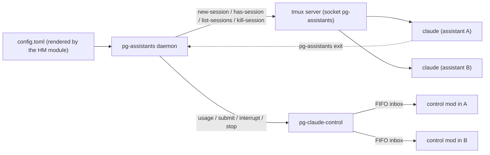

# pg-assistants: a minimal supervisor for permanent Claude Code assistants

Status: APPROVED by the operator (2026-11-16), after two review rounds. Implementation starts in a
fresh session.

## Intent

The operator wants a few "permanent" assistants, each looking after one area on its own. A permanent
assistant is a chain of ordinary interactive Claude Code sessions in one working directory: each
session works, keeps its own notes in that directory, and exits before its context fills; the next
session picks up from the notes. The framework is two parts and stays small:

1. **A config** listing the assistants and their attributes.
2. **A minimal daemon** that keeps each enabled assistant running and makes each session stop before
   it uses too much context.

Everything else (messaging between assistants, permissions, MCP, self-update) comes later and does
not belong in the daemon.

## Goals

- G1. Start an enabled assistant that is not running, in its own tmux session.
- G2. Stop a running assistant whose config says `enabled = false`, and any session on the
  assistants' tmux server that no valid config entry supervises.
- G3. Recycle a session through a ladder (nudge, interrupt, kill) as its context fill crosses
  configured fractions of its limit.
- G4. Recycle sessions through the same ladder as the account's 5-hour or 7-day usage block fills
  (nudge to stop at 95%, interrupt at 98%, kill at 100% by default), and start nothing while a
  block is at or above its nudge level, until it resets.
- G5. Let an operator see each assistant's state with one command, see why an assistant is not
  running, and attach to any session.
- G6. Isolate assistants from each other inside the daemon: a slow, broken or misconfigured
  assistant MUST NOT delay, block or stop the supervision of any other.

## Non-goals (day 1)

- Per-assistant quota (tokens or dollars per unit of time). Deferred to a follow-up: it needs a
  recorder query over the assistant's working directory plus pa-monitor's price table (see
  "Follow-up: quota").
- Messaging, permissions, MCP configuration, self-update, scheduling, and any knowledge of what an
  assistant does. Identity and duties live in the working directory's `AGENTS.md` / `CLAUDE.md`.
- Detecting a session that is stuck on a permission prompt or a question while never nudged. Such a
  session is idle and is left alone (see "Ladders"); a later version MAY read pa-monitor's
  `blocked` state for it.

## Anti-goals

- The daemon MUST NOT grow into an orchestrator: no work queue, no task routing, no LLM calls.
- A daemon restart MUST NOT kill the assistants.
- The daemon MUST NOT type into a terminal pane; every action on a session goes through
  `pg-claude-control`, or through tmux for the kill of last resort.

## Approaches considered

| Approach                                   | Trade-off                                                                                       | Outcome                    |
| ------------------------------------------ | ----------------------------------------------------------------------------------------------- | -------------------------- |
| A. Small Go daemon in `nix-agent-support`  | More code than a script; matches the workspace's daemon pattern and tests cleanly in Go         | **Chosen by the operator** |
| B. Bash script on a launchd timer          | Least code; grace timers and backoff need a state file, per-assistant ticks are awkward         | Rejected                   |
| C. Extend ccmux (external, TypeScript/Bun) | Keep-alive loop exists; foreign runtime, low maturity, the whole ladder still has to be written | Rejected                   |

Prior art (researched 2026-11-16): nothing does the whole job. ccmux is the closest structure (a
heal-every-30-seconds daemon over tmux sessions) but resumes one conversation instead of recycling.
Claude Code's built-in background supervisor (`claude --bg`, `claude respawn`) restarts crashed
sessions but has no config, no tmux, no context recycling, and stops idle sessions after about an
hour, which works against a permanent assistant. ccpool (this repo) is NOT used as a dependency; two
pieces of it are promoted into the shared `x` module (operator ruling, 2026-11-16): its tmux client
becomes `x/tmux` and its folder-trust writer `x/claudetrust`, so pg-assistants does not make a
second copy. Moving ccpool onto them is a separate follow-up.

## Design

### Components



- `pg-assistants` (new Go package `packages/pg-assistants`): subcommands `daemon`, `status`,
  `attach`, `exit`, `trust` and `config check`.
- `pg-claude-control` (existing): gains a `usage` verb, command side and mod side.
- tmux: one dedicated server (`tmux -L pg-assistants`), one session per assistant, named by its
  `id`. The operator attaches with `pg-assistants attach <id>`. (A tmux "session group" is NOT
  used: grouped sessions share one window set, which is the opposite of what is wanted.)
- launchd (darwin): a per-user keep-alive agent registered by the HM module, with
  `AbandonProcessGroup = true` so that stopping or restarting the daemon does not take the tmux
  server and the assistants with it.

### Config

TOML, rendered by `home/programs/pg-assistants` and checked at build time with
`pg-assistants config check`.

```toml
tick = "1m"                   # global default, Go duration

[grace]                       # time-based steps (see "Ladders")
interrupt = "5m"              # nudge -> interrupt, for every ladder
kill = "2m"                   # interrupt -> kill, for every ladder

[blocks]                      # fractions of the account's 5-hour or 7-day block
nudge = 0.95                  # nudge every running session to stop; hold new starts
interrupt = 0.98
kill = 1.00
unknown_reset_hold = "1h"     # hold when a block is held but reports no reset time

[restart]
min_uptime = "1m"             # a session that dies sooner counts as a crash
backoff_initial = "1m"
backoff_max = "30m"
start_timeout = "5m"          # no answer from the control mod by then: the start stalled

[paths]                       # absolute paths, rendered by the HM module
tmux = "/nix/store/.../bin/tmux"
claude = "/nix/store/.../bin/claude"
pg_claude_control = "/nix/store/.../bin/pg-claude-control"
shell = "/bin/zsh"            # the operator's login shell
state_dir = "/Users/<user>/.local/state/pg-assistants"
claude_json = "/Users/<user>/.claude.json"   # where folder trust is written

[[assistant]]
id = "inbox-keeper"           # unique; [a-z0-9-]+; tmux session name
name = "Inbox Keeper"         # claude --name
enabled = true
model = "claude-sonnet-5-5"   # claude --model
effort = "medium"             # claude --effort
cwd = "/abs/path"             # MUST exist; one assistant per directory
prompt = "Resume your duties per AGENTS.md."   # first message
tick = "30s"                  # optional override
env = { FOO = "bar" }         # optional extra session environment

[assistant.context]
limit = 200000                # tokens
window = 1000000              # optional; required only for a model the table does not know
nudge = 0.80
interrupt = 0.95
kill = 1.00                   # MAY exceed 1.0
```

Validation rules (each failure names its field):

- ids unique and `[a-z0-9-]+`; `cwd` absolute and unique across assistants.
- `name` and `model` non-empty; `effort` is one of `low`, `medium`, `high`, `xhigh`, `max`;
  `prompt` is non-empty and does not start with `-`.
- `context.limit > 0`.
- `0 < nudge < interrupt <= kill`, for `[assistant.context]` and for `[blocks]`.
- `limit * kill` MUST be strictly below the model's context window. With auto-compact off a full
  session fails with "prompt is too long" instead of compacting, so a kill point at or past the
  window can never trigger. The window comes from a table of exact model ids in the package (seeded
  from pa-monitor's `internal/core/models/windows.go`, without its family fallback, which
  over-sizes unknown models and so would accept an unreachable kill point; a `[1m]` suffix selects
  the 1M window); an unknown model is an error unless `context.window` is set explicitly, and an
  explicit `context.window` is accepted for any model. At runtime the daemon compares the window
  the engine reports (`usage` answers `context.window`) with the configured one and logs
  `window_mismatch` when they differ.
- Durations parse as Go durations and are positive. A bad per-assistant `tick` is that assistant's
  problem, not a global one.
- Whether `cwd` exists is NOT a config error: the build sandbox cannot see it. The daemon checks it
  before each start (see "Reconcile loop").

Where the rules apply:

- **Build time (`config check`) is strict.** Any failure fails the build, so a bad config is caught
  before it is ever deployed.
- **The daemon is isolated per assistant (G6).** An assistant with any failing rule is not started
  and shows `config error: <field>: <msg>` in `status`; if its session is running, the daemon runs
  the disabled ladder on it (see "Orphan sessions"). Every other assistant runs. A failing global
  field (`tick`, `[grace]`, `[blocks]`, `[restart]`) falls back to its default, is logged as a
  `config_problem` event and is listed in `status`. Only a file that cannot be read or parsed, or an
  invalid `[paths]` entry, stops the daemon, because then no assistant could run at all.

### Launch

For an assistant to start, the daemon runs (argv form; the only shell is the login shell shown):

```text
tmux -L pg-assistants -f <state dir>/tmux.conf new-session -d -s <id> -c <cwd> \
  -e DISABLE_AUTO_COMPACT=1 -e PG_ASSISTANT_ID=<id> -e PG_ASSISTANTS_STATE_DIR=<state dir> \
  -e CLAUDECODE= -e CLAUDE_CODE_CHILD_SESSION= -e CLAUDE_CODE_ENTRYPOINT= \
  -e CLAUDE_CODE_SESSION_ID= -e CLAUDE_CODE_EXECPATH= [-e K=V ...] -- \
  <paths.shell> -l -i -c 'exec "$@"' <paths.shell> \
  <paths.claude> --allowed-tools 'Bash(pg-assistants exit)' --session-id <fresh uuid> \
  --name <name> --model <model> --effort <effort> -- <prompt>
```

- **Flag order matters.** `--allowed-tools` takes a variable number of values (claude 2.1.318
  declares `--allowed-tools <tools...>`), so a positional argument after it would be read as one
  more tool rule and the first message would be lost (the same trap is recorded in
  `packages/pg-rescue/README.md`). It therefore comes first, followed by single-value flags, and
  `--` ends the options before `<prompt>`.
- **The session gets the operator's own shell environment (operator ruling, 2026-11-16: "the agents
  should start up using the same bash PATH as i would have, no additional restrictions").** Claude
  starts under launchd and tmux, which pass only a bare environment. Running it through the
  operator's login shell as an interactive login shell (`-l -i`) loads the same startup files an
  interactive terminal does, so the session gets the same `PATH` and every `home.sessionVariables`
  entry (`CLAUDE_CODE_TMPDIR`, `PG_CLAUDE_CONTROL_*`, any `CLAUDE_CONFIG_DIR`, auth or OTel
  variables). This holds where home-manager manages that shell's startup files (on this machine
  `~/.zshenv` sources `hm-session-vars.sh`); the after-landing check confirms it. The environment is
  not filtered or restricted; restrictions may come later. `exec` keeps the pane pid equal to the
  claude pid (the claude entry point is itself an `exec` wrapper).
- `DISABLE_AUTO_COMPACT=1` turns auto-compact off for that session only (Claude Code env-vars docs).
- The five `CLAUDE*` markers are blanked, as ccpool does, so a session never mistakes itself for a
  child of another Claude.
- **The control mod is not loaded with `--plugin-dir`.** The pg-claude-control plugin is
  default-enabled through the marketplace; the module asserts that it is on (see "Packaging"), so
  the plugin loads once.
- **`pg-assistants exit` is pre-allowed** with `--allowed-tools`, because nobody is attached to
  answer a permission prompt. The rule matches only that exact command, so the assistant MUST run
  it alone, not chained (`cd x && pg-assistants exit` would prompt). This only adds an allowance; it
  restricts nothing. All other permissions come from the operator's normal settings.
- **The tmux config is the daemon's own.** At start the daemon writes `<state dir>/tmux.conf`
  holding only `set -g remain-on-exit on`, which keeps the operator's tmux config (plugins,
  `run-shell`) out of the assistants' server and keeps a dead pane, with its exit status and last
  output, until the daemon has read it.
- "Running" means `tmux has-session -t =<id>` succeeds AND `display -p -t =<id> '#{pane_dead}'` is
  not `1` (the order matters: `display` falls back to another session when the target is gone;
  `x/tmux` does this, as ccpool's `internal/tmux` did). Targets always use `=<id>`, an exact match, never a
  prefix.
- **A dead pane is the normal end of a session.** The daemon reads `#{pane_dead_status}` and
  `#{pane_dead_signal}` and the last 40 lines (`capture-pane -p -S -40`), writes them to
  `<state dir>/last-exit/<id>.txt`, logs them in the `exited` event, and then kills the session. So
  an assistant that crashes at once (expired auth, a removed flag, a bad env value) leaves its
  reason behind.
- The daemon targets the session as `pid:<pane pid>` (read with
  `tmux display -p -t =<id> '#{pane_pid}'`), which survives `/clear` changing the session id.
- **Folder trust.** An untrusted `cwd` stops claude on the trust dialog before any hook runs, so the
  control mod never loads. `pg-assistants trust <cwd>...` marks directories trusted in
  `paths.claude_json` (a merge-only write of `.projects[<cwd>].hasTrustDialogAccepted`,
  through `x/claudetrust`). The HM module runs it for every assistant `cwd` at
  activation (best effort), and the daemon checks it before each start and writes it again when it
  is missing, because Claude's own rewrites of that file can lose the activation's write.
- **`cwd` is checked before every start.** `tmux new-session -c <missing dir>` silently starts the
  pane in `$HOME`, which is untrusted and is the wrong directory, so a missing `cwd` MUST stop the
  start.

### Reconcile loop

Each assistant has its own timer at its `tick`. On each tick:

1. **Not running, enabled:** start it unless (a) a block is at or above `blocks.nudge` and its
   reset time has not passed, or (b) it is in restart backoff. After a requested exit the next
   session starts on the next tick (operator ruling, 2026-11-16: "restart on next tick. if a
   particular agent can't handle on its own to poll or wait, then the config for it could use a
   different timer interval"). A missing `cwd` is a `start_failed` event (logged once until it
   changes) and is retried every tick without growing the backoff, so creating the directory takes
   effect on the next tick.
   Uptime is the last time the session was seen alive minus its start time (a session never seen
   alive has uptime 0, so a crash before the first tick counts). An uptime under `min_uptime` that
   did not end in a requested exit doubles the backoff (from `backoff_initial` up to
   `backoff_max`); a longer one resets it.
2. **Running, disabled:** run the disabled ladder.
3. **Running, enabled:** read `pg-claude-control usage pid:<pane pid> --json`, record the 5-hour
   and 7-day readings, and run the ladder over the context and block meters.
4. **Start stalled:** if no `usage` call has succeeded within `restart.start_timeout` of a start,
   the daemon logs `start_stalled` (naming the last `usage` error), runs the kill path
   (`stop --signal`, then `tmux kill-session` on the next tick) and counts it as a crash for
   backoff. This catches a shell startup file that waits for input, a login or trust screen, and a
   plugin that is off: the pane stays alive but the session never answers.
5. **Exit requested:** if the assistant ran `pg-assistants exit` (see below), the daemon runs
   `pg-claude-control stop --escalate <grace.kill>` on it (interrupt, `/exit`, then SIGTERM if it
   is still alive at the deadline). The call blocks only that assistant's own loop.

A session found alive at the loop's first tick is adopted: the daemon reads its pane pid, takes its
session id from the `usage` report, and starts its ladder from the beginning (so a session may be
nudged twice; that is acceptable). An exit request already on file for an adopted session is
honoured.

### Orphan sessions

A session on the `pg-assistants` socket that no valid config entry supervises (an assistant removed
from the config, renamed, or with a config error) would otherwise run unsupervised; a renamed
assistant would also put a second claude in the same directory. The daemon lists sessions
(`list-sessions -F '#{session_name}'`; "no server running" is an empty list) at start and every
global `tick`, and gives each orphan its own goroutine running the disabled ladder until it is
gone. `status` lists orphans with the note `not in config`.

### Ladders

Each session has one ladder. A rung fires once per session and the ladder only moves up. A rung
counts as fired even when its action fails (a failed nudge is logged, and the next rung still
follows on time). Priority: an exit request, then `enabled = false` (or an orphan), then the meters.

A **meter** is a fraction with its own nudge, interrupt and kill points. A session has up to three:
context (`tokens / limit` with `[assistant.context]`'s points) and the 5-hour and 7-day blocks
(`percentUsed / 100` with `[blocks]`'s points). The ladder's target rung is the highest rung any
meter reaches.

| Ladder   | Nudge                        | Interrupt                                                          | Kill                                                         |
| -------- | ---------------------------- | ------------------------------------------------------------------ | ------------------------------------------------------------ |
| Meters   | any meter >= its `nudge`     | any meter >= its `interrupt`, OR `grace.interrupt` after the nudge | any meter >= its `kill`, OR `grace.kill` after the interrupt |
| Disabled | on the first tick it is seen | `grace.interrupt` after the nudge                                  | `grace.kill` after the interrupt                             |

- **Both time fallbacks exist because a meter may stop growing.** Context only grows during a turn,
  so a nudged or interrupted assistant that ends its turn without running `pg-assistants exit`
  would otherwise stay on that rung forever.
- **When `usage` fails** (no control mod, busy inbox) the context meter is skipped for that tick,
  but the ladder still runs with the block meters and the time fallbacks, and the disabled ladder
  and exit requests still work, through `tmux kill-session` when the mod is gone.
- **A change of ladder keeps the rung and its clock.** A session moving from the meter ladder to
  the disabled ladder (or the reverse) stays on its current rung, and the next time step counts
  from when that rung fired. An exit request below the kill rung always starts a graceful stop.
- **An idle session that was never nudged is left alone.** It costs nothing while it waits.
- **Nudge:** `pg-claude-control submit` a message asking the assistant to finish its current step,
  write its notes, run `pg-assistants exit` as a command on its own, and end its turn. The message
  names the reason and the numbers (for example "context is at 81% of your 200k limit" or "the
  account's 5-hour block is at 95%").
- **Interrupt:** `pg-claude-control interrupt --reply` (it returns once the turn is aborted; a
  `no turn` refusal counts as success), then submit "Stop now: write your notes, run
  `pg-assistants exit` on its own, and end your turn." Without `--reply` the submit could reach
  the mod while the abort is still in progress, because the mod handles inbox lines concurrently.
- **Kill:** `pg-claude-control stop --signal` (SIGTERM at once). If the session is still running on
  the next tick, `tmux kill-session -t =<id>`, repeated each tick until the session is gone.
  (`stop` never sends SIGKILL and does not wait after its SIGTERM.)
- **Hints.** When `usage` fails with `no_control_mod`, `no_such_process` or `mod_not_accepting` on
  three consecutive ticks after a start, `status` shows "control mod not answering (shell startup
  waiting? trust dialog? plugin disabled?): pg-assistants attach <id>". A session that reached a
  time-fallback interrupt shows "did not exit after the nudge (a permission prompt?)".

### Self-exit: `pg-assistants exit`

A Claude session cannot type `/exit` into itself. An assistant asks to stop by running
`pg-assistants exit` from its Bash tool. The command reads `PG_ASSISTANT_ID` and
`PG_ASSISTANTS_STATE_DIR` from its environment (both set at launch) and writes
`<state dir>/exit-requests/<id>`. Before starting a session the daemon deletes any leftover request
for that id. On its next tick the daemon sees the file and stops the session as in step 5; it
deletes the file only once the session is gone, so a daemon restart during the graceful stop (a
deploy) leaves the request for the next daemon to honour. A request for a session that has already
ended is discarded. Each assistant's `AGENTS.md` tells it to do this when nudged or when its work is
done, and never to wait for input, because nobody is attached; the package README ships a
copy-paste block for it. The HM module installs `pg-assistants` on the per-user profile so the
command is on the session's `PATH`. An id that does not match `[a-z0-9-]+` is refused (it becomes
part of a file path).

### Account blocks

- The readings come from the `usage` verb of any running assistant (all sessions share one
  account). The daemon keeps one reading per block kind in memory.
- **A stale reading MUST NOT lower a fresh one.** The engine updates its figures only after a model
  response, so an idle session reports old ones. Per block kind the daemon keeps the reading with
  the latest reset time; for an equal reset time, the higher fraction (use within one block only
  grows). A reading without a reset time never replaces one that has one.
- A reading outside 0 to 100 percent is dropped (pgd has seen epoch-sized bogus values).
- Every running session's ladder includes the block meters (see "Ladders"), so at 95% every
  session is nudged to stop, at 98% interrupted, and at 100% killed.
- While a block is at or above `blocks.nudge` the daemon starts nothing until that block's reset
  time passes; otherwise a session nudged to stop would be restarted on the next tick into the same
  full block. A held reading with no reset time holds starts for `blocks.unknown_reset_hold`
  (default 1h) after it was observed.
- **The hold survives a daemon restart.** At start the daemon seeds the readings from the previous
  `status.json` (each reading carries its observation time) when their reset time, or for a reading
  without one its observation time plus `unknown_reset_hold`, has not passed. With no reading at
  all the daemon starts assistants normally.
- A reading whose reset time has passed is discarded.
- The 7-day block depends on the engine reporting it; only the 5-hour kind has been seen live so
  far (`docs/guides/claude-code-mods.md`, F9). The after-landing check looks for it.

### Isolation and cancellation (G6)

- **One goroutine per assistant**, and one per orphan. Each loop owns its ladder, backoff and
  session state, and makes every tmux and `pg-claude-control` call for that assistant itself. No
  loop ever waits on another loop or on another assistant's call. A blocking call (a graceful stop
  takes up to `grace.kill + 15s`) delays only its own assistant.
- **Shared state is small and never held across I/O.** The block tracker and the status board are
  mutex-guarded in-memory values; the lock covers only a read or write of memory. The status file
  is written by its own heartbeat goroutine, and the events log by a concurrency-safe logger.
- **A panic in one loop is contained.** The loop's goroutine recovers it, logs a `loop_panic`
  event with the stack, and restarts that loop after the restart backoff, which doubles on each
  panic as it does for a crash; `status` shows the last panic in that assistant's note.
- **Context is the only cancellation path.** The daemon's root context comes from `x/lifecycle`
  (SIGTERM or SIGINT cancels it). Each loop derives its own context from the root; each tick
  derives a tick context from the loop's; the supervisor wraps each external call in its own
  `context.WithTimeout` from the tick context, and the tmux and control clients set the same value
  as `cmdrun.Call.Timeout`, so cancellation and timeouts behave the same everywhere. Defaults: tmux
  calls 10 s, `usage`/`submit`/`interrupt`/`stop --signal` 15 s, a graceful stop
  `grace.kill + 15s`. No function creates a fresh `context.Background()` below `main`. On shutdown
  every in-flight call is cancelled and every loop returns within the shutdown deadline; tmux
  sessions are left running.
- **Shutdown uses `x/lifecycle` as it is** (`phillipg-nix-repo-base` `docs/go-daemons.md`,
  "Shutdown requirements"). Every assistant loop, orphan loop, the orphan sweep and the heartbeat
  is a named `lifecycle` loop (`assistant:<id>`, `orphan:<name>`), so the package's own events
  (`shutdown_signal`, `shutdown_phase`, `shutdown_complete`, `shutdown_overrun`, `loop_started`,
  `loop_stopped`) go to the events log, and an overrun names the assistant whose call hung. A hard
  exit uses `exitcode.ShutdownOverrun`. The daemon adds no shutdown events of its own. Tests check
  for leaked goroutines with `goleak`.
- **Mechanical guards.** The module is added to the repo's golangci lint lists, which enable
  `noctx` (no non-context `os/exec` forms) and `contextcheck` (no fresh context where one was passed
  in) (`.golangci.yml`), and one `cmdruntest.AssertCallsBounded` test fails any `cmdrun.Call`
  without a timeout.

### `pg-claude-control usage`

New verb, both halves:

- Mod: on `usage`, call `$.session.usage()` and write the JSON answer to the request's reply path:
  `{context: {percent, tokens, window}, rateLimits: [{kind, percentUsed, resetsAt}], cost: {usd}}`,
  fields absent when the engine has none.
- Command: `pg-claude-control usage <target> [--json] [--timeout <d>]` writes the request with a
  reply path and prints the answer. It uses the existing exit codes (`no_control_mod`,
  `no_such_process`, `no_reply`, `mod_not_accepting`). The `--json` report also carries the
  session id from the registry, which the daemon uses for an adopted session.

The context figure is current while the session is idle, because context only changes during a turn.

### Status and observability

- The daemon writes `<state dir>/status.json` (with `schema_version`) at the end of every tick and
  from a heartbeat every 15 seconds, so a loop blocked in a graceful stop does not make the file
  look stale. It holds:
  - `daemon`: pid, version, start time, config path and hash, the effective
    `PG_CLAUDE_CONTROL_STATE_DIR` and `CLAUDE_CONFIG_DIR` (the daemon runs under `-l`, not `-i`, so
    a variable set only in an interactive startup file would differ from the sessions'), and the
    global `config_problems`.
  - per assistant: `id`, `enabled`, `running`, `pid`, `session_id`, `started_at`,
    `context_tokens`, `context_fraction`, `context_at` (when the figure was read), `ladder`,
    `rung`, `reason`, `wait_until` with `wait_reason` (`backoff`, `block_hold` or `missing_cwd`),
    `hint`, `last_error`, `config_error`, `last_exit` (status, signal, uptime) and `last_tick`.
  - `orphans`: session names on the socket that no valid entry supervises.
  - `blocks`: the current readings, each with its observation time.
- `pg-assistants status [--json]` prints a header (daemon pid and age, the block readings, for
  example `five_hour 96% (starts held until 20:00)`) and a table `ID ENABLED RUNNING CONTEXT LADDER
WAIT NOTE`, or the raw JSON. It marks an assistant `stalled` when its `last_tick` is older than
  `tick + grace.kill + 45s`. It exits 0. It warns when the file is older than one minute or missing,
  naming the launchd label (`launchctl print gui/$UID/com.phillipg.pg-assistants-daemon`) and the
  launchd stderr path.
- `pg-assistants status --check` is the health probe, as in pg-keep-awake: exit 3 when the daemon
  is down or the file is missing or stale, 5 when degraded (a config error, a hint, a stalled loop,
  a crash backoff or an orphan), 0 otherwise.
- `pg-assistants attach <id>` runs `tmux -L pg-assistants attach -t =<id>` with `TMUX` unset, so it
  works from inside the operator's own tmux; detach with `C-b d`.
- The daemon logs one JSON line per action to `<state dir>/events.jsonl` through `x/jsonllogger`
  over its `RotatingFile` (size-capped with one backup), shaped `{ts, event, assistant, session_id, pid, reason, error, uptime_s, ...}`. Events:
  `start`, `start_failed`, `start_stalled`, `adopt`, `exited`, `nudge`, `interrupt`, `kill`,
  `force_kill`, `graceful_stop`, `usage_failed`, `window_mismatch`, `action_failed`,
  `config_problem`, `orphan`, `loop_panic` and the shutdown events.
- State dir: `paths.state_dir`, rendered by the HM module (default
  `${config.xdg.stateHome}/pg-assistants`), created mode 0700 before any file in it. It is in the
  config so the daemon (under launchd's bare environment) and `status` (in the operator's shell)
  agree on it. launchd's own stdout and stderr files live outside it, as pg-keep-awake does.
- pprof follows the workspace Go daemon convention (`phillipg-nix-repo-base` `docs/go-daemons.md`):
  a `pprof.enable` option (default true), `x/pprofserver`, and
  `PG_ASSISTANTS_PPROF_ADDR = <state dir>/pprof.sock`.
- No metrics, Grafana dashboard or alert rules on day 1; the events log is the record. Wiring it into
  the observability stack is a follow-up.

### Packaging and platforms

- Go module built with `mkGoApp`, following the repo's package conventions (versioning rule, tldr
  page, completions, go-tests check, an integration-tests check for the real-tool tests).
- `home/programs/pg-assistants`: options for the whole config, `enable`, `package`; renders
  `config.toml`, runs `config check` at build time, runs `pg-assistants trust` at activation, and
  registers the launchd agent through `phillipgreenii.programs.launchdServices.userAgents` as the
  other HM-scoped agents do. A hash of the rendered config rides in the agent's environment, so any
  config change restarts the daemon. The agent's script runs the daemon through
  `<paths.shell> -l -c`, so the daemon and every `pg-claude-control` call it makes see the
  operator's session variables (`PG_CLAUDE_CONTROL_*`).
- The module asserts that `pg-claude-control` is enabled AND that
  `claude-code.marketplaces.overrides."pg-claude-control"` is not `false` (which turns the plugin
  off while the binary stays), and that every `cwd` and the login shell are absolute.
- Removing an assistant: set `enabled = false`, deploy, wait until `status` shows it stopped, then
  delete the entry (deleting it at once also works: the orphan sweep stops it). Uninstalling: turn
  the module off, then `tmux -L pg-assistants kill-server`, because `AbandonProcessGroup` keeps the
  sessions alive by design.
- Linux: no supervisor on day 1 (the module warns), matching the recorder's module.
- ADR 0128 in this repo records the decision (a separate minimal supervisor, not ccpool), so code
  can cite a durable record instead of this spec.

## Constraints

- No ZipRecruiter-specific details anywhere (public repo).
- No bead ids in the repo.
- The daemon depends on `tmux`, `claude` and `pg-claude-control` at runtime, given as absolute store
  paths in the rendered config or the wrapper, never through launchd's `PATH`.

## Follow-up: quota (implemented)

Implemented as `[assistant.quota]` (see the package README): the recorder `Query` form below, with
pa-monitor's price table copied into `internal/quota`. The recorder usage-totals op below is still
a plan, so the quota reads through `Query`.

Per-assistant quota as tokens per window or dollars per window, spanning sessions:

- Tokens: one recorder `Query` per assistant per tick over records whose `cwd` is under the
  assistant's directory and whose time is in the window, grouped by model, summing the `usage.*`
  token fields. Caveat: records written after an assistant `cd`s outside its directory escape the
  count.
- Dollars: those per-model tokens times pa-monitor's price table (`internal/core/usage/pricing.go`),
  moved to a shared package or copied.
- See also `docs/superpowers/plans/2026-11-14-usage-totals-recorder-op.md`, which proposes a
  recorder op for usage totals.

## Left to the builder

- Package layout inside `packages/pg-assistants`, the exact nudge wording, the status table layout.
- Whether `exit` requests are noticed on the next tick or through a file watch (tick is enough).
