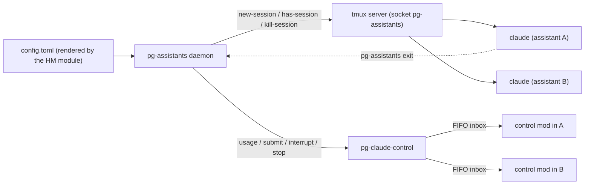

# pg-assistants: a minimal supervisor for permanent Claude Code assistants

Status: DRAFT for operator review (2026-11-16).

## Intent

The operator wants a few "permanent" assistants, each looking after one area on its own. A permanent
assistant is a chain of ordinary interactive Claude Code sessions in one working directory: each
session works, keeps its own notes in that directory, and exits before its context fills; the next
session picks up from the notes. The framework is two parts and stays small:

1. **A config** listing the assistants and their attributes.
2. **A minimal daemon** that keeps each enabled assistant running and makes each session stop before
   it uses too much context.

Everything else (messaging between assistants, permissions, MCP, self-update) comes later and does
not belong in the daemon.

## Goals

- G1. Start an enabled assistant that is not running, in its own tmux session.
- G2. Stop a running assistant whose config says `enabled = false`.
- G3. Recycle a session through a ladder (nudge, interrupt, kill) as its context fill crosses
  configured fractions of its limit.
- G4. Recycle sessions through the same ladder as the account's 5-hour or 7-day usage block fills
  (nudge to stop at 95%, interrupt at 98%, kill at 100% by default), and start nothing while a
  block is at or above its nudge level, until it resets.
- G5. Let an operator see each assistant's state with one command and attach to any session.
- G6. Isolate assistants from each other inside the daemon: a slow, broken or misconfigured
  assistant MUST NOT delay, block or stop the supervision of any other.

## Non-goals (day 1)

- Per-assistant quota (tokens or dollars per unit of time). Deferred to a follow-up: it needs a
  recorder query over the assistant's working directory plus pa-monitor's price table (see
  "Follow-up: quota").
- Messaging, permissions, MCP configuration, self-update, scheduling, and any knowledge of what an
  assistant does. Identity and duties live in the working directory's `AGENTS.md` / `CLAUDE.md`.

## Anti-goals

- The daemon MUST NOT grow into an orchestrator: no work queue, no task routing, no LLM calls.
- A daemon restart MUST NOT kill the assistants.
- The daemon MUST NOT type into a terminal pane; every action on a session goes through
  `pg-claude-control`.

## Approaches considered

| Approach                                   | Trade-off                                                                                       | Outcome                    |
| ------------------------------------------ | ----------------------------------------------------------------------------------------------- | -------------------------- |
| A. Small Go daemon in `nix-agent-support`  | More code than a script; matches the workspace's daemon pattern and tests cleanly in Go         | **Chosen by the operator** |
| B. Bash script on a launchd timer          | Least code; grace timers and backoff need a state file, per-assistant ticks are awkward         | Rejected                   |
| C. Extend ccmux (external, TypeScript/Bun) | Keep-alive loop exists; foreign runtime, low maturity, the whole ladder still has to be written | Rejected                   |

Prior art (researched 2026-11-16): nothing does the whole job. ccmux is the closest structure (a
heal-every-30-seconds daemon over tmux sessions) but resumes one conversation instead of recycling.
Claude Code's built-in background supervisor (`claude --bg`, `claude respawn`) restarts crashed
sessions but has no config, no tmux, no context recycling, and stops idle sessions after about an
hour, which works against a permanent assistant. ccpool (this repo) is NOT used.

## Design

### Components



- `pg-assistants` (new Go package `packages/pg-assistants`): subcommands `daemon`, `status`,
  `config check` and `exit`.
- `pg-claude-control` (existing): gains a `usage` verb, command side and mod side.
- tmux: one dedicated server (`tmux -L pg-assistants`), one session per assistant, named by its
  `id`. The operator attaches with `tmux -L pg-assistants attach -t <id>`. (A tmux "session group"
  is NOT used: grouped sessions share one window set, which is the opposite of what is wanted.)
- launchd (darwin): a per-user keep-alive agent registered by the HM module, with
  `AbandonProcessGroup = true` so that stopping or restarting the daemon does not take the tmux
  server and the assistants with it.

### Config

TOML, rendered by `home/programs/pg-assistants` and checked at build time with
`pg-assistants config check`.

```toml
tick = "1m"                   # global default, Go duration

[grace]                       # time-based steps (see "Ladders")
interrupt = "5m"              # nudge -> interrupt, for every ladder
kill = "2m"                   # interrupt -> kill, for every ladder

[blocks]                      # fractions of the account's 5-hour or 7-day block
nudge = 0.95                  # nudge every running session to stop; hold new starts
interrupt = 0.98
kill = 1.00
unknown_reset_hold = "1h"     # hold when a block is held but reports no reset time

[restart]
min_uptime = "1m"             # a session that dies sooner counts as a crash
backoff_initial = "1m"
backoff_max = "30m"

[paths]                       # absolute paths, rendered by the HM module
tmux = "/nix/store/.../bin/tmux"
claude = "/nix/store/.../bin/claude"
pg_claude_control = "/nix/store/.../bin/pg-claude-control"
shell = "/bin/zsh"            # the operator's login shell
state_dir = "/Users/<user>/.local/state/pg-assistants"

[[assistant]]
id = "inbox-keeper"           # unique; [a-z0-9-]+; tmux session name
name = "Inbox Keeper"         # claude --name
enabled = true
model = "claude-sonnet-5-5"   # claude --model
effort = "medium"             # claude --effort
cwd = "/abs/path"             # MUST exist; one assistant per directory
prompt = "Resume your duties per AGENTS.md."   # first message
tick = "30s"                  # optional override
env = { FOO = "bar" }         # optional extra session environment

[assistant.context]
limit = 200000                # tokens
nudge = 0.80
interrupt = 0.95
kill = 1.00                   # MAY exceed 1.0
```

Validation rules (each failure names its field):

- ids unique and `[a-z0-9-]+`; `cwd` absolute and unique across assistants.
- `effort` is one of `low`, `medium`, `high`, `xhigh`, `max`; `prompt` is non-empty and does not
  start with `-` (it is claude's last positional argument).
- `0 < nudge < interrupt <= kill`, for `[assistant.context]` and for `[blocks]`.
- `limit * kill` MUST be below the model's context window. With auto-compact off a full session
  fails with "prompt is too long" instead of compacting, so a kill point at or past the window can
  never trigger. The window comes from a table of exact model ids in the package (seeded from
  pa-monitor's `internal/core/models/windows.go`, without its family fallback, which over-sizes
  unknown models and so would accept an unreachable kill point); an unknown model is an error unless
  `context.window` is set explicitly. At runtime the daemon also derives the live window as
  `tokens * 100 / percent` and logs `window_mismatch` when it disagrees.
- Durations parse as Go durations and are positive.
- Whether `cwd` exists is NOT a config error: the build sandbox cannot see it. The daemon checks it
  before each start (see "Reconcile loop").

Where the rules apply:

- **Build time (`config check`) is strict.** Any failure fails the build, so a bad config is caught
  before it is ever deployed.
- **The daemon is isolated per assistant (G6).** An assistant with any failing rule is not started
  and shows `config error: <field>: <msg>` in `status`; every other assistant runs. A failing
  global field (`tick`, `[grace]`, `[blocks]`, `[restart]`) falls back to its default and is logged
  as a `config_problem` event. Only a file that cannot be read or parsed, or an invalid `[paths]`
  entry, stops the daemon, because then no assistant could run at all.

### Launch

For an assistant to start, the daemon runs (argv form; the only shell is the login shell shown):

```text
tmux -L pg-assistants -f /dev/null new-session -d -s <id> -c <cwd> \
  -e DISABLE_AUTO_COMPACT=1 -e PG_ASSISTANT_ID=<id> -e PG_ASSISTANTS_STATE_DIR=<state dir> \
  -e CLAUDECODE= -e CLAUDE_CODE_CHILD_SESSION= -e CLAUDE_CODE_ENTRYPOINT= \
  -e CLAUDE_CODE_SESSION_ID= -e CLAUDE_CODE_EXECPATH= [-e K=V ...] -- \
  <paths.shell> -l -i -c 'exec "$@"' <paths.shell> \
  <paths.claude> --session-id <fresh uuid> --name <name> --model <model> --effort <effort> \
  --allowed-tools 'Bash(pg-assistants exit)' <prompt>
```

- **The session gets the operator's own shell environment (operator ruling, 2026-11-16: "the agents
  should start up using the same bash PATH as i would have, no additional restrictions").** Claude
  starts under launchd and tmux, which pass only a bare environment. Running it through the
  operator's login shell as an interactive login shell (`-l -i`) loads the same startup files an
  interactive terminal does, so the session gets the same `PATH` and every `home.sessionVariables`
  entry (`CLAUDE_CODE_TMPDIR`, `PG_CLAUDE_CONTROL_*`, any `CLAUDE_CONFIG_DIR`, auth or OTel
  variables). The environment is not filtered or restricted; restrictions may come later. `exec`
  keeps the pane pid equal to the claude pid.
- `DISABLE_AUTO_COMPACT=1` turns auto-compact off for that session only (Claude Code env-vars docs).
- The five `CLAUDE*` markers are blanked, as ccpool does, so a session never mistakes itself for a
  child of another Claude.
- **The control mod is not loaded with `--plugin-dir`.** The pg-claude-control plugin is
  default-enabled through the marketplace; the module asserts `pg-claude-control.enable` instead,
  so the plugin loads once.
- **`pg-assistants exit` is pre-allowed** with `--allowed-tools` (the flag ccpool already passes),
  because nobody is attached to answer a permission prompt. This only adds an allowance; it
  restricts nothing. All other permissions come from the operator's normal settings.
- **`-f /dev/null`** keeps the operator's tmux config (plugins, `run-shell`, `remain-on-exit`) out
  of the assistants' server.
- `claude` is the pane's own process, so the tmux session ends when claude exits. "Running" means
  `tmux has-session -t =<id>` succeeds AND `display -p -t =<id> '#{pane_dead}'` is not `1` (the
  order matters: `display` falls back to another session when the target is gone; ccpool's
  `internal/tmux` does the same). A session that exists with a dead pane is killed before a new
  start, or `new-session` would fail as a duplicate.
- The daemon targets the session as `pid:<pane pid>` (read with
  `tmux display -p -t =<id> '#{pane_pid}'`), which survives `/clear` changing the session id.
- **Folder trust.** An untrusted `cwd` stops claude on the trust dialog before any hook runs, so the
  control mod never loads. The HM module pre-trusts every assistant `cwd` at activation, the same
  best-effort `.projects[<cwd>].hasTrustDialogAccepted` write ccpool's module makes
  (`home/programs/ccpool/default.nix`).

### Reconcile loop

Each assistant has its own timer at its `tick`. On each tick:

1. **Not running, enabled:** start it unless (a) a block is at or above `blocks.nudge` and its
   reset time has not passed, or (b) it is in restart backoff. After a requested exit the next
   session starts on the next tick (operator ruling, 2026-11-16: "restart on next tick. if a
   particular agent can't handle on its own to poll or wait, then the config for it could use a
   different timer interval"). A missing `cwd` is a `start_failed` event with backoff, not a daemon
   error.
   Uptime is the last time the session was seen alive minus its start time (a session never seen
   alive has uptime 0, so a crash before the first tick counts). An uptime under `min_uptime` that
   did not end in a requested exit doubles the backoff (from `backoff_initial` up to
   `backoff_max`); a longer one resets it.
2. **Running, disabled:** run the disabled ladder.
3. **Running, enabled:** read `pg-claude-control usage pid:<pane pid> --json`, record the 5-hour
   and 7-day readings, and run the ladder over the context and block meters.
4. **Exit requested:** if the assistant ran `pg-assistants exit` (see below), the daemon runs
   `pg-claude-control stop --escalate <grace.kill>` on it (interrupt, `/exit`, then SIGTERM if it
   is still alive at the deadline). The call blocks only that assistant's own loop.

The daemon keeps ladder state in memory. After a daemon restart it rediscovers running sessions from
tmux and starts every ladder from the beginning, so a session may be nudged twice; that is
acceptable.

### Ladders

Each session has one ladder. A rung fires once per session and the ladder only moves up. A rung
counts as fired even when its action fails (a failed nudge is logged, and the next rung still
follows on time). Priority: an exit request, then `enabled = false`, then the meters.

A **meter** is a fraction with its own nudge, interrupt and kill points. A session has up to three:
context (`tokens / limit` with `[assistant.context]`'s points) and the 5-hour and 7-day blocks
(`percentUsed / 100` with `[blocks]`'s points). The ladder's target rung is the highest rung any
meter reaches.

| Ladder   | Nudge                        | Interrupt                                                          | Kill                                                         |
| -------- | ---------------------------- | ------------------------------------------------------------------ | ------------------------------------------------------------ |
| Meters   | any meter >= its `nudge`     | any meter >= its `interrupt`, OR `grace.interrupt` after the nudge | any meter >= its `kill`, OR `grace.kill` after the interrupt |
| Disabled | on the first tick it is seen | `grace.interrupt` after the nudge                                  | `grace.kill` after the interrupt                             |

- **Both time fallbacks exist because a meter may stop growing.** Context only grows during a turn,
  so a nudged or interrupted assistant that ends its turn without running `pg-assistants exit`
  would otherwise stay on that rung forever.
- **An idle session that was never nudged is left alone.** It costs nothing while it waits.
- **Nudge:** `pg-claude-control submit` a message asking the assistant to finish its current step,
  write its notes, run `pg-assistants exit`, and end its turn. The message names the reason and the
  numbers (for example "context is at 81% of your 200k limit" or "the account's 5-hour block is at
  95%").
- **Interrupt:** `pg-claude-control interrupt`, then submit "Stop now: write your notes, run
  `pg-assistants exit`, and end your turn."
- **Kill:** `pg-claude-control stop --signal` (SIGTERM at once). If the session is still running on
  the next tick, `tmux kill-session -t =<id>`, repeated each tick until the session is gone.
  (`stop` never sends SIGKILL and does not wait after its SIGTERM.)
- When `usage` fails (no control mod, busy inbox), the daemon logs it and skips the context ladder
  for that tick; the time rules, the disabled ladder and exit requests still work through
  `tmux kill-session`. When `usage` keeps failing with `no_control_mod` for three ticks after a
  start, `status` shows the hint "control mod not loaded (trust dialog? plugin disabled?)".

### Self-exit: `pg-assistants exit`

A Claude session cannot type `/exit` into itself. An assistant asks to stop by running
`pg-assistants exit` from its Bash tool. The command reads `PG_ASSISTANT_ID` and
`PG_ASSISTANTS_STATE_DIR` from its environment (both set at launch) and writes
`<state dir>/exit-requests/<id>`. Before starting a session the daemon deletes any leftover request
for that id. On its next tick the daemon sees the
file, deletes it, and stops the session as in step 4. A request for a session that has already ended
is discarded. Each assistant's `AGENTS.md` tells it to do this when nudged or when its work is done,
and never to wait for input, because nobody is attached. The HM module installs `pg-assistants`
on the per-user profile so the command is on the session's `PATH`. An id that does not match
`[a-z0-9-]+` is refused (it becomes part of a file path).

### Account blocks

- The readings come from the `usage` verb of any running assistant (all sessions share one
  account). The daemon keeps the latest reading and reset time per block in memory.
- A reading outside 0 to 100 percent is dropped (pgd has seen epoch-sized bogus values).
- Every running session's ladder includes the block meters (see "Ladders"), so at 95% every
  session is nudged to stop, at 98% interrupted, and at 100% killed.
- While a block is at or above `blocks.nudge` the daemon starts nothing until that block's reset
  time passes; otherwise a session nudged to stop would be restarted on the next tick into the same
  full block. A held reading with no reset time holds starts for `blocks.unknown_reset_hold`
  (default 1h). With no reading yet (no assistant has run since the daemon started) the daemon
  starts assistants normally.
- A reading whose reset time has passed is discarded.

### Isolation and cancellation (G6)

- **One goroutine per assistant.** Each assistant's loop owns its ladder, backoff and session
  state, and makes every tmux and `pg-claude-control` call for that assistant itself. No loop ever
  waits on another loop or on another assistant's call. A blocking call (a graceful stop takes up to
  `grace.kill + 15s`) delays only its own assistant.
- **Shared state is small and never held across I/O.** The block tracker and the status board are
  mutex-guarded in-memory values; the lock covers only a read or write of memory. The status file
  is written by its own heartbeat goroutine, and the events log by a concurrency-safe logger.
- **A panic in one loop is contained.** The loop's goroutine recovers it, logs a `loop_panic`
  event with the stack, and restarts that loop after the restart backoff; the other loops never
  see it.
- **Context is the only cancellation path.** The daemon's root context comes from `x/lifecycle`
  (SIGTERM or SIGINT cancels it). Each loop derives its own context from the root; each tick
  derives a tick context from the loop's; each external call gets its own `context.WithTimeout`
  from the tick context and the matching `cmdrun.Call.Timeout`, so cancellation and timeouts
  behave the same everywhere. Defaults: tmux calls 10 s, `usage`/`submit`/`interrupt`/`stop
--signal` 15 s, a graceful stop `grace.kill + 15s`. No function creates a fresh
  `context.Background()` below `main`. On shutdown every in-flight call is cancelled and every loop
  returns within the shutdown deadline; tmux sessions are left running.
- **Mechanical guards.** The module is added to the repo's golangci lint lists, which enable
  `noctx` (no non-context `os/exec` forms) and `contextcheck` (no fresh context where one was passed
  in) (`.golangci.yml`), and one `cmdruntest.AssertCallsBounded` test fails any `cmdrun.Call`
  without a timeout.

### `pg-claude-control usage`

New verb, both halves:

- Mod: on `usage`, call `$.session.usage()` and write the JSON answer to the request's reply path:
  `{context: {percent, tokens}, rateLimits: [{kind, percentUsed, resetsAt}], cost: {usd}}`, fields
  absent when the engine has none.
- Command: `pg-claude-control usage <target> [--json] [--timeout <d>]` writes the request with a
  reply path and prints the answer. It uses the existing exit codes (`no_control_mod`,
  `no_such_process`, `no_reply`, `mod_not_accepting`).

The context figure is current while the session is idle, because context only changes during a turn.

### Status and observability

- The daemon writes `<state dir>/status.json` at the end of every tick: per assistant `id`,
  `enabled`, `running`, `pid`, `session_id`, `started_at`, `context_tokens`, `context_fraction`,
  `ladder` and `rung`, `backoff_until`, and the latest block readings.
- A separate heartbeat rewrites `status.json` every 15 seconds, so a loop blocked in a graceful
  stop does not make the file look stale.
- `pg-assistants status [--json]` prints that file as a table (or raw JSON), and warns when the file
  is older than one minute (the daemon is probably down).
- The daemon logs one JSON line per action (start, nudge, interrupt, kill, exit, error) to
  `<state dir>/events.jsonl`, with a size cap.
- State dir: `paths.state_dir`, rendered by the HM module (default
  `${config.xdg.stateHome}/pg-assistants`), created mode 0700 before any file in it. It is in the
  config so the daemon (under launchd's bare environment) and `status` (in the operator's shell)
  agree on it. launchd's own stdout and stderr files live outside it, as pg-keep-awake does.
- pprof follows the workspace Go daemon convention (`phillipg-nix-repo-base` `docs/go-daemons.md`):
  a `pprof.enable` option (default true) and `x/pprofserver`.
- No metrics, Grafana dashboard or alert rules on day 1; the events log is the record. Wiring it into
  the observability stack is a follow-up.

### Packaging and platforms

- Go module built with `mkGoApp`, following the repo's package conventions (versioning rule, tldr
  page, completions, go-tests check).
- `home/programs/pg-assistants`: options for the whole config, `enable`, `package`; renders
  `config.toml`, runs `config check` at build time, and registers the launchd agent through
  `phillipgreenii.programs.launchdServices.userAgents` as the other HM-scoped agents do. The
  agent's script also runs the daemon through `<paths.shell> -l -c`, so the daemon and every
  `pg-claude-control` call it makes see the operator's session variables (`PG_CLAUDE_CONTROL_*`).
- Linux: no supervisor on day 1 (the module warns), matching the recorder's module.
- ADR 0128 in this repo records the decision (a separate minimal supervisor, not ccpool), so code
  can cite a durable record instead of this spec.

## Constraints

- No ZipRecruiter-specific details anywhere (public repo).
- No bead ids in the repo.
- The daemon depends on `tmux`, `claude` and `pg-claude-control` at runtime, given as absolute store
  paths in the rendered config or the wrapper, never through launchd's `PATH`.

## Follow-up: quota (deferred)

Per-assistant quota as tokens per window or dollars per window, spanning sessions:

- Tokens: one recorder `Query` per assistant per tick over records whose `cwd` is under the
  assistant's directory and whose time is in the window, grouped by model, summing the `usage.*`
  token fields. Caveat: records written after an assistant `cd`s outside its directory escape the
  count.
- Dollars: those per-model tokens times pa-monitor's price table (`internal/core/usage/pricing.go`),
  moved to a shared package or copied.
- See also `docs/superpowers/plans/2026-11-14-usage-totals-recorder-op.md`, which proposes a
  recorder op for usage totals.

## Left to the builder

- Package layout inside `packages/pg-assistants`, the exact nudge wording, the status table layout.
- Whether `exit` requests are noticed on the next tick or through a file watch (tick is enough).
