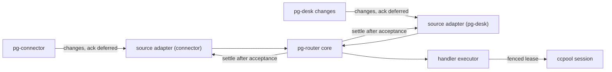

# pg-apps delivery correctness: design (review step 4)

- **Status**: Proposed. Agent-drafted for decomposition; the operator rulings quoted in section 2 bound it.
- **Date**: 2026-11-17 (revision 2, 2026-11-18).
- **Revision**: 2. Adds section 7, the seam register, which decides the interface seams that revision 1 left open (the
  first decomposition was refused by its cold-read for exactly that gap). Sections 1 to 6 are unchanged except that the
  decisions D-2 to D-4, D-6 to D-9 and D-11 are now completed by their seam decisions in section 7.
- **Source**: the 2026-11-11 pg-apps deep review (`deep-review-2026-11-11-pg-apps/`, README "A workable order for the
  larger work", delivery-correctness step), findings CR-01, DR-01, DR-02, RR-05, RR-07, XO-01 and XO-11. (The
  workspace-level review numbers its delivery-correctness step 4 in the README list; the tracking item calls it step 5.)
- **Scope**: the packages `pg-desk`, `pg-router`, `pg-router-handlers`, `pg-router-source-pg-desk` and
  `pg-router-source-pg-connector` of this repository.

The key words MUST, MUST NOT, SHOULD, SHOULD NOT and MAY are to be read as in RFC 2119.

## 1. Pre-checks (run 2026-11-17 against the tree this design was drafted from)

1. **Shared foundations are landed.** `x/lifecycle` exists on `x` main (`lifecycle.go`, with provider hooks and
   per-phase durations); `x/cmdrun` has `Call.TermGrace` (the SIGTERM-before-SIGKILL grace, commit "cmdrun: opt-in
   SIGTERM grace before SIGKILL on cancel"); `pg-router` `run` imports `x/lifecycle` (`cmd/pg-router/run.go`,
   `shutdown_budget.go`). The three closed beads that delivered them record the landed patch-ids. Packets here may
   therefore assume a shared run group and a cancel grace.
2. **Findings re-verified on current main.** Each finding's central claim still holds:

   | Finding | Re-check on this tree                                                                                                                                                                                                                                                                                                                     |
   | ------- | ----------------------------------------------------------------------------------------------------------------------------------------------------------------------------------------------------------------------------------------------------------------------------------------------------------------------------------------- |
   | CR-01   | `pg-connector changes` acknowledges after its answer is flushed unless `--no-ack` is passed (`cmd/pg-connector/changes.go`, `changes_forward.go`). The `--no-ack` flag and the `changes-ack` verb now exist, which closes the ledger-path half of the finding. The `pg-router-source-pg-connector` adapter still never passes `--no-ack`. |
   | DR-02   | `Engine.deliver` in `packages/pg-desk/internal/changes/changes.go` still writes the envelope and then advances the cursor; no deferred acknowledgement exists for the pg-router source.                                                                                                                                                   |
   | DR-01   | `finishEntityChange` (`internal/pipeline/entity_change.go`) still writes the propagation records, the interpretation and the derived links in separate steps after the entity commit.                                                                                                                                                     |
   | RR-07   | A handler error settles the event; the retry count is the in-memory `retryLedger` (`internal/orchestrator/retry.go`); no terminal failed record exists.                                                                                                                                                                                   |
   | RR-05   | `internal/executor/lease.go` refreshes a lease with no owner id or generation; ADR 0085 still mandates redelivery to a fresh adapter.                                                                                                                                                                                                     |
   | XO-01   | `dispatch_records.go` in the handler executor carries no router event id or dispatch id.                                                                                                                                                                                                                                                  |
   | XO-11   | No metric exists for events re-offered after shutdown, supervisors per session, or ingest attempts.                                                                                                                                                                                                                                       |

3. **The ack-on-emit ruling behind CR-01.** The test
   `TestChanges_NeverPassesNoAck_CursorAdvancesAtEmitSoExpiredEventsAreNotReplayed` and the adapter behavior README
   line "Cursor advance is at emit, not at accept" record the ruling of 2026-10-30 that an unaccepted event is not
   replayed. That ruling is already superseded in direction: Phillip, 2026-11-04, human triage, verbatim: "operator
   concern (2026-10-29) that missing events is a big deal favours (b), which closes both loss paths, with at-least-once
   duplicates absorbed by INV-EVT-3 dedup." A complete design for it exists,
   `docs/superpowers/specs/2026-11-11-pg-router-source-ack-after-accept-design.md`, in status Proposed and awaiting
   operator approval; its own decomposition is held until that approval. **This design therefore files no packet for the
   pg-connector adapter hop of CR-01 and does not reverse the ruling; it depends on that design** (section 4.1).

## 2. Operator rulings that bound this design

- Phillip, 2026-11-17, on the handler Supervisor daemon (RR-05): "(a) one long-lived handler daemon." This design
  records that as the end state and plans only the interim fence of section 4.5. The daemon's own design is a separate,
  later piece of work and is not planned here.
- Phillip, 2026-11-17, on pause semantics (RR-08): "(b) keep discarding events during a pause and say so", with the
  reason, verbatim, "TTL is higher priority than gate". Nothing here changes the gate; the pause documentation fix
  (saying so) is outside this design.
- Phillip, 2026-11-04 (CR-01), quoted in section 1.

## 3. Shape of the work

Patterns used: Idempotent Consumer with explicit acknowledgement (DR-02), Unit of Work (DR-01), Write-Ahead Log entry
and Dead Letter Channel (RR-07), Fencing Token (RR-05), Correlation Identifier (XO-01).

## 4. Decisions

### 4.1 Explicit acknowledgement at both source hops (CR-01, DR-02)

- **D-1 (pg-connector hop)**: owned entirely by the ack-after-accept design named in section 1. This design adds a
  dependency edge to it, not a copy.
- **D-2 (pg-desk hop)**: `pg-desk changes` MUST support a deferred acknowledgement mirroring pg-connector's contract:
  with `--no-ack` the cursor is not advanced when the envelope is written, and a `changes-ack` verb advances the
  consumer cursor to a given sequence, never past the highest sequence it delivered and never backward. Item ids already
  carry the sequence, so redelivery is idempotent. The review's "acknowledge on the next poll" shortcut is rejected: a
  one-shot adapter holds no state between polls, so it cannot name the last sequence it handed over, and an implicit ack
  on the next poll would acknowledge a batch the adapter failed to deliver. The exact contract is section 7.1.
- **D-3 (adapter hop, pg-desk)**: `pg-router-source-pg-desk` adopts the lane and token settlement of the
  ack-after-accept design, as a second cursor-feed source. It is therefore blocked by that design's core and adapter
  packets, and its packet states this edge. Until that lands the pg-desk side of D-2 ships dormant (nothing calls it with
  `--no-ack`), so the cursor behavior is unchanged.

### 4.2 One Unit of Work for pg-desk post-commit steps (DR-01)

- **D-4**: the propagation records, the interpretation row and the derived links MUST commit in the same transaction as
  the entity, its change-log row and the feed marker, so a failure leaves either all of them or none, and a redelivered
  row is reprocessed because the marker did not advance. The first step is a fault-injection test at the existing seam
  (`beforeFinish`, `appendLocalRecords`) that fails each post-commit step and asserts the next poll repairs the row.
  The alternative (a "finish pending" outbox row) is used only if the store layer cannot nest the optimistic-concurrency
  write of `commitCAS` in a caller's transaction; the packet reports `stuck` and names the question rather than choosing.

### 4.3 Persisted retry count and a dead-letter record (RR-07)

- **D-5**: persisting the retry count is the decision of ADR 0121 (Proposed, awaiting ratification), already carried by an
  existing implementation bead. This design adds nothing to it and depends on its ratification.
- **D-6**: when a dispatch ends terminally failed (deterministic failure, retries spent, or window closed), the core MUST
  append one durable `failed` record to the queue log (same Write-Ahead Log, replayed on start, dropped on eviction and
  compaction as the event is), and a read-only verb `pg-router dead-letters [--json]` MUST list the records still held.
  The record carries the event id, role, failure class, attempt count and failure time. It is not a redrive: ADR 0121's
  redrive (D2/D3 there) stays its own decision.

### 4.4 Correlation identifier (XO-01)

- **D-7**: the router event id and dispatch id MUST appear in (a) the router's own row, (b) the handler's dispatch start
  and end records, (c) the ccpool session label the recorder can index, and (d) the handler payload environment as
  `PG_ROUTER_EVENT_ID` and `PG_ROUTER_DISPATCH_ID`. OpenTelemetry trace-context propagation (`TRACEPARENT`) is NOT part
  of this design: the router installs no tracer, so that belongs to the shared observability work of review step 3.

### 4.5 Idempotency and fencing for restart-stacked supervisors (RR-05)

- **D-8**: the ccpool session lease MUST carry an owner id and a monotonically increasing generation. A dispatch that
  absorbs a live session (the redelivery path of ADR 0085) takes over by incrementing the generation; the newest
  dispatch wins, matching ADR 0085's rule that the new daemon's reply is the one accepted. A superseded adapter
  MUST notice the higher generation on its next refresh and stop without terminal actions (no session close, no worktree
  removal, no reminder paste).
- **D-9**: the watchdog's reminder level latch MUST persist per session (in the lease record), so a restart past the
  reminder threshold does not paste the reminder again.
- **D-10**: this fence is the interim fix. The end state is the single long-lived handler daemon ruled on 2026-11-17;
  its design is out of scope and these packets MUST NOT take a step toward it beyond the fence.

### 4.6 Signals for unobserved failure modes (XO-11)

- **D-11**: add counters `pg_router_events_reoffered_after_shutdown_total` and `pg_router_supervisors_per_session`
  (gauge, high-water per live session), and a pg-desk ingest attempts-per-entry measure, each named by the existing
  naming convention of its package. Alert on the re-offered counter and on supervisors per session above one, in the
  existing alerting rules file with rule tests as the neighbours have. The signals for CR-01 and DR-02 belong to the
  ack-after-accept design's own metrics, not here.

## 5. Packet list (for decomposition)

| #   | Packet                                                                                           | Size | Depends on                                   |
| --- | ------------------------------------------------------------------------------------------------ | ---- | -------------------------------------------- |
| 1   | pg-desk `changes`: deferred cursor advance (`--no-ack`, `changes-ack`) with contract tests (D-2) | M    | none                                         |
| 2   | `pg-router-source-pg-desk`: adopt lane/token settlement (D-3)                                    | M    | 1; ack-after-accept core and adapter packets |
| 3   | pg-desk Unit of Work for post-commit steps, fault-injection test first (D-4)                     | M    | none                                         |
| 4   | pg-router: terminal `failed` record and `pg-router dead-letters` verb (D-6)                      | M    | persisted retry count; ADR 0121 ratification |
| 5   | Executor lease owner id and generation, superseded adapter stops silently (D-8)                  | M    | none                                         |
| 6   | Persist the watchdog reminder latch in the lease (D-9)                                           | S    | 5                                            |
| 7   | Dispatch id and event id in the router row and handler start/end records (D-7 a, b)              | M    | none                                         |
| 8   | Ccpool session label and payload environment ids (D-7 c, d)                                      | S    | 7                                            |
| 9   | Router signals and alerts: re-offered after shutdown, supervisors per session (D-11)             | M    | 5                                            |
| 10  | pg-desk ingest attempts-per-entry measure (D-11)                                                 | S    | none                                         |

## 6. Risks and open dependencies

- Packet 2 and the pg-connector hop wait on operator approval of the ack-after-accept design; this design does not
  accelerate or change it.
- Packet 4 waits on ADR 0121 ratification and its persisted-count implementation; if the operator overturns 0121, the
  dead-letter record is re-specified against the replacement.
- Packet 3 may hit the nested-transaction limit named in D-4.
- Not covered, already tracked elsewhere: the redelivery busy-guard and failed-ingest retry by error class.

## 7. Seam register (revision 2)

Revision 1 stated decisions D-1 to D-11 but not the interface seams the packets consume, so a reader of one packet could
not tell what its neighbours produce. This section decides each seam from the code on the tree of section 1 and from the
review report's findings. A choice listed here is binding; a choice not listed (Go identifiers, file and test names,
private structure) stays the implementer's. Where a decision needs a store column or a new reply field, that is named, so
the packet that adds it and the packets that read it agree.

### 7.1 pg-desk deferred acknowledgement and its adapter (packets 1 and 2; D-2, D-3)

Packet 1 implements S-1 to S-4 (the `pg-desk` side); packet 2 implements S-5 and S-6 (the adapter side). pg-desk itself
prints no `ack` object: only the adapter does.

- **S-1 (verb and flag shape).** `pg-desk changes --no-ack` mirrors `pg-connector changes --no-ack`. `pg-desk <type>
changes-ack --consumer <id> --next-seq <N>` mirrors `pg-connector <type> changes-ack`
  (`packages/pg-connector/cmd/pg-connector/changes_ack.go` and the `INTF-WIRE-ACK-2` entry of
  `packages/pg-connector/docs/behavior/interfaces.md`, the authority for the contract). `--next-seq` is a non-negative
  integer; a non-integer or negative value is refused as a usage error before any store access.
- **S-2 (envelope).** The `changes` envelope gains no field. With `--no-ack` the cursor is not advanced and the envelope's
  `cursor.from` is the unchanged cursor; `cursor.to` is the highest delivered record sequence, which is the position the
  caller acknowledges. `changes-ack` prints one JSON object, `{"consumer", "type", "acked_seq"}`, where `acked_seq` is
  the cursor after the call (MAY exceed the requested value only if the cursor was already past it, never otherwise), and
  a human line under `--output human`, as pg-connector does.
- **S-3 (exit codes).** `changes-ack` exits 0 on success, including a no-op for a value at or below the cursor (a retried
  acknowledgement is harmless); 4 (the shared not-found code) for an unregistered consumer; 2 (the shared usage code)
  for a malformed `--next-seq` or one past the highest delivered sequence; 1 for any other failure. A failure is reported
  and never retried by the verb.
- **S-4 (where the highest delivered sequence lives).** In the `consumer` row, as a new `delivered` column: a `--no-ack`
  emit raises it to the envelope's `cursor.to` (never lowers it), and `changes-ack` refuses a `--next-seq` above it. The
  column is nullable and a missing value reads as the cursor, so existing databases need no backfill. An ordinary
  (acknowledging) call sets it to the larger of its current value and the cursor it just advanced to, so it is never
  lowered. A poll with no records leaves `cursor.to` equal to `cursor.from`, as today. A missing `--consumer` or
  `--next-seq` is a usage error (exit 2), and an unregistered consumer (exit 4) is checked before the upper bound (exit 2).
  The valid types are `pr`, `issue` and `thread`.
- **S-5 (settlement vocabulary of the adapter).** Following the lane and token terms of the ack-after-accept design
  (`docs/superpowers/specs/2026-11-11-pg-router-source-ack-after-accept-design.md`, its sections 4 and 5): the lane of
  every item is the entity type of the poll (`pr`, `issue` or `thread`), because the cursor key is the pair of consumer
  and type. Each item the adapter prints carries `ack: {"lane": <lane>, "token": <token>}`, the object the ack-after-accept design
  adds to the event shape (both strings; the token is the decimal sequence). `pg-router-source-pg-desk` gains a
  `settle` subcommand with the same arguments as the connector adapter's (`--lane`, `--through`) that runs `pg-desk
<type> changes-ack --consumer <id> --next-seq <N>`; a `--lane` that is not the entity type, or a `--through` that is
  not a non-negative integer, is a usage error (exit 2), and any failure of the `changes-ack` call is a non-zero exit.
  The live check: after a `--no-ack` poll, `pg-desk <type> changes --cached --consumer <id> --json` still lists the
  records; after `settle` through the last token it lists none.
- **S-6 (token rule).** The adapter coalesces records into one item per entity (existing behavior), so a token that is
  simply the item's own sequence would let an acknowledgement pass an earlier record of an entity that is still
  unsettled. The adapter therefore emits the items of a poll ordered by each entity's lowest record sequence and gives
  item k the token (lowest record sequence of item k+1) minus 1, and the last item the envelope's `cursor.to`. Every
  record at or below a token then belongs to an item at or before it. A poll with no records emits nothing and
  acknowledges nothing. The settle form is `settle <type> --consumer <id> --lane <lane> --through <token>` (the type is
  positional; the consumer is required). The adapter's packet MUST prove the rule with a test whose entity has interleaved records.

### 7.2 One Unit of Work (packet 3; D-4)

- **S-7 (entry point and assertions of the fault-injection test).** The test lives in the pipeline package beside the
  existing `beforeFinish` and `appendLocalRecords` seams. The seams fail these steps: `appendLocalRecords` fails the propagation records (the first step); `beforeFinish` fails all three (it runs before the first); the interpretation row and the derived links have no seam, so the packet adds two test-only hooks beside them (nil in production, run just before the interpretation write and just before the derived-link replacement). The three results are read through the store's existing read methods, and the feed marker through its existing read. For each post-commit step (propagation records, interpretation
  row, derived links) it injects one failure on the first `RunEntityChange` of an entity, then calls
  `RunEntityChange` again for the same entity without injection, and asserts that the three results equal those of a
  control entity processed without any injection: same propagation records, same interpretation row, same derived links,
  none duplicated, and the feed marker advanced exactly once. The test is written first and fails on the current code.
- **S-8 (the fallback).** If the store layer cannot nest the compare-and-set write in a caller's transaction, the packet
  reports `stuck` and names that question (D-4); it does not add the outbox row on its own. If, on the unchanged code, the next poll already repairs one of the three steps, the test still covers that step as a regression guard (the "fails first" requirement then holds for the other steps only) and the packet's closeout says which step it was.

### 7.3 Dead letters (packet 4; D-5, D-6)

- **S-9 (record).** One new queue-log record kind, `failed`, appended when `roleListener.Offer` finishes a dispatch
  failed with no re-run (the place that today reports the dispatch as failed). Its fields: `eventId`, `role`, `class`
  (exactly one of `killed`, `deadline`, `unavailable`, `not-ingested` (the four values of the router's transient
  classifier) or `deterministic` for any other handler failure), `attempts` (the 1-based attempt that ended it, the
  count the dispatch result record already carries), `reason` (`deterministic`, `retries-spent` or `window-closed`) and
  `at` (the failure instant, UTC RFC 3339 with seconds). The reason is chosen in this order: a `deterministic` class is
  always reason `deterministic`; otherwise `window-closed` when the event had expired at the failure instant (the queue's
  own `Expired` test: the instant is not before the event's `expiresAt`, so equality counts as expired; no re-run was
  allowed); otherwise `retries-spent`, which also covers a role that did not opt in to retries (zero retries
  allowed, zero spent). Every transient class can therefore produce a record. An event that expires while queued and is never dispatched
  produces no `failed` record (no dispatch ended failed); the queue evicts it as expired, as today. The record's envelope is that of the
  other later kinds: a JSON line whose `op` is `failed`. Replay, compaction and eviction treat it as they treat the event's other
  records: kept while the event is held, dropped with it; a binary that does not know the kind ignores it, like the other
  later kinds.
- **S-10 (verb).** `pg-router dead-letters [--json]` is read-only. It does not take the queue log lock: it replays the
  log file the way a dry-run compaction reads it, ignoring a torn last line, so it works with the daemon running or not.
  Human output is one line per record; `--json` prints one object with a `records` array whose items carry the fields of
  S-9 under the same names. An empty result prints an empty `records` array (or "no dead letters" in human mode) and
  exits 0, and so does a log file that does not exist (a fresh install); an unreadable log exits with the shared unavailable code, and bad arguments with the shared usage code, per
  `docs/adr/0127-pg-router-exit-codes-are-the-shared-workspace-codes.md`. The verb finds the log the way `pg-router log
compact` does (its flags and discovery). The live check: with a throwaway config declaring one command role whose
  handler fails with an invalid-argument error, run `pg-router run-role` against a forced event, then run `pg-router
dead-letters --json` and expect one record of class `deterministic`. The `run-role` form is `pg-router run-role [--json] <role> <json>`
  (the event as a JSON object with the fields a queue event needs, copied from a sample of the role's own query output; "forced" means supplied by hand to `run-role` instead of produced by a query); the config comes from `pg-router config --print-defaults` with one command role added.
  The closed set of `class` values is exactly `killed`, `deadline`, `unavailable`, `not-ingested` and `deterministic`.
- **S-11 (dependency).** The record's `attempts` for a transient failure reads the persisted retry count of the
  ratification-pending decision (D-5). The packet is not claimable until its blocking edges clear (section 5); when it
  is claimed it uses the persisted count, which has landed by then; the in-memory count is not a fallback.

### 7.4 Lease owner and generation, reminder latch (packets 5 and 6; D-8, D-9)

Packet 5 implements S-12 and S-13; packet 6 implements S-14. The live check of packet 5 is a Go test in the
executor package, not the binary: it drives two dispatches of the same event in one process against the fake ccpool of
the handlers' `internal/dtest` helpers (extended to answer a metadata read if it cannot yet) and reads the lease keys
from the metadata calls that fake records. The expected result is the second dispatch at the higher generation and the
first ending with a `superseded` outcome and no recorded close, worktree-removal or reminder-paste call. Packet 6 uses
the same harness.

- **S-12 (lease record).** The lease stays ccpool session metadata, beside the existing lease expiry key, with two new
  keys in the same `pgrouter.` namespace: `pgrouter.lease_owner` and `pgrouter.lease_generation`. The owner id is the
  dispatch id the router minted for the dispatch (the `id` of the handler request); the generation is a decimal
  integer, 1 for the first owner of a session. A session with no generation key, or an unparsable one, reads as
  generation 0 (so the first takeover writes 1), and an absent owner key means no owner. A dispatch that launches a
  new session, rather than absorbing one, writes owner = its dispatch id, generation 1 and `pgrouter.supervisors` 1 in the
  session metadata it already stamps at launch; a takeover then writes generation 2 and up.
- **S-13 (takeover and stop).** A dispatch that absorbs a live session, inside the per-session lock it already takes for
  absorption, reads the current generation, writes owner = its dispatch id and generation + 1, then refreshes the
  expiry. Each refresh first reads the session's metadata; if the generation there is above the one this dispatch owns,
  the dispatch is superseded: it cancels its supervision (wait loop, watchdog, refresher) with a distinct cause and ends
  with a new `superseded` outcome on its end record. It takes no terminal action: no session close, no worktree
  removal, no reminder paste, no failure report. A refresh that cannot read the metadata keeps the existing
  warn-then-error behavior and does not decide either way. The takeover also maintains a third key,
  `pgrouter.supervisors`: when the previous lease expiry is still in the future at the takeover instant it is the
  previous value (1 when absent) plus one (an unparsable previous value reads as 1), otherwise 1; the takeover function returns `(supervisors int, err error)` to its caller (an error aborts the absorption, which then declines as it does today when absorption fails), which reports
  it (7.6). A fresh lease means that expiry is later than the instant of the takeover; an absent or unparsable previous expiry is not fresh (so `supervisors` is 1), never an error. A refresh is a read followed by an expiry write without the per-session lock; a refresh that races a takeover can write the expiry once more, which is harmless because the next refresh reads the higher generation and stops, and a refresh never writes the owner or generation keys. The `superseded` outcome is one
  more value of the end record's existing outcome field. Dispatch cancellation is all packet 5 adds on the reminder
  path: it adds no guard inside the watchdog's paste step (that is 7.4's latch rule), and passes the dispatch's own owner
  id and generation, as recorded at takeover, to the watchdog at construction: packet 5 adds two exported fields to the
  watchdog struct, `OwnerID string` and `Generation int64`, and sets them where it builds the watchdog (the value
  written at takeover, `1` for a fresh launch); packet 6 reads those two fields.
- **S-14 (reminder latch).** The latch is one more key, `pgrouter.reminder_sent`, holding the RFC 3339 instant the
  reminder was pasted. The reminder threshold is the existing budget reminder level of the watchdog (the reminder
  percentage of the handler configuration). Ordering: the watchdog re-reads the lease record immediately before the
  paste and abandons the paste if it was superseded; it pastes, then writes the latch. A crash between the two can
  repeat one reminder, which is harmless; writing first would risk losing it. On start, a watchdog that finds the key
  set to a parsable instant treats the reminder level as already reached (an empty or unparsable value reads as unset).
  If the re-read fails, the watchdog skips the paste for that poll without latching the level and tries again on the next
  poll; if the generation key is absent or unparsable it reads as 0 and so is never superseded. If the latch write fails
  after a paste, the watchdog logs a warning and keeps its in-memory latch, so the process does not repeat the reminder.
  The cancel and hard levels keep their existing in-memory latch.

### 7.5 Correlation identifiers (packets 7 and 8; D-7)

Packet 7 implements S-15 and S-16; packet 8 implements S-17. The live check of packet 7 follows the repository's
pg-router config recipe (a throwaway config with one command role, `pg-router run-role` on a forced event) and reads the
router row from the router's `events.jsonl` and the handler records from the handler's own event log.

- **S-15 (both ids exist; nothing is minted).** The event id is the id of the queue event, already on the handler
  request (`event.id`) and already carried by the handler's dispatch context. The dispatch id is the router's own
  tracking id (`dsp-` followed by twelve hex characters), already minted per offer and sent as the request's `id`. The
  work is to record and forward them, not to create them.
- **S-16 (where each appears).** Router row: the router event-log row written when a dispatch ends (the row `emitResult` writes) gains `event_id` and `dispatch_id`
  fields. Handler records: the dispatch start, end, result and decline records gain the same two fields; the handler
  dispatch context gains a plain exported string field `DispatchID` beside its `EventID` (no method; packet 8 reads the field). An id that is empty is
  omitted from a record, as from the environment. The dispatch id reaches the router row from the handler reply's `id` on success; on the error, busy and decline paths, where there is no reply, `dispatch_id` is omitted from the row (the handler's own records still carry it). This packet spans two projects (the router and the
  handlers) and so carries both project labels; it stays one packet because the two halves are not separately
  reviewable (a record field nobody writes is not a deliverable).
- **S-17 (session label and environment).** The ccpool session label key the recorder can index is
  `pgrouter.dispatch_id` (the event id is already a session metadata key, `pgrouter.event_id`, and is added to the label
  set too); the label is set at launch with the other `pgrouter.` labels. The payload environment gets
  `PG_ROUTER_EVENT_ID` and `PG_ROUTER_DISPATCH_ID` from the shared item-context function, so both the ccpool launch and
  the command handler set them, with an empty value omitted.

### 7.6 Signals (packets 9 and 10; D-11)

Packet 9 implements S-18 to S-20; packet 10 implements S-21.

- **S-18 (re-offered counter).** `pg_router_events_reoffered_after_shutdown_total{role}` is a counter incremented where an
  offer is handed back because the run context was cancelled (the shutdown decline), since such an event is re-offered
  by the next router by construction and the queue records no attempt history to detect it later. A test MUST show the
  increment is visible in the metrics registry (a scrape of the registry) at the point where the run context is
  cancelled and the offer is handed back, which is before the shutdown path flushes and exits; if it is not, the packet reports `stuck` and
  names that question rather than choosing another place. The live check is the existing shutdown re-offer process
  test pattern, extended and behind its integration build tag, so it is not part of the unit gate.
- **S-19 (re-offered alert).** The alert fires when `increase(pg_router_events_reoffered_after_shutdown_total[1h]) >= 3`
  with no `for` delay: one or two are an ordinary restart, three in an hour is a restart loop. Rule tests follow the
  neighbours' layout.
- **S-20 (supervisors per session).** `pg_router_supervisors_per_session{role,session}` is a gauge. The adapter that did a
  takeover returns the integer `supervisors` of 7.4 (and the session is the ccpool session external id it absorbed); the dispatch code reads that returned integer in process and never reads the `pgrouter.supervisors` metadata key back, which exists only for the takeover's own bookkeeping; its dispatch reply carries two new optional
  properties, `session` (the ccpool session's external id, a string) and `supervisors` (that integer, at least 1), and the router sets the gauge from the reply
  at the end of the dispatch. A new optional property keeps older handlers valid. D-11's "high-water per live session" is realized by that integer, which is itself the high-water count of supervisors the session has had; the gauge keeps the value of the latest
  dispatch that ended for that session (last write wins, never removed while the router runs; a reply without the
  properties, with only one of them, with an empty `session`, or with `supervisors` that is not an integer of at least 1
  leaves it unset). The alert fires when the gauge is above 1, with no `for` delay. The `role` label of both new metrics is the role of the offer being dispatched (the same source as the router's existing per-role metrics). A dispatch that ends in error or failure sends `session` and `supervisors` only when a takeover completed before the failure; otherwise it omits them and the gauge is untouched. The takeover returns an
  integer, stored in the session metadata as a decimal string like the generation. The gauge is therefore observed when a dispatch ends, not while it runs; a mid-dispatch heartbeat is not planned.
- **S-21 (ingest attempts measure).** An attempt is one recorded failure of one ingest-failure entry (one call that
  records the same instance, entity and sequence again). The entry gains an `attempts` integer, 1 on first record and
  plus one on each repeat. The measure is the gauge `pg_desk_ingest_attempts_max`: the largest `attempts` over the
  entries still being retried (an entry is flagged when its `FlaggedAt` is set, which the existing code does once the
  failure class is permanent; flagged entries are excluded), 0 when there are none, a single series with no labels,
  fed at scrape time from a store query exposed through a metrics option like the neighbouring `WithIngestFailed`.
  Entries that exist before the column is added read as 1 attempt. If the scrape-time query fails, the series is omitted
  for that scrape and the error is logged; the other series are unaffected. The measure is named like the neighbouring `pg_desk_ingest_*`
  gauges and registered beside them.

### 7.7 Items left to the implementer, recorded

Live-check procedures for packets that wire a scheduled or dispatched consumer need concrete steps, written by the
packet that wires it from the repository's own live-check rule. The worktree path for any live check is supplied by the
consumer of the packet, not fixed here.
