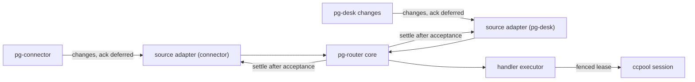

# pg-apps delivery correctness: design (review step 4)

- **Status**: Proposed. Agent-drafted for decomposition; the operator rulings quoted in section 2 bound it.
- **Date**: 2026-11-17.
- **Source**: the 2026-11-11 pg-apps deep review (`deep-review-2026-11-11-pg-apps/`, README "A workable order for the
  larger work", delivery-correctness step), findings CR-01, DR-01, DR-02, RR-05, RR-07, XO-01 and XO-11. (The
  workspace-level review numbers its delivery-correctness step 4 in the README list; the tracking item calls it step 5.)
- **Scope**: the packages `pg-desk`, `pg-router`, `pg-router-handlers`, `pg-router-source-pg-desk` and
  `pg-router-source-pg-connector` of this repository.

The key words MUST, MUST NOT, SHOULD, SHOULD NOT and MAY are to be read as in RFC 2119.

## 1. Pre-checks (run 2026-11-17 against the tree this design was drafted from)

1. **Shared foundations are landed.** `x/lifecycle` exists on `x` main (`lifecycle.go`, with provider hooks and
   per-phase durations); `x/cmdrun` has `Call.TermGrace` (the SIGTERM-before-SIGKILL grace, commit "cmdrun: opt-in
   SIGTERM grace before SIGKILL on cancel"); `pg-router` `run` imports `x/lifecycle` (`cmd/pg-router/run.go`,
   `shutdown_budget.go`). The three closed beads that delivered them record the landed patch-ids. Packets here may
   therefore assume a shared run group and a cancel grace.
2. **Findings re-verified on current main.** Each finding's central claim still holds:

   | Finding | Re-check on this tree                                                                                                                                                                                                                                                                                                                     |
   | ------- | ----------------------------------------------------------------------------------------------------------------------------------------------------------------------------------------------------------------------------------------------------------------------------------------------------------------------------------------- |
   | CR-01   | `pg-connector changes` acknowledges after its answer is flushed unless `--no-ack` is passed (`cmd/pg-connector/changes.go`, `changes_forward.go`). The `--no-ack` flag and the `changes-ack` verb now exist, which closes the ledger-path half of the finding. The `pg-router-source-pg-connector` adapter still never passes `--no-ack`. |
   | DR-02   | `Engine.deliver` in `packages/pg-desk/internal/changes/changes.go` still writes the envelope and then advances the cursor; no deferred acknowledgement exists for the pg-router source.                                                                                                                                                   |
   | DR-01   | `finishEntityChange` (`internal/pipeline/entity_change.go`) still writes the propagation records, the interpretation and the derived links in separate steps after the entity commit.                                                                                                                                                     |
   | RR-07   | A handler error settles the event; the retry count is the in-memory `retryLedger` (`internal/orchestrator/retry.go`); no terminal failed record exists.                                                                                                                                                                                   |
   | RR-05   | `internal/executor/lease.go` refreshes a lease with no owner id or generation; ADR 0085 still mandates redelivery to a fresh adapter.                                                                                                                                                                                                     |
   | XO-01   | `dispatch_records.go` in the handler executor carries no router event id or dispatch id.                                                                                                                                                                                                                                                  |
   | XO-11   | No metric exists for events re-offered after shutdown, supervisors per session, or ingest attempts.                                                                                                                                                                                                                                       |

3. **The ack-on-emit ruling behind CR-01.** The test
   `TestChanges_NeverPassesNoAck_CursorAdvancesAtEmitSoExpiredEventsAreNotReplayed` and the adapter behavior README
   line "Cursor advance is at emit, not at accept" record the ruling of 2026-10-30 that an unaccepted event is not
   replayed. That ruling is already superseded in direction: Phillip, 2026-11-04, human triage, verbatim: "operator
   concern (2026-10-29) that missing events is a big deal favours (b), which closes both loss paths, with at-least-once
   duplicates absorbed by INV-EVT-3 dedup." A complete design for it exists,
   `docs/superpowers/specs/2026-11-11-pg-router-source-ack-after-accept-design.md`, in status Proposed and awaiting
   operator approval; its own decomposition is held until that approval. **This design therefore files no packet for the
   pg-connector adapter hop of CR-01 and does not reverse the ruling; it depends on that design** (section 4.1).

## 2. Operator rulings that bound this design

- Phillip, 2026-11-17, on the handler Supervisor daemon (RR-05): "(a) one long-lived handler daemon." This design
  records that as the end state and plans only the interim fence of section 4.5. The daemon's own design is a separate,
  later piece of work and is not planned here.
- Phillip, 2026-11-17, on pause semantics (RR-08): "(b) keep discarding events during a pause and say so", with the
  reason, verbatim, "TTL is higher priority than gate". Nothing here changes the gate; the pause documentation fix
  (saying so) is outside this design.
- Phillip, 2026-11-04 (CR-01), quoted in section 1.

## 3. Shape of the work

Patterns used: Idempotent Consumer with explicit acknowledgement (DR-02), Unit of Work (DR-01), Write-Ahead Log entry
and Dead Letter Channel (RR-07), Fencing Token (RR-05), Correlation Identifier (XO-01).

## 4. Decisions

### 4.1 Explicit acknowledgement at both source hops (CR-01, DR-02)

- **D-1 (pg-connector hop)**: owned entirely by the ack-after-accept design named in section 1. This design adds a
  dependency edge to it, not a copy.
- **D-2 (pg-desk hop)**: `pg-desk changes` MUST support a deferred acknowledgement mirroring pg-connector's contract:
  with `--no-ack` the cursor is not advanced when the envelope is written, and a `changes-ack` verb advances the
  consumer cursor to a given sequence, never past the highest sequence it delivered and never backward. Item ids already
  carry the sequence, so redelivery is idempotent. The review's "acknowledge on the next poll" shortcut is rejected: a
  one-shot adapter holds no state between polls, so it cannot name the last sequence it handed over, and an implicit ack
  on the next poll would acknowledge a batch the adapter failed to deliver.
- **D-3 (adapter hop, pg-desk)**: `pg-router-source-pg-desk` adopts the lane and token settlement of the
  ack-after-accept design, as a second cursor-feed source. It is therefore blocked by that design's core and adapter
  packets, and its packet states this edge. Until that lands the pg-desk side of D-2 ships dormant (nothing calls it with
  `--no-ack`), so the cursor behavior is unchanged.

### 4.2 One Unit of Work for pg-desk post-commit steps (DR-01)

- **D-4**: the propagation records, the interpretation row and the derived links MUST commit in the same transaction as
  the entity, its change-log row and the feed marker, so a failure leaves either all of them or none, and a redelivered
  row is reprocessed because the marker did not advance. The first step is a fault-injection test at the existing seam
  (`beforeFinish`, `appendLocalRecords`) that fails each post-commit step and asserts the next poll repairs the row.
  The alternative (a "finish pending" outbox row) is used only if the store layer cannot nest the optimistic-concurrency
  write of `commitCAS` in a caller's transaction; the packet reports `stuck` and names the question rather than choosing.

### 4.3 Persisted retry count and a dead-letter record (RR-07)

- **D-5**: persisting the retry count is the decision of ADR 0121 (Proposed, awaiting ratification), already carried by an
  existing implementation bead. This design adds nothing to it and depends on its ratification.
- **D-6**: when a dispatch ends terminally failed (deterministic failure, retries spent, or window closed), the core MUST
  append one durable `failed` record to the queue log (same Write-Ahead Log, replayed on start, dropped on eviction and
  compaction as the event is), and a read-only verb `pg-router dead-letters [--json]` MUST list the records still held.
  The record carries the event id, role, failure class, attempt count and failure time. It is not a redrive: ADR 0121's
  redrive (D2/D3 there) stays its own decision.

### 4.4 Correlation identifier (XO-01)

- **D-7**: the router event id and dispatch id MUST appear in (a) the router's own row, (b) the handler's dispatch start
  and end records, (c) the ccpool session label the recorder can index, and (d) the handler payload environment as
  `PG_ROUTER_EVENT_ID` and `PG_ROUTER_DISPATCH_ID`. OpenTelemetry trace-context propagation (`TRACEPARENT`) is NOT part
  of this design: the router installs no tracer, so that belongs to the shared observability work of review step 3.

### 4.5 Idempotency and fencing for restart-stacked supervisors (RR-05)

- **D-8**: the ccpool session lease MUST carry an owner id and a monotonically increasing generation. A dispatch that
  absorbs a live session (the redelivery path of ADR 0085) takes over by incrementing the generation; the newest
  dispatch wins, matching ADR 0085's rule that the new daemon's reply is the one accepted. A superseded adapter
  MUST notice the higher generation on its next refresh and stop without terminal actions (no session close, no worktree
  removal, no reminder paste).
- **D-9**: the watchdog's reminder level latch MUST persist per session (in the lease record), so a restart past the
  reminder threshold does not paste the reminder again.
- **D-10**: this fence is the interim fix. The end state is the single long-lived handler daemon ruled on 2026-11-17;
  its design is out of scope and these packets MUST NOT take a step toward it beyond the fence.

### 4.6 Signals for unobserved failure modes (XO-11)

- **D-11**: add counters `pg_router_events_reoffered_after_shutdown_total` and `pg_router_supervisors_per_session`
  (gauge, high-water per live session), and a pg-desk ingest attempts-per-entry measure, each named by the existing
  naming convention of its package. Alert on the re-offered counter and on supervisors per session above one, in the
  existing alerting rules file with rule tests as the neighbours have. The signals for CR-01 and DR-02 belong to the
  ack-after-accept design's own metrics, not here.

## 5. Packet list (for decomposition)

| #   | Packet                                                                                           | Size | Depends on                                   |
| --- | ------------------------------------------------------------------------------------------------ | ---- | -------------------------------------------- |
| 1   | pg-desk `changes`: deferred cursor advance (`--no-ack`, `changes-ack`) with contract tests (D-2) | M    | none                                         |
| 2   | `pg-router-source-pg-desk`: adopt lane/token settlement (D-3)                                    | M    | 1; ack-after-accept core and adapter packets |
| 3   | pg-desk Unit of Work for post-commit steps, fault-injection test first (D-4)                     | M    | none                                         |
| 4   | pg-router: terminal `failed` record and `pg-router dead-letters` verb (D-6)                      | M    | persisted retry count; ADR 0121 ratification |
| 5   | Executor lease owner id and generation, superseded adapter stops silently (D-8)                  | M    | none                                         |
| 6   | Persist the watchdog reminder latch in the lease (D-9)                                           | S    | 5                                            |
| 7   | Dispatch id and event id in the router row and handler start/end records (D-7 a, b)              | M    | none                                         |
| 8   | Ccpool session label and payload environment ids (D-7 c, d)                                      | S    | 7                                            |
| 9   | Router signals and alerts: re-offered after shutdown, supervisors per session (D-11)             | M    | 5                                            |
| 10  | pg-desk ingest attempts-per-entry measure (D-11)                                                 | S    | none                                         |

## 6. Risks and open dependencies

- Packet 2 and the pg-connector hop wait on operator approval of the ack-after-accept design; this design does not
  accelerate or change it.
- Packet 4 waits on ADR 0121 ratification and its persisted-count implementation; if the operator overturns 0121, the
  dead-letter record is re-specified against the replacement.
- Packet 3 may hit the nested-transaction limit named in D-4.
- Not covered, already tracked elsewhere: the redelivery busy-guard and failed-ingest retry by error class.
