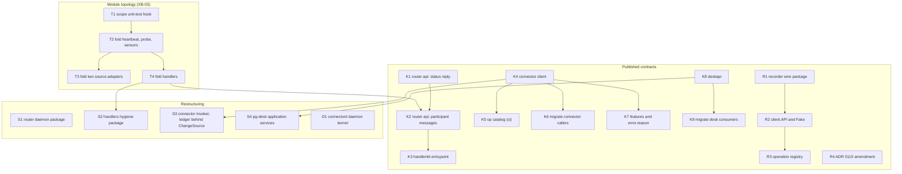
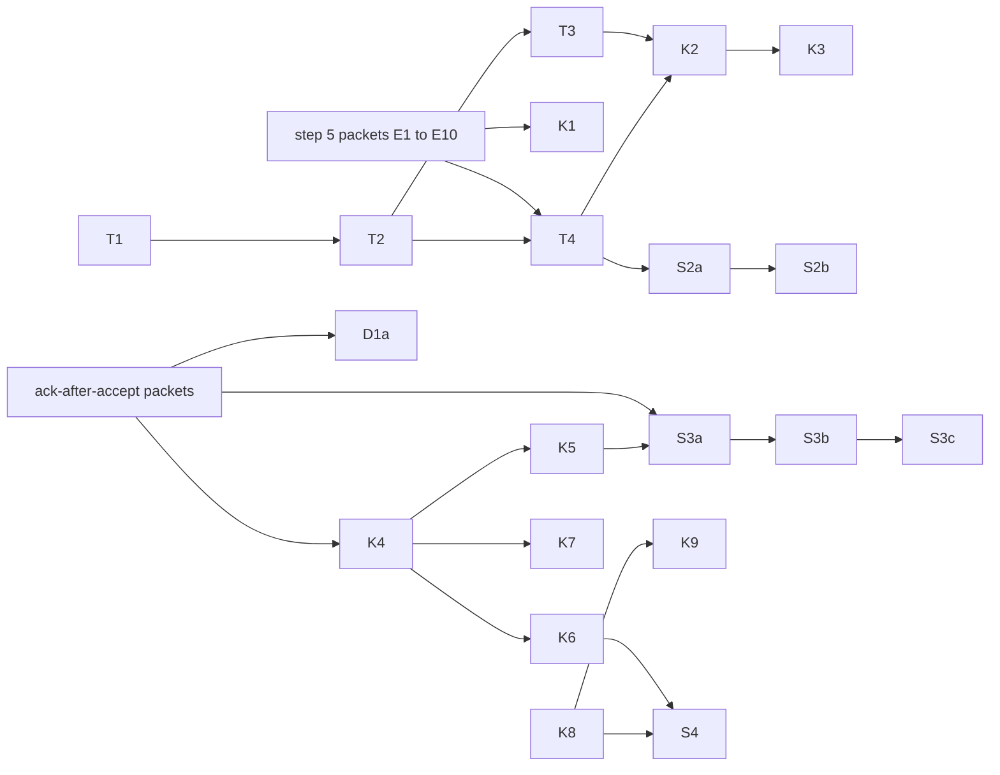

# pg-apps published contracts and restructuring: design (review step 6)

- **Status**: Proposed. Agent-drafted for decomposition; the operator rulings quoted in section 2 bound it.
- **Date**: 2026-11-18.
- **Source**: the 2026-11-11 pg-apps deep review (`deep-review-2026-11-11-pg-apps/`, README "A workable order for the
  larger work", steps 5 "Published contracts" and 6 "Restructuring"), findings RCA-04, RHA-01, CFA-02, CFA-03, CFA-10,
  DA-06, PA-01, DT-03, RCA-01, RHA-03, CFA-01, DA-01, CFA-04, CCA-01 and CR-06, plus the three owner decisions the
  operator ruled on for this step: CFA-06, PA-06 and XB-03. (The tracking item calls this step 6; the report's README
  numbers its two parts 5 and 6.)
- **Scope**: the packages `pg-router`, `pg-router-handlers`, `pg-router-heartbeat`, `pg-router-probe`,
  `pg-router-sensors`, `pg-router-source-pg-connector`, `pg-router-source-pg-desk`, `pg-desk`, `pg-decider` (as a
  consumer), `pg-connector` and `pg-claude-code-recorder` of this repository, plus one packet in `phillipg-nix-repo-base`
  (the unit-test runner).
- **Sequencing**: this design follows the delivery-correctness design,
  `docs/superpowers/specs/2026-11-17-pg-apps-delivery-correctness-design.md` (called "step 5" below; its packets are
  written `E1` to `E10` (E-numbers), numbered as in its section 5). Where a packet here edits the same files as a step-5 packet,
  section 6 orders it after, so no packet is built on a tree the other is about to move.

The key words MUST, MUST NOT, SHOULD, SHOULD NOT and MAY are to be read as in RFC 2119.

## 1. Pre-checks (run 2026-11-18 against the tree this design was drafted from)

Each finding was re-read against the worktree of main at the commit after the step-5 design. Counts below are
re-measured where a number is given; a claim not re-measured says so.

| Finding | Still holds? | What was checked                                                                                                                                                                                                                                                                                                                                                                                                                  |
| ------- | ------------ | --------------------------------------------------------------------------------------------------------------------------------------------------------------------------------------------------------------------------------------------------------------------------------------------------------------------------------------------------------------------------------------------------------------------------------- |
| RCA-04  | Yes          | `SchemaVersion` is a constant in `schemas/schemas.go` and in `internal/wireclient/wireclient.go`, and a struct field in `internal/query/query.go` (line numbers moved). The status reply is still built as `map[string]any` by `composeStatusReply` in `internal/core/core.go` and decoded by three separate structs (`statusReply` in `status_cmd.go`, `doctorStatus` in `doctor.go`, `StatusReply` in `internal/tui/reply.go`). |
| RHA-01  | Yes          | `internal/corecall/corecall.go` still says its types match the core "BYTE-FOR-BYTE ... read from its source rather than imported". `pg-router/conformance` is imported on 45 lines across the handlers' production code. `rawItem` is declared in `internal/query/command.go` (router) and in the `wire.go` of both source satellites.                                                                                            |
| CFA-02  | Yes          | `pkg/provider/ci/dispatch.go` still declares op names as map-key literals with anonymous request structs; `cmd/pg-connector/ci.go` still sends `map[string]string` (lines 324 and 345).                                                                                                                                                                                                                                           |
| CFA-03  | Yes          | `pkg/` holds `connectord`, `eventlog`, `provider`, `schema`, `scriptout` and no client package. `SourceResult` and `FanOutOutcome` are still in `cmd/pg-connector/outcome.go`; the duplicate-by-convention comment is still in `changes.go`. The fan-out outcome has no version field. The "32 files in nine modules" count was not re-measured.                                                                                  |
| CFA-10  | Yes          | `"migrating:"` and `"cursor_expired:"` are still prefix-matched in `pkg/connectord/router/router.go` and `pg-desk/internal/changes/feed.go`; `Vocabulary` is still `map[string]any` in `pkg/scriptout/envelope.go`.                                                                                                                                                                                                               |
| DA-06   | Yes          | There is no `pkg/deskapi`. `pg-desk.view/v1` is still literal in `cmd/pg-desk/show_review.go`, `doctor_focus.go` and `pg-decider/internal/view/view.go`; the router events are still built by hand in `focus_announce.go` (`removalEvent`, `selectionEvent`); `cmd/pg-desk/routerconfig.go` is still 454 lines.                                                                                                                   |
| PA-01   | Yes          | `client/client.go` imports `internal/client`, `internal/config`, `internal/feed`, `internal/query` and `internal/wire`; `go list -deps ./client` still lists packages from `internal/store` and `modernc.org/sqlite` (4 matching lines).                                                                                                                                                                                          |
| DT-03   | Yes          | `client/contract_test.go` still carries the `integration` build tag, with a second tagged suite beside it; the only fake is `clienttest`'s whole in-process daemon. The 0.0% coverage figure was not re-measured.                                                                                                                                                                                                                 |
| RCA-01  | Yes          | `cmd/pg-router/run.go` is now 2,019 lines; `bootCore` is at line 241, `runOneTick` at 1519, `runLongRunningBody` at 1887 (all moved since the review).                                                                                                                                                                                                                                                                            |
| RHA-03  | Yes          | The `cmd/pg-router-handler-ccpool` directory holds 83 files; `InlineSweeps` is still a "transitional" switch whose default is `true` (`internal/config/config.go`, line 502).                                                                                                                                                                                                                                                     |
| CFA-01  | Yes          | `cmd/pg-connector` holds 120 files and about 38,000 lines with tests; `Registry.Invoke` still calls `scriptout.InvokeTarget` directly; `ledger.go`, `ledger_cmd.go` and `ledger_lock.go` are still in `main`; the module has no `internal/` directory. The 273 s test time was not re-measured.                                                                                                                                   |
| DA-01   | Yes          | `cmd/pg-desk-attention` still exists beside `cmd/pg-desk`, and `cmd/pg-desk` has 39 `init()` functions, the review's count.                                                                                                                                                                                                                                                                                                       |
| CFA-04  | Yes          | `serve.go` of the two daemons is 967 and 570 lines; `internal/config/duration.go` and `block.go` are byte-identical in both. `pkg/connectord/rungroup` exists (the shared run group) but no `daemon` package.                                                                                                                                                                                                                     |
| CCA-01  | Yes          | Same evidence as CFA-04; the telemetry drift figures were not re-measured.                                                                                                                                                                                                                                                                                                                                                        |
| CR-06   | Yes          | Same duplication as CFA-04; `goleak` appears only in `go.sum`, never in code (no `goleak` or `synctest` use).                                                                                                                                                                                                                                                                                                                     |

**Dropped and overlap checks.**

1. The shared exit codes and error envelope (XU-03) are already delivered and audited; nothing here replans them. Packets
   below MUST reuse the shared exit-code constants and MUST NOT introduce new ones (decision SD-9 names the one additive
   field).
2. The closed work that routed `cmd/pg-desk`'s direct exec calls through one bounded connector client over `x/cmdrun`
   (landed 2026-11-15) built `internal/connector` (`Run`, `Use`, `ResultError`, `Output`, `Combined`) and the per-call
   bounds in `cmd/pg-desk/connector_bounds.go`. That is the TRANSPORT only: it returns raw bytes and decodes nothing.
   It does not overlap CFA-02 (typed op catalog) or DA-06 (typed contract structs); it is a consumer of the published
   client built here (packet K6 below replaces its raw-byte decode with the typed client, keeping its bounded-call guard
   and its `Use` test seam).
3. The step-5 packets that change a shape this design publishes are named in section 6, so the published type carries the
   field from its first release.

## 2. Operator rulings that bound this design

- Phillip, 2026-11-17, on change detection in pg-connector (CFA-06): "(b) freeze the JSON ledger behind one interface;
  do not retire it now."
- Phillip, 2026-11-17, on the recorder (PA-06): "(a) allow derived facts such as counts and totals, with interpretation
  staying in clients (ruling 14), and amend ADR 0115 accordingly."
- Phillip, 2026-11-17, on module topology (XB-03): "(a) one Go module per family", scope as recommended: "start with
  the router fold only (fold pg-router-handlers, -heartbeat, -probe, -sensors, -source-pg-connector and -source-pg-desk
  into the pg-router module), keep each binary's own cmd and nix package and per-binary source fileset, add a root
  go.work with GOWORK=off in nix and a cross-module go vet, and let this step's design decide the other families after
  the fold. The design must also scope the commit unit-test hook to touched packages and state an import-boundary rule
  for internal/ inside the larger module."
- Phillip, 2026-11-17, on the handler Supervisor daemon (RR-05) and pause semantics (RR-08), recorded in the step-5
  design: this design MUST NOT plan the Supervisor end state or change pause behavior. Nothing here takes a step toward
  either.
- Phillip, 2026-11-04 (explicit acknowledgement at both source hops, quoted in the step-5 design): the ack-after-accept
  design owns the source adapters' settle contract. This design consumes it and never copies it.

## 3. Shape of the work

Patterns used: Published Language (K1 to K9, R1 to R3), Dependency Inversion (R1, S3), Ports and Adapters (S3, S4),
Strategy (the `ChangeSource` of S3), Template Method (K3, D1), Anti-Corruption Layer kept at the edges (the typed
clients), Strangler Fig (callers migrate to a client one at a time; the old private copy is deleted by the same packet
that migrates the last caller).

## 4. Decisions and seams

Every choice listed here is binding; a choice not listed (Go identifiers, file and test names, private structure) stays
the implementer's.

### 4.1 Module topology (XB-03)

- **SD-1 (what folds, and where the sources land).** The module path stays `github.com/phillipgreenii/pg-router` and its
  directory stays `packages/pg-router`. Each folded binary keeps its own `cmd/<binary-name>` directory, moved under
  `packages/pg-router/cmd/`. Every non-`main` package of a folded member moves under
  `packages/pg-router/internal/<member>/...`, where `<member>` is one of `handlers`, `sensors`, `probe`, `heartbeat`,
  `source/connector`, `source/desk`. The subtree is mandatory, not tidy: the router and the handlers each have internal
  packages named `config`, `dtest`, `eventlog`, `item`, `query`, `report`, `roles`, `usage` and `worktree`, so a flat
  move would collide. The two `conformance` trees (router's and handlers') merge into the router's, with the handlers'
  fixtures under a subdirectory named for the member.
- **SD-2 (nix packages stay).** Each folded member keeps its own directory under `packages/` holding only `default.nix`
  (and its README and behavior docs if it has them), its own flake attribute name, and its own `meta`. The package's
  `src` fileset points at `../pg-router`, its `modRoot` is `pg-router`, and its `subPackages` names its own `cmd/`
  directories only. Per-binary versioning stays per-source-digest: the fileset of a member binary MUST be exactly its
  `cmd/<binary>` directories, its `internal/<member>` subtree, and the shared set of SD-3 (rule 2). The router's own
  fileset is everything under `packages/pg-router` except the member `cmd/` directories and `internal/<member>` subtrees,
  so a handler-only edit does not bump the router's `--version`. Each package keeps its Go-tests check name; a check runs
  `go test` over its own subtree (`./cmd/<its binaries>/... ./internal/<member>/...` for a member; the rest for the
  router), so the existing check names and what they gate are unchanged. One `go.mod`, one `go.sum`, one
  `gomod2nix.toml` and one `update-deps.sh` remain, in `packages/pg-router`; the six members' own `go.mod`, `go.sum`,
  `gomod2nix.toml` and `update-deps.sh` files are deleted. The checks that enumerate `packages/*/gomod2nix.toml`
  (`go-deps-wired`, the lint module lists, `update-locks.sh`) MUST be updated in the same packet so a member directory
  without a `go.mod` is not an error and the router module is still covered.
- **SD-3 (import-boundary rule for `internal/` inside the larger module).** Go's `internal/` rule no longer separates
  members once they share a module, so the boundary is a tested rule. It MUST hold at every commit:
  1. A package under `internal/<member>/` and a `cmd/<member binary>` MAY import: the standard library; third-party and
     workspace modules; their own member's subtree; and the shared set of rule 2. They MUST NOT import another member's
     subtree and MUST NOT import a router engine package.
  2. The **shared set** is exactly the packages the folded members import from the router today: `conformance` (with
     `conformance/driver` and `conformance/golden`), `procenv`, `schemas`, and any package under `api/` (decision SD-7).
     Adding a package to the shared set is a deliberate edit to the allowlist file the test reads, reviewed like an
     interface change. The shared set MUST NOT grow to include an engine package.
  3. The **router engine** is every other package of the router (`internal/core`, `internal/eventqueue`,
     `internal/orchestrator`, `internal/tui`, and so on). It MUST NOT import any member subtree or member `cmd/`.
  4. `internal/heartbeat` and `cmd/pg-router-heartbeat` MUST import the standard library only (the heartbeat is the
     out-of-stack dead-man's switch; its independence was a property of its own `go.mod`, and after the fold it is a
     property of this rule alone).
  5. `cmd/` packages MUST NOT be imported by any package.
     The rule is enforced by one unit test in the router module that reads `go list -deps -json ./...` and an allowlist
     file, runs in milliseconds-to-seconds, and fails with the offending import edge. A `depguard` configuration MAY mirror
     it for editor feedback but is not the gate. The same test asserts that each member binary's dependency closure (the
     packages it links) lies within its SD-2 fileset, so the fileset cannot drift from the code.
- **SD-4 (`go.work`, nix, and the cross-module vet).** A `go.work` at the repository root lists every `packages/*/go.mod`
  module, is generated by a script that a check compares against the tracked file (so it cannot drift), and exists for
  the editor and for the vet only. Nix builds and the hook runs set `GOWORK=off`, so a build still resolves through each
  module's own `replace` lines (the `replace` lines in `go.mod` remain the build's truth). A new gate, `go-work-vet`, runs
  `go vet` with the work file active over each module that consumes (by `replace`) a module whose non-test Go files
  changed, plus the changed module itself; it runs under `pg-hooks run pre-land`, not at commit, because it type-checks
  across modules and is not a unit test.
- **SD-5 (the pinned `x` version).** The folded module MUST pin one `x` version and one version of each shared
  third-party module. The unified `x` pin MUST be at least the newest pin among the folded modules and MUST contain the
  `Call.Timeout` and `Call.TermGrace` fields of `x/cmdrun` (an older pin does not). The packet records the chosen pins
  in its commit message and MUST compile every folded binary against them.
- **SD-6 (the commit unit-test hook is scoped to touched packages).** `pg-test-runner --files` resolves a changed file to
  the nearest ancestor project marker and runs the whole project (its own help text, read 2026-11-18); with the fold,
  one touched file would run the whole router module's tests. The hook contract after the change: for a Go project, a
  changed file selects (a) the Go packages that contain a changed `.go` file or `testdata/` file, and (b) every package of
  the same module that imports one of those (reverse dependencies inside the module, computed from `go list`); a changed
  `go.mod`, `go.sum`, embedded file outside a package directory or a `projectExtraPaths` entry still selects the whole
  module. The selection MUST never be smaller than (a) plus (b). Packet T1 implements it in the unit-test runner
  (`phillipg-nix-repo-base`) and this repository's `run-unit-tests` hook wrapper forwards unchanged; because the runner
  lives in another repository, the packet is filed there.
- **SD-7 (other families, decided).** No further fold is made in this step. The criterion is: a module joins a family
  module only if it imports that family's packages through a `replace` line or shares an `internal/` namespace by copy.
  Applied to what this design read: `pg-connector` already ships its twelve binaries from one module;
  `pg-desk` already holds `cmd/pg-desk` and `cmd/pg-desk-attention`; the recorder is one module; `pg-decider` and
  `pg-decider-backfill-pr-metadata` consume pg-desk through its published contract, which is the point of K8 and K9 (a
  fold would hide the contract from its consumer); `ccpool`, `claude-transcript`, `pg-failsig` and `pg-sqlite` are
  libraries imported by several families. The report examined only the router family's fold; a scan of the remaining
  `packages/*` modules against the criterion is not planned here and MAY be done after the router fold has landed.

### 4.2 Published contracts

- **SD-8 (where a published contract lives, and the closure rule).** A contract package is a public (non-`internal`)
  package of its family's module, containing the message types, the constants, the codec and nothing else (no engine
  type, no logging, no I/O beyond what the codec needs). It MUST depend on the standard library only (the connector
  client and the desk and router packages MAY also depend on `x/cmdrun`; a deliberate import of any other package fails
  the closure test). Each contract package ships a closure test that fails if `go list -deps` of the package contains
  anything outside the standard library and the allowed list. The first packet of each contract (K1, K4, K8, R1) MUST
  begin with a spike that proves the closure for a consumer in another module (`go list -deps` and the consumer's
  `gomod2nix` output); if a consumer's closure or `gomod2nix.toml` gains a package outside the standard library and `x`,
  the contract moves to a leaf module `packages/<family>-api` (or `-client`) with its own `go.mod`, consumed by `replace`,
  and the packet says so in its commit. The default is in-module; the leaf module is the measured fallback, not a
  free choice.
- **SD-9 (additive fields only; no new exit codes).** The published types are the source of truth for Go code; the
  JSON Schemas stay hand-written and checked in. The conformance driver gains a both-ways test: every exported message
  type round-trips through the codec and validates against its schema, and every golden fixture decodes into its type with
  unknown fields rejected. Generating schemas from types was considered and rejected: it adds a dependency and
  `gomod2nix` churn for a gain the both-ways test already gives. A version field added to an existing envelope
  (the connector fan-out outcome) MUST be additive and optional, and an absent value MUST read as version 1, so an old
  producer and a new consumer, and the reverse, keep working. Exit codes are the shared workspace codes of
  `docs/adr/0127-pg-router-exit-codes-are-the-shared-workspace-codes.md`; the contract packages re-export them from the
  shared source and MUST NOT define new ones.
- **SD-10 (router API shape).** Public tree `packages/pg-router/api/`: `api/status` (the one exported status-reply type
  used by the core, `status`, `doctor` and the TUI, with the single schema-version constant), `api/event` (the queue
  event and the item payload, including the optional `ack` object `{lane, token}` the ack-after-accept design adds), and
  `api/participant` (handler and source request and reply messages, the outcome codec, decline kinds, the dispatch
  reply with its optional `session` and `supervisors` properties and the `event_id` and `dispatch_id` fields of the
  step-5 design) with `api/participant/coreclient` (the socket client the handlers use today as `corecall`). It
  re-exports the shared exit codes. `conformance` stops being imported by production code: after K2 only tests import it.
  The `schemaVersion` constant exists once, in `api/status` or `api/participant` as the type's package dictates, and
  `schemas` and `wireclient` import it.
- **SD-11 (connector client shape).** A public package `packages/pg-connector/client` provides: the result types
  (`SourceResult`, `FanOutOutcome`, the list and changes outcomes) moved out of `main` (the umbrella encodes with the
  same types, so one definition serves both sides); the exit-code constants (re-exported shared codes); a typed error
  carrying the exit code and the `error.reason` of SD-13; `Client{Run cmdrun.Runner}` with one method per verb the
  consumers call today (`List`, `Get`, `Changes`, `ChangesAck`, `Ci`, and the op verbs the callers use); and a test
  fake. The argv each method builds is part of the contract and is covered by a table test over the fake's recorded
  calls. The review's rule "duplicate, do not import" (the comment in `changes.go`) is retired by K6: the comment is
  deleted when the last duplicate is migrated.
- **SD-12 (typed op catalog, `ci` first).** An op is a value `Op[Req, Res]{Name, SchemaVersion}` in an exported package
  (`pkg/provider/ci` for the first). The backend's dispatch table is built from the catalog (`Handle` decodes `Req` and
  encodes `Res`), and the client's `Call(ctx, invoker, op, req)` is generic over the same descriptor, so a renamed op or
  key is a compile error on both sides. No code generation. The `ci` capability has three ops (`list_runs`, `get_logs`,
  `rerun_failed`) and is the first and only conversion in this step; other capabilities convert later by the same
  pattern. The prose catalog in the interfaces behavior doc is regenerated or checked by a test against the catalog (a
  test that every catalog name appears in the doc), not hand-maintained.
- **SD-13 (features and error reasons).** `Vocabulary map[string]any` is replaced by a typed `Features` struct with the
  six keys that are private constants today; the wire stays a JSON object (unknown keys are kept in a `map` field so a
  newer backend is not rejected). Error sub-codes become an additive `error.reason` string field with shared constants
  (`migrating`, `cursor_expired`, and any others the packet finds by grep over the prefix matches); consumers MUST read
  `reason` first and MAY fall back to the legacy message prefix for one release. The umbrella stops reading one backend's
  environment variable; the registry instance name is the only identity (the finding's direction).
- **SD-14 (desk API).** Public package `packages/pg-desk/pkg/deskapi` with the structs of `pg-desk.view/v1` and
  `pg-desk.changes/v1` (including the `ack` object per item the pg-desk source adapter prints, from the step-5 design),
  JSON Schemas under it, golden files, and a both-sides contract test: the producer's encoder and the consumer's decoder
  (`pg-decider`'s view reader, the pg-desk source adapter's wire) are each run over the same golden file. The events
  pg-desk injects into the router are built from the router's `api/event` type (K2), not hand-built maps
  (`focus_announce.go`). The hand-written TOML reader of the router config (`routerconfig.go`) is NOT part of this
  contract (the finding's direction does not cover it); it stays and is not planned here.
- **SD-15 (recorder wire).** The recorder's request, answer and op-name types move to a public dependency-free package
  `packages/pg-claude-code-recorder/wire` (today `internal/wire` plus shapes spread over `internal/client`,
  `internal/query`, `internal/feed` and `internal/lifecycle`); the engines import `wire` (never the reverse) and the
  public `client` re-exports them as aliases. A closure test asserts that `go list -deps ./client` contains no package
  under `internal/store`, `internal/lifecycle`, `internal/feed`, `internal/query` and no `modernc.org/sqlite`. Because
  the aliases into `internal/` are exactly what stops a consumer naming `ProcessList`, every type the client returns MUST
  be a name from `wire` or the standard library. `client.API` is an interface listing the client's methods;
  `clienttest.Fake` is an in-memory implementation of it; one table-driven contract suite runs against the Fake in the
  unit tier and against the real daemon in the integration tier (the integration tier stays outside the unit gate;
  nothing here changes the gate's tiers). The capability list and the cancel table are generated from one operation
  registry (a Go slice of descriptors read by both), not two string-literal lists.
- **SD-16 (derived facts in the recorder, amending the access rule).** Per the ruling of 2026-11-17, ADR 0115 gains a
  dated amendment, written as a numbered decision that amends its first and fourth decisions. Text bound by this
  design: the recorder MAY serve a derived fact when the fact is (a) an aggregate that is a deterministic function of
  evidence the recorder already holds, such as a count or a total, (b) accompanied by the evidence-level query that still
  returns the rows it aggregates, and (c) free of interpretation; interpretation (a label such as "crashed" or
  "resumable", a threshold, any "needs attention" judgement) stays in clients. Each derived fact the recorder serves MUST
  be listed in the amendment with the query that serves it; a fact not on the list needs its own amendment. The recorder
  does not grow a general projection plug-in (the finding's direction) in this step; the amendment only legalizes the
  facts the recorder already serves or is asked to serve.

### 4.3 Restructuring

- **SD-17 (router `internal/daemon`).** An `App` built by constructor injection with `Run(ctx)` that owns the tick loop
  and a declared shutdown sequence; `main` keeps argument routing and flag parsing. The first packet moves `bootCore` and
  `runOneTick` unchanged (the review's first step); the second replaces the LIFO-defer shutdown in `runLongRunningBody`
  with an explicit ordered list. Behavior MUST NOT change: the shutdown-budget tests, the run-group wiring and the
  `x/lifecycle` use stay as they are, and the step-5 shutdown test (the re-offered counter's visibility at cancellation)
  MUST stay green unchanged.
- **SD-18 (handlers `internal/handlers/hygiene`).** A `Sweeper` holding its ports and configuration, taking over the
  reclaim and teardown passes that live in `cmd/pg-router-handler-ccpool` (the janitor, the orphan reconcile, worktree
  sweeps, pre-shutdown teardown, the purge retry), replacing the package-level variables and the `executor.Reconciler`
  back-port. The move is two packets: a pure refactor that keeps the `InlineSweeps` switch and its default, then a
  behavior step that deletes the inline path and the switch (finishing the move that `docs/adr/0117-ccpool-handler-hygiene-moves-to-a-janitor-and-dispatch-reconciles-on-capacity-pressure.md`
  started). The second packet changes which code runs by default and MUST carry a live check of the janitor path under
  the repository's pg-router live-exercise rule.
- **SD-19 (connector umbrella ports and the frozen ledger).** The umbrella gains an `Invoker` interface (`Invoke(ctx,
target, op, args, config)`), implemented by the `scriptout.InvokeTarget` call and a test fake, injected from a
  composition root; the package-global runner in `pkg/scriptout/exec.go` is removed. Per the ruling of 2026-11-17, the
  JSON ledger is frozen behind one interface, not retired: a `ChangeSource` with two Strategies, `ledgerSource` (the JSON
  ledger and the entity cache, with their file lock) and `feedSource` (the daemon's SQLite change feed, selected by the
  `owns_changes` probe as today). Freeze means: the ledger Strategy MUST NOT gain any feature; a feed feature the ledger
  cannot support returns an explicit "unsupported by this backend" error through the interface (exit code per the shared
  codes) and the caller handles it; any new change-detection capability lands in `feedSource` only. The `ledger` and
  `cache` code move out of `main` to `internal/ledger` and `internal/cache`; the registry, dispatch and CLI split after
  (`internal/{registry,dispatch,cli}`). The per-call `owns_changes` probe is kept as it is (it is not the end state, and
  the end state is not decided here).
- **SD-20 (pg-desk application services).** `internal/app/<usecase>` packages whose use cases take a `Deps` struct (store
  port, connector port, clock, router injector) and return values; the cobra code only parses flags and renders. The
  connector port is the K4 client interface (built over the closed work's `internal/connector.Run` and its `Use` seam), so
  the process-global function variables of `cmd/pg-desk` become fields of `Deps` one use case at a time. The first packet
  is the review's first step: the watch refresh, issue hydration and backend resolution move into one hydration service.
  `cmd/pg-desk-attention` MUST then import that seam instead of duplicating it.
- **SD-21 (connector daemon kernel).** `pkg/connectord/daemon.Run(ctx, Spec)` owns the process-start and shutdown
  lifecycle (signal context, run group from `pkg/connectord/rungroup`, the drain-hook order, the start protocol and its
  startup race handling), and, in later packets, the shared config primitives, the three logs, base telemetry, the
  `serve`, `status` and `pprof` commands, the status skeleton and the test harness; a connector supplies a `Spec`. The two
  daemons (`pg-connector-github`, `pg-connector-issue-jira`) migrate one after the other, each a separate packet, behavior
  unchanged. `goleak` is added to the kernel's tests. A fix to shutdown order lands once.

## 5. Packets (for decomposition)

Sizes S, M, L, XL. "Consumes" names what must exist before the packet; "Produces" names what a later packet reads.
`AAA` is the ack-after-accept design's own decomposition (a set of packets held until the operator approves it); `En`
are the packets of the step-5 design.

### 5.1 Module topology

| #   | Packet                                                                                                                                                                                                                                                                                         | Size | Consumes                          | Produces                                                                                                                                      |
| --- | ---------------------------------------------------------------------------------------------------------------------------------------------------------------------------------------------------------------------------------------------------------------------------------------------- | ---- | --------------------------------- | --------------------------------------------------------------------------------------------------------------------------------------------- |
| T1  | Scope the unit-test runner to touched packages (SD-6): package selection plus reverse dependents in the module, whole-module selection on `go.mod`, `go.sum`, embed and extra paths; tests in the runner's own suite. **Filed in `phillipg-nix-repo-base`.**                                   | M    | none                              | the package-scoped `--files` contract; the commit hook of this repo needs no change.                                                          |
| T2  | Fold `pg-router-heartbeat`, `pg-router-probe` and `pg-router-sensors` into the router module (SD-1, SD-2, SD-5): moves, pins, one `go.mod`, wiring and check updates, plus the boundary test (SD-3), the root `go.work` generator and its drift check, `GOWORK=off`, and `go-work-vet` (SD-4). | L    | T1                                | the boundary test and its allowlist; `go.work`; `go-work-vet`; the router module with three members; the nix wiring pattern T3 and T4 repeat. |
| T3  | Fold `pg-router-source-pg-connector` and `pg-router-source-pg-desk` into the router module.                                                                                                                                                                                                    | M    | T2; `E2`; the AAA adapter packets | the two source adapters as members under `internal/source/...`.                                                                               |
| T4  | Fold `pg-router-handlers` (SD-1 collision rule: everything under `internal/handlers/`), merge the two `conformance` trees, retarget `pg-router-ccpool-handler-go-tests` to the subtree, remove the handler module's `go.mod`.                                                                  | L    | T2; `E5`, `E6`, `E7`, `E8`, `E9`  | handlers inside the router module; `corecall` and the handlers' `wire` reachable to the router's `api` tree (K2).                             |

### 5.2 Published contracts

| #   | Packet                                                                                                                                                                                                                                                                                                                        | Size | Consumes                                                                               | Produces                                                                               |
| --- | ----------------------------------------------------------------------------------------------------------------------------------------------------------------------------------------------------------------------------------------------------------------------------------------------------------------------------- | ---- | -------------------------------------------------------------------------------------- | -------------------------------------------------------------------------------------- |
| K1  | Router `api/status`: the status reply as one exported type; the core, `status`, `doctor` and the TUI use it; one `schemaVersion` constant (RCA-04's first step); closure test and consumer spike (SD-8); both-ways schema test for the status reply (SD-9).                                                                   | M    | none (after `E4` and `E9` in section 6)                                                | `api/status`; the schema-version constant; the both-ways test harness K2 and K8 reuse. |
| K2  | Router `api/event` and `api/participant` (+ `coreclient`): item and report, the outcome codec, decline kinds, exit-code re-exports; the handlers and the two source satellites stop declaring `rawItem` and the request and reply structs; `conformance` becomes test-only (RHA-01, RCA-04).                                  | L    | K1; T4; T3; `E7` (event and dispatch ids), `E9` (reply fields); AAA (the `ack` object) | `api/event`, `api/participant`; the typed core-to-participant seam.                    |
| K3  | `handlerkit.Main(Adapter{...})`: the Template Method entrypoint shared by the two handler mains and the two source mains.                                                                                                                                                                                                     | M    | K2                                                                                     | one entrypoint skeleton; the two mains shrink to adapter definitions.                  |
| K4  | `pg-connector/client`: result types, exit-code re-exports, typed error, `Client{Run cmdrun.Runner}` with one method per verb, test fake, additive `schemaVersion` on the fan-out outcome; the umbrella encodes with the same types (CFA-03); closure test and consumer spike.                                                 | L    | the AAA core and adapter packets (the `--no-ack` and `changes-ack` surface)            | the client and fake that K5, K6, K7, S3 and S4 read.                                   |
| K5  | Typed op catalog for `ci` (SD-12): `Op[Req, Res]`, the dispatch table derived from it, generic `Call`, the umbrella's `ci.go` converted, catalog-versus-doc test (CFA-02's first step).                                                                                                                                       | M    | K4                                                                                     | the catalog pattern for later capabilities.                                            |
| K6  | Migrate every pg-connector caller to the client: `pg-desk`'s `gather`, `beadref` and `cmd/pg-desk/run.go` (through `internal/connector.Run`, keeping its bounded-call guard and `Use` seam), `pg-router-source-pg-connector`, and any other consumer found by grep; delete the duplicate structs and the "duplicate" comment. | L    | K4; T3                                                                                 | no private copy of the connector contract remains in a consumer.                       |
| K7  | Typed `Features` and additive `error.reason` with shared constants (SD-13); consumers prefer `reason`; the umbrella stops reading one backend's environment variable (CFA-10).                                                                                                                                                | M    | K4                                                                                     | `reason` constants consumed by `pg-desk` and the router adapter.                       |
| K8  | `pg-desk/pkg/deskapi` (SD-14): the view and changes structs, schemas, golden files, the both-sides contract test; the router event builders switch to `api/event`.                                                                                                                                                            | M    | `E1`, `E2`; K2; closure spike (SD-8)                                                   | the desk contract package.                                                             |
| K9  | Migrate the desk consumers: `pg-decider`'s `view` reader and `pg-router-source-pg-desk`'s `wire` use `deskapi`; the duplicate structs are deleted.                                                                                                                                                                            | M    | K8; T3                                                                                 | no private copy of the desk contract in a consumer.                                    |
| R1  | Recorder `wire` package (SD-15): move the lifecycle types first (the review's first step), then the request, answer and op-name types; engines import `wire`; closure test on `./client`.                                                                                                                                     | M    | none                                                                                   | `wire`; a `client` closure free of the engine.                                         |
| R2  | `client.API`, `clienttest.Fake`, and the table-driven contract suite run on the Fake (unit tier) and the real daemon (integration tier, unchanged tier).                                                                                                                                                                      | M    | R1                                                                                     | a unit-tier contract suite; the Fake for consumers (`ccpool`, the handlers).           |
| R3  | One operation registry from which the capability list and the cancel table are generated; the two string-literal lists are deleted.                                                                                                                                                                                           | S    | R2                                                                                     | a single place to add an op.                                                           |
| R4  | Amend ADR 0115 (SD-16): the dated amendment, the list of derived facts the recorder serves today, and the behavior-doc line, per the operator's ruling of 2026-11-17. A doc-only packet.                                                                                                                                      | S    | none                                                                                   | the rule R1 to R3 and later recorder work cite.                                        |

### 5.3 Restructuring

| #   | Packet                                                                                                                                                                                                                 | Size | Consumes                                              | Produces                                                               |
| --- | ---------------------------------------------------------------------------------------------------------------------------------------------------------------------------------------------------------------------- | ---- | ----------------------------------------------------- | ---------------------------------------------------------------------- |
| S1a | Router `internal/daemon`: move `bootCore` and `runOneTick` from `cmd/pg-router/run.go` unchanged (RCA-01's first step); main keeps routing.                                                                            | M    | `E4`, `E7`, `E9`; K1                                  | `internal/daemon` with the two functions importable.                   |
| S1b | `App` with constructor injection and `Run(ctx)`; the declared shutdown sequence replaces the LIFO defers; no behavior change.                                                                                          | L    | S1a                                                   | the injection point later signals edit instead of a 290-line function. |
| S2a | Handlers `internal/handlers/hygiene` with a `Sweeper` (SD-18): move the passes, remove the package-level variables and the `Reconciler` back-port; keep `InlineSweeps` and its default.                                | L    | T4; `E5`, `E6`                                        | the importable janitor, orphan, sweep and teardown code.               |
| S2b | Delete the inline-sweep path and the `InlineSweeps` switch (SD-18); live check of the janitor path.                                                                                                                    | M    | S2a                                                   | one hygiene path.                                                      |
| S3a | Connector umbrella: `Invoker` interface injected from a composition root; remove the package-global runner; convert the verb tests that spawn shell scripts to the fake (a bounded subset, listing which).             | L    | K4, K5; the AAA core packet (touches `changes.go`)    | verbs testable in process, in parallel.                                |
| S3b | Move the ledger and cache out of `main` to `internal/ledger` and `internal/cache` behind the `ChangeSource` interface with its two Strategies, and freeze the ledger Strategy (SD-19).                                 | L    | S3a                                                   | `ChangeSource`; the "no new feature in the ledger" rule with a test.   |
| S3c | Split the rest of the umbrella into `internal/{registry,dispatch,cli}`.                                                                                                                                                | L    | S3b                                                   | a package structure; the umbrella no longer a single `main`.           |
| S4  | pg-desk `internal/app/hydrate` (SD-20): watch refresh, issue hydration and backend resolution into one service over a `Deps` struct; `cmd/pg-desk-attention` imports the shared seam instead of duplicating it.        | L    | `E1`, `E3`; K6; K8                                    | the first application service; the `Deps` pattern for later verbs.     |
| D1a | `pkg/connectord/daemon`: move the two byte-identical config files (`duration.go`, `block.go`) and add `Run(ctx, Spec)` (CFA-04's first step); migrate `pg-connector-issue-jira` onto it; `goleak` in the kernel tests. | L    | the AAA core packet (touches the daemons' serve path) | the kernel and one migrated daemon.                                    |
| D1b | Migrate `pg-connector-github` onto the kernel.                                                                                                                                                                         | M    | D1a                                                   | one lifecycle for both daemons.                                        |
| D1c | Move logging, base telemetry, the `serve`, `status` and `pprof` commands and the status skeleton into the kernel; each daemon supplies a `Spec`.                                                                       | L    | D1b                                                   | a third daemon no longer copies the shell.                             |
| D1d | Move the daemon test harness into the kernel's test package.                                                                                                                                                           | M    | D1c                                                   | one harness.                                                           |

Size notes: S2 and S3 are split so each packet changes one thing the reviewer can check (a pure move, then a behavior
step). K2, K4 and K6 are L because each touches several modules; none is XL.

## 6. Ordering and the seam register against step 5

Where a packet here edits the same files or published shapes as a step-5 packet, step 5 comes first. A packet from this
design MUST NOT be claimed until its step-5 and ack-after-accept predecessors have landed.

| Step-5 packet                                                                      | Same files or shapes as                                                                | Rule                                                                                                                                                                                                  |
| ---------------------------------------------------------------------------------- | -------------------------------------------------------------------------------------- | ----------------------------------------------------------------------------------------------------------------------------------------------------------------------------------------------------- |
| `E1` pg-desk deferred cursor advance and `changes-ack`                             | K8 (the `pg-desk.changes/v1` structs), S4 (`cmd/pg-desk` changes verbs)                | K8 and S4 start after `E1`, so `deskapi` carries the deferred-ack shape from its first version and S4 does not move a verb that `E1` is editing.                                                      |
| `E2` source adapter for pg-desk adopts lane and token                              | T3 (moves the satellite), K8 and K9 (the `ack` object)                                 | T3 and K9 after `E2`. A satellite is never moved while its settle subcommand is being written.                                                                                                        |
| `E3` pg-desk Unit of Work                                                          | S4 (the pipeline is internal and untouched by S4, but `cmd/pg-desk` verbs call it)     | S4 after `E3` so its tests do not race the fault-injection seams.                                                                                                                                     |
| `E4` terminal `failed` record and the `dead-letters` verb                          | S1a (`run.go`), K1 (a new JSON reply)                                                  | S1a and K1 after `E4`; the `dead-letters` reply is typed by K1 in the same `api` tree if it prints a status-like object, otherwise left alone.                                                        |
| `E5` lease owner and generation                                                    | T4 (moves `internal/executor`), S2a (reconcile and absorb paths), K2                   | T4 and S2a after `E5`. The lease keys are ccpool session metadata, not a wire type, so K2 does not carry them.                                                                                        |
| `E6` reminder latch                                                                | T4, S2a                                                                                | After `E6` for the same reason as `E5`.                                                                                                                                                               |
| `E7` event id and dispatch id in the router row and handler records                | K2 (the dispatch context field `DispatchID`, the `event_id`, `dispatch_id` fields)     | T4 and K2 after `E7`, so the published reply and record types carry the two ids from their first release.                                                                                             |
| `E8` session label and payload environment ids                                     | T4                                                                                     | T4 after `E8`.                                                                                                                                                                                        |
| `E9` router signals and alerts (the dispatch reply gains `session`, `supervisors`) | K2 (reply type), S1a (shutdown path), T2 (the probe's `registeredRuleUIDs` gains uids) | K2 and S1a after `E9`. T2 MUST rebase over `E9`'s edit to the probe's rule-uid list if `E9` lands first; if T2 lands first, `E9` edits the probe in its new location, and the packet text says which. |
| `E10` pg-desk ingest attempts measure                                              | none in this design                                                                    | no ordering.                                                                                                                                                                                          |
| AAA core and pg-connector adapter packets                                          | K4 (`--no-ack`, `changes-ack` in the client), S3a and D1a (daemon and umbrella)        | K4, S3a and D1a start after the AAA core and adapter packets. T3 moves `pg-router-source-pg-connector` after the AAA adapter packet.                                                                  |

If the operator has not yet approved the ack-after-accept design when decomposition runs, the packets that name AAA
(T3, K2, K4, S3a, D1a) are filed and held, exactly as step 5's packet 2 is; the other packets (T1, T2, K1, K8, R1 to R4,
S1a, S2 after T4) are not blocked by it.

## 7. Verification of the topology packets (what each acceptance names)

- T1: a fixture module with two packages where one imports the other; touching the importee runs both, touching the
  importer runs one, touching `go.mod` runs both. A test in the runner's own suite, against real `go`.
- T2: `go build ./...` and the three members' unit tests green in one module; the boundary test fails when a deliberate
  violating import is added in a scratch change (negative control, not committed); `GOWORK=off go build` and the
  members' nix builds match the previous `--version` digests only where the source is unchanged; `go-work-vet` passes on
  the whole workspace and fails on a deliberate cross-module type break (negative control).
- T3 and T4: each folded binary builds through its nix package; `--version` still stamps; the member's go-tests check name
  still exists and runs its subtree; the closure test of SD-3 passes; the router's own `--version` does not change when a
  member-only file is edited (a test over the fileset).
- A packet that moves code MUST NOT edit behavior. Its test evidence is the unchanged test suite plus the boundary and
  closure tests.

## 8. Risks and open dependencies

- The AAA design is awaiting operator approval; T3, K2, K4, S3a and D1a wait on it. This design does not change it.
- T1 lives in another repository. If the runner's maintainers reject package-level selection, T2 and everything after it
  MUST NOT proceed: folding into one module without scoping makes every commit run the whole router module's suite. The
  fallback is not to fold, and the packet reports `stuck` naming that.
- T2 and T4 change many files and the same nix wiring in `flake.nix`; each is a single mechanical packet that MUST be
  landed alone and quickly, and no two fold packets are in flight at once.
- The consumer closure spike (SD-8) may show a leaf module is needed for one or more contracts; the design accepts that
  outcome and names the rule, but it adds a module, which runs against XB-03's direction. The packet records the cost.
- The unified `x` pin (SD-5) moves the router's and the handlers' effective `x` forward; a behavior difference in
  `x/cmdrun` would surface as a test failure in T2 or T4, not silently.
- S2b changes default behavior and so needs its live check; if the janitor path cannot be exercised the packet reports
  `stuck`.

## 9. Not planned here

- The handler Supervisor end state and pause semantics (see section 2).
- The change-detection end state beyond the freeze (the ledger is not retired; no generic poll-and-diff daemon).
- The recorder's projection plug-in (PA-06's direction): the operator ruled only the ADR amendment.
- The router config TOML reader of `pg-desk` (see SD-14).
- A fold of any module outside the router family, and the "one module per repository" question (SD-7).
- The gate work of step 2 of the report (test tiers, lint at land, the effective post-land check).
- Generating JSON Schemas from types (rejected in SD-9).
