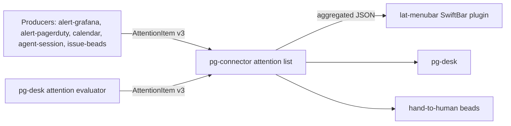
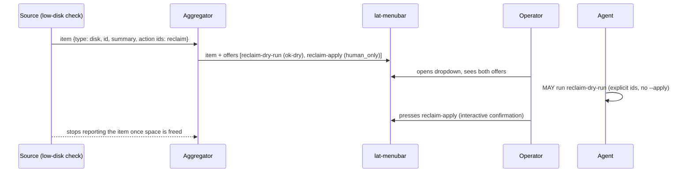
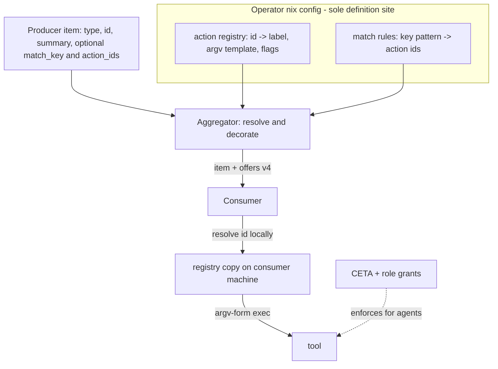
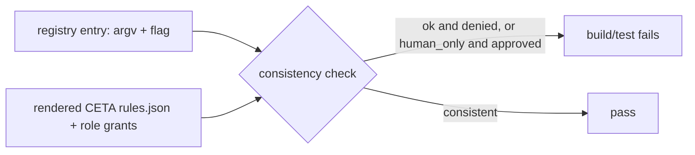
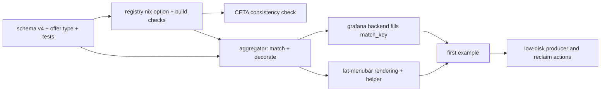

# Attention Item actions — design

**Status**: Proposed. This is a draft for operator review. Nothing here is implemented, no
decomposition has been filed, and every choice marked "Open question" is the operator's to make.
**Date**: 2026-11-21

Like the other files under `docs/superpowers/specs/`, this file is an extraction source, not a
durable citation target. The key words MUST, MUST NOT, SHOULD, SHOULD NOT and MAY are used as in
RFC 2119. This repository is public: deployment specifics are deliberately absent.

## 0. Summary

Operator ask (2026-11-12, verbatim): "i would like it if there was a way for attention items to
have an optional set of possible actions to take with regards to the attention. ie, low disk space
may include a way to run the pg-disk-reclaimer. this action should include if the action is
something an agent can/should run or if it is human only."

Today an Attention Item says that something needs attention and never what to do about it. This
design adds **actions**: operator-defined, named, argv-form commands that a consumer MAY offer next
to an item. Each action carries a three-state **agent flag** (`ok`, `dry_run_only`, `human_only`).

Chosen design, in one paragraph: action definitions live in an operator-owned nix registry (the
pattern `pg-disk-reclaimer` already uses). Producers MAY name an action id, and never supply argv.
A **match rule** in the same registry attaches actions to items by a match key. The attention
aggregator resolves ids to **descriptive offers** and passes them to consumers through an
additive `actions` field (attention schema version 4). The offer carries no argv by default, only
the action id, label and flags, so the wire stays descriptive and stateless. Consumers execute
argv-form, resolving the id against the registry on the consumer's own machine. Enforcement stays
in CETA and role tool grants; the flag is advisory and a consistency test ties the two together.

## 1. Context and constraints

Facts this design builds on:

- The wire shape is `{type, id, summary}` plus optional `severity`, `url`, `group{key,label}`
  (`AttentionSchemaVersion = 3`). The aggregated `pg-connector attention list --output json` adds
  `via[]`, `truncated`, `total_before_cap`, `sources[]`. Each field so far was one additive bump.
- The schema is deliberately stateless and descriptive: it MUST NOT carry acknowledge, hide or
  unhide state. Resolving a signal means doing the underlying thing, and the item clears when its
  producer stops reporting it.
- The Grafana attention item carries `ID = idPrefix + fingerprint`, `summary`, `severity` and `url`
  only. The rule uid and title are on the full alert (`schema.Alert`, Grafana extension `RuleUID`)
  and are not on the attention item.
- `pg-disk-reclaimer reclaim --aggressiveness N [ids]` is a dry run by default and mutates only
  with `--apply`; at level 4 or above `--apply` needs interactive confirmation. The operator rule
  on containers and reclaim (C-3) says agents run it only as a dry run with explicit item ids and
  ask the operator for any `--apply` at level 4 or 5.
- The lat-menubar plugin records that a "Triage to Agent" action was deliberately deferred. That
  action is out of scope here.

Non-goals: triage-to-agent, acknowledging or hiding items, any state on the attention wire, and a
general remote-execution facility.

## 2. Motivating journey and agent eligibility

Under C-3 the same tool has two offers with different agent flags. The flag therefore belongs on
the **action**, not the tool:

| Action id (example)            | argv shape                                                   | Agent flag     | Why                                                                              |
| ------------------------------ | ------------------------------------------------------------ | -------------- | -------------------------------------------------------------------------------- |
| `disk-reclaim-dry-run`         | `pg-disk-reclaimer reclaim --aggressiveness N <ids>`         | `dry_run_only` | A dry run mutates nothing. An agent MAY run it with explicit registry ids.       |
| `disk-reclaim-apply`           | `pg-disk-reclaimer reclaim --aggressiveness N --apply <ids>` | `human_only`   | `--apply` at level 4 or 5 needs the operator, and C-3 forbids agent apply there. |
| `disk-reclaim-list` (optional) | `pg-disk-reclaimer list`                                     | `ok`           | Read-only.                                                                       |

Agent-eligible parts: running read-only and dry-run offers. Human-only parts: every `--apply`, and
every action that needs an interactive session (login flows, confirmations).

## 3. Candidate designs and the choice

| Option                          | Idea                                                                        | Pros                                                           | Cons                                                                                                          |
| ------------------------------- | --------------------------------------------------------------------------- | -------------------------------------------------------------- | ------------------------------------------------------------------------------------------------------------- |
| A                               | Producers fill an `actions` array with argv on the item (schema v4)         | One command for all consumers; additive pattern                | Couples producers to tools; argv on the wire is a trust question; imperative field against a stateless schema |
| B                               | Registry in nix config maps a match to actions, attached at read time       | Argv operator-owned; producers stay dumb                       | Matching needs its own design; needs an owner                                                                 |
| C                               | Annotations or bead metadata carry actions                                  | Zero config                                                    | REJECTED: a command-injection surface for anyone with alert-rule or bead edit rights                          |
| D                               | A separate `pg-connector actions list` capability keyed by item             | Attention wire stays strictly stateless                        | Every consumer makes a second call and must join by item key; races between the two calls                     |
| **B plus passthrough (chosen)** | B for definitions, additive v4 `actions` offer field on the aggregated item | Argv off the wire; one call; matches the additive bump pattern | Needs a matcher owner and a v4 bump                                                                           |

Recommendation: **B plus passthrough**. Option D remains the documented fallback if the operator
judges that even descriptive offers violate the stateless principle (Open question 1).

Rationale as design patterns: the registry is a **Registry** plus **Command** pattern (a named,
parameterless-by-default command object resolved by id); the match rules are a **Strategy**
chosen by key; the aggregator attaches offers as a **Decorator** over the item, leaving producers
unchanged; consumers are **Adapters** that render offers in their own medium.

## 4. Architecture

### 4.1 Action definition (registry, nix only)

Each registry entry has these fields. The registry is the only place argv exists.

| Field                  | Type                                    | Meaning                                                                |
| ---------------------- | --------------------------------------- | ---------------------------------------------------------------------- |
| `id`                   | string, unique, `[a-z0-9-]+`            | Stable identifier producers and match rules reference                  |
| `label`                | string                                  | Human-readable button text                                             |
| `argv`                 | list of strings                         | Command and fixed arguments. MUST NOT be a shell string                |
| `params`               | map name -> validator                   | Declared substitution slots; see 4.3. Absent means no parameters       |
| `agent`                | enum `ok`, `dry_run_only`, `human_only` | Advisory agent flag (section 5)                                        |
| `confirm`              | bool                                    | Consumer MUST ask for confirmation before running                      |
| `destructive`          | bool                                    | Consumer SHOULD style it as destructive and MUST NOT default-select it |
| `timeout_seconds`      | int                                     | Consumer MUST kill the process after this long                         |
| `requires_interactive` | bool                                    | The action needs a TTY or a person; implies `agent = human_only`       |
| `description`          | string, optional                        | Tooltip or help text                                                   |

Validation at nix evaluation time: `requires_interactive = true` with `agent != human_only` MUST
fail the build; `destructive = true` SHOULD imply `confirm = true`; ids MUST be unique.

### 4.2 Match rules and the matching-key gap

A rule maps a match key to action ids. The matching-key gap (the Grafana item has no rule uid or
title) is closed by an optional, additive, descriptive item field in the same v4 bump:

- `match_key` (string, optional, omitempty): a producer-chosen, opaque, stable key naming the
  _kind_ of condition, not the instance. The Grafana backend fills it with the rule uid (it has
  `RuleUID` on the full alert); the beads source fills it with the matched attention label; a
  low-disk source fills a fixed key such as `disk-low`. The key is descriptive and the producer
  MUST NOT put argv or action ids into it.
- A rule matches on `(source, type, match_key glob, minimum severity)`. First match wins per
  rule list, and all matched rules' action ids are unioned, de-duplicated, preserving order.
- A producer MAY also emit `action_ids` (a list of registry ids) directly. Unknown ids are
  dropped (section 8). This lets a source that knows its own remedy name it without a rule.

Alternative considered for the key: matching on `summary` text. Rejected as brittle (summaries are
human prose and change).

### 4.3 Argv safety

- Argv MUST NEVER be built by interpolating item fields into a shell string. Execution is
  argv-form `exec` (no `sh -c`, no `eval`).
- The only item-derived values permitted in argv are **registry-validated ids** supplied through
  declared `params`. Each param has a validator that is an enum of ids drawn from a registry (for
  the disk example, the `pg-disk-reclaimer` registry item ids) or a strict anchored regex such as
  `^[a-z0-9][a-z0-9-]*$`. A value failing its validator MUST abort the action before exec.
- Substitution replaces a whole argv element; it MUST NOT splice into the middle of an element
  that contains other text, and MUST NOT introduce a new argv element from one value (no word
  splitting).
- The config surface is nix only: no alert annotations, no bead metadata, no producer-supplied
  argv. Producer-supplied strings are limited to ids and keys, which are validated.

## 5. The agent flag, CETA and role grants

The flag has three states:

| State          | Meaning for an agent                                                                              |
| -------------- | ------------------------------------------------------------------------------------------------- |
| `ok`           | The argv MAY be run by an agent as-is                                                             |
| `dry_run_only` | An agent MAY run only the dry-run form; the registry entry's argv MUST itself be the dry-run form |
| `human_only`   | An agent MUST NOT run it; it MUST ask the operator                                                |

The flag is **advisory metadata**. Enforcement stays where it is today: CETA (the approver, whose
policy is per-machine `rules.json` data, `docs/ARCHITECTURE.md`) and the role tool grants. The
flag MUST NOT be the thing that allows a command.

Keeping them consistent (Dependency Injection of one source of truth, plus a conformance check):

1. The registry and the CETA data are both rendered from nix. A **consistency check** (a nix
   evaluation-time assertion where the data allows it, and otherwise a unit test over rendered
   JSON) MUST evaluate each action's argv against what CETA and the role grants decide:
   - `ok`: the argv MUST be allowed (auto-approved) for the agent roles that may see it.
   - `dry_run_only`: the dry-run argv MUST be allowed, and the matching apply action MUST NOT be.
   - `human_only`: the argv MUST NOT be auto-approved for any agent role (it MUST resolve to
     ask or reject).
2. A divergence (an `ok` argv that CETA denies, or a `human_only` argv that CETA approves) MUST
   fail the check. The remedy is to change the flag or the CETA data, never to weaken the check.
3. At runtime an agent consumer MUST treat the flag as a hint and still submit the command through
   the normal CETA path; CETA's verdict wins over the flag in both directions.

## 6. Reconciliation with the stateless wire principle

The schema forbids state, not information. An offer is a descriptive statement ("this item has
these remedies"); it records no acknowledgement, no run result, and nothing changes the item's
identity or severity. The reconciliation rules:

- The wire `actions` offer carries only `id`, `label`, `agent`, `confirm`, `destructive`,
  `requires_interactive`. It carries **no argv** by default.
- Running an action MUST NOT change attention state. The item clears only when its producer stops
  reporting it. (Open question 2 asks the operator to confirm.)
- The field is an additive bump (v3 to v4), following the existing one-bump-per-field convention.
  A v3 consumer ignores it; a v4 consumer tolerates its absence. `match_key` and `action_ids` are
  producer-side optional fields in the same bump; the aggregated output drops `action_ids` after
  resolution and keeps only the resolved `actions`.
- The Go change goes in `pkg/schema/attention.go` (struct and version comment), `versions.go`
  (the `CurrentSchemaVersions` entry follows the constant) and `attention_test.go`.

Fallback, if the operator rejects any actions field on the wire: Option D, a separate
`pg-connector actions list` capability keyed by item id, which leaves `AttentionItem` untouched.

## 7. Execution and audit

Two models:

| Model              | Description                                                                    | Pros                                                 | Cons                                              |
| ------------------ | ------------------------------------------------------------------------------ | ---------------------------------------------------- | ------------------------------------------------- |
| Consumer-side exec | The consumer resolves the id against its local registry copy and runs the argv | Smallest change; lat-menubar and agents run directly | No central audit; each consumer needs a validator |
| Central run verb   | A `pg-desk action run <id> [--param k=v]` verb validates and executes          | One validator, one audit record                      | More code; a new always-needed daemon path        |

Recommendation: **consumer-side exec for v1**, because the first actions are a menubar press and
an agent-run dry run, with the central verb deferred. The consumer MUST resolve by id (never take
argv from the wire), MUST validate params, MUST apply `timeout_seconds`, MUST honour `confirm`,
and SHOULD log one JSON line per run (action id, param ids, timestamp, exit status, who invoked)
to the consumer's own state directory as the interim audit trail. A shared consumer library SHOULD
hold the validator and the log writer so the central verb can adopt them later (Template Method
over the same steps).

## 8. Consumer degradation (absent, empty, malformed)

Consumers MUST degrade to today's behaviour:

- Field absent or `null`, or empty list: render the item exactly as today.
- Field not a list, or an entry not an object: ignore the whole field and render as today; log one
  diagnostic.
- An entry with a missing or empty `id`, an unknown `agent` value, or a non-boolean flag:
  drop that entry only.
- An action id not found in the consumer's registry: drop that entry (never run, never guess).
- Unknown extra fields: ignore (forward compatibility).
- Failure to load the registry at all: render with no actions.

The aggregator applies the same rules to producer-supplied `action_ids` and `match_key`: unknown
ids are dropped with a diagnostic, and a malformed value never fails the whole attention list.

## 9. Menubar rendering (lat-menubar)

Constraints: the SwiftBar plugin conventions of its repo apply (wide and narrow title, primary
state only in the title). Actions MUST NOT appear in the menu-bar title; they are dropdown rows.

- Under each item row, a submenu "Actions" lists offers in registry order.
- `human_only` and `requires_interactive` actions run in a terminal the plugin opens
  (`terminal=true`), so confirmations and logins have a TTY. `ok` and `dry_run_only` MAY run
  with `terminal=false` and show the output in a notification.
- `destructive` actions are rendered with a warning prefix and are never the first row.
- A `confirm` action asks first; the plugin passes the action id, never argv, to its helper
  script, which resolves the id (section 7).
- With no offers the row is unchanged from today.

## 10. Low-disk producer and first example

Gap: no low-disk Attention producer exists today. Two options:

| Option       | Producer                                                                                                                                             | Exercises             | Notes                                                 |
| ------------ | ---------------------------------------------------------------------------------------------------------------------------------------------------- | --------------------- | ----------------------------------------------------- |
| 1 (low disk) | A new, small attention source (a "disk-low" check emitting one item when free space on the data volume is under a threshold, `match_key = disk-low`) | All three flag states | Needs a new producer; threshold is an operator choice |
| 2 (login)    | The existing Grafana expired-auth alert, matched by rule uid, offering a login action                                                                | `human_only` only     | The producer already exists                           |

Recommendation: ship **Option 2 first** (it needs no new producer and proves the match key, the
registry and the rendering), and add Option 1 as the second example because only it exercises all
three flag states and is the operator's stated motivating case. The low-disk producer SHOULD be a
pg-connector attention source implemented as a normal source backend, not a one-off script, so it
inherits severity, `via` and degradation handling. (Open question 3.)

## 11. Test plan

Deterministic parts MUST be covered by automated tests that stay in the repo, run against the real
code (no mock of the tool whose semantics matter), in the unit gate:

- **Schema round trip and version bump**: encode and decode v4 items with and without `actions`;
  a v3 decoder ignores `actions`; `AttentionSchemaVersion` and `CurrentSchemaVersions` agree.
- **Match rules**: golden cases for key glob, severity floor, union and ordering, no-match.
- **Malformed input degradation**: every case in section 8 as a table test.
- **Argv validation**: valid ids, regex rejects (spaces, `;`, `$(`, newline, leading dash,
  empty), whole-element substitution only, no word splitting, argv-form exec confirmed by a test
  that a value containing shell metacharacters reaches the child as one literal argument.
- **Registry build-time checks**: duplicate ids, `requires_interactive` with a non-human flag.
- **CETA and role-grant consistency**: the check in section 5 over the rendered registry and
  rendered CETA data (`ok` argv allowed, `dry_run_only` dry-run allowed and apply not, `human_only`
  never auto-approved for agents).
- **Aggregator**: producer `action_ids` plus rules produce the expected offers; unknown ids are
  dropped; `action_ids` never appear in aggregated output.

Slow, end-to-end or cross-process checks (menubar press against a real SwiftBar, a real
low-disk condition) are not unit tests and MUST NOT run in the unit gate; they belong behind an
opt-in switch if wanted.

## 12. Rollout order

No production code lands with this document. The decomposition into implementation work waits for
operator approval of this document.

## 13. Open questions for the operator

1. **Design.** Approve B plus passthrough (recommended), or choose A, or the separate-capability
   option D, if even descriptive offers on the attention wire are unwanted. C stays rejected.
2. **Execution and state.** Consumer-side exec for v1 with a central `pg-desk action run` verb
   deferred (recommended), or build the central verb first. Confirm that running an action does
   NOT change attention state (recommended: no; the item clears when its producer stops
   reporting it).
3. **First example and low-disk producer.** Login action first then low disk (recommended), or
   low disk first. For low disk, which source emits it and what free-space threshold applies?
4. **Wire detail.** Is it acceptable that the offer carries `agent` and `confirm` flags on the
   wire (needed so consumers render without a registry round trip), given the registry stays the
   source of truth for argv?
5. **Match key ownership.** Should `match_key` be a v4 item field (recommended), or should the
   aggregator look the rule uid up out of band for the Grafana source only?
