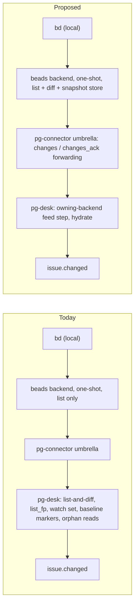
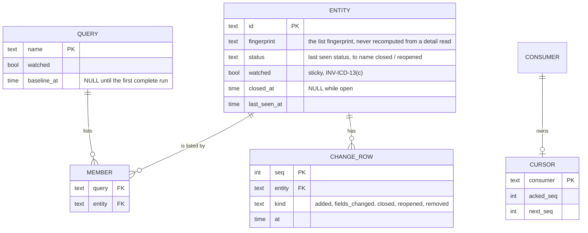
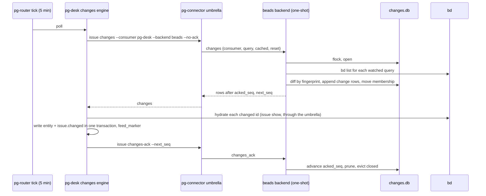

# Beads connector owns change detection for beads issues: design

**Status**: Draft, awaiting operator review. Nothing here is decided, implemented or decomposed.
Every item under "Open questions" is the operator's to answer, and the answers MAY change the
design. This draft was written by an agent from the code and documents named in section 1.
**Date**: 2026-11-21

Like the other files under `docs/superpowers/specs/`, this file is an extraction source, not a
durable citation target. The key words MUST, MUST NOT, SHOULD, SHOULD NOT and MAY are used as in
RFC 2119. This repository is public: deployment specifics are deliberately absent.

## 0. Summary

Operator ruling 8 of the issue change emission design (2026-10-20, ruled 2026-10-22) says: "A is
fine until the beads connector handles it". Today pg-desk detects beads changes by fingerprint
list-and-diff (ADR 0077 S29) over the queries named in `watch.issue.queries`, and keeps the `watched`
flag in its own store. ADR 0106 (Proposed) records that a later step moves detection into the beads
connector and deletes `watch.issue.queries` and the beads list-and-diff, "as the PR design does for
`watch.pr.queries`", and that what survives of the other pg-desk pieces "is its own design". This
file is that design.

Proposed shape, in five lines.

1. **State.** The beads backend keeps one small SQLite file per tracker in a deterministic state
   directory next to its existing budget directory. It holds a Snapshot (Memento) of what the
   consumer last acknowledged: per watched entity a fingerprint and a few classification fields, per
   query a baseline marker, and the cursor. It is bounded by the size of the watched set plus a short
   retention window for closed issues (section 3).
2. **No daemon.** A one-shot backend is enough, because the diff is computed on demand inside the
   `changes` call that pg-desk already makes on the router's 5-minute tick, and `bd` data is local and
   always current. The signal that would change this answer is the one the design already names
   (section 4).
3. **Events.** The beads backend declares `owns_changes`. pg-desk consumes it through the owning-backend
   feed path that already exists for the Jira daemon (`changes`, then flush, then `changes_ack`), and
   stays the single emitter of `issue.changed` (section 5).
4. **Deletion.** pg-desk loses the non-owning (beads) half of the issue flow: the list-and-diff, the
   watch-set bookkeeping for it, the pg-desk-side baseline markers and the orphan read. It keeps the
   `entity.backend` and `entity.watched` columns and the feed machinery, which the Jira path needs
   (section 6).
5. **Open.** `watch.issue.queries` also names the Jira queries today, so deleting the key outright
   is a decision with a recommendation (section 8).

## 1. Sources read

Every claim below was checked against these files in this worktree.

| Source                                                                                                                                                                                   | Used for                                                                                                        |
| ---------------------------------------------------------------------------------------------------------------------------------------------------------------------------------------- | --------------------------------------------------------------------------------------------------------------- |
| `docs/adr/0090-a-connector-may-be-stateful-and-run-a-daemon-and-own-its-changes.md`                                                                                                      | A connector MAY be stateful, MAY run a daemon, and a backend that declares `owns_changes` decides what changed. |
| `docs/adr/0106-issue-change-emission-is-decided-per-backend-and-for-watched-issues-only.md`                                                                                              | Beads needs no daemon; a daemon is an option; the later move of detection.                                      |
| `docs/adr/0077-entity-change-flow.md`, row S29 and the 2026-10-10 and 2026-10-22 amendment notes                                                                                         | The fingerprint baseline owned by pg-desk, narrowed to backends that do not own changes.                        |
| `docs/superpowers/specs/2026-10-20-issue-change-emission-per-backend-design.md`, sections 2.2, 2.3, 4.4, 4.5, 5 and INV-ICD-9, -13, -15, -16, -17, -18                                   | The design of record; ruling 8; the budget; the baseline rule.                                                  |
| `docs/superpowers/specs/2026-10-22-connectord-shared-change-engine-hoist-design.md`                                                                                                      | The shared feed, engine and store library a beads path would consume.                                           |
| `docs/superpowers/specs/2026-10-20-pr-lane-refactor-design.md` (U9 and the P9 deletion of `watch.pr.queries`)                                                                            | The precedent for deleting a watch key.                                                                         |
| `packages/pg-connector/cmd/pg-connector-issue-beads/` (`main.go`, `internal/budget/budget.go`)                                                                                           | The existing one-shot backend and its state directory rule.                                                     |
| `packages/pg-connector/cmd/pg-connector/changes_forward.go`, `dispatch.go`                                                                                                               | How the umbrella forwards `changes` and `changes_ack` to an owning backend.                                     |
| `packages/pg-connector/pkg/connectord/{store,engine,feed,feedop,query}`                                                                                                                  | The shared library.                                                                                             |
| `packages/pg-desk/internal/changes/*.go`, `internal/config/config.go`, `internal/store/{gate,issue_feed_storage,feed_marker,ingest_failed}.go`, `cmd/pg-desk/{run,doctor_issuegates}.go` | What pg-desk holds today.                                                                                       |

## 2. Where this sits



The pattern is Observer with the connector as Subject and pg-desk as the one Observer that turns a
notification into an event. The detection logic moves to the side that owns the data, which is what
ADR 0090 means by "to be optimal, only the connector itself understands what to do".

## 3. The fingerprint-state store

### 3.1 Requirements

- **BCS-1.** The beads backend MUST decide what changed for the issues it watches and MUST emit a
  change only for a watched issue (INV-ICD-13(d), INV-ICD-15).
- **BCS-2.** Detection MUST survive process exit: the backend is one-shot, so whatever it needs to
  compare against MUST be on disk between runs.
- **BCS-3.** Delivery MUST be at-least-once with an explicit acknowledgement after the consumer has
  flushed its output, as the shared feed already does (`feedop`: a `changes` answer does not move the
  cursor; `changes_ack` does).
- **BCS-4.** The store MUST be bounded: its size MUST depend only on the watched set and a fixed
  retention window, never on the age of the tracker or the number of runs.
- **BCS-5.** The store MUST NOT be a second copy of an issue. Content stays in `bd`; pg-desk
  re-hydrates by id when it is told something changed.
- **BCS-6.** Two concurrent one-shot processes MUST NOT corrupt the store or double-append.
- **BCS-7.** Losing the store MUST be recoverable without a flood: every watched query runs a silent
  baseline again (INV-ICD-18(g)).

### 3.2 Where it lives

One SQLite file per tracker (per budget group, the unit the existing budget already uses), in the
state directory the backend already resolves for its budget, as a sibling directory:

```text
<home from the passwd entry>/.local/state/pg-connector-issue-beads/budget/<group>/   (exists today)
<home from the passwd entry>/.local/state/pg-connector-issue-beads/changes/<group>/changes.db   (new)
```

- **BCS-8.** The path MUST be deterministic and MUST NOT depend on `$HOME` or `$XDG_STATE_HOME`, for
  the reason `DefaultStateDir` already states: a launchd job and an interactive shell resolve those
  differently and would get two stores. The new directory SHOULD reuse the same resolver.
- **BCS-9.** The file is SQLite (modernc, the engine of pg-desk's store and of the shared connector
  store) in WAL mode. A one-shot process opens it, takes an exclusive advisory lock on a sibling
  `.lock` file for the whole `changes` or `changes_ack` call, and closes it. The shared store
  documents the daemon as "the store's only writer" with exclusivity provided by the process
  scaffolding; for a one-shot backend the per-call `flock` plays that role (BCS-6).
- **BCS-10.** If the directory is unwritable the backend MUST answer `unavailable` for `changes`. It
  MUST NOT fail open: unlike the budget, a silent store loss would drop changes. (The budget fails
  open because it only limits load.)

### 3.3 Shape

The Snapshot (Memento) holds only what is needed to decide that something changed and to name the
kind. Content stays in `bd`.



- **BCS-11.** The fingerprint MUST be the connector's list fingerprint, compared list against list,
  never recomputed from a detail read (ADR 0077 S29, unchanged). It hashes the whole entity JSON
  minus `as_of`, `stale` and `metadata.last_checked_at` (design section 2.2), so the diff covers every
  field the list returns.
- **BCS-12.** Kinds are derived from the stored fields without reading prior content: `added` (first
  observation of a watched issue after its query's baseline, or a late watch), `closed` and `reopened`
  (status crossing the closed boundary, using the stored `status`), `removed` (the issue is no longer
  returned by `bd` at all), and `fields_changed` for any other fingerprint difference. The field
  level diff is NOT stored; pg-desk's hydration produces the normalised content and its own diff
  (INV-ICD-5 to -7 stay in pg-desk). This is why no content copy is needed.
- **BCS-13.** No `reconcile` kind, no `sweep` origin and no timer exists in this store (INV-ICD-15).

### 3.4 Bounds and retention

- **BCS-14.** `entity` rows exist only for watched issues (and for members of a query before its
  baseline completes). An issue that is not watched MUST NOT have a row, so the table size is the
  watched set.
- **BCS-15.** A closed watched issue keeps its row and its `watched` flag until it has been closed for
  a retention window, then the row is evicted. The beads design (section 4.5) said "pg-desk deactivates
  a bead when it is observed closed, as today, and the watched flag ends with it"; the connector
  equivalent is eviction after the `closed` row has been acknowledged. The operator's ruling 2 of the
  design ("until it is closed + 24 hours ... can fall off after being closed for 7 days") is the
  retention precedent; whether beads uses 24 hours, 7 days or "acknowledged then evict" is Open
  question 3.
- **BCS-16.** `change_row` rows MUST be pruned once every consumer's `acked_seq` has passed them
  (the shared `feed/prune.go` rule), and MUST be capped by a maximum row count per store; a consumer
  whose cursor falls behind the pruned range gets `cursor_expired` and re-baselines through a reset,
  as the shared feed already does.
- **BCS-17.** `bd` itself is not the source of truth for retention: an issue that was deleted from
  `bd` produces `removed` once, then its row is evicted.

### 3.5 Two ways to build it

| Option                                                     | What it is                                                                                                                                                | Pros                                                                                                                                                                                                                                                                                                                                                     | Cons                                                                                                                                                                                                                                                             |
| ---------------------------------------------------------- | --------------------------------------------------------------------------------------------------------------------------------------------------------- | -------------------------------------------------------------------------------------------------------------------------------------------------------------------------------------------------------------------------------------------------------------------------------------------------------------------------------------------------------- | ---------------------------------------------------------------------------------------------------------------------------------------------------------------------------------------------------------------------------------------------------------------- |
| **S-A: reuse the shared connector store, feed and engine** | The beads backend registers a `registry.Spec` and the shared `store`, `feed`, `feedop` and `query` packages, opened per call instead of held by a daemon. | One wire contract with Jira and GitHub (`changes`, `changes_ack`, `cursor_expired`, `reset`, `store_identity`); pg-desk's existing feed step and `feed_marker` work unchanged; the hoist design says its beads consumer "only consume[s] what section 15 lists and add[s] no store rung"; migrations, move-aside and backup-before-migrate come with it. | The store was built for a long-lived daemon: opening, migrating and (on first open) backing up per one-shot call costs milliseconds each time; it carries tables beads does not need (groups, jobs); the single-writer assumption needs the `flock` of BCS-9.    |
| **S-B: a purpose-built minimal store (the model in 3.3)**  | A tiny schema owned by the beads backend, with the `changes` and `changes_ack` ops implemented directly.                                                  | Smallest state and smallest code; nothing unused; no daemon assumptions.                                                                                                                                                                                                                                                                                 | A second implementation of cursor, ack, `cursor_expired`, reset and store identity semantics that Jira already has; a second place for the invariants of INV-ICD-15 and INV-ICD-18 to drift; contradicts ADR 0124's direction of sharing generic infrastructure. |

Recommendation: S-A, with the beads backend using only the entity, query, change-log and cursor
tables and leaving the group and job tables empty. Reason: the observable cost of one-shot opening is
small, whereas two implementations of the ack protocol are a standing risk, and ADR 0124 already
settled that generic infrastructure is shared. This is Open question 1.

## 4. Is a daemon needed?

ADR 0106 decision 2 says: "A beads daemon is an option, not a requirement". This design confirms it,
on the evidence below, and states the condition that would reverse it.

| Question                                                | Evidence                                                                                                                                                                                                                                                                                                                  | Answer                                  |
| ------------------------------------------------------- | ------------------------------------------------------------------------------------------------------------------------------------------------------------------------------------------------------------------------------------------------------------------------------------------------------------------------- | --------------------------------------- |
| Is there upstream work to do in the background?         | `bd` reads are local; the data is current at every call (ADR 0106 decision 2; design section 2.2).                                                                                                                                                                                                                        | No.                                     |
| Does detection need a clock of its own?                 | pg-desk polls on the router's 5-minute tick (ADR 0106 decision 5; the beads cadence of 60 seconds is conditional on measured local list latency under 10 seconds). Detection on demand inside that call needs no timer.                                                                                                   | No.                                     |
| Is a baseline expensive enough to need background work? | A baseline run is one `bd list` per watched query and writes no rows (INV-ICD-18(b)). Today pg-desk pays more: it also hydrates every member it does not hold, paced by `hydration.max_per_poll`. Under the owning-backend feed, pg-desk learns a member it does not hold from that member's first feed row, as for Jira. | No; the proposal is cheaper than today. |
| Does `bd` load need a single reader?                    | The budget already bounds concurrent and per-minute `bd` processes across processes with slot files that survive the backend being killed (design section 4.4, `internal/budget`).                                                                                                                                        | Not by itself.                          |
| Do concurrent callers corrupt detection?                | One `flock` per call serialises them (BCS-9); the diff is cheap.                                                                                                                                                                                                                                                          | No.                                     |

**What would justify a daemon** is the signal the design already names (section 4.4): a sustained
`budget_denied` rate, or `bd` timeouts the semaphore cannot remove because the dolt server itself is
saturated. A daemon would then be the only `bd` reader, with its own store, as a separate binary
instance that shares only the library (ADR 0106 decision 2). This design adds one more
signal worth measuring before then: the wall time of one `changes` call under the pg-desk call
deadline, because detection now runs inside it (Open question 5). If that exceeds the deadline for
the deployment's real watched set, the daemon option reopens.

Challenge to ADR 0106's wording: ADR 0106 says a beads "store" is not needed ("no store, no
daemon"). Once detection moves, a store IS needed (section 3); only the daemon is not. ADR 0106
SHOULD be amended in the same change that lands the implementation so that the two statements are
not read as one (section 7).

## 5. How change events reach pg-desk

The PR and Jira pattern (ADR 0090, ADR 0106 decisions 1 and 7): the connector decides, pg-desk
consumes a feed, hydrates, and acknowledges. Nothing about the router source, the roles or the
decider changes; pg-desk stays the single emitter of `issue.changed`.



- **BCS-18.** The beads backend MUST declare `owns_changes` in its capabilities, and the deployment
  MUST list it under `watch.issue.backends` with `owns_changes: true`. `pg-desk`'s startup dispatch
  check (`internal/changes/dispatch_check.go`) already compares that setting with the backend's
  capabilities answer and MUST keep doing so for beads.
- **BCS-19.** The `watched` flag of a query is a property of the query definition in the beads backend's
  own configuration, shared with the Jira shape (INV-ICD-13(b), INV-ICD-20), not of pg-desk's.
  A one-off watch uses the lookup option `pg-desk issue refresh <id> --watch`, forwarded to the
  backend as for Jira.
- **BCS-20.** pg-desk MUST NOT diff or sweep a beads issue once the backend owns its changes. The
  existing `OwningSet` filter (`internal/changes/sweep.go`) already skips owning-backend entities in
  the list-and-diff selection (`poll.go:412`); the registry flip is what moves beads over.
- **BCS-21.** The feed answer for beads carries `next_seq`, and an acknowledgement is sent only after
  pg-desk has committed (`feedop` and `changes_forward.go` already enforce "flush, then ack"). A
  failed hydration keeps the row in `ingest_failed` for retry (`store/ingest_failed.go`), which is the
  Jira path's recovery rule and which this design reuses unchanged.
- **BCS-22.** An open question is whether the umbrella's forwarding path is exercised with a backend
  that is spawned once per call rather than reached over a socket. `changes_forward.go` sends
  through `invokeOne`, which resolves the registered backend and calls `reg.Invoke`, a generic
  call that does not assume a socket; no test covers a one-shot owning backend today. The
  implementation MUST add one (a test against a real `pg-connector` and a real one-shot backend,
  per the repository's rule on deterministic CLI behavior).
- **BCS-23.** Cutover is per query: a query moves from `watch.issue.queries` (non-owning) to an entry
  in `watch.issue.backends` with `owns_changes: true`. The first run of each moved query is a
  silent baseline (INV-ICD-18(b)); the members pg-desk already holds are already `watched`, so the
  backend's baseline run MUST mark them without emitting, and pg-desk's `watched` column is not
  rewritten.

## 6. pg-desk deletion scope

Verified against the current code. "Delete" means the beads half only; the thread type shares the
generic list-and-diff engine in `internal/changes/poll.go` and `sweep.go`
(`FlowEntityTypes = {"issue", "thread"}`, `observe.go:15`), so those files shrink and do not go away
unless the thread path is also moved.

### 6.1 Deleted or narrowed

| Item                                                                                    | Where                                                                                                                                           | Disposition                                                                                                                                                                                                                                                                                                                                                                  |
| --------------------------------------------------------------------------------------- | ----------------------------------------------------------------------------------------------------------------------------------------------- | ---------------------------------------------------------------------------------------------------------------------------------------------------------------------------------------------------------------------------------------------------------------------------------------------------------------------------------------------------------------------------- |
| `watch.issue.queries` for beads queries                                                 | `internal/config/config.go:250-258`, `:328-333`, `:351-400`, `:630`, `:677-695`                                                                 | Deleted for non-owning (beads) queries; see Open question 2 for the Jira queries the same key also lists.                                                                                                                                                                                                                                                                    |
| `NonOwningWatchQueries`, `NonOwningInstances`                                           | `config.go:357-400`                                                                                                                             | Deleted once no non-owning issue instance remains.                                                                                                                                                                                                                                                                                                                           |
| List-and-diff for non-owning issues                                                     | `internal/changes/poll.go` (`diffListed`, `hydrateListed`, `applyMembership`, the `issueEntityType` branches at `:264`, `:412`, `:540`, `:609`) | The `issue` branches are deleted; the thread path stays.                                                                                                                                                                                                                                                                                                                     |
| Persisted watch-set bookkeeping `change_flow.watchset.issue.<query>`                    | `internal/changes/watchset.go`                                                                                                                  | Deleted for `issue`; read only by the orphan read and the doctor reports below.                                                                                                                                                                                                                                                                                              |
| Reconcile and sweep tiers for `issue`                                                   | `internal/changes/sweep.go` (`reconcileLocal`, `reconcileOne`)                                                                                  | Already retired for `issue` by ADR 0106 decision 4 once the implementation of that ADR lands; this design removes whatever is left of the non-owning path.                                                                                                                                                                                                                   |
| Baseline markers `change_flow.baseline.<query>` and `change_flow.baseline_open.<query>` | `internal/changes/baseline.go` (`MetaBaselinePrefix`, `ReadBaseline`, the baseline hydration at `:195-239`)                                     | Deleted for beads (the connector's `query.baseline_at` replaces them, as for Jira). The `doctor` gate `gateBaselineOpenAge` (`cmd/pg-desk/doctor_issuegates.go:377-`) loses its beads half and keeps the owning (feed) half, which reads the daemon's marker.                                                                                                                |
| Orphan reads                                                                            | `internal/changes/orphans.go` (`OrphanEntities`, the by-id read at `:112-166`)                                                                  | Deleted. Orphans are, by definition, watched and active issues "that no watched query lists any longer" on the listed path; under the backend's stickiness rule (INV-ICD-13(c)) the connector keeps delivering rows for a watched issue that left every query, by reading it by id inside its own `changes` call. The by-id read moves into the beads backend (section 6.3). |
| `hydrateJiraIssue` guard `len(cfg.WatchQueries("issue")) == 0`                          | `cmd/pg-desk/run.go:215-275`                                                                                                                    | Rewritten to ask "is any issue backend configured" instead of reading the deleted key. This is a behavior change for the PR-text ticket-key hydration; see Open question 2.                                                                                                                                                                                                  |
| `unflagged` alert for the non-owning half                                               | `internal/changes/unflagged.go:156-` (`NonOwningWatchQueries` loop)                                                                             | The non-owning branch is deleted; the owning branch (`unflaggedInstance`) stays.                                                                                                                                                                                                                                                                                             |
| Doctor issue-flow reports that iterate `cfg.WatchQueries("issue")`                      | `cmd/pg-desk/doctor_issuegates.go:524`, `:566`                                                                                                  | Re-based on the owning-instance list.                                                                                                                                                                                                                                                                                                                                        |

### 6.2 Survives

| Item                                      | Where                                                                  | Why it stays                                                                                                                                                                                                                                                                                                                                                                                                                                                                             |
| ----------------------------------------- | ---------------------------------------------------------------------- | ---------------------------------------------------------------------------------------------------------------------------------------------------------------------------------------------------------------------------------------------------------------------------------------------------------------------------------------------------------------------------------------------------------------------------------------------------------------------------------------- |
| `entity.backend` column                   | `internal/store/schema.go:71`, `issue_feed_storage.go`, `gate.go:116-` | It names which registry instance serves an entity. With two or more issue backends (beads and the Jira daemon), the backend is needed to route a by-id read and to find the right feed marker. It is also the key of the delivery gate's owning check (`gate.go:53-64`).                                                                                                                                                                                                                 |
| `entity.watched` column                   | `schema.go:72`, `gate.go:88-165`, `issue_feed_storage.go`              | pg-desk's delivery gate (INV-ICD-16) MUST NOT append a row for an unwatched issue, whatever the origin (a link or work propagation from a PR change, a refresh, an annotation write). The connector decides the set, but the gate runs in pg-desk and needs a local, transactional answer. After this change the column is a MIRROR of the connector's flag, written from feed rows (set) and `closed` rows (clear, as `ClearWatchedAfterAppend` does today), not an independent source. |
| `read_attempt_at`, `read_ok_at`           | `issue_feed_storage.go`                                                | Used by the unflagged and degraded-read reports for owning backends; unrelated to the list path.                                                                                                                                                                                                                                                                                                                                                                                         |
| Feed marker and ingest-failed stores      | `store/feed_marker.go`, `store/ingest_failed.go`                       | The consumption side of the owning-backend path, now used for beads too.                                                                                                                                                                                                                                                                                                                                                                                                                 |
| Owning-backend feed step                  | `internal/changes/feed.go`                                             | It IS the new beads path.                                                                                                                                                                                                                                                                                                                                                                                                                                                                |
| `dispatch_check.go` startup comparison    | `internal/changes/dispatch_check.go`                                   | Keeps catching a configuration that says `owns_changes` while the backend says otherwise (BCS-18).                                                                                                                                                                                                                                                                                                                                                                                       |
| Thread list-and-diff, sweep and reconcile | `internal/changes/poll.go`, `sweep.go` (thread branches)               | Out of scope: `pr` and `thread` keep ADR 0077 S29 and S31 as they stand.                                                                                                                                                                                                                                                                                                                                                                                                                 |

### 6.3 What moves into the connector

- The baseline rule of INV-ICD-18, stated for the beads backend: a run of a watched query that has no
  `baseline_at` marks every member watched and appends no row; a member first seen after the marker
  appends one `added` row; a member that becomes watched while known (late watch) appends one `added`
  row. The baseline marker is written only when the run completed (a truncated `bd` list MUST NOT
  write it, as pg-desk's `ReasonListTruncated` rule says today).
- The by-id read of a sticky watched issue that left every query: the backend, inside its `changes`
  call, MUST read each such issue by id and apply the same fingerprint diff, capped per call to keep
  within the budget of INV-ICD-9. A cap MUST carry the remainder to the next call.
- The `bd` budget remains the beads backend's own and is shared by both the list and the by-id
  reads, because they run in the same process under the same slot discipline.

### 6.4 Behavior docs and ADRs that change with it

These are named for the later implementation; this draft changes none of them.

- ADR 0106: decision 1's table row for beads, decision 2's "no store, no daemon" wording, and the
  last sentence of decision 2 that defers to the later move.
- ADR 0077: the 2026-10-22 amendment note that says S29 still applies to beads.
- The design of record: section 2.2's table, section 4.2 (the watched flag in pg-desk), section 4.5,
  and the ruling 8 passage that lists what pg-desk keeps.
- `packages/pg-connector/docs/behavior/` gains a beads set equivalent to the Jira set
  (`jira/interfaces.md`, `jira/invariants.md`), and the generic `interfaces.md` stops describing a
  beads backend as one with no changes feed.
- `packages/pg-desk` behavior docs that describe `watch.issue.queries` and the non-owning flow.

## 7. Invariants this design adds or narrows

| Id                    | Statement                                                                                                         |
| --------------------- | ----------------------------------------------------------------------------------------------------------------- |
| BCS-1 to BCS-23       | The requirements above.                                                                                           |
| Narrows INV-ICD-17    | The orphan read is the connector's, not pg-desk's, for beads.                                                     |
| Narrows INV-ICD-18(a) | A beads query's baseline marker lives in the connector, as for Jira; the pg-desk `meta` key for beads is retired. |
| Unchanged             | INV-ICD-13 to -16 (watched model, no re-emit, delivery gate), INV-ICD-9 (the budget).                             |

## 8. Open questions

Each is a decision for the operator. The recommendation is the agent's, not a ruling.

### Open question 1: Which store implementation?

| Option                                                                                                                                     | Pros                                                                                                                                             | Cons                                                                                                                                      |
| ------------------------------------------------------------------------------------------------------------------------------------------ | ------------------------------------------------------------------------------------------------------------------------------------------------ | ----------------------------------------------------------------------------------------------------------------------------------------- |
| **A. Reuse the shared connector store, feed and engine (section 3.5, S-A)**                                                                | One ack protocol and one set of invariants for all issue backends; pg-desk's feed step works unchanged; migrations and move-aside come for free. | Opened per one-shot call; larger schema than beads needs; needs the per-call `flock`.                                                     |
| **B. Purpose-built minimal store (S-B)**                                                                                                   | Smallest state and code.                                                                                                                         | A second ack implementation that can drift from Jira's.                                                                                   |
| **C. No change log, only the acknowledged snapshot** (diff on each poll against the last acknowledged fingerprints; no `change_row` table) | Smallest of all: state is only the watched set's fingerprints.                                                                                   | Cannot serve `reset`, `cursor_expired` or a replay; changes between two polls coalesce; diverges from the wire contract pg-desk consumes. |

Recommendation: A. Reason: it has one wire contract, and the hoist was designed so that a beads path
adds no store rung. C is the smallest but loses the semantics pg-desk's feed step already depends on.

### Open question 2: What happens to `watch.issue.queries` for the Jira queries?

Today `watch.issue.queries` lists both the owning (Jira daemon) queries and the non-owning (beads)
queries, and `watch.issue.backends` annotates each (`config.go:250-258`, `:351-400`). Deleting the key
for beads alone leaves the Jira queries listed.

| Option                                                                                                                           | Pros                                                                      | Cons                                                                                                |
| -------------------------------------------------------------------------------------------------------------------------------- | ------------------------------------------------------------------------- | --------------------------------------------------------------------------------------------------- |
| **A. Delete the key and the non-owning split; each issue backend lists its own queries under `watch.issue.backends.<instance>`** | One place per backend; matches how `watch.pr.queries` is deleted for PRs. | A configuration migration for the Jira queries too; touches the Jira path that already works.       |
| **B. Keep the key for owning (Jira) queries only; delete the non-owning half**                                                   | Smallest change; Jira path untouched.                                     | Leaves a key whose only reason to exist is a "rendered mirror" the design called a gate (`doctor`). |
| **C. Keep the key as is until the thread path also moves**                                                                       | No change now.                                                            | The bead's stated goal ("delete `watch.issue.queries`") is not met.                                 |

Recommendation: A, in the same change that removes the beads list-and-diff, because `hydrateJiraIssue`
also reads the key (`run.go`) and two half-deleted states are harder to reason about than one.

### Open question 3: How long does the connector keep a closed beads issue watched?

| Option                                                                                          | Pros                                                                               | Cons                                                                                    |
| ----------------------------------------------------------------------------------------------- | ---------------------------------------------------------------------------------- | --------------------------------------------------------------------------------------- |
| **A. Evict after the `closed` row is acknowledged** (the beads rule of design section 4.5)      | Smallest store; matches today's behavior (pg-desk deactivates on observed closed). | A reopen after eviction is a first observation: `added`, not `reopened`.                |
| **B. Keep for 24 hours after closing, evict at 7 days** (the PR and Jira retention of ruling 2) | Same rule as every other connector; a reopen inside the window is `reopened`.      | More state, which the bounded watched set tolerates; a rule a beads issue rarely needs. |

Recommendation: B, because it is the one rule the operator already stated for all backends, and a
beads reopen is a real, common event (a closed bead that is reopened by a drain).

### Open question 4: Does pg-desk keep a copy of the baseline marker for beads?

| Option                                                                        | Pros                                         | Cons                                                                                                                                    |
| ----------------------------------------------------------------------------- | -------------------------------------------- | --------------------------------------------------------------------------------------------------------------------------------------- |
| **A. No: the connector's `baseline_at` is the only marker**                   | One owner; matches Jira.                     | A lost connector store makes every query a silent baseline, so an in-flight change at that moment is lost (INV-ICD-18(g) accepts this). |
| **B. Yes: keep `change_flow.baseline.<query>` in pg-desk as a second signal** | Lets pg-desk detect a connector store reset. | Two owners of one fact; contradicts "the connector owns detection".                                                                     |

Recommendation: A. The reset signal already exists: a changed `store_identity` in the feed answer
makes pg-desk's feed step reset its cursor (`feed_marker.go`).

### Open question 5: Is a call-time budget an acceptance criterion?

Detection now runs inside the `changes` call under pg-desk's call deadline. Today the equivalent work
is inside pg-desk's poll, paced by `hydration.max_per_poll`.

| Option                                                                                                                                    | Pros                                                          | Cons                                                                                                                                                                     |
| ----------------------------------------------------------------------------------------------------------------------------------------- | ------------------------------------------------------------- | ------------------------------------------------------------------------------------------------------------------------------------------------------------------------ |
| **A. Measure the wall time of one `changes` call on the real watched set before cutover; adopt a daemon only if it exceeds the deadline** | Evidence before cost; keeps ADR 0106's "daemon is an option". | One more spike.                                                                                                                                                          |
| **B. Pre-decide a daemon now**                                                                                                            | Removes the deadline risk.                                    | Contradicts ruling 2 ("beads doesn't need a store or daemon because it runs locally"); two binaries to operate.                                                          |
| **C. Ignore**                                                                                                                             | No work.                                                      | The risk (a baseline of a large query inside one call) is unmeasured; the watched set size is already an acknowledged unknown (design section 1 and section 10 item 13). |

Recommendation: A.

### Open question 6: Cutover order across the Jira daemon and the thread path

| Option                                                                                         | Pros                                                                                      | Cons                                                   |
| ---------------------------------------------------------------------------------------------- | ----------------------------------------------------------------------------------------- | ------------------------------------------------------ |
| **A. Move beads now, independent of the thread path**                                          | Beads is the only user of the non-owning issue flow; the thread flow is a different type. | `poll.go` keeps both until the thread flow also moves. |
| **B. Wait until the thread flow also owns its changes, then delete the generic list-and-diff** | Deletes the engine in one pass.                                                           | Indefinite; the thread path has no owner yet.          |

Recommendation: A. The engine's `issue` branches are separable (section 6.1), and the shared file
shrinks without waiting.

### Open question 7: A beads behavior-doc set

The Jira backend has `docs/behavior/jira/{glossary,interfaces,invariants}.md`; beads has none. Should
this change add `docs/behavior/beads/` with the same three files?

| Option                         | Pros                                                                      | Cons                                               |
| ------------------------------ | ------------------------------------------------------------------------- | -------------------------------------------------- |
| **A. Yes, in the same change** | The `changes` contract for beads is stated once and testable like Jira's. | More docs work in the change.                      |
| **B. Later**                   | Smaller change.                                                           | The contract lives only in this draft and in code. |

Recommendation: A.
