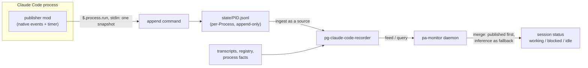
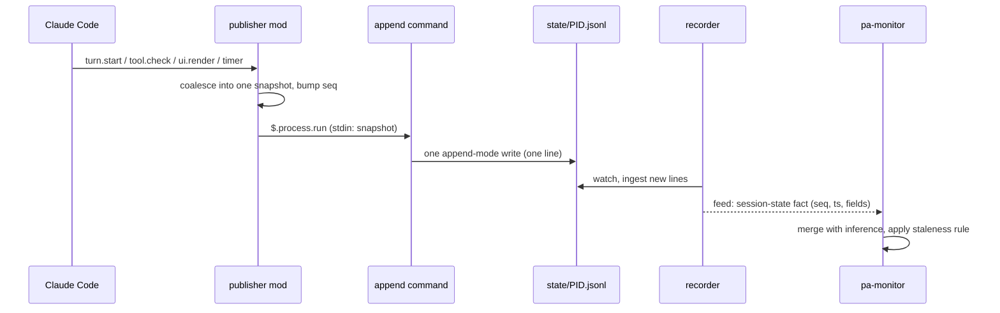
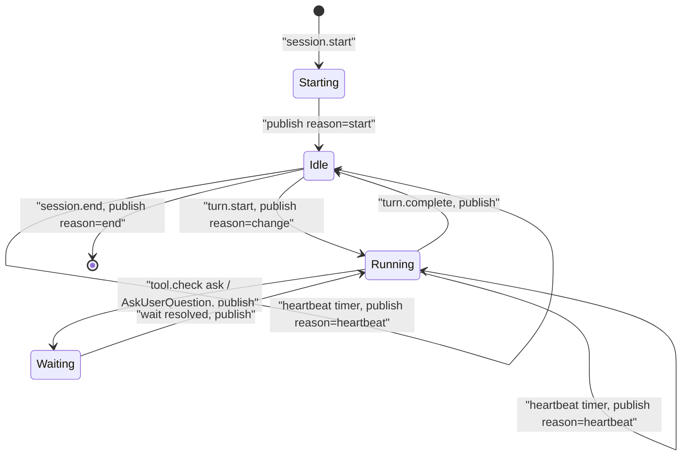

# Session-state publisher mod: design

**Status**: Draft, awaiting operator review. Nothing here is decided, implemented or decomposed.
Every item under "Open questions" is the operator's to answer, and the answers MAY change the
design. This draft was written by an agent from the findings in
`docs/investigations/2026-10-13-claude-code-mods-spike.md` and the accepted design of the
recorder (`docs/adr/0115-pg-claude-code-recorder-domain-model-and-access-rule.md` and
`docs/superpowers/specs/2026-10-30-pg-claude-code-recorder-design.md`).
**Date**: 2026-11-21

Like the other files under `docs/superpowers/specs/`, this file is an extraction source, not a
durable citation target. The key words MUST, MUST NOT, SHOULD, SHOULD NOT and MAY are used as in
RFC 2119. This repository is public: deployment specifics are deliberately absent.

## 0. Summary

Today pa-monitor infers what each Claude Code session is doing from transcripts, the session
registry and process listings. The inference is a guess about a state the session itself knows
exactly: whether a turn is running, what it is waiting for, whether the person has typed an unsent
prompt, and how close the account is to its rate limits.

This design adds a **session-state publisher**: a Claude Code mod inside each session that reports
that session's own state, as a small fact record, to a place pa-monitor reads. It is the "mods
workstream 2" direction from the mods spike: "let each session report its own state rather than
having the daemon infer it from transcripts and process listings".

Proposed shape, in one paragraph. A new plugin with one hooks module observes native mod events and
hands a snapshot of the session's state to a small append command through `$.process.run` whenever
the state changes, and at a heartbeat interval otherwise. The command appends one JSON line to a
per-Process file under a state directory. The recorder ingests those files as one more source,
the way it already ingests the control mod's end files, and serves them in its feed; pa-monitor reads
the recorder, as ADR 0115 requires, and merges the published facts with its existing inference
under explicit precedence rules. The mod publishes facts only; every interpretation (working,
blocked, idle, hung, the blocker) stays in pa-monitor. Rollout is per machine, in shadow mode first,
with inference as the fallback for any session that publishes nothing or goes stale.

Size: M for the mod and append command, S to M for the recorder source, M for the pa-monitor
reader and merge. The unit sizes are an indication, not a plan.

## 1. Intent, goals and non-goals

### Goals

- A session reports its own turn state, waits, unsent-prompt presence, rate limits and a heartbeat.
- pa-monitor stops guessing the facts the session can state, and still works for a session that
  does not publish (no mod, an older Claude Code, a mod that failed to load).
- A tool that reads the state can tell a published fact from an inferred one, and can tell a
  session that went quiet from one that is idle.
- The mod can never slow, block or break the session it observes.

### Non-goals

- Controlling a session. The control mod owns inbound requests; this mod is outbound only.
- Replacing the recorder's transcript, Conversation or Process facts. Published state is one more
  evidence source, not a second record of the conversation.
- Moving pa-monitor's interpretation (the three statuses, the blockers, `hung`, nudging, the busy
  gate) into the mod or the recorder. ADR 0115 (decisions 1 and 6) keeps interpretation in clients.
- The tool-call recording (the tracker design) and the drain idle monitor (a separate workstream).
- A guarantee for a Claude Code that has no mod support, or for a machine whose guard forbids the
  mod. Those sessions keep inference.

### Anti-goals (a failure even if it technically works)

- A published value that disagrees with the transcript and wins silently. A disagreement MUST be
  visible (section 6).
- The unsent prompt text written to disk by default (section 4, open question 3).
- A mod whose failure shows in the Claude Code interface or delays a turn.

## 2. Constraints from the spike

Findings from the 2026-10-13 spike on Claude Code 2.1.296 that bind this design. The mods API was
marked early access, so the builder MUST re-check each against the installed version and the
build's own `claude-code.d.ts` before relying on it (section 9).

| Finding                                                                                                                 | Consequence for this design                                                                                                                                                                                                    |
| ----------------------------------------------------------------------------------------------------------------------- | ------------------------------------------------------------------------------------------------------------------------------------------------------------------------------------------------------------------------------ |
| With managed settings the built-in guard skips user mods on every `classic.*` event                                     | The mod MUST use native events only (`session.start`, `turn.start`, `turn.complete`, `tool.call`, `tool.check`, `ui.render`, `session.end`). A value only a classic event carries (the live `permission_mode`) is out of reach |
| `$.fs.write` is not atomic: 2 of 328 files held runs of NUL bytes, both written while a subagent made concurrent calls  | The mod MUST NOT write state with `$.fs.write`. It publishes through an append command                                                                                                                                         |
| `$.process.run` costs 4 to 6 ms per process                                                                             | Publishing on change plus a slow heartbeat is cheap; per-event publishing is affordable, but SHOULD be coalesced                                                                                                               |
| A child of `$.process.run` does not receive `CLAUDE_CODE_SESSION_ID`                                                    | The mod MUST pass the session id explicitly (`init.env` or an argument). The pid is derived by the command (section 4)                                                                                                         |
| `$.prompt.read()` polled every 3 s returned the unsent draft; any mod can read drafts                                   | Draft presence is publishable; publishing the text is a privacy decision (open question 3)                                                                                                                                     |
| `$.session.usage().rateLimits` returned the `five_hour` window; no `seven_day` entry appeared                           | The contract MUST allow either window to be absent                                                                                                                                                                             |
| `tool.check` returning `ask`, then the row redrawing as running or errored, brackets a permission wait                  | A wait is observable in the mod, with its start and its end                                                                                                                                                                    |
| "No" and Esc at a permission dialog look identical; an engine ask in auto mode may go to the classifier, with no dialog | The mod MUST NOT claim a person was asked. It publishes who asked (a hook or the engine) and lets pa-monitor interpret                                                                                                         |
| State kept in `$.state` survives hot reload, and `session.start` fires again                                            | The mod keeps its sequence number in `$.state` and re-publishes a full snapshot on every `session.start`                                                                                                                       |
| Subagent calls reach `tool.call` and `tool.check` with `agentId`                                                        | Waits and the running-tool count can be attributed to a subagent                                                                                                                                                               |
| The spike measured one machine, with managed settings                                                                   | Rollout is per machine, with shadow mode, and a machine nobody has checked keeps inference (section 7)                                                                                                                         |

## 3. Where state flows (decision pending: open question 1)

ADR 0115 decision 4 says any tool MAY read the recorder directly and that a client of a recorder
that is down reports "daemon offline" and does not fall back to Claude's files. Decision 2 moved
control into a mod and left the recorder to ingest the mod's end files. Published session state is
the same kind of thing: a fact a mod writes and the recorder ingests. Three paths were considered.

| Path                                                                        | Pros                                                                                                                                                                                                    | Cons                                                                                                                                                                             |
| --------------------------------------------------------------------------- | ------------------------------------------------------------------------------------------------------------------------------------------------------------------------------------------------------- | -------------------------------------------------------------------------------------------------------------------------------------------------------------------------------- |
| A. Mod to files, recorder ingests, pa-monitor reads the recorder (proposed) | One reader for every session fact, matching ADR 0115 and the `claude-control-end` precedent; the feed gives pa-monitor push instead of its own polling; ccpool and other clients get the state for free | The recorder gains a source and a store classification (it is ephemeral, not re-derivable); one more hop of latency; the recorder is a hard dependency for the feature           |
| B. Mod to files, pa-monitor reads the files directly                        | Fewest moving parts; no recorder change                                                                                                                                                                 | Contradicts the direction of ADR 0115 (pa-monitor ends up as policy only); pa-monitor grows file watching the recorder was built to remove; other clients each re-read the files |
| C. Mod to the control mod's inbox channel, outbound                         | Reuses the listener and the state directory                                                                                                                                                             | The FIFO is inbound and at-most-once with no ack; it is a per-process request channel, not a publication channel; mixes two responsibilities in one mod                          |

Path A is recommended. Under A the recorder serves the published record as a **fact** (what the
session said, and when), never as a label. Whether the recorder keeps the published records only
current or also in its observations journal is an ADR 0115 decision-3 question (open question 9).

## 4. The published state contract

### 4.1 Location and files

- Directory: `$XDG_STATE_HOME/pg-claude-session-state/state/` (default under `~/.local/state`),
  mode 0700, one file per Process, `<pid>.jsonl` mode 0600. Naming the file by pid follows the
  control mod's `<pid>.fifo`, so the recorder can match it to a Process by the pid and the start
  time the record carries.
- A file holds the lines of one Process only. The append command is the only writer and takes the
  pid from its parent process (the `claude` that spawned it), which the builder MUST confirm live
  (section 8, check 2) because the spike did not measure it.
- Each line is written with a single append-mode `write`, so concurrent callers (the main thread and
  a subagent's hooks) cannot interleave inside a line.
- The recorder (or, until it does, a startup sweep of the command) removes the file of a Process
  that has exited, as it removes a stale FIFO today.

A file is an append-only log whose every line is a complete snapshot, so a reader needs only the
last valid line. The log shape is chosen because the spike recommended an append command over one
file per event, because a torn tail line is skipped rather than corrupting the file, and because the
history is useful for diagnosis. The alternative, one snapshot file replaced by an atomic rename,
is open question 7.

### 4.2 One line: `session-state/1`

Each line is one JSON object. The mod fixes exact field names against the build's
`claude-code.d.ts` (section 9); the facts are:

| Field         | Required   | Meaning                                                                                                                               |
| ------------- | ---------- | ------------------------------------------------------------------------------------------------------------------------------------- |
| `schema`      | yes        | the format and its version, `session-state/1`                                                                                         |
| `seq`         | yes        | a counter that increases by one per line within a Process, kept in `$.state`, so a reader orders lines and detects a gap              |
| `ts`          | yes        | milliseconds since the Unix epoch, from `$.clock.now()`                                                                               |
| `session_id`  | yes        | the Claude Code session id, passed explicitly                                                                                         |
| `pid`         | yes        | the Claude process id, from the command                                                                                               |
| `proc_start`  | yes        | the process start time, from the command, so a reused pid is not mistaken for the old Process                                         |
| `reason`      | yes        | why this line was written: `start`, `change`, `heartbeat`, `end`                                                                      |
| `heartbeat_s` | yes        | the interval the mod promises; a reader derives staleness from it (section 6)                                                         |
| `turn`        | yes        | `{ state, id, started_at, last_duration_ms, last_reason }`: `state` is `running` or `idle`; `last_reason` is `turn.complete`'s reason |
| `waits`       | yes        | a list, possibly empty, of what the session is waiting on (4.3)                                                                       |
| `prompt`      | yes        | `{ draft_present, draft_chars }`, and `draft_text` only if open question 3 allows it                                                  |
| `rate_limits` | when known | `{ five_hour?, seven_day? }`, each `{ used_pct, resets_at }`; either window MAY be absent; account-level, not per session             |
| `agents`      | yes        | `{ running_subagents, running_tools }`                                                                                                |
| `versions`    | yes        | `{ claude_code, mod, load_count }`; `load_count` rises on each hot reload                                                             |
| `end`         | on `end`   | the `session.end` reason, so a clean end is distinguishable from silence                                                              |

A reader MUST ignore fields it does not know and MUST treat an unknown `schema` major version as
"no published state" for that Process, not as an error. The mod MUST NOT publish a tool's input,
output or any transcript text.

### 4.3 Waits

A wait is something the session cannot proceed past without an outside event. Each entry:

| Field         | Meaning                                                                                                                                                                             |
| ------------- | ----------------------------------------------------------------------------------------------------------------------------------------------------------------------------------- |
| `kind`        | `permission` (a `tool.check` verdict of `ask` not yet resolved), `question` (an `AskUserQuestion` call not yet answered), `tool` (a tool call running longer than a configured age) |
| `since`       | the time the wait began, from the clock                                                                                                                                             |
| `tool`        | the tool name                                                                                                                                                                       |
| `tool_use_id` | the call id, the Correlation Identifier the tracker design also uses                                                                                                                |
| `agent_id`    | present when a subagent is the one waiting                                                                                                                                          |
| `asked_by`    | for `permission`: `hook` when `tool.check` carries a deciding hook, `engine` when it does not                                                                                       |

The spike measured the `permission` wait (a `tool.check` of `ask` to the row running or errored) and
showed that an `engine` ask in auto mode may go to the classifier with no dialog (653 ms in one
sample). The mod therefore publishes `asked_by` and leaves "a person is being asked" to pa-monitor,
which MAY treat `asked_by: engine` waits shorter than a threshold as not needing a person. The
`question` wait was not exercised in the spike and MUST be proven by a live check (section 8,
check 4) before pa-monitor trusts it; until then pa-monitor keeps its existing `AskUserQuestion`
inference for that case.

### 4.4 Publish triggers and heartbeat

- The mod MUST publish on `session.start` (a full snapshot, including after a hot reload), on a
  change of `turn.state`, on a change in `waits`, on `draft_present` flipping, and on `session.end`.
- The mod MUST publish a `heartbeat` line every `heartbeat_s` when nothing else was published. The
  proposed default is 15 s (open question 6). At about 5 ms per publish that is under 0.05% of one
  core per session (5 ms / 15 s = 0.033%).
- Bursts MUST be coalesced: a change within 250 ms of the previous publish is folded into one line,
  so a flurry of tool calls is one line, not dozens. The 250 ms figure is a starting value for the
  builder to measure, not a measured one.
- The draft is polled with `$.prompt.read()` at a short interval (the spike used 3 s). Only the
  derived `draft_present` and `draft_chars` leave the mod by default.
- Rate limits are read when the snapshot is built. They are account-wide, so the same value appears
  in every session's line; pa-monitor MUST NOT sum them.

## 5. The reader and the recorder source

### 5.1 The recorder

The recorder gains one source, `claude-session-state`, beside `claude-control-end`: it watches the
state directory, ingests complete lines, ignores and counts a torn tail line, and keeps the newest
line per Process available to the feed and to a query. It MUST NOT derive labels from the line (ADR
0115 decision 6 keeps interpretation in clients). Each new source and each derived fact it serves
needs a listing in ADR 0115 (open question 9). The recorder's usual metrics (a lag figure for the
source, a count of skipped lines) and its coverage view SHOULD include the source.

### 5.2 pa-monitor

pa-monitor reads the published record through its existing recorder client, in the same place it
reads Process facts, and adds it to the per-session inputs of the status computation. The three
statuses and the blockers keep the definitions of pa-monitor's ADR 0024; this design adds inputs,
not statuses. A reader that cannot reach the recorder reports "daemon offline", as ADR 0115
requires, and does not read the state files.

## 6. Coexistence with transcript inference

The published state and the inferred state describe the same session, so the design needs a rule for
when they disagree, a rule for when the publisher goes quiet, and a way to see both.

### 6.1 Per-field precedence

When a fresh published record exists for a session, pa-monitor SHOULD use it for the facts the
session knows better than a transcript, and keep inference for the rest:

| Fact                                                    | Source when fresh published state exists                            | Source otherwise or in addition                                                                         |
| ------------------------------------------------------- | ------------------------------------------------------------------- | ------------------------------------------------------------------------------------------------------- |
| Is a turn running                                       | published `turn.state`                                              | inferred from the transcript tail and registry status                                                   |
| Waiting on a permission or a question                   | published `waits` (a `question` wait only after check 4 passes)     | inferred (`AskUserQuestion` without a result, a permission prompt)                                      |
| Typed but not sent (not idle)                           | published `draft_present`                                           | none: inference cannot see it, so today such a session looks idle                                       |
| Usage-limit blocker, API errors, authentication blocker | inference only                                                      | the transcript carries the error; the mod does not see API errors in the spike evidence                 |
| Hung (a turn running with no progress)                  | inference, using the published heartbeat as an extra liveness input | inferred                                                                                                |
| Account rate-limit windows                              | published `rate_limits` as one more input                           | pa-monitor's existing source stays authoritative until a comparison supports a change (open question 5) |
| Subagent and shell counts                               | inference                                                           | the published counts are compared, not used, until the comparison (6.3) is clean                        |

The precedence is deliberately per field. A published `idle` MUST NOT override an inferred
`usage_limit` blocker, because the mod cannot see the API error; the blocker is a fact only the
transcript carries.

### 6.2 Staleness and a quiet publisher

- A published record is **fresh** while `now - ts <= 3 * heartbeat_s` (3 missed heartbeats; the
  multiplier is open question 6). A stale record MUST be ignored for the facts above, and the
  session falls back to inference for them. The fallback MUST be visible (below).
- A record whose `pid` and `proc_start` do not match a live Process in the registry MUST be ignored
  (pid reuse), and one with `reason: end` marks the session as ended cleanly.
- A hot reload or a mod crash makes the record stale until the next `session.start`; this is not an
  error, and inference covers the gap.

### 6.3 Making disagreement visible

- pa-monitor SHOULD expose, per session, which source decided each status (`published` or
  `inferred`), in `status --json` and in the TUI, so an operator can see which sessions are covered.
- When both exist and disagree on whether a turn is running, pa-monitor MUST count the disagreement
  (an OpenTelemetry counter labelled by the fact) and keep the last disagreement's evidence
  available to a diagnostic command. A rise in disagreements is the signal that the publisher or the
  inference has a bug.
- During shadow mode (section 7) the published value is computed and compared but never used.

## 7. Rollout, per machine

The tracker rollout decision (the 2026-10-29 ruling in the tool-tracker design) is the precedent:
the new path starts on one machine, is compared there, and a machine nobody has checked keeps the
old behavior. The same shape fits here.

1. **Enable the mod per machine.** The plugin is delivered by home-manager like the other mods, and
   its enablement is a per-machine option (bundle placement: open question 2). A machine without the
   option publishes nothing, and its sessions use inference exactly as today.
2. **Shadow mode.** pa-monitor reads and compares the published state, counts disagreements, and
   still computes status from inference alone. This runs on the first machine until the comparison
   (below) is clean.
3. **Cut-over, per machine.** A second option makes pa-monitor use published state for the facts in
   6.1 on that machine only. It MUST NOT be flipped on a machine until publication is observed there
   (live checks 1 to 3, section 8).
4. **Another machine joins** by enabling the mod, repeating the live checks and passing the same
   comparison there. The spike measured only a machine with managed settings, and a machine without
   them, or with a different Claude Code version, MAY behave differently for mods, so no machine
   inherits a result from another.
5. **A mixed fleet is normal.** Cut-over is per machine, and within a machine fallback is per
   session, so a session started before the mod was enabled, or by a Claude Code that fails the
   version check, simply stays inferred.

The comparison that closes shadow mode compares, over a measured window (the length is open question
8): the fraction of session-time where published and inferred agree on "a turn is running", every
disagreement categorized (a known gap such as draft presence, versus an unexplained one), and the
heartbeat gap distribution. The operator accepts or rejects the result, as with the tracker.

## 8. Live checks (what a test cannot prove)

Unit tests cover the append command, the contract, the coalescing and the merge. These need a real
Claude Code on the machine; each is run per machine at rollout.

1. **The mod loads and publishes.** Start a session; the Process's file exists, the first line has
   `reason: start`, and the line count grows with a turn.
2. **The pid and start time are right.** The `pid` and `proc_start` in the line equal the registry
   file's values for that session. This proves the command can derive the pid (the spike did not
   measure it) and that a reused pid is detectable.
3. **A turn and a permission wait show up and clear.** Run a turn, then a call that needs approval;
   the line shows `turn.state: running`, then a `permission` wait with `asked_by`, then both clear
   after the dialog is answered. Repeat in auto mode and confirm an engine ask is labelled
   `asked_by: engine`.
4. **An `AskUserQuestion` wait shows up.** Not exercised in the spike. Without this passing, the
   `question` wait stays off and pa-monitor keeps its inference for it.
5. **The draft flag.** Type a prompt without sending; `draft_present` becomes true within the poll
   interval and false after it is sent or cleared. The line MUST NOT contain the text (unless open
   question 3 is answered otherwise).
6. **Heartbeat and staleness.** Pause the publisher (suspend the process or disable the mod on a
   running session); pa-monitor marks the record stale after 3 heartbeats and falls back to
   inference, and says so in `status --json`.
7. **Hot reload.** Edit and reload the mod; `seq` continues, `load_count` rises, and a full
   snapshot is published on the second `session.start`.
8. **Concurrency.** Run a subagent making tool calls while another session publishes; every line is
   valid JSON and no file contains NUL bytes (the spike's `$.fs.write` failure).
9. **A broken publisher is harmless.** Make the append command fail or hang; the session's turn
   latency does not change and nothing appears in the interface (section 9).
10. **No leak.** Search the state directory for the text of a drafted prompt and a tool input; there
    is none.

## 9. Left to the builder

- Exact field names, and which event supplies which value, fixed against the build's own
  `claude-code.d.ts`, and a re-check of every spike finding against the installed Claude Code
  version (the spike used 2.1.296; the mods API was marked early access).
- The failure policy. The mod MUST be a pure observer: every hook returns what `next(e)` resolves
  to, unchanged, and a thrown error, a failed or slow `$.process.run`, or a missing append command
  MUST NOT surface in the interface or delay a turn. The mod MUST bound each publish with a timeout
  and drop it on failure, relying on the next heartbeat. This follows the rule that Claude Code MUST
  NOT depend on its mods.
- How the append command finds its pid, and the file rotation: bounding a file's size (for example,
  rewrite to the last snapshot past a size) so a long session does not grow without bound.
- Validator constraints: `$` is passed only to functions declared at the top of the module, not to
  closures created inside `register` (spike finding).
- Command hooks versus a mod. Because classic events never reach a user mod under the guard, a fact
  only a classic event carries MUST come from a command hook or be left out. This design asks for
  none.
- pa-monitor's behavior documents change before its code, as for the recorder's own client moves.

## 10. Risks

| Risk                                                                            | Mitigation                                                                                                   |
| ------------------------------------------------------------------------------- | ------------------------------------------------------------------------------------------------------------ |
| The mods API changes between Claude Code releases ("may change without notice") | Version recorded in every line; re-check on a version change; fallback to inference is always in place       |
| The publisher says idle while the transcript shows an error blocker             | Per-field precedence (6.1): the mod never overrides a blocker only the transcript can see                    |
| Many sessions multiply the append cost                                          | Coalescing and a 15 s heartbeat; per-session cost computed in 4.4                                            |
| Draft text leaks through the state files                                        | Presence and length only by default; live check 10                                                           |
| The recorder is down or lagging, and published state looks stale                | Staleness is measured from the line's own `ts`, so a lag shows as stale and falls back to inference, visibly |
| The mod is not loaded on a machine nobody enabled it on                         | Per-session fallback; the status shows `inferred`, so the gap is visible                                     |
| Two writers per Process (a restarted listener, a reloaded module)               | One append command, single append-mode writes, `seq` ordering; the reader takes the highest `seq`            |

## 11. Open questions for the operator

Each question gives the situation, the options and a recommendation. The operator's answers go
into this design before any decomposition.

1. **Does published state flow through the recorder, or straight to pa-monitor?** The recorder's
   accepted design makes it the one reader of Claude Code's files and has pa-monitor end up as
   policy only; the control mod already writes files the recorder ingests. Options: (A) mod to
   files, recorder ingests, pa-monitor reads the recorder; (B) mod to files, pa-monitor reads the
   files directly; (C) reuse the control mod's inbox channel. Recommend A (section 3), because it
   follows ADR 0115 and gives every client one feed; its cost is a recorder source and ADR
   bookkeeping. B is faster to build and contradicts the direction already ruled. Blocks the
   recorder work and pa-monitor's reader design.
2. **A new plugin, or part of the control mod?** The plugin boundary is one hooks module per plugin,
   and the bundle grouping design puts the control mod in the Control bundle. Options: (a) a new
   plugin `pg-claude-session-state`, in the Tracking or Control bundle; (b) extend the control mod
   with the outbound half. Recommend (a): the control mod is inbound, at-most-once and holds a
   listener child, and a bug in publishing should not take control down with it; the cost is one
   more plugin and bundle membership. Which bundle is also yours to name.
3. **May the unsent prompt text leave the session?** Any mod can read the draft, and the draft can
   hold secrets or half-written thoughts. Options: (a) presence and character count only; (b) the
   text too, behind a per-machine option; (c) nothing about the draft. Recommend (a): it fixes
   "typed but not sent looks idle" without storing the text. Choosing (b) turns every state file and
   the recorder store into a place that holds drafts.
4. **Does published state replace inference or supplement it?** Options: (a) supplement, per field,
   with inference as the fallback (section 6, proposed); (b) replace inference wherever a mod is
   present; (c) published state only feeds a new `status --json` field and never changes the
   status. Recommend (a) with shadow mode first: it gains the facts a session knows and keeps what
   only a transcript can show. (b) would lose the usage-limit and error blockers, which the mod
   cannot see.
5. **Are the account rate limits published per session?** pa-monitor already tracks the windows,
   and every session would publish the same account-wide value; the spike saw only `five_hour`.
   Options: (a) publish them, pa-monitor reads one and compares; (b) do not publish them in this
   version. Recommend (a) as a comparison input only, kept authoritative-by-inference until the
   comparison supports a change, because it is nearly free and an independent reading is useful.
6. **Heartbeat interval and staleness multiplier.** Proposed: 15 s and 3 missed heartbeats (45 s
   to stale). A shorter interval makes a hung or dead publisher visible sooner at more cost; pa-monitor's
   fast tier polls every few seconds and its menu bar refreshes every 5 to 10 s. Recommend 15 s and 3
   unless a consumer needs faster detection of a stopped publisher; say if one does.
7. **Append-only log per Process, or one snapshot file replaced by rename?** Log (proposed): a torn
   tail is skipped, history aids diagnosis, and it matches the spike's advice; needs rotation. Snapshot
   file: bounded size and simplest read, needs a write-temp-then-rename in the command and loses
   history. Recommend the log with rotation; the choice is cheap to reverse before the contract is
   consumed.
8. **How long is shadow mode, and what counts as clean?** The tracker design left the comparison
   window to the operator. Options: a fixed window (for example one week of normal use on the first
   machine), or a count of sessions covering an agreement target. Recommend a fixed window of one
   week and an agreement target stated in advance, so the cut-over decision is not made on a
   feeling. Which machines join, and in what order, is also yours; the spike evidence is one
   machine with managed settings, and a machine without them MUST repeat the live checks.
9. **ADR 0115 bookkeeping.** Adding a source and serving its newest line per Process touches the
   store split (decision 3: is published state re-derivable? it is not, but it is ephemeral) and the
   derived-facts list (decision 6). Options: (a) a short amendment to ADR 0115 listing the
   `claude-session-state` source as an ephemeral, non-journaled fact source; (b) journal every line
   like other non-re-derivable observations. Recommend (a): the lines are superseded by the next
   one, and a lost database loses nothing the next heartbeat does not restore. You decide whether
   that needs the amendment ritual the earlier derived-facts change used.
10. **Do the end reason and this mod merge?** The control mod already writes the end reason that the
    recorder ingests. The publisher's `end` line would duplicate it. Options: (a) keep both, with
    the control mod's file authoritative for the end reason; (b) the publisher also carries the end
    reason and the control mod stops writing it. Recommend (a) for now: it changes nothing in an
    accepted design; revisit if the duplication causes a conflict.

## 12. What this design does not decide

It does not choose names beyond the working names used here, does not fix exact field names (the
builder's task, section 9), does not decompose into work, and does not touch pa-monitor's status
definitions. Approval of this draft is the operator's; decomposition follows approval, not before.
