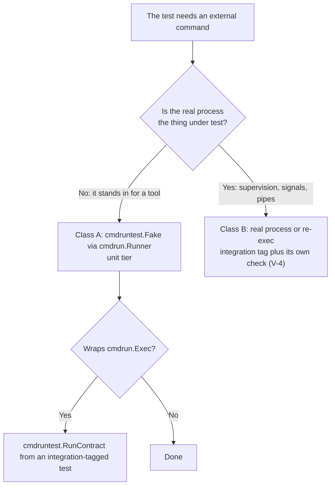

# Code File Standards

Moved out of the always-on core rules (tc-ql0o Stage D, 2026-08-26): each of these three packs is
scoped to a file type, so it now rides in only when a matching file is read instead of every
session unconditionally.

## Exit Codes

In ANY language, exit code 1 is the conventional general/catch-all error and MUST NOT be given a
specific branchable meaning. If an exit code must carry a specific meaning (so callers/scripts can
branch on it), it MUST be a distinct value >= 2, with 1 reserved for generic/unexpected errors.

## Unit Tests

MUST be isolated; if they modify files directly, the test MUST generate the scenario in a temp
directory.

### Speed And Scope: What Counts As A Unit Test

A unit test MUST need minimal setup and fixtures, MUST pass in any order, and MUST NOT depend on
another test having run. The expected cost (operator ruling, Phillip, 2026-10-25):

- a single test takes milliseconds;
- a package's tests take seconds;
- the unit tests of a whole app MAY take a minute or two, and there is no hard limit on that total.

A test that cannot meet this is NOT a unit test, whatever its file is called. Two kinds are the
usual offenders and MUST NOT run in the unit gate (`go test ./...`, a `*-go-tests` check, the
`run-unit-tests` hook, `pg-hooks run pre-commit` or `pre-land`), and MUST NOT block a commit or a
land:

- a load, soak or scale test, including any simulation of elapsed time or of many entities;
- an integration or end-to-end test that spans several processes or runs a whole daemon.

A fast, single-process test that runs the real tool against a hermetic fixture (the V-3 case, such
as a real `git` in `x/gittest`) stays a unit test.

Such a test MAY stay in the repo. It MUST sit behind a build tag or an opt-in switch AND have its
own check that runs it (`phillipg-nix-repo-base` ADR 0024: a suite that nothing runs cannot fail,
so it is not a gate). When a change warrants running it, the agent MUST file a bead gated on that
change being deployed (`pb:pb-gate-lifecycle`), whose work is to run the suite against `main`. An
agent MUST NOT raise a package test timeout (`-timeout 30m`) to make a slow test fit the unit gate:
the timeout is the sign the test is in the wrong place.

### Tests That Need Git

A test that needs a git repository MUST get it from the shared hermetic fixture library for its
language. It MUST NOT build one by hand, and it MUST NOT touch the ambient repository (the one the
test process happens to be running in).

Go (`github.com/phillipgreenii/x`, repo `phillipgreenii-x`):

```go
repo := gittest.New(t, gitfixture.RepoOptions{})
```

- Tests MUST use `x/gittest` (the `*testing.T` adapter). Non-test helpers MAY use `x/gitfixture`,
  which is deliberately free of the `testing` import.
- Code under test that shells out to git SHOULD go through `x/gitclient`, whose child-process
  environment is an allowlist.

Bash/bats (`git-fixture-harness.bash`; canonical copy in `phillipg-nix-repo-base` under
`lib/scripts/`, exported by that flake as the `git-fixture-harness` package):

```bash
setup() { gfh_setup "my-suite"; }
teardown() { gfh_teardown; }
```

- Tests MUST use `gfh_setup`/`gfh_teardown`. A second repository under one setup MUST come from the
  harness primitive for its kind, never a hand-rolled `git init`/`git clone`:
  - `gfh_init_repo <path> <suite-name> [--no-identity]` for an additional working repository;
  - `gfh_init_bare <path>` for a bare remote (branch `main`, hooks disabled);
  - `gfh_clone <src> <dest> <suite-name> [--no-identity]` for a clone (hooks disabled even during
    the clone).

  Keep every `<path>`/`<dest>` under `GFH_WORK`.

- `--no-identity` (on `gfh_init_repo`/`gfh_clone`) MUST be used by a test of code that has to
  handle a repo where git cannot resolve an author: it sets `user.useConfigOnly=true` and no local
  identity. A test MUST NOT export `GIT_AUTHOR_*`/`GIT_COMMITTER_*` or an identity after
  `gfh_setup` when relying on it.
- `gfh_reset_env` (called by `gfh_setup`) unsets every exported variable not on its allowlist. A
  suite that needs one to survive (for example `SCRIPTS_DIR` or a nix-injected tool path) MUST
  preserve it with `gfh_save_env VAR...` BEFORE `gfh_setup` and `gfh_restore_env` AFTER it, and MUST
  NOT re-export any `GIT_*`-family variable that way. `gfh_save_env` replaces hand-rolled
  copy-to-an-unexported-name-and-back code.
- A repo SHOULD consume the harness by reference (`phillipg-nix-repo-base`'s `git-fixture-harness`
  package, handed to the bats check as its `testSupport`) rather than vendor a copy, so there is
  nothing to drift. A repo that still vendors a copy under a `test-support/` directory MAY see it
  lag the canonical copy and lack the primitives above; a suite that needs one MUST re-vendor the
  canonical file rather than hand-roll the fixture.

Cross-repo test dependencies (the harness lives in `nix-repo-base`, a different repo from the
tests that use it; tc-4ehow):

- A test that needs a file from ANOTHER repo MUST read it from a purpose-named environment
  variable naming that one file (`GFH_LIB` for `git-fixture-harness.bash`), never from a guessed
  sibling path, `pn` discovery, `find`, or a `nix` call. A test MUST NOT mention a sibling repo's
  directory name.
- The variable MUST have a locked nix default (`pkgs.git-fixture-harness`), set by the
  `run-unit-tests` hook, the nix `checks.*`, and the dev shell, so a commit or CI works with no
  local checkout of the provider. A local checkout MAY override it via the workspace-root
  `.envrc` (direnv); the tests behave the same either way.
- A test whose variable is unset MUST fail at once with one line naming the variable and the
  ways to set it (the `GFH_LIB is not set: ...` message used by the existing suites).
- A repo that adds its own `.envrc` MUST call `source_up_if_exists`, or the workspace `.envrc`
  stops loading.
- Agent workarounds: ad-hoc `bats` MUST run as `direnv exec <workspace-root> bats ...` or with
  `GFH_LIB` exported; an agent that changes the harness AND its tests together MUST commit with
  `GFH_LIB=<local file> git commit ...`; in a workforest set the workspace `.envrc` points at
  the CANONICAL `nix-repo-base`, so a set that changes the harness MUST export `GFH_LIB` to the
  set's own copy. After a provider change lands, consumers' locked default and CI keep the OLD
  harness until the consumer's flake lock is bumped (provider, then lock bump, then consumer).

Both libraries are hermetic BY CONSTRUCTION: the fixture lives under a temp root, `HOME` and the
system git config are neutralised, and the environment is rebuilt from an allowlist rather than
scrubbed against a list of known-leaky `GIT_*` names. A test therefore MUST NOT:

- run `git init`, or `exec.Command("git", ...)`, outside these libraries;
- run git against the working directory, a bare relative path, or a `-C` path that is not under the
  fixture root;
- "protect" a hand-rolled fixture by unsetting `GIT_DIR`/`GIT_WORK_TREE` and friends. An enumerated
  scrub is only as complete as its list, and it is how this class of bug keeps recurring.

If a test needs something the library lacks, it MUST extend the library, not bypass it. Code that
predates this rule MAY keep its hand-rolled setup until the file is next changed; at that point it
MUST be migrated.

Exemption: scenario `setup.sh` scripts of the `pn` smoke tier (`phillipg-nix-repo-base`,
`modules/pn/internal/workspace/smoke/scenarios/*/setup.sh`; operator-reversible agent decision b+
recorded on `pg2-km0jx`, applied by `pg2-wsvch`). They MAY keep their hand-written `git init`,
`git clone` and `git config`. Reason: a `setup.sh` is not a Go test; it only ever runs inside the
smoke runner, as `bash setup.sh` with the environment from `buildScrubbedEnv` (throwaway `HOME`,
`GIT_CONFIG_GLOBAL`/`GIT_CONFIG_SYSTEM` at `/dev/null`, fixed identity), and migrating 44 scripts
would add a second fixture mechanism without closing a leak that environment does not already
close. The exemption holds only while ALL of these hold:

- `buildScrubbedEnv` MUST strip the whole GIT_DIR family (`GIT_DIR`, `GIT_WORK_TREE`,
  `GIT_INDEX_FILE`, `GIT_CEILING_DIRECTORIES`, `GIT_COMMON_DIR`, `GIT_PREFIX`,
  `GIT_OBJECT_DIRECTORY`) on every call, so a variable set with `t.Setenv` after `TestMain` cannot
  reach a script;
- a test MUST prove that (`TestSmoke_ScrubbedEnvStripsGitDirFamilyAfterTestMain`);
- the smoke package's own Go code MUST NOT run git outside `x/gitfixture`/`x/gitclient`.

The exemption covers nothing else: any new Go test in that package, and any other `setup.sh`-style
script outside the smoke runner, follows the rule above.

Why this is a hard rule: hook environments (a `pre-commit` run, a linked worktree) export
`GIT_DIR`/`GIT_INDEX_FILE` pointing at the OUTER repository. A fixture `git init` that inherits
them writes its temp path into the canonical clone's `.git/config` as `core.worktree`; the temp
dir is later deleted, and every git command in the clone then fails with `fatal: Invalid path`
(this also breaks `pn workspace apply`). Observed repeatedly: `pg2-12795`, `pg2-3fz2s`,
`pg2-oixbs`, `pg2-rrhw2`, `pg2-6drqh`, `pg2-yj06c`, `pg2-zw8s7`, and again in `pg2-7byxb`
(2026-10-06), where a hand-rolled test fixture bypassed `x/gittest`.

### Ad-Hoc Throwaway Git Fixtures

When an agent builds a throwaway repository by hand (an experiment, a reproduction), a failed `cd`
MUST NOT turn the next command into a write against the real repository. A linked worktree shares
its common `.git/config`, so a `git config user.email ...` run in the wrong directory changes the
identity for EVERY worktree of that repository (incident 2026-10-07: a failed `cd "$T/repo"`
followed by `git config user.email agent@example.invalid` poisoned the ZR monorepo for every
session and stamped the placeholder as the owner of 62 beads).

- The fixture MUST be addressed with `git -C "$T/repo" ...` for every git command, not by a bare
  `cd` followed by git commands.
- If a `cd` is used anyway it MUST be `cd "$T/repo" || exit 1`.
- The fixture directory MUST be created and verified (`test -d`) in a step of its own before any
  mutation. A mutating `git config`/`git remote`/`git commit` MUST NOT sit in the same command as
  the step that creates the directory it depends on.
- `$T` MUST be under a temporary root (`mktemp -d`); the approver refuses a repo-local
  `user.name`/`user.email`/`protocol.*` write that is not provably under one.

### Tests That Run An External Command

Code that runs an external program (`bd`, `gh`, `pg-connector`, `sh`, and so on) MUST do it through
a seam a test can answer in process, and a test that stands in for such a program MUST use the
shared fake for its language. It MUST NOT build the stand-in by re-executing the test binary.
Design record: ADR 0001 (`docs/adr/0001-shared-command-runner-seam.md`) in repo `phillipgreenii-x`.

Go (`github.com/phillipgreenii/x`, repo `phillipgreenii-x`; packages
[`x/cmdrun`](https://github.com/phillipgreenii/x/tree/main/cmdrun) and
[`x/cmdruntest`](https://github.com/phillipgreenii/x/tree/main/cmdruntest)):

```go
// production code (imports x/cmdrun only, never "testing")
type Deps struct{ Run cmdrun.Runner } // nil means cmdrun.Exec

res := run(ctx, cmdrun.Call{Name: "bd", Args: []string{"show", id}})
```

```go
// a unit test (imports x/cmdruntest, the testing adapter)
fake := cmdruntest.New(t)
fake.On(cmdruntest.Match("bd", "show", "pg2-1")).Return(cmdruntest.Out(`{"id":"pg2-1"}`))
deps := Deps{Run: fake.Runner()}
// ... exercise the code, then assert on fake.Calls() (ordered, safe for concurrent use)
```

- Code under test MUST take a `cmdrun.Runner` (`Call` in, `Result` out, no `*exec.Cmd`), defaulting
  to `cmdrun.Exec`. A seam that hands back an `*exec.Cmd` (a package variable set to
  `exec.CommandContext`, or a `CmdFactory`) cannot be answered in process, so its only double is a
  real process; it MUST NOT be introduced.
- A test MUST answer the seam with `cmdruntest.Fake` (`On(...).Return/Respond/Seq`, limited with
  `Times`/`Nth`). The fake fails the test on a call no rule answers; a test MUST NOT weaken that
  with a catch-all rule to silence it.
- A test MUST NOT re-execute the test binary to impersonate a tool (`GO_WANT_HELPER_PROCESS`,
  `-test.run=^TestHelperProcess$`, `os.Args[0]` as the child).
- An adapter that wraps `cmdrun.Exec` (to map a non-zero exit or a signal as its own callers
  expect) MUST NOT re-test `Exec` in a copy of the same `sh -c` cases. It MUST run
  `cmdruntest.RunContract(t, runner)` from a test carrying the `integration` build tag (real `sh`,
  so it spawns processes); `cmdrun.Exec` itself already passes that suite in `x`.
- A package SHOULD keep one fast real-process test through the seam (a `#!/bin/sh` stub on `PATH`
  exercising the real `Exec` path, plus a missing-binary start-error case), as the migrated
  `pg-router-source-pg-desk` and `ccpool-probe` do. That is a single-process real-tool test
  (V-3), costs milliseconds, and stays in the unit tier.

Class B exception: when the real process IS the thing under test (a wrapper that supervises a
child, process groups and signals, a delegate that leaves a grandchild holding a pipe open, a
`main` re-executed as itself), no `Runner` double can stand in, because the test exists to exercise
the real `exec`. Such a test MAY re-execute the test binary or spawn real children. It is a
multi-process test, so under V-4 it is an integration test, not a unit test:

```go
//go:build integration

package runner
```

- It MUST sit behind a build tag (`integration`, the tag `x` and this repo already use) or an
  opt-in switch, AND have its own check that runs it (`phillipg-nix-repo-base` ADR 0024: a suite
  nothing runs cannot fail). It MUST NOT run in the unit gate (`go test ./...`, a `*-go-tests`
  check, the `run-unit-tests` hook, `pg-hooks run pre-commit|pre-land`) and MUST NOT block a commit
  or a land.
- When a change to such a test or its subject warrants running it, the agent MUST file a bead gated
  on that change being deployed (`pb:pb-gate-lifecycle`) whose work is to run the suite against
  `main`. An agent MUST NOT raise a package test timeout to fit it into the unit gate.
- The class B test MUST NOT be used as an excuse for a stand-in: a test that only answers "what does
  the tool say" is class A (a stand-in for an external tool) and uses the fake.



Why (measured in `x`'s ADR 0001, Context and Measured cost, 2026-10-27; single runs of
`nice -n 10 go test -p 4 -count=1` on a shared host whose load was not recorded, so they are size
indicators, not predictions):

- A race-built child is the cost, not spawning. In a throwaway module, `sh -c true` took 175.7 ms
  over 20 runs under `-race` (175.7 / 20 = 8.8 ms each; 182.4 / 20 = 9.1 ms without `-race`),
  while re-executing the test binary took 3.032 s over 3 runs under `-race` (3.032 / 3 = 1.01 s
  each; 12.75 ms / 3 = 4.2 ms without `-race`). A real `sh` costs milliseconds; each fake call
  made by re-exec costs about a second.
- In `nix-agent-support` the class A packages measured, under `-race` against without it (package
  time, seconds): `pg-desk/internal/gather` 208.7 against 1.4, `pg-desk/internal/sync` 253.9
  against 1.6, `pg-router-source-pg-connector/cmd/...` 90.2 against 2.1,
  `pg-router-source-pg-desk/cmd/...` 15.6 against 4.1, `pg-router-probe/cmd/pg-router-probe` 15.3
  against 4.8, `ccpool-probe/cmd/ccpool-probe` 23.1 against 1.0. Summed: 208.7 + 253.9 + 90.2 +
  15.6 + 15.3 + 23.1 = 606.8 s under `-race`, against 1.4 + 1.6 + 2.1 + 4.1 + 4.8 + 1.0 = 15.0 s
  without. This is a sum of package times, not a module wall time (`-p 4` runs packages in
  parallel).
- The `pg-decider` fix (commit `c1911c5c8`, which replaced a `CmdFactory` with a `Runner` func)
  measured `internal/apply` 289.7 s to 1.5 s, `cmd/pg-decider` 149 s to 2.4 s and `internal/view`
  4.3 s to 1.3 s (`go test -race -count=1 -p 4`, wall per package). Before it, `pg-decider` hit the
  300 s `pg-test-runner` cap with every test passing.
- The ADR counted 21 test files containing `GO_WANT_HELPER_PROCESS` in `nix-agent-support`: 7 class
  A (replaced by the fake) and 14 class B (kept, to be tagged).

Code that predates this rule MAY keep its re-exec double until the file is next changed; at that
point a class A test MUST be migrated to `cmdruntest.Fake`, and a class B test MUST gain the build
tag and its own check. There is not yet a mechanical guard that flags `GO_WANT_HELPER_PROCESS` in an
untagged file (ADR 0001 defers it until the class A migrations land, because it would fail on every
file today), so a reviewer MUST look for the pattern by hand.

## Structured Data Files

MUST use `jq`/`yq`/`tq` for JSON/YAML/TOML manipulation over text-based editing (sd, sed, awk, python). `sd PAT REPL FILE...` rewrites FILE in place with no backup: preview with `sd -p` first, and run it only on files under version control.
