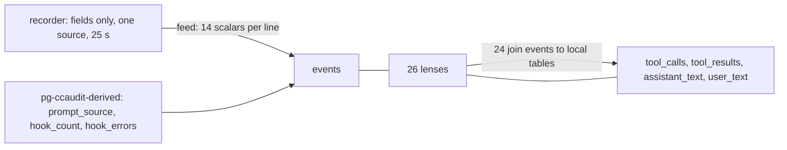

# pg-ccaudit events column inventory

Purpose: decide which `events` columns and indexes pg-ccaudit can stop storing, by recording what each
canned lens query reads and whether the recorder's query API could serve it instead. No code changes
here. The key words MUST, SHOULD and MAY are used as in RFC 2119.

Sources read: `internal/query/registry.go` (the lens queries), `internal/store/store.go` (schema and
indexes), `internal/ingest/recorder.go` and `write.go` (what fills each column), and in the recorder
package `wire/query.go`, `internal/query/query.go` and `internal/source/claudetranscript/transcript.go`.

## Count check

The request text says 38 lens queries. `registry.go` registers **26** (26 `Name:` entries in the
`qs` slice; `Names()` is built from that one map, so there is no other source). The 38 in the request
is wrong. Of the 26, 24 join `events` to a local table (`tool_calls`, `tool_results`, `assistant_text`,
`user_text`), one (`hook-rejections`) reads `events` alone, and one (`coverage`) reads only `files`.
The "about 30 of 38" in the request is therefore 24 of 26.

## What the recorder can and cannot do

- The query API (`wire.QueryRequest`) is one filter, group and aggregate over one source, plus a
  per-row `Follow` (`parent`, `result`, `call`, `body`, and a few others). It has no general join,
  no window functions, no self-join on a sequence gap, no `json_extract`.
- Every read has a 25 s deadline (`query.timeout`, default 25s). A lens that scans the whole window
  and joins is not safe to move there.
- Recorder fields exist for: `type`, `uuid`, `parent_uuid`, `session`, `time`, `cwd`, `is_sidechain`,
  `git_branch`, `permission_mode`, `duration_ms`, `user_type`, `source_tool_assistant_uuid`,
  `prompt_id`, `entrypoint`, `tool_use_id`, `name` (tool name), `is_error`, `body_length`, the text
  fields (`assistant_text`, `user_text`) and the opaque `tool_use.input` and `tool_result.body`.
- The recorder does NOT have: `signature` (pg-ccaudit normalises it at ingest), `lead_cmd`,
  `prompt_source`, `interrupted`, `hook_count` and `hook_errors` (known transcript keys but not
  indexed), and the tool input is opaque, so `input_json` paths (command, file_path, skill) cannot be
  filtered or grouped there.

## Legend

- Window: every windowed query reads `events.ts`. Scope: a query marked Scoped also reads `session_id`,
  `cwd`, `seq`, `ts` and `path` through the first-cwd sub-select (`firstCwdSessions`). These are listed
  once here and not repeated per row; the table lists the columns beyond the join key `path, seq`.
- Local join: the query joins `events` to a local pg-ccaudit table.
- Recorder: No means the lens needs a pg-ccaudit-derived column (`signature`, `lead_cmd`,
  `prompt_source`, `interrupted`) or an opaque tool input, or a join/self-join the API lacks.
  Partial means a fragment (a count or a filtered listing) could come from the recorder but the lens as
  written could not.

## Inventory

| #   | Query                      | Scoped | events columns read (beyond path, seq)                                                    | Local join                                       | Recorder can serve                                                                                                              |
| --- | -------------------------- | ------ | ----------------------------------------------------------------------------------------- | ------------------------------------------------ | ------------------------------------------------------------------------------------------------------------------------------- |
| 1   | error-rate-by-tool         | yes    | ts, session_id, is_sidechain (+scope)                                                     | tool_calls, tool_results                         | Partial: `name` and `is_error` exist, but a call with no result must still count, and that needs a call-to-result join per call |
| 2   | top-signatures             | yes    | ts, session_id, is_sidechain (+scope)                                                     | tool_results                                     | No: groups on `signature`                                                                                                       |
| 3   | bash-by-lead-cmd           | no     | ts                                                                                        | tool_calls, tool_results                         | No: `lead_cmd` is derived                                                                                                       |
| 4   | bash-by-effective-cmd      | no     | ts                                                                                        | tool_calls, tool_results                         | No: needs the raw Bash command, opaque in the recorder                                                                          |
| 5   | session-concentration      | no     | ts, session_id                                                                            | tool_results                                     | No: filters on `signature`                                                                                                      |
| 6   | retry-chains               | yes    | ts, session_id, is_sidechain (+scope)                                                     | tool_calls, tool_results (self-joins on seq gap) | No                                                                                                                              |
| 7   | error-then-narration       | no     | ts, session_id, is_sidechain, type                                                        | tool_results, assistant_text                     | No: next non-system line by seq                                                                                                 |
| 8   | sidechain-split            | no     | ts, session_id, is_sidechain                                                              | tool_results                                     | No: `signature`                                                                                                                 |
| 9   | cost-by-signature          | yes    | ts, session_id, duration_ms (result and call rows) (+scope)                               | tool_results, tool_calls                         | No: `signature`, window functions                                                                                               |
| 10  | hook-rejections            | no     | ts, session_id, is_sidechain, hook_errors, hook_count                                     | none                                             | No: the recorder does not index hook keys                                                                                       |
| 11  | first-seen                 | no     | ts, session_id                                                                            | tool_results                                     | No: `signature`                                                                                                                 |
| 12  | last-seen                  | no     | ts, session_id                                                                            | tool_results                                     | No: `signature`                                                                                                                 |
| 13  | concentration-by-signature | no     | ts, session_id                                                                            | tool_results                                     | No: `signature`                                                                                                                 |
| 14  | human-turns                | no     | ts, type, prompt_source, session_id, is_sidechain                                         | user_text                                        | No: `prompt_source` is derived                                                                                                  |
| 15  | typed-turn-candidates      | no     | ts, prompt_source, session_id, is_sidechain (events self-join for the previous call line) | user_text, tool_calls, tool_results              | No                                                                                                                              |
| 16  | interruptions              | yes    | ts, session_id, is_sidechain (+scope)                                                     | user_text, tool_calls, tool_results              | Partial: the sentinel text could be matched on `user_text`, but the preceding tool call context and `interrupted` are local     |
| 17  | denied-tool-calls          | yes    | ts, session_id, is_sidechain (+scope)                                                     | tool_results (content prefix), tool_calls        | Partial: bodies reachable only through `Follow: body` per row, client side                                                      |
| 18  | hook-refusals-in-body      | yes    | ts, session_id, is_sidechain (+scope)                                                     | tool_results, tool_calls                         | No: multi-pattern body classification                                                                                           |
| 19  | failed-reads-by-root       | no     | ts, session_id, is_sidechain                                                              | tool_calls (input_json), tool_results            | No: opaque input                                                                                                                |
| 20  | root-first-last-seen       | no     | ts, session_id                                                                            | tool_calls, tool_results                         | No: opaque input                                                                                                                |
| 21  | undo-signatures            | no     | ts, session_id, is_sidechain                                                              | tool_calls (self-joins)                          | No: opaque input, self-joins                                                                                                    |
| 22  | file-churn                 | no     | ts, session_id, is_sidechain                                                              | tool_calls                                       | No: opaque input (`file_path`)                                                                                                  |
| 23  | escaping-retries           | no     | ts, session_id, is_sidechain                                                              | tool_calls, tool_results                         | No: opaque input, seq-gap self-join                                                                                             |
| 24  | ack-markers                | no     | ts, type, session_id, is_sidechain, prompt_source (previous user line)                    | assistant_text                                   | Partial: marker text on `assistant_text`, but provenance needs `prompt_source`                                                  |
| 25  | skill-calls                | yes    | ts, session_id (+scope)                                                                   | tool_calls (`$.skill`)                           | No: opaque input                                                                                                                |
| 26  | coverage                   | no     | none (reads `files` only)                                                                 | none                                             | n/a: reads pg-ccaudit's own ingest bookkeeping                                                                                  |

### Summary

- Recorder can serve fully: 0 of 26. Partial: 4 (rows 1, 16, 17, 24). The other 22 need data the
  recorder does not carry or a join it cannot do.
- Column union read from `events` by any lens: `path`, `seq`, `ts`, `session_id`, `is_sidechain`,
  `type` (rows 7, 14, 24), `cwd` (scope only), `prompt_source` (rows 14, 15, 24), `duration_ms`
  (row 9), `hook_errors` and `hook_count` (row 10).
- Columns no lens reads: `uuid`, `parent_uuid`, `git_branch`, `permission_mode`, `user_type`,
  `source_tool_assistant_uuid`, `prompt_id`, `entrypoint`. A search of `packages/pg-ccaudit` (non-test)
  and `claude-marketplace/pg-ccaudit` found them only in the schema and the ingest writers.

## Index usage

| Index                                                        | Used by                                                                                                                                                    | Verdict                          |
| ------------------------------------------------------------ | ---------------------------------------------------------------------------------------------------------------------------------------------------------- | -------------------------------- |
| idx_events_ts (ts)                                           | every window (`windowEvents`) and the first-cwd session finder                                                                                             | keep                             |
| idx_events_session (session_id, seq)                         | first-cwd sub-select used by every Scoped lens                                                                                                             | keep while scope filtering stays |
| idx_events_side (is_sidechain, type)                         | no lens filters on `is_sidechain` in a WHERE (it is only selected or aggregated); the `type` filters (rows 7, 14, 24) are on the primary key or the window | drop candidate                   |
| idx_events_src (prompt_source)                               | rows 14 and 15 filter on it, but both are windowed and start from `idx_events_ts`; the column is low cardinality                                           | drop candidate                   |
| idx_calls_name, idx_calls_pathseq, idx_res_err, idx_user_int | tool_name filters, the nearest-previous-call lookups, `is_error` plus `signature`, `interrupted = 1`                                                       | keep (not events)                |

## Recommendation for the slimming change

1. Stop storing these eight `events` columns, which no lens reads: `uuid`, `parent_uuid`,
   `git_branch`, `permission_mode`, `user_type`, `source_tool_assistant_uuid`, `prompt_id`,
   `entrypoint`. Remove them from the feed field list in `internal/ingest/recorder.go`, from both
   `INSERT` statements and the `Schema`, with a `SchemaVersion` bump (the version bump re-ingests, so
   do it with the retention change that already shrinks the window).
2. Keep `path`, `seq`, `ts`, `session_id`, `is_sidechain`, `type`, `cwd`, `duration_ms` (recorder
   projected) and `prompt_source`, `hook_count`, `hook_errors` (pg-ccaudit derived). Do not try to
   replace `events` with live recorder reads: no lens is fully servable there, and 24 of 26 join
   local tables on (path, seq).
3. `hook-rejections` is the only reader of `hook_count` and `hook_errors`; its own notes record zero
   non-empty payloads on the measured corpus. Dropping those two columns is a separate decision (it
   would retire or rewrite that lens); this inventory does not take it.
4. Drop `idx_events_side` and `idx_events_src` only after an `EXPLAIN QUERY PLAN` on each affected
   lens (rows 14, 15 and any with `is_sidechain` or `type`) shows the planner does not choose them
   on the real database. They are dropped with `DROP INDEX IF EXISTS` and need no re-ingest.
5. Re-run the check on any query added later: this inventory covers the 26 registered lenses and
   not ad hoc SQL typed into `pg-ccaudit query`.
