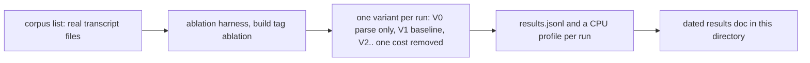

# Ablation harness: a development tool, not part of the recorder

This directory documents an opt-in measurement harness for the rebuild's write path. It is not part
of the daemon, the CLI or any deployed artifact. Nothing in a normal build, in `go test ./...`, in
the unit gate or in the pre-commit hooks runs it.

## What it is

The harness replays a bounded corpus of real transcript files through the real `Parser` and `Store`
in bulk rebuild mode, into a throwaway database, and changes one cost at a time (the full FTS
inserts, the `fields` rows, the per-file `SAVEPOINT`, the journal and temp-file settings, prepared
statements and so on). It reports records per second, wall time, rows written, database and WAL
sizes and a Go CPU profile per variant, so a cost is attributed by removing it, not by guessing from
a thread sample.



## Where the pieces live

| Piece                                                  | Path under `packages/pg-claude-code-recorder`                                                           |
| ------------------------------------------------------ | ------------------------------------------------------------------------------------------------------- |
| The harness (Go tests, build tag `ablation`)           | `internal/parser/ablation_test.go`, `internal/parser/ablation_fields_test.go`                           |
| Production hooks, constants in a normal build          | `internal/store/ablation_off.go`, `ablation_on.go`, `internal/parser/ablation_off.go`, `ablation_on.go` |
| Results of each study, newest by date in the file name | `docs/ablation/YYYY-MM-DD-*-results.md`, with `.jsonl` and `-profiles.txt` beside it                    |

The harness has to sit in the `parser` package because it uses unexported types. The hook files are
the only code that touches production packages. In a normal build the hooks are compile-time
constants, so behavior is unchanged.

## When to use it

- A change touches the rebuild or bulk write path (`Parser.insert`, `Store` bulk mode, the pragmas in
  `bulk.go`, the FTS or `fields` inserts) and the change claims a speedup. Run the harness before and
  after on the same corpus and compare.
- A rebuild is slower than the earlier numbers in this directory and the cause is unknown.
- A new schema version adds tables, indexes or FTS content, and its write cost needs a number before
  the next rebuild is run.

## When not to use it

- To judge the parse side alone in a unit test. Use the benchmarks in `internal/source`.
- To judge production throughput. The corpus is small, so the page cache never spills, the WAL never
  reaches its checkpoint threshold and no readers contend. Treat results as planning figures, then
  confirm with the daemon's own rebuild metrics.
- In CI, in a hook or in any gate. A study MUST NOT be added to `go test ./...`, a `*-go-tests`
  check, the `run-unit-tests` hook or `pg-hooks run pre-commit|pre-land`.

## How to run it

1. Build a corpus list: one line per transcript file, `<size in bytes> <absolute path>`. Sample by
   size class with a deterministic stride so large and small files are both present, keep only
   transcripts (the first 3,000 bytes contain `"sessionId"`), and aim for about 2,000 files and
   under 600 MB. The 2026-11-05 study's corpus method is in its results doc under "Corpus".
2. Build the test binary and run one variant per invocation:

   ```bash
   go test -c -tags ablation -o ablation.test ./internal/parser/
   PG_CCREC_ABLATION_LIST=corpus.txt PG_CCREC_ABLATION_WORK=/tmp/work \
     PG_CCREC_ABLATION_OUT=out PG_CCREC_ABLATION_VARIANT=V1 PG_CCREC_ABLATION_RUN=1 \
     ./ablation.test -test.run 'TestAblation$' -test.v
   ```

3. Read `out/results.jsonl` and the CPU profile `out/<variant>.<run>.cpu.pb.gz` with
   `go tool pprof -top`.
4. Write the study up as a dated file in this directory and keep its `.jsonl` and profile listing
   beside it.

## Rules for running it

- The corpus MUST be read-only (symlinks or read-only copies). The harness MUST NOT write to, or run
  the recorder binary against, a live state directory.
- Throwaway databases MUST live under one `mktemp -d` directory, MUST stay under about 1.5 GB in
  total, and MUST be removed when the run ends.
- Run each variant at least 3 times and report the median and the best. Differences under about 5%
  are not resolved on a loaded machine, and a study MUST say the load average it ran under.
- A long run SHOULD go through `bgrun` with `nice -n 10`, and wait with `bgwait`, so it does not
  saturate the host.
- Comparing two studies is valid only when they use the same corpus list, the same variants and a
  similar load. A new study MUST name the corpus list it used.

## Adding a variant

Add a case to the variant table in `internal/parser/ablation_test.go`. If it needs a production hook,
add it as a constant in the `ablation_off.go` file and a variable in `ablation_on.go` of the owning
package, so a normal build keeps a compile-time constant, and say so in the study. A hook MUST NOT
change behavior when the build tag is absent.

## Studies

| Date       | Question                                        | Results                             |
| ---------- | ----------------------------------------------- | ----------------------------------- |
| 2026-11-05 | Where does the rebuild's SQLite insert time go? | `2026-11-05-insert-cost-results.md` |
