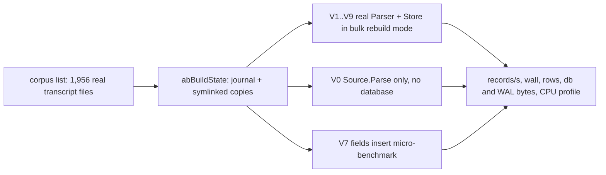

# Rebuild insert-cost ablation

Spike result: where the write side of `pg-claude-code-recorder rebuild` spends its time, found by
removing one cost at a time on a bounded corpus of real transcript files. The harness is opt-in
(Go build tag `ablation`), is not part of `go test ./...`, and changes no production behavior.

## Verdict

The write side is about 40 percent of a rebuild (the other 60 percent is parsing and Go runtime),
and inside the write side the largest single item is not the table or FTS inserts but the
sub-journal of the per-file `SAVEPOINT bulk_write` (a temp-file `pwrite` of every page an insert
touches for the first time since the savepoint). It is 21 percent of all CPU samples of the
baseline and about 60 percent of the time inside `Parser.insert`. Removing it (or keeping the
sub-journal in memory with `temp_store=MEMORY`) saves 6 to 8 percent of wall time here, less than
the profile share suggests, because part of the cost moves into statement-level journals. FTS
indexing is second (about 12 percent), the `fields` rows are small (about 4 percent of the wall
time at most), and WAL commit cost is negligible at this scale.

## Method



Each variant runs in its own process over the same corpus in a fresh state directory (the state
directory holds symlinks to the live copies, which are only read), so each profile and GC state is
clean. The rebuild path is the real one: `Parser.ParseAll` then `Store.FinishRebuild`, store
options `V3Layout`, `Rebuild`, `BulkRebuild` as the daemon passes them (so there is no trigram
table, the extension tables exist, and `records` has no `session` column). Wall time is
`ParseAll` plus `FinishRebuild`; the corpus build is outside the timed region.

### Hooks in production code (no-ops by default)

In a normal build these are constants, so the compiler removes the branches and behavior is
unchanged. Only a build with the `ablation` tag has variables.

| File                                                | Hook                                                                                   | Used by         |
| --------------------------------------------------- | -------------------------------------------------------------------------------------- | --------------- |
| `internal/store/ablation_off.go`, `ablation_on.go`  | journal mode in the DSN, extra DSN pragmas, skip of the bulk `SAVEPOINT` and `RELEASE` | V4, V5, V5b, V9 |
| `internal/parser/ablation_off.go`, `ablation_on.go` | run each statement unprepared in `pstx`                                                | V6              |

### How to run

```bash
go test -c -tags ablation -o ablation.test ./internal/parser/
PG_CCREC_ABLATION_LIST=corpus.txt PG_CCREC_ABLATION_WORK=/tmp/work \
  PG_CCREC_ABLATION_OUT=out PG_CCREC_ABLATION_VARIANT=V1 PG_CCREC_ABLATION_RUN=1 \
  ./ablation.test -test.run 'TestAblation$' -test.v
```

`corpus.txt` has one `<size> <absolute path>` line per transcript file. Results are appended to
`out/results.jsonl` and a CPU profile is written to `out/<variant>.<run>.cpu.pb.gz`; read it with
`go tool pprof -top`. The results and the top-15 profile entries of this study are in
`insert-ablation-results.jsonl` and `insert-ablation-profiles.txt` in this directory.

## Corpus

| Item              | Value                                                                                                                                   |
| ----------------- | --------------------------------------------------------------------------------------------------------------------------------------- |
| Files             | 1,956 transcript files (read-only, symlinked, generation 1 of each)                                                                     |
| Bytes             | 541,870,936 (about 517 MiB)                                                                                                             |
| Records parsed    | 180,459 from 128,450 lines                                                                                                              |
| Size classes      | 2 files of 10 MB or more, 23 of 2 to 10 MB, 154 of 0.3 to 2 MB, 1,683 of 20 to 300 KB, 94 under 20 KB                                   |
| Rows written (V1) | records 180,459; fields 1,132,782; texts 48,950 (each with an FTS row); ext_assistant_usage 27,736; unknown_keys 36,965; sessions 1,489 |

How it was chosen: from the 55,148 `<id>.<gen>` copy files, a deterministic stride sample per size
class (so large and small files are both present), then only files whose first 3,000 bytes contain
`"sessionId"` were kept (this drops the status and other non-transcript sources, which are the
bulk of the small files). Small transcripts are rare, so the 20 to 300 KB class was thinned by a
fixed stride (3 of every 5) to land near 1,956 files. The largest kept file is 12 MB; the larger
files of the live copies were status or other sources, so the corpus has no file above 12 MB and
under-represents the biggest tool_result bodies.

## Results

Seven or more runs of the baseline, four of most variants (the machine ran at a load average near
25 to 30 with other agents, so single runs differ by up to 25 percent; the table gives the median
and the best run). Records per second is 180,459 divided by wall seconds. Raw numbers per run are
in `insert-ablation-results.jsonl`.

| Variant | Change                                          | Runs | Wall median (s) | Wall best (s) | Records/s median | Records/s best | Median vs V1             |
| ------- | ----------------------------------------------- | ---- | --------------- | ------------- | ---------------- | -------------- | ------------------------ |
| V0      | parse only, no database                         | 4    | 17.5            | 13.2          | 10,312           | 13,671         | 63% of the time          |
| V1      | baseline                                        | 13   | 27.7            | 23.3          | 6,515            | 7,745          | 100%                     |
| V2      | no FTS inserts (plain table, insert ignored)    | 4    | 24.4            | 21.7          | 7,396            | 8,316          | 88%                      |
| V2b     | no FTS and no texts rows                        | 4    | 23.8            | 21.1          | 7,582            | 8,553          | 86%                      |
| V3      | no fields rows (insert ignored by trigger)      | 4    | 31.6            | 29.2          | 5,711            | 6,180          | 114% (slower, see below) |
| V4      | no savepoint per file                           | 13   | 26.0            | 22.2          | 6,941            | 8,129          | 94%                      |
| V5      | journal_mode MEMORY                             | 7    | 25.5            | 22.0          | 7,077            | 8,203          | 92%                      |
| V5b     | journal_mode OFF                                | 4    | 27.6            | 23.4          | 6,538            | 7,712          | 100%                     |
| V6      | statements not prepared                         | 4    | 44.1            | 35.6          | 4,092            | 5,069          | 159%                     |
| V8      | every row insert ignored (statement-call floor) | 4    | 25.3            | 17.2          | 7,133            | 10,492         | 91% (noisy, see below)   |
| V9      | savepoint kept, temp_store MEMORY               | 3    | 22.6            | 22.3          | 7,985            | 8,092          | 82%                      |

The three runs of V1, V4 and V9 that ran back to back in the quietest period were V1 24.5, 23.3
and 24.3 s, V4 22.2, 22.2 and 22.7 s, V9 28.9 (an outlier), 22.3 and 22.6 s.

Files and bytes at the end of V1: database 129 MB, WAL peak 158 MB, final WAL 0 (the finish step
truncates it). V5 and V5b have no WAL and the same 129 MB database. V2 shrinks the database to
87 MB, V3 to 89 MB.

### Where the baseline CPU goes (V1, run 2: 23.53 s of CPU samples)

| Part                                                                                     | Seconds   | Share |
| ---------------------------------------------------------------------------------------- | --------- | ----- |
| `source.Parse` (JSON decode 4.26 s, regexp 0.63 s)                                       | 5.82      | 25%   |
| `Parser.insert` (all row statements)                                                     | 8.29      | 35%   |
| of which SAVEPOINT sub-journal page writes (`subjournalPage`, a `pwrite` to a temp file) | 4.88      | 21%   |
| of which FTS5 (`fts5UpdateMethod`, tokenizer, hash)                                      | 1.82      | 8%    |
| `FinishRebuild` (deferred index build 0.74 s, FTS optimize 0.58 s)                       | 1.33      | 6%    |
| batch commits                                                                            | 0.18      | 1%    |
| Go runtime, GC workers, background threads, rest                                         | about 7.9 | 33%   |

The SQLite share (insert plus finish plus commit) is 9.8 s, 42 percent, which matches the 42
percent of the production sample. The `pwrite` that the production sample attributes to the
database is, in this harness, the savepoint sub-journal and not the WAL: the batch commit
(which writes the WAL) is 1 percent, and V4, V5 and V9 each remove the `pwrite` frame.

### What each variant says

- V0 versus V1: parse is 13.2 to 17.5 s of 23.3 to 27.7 s, so the write side is about 10 to 11
  s (40 percent).
- V6: preparing every statement each time adds about 16 s (59 percent). The path already reuses
  prepared statements (`pstx` prepares once per transaction function call and closes at its end,
  which is once per file), so V6 is not an improvement to make; it shows each statement is
  expensive to compile (about 10 microseconds) and that the statement count matters.
- V2 and V2b: FTS inserts cost 1.6 to 3.3 s (6 to 12 percent of wall); the profile puts
  `fts5UpdateMethod` at 1.8 to 3.0 s. The `texts` rows themselves cost nothing measurable (V2b
  versus V2). The finish step adds the FTS optimize (0.9 to 1.4 s here, 3.1 percent in the
  production run).
- V3: ignoring the `fields` rows through a trigger made the run slower, not faster. The trigger
  program costs about as much as the insert it replaces, so V3 only shows that the `fields`
  insert is cheap, and V7 measures it directly: 1.6 to 2.2 microseconds per row with one
  prepared statement per row. At the 1,132,782 real rows of V1 that is 1.8 to 2.5 s, 7 to 9
  percent of the wall time.
- V4, V5, V9: the same mechanism. Without the outer `SAVEPOINT`, with
  `journal_mode=MEMORY` (the sub-journal is then in memory), or with `temp_store=MEMORY`, the
  `subjournalPage` frame drops from 4.9 s to 0 to 0.2 s and `Parser.insert` from 8.3 s to 6.0 to
  6.6 s. Wall time falls 1.7 to 2.1 s (6 to 8 percent), not 4.9 s, so about 40 percent of the
  sub-journal cost is replaced by the statement-level journals that upserts need anyway.
- V5b (journal OFF): no better than MEMORY, no further gain. The variant is only safe because
  the corpus has no failed write; a failed write would need the rollback it removes.
- V8: with every row insert ignored the run still spends 17.2 to 25.8 s, 4 to 8 s above V0. That
  is the cost of the statement dispatch, the lookup and session statements, the extension and
  `unknown_keys` upserts, and the savepoint (V8 still shows 3.2 to 3.8 s of sub-journal, because
  those remaining tables are touched in every file). It is the least reliable number of the table:
  best run 10,492 records/s, median 7,133.

## Ranked bottlenecks and next changes

All gains are on the measured 27.7 s median wall (180,459 records) and are then projected onto
the production rebuild (3,065.6 s for 88,839 files and 17.26 million records) by a stated
assumption. They are estimates, not measurements of the production rebuild.

| Rank | Bottleneck                                          | Evidence                                                                                                               | Next change                                                                                                                                                                                                       | Expected gain                                                                                                                                                                                                          |
| ---- | --------------------------------------------------- | ---------------------------------------------------------------------------------------------------------------------- | ----------------------------------------------------------------------------------------------------------------------------------------------------------------------------------------------------------------- | ---------------------------------------------------------------------------------------------------------------------------------------------------------------------------------------------------------------------- |
| 1    | Per-file savepoint sub-journal (temp-file `pwrite`) | 4.88 of 23.53 CPU s (21%); V4, V5, V9 each 6 to 8% faster                                                              | Add `PRAGMA temp_store=MEMORY` to the bulk writer pragmas (one line in `bulkDSNPragmas`, keeps the savepoint and its error semantics) and re-measure; fall back to a savepoint per batch only if it is not enough | Median 27.7 to 22.6 s (V9) = 5.1 / 27.7 = 18% on the median runs, 1.7 to 2.1 s (6 to 8%) on the quiet interleaved runs; use 6 to 8% as the planning figure. On the production run, 6 to 8% of 3,065.6 s = 184 to 245 s |
| 2    | Parse (JSON decode and regexp)                      | V0 is 13.2 to 17.5 s of 23.3 to 27.7 s; `json.Unmarshal` is 18% of V1 CPU, `checkValid` plus `stateInString` about 14% | Out of scope for the write side, but the largest block; decode with a tolerant streaming decoder or avoid the validate-then-decode double scan                                                                    | Not measured here; V0 shows the ceiling: the write side removed would leave 60%                                                                                                                                        |
| 3    | FTS5 indexing (`fts_word`)                          | V2 saves 1.6 to 3.3 s; finish adds 0.6 to 1.4 s for optimize                                                           | Keep. Only a smaller indexed text (fewer or shorter bodies) reduces it; the contentless FTS5 insert path has no cheaper variant in this version                                                                   | 6 to 12% if FTS were free; no concrete change proposed                                                                                                                                                                 |
| 4    | `fields` row inserts                                | V7: 1.6 to 2.2 microseconds per row per statement; 0.94 to 1.31 with 500 rows per statement                            | Batch the rows of one record (or of several records) into one multi-row `INSERT ... VALUES (...),(...) ON CONFLICT DO UPDATE`                                                                                     | Per row saving 1.6 - 0.94 = 0.66 to 2.2 - 1.31 = 0.91 microseconds, times 1,132,782 rows = 0.75 to 1.03 s = 2.7 to 3.7% of 27.7 s; 82 to 113 s of the production run at the same share                                 |
| 5    | WAL commit and checkpoint                           | Batch commit 0.18 to 0.6 s of 23 to 27 s (1 to 2%) here; 231.6 s (7.5%) in production                                  | Cannot be judged at this scale (see below)                                                                                                                                                                        | Not measured                                                                                                                                                                                                           |

Savepoint cost scales with the number of files, not records, if it is a fixed number of pages per
file. At 4.88 s / 1,956 files = 2.5 ms per file (CPU samples) or 1.7 s / 1,956 = 0.87 ms per file
(measured wall saving), the production run with 88,839 files would save between 88,839 x 0.87 ms
= 77 s (2.5%) and 88,839 x 2.5 ms = 222 s (7.2%). The percentage figure above and this per-file
figure disagree by a factor of up to 3, and the harness cannot say which holds at scale.

## What this study could not measure

- Production scale: 17.26 million records and 88,839 files, a database far larger than the 256 MiB
  page cache, WAL autocheckpoints at 1 GiB (this run never checkpointed during the parse: the WAL
  peaked at 158 MB), and a multi-hour run. Checkpoint stalls, page cache spill and B-tree depth
  growth are therefore not represented, and may dominate the 231.6 s of batch commit seen in
  production.
- Concurrent readers during the rebuild. A first attempt at `journal_mode=MEMORY` failed
  immediately with `SQLITE_BUSY` because every connection ran a `journal_mode(WAL)` pragma first;
  with a single mode for all connections V5 and V5b worked, but only because the small database
  never spilled the writer's cache. A rollback-journal mode is not safe where readers query the
  index during a long write transaction, so V5 and V5b are measurements, not recommendations.
- Variance: other agents shared the machine (load average 25 to 30), single runs differ by up to
  25 percent, and V3 and V8 have only four runs each and V9 three. Differences under about 5
  percent are not resolved. The CPU profile shares inside one run are more stable than the wall
  comparison between runs.
- The per-batch savepoint variant (one savepoint per commit batch instead of per file). Each
  `WithWrite` call is one file, so a batch savepoint needs a change to the parser's grouping; V4
  (no savepoint) is its upper bound.
- Statement count per record in production. V7 counts every non-searchable field, 1,994,967 rows,
  not the 1,132,782 that the parser keeps after skipping derivable fields; per-row times are
  comparable, row counts are not.
- A multi-row insert for rows other than `fields` (`texts` plus FTS rows are paired and need the
  `texts` row id).
