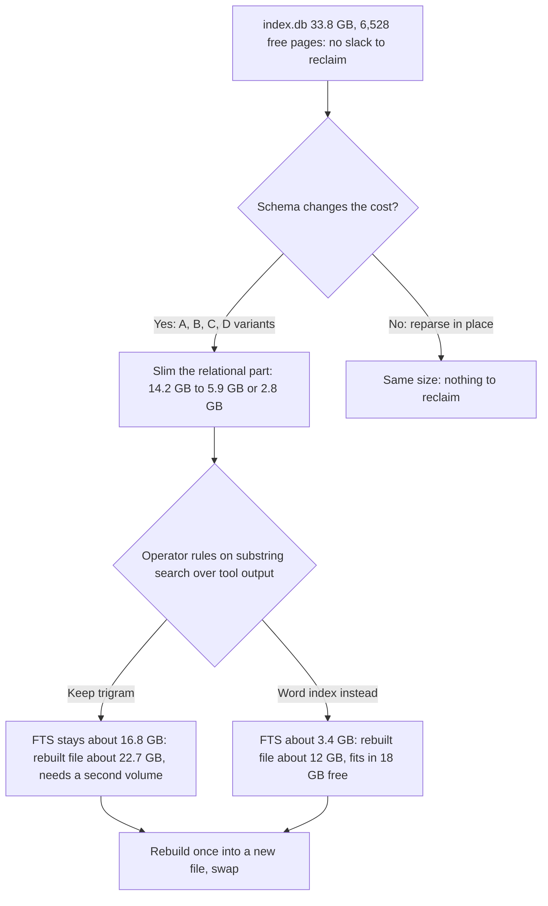
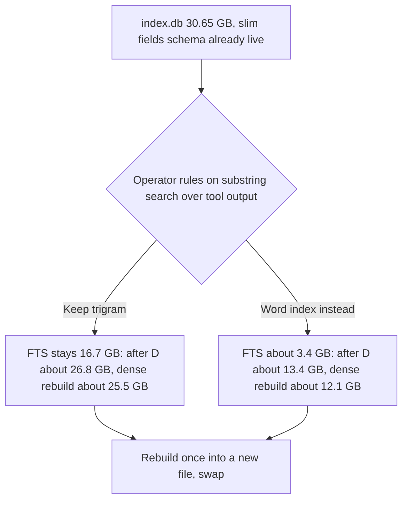

# Investigation: why the recorder's `index.db` is 33.8 GB (2026-11-03)

The recorder's `index.db` was 8,255,949 pages x 4,096 bytes = 33,816,367,104 bytes (33.8 GB) with 6,528
free pages, so it is almost all live data, not slack. Row counts read by maximum rowid on 2026-11-03:
`fields` 152,741,348; `records` 13,099,000; `texts` 3,869,108; `files` 73,076; `generations` 40,808.

The sections up to "Live scan" are built from a SYNTHETIC fixture written through the real parser and store.
The "Live scan" section then records the read-only measurement of the live database (30.65 GB by then, already
on the slim `fields` schema) and re-prices the variants; where the two disagree, the live scan wins. This
repo is public: the fixture has no real transcript content, names or paths.

## Summary

| Question                                    | Answer                                                                                                                                                                                                                                |
| ------------------------------------------- | ------------------------------------------------------------------------------------------------------------------------------------------------------------------------------------------------------------------------------------- |
| Where do the bytes go?                      | About 50 percent in the relational part (`fields` and its two indexes, `records`, `texts`), about 50 percent in the two FTS indexes, almost all of that in the trigram index (`fts_tri`). `fields` alone is about 14.2 GB.            |
| What is a `fields` row?                     | One typed scalar of one record (name, string or integer or float). About 11.7 per record because each transcript line yields a record carrying 11 to 30 scalars, and every field NAME is stored as text three times.                  |
| Trigram versus word FTS                     | They are not redundant: each text goes to exactly one of them, chosen by kind. The trigram index costs 2.5 bytes per indexed byte, 13.3 times the word index per text row (4,060 / 306), though the two hold different kinds of text. |
| Smaller rebuild from the copies?            | Feasible and the design allows it, but a re-parse into a fresh file is a new-schema job, not a vacuum: the free-page count shows nothing to reclaim. It needs a target file that fits beside the old one (18 GB was free).            |
| Recommendation                              | SLIM first (field names interned, `fields` WITHOUT ROWID, partial numeric index), then REBUILD once into the slim schema. Keep both FTS tables until the operator rules on substring search over tool output.                         |
| Can a rebuild be sized without a live scan? | Only roughly. The fixture reproduces the live per-record cost within 8 percent (arithmetic below) but cannot know live text lengths.                                                                                                  |

## Method and reproduction

The measurement is `TestSizingFixture` in `internal/parser/sizing_test.go`, behind the `soak` build tag and
skipped unless `PG_CCREC_SIZING_TURNS` is set (it is not named `TestSoak*`, so the soak check does not run
it, and it is outside the unit gate). It writes synthetic transcript files with the testkit store, runs the
real `Parser.ParseAll`, then reads the `dbstat` virtual table (compiled into the repo's `modernc.org/sqlite`
build; the existing soak test already relies on it). It also builds what-if variants in the SAME database so
`dbstat` sizes them alike.

```bash
mkdir -p ~/.cache/sizing && cd packages/pg-claude-code-recorder
TMPDIR=$HOME/.cache/sizing PG_CCREC_SIZING_TURNS=1200 \
  nice -n 10 go test -tags soak -run TestSizingFixture -count=1 -v -timeout 20m ./internal/parser
```

Figures below are the 1,200-turn run (20 files, 8,124,342 input bytes; seed fixed, so it is repeatable).
A 300-turn run (4 times smaller) scaled linearly: `fts_tri_data` 2,813,952 x 3.43 (the ratio of opaque
bytes, 3,931,466 / 1,131,964) = 9.65 million against 9,650,176 measured, and `fields` 1,200,128 x 4.0 =
4.80 million against 4,796,416. So per-unit costs do not depend on fixture size at this scale.

### Fixture shape and its limits

A "turn" is one tool-use cycle as Claude Code writes it: an optional assistant text line, an assistant
`tool_use` line (each content block is its own line, sharing a message id, with full usage and cache
counters), 0 to 2 hook-progress lines (the generator draws 0 to 4), an optional snapshot line, and a user line holding a `tool_result`. Texts are drawn from a
Zipf vocabulary of 20,000 invented words plus paths, identifiers, numbers and 40-character hashes for
tool output. Sizes are log-normal.

| Calibration against the live counts | Fixture                    | Live                                |
| ----------------------------------- | -------------------------- | ----------------------------------- |
| fields per record                   | 122,079 / 9,675 = 12.62    | 152,741,348 / 13,099,000 = 11.66    |
| texts per record                    | 3,309 / 9,675 = 0.342      | 3,869,108 / 13,099,000 = 0.295      |
| all-in bytes per record             | 23,134,208 / 9,675 = 2,391 | 33,816,367,104 / 13,099,000 = 2,582 |

The fixture is within 8 percent on all-in bytes per record ((2,582 - 2,391) / 2,391 = 8.0). What it cannot
reproduce: the true length distribution of text bodies (the live residual implies they are longer, see
below), real vocabulary entropy (it drives trigram size), how often field values really vary within a
session, the three other sources (history, status, subagent meta), reparse churn, and fragmentation from
months of interleaved writes (the live file has almost no free pages, so fragmentation is unlikely to be
large, but `dbstat` unused-byte counts on the live file would show it).

## Bytes per table and index

Fixture bytes are `SUM(pgsize)` per object from `dbstat`. Live figures multiply the per-unit cost by the live
count; each line shows its arithmetic.

| Object                                       | Fixture bytes | Per unit                          | Live extrapolation                                |
| -------------------------------------------- | ------------: | --------------------------------- | ------------------------------------------------- |
| `fields` (table)                             |     4,796,416 | / 122,079 rows = 39.29 B/row      | x 152,741,348 = 6.00 GB                           |
| `fields_rec` (`rec_id`, `name`)              |     3,407,872 | / 122,079 = 27.92 B/row           | x 152,741,348 = 4.26 GB                           |
| `fields_name_n` (`name`, `n`)                |     3,145,728 | / 122,079 = 25.77 B/row           | x 152,741,348 = 3.94 GB                           |
| `fields` total                               |    11,350,016 | / 122,079 = 92.97 B/row           | x 152,741,348 = 14.20 GB                          |
| `records` plus its four indexes              |     1,605,632 | / 9,675 records = 165.96 B/record | x 13,099,000 = 2.17 GB                            |
| `texts` plus `texts_rec`                     |       155,648 | / 3,309 texts = 47.04 B/text      | x 3,869,108 = 0.18 GB                             |
| `fts_tri` (data, idx, docsize, config)       |     9,744,384 | / 2,400 opaque texts = 4,060 B    | see "calibrated FTS" below                        |
| `fts_word` (data, idx, docsize, config)      |       278,528 | / 909 word texts = 306 B          | see "calibrated FTS" below                        |
| Everything else (meta, files, one page each) |  under 0.3 MB | negligible                        | files 73,076 and generations 40,808 rows are tiny |

`records` breakdown per record: table 757,760 / 9,675 = 78.3 B, `records_session` 311,296 / 9,675 = 32.2 B,
`records_type` and `records_time` 180,224 / 9,675 = 18.6 B each, `records_ident` 176,128 / 9,675 = 18.2 B.
Sum 78.3 + 32.2 + 18.6 + 18.6 + 18.2 = 165.9 B (rounding).

Fixture total: 11,350,016 + 1,605,632 + 155,648 + 278,528 + 9,744,384 = 23,134,208 bytes.

### Calibrated FTS split

The non-FTS part extrapolates to 14.20 + 2.17 + 0.18 = 16.55 GB (49.0 percent of 33.82 GB: 16.55 / 33.82). The
rest, 33,816,367,104 - 16,556,640,027 = 17,259,727,077 bytes (17.26 GB), is the two FTS indexes, so 17,259,727,077 / 3,869,108 = 4,461
bytes per text row. The fixture's mix averages (9,744,384 + 278,528) / 3,309 = 3,029 bytes per text row, so
live bodies are about 4,461 / 3,029 = 1.47 times heavier per text than the synthetic ones. Taking the
fixture's trigram share of FTS bytes (9,744,384 / 10,022,912 = 97.2 percent), live `fts_tri` is about
0.972 x 17.26 = 16.8 GB and live `fts_word` about 0.48 GB. This split is an inference, not a measurement.

## What a `fields` row is, and why about 11.7 per record

Source: `internal/parser/parser.go` (`insert`) and `internal/source/source.go` (`Extract`). A record is a
transcript line (item -1) or one child per `message.content` item. For each field of the record whose
`ingest` tag is not searchable (`text` or `opaque`), the parser inserts `fields(rec_id, name, s, n, f)`: a
string for `id`, `keyword`, `path` and `session`, a float for `float`, an integer for `int`, `bool` and
`time`. Searchable fields go to `texts` plus an FTS table instead.

Where the 12.6 (fixture) and 11.7 (live) come from, from the fixture's name census (1,200 turns):

| Group                                                                                                                      |                 Rows (fixture) | Share of rows            |
| -------------------------------------------------------------------------------------------------------------------------- | -----------------------------: | ------------------------ |
| Constant per file or session in the fixture: `file_session`, `project`, `cwd`, `entrypoint`, `git_branch`, `session_id`... | 6,366 x 2 + 5,746 x 9 = 64,446 | 64,446 / 122,079 = 52.8% |
| Duplicates of `records` columns: `type`, `session_id`, `timestamp`                                                         |                         17,858 | 17,858 / 122,079 = 14.6% |
| Usage and message block of assistant lines (11 usage scalars plus 5 message scalars)                                       |               about 2,089 x 16 | about 27%                |
| Child scalars: `tool_use_id`, `name`, `is_error`, `body_length`                                                            |                    about 6,000 | about 5%                 |

The groups overlap (`session_id` is in both of the first two), so the shares are not additive. Every line
record carries about 12 to 29 scalars while the children carry 0 to 3 and a pure text child carries none, so the
average over lines plus children lands near 12. Names are the heavy part: the average name is
1,545,955 / 122,079 = 12.7 bytes and the average string value 1,437,324 / 122,079 = 11.8 bytes, and the name
is repeated in the table row AND in both indexes (`fields_rec`, `fields_name_n`).

Whether never-queried fields can be dropped, sparse or derived:

- The query layer reads `fields` generically (`internal/query/filter.go` joins `fields` by name for any
  catalogued field), so "never queried" is a property of live USAGE that this repo does not log. A live
  name census plus the daemon's query log must supply it.
- Parts that are provably redundant by construction: `type`, `session_id` and `timestamp` duplicate
  `records.type`, `records.session` and `records.time_ns` (14.6 percent of rows), and `file_session` and
  `project` are per-file facts already derivable from `files` and `paths` (2 x 6,366 / 122,079 = 10.4
  percent of rows).
- A copy-derived value path already exists (`Parser.Value` reads a field from the copy by offset), so
  rarely used fields can be answered from the copy on demand. Moving a field there loses its filter and
  sort speed, so it is a per-field decision.
- Per-session constants (`cwd`, `git_branch`, `version`, `entrypoint`, `user_type`, `slug`): the fixture
  makes them constant by construction, live data varies (a branch switch), so how many rows are truly
  redundant needs the live distinct-values-per-session count.

## Slimming the relational part (measured variants)

All variants were built in the same fixture database from the same 122,079 rows and sized with `dbstat`.

| Variant                                                                          |                               Bytes (fixture) | Ratio to 11,350,016            | Live (14.20 GB x ratio)                  |
| -------------------------------------------------------------------------------- | --------------------------------------------: | ------------------------------ | ---------------------------------------- |
| A. Names interned into a `name_id` column plus the same two indexes              | 3,350,528 + 1,568,768 + 1,392,640 = 6,311,936 | 6,311,936 / 11,350,016 = 0.556 | 14.20 x 0.556 = 7.90 GB (saves 6.30 GB)  |
| B. A plus `WITHOUT ROWID` keyed `(rec_id, name_id)` and one `(name_id, n)` index |             3,395,584 + 1,302,528 = 4,698,112 | 4,698,112 / 11,350,016 = 0.414 | 14.20 x 0.414 = 5.88 GB (saves 8.32 GB)  |
| C. Partial `(name, n) WHERE n IS NOT NULL` instead of `fields_name_n`            |                  983,040 instead of 3,145,728 | 983,040 / 3,145,728 = 0.3125   | 3.94 x 0.3125 = 1.23 GB (saves 2.70 GB)  |
| D. B and dropping the 52.8 percent constant rows                                 |                       not measured, a product | 0.414 x (1 - 0.528) = 0.195    | 14.20 x 0.195 = 2.77 GB (saves 11.43 GB) |

Notes. The "per fixture byte-row" column heading is shorthand: the live figure is the live row count times
the fixture per-row cost, which equals 14.20 GB times the ratio (14.20 GB = 152,741,348 x 92.97). Only 26,426
of 122,079 rows (21.6 percent) have a non-null `n`, which is why C is so small. B drops zero duplicate
`(rec_id, name_id)` pairs in the fixture; the live table MAY hold duplicates (a block with both `id` and
`tool_use_id` maps to one name), so B needs an explicit rule for them (keep last) before it is safe. D is
only as good as the constant-row assumption above and MUST be re-priced from live counts. The planner MUST
be shown to use the partial index (a query on `n` implies `n IS NOT NULL`, but this needs a test).

## Trigram versus word FTS

Routing, from `parser.go` and `internal/query/search.go`: a `text` field (prose: user, assistant, thinking
text, summaries) goes to `fts_word`; an `opaque` field (tool input JSON, tool result bodies) goes to
`fts_tri`. A `word` search queries `fts_word` only; a `substring` search (a quoted phrase, 3 characters or
more) queries `fts_tri` only, then re-checks against the copy. They are complementary, not duplicates:
dropping the trigram table would remove substring search over tool output, and prose is not substring
searchable today.

| Index (fixture, 2,400 opaque texts of 3,931,466 bytes)            | Bytes (data table) | Ratio to `fts_tri` data 9,650,176 | Substring phrase query            |
| ----------------------------------------------------------------- | -----------------: | --------------------------------- | --------------------------------- |
| `fts_tri` as built (trigram, case sensitive)                      |          9,650,176 | 1.000                             | works (1,487 hits)                |
| trigram, case insensitive                                         |          9,699,328 | 1.005                             | works                             |
| trigram without the docsize table (needs no `contentless_delete`) |          9,723,904 | 1.008                             | works (docsize saved: 32,768)     |
| trigram with `detail=column`                                      |          4,149,248 | 4,149,248 / 9,650,176 = 0.430     | FAILS: phrase queries unsupported |
| the SAME bodies in a `unicode61` word index                       |          1,904,640 | 1,904,640 / 9,650,176 = 0.197     | token phrase only                 |
| word index with `detail=none` and no docsize                      |            954,368 | 954,368 / 9,650,176 = 0.099       | no phrase queries                 |

Cost per indexed byte: trigram data 9,650,176 / 3,931,466 = 2.455 bytes per input byte, word-for-opaque
1,904,640 / 3,931,466 = 0.484. The size is dominated by position lists, which is why `detail=column` halves
it, but the recorder's substring path is a quoted phrase, which `detail=column` rejects at query time
(`fts5: phrase queries are not supported`), so it is NOT a drop-in.

Are both needed? Today yes: they serve two query modes over different field kinds. The real decision is
whether substring search over tool output is worth its cost. Priced on live: moving opaque bodies to a
word index scales the trigram share to 16.8 GB x 0.201 (1,961,984 / 9,744,384, total word-for-opaque object set over total trigram object
set) = 3.38 GB (saves about 13.4 GB), and with `detail=none` 16.8 x 0.099 = 1.66 GB, at the price of
phrase semantics that a quoted `--no-verify` style query needs. That is a product ruling for the
operator, not an engineering default.

## Can the database be rebuilt smaller from the copies?

Yes in principle: `derivedSQL` documents the records, fields, texts and both FTS tables as derived from
the copies ("a rebuilt database simply parses again"). What the fixture shows:

- Parse throughput into a fresh database: 8,124,342 input bytes in 3.98 s = 2.04 MB/s, and the 300-turn
  run 2,192,673 / 0.75 = 2.92 MB/s, both on a host at load average about 65, so a floor, not a typical
  figure. Input bytes per record are 8,124,342 / 9,675 = 840.
- There is nothing to reclaim by `VACUUM` or an in-place reparse: the live file has 6,528 free pages
  (6,528 x 4,096 = 26.7 MB, 0.08 percent). The reparse path (`Reparse`) deletes and reinserts into the same
  file, so it leaves freed pages and never shrinks it. A smaller file needs a NEW file written by the slim
  schema, then an atomic swap while the daemon is stopped or double-written.
- Temporary space: the new file plus its WAL must coexist with the old one. 18 GB was free, which fits the
  slim targets (A to D in the table, 25.5 GB and below once the FTS is also reduced) only if the trigram
  share is reduced too: B alone leaves 33.82 - 8.32 = 25.5 GB, which does NOT fit in 18 GB. B plus the
  word-for-opaque change leaves 33.82 - 8.32 - 13.4 = 12.1 GB, which fits. A rebuild is therefore gated on
  space unless a second volume is used.
- Time: this equals live copy bytes divided by the parse throughput. The live copy byte total was not
  read (the copies are clones that share blocks with the originals, so `du` is logical), so the wall time
  is NOT stated; the effort is L (a new rebuild command, a second-file write path, a swap protocol, and
  verification that the rebuilt database answers the same queries).



Arithmetic for the two end states: keep trigram, slim B: 33.82 - 8.32 = 25.5 GB; D adds 14.20 x 0.414 - 2.77 =
3.1 GB more, so about 22.4 GB (25.5 - 3.1); word index plus B: 12.1 GB; plus D about 9 GB (12.1 - 3.1).

## Recommendation: SLIM, then REBUILD once

1. Do NOT delete or compact anything now: no free pages, no retention is intended.
2. Slim the relational part first. It is behaviour-preserving for every query (the field is still
   filterable), measured at 0.414 of its current size, and together with a partial numeric index it takes
   `fields` from 14.2 GB to about 5.9 GB.
3. Ask the operator for a ruling on substring search over tool output (a product decision recorded as an
   ADR). That is the single largest lever (about 13.4 GB) and cannot be taken silently.
4. Rebuild once, into a new file, after the slim schema exists, so the cost of a rebuild is paid once.
5. Run the live scan first (deferred below) so the constants, the text lengths and the query usage are
   measured, not assumed.

## Live scan (2026-11-03, evening)

The scan ran after the read-deadline and WAL fixes were applied. Method: read-only opens
(`file:...index.db?mode=ro`) through the system `sqlite3`, one background job per query with a hard `timeout`
(900 to 1,200 s) and a 2 s busy timeout, nothing written. The WAL was 88 MB before the scan, grew to 173 MB
during the roughly 22 minutes the three jobs ran, and stopped growing once the readers ended; it did not
climb toward the old multi-gigabyte sizes. Host load average was 50 to 77 throughout. Text body lengths were
NOT measured (the full-text tables are contentless, so that needs the copies), and the daemon's query log
does not exist, so which fields clients filter on is still unknown.

### The live file is already on the slim schema

The file measured here is not the one the fixture was extrapolated to. It has 7,483,490 pages x 4,096 =
30.65 GB (426 free pages), and its schema already has `field_names` (interned names), `fields` as
`WITHOUT ROWID` keyed `(rec_id, name_id)`, and the partial index `fields_name_n ... WHERE n IS NOT NULL`:
variants B and C of the table above are already in force. Live row counts (`count(*)`): `fields`
196,306,009; `records` 16,993,912; `texts` 5,097,894 (3,286,645 opaque, 1,812,241 text); `files` 86,237;
`generations` 53,278; `field_names` 77.

Duplicates of `(rec_id, name)` that would block `WITHOUT ROWID` are moot: the primary key
`(rec_id, name_id)` already enforces uniqueness on the live table.

### Exact bytes per object (`dbstat`)

| Object                                                               |    Bytes (pgsize) | Unused bytes | Per unit                                          |
| -------------------------------------------------------------------- | ----------------: | -----------: | ------------------------------------------------- |
| `fts_tri` (data 16,674,889,728 + docsize 49,598,464 + idx 5,091,328) |    16,729,579,520 |  111,752,570 | 16,729,579,520 / 3,286,645 opaque texts = 5,090 B |
| `fts_word` (data 1,502,556,160 + docsize 26,284,032 + idx 815,104)   |     1,529,655,296 |   11,021,143 | 1,529,655,296 / 1,812,241 text texts = 844 B      |
| `fields` (table, WITHOUT ROWID)                                      |     7,022,608,384 |  846,909,139 | 7,022,608,384 / 196,306,009 rows = 35.8 B/row     |
| `fields_name_n` (partial)                                            |       646,107,136 |   77,985,013 | 157,741 pages                                     |
| `records` (table plus 5 indexes, listed below)                       |     4,222,296,064 |  234,150,876 | 4,222,296,064 / 16,993,912 = 248 B/record         |
| `texts` plus `texts_rec`                                             |       244,875,264 |    9,893,738 | 171,876,352 + 72,998,912                          |
| `unknown_keys` plus its autoindex                                    |       151,117,824 |   12,942,982 | 73,392,128 + 77,725,696                           |
| Everything else                                                      | under 0.1 GB each |            - | small                                             |

`records` objects: table 1,680,785,408; `records_session` 870,182,912; `records_source_type` 623,489,024;
`records_ident` 367,738,880; `records_time` 340,836,352; `records_type` 339,263,488 (sum 4,222,296,064).
Unused figures for grouped rows are the sums of their objects.

Totals: all objects sum to 30,650,707,968 bytes. The two FTS indexes are 18,259,234,816 (59.6 percent) and
everything else 12,391,473,152 (40.4 percent). Unused space inside pages is 1,318,112,588 bytes (4.3
percent), 846,909,139 of it in `fields` (12.1 percent of that table's pages). That slack is fragmentation,
not freed pages (the freelist is 426 pages), and only a rebuild into a new file reclaims it.

### How the fixture predictions held

| Quantity                           | Fixture prediction                      | Live                                                                    |
| ---------------------------------- | --------------------------------------- | ----------------------------------------------------------------------- |
| `fields` plus index, bytes per row | variant B: 38.5 B (4,698,112 / 122,079) | (7,022,608,384 + 646,107,136) / 196,306,009 = 39.1 B (1.5 percent high) |
| `fts_tri` bytes per opaque text    | 4,060 B                                 | 5,090 B (1.25 times)                                                    |
| `fts_word` bytes per text          | 306 B                                   | 844 B (2.8 times)                                                       |
| Trigram share of the FTS bytes     | 97.2 percent                            | 16,729,579,520 / 18,259,234,816 = 91.6 percent                          |
| `fields` rows per record           | 11.66                                   | 196,306,009 / 16,993,912 = 11.55                                        |

The per-row cost of the slim `fields` layout was predicted well; both FTS costs were underestimated (live
bodies are longer, and the word index is heavier than a fixture of invented words). The calibrated split
("live `fts_word` about 0.48 GB") was wrong: it is 1.53 GB.

### Field census (rows and string bytes per name)

Rows per field name, from `fields` joined to `field_names` (77 names; string bytes are `SUM(length(s))`):

| Name                                      |           Rows |                String bytes | Name                                       |      Rows | String bytes |
| ----------------------------------------- | -------------: | --------------------------: | ------------------------------------------ | --------: | -----------: |
| `project`                                 |     11,992,411 |                 388,122,487 | `message.usage.*` (6 token counters, each) | 2,755,447 |            0 |
| `file_session`                            |     11,929,653 |                 429,467,508 | `message.model`                            | 2,755,447 |   44,116,486 |
| `session_id`                              |     11,918,633 |                 429,070,788 | `message.id`                               | 2,755,447 |   77,174,244 |
| `type`                                    |     11,803,890 |                 108,289,732 | `request_id`                               | 2,754,917 |   77,137,676 |
| `timestamp` (integer)                     |     10,193,429 |                           0 | `tool_use_id`                              | 3,251,167 |   97,535,010 |
| `version`                                 |      9,918,292 |                  69,428,044 | `agent_id`                                 | 5,906,326 |  100,407,542 |
| `entrypoint`                              |      9,574,399 |                  29,780,308 | `uuid`                                     | 9,573,572 |  344,648,592 |
| `cwd`                                     |      9,574,399 |                 419,014,966 | `parent_uuid`                              | 9,526,893 |  342,968,148 |
| `user_type`, `git_branch`, `is_sidechain` | 9,573,572 each | 76,588,576 / 65,001,914 / 0 | `message.role`                             | 4,772,352 |   33,544,924 |

The other 47 names have 1,630,728 rows or fewer (`body_length`, `name`, `slug`, `is_error`, then a long
tail down to 1 row). Constant-per-session candidates are the top of the table by string bytes: `cwd`,
`file_session`, `session_id`, `project`, `uuid`, `parent_uuid` carry 2.35 GB of string bytes between them
(388,122,487 + 429,467,508 + 429,070,788 + 419,014,966 + 344,648,592 + 342,968,148 = 2,353,292,489), but the
`uuid` and `parent_uuid` values are unique per record and are not candidates for removal.

### Constant fields really are constant per session

Distinct values per `(session, name)` over the live table (`records.session` is the session key):

| Name           | Rows (sum) | Sessions | Distinct (session, value) pairs | Sessions with more than one value | Max values in one session |
| -------------- | ---------: | -------: | ------------------------------: | --------------------------------: | ------------------------: |
| `cwd`          |  9,575,762 |    7,898 |                          13,207 |                             1,637 |                        31 |
| `entrypoint`   |  9,575,762 |    7,898 |                           7,910 |                                12 |                         2 |
| `git_branch`   |  9,574,921 |    7,890 |                           8,698 |                               597 |                         9 |
| `user_type`    |  9,574,921 |    7,890 |                           7,890 |                                 0 |                         1 |
| `version`      |  9,919,829 |    7,898 |                           7,932 |                                34 |                         2 |
| `slug`         |  1,530,658 |      532 |                             532 |                                 0 |                         1 |
| `file_session` | 11,929,653 |    8,001 |                           8,001 |                                 0 |                         1 |
| `project`      | 11,992,419 |   11,583 |                          15,846 |                             4,034 |                         9 |

Those six per-session candidates (`cwd`, `entrypoint`, `git_branch`, `user_type`, `version`, `slug`) hold
9,575,762 + 9,575,762 + 9,574,921 + 9,574,921 + 9,919,829 + 1,530,658 = 49,751,853 rows (25.3 percent of
196,306,009) and collapse to 13,207 + 7,910 + 8,698 + 7,890 + 7,932 + 532 = 46,169 distinct pairs. A
change of value inside a session (a branch switch, a `cd`) is real (1,637 sessions change `cwd`), so the
replacement MUST keep one row per change, not one per session. Together with the five fields that
duplicate a `records` column or a `files` fact (`type` 11,803,890, `session_id` 11,918,633, `timestamp`
10,193,429, `file_session` 11,929,653, `project` 11,992,411; sum 57,838,016), 57,838,016 + 49,751,853 =
107,589,869 rows (54.8 percent) are redundant or constant, near the fixture's 52.8 percent.

### Re-priced variants (live)

| Variant                                                      | Live bytes                                                                         | Saves                                                                                                    |
| ------------------------------------------------------------ | ---------------------------------------------------------------------------------- | -------------------------------------------------------------------------------------------------------- |
| A, B, C (intern, WITHOUT ROWID, partial index)               | in force: `fields` plus index 7.67 GB                                              | already taken                                                                                            |
| D (drop the 107,589,869 redundant or constant rows)          | (196,306,009 - 107,589,869) x 35.78 B = 88,716,140 x 35.78 = 3.17 GB for the table | 7.02 - 3.17 = 3.85 GB or more (the dropped rows carry the longest strings, so the true saving is larger) |
| Word index instead of trigram for opaque bodies              | 16.73 GB x 0.201 = 3.36 GB                                                         | 13.37 GB                                                                                                 |
| Word index with `detail=none`                                | 16.73 GB x 0.099 = 1.66 GB                                                         | 15.07 GB                                                                                                 |
| Rebuild into a new file, same schema (reclaim fragmentation) | 30.65 - 1.32 = 29.33 GB                                                            | 1.32 GB                                                                                                  |

End states: keep trigram and apply D only, 30.65 - 3.85 = 26.8 GB, about 25.5 GB after a dense rebuild
(26.8 - 1.32); word index for opaque plus D, 30.65 - 13.37 - 3.85 = 13.43 GB, about 12.1 GB after a dense
rebuild. The ratios 0.201 and 0.099 come from the fixture and MUST be re-measured on a sample of live
bodies before the operator ruling, because live bodies were 1.25 to 2.8 times heavier than the fixture's.
Free disk on the volume was 31 GB at scan time, so a same-schema rebuild (29.33 GB plus WAL) barely fits and
is not advisable; a rebuild that applies D or the word index fits comfortably.



The recommendation changes in one respect: step 2 (slim `fields`) is done. What remains is the product
ruling on substring search (13.4 GB), dropping redundant and constant `fields` rows (3.85 GB or more), then
one rebuild into a new file that also reclaims the 1.32 GB of slack.

## Proposed fix items

| Title                                                                       | Scope                                                                                                                                          | Size |
| --------------------------------------------------------------------------- | ---------------------------------------------------------------------------------------------------------------------------------------------- | ---- |
| recorder: intern field names and store `fields` WITHOUT ROWID               | New `field_names` table, `fields(rec_id, name_id, s, n, f)` keyed `(rec_id, name_id)`, query layer and catalog updated, duplicate rule defined | L    |
| recorder: make the numeric field index partial                              | `fields_name_n` becomes `WHERE n IS NOT NULL`; a test proves the planner uses it for numeric filters                                           | S    |
| recorder: stop storing fields that duplicate record columns or file facts   | Drop `type`, `session_id`, `timestamp`, `file_session`, `project` rows; serve them from `records`, `files` and `paths`                         | M    |
| recorder: rule on substring search over tool output (trigram or word index) | Operator decision recorded as an ADR with the measured 16.8 GB versus 3.4 GB and the phrase-query trade-off                                    | M    |
| recorder: rebuild command that parses the copies into a new file and swaps  | Offline or double-write rebuild, free-space preflight, parity check against the old file, no deletion of the old file                          | L    |
| recorder: log the field names clients filter on                             | Count filtered field names so unused fields can be dropped or moved to on-demand copy reads                                                    | S    |
