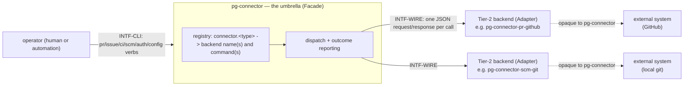

# pg-connector — behavior docs

pg-connector is a **Facade**: one user-facing CLI over N pluggable **backends**, each one an
**Adapter** translating a single external system (GitHub, beads, local git, …) into a small,
capability-scoped wire contract. This set follows the behavior-docs method
(`phillipgreenii-nix-agent-support · behavior-docs/docs/behavior`).

Start here, then the [glossary](glossary.md); the rules are in [invariants](invariants.md), the
boundaries in [interfaces](interfaces.md), the actors in [actors](actors.md), the stories,
use cases, journey, and open questions in [journeys](journeys.md), and the `pg-pr`
verb→destination map plus its per-table SQLite dispositions in
[pg-pr retirement](pg-pr-retirement.md). The one backend that is stateful and runs a daemon,
`pg-connector-github`, has its own behavior-docs set in [github/README.md](github/README.md): it
owns its cache, its refresh policy and its change decisions, which this set only forwards to
(`INV-CACHE-9`).

## The model

**pg-connector itself is the Facade + registry**, never a backend. For each entity-type
**capability** (`pr`, `issue`, `ci`, `scm`) the registry names one or more registered **backend**
binaries; a capability's own Go `Provider` interface (`pr.Provider`, `issue.Provider`, …) is a
**Strategy** the registry selects among, realized one level down as a **process-boundary
Adapter** — a separate OS process speaking the wire protocol, never an in-language object — so a
backend's own dependencies (a `gh` binary, Cloudflare Access credentials, …) never become the
umbrella's own. `INTF-WIRE` is the one contract every backend speaks regardless of capability or
system; `INTF-CLI` is the one surface every operator or piece of automation drives regardless of
which capability it's asking about.

### The boundary principle

pg-connector knows an operation was **dispatched to a backend and answered** — a `result` or a
taxonomy-coded `error`. It knows **nothing** about how a backend arrives at that answer: not its
credentials, not its own local store (a backend MAY be stateful and MAY run a daemon, ADR 0090),
not which external system (if any) it talks to. What is
left is the whole of what pg-connector itself does: **resolve a capability's registered
backend(s), invoke the wire protocol, and report the outcome** — coarsely at the wire layer (a
plain success/failure), richly in its own CLI exit code and `sources[]` reporting (`INV-EXIT-1`,
`INV-OUT-1`).

One question draws that boundary: **does pg-connector ACT on the value, or merely HAND IT
OVER?** The four entity-type schemas and the wire envelope are pg-connector's own — it acts on
them (validates shape, checks versions, classifies errors). Everything inside a backend's own
`args`/`result` payload beyond that shared schema, and everything about how a backend produces
it, is the backend's own and stays opaque. This is why a Tier-2 backend needing data another
capability's backend would otherwise supply MUST resolve it through its own direct system access
rather than by executing `pg-connector` or a sibling backend (`INV-COMP-1`) — reaching back into
the umbrella that dispatches it is not "pg-connector acting on a value," it is a backend quietly
becoming pg-connector's own caller, which the boundary above does not authorize.

## Scope (extent + floor)

- **Extent (in)** — the registry (`connector.<type>`, list- or single-valued per type, plus the
  per-backend `backends.<binary>` config block); the three top-level, always-list-valued
  `attention.sources`/`search.sources`/`activity.sources` registry keys and the cross-cutting `attention`/`search`/`activity`
  capabilities they back (`list_attention`/`search`/`list_activity`, each capability's own aggregation rule, and
  the `pg-connector attention list`/`pg-connector search`/`pg-connector activity list` CLI verbs); the wire protocol (envelope,
  `protocolVersion`/`schemaVersion` negotiation, the closed seven-value error taxonomy, the
  `capabilities`/`auth_status` meta-ops, the optional `config` member and its statelessness rule for a backend that is not daemon-backed
  (ADR 0090),
  the optional `AuthChecker` sub-interface); the operator CLI surface for the landed
  entity-type capabilities (`pr`, `issue`, `ci`, `scm`, and `alert` with its `list`/`show`/`history`
  verbs, firing-only contract, and direct attention implementation), plus `mail` (its Tier-1 interface, wire schema and op catalog, with no delete operation) plus `auth status`, `config validate`, and
  `config show`; the `pr`/`issue` `list` op and its named-query resolution; the `--backend`
  targeted/fan-out pinning flag; the id-keyed-vs-id-less split in multi-instance targeted-op
  resolution (an id-keyed op tries each registered backend in order, an id-less write hard-fails
  at N > 1 with no pin); pg-connector's own CLI outcome reporting (`sources[]`, the fan-out and
  targeted exit-code schemes); the `--output json|human` presentation mode; and the composition
  boundary between the umbrella and its backends.
- **Extent (out)** — everything the design document
  (`docs/superpowers/specs/2026-09-03-unified-connector-architecture-design.md`, recorded
  durably by `ADR 0062`) describes but that has not yet landed in code as of this writing: the
  Tier-1/Tier-2 dashboard convention, and the concrete `alert` Tier-2 backends (Grafana, PagerDuty), and the deferred `Thread`/`Note` entity types. A
  packet that builds either of these MUST extend this set in the same change (`ADR 0062`'s own
  "Negative" consequence) rather than leaving intended behavior undocumented a second time.
  Concrete backend implementations (which system a backend talks to, and how) are also out — that
  is each backend's own concern, opaque to this set; this now includes the second `issue` backend
  (Jira) and whatever concrete backend or standalone plugin eventually implements `attention`/
  `search` — only the multi-instance targeted-op resolution POLICY those registrations exercise is
  in scope, documented in [invariants](invariants.md)'s `INV-REG-2`, never a named backend as
  anything but an illustrative example (this set's own Floor). The one backend that is daemon-backed
  keeps its own set ([github](github/README.md)) for its freshness, change-delivery and budget
  behavior; this set holds only the umbrella's half of that seam (`INV-CACHE-9`,
  `INV-LEDGER-FRESH-5`). Tier-3 consumer tooling built on
  top of these verbs — `pg-desk`, a TUI, a pg-router role — is out categorically regardless of
  whether it has landed (see the [glossary](glossary.md)'s Tiers and roles):
  `phillipg-nix-ziprecruiter`'s `df-attention`/`df-search` (pure clients of `attention list`/
  `search`) landed there and stay out of this set for that structural reason, not because they
  were unbuilt. Its `df-categorize`/`df-feedback` pg-router roles (consumers of the `pr
categorize`/`feedback_set` ops) landed there too but were retired, along with the ops
  themselves, by bead `pg2-2j5ac.28.7` (statelessness, `D3`) — category/disposition are
  re-derived by `pg-desk`'s interpreter rather than persisted by any backend. The `pg-pr`
  verb→destination MAP and its
  per-table SQLite dispositions are now documented in
  [pg-pr retirement](pg-pr-retirement.md) (Phase 5, `pg2-2j5ac.23`) — but `pg-pr`'s actual
  retirement code (any command-group cutover, SQLite disposition execution, or migration tooling)
  remains out of scope here until each destination ships.
- **Floor** — this set speaks in capabilities, backends, the registry, the wire envelope, ops,
  and outcomes. It names a concrete backend (`pg-connector-pr-github`, …) only as an
  illustrative example, never as part of a rule, and it names no external system's own API shape.

### Elements this set cites from other sets

One other set owns elements this set's implementation implements, and the rows below declare them:
the GitHub backend's own set ([github](github/README.md)). It owns the read-answer provenance
(`INV-GH-FRESH-8`), the budget governor's hard cap, priority classes, background share and limit
handling (`INV-GH-BUDGET-1`, `INV-GH-BUDGET-2`, `INV-GH-BUDGET-3`, `INV-GH-BUDGET-5`), and the
operator verbs that explain and refresh a stale entity (`INV-GH-DIAG-2`, `INV-GH-DIAG-3`). The
as-of contract (`INV-ASOF-1`) and the single-computer rule for the staleness flag (`INV-ASOF-2`),
the pair every read capability's wire result carries, are this set's own
([invariants](invariants.md), "Read as-of and staleness"), so they are not listed below.

## Realization gaps

This set's **realization-gap register** (method `INV-23`): intended behavior this set's
implementation has not yet built, one row per gap.

| Element               | Intended                                                                                                                                                                                                                                            | Where the implementation stands                                                                                                                                                                                                                                                                                        | Tracked by                 |
| --------------------- | --------------------------------------------------------------------------------------------------------------------------------------------------------------------------------------------------------------------------------------------------- | ---------------------------------------------------------------------------------------------------------------------------------------------------------------------------------------------------------------------------------------------------------------------------------------------------------------------- | -------------------------- |
| `INV-WIRE-1`          | every interface ships a **conformance suite** an implementer can run before being trusted to route through it — the same discipline `pg-router`'s own interface conformance suite requirement already applies                                       | `pkg/scriptout` has no schemas/goldens/conformance suite of its own; nothing structurally prevents a backend's own unit tests from passing against a fake shape no real backend implements                                                                                                                             | not yet tracked by a bead  |
| `INV-COMP-1`          | the composition-boundary rule (a Tier-2 backend MUST NOT exec `pg-connector` or a sibling backend) is a mechanically-checked regression guard, not only a manually-fixed instance                                                                   | one violation (the CI backend's PR→branch lookup) was found and fixed by hand (`pg2-0vwcc`); no automated check (e.g. a grep for `exec.Command`/`os/exec` naming `pg-connector` or a sibling backend binary outside a backend's own tests) exists to catch a recurrence                                                | not yet tracked by a bead  |
| `INV-COMP-1`          | a standalone `attention`/`search` plugin (the implementer kind [interfaces](interfaces.md)'s `attention`/`search` subsection names, alongside a capability's own Tier-2 backend) can compose `pg-connector`'s own verbs the way its design requires | no such plugin has landed yet, and the composition-boundary's own mechanical guard (`evaluateCompositionBoundary`, `dependency_direction_test.go`) as written flags ANY `pg-connector`-named binary executing `pg-connector`, standalone plugin or not — the exemption this implementer kind would need does not exist | not yet tracked by a bead  |
| `INV-CONOBS-2`        | every backend for an external service tracks its service's availability, authentication health and (where exposed) quota in its own telemetry                                                                                                       | only the GitHub PR backend and the Slack thread backend write their own rotating event log today; no other external-service backend does, and quota/availability tracking is incomplete even there (retrofitting is explicitly not required yet)                                                                       | not yet tracked by a bead  |
| `INV-STATE-1`         | a daemon-backed backend reads its per-call policy from its own rendered config file and takes nothing from the environment (ADR 0090)                                                                                                               | the daemon-backed GitHub backend now exists (`cmd/pg-connector-github`) but is not yet registered or deployed, its token source and sidecar still read the process environment, and no check proves it takes nothing else from the environment                                                                         | `pg2-z5fax` (later phases) |
| `pg-pr-retirement.md` | for pull-request entities the `pr-sweep` feed retires once the daemon-backed GitHub backend owns change detection, and no pg-desk sweep re-derives them                                                                                             | the daemon-backed backend exists but is not registered or deployed; `pr-sweep` is still configured and pg-desk still sweeps                                                                                                                                                                                            | `pg2-z5fax` (later phases) |

## External references

| Name              | What it is                                                                                          | Owner set-path                                                                  | Owner UUID                                                                                                                                                     |
| ----------------- | --------------------------------------------------------------------------------------------------- | ------------------------------------------------------------------------------- | -------------------------------------------------------------------------------------------------------------------------------------------------------------- |
| `INV-8`           | an interface declares its counterparty's kind and its participation                                 | `phillipgreenii-nix-agent-support · behavior-docs/docs/behavior`                | [67a79e92-2f98-40a2-9392-034a697e457e](https://github.com/phillipgreenii/nix-agent-support/blob/main/behavior-docs/docs/behavior/invariants.md)                |
| `INV-11`          | a set's extent is exactly what its stories, use cases, and journeys need                            | `phillipgreenii-nix-agent-support · behavior-docs/docs/behavior`                | [f8174e40-806c-4c42-97da-996efd7c6e23](https://github.com/phillipgreenii/nix-agent-support/blob/main/behavior-docs/docs/behavior/invariants.md)                |
| `INV-13`          | a set makes its scope explicit and defines every actor and interface                                | `phillipgreenii-nix-agent-support · behavior-docs/docs/behavior`                | [94285c70-da89-4402-8ae2-af27925008bd](https://github.com/phillipgreenii/nix-agent-support/blob/main/behavior-docs/docs/behavior/invariants.md)                |
| `INV-18`          | inter-consistency at every interface, reconciled by counterparty kind                               | `phillipgreenii-nix-agent-support · behavior-docs/docs/behavior`                | [4c6a764b-02f5-4c85-afae-a082fe6c21cd](https://github.com/phillipgreenii/nix-agent-support/blob/main/behavior-docs/docs/behavior/invariants.md)                |
| `INV-23`          | the realization-gap register is set-level and never an element                                      | `phillipgreenii-nix-agent-support · behavior-docs/docs/behavior`                | [f3bba3e7-440f-4109-a4de-9d37daa34bcf](https://github.com/phillipgreenii/nix-agent-support/blob/main/behavior-docs/docs/behavior/invariants.md)                |
| `INV-GH-FRESH-8`  | every GitHub read answer carries served_from, stale, age_seconds and groups[]                       | `phillipgreenii-nix-agent-support · packages/pg-connector/docs/behavior/github` | [0236db7d-ba4b-433f-8fec-91f4acbf5930](https://github.com/phillipgreenii/nix-agent-support/blob/main/packages/pg-connector/docs/behavior/github/invariants.md) |
| `INV-GH-BUDGET-1` | every origin call passes through the governor and each bucket cap is hard for every class of work   | `phillipgreenii-nix-agent-support · packages/pg-connector/docs/behavior/github` | [f5335c40-d98a-4b27-8895-d9926c6349a6](https://github.com/phillipgreenii/nix-agent-support/blob/main/packages/pg-connector/docs/behavior/github/invariants.md) |
| `INV-GH-BUDGET-2` | each (entity, group) task carries a due time and one of five priority classes, highest first        | `phillipgreenii-nix-agent-support · packages/pg-connector/docs/behavior/github` | [8f25cfbd-5f24-43e6-a0ff-8e4375dcae36](https://github.com/phillipgreenii/nix-agent-support/blob/main/packages/pg-connector/docs/behavior/github/invariants.md) |
| `INV-GH-BUDGET-3` | background classes 3 to 5 stop at the background share of each bucket cap                           | `phillipgreenii-nix-agent-support · packages/pg-connector/docs/behavior/github` | [3d9c2d1d-7fc1-4a92-b786-ecd42ebfb6e8](https://github.com/phillipgreenii/nix-agent-support/blob/main/packages/pg-connector/docs/behavior/github/invariants.md) |
| `INV-GH-BUDGET-5` | a secondary or primary limit pauses the background classes while interactive reads are served stale | `phillipgreenii-nix-agent-support · packages/pg-connector/docs/behavior/github` | [08b3ffb4-0b25-4850-809d-96c3b3e5248e](https://github.com/phillipgreenii/nix-agent-support/blob/main/packages/pg-connector/docs/behavior/github/invariants.md) |
| `INV-GH-DIAG-2`   | explain answers why an entity is stale, per group                                                   | `phillipgreenii-nix-agent-support · packages/pg-connector/docs/behavior/github` | [74d55235-019d-44ad-babd-91f3de1ac04f](https://github.com/phillipgreenii/nix-agent-support/blob/main/packages/pg-connector/docs/behavior/github/invariants.md) |
| `INV-GH-DIAG-3`   | refresh queues the named groups at the write-invalidated class and returns at once                  | `phillipgreenii-nix-agent-support · packages/pg-connector/docs/behavior/github` | [3ba638f6-aacc-4afe-9b13-7f3eea58c455](https://github.com/phillipgreenii/nix-agent-support/blob/main/packages/pg-connector/docs/behavior/github/invariants.md) |
