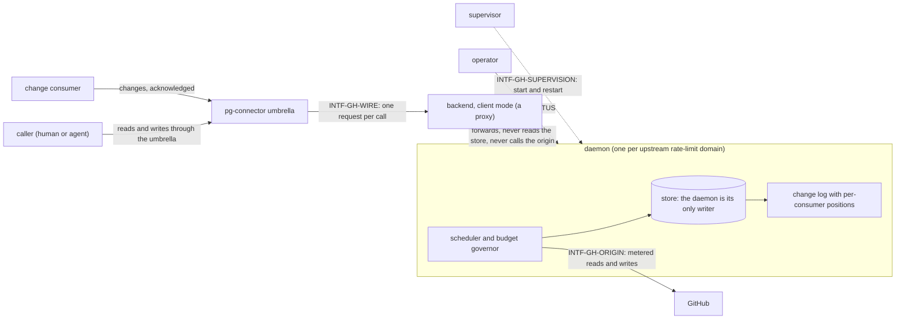

# pg-connector-github — behavior docs

`pg-connector-github` is the **daemon-backed Tier-2 backend** that answers the `pr` and `ci`
capabilities of pg-connector for GitHub. It keeps the data its callers ask for fresh
inside a hard budget, answers their reads from a store it owns, and decides by itself what changed.

This set follows the behavior-docs method
(`phillipgreenii-nix-agent-support · behavior-docs/docs/behavior`) and describes exactly one scope
(`INV-1`), **that backend's own intended behavior** and nothing below it (`INV-2`); the umbrella's side of the same seam (forwarding, acknowledgement
ordering, cache opt-out, ledger stamping) is the parent set's
(`phillipgreenii-nix-agent-support · packages/pg-connector/docs/behavior`), which this set cites and
does not restate. ADR 0090 lifted the earlier restriction that a backend is stateless, which is what
makes a backend like this one allowed; no other backend is required to follow it.

Start here, then the [glossary](glossary.md); the rules are in [invariants](invariants.md), the
boundaries in [interfaces](interfaces.md), the actors in [actors](actors.md), and the stories, use
cases and journeys in [journeys](journeys.md).

## The model

The backend is a **Proxy** in front of an **Active Object**. The daemon owns a persistent
**read-through cache** whose entries are refreshed ahead of expiry by a priority-queue scheduler; its
change log is a polled **Observer** feed with explicit acknowledgement; each field group is a
**Strategy** with its own freshness rule. These are the design patterns the rest of the set uses
the words for.

The idea the whole set serves: a caller's read is a **local hit**, so a poll or a read costs no
origin call while the data is fresh, and the backend never lets a consumer learn of a change before
the data that explains it is already stored.

## Scope (extent + floor)

- **Extent (in)** — what a caller observes of a PR and of its CI through the umbrella (reads from a
  store the daemon owns, writes that go through the daemon, and the freshness and age of each
  answer); how a change consumer polls and acknowledges the backend's own change feed, including the
  changes to a PR's CI; the rules that keep data fresh (the two caches, field groups, keep-alive,
  revalidation, expiry, persistence across a restart, mergeability); the rules that bound spend (a
  hard cap per bucket, the background share, priority classes); what a caller sees when the daemon
  is unreachable; and the diagnostics an operator reads (`status`, `explain` and
  `refresh`).
- **Extent (out)** — the umbrella's own half of the seam (forwarding `changes` and `changes_ack`,
  flushing before acknowledging, passing annotations through, stamping the ledger), which is the
  parent set's (`INV-CACHE-9`, `INV-LEDGER-FRESH-5`); the numeric defaults of every time-to-live,
  age, cap and share, which are decision-doc material set from measurement; the store's layout and
  engine, the socket framing, the supervisor wrapper per platform, registration of the backend in
  the umbrella's registry, observability catalogues (metrics, event log, alert thresholds), rollout,
  shadow runs and cutover of the consumers that read this backend (pg-desk and pg-router have their
  own sets), and the retirement of the two stateless GitHub backends it supersedes.
- **Floor** (`INV-10`) — this set speaks in entities, field groups, queries, caches, the change log, consumer
  positions, buckets and budgets, and in the existing wire ops and the seven-value error taxonomy
  of the parent set. It names GitHub only as the upstream the backend serves, and names no GitHub
  API shape, no storage engine, no process-manager product, and no source file or function.

## Realization gaps

This set's **realization-gap register** (method `INV-23`): intended behavior this set's
implementation has not built, one row per gap. The set states intended behavior only. **No gap is
open.** The daemon-backed GitHub backend is built (`packages/pg-connector/cmd/pg-connector-github`,
on the shared daemon library `packages/pg-connector/pkg/connectord`), and every row this register
once carried (process and placement, freshness, change delivery, budget, `status`, the error
taxonomy, and the config, supervision and status interfaces) was re-verified against that code and
its tests and removed, because the build now realizes it. The umbrella's half of the seam is the
parent set's register. A later divergence between this set and the build is recorded here as a new
row.

## External references

Every element this set cites from outside it is declared here. The owner UUID is the authority;
the link is a convenience (`INV-3`).

| Name                 | What it is                                                                                                      | Owner set-path                                                           | Owner UUID                                                                                                                                              |
| -------------------- | --------------------------------------------------------------------------------------------------------------- | ------------------------------------------------------------------------ | ------------------------------------------------------------------------------------------------------------------------------------------------------- |
| `INV-1`              | a behavior docs set describes exactly one scope                                                                 | `phillipgreenii-nix-agent-support · behavior-docs/docs/behavior`         | [5f8e3cf8-aedc-4718-b1b9-986d4b10ae17](https://github.com/phillipgreenii/nix-agent-support/blob/main/behavior-docs/docs/behavior/invariants.md)         |
| `INV-2`              | a behavior doc describes intended behavior only, no _how_                                                       | `phillipgreenii-nix-agent-support · behavior-docs/docs/behavior`         | [015a5534-9f3c-4eeb-9c22-34397008b9c5](https://github.com/phillipgreenii/nix-agent-support/blob/main/behavior-docs/docs/behavior/invariants.md)         |
| `INV-3`              | typed name plus stable UUID identity convention                                                                 | `phillipgreenii-nix-agent-support · behavior-docs/docs/behavior`         | [c44b760f-9baf-471a-8424-49984eb94ac7](https://github.com/phillipgreenii/nix-agent-support/blob/main/behavior-docs/docs/behavior/invariants.md)         |
| `INV-8`              | an interface declares its counterparty's kind and participation, and owns its catalog                           | `phillipgreenii-nix-agent-support · behavior-docs/docs/behavior`         | [67a79e92-2f98-40a2-9392-034a697e457e](https://github.com/phillipgreenii/nix-agent-support/blob/main/behavior-docs/docs/behavior/invariants.md)         |
| `INV-10`             | a set speaks at its scope's floor (the substitution test)                                                       | `phillipgreenii-nix-agent-support · behavior-docs/docs/behavior`         | [75d9daaa-46f5-4645-949d-f9223bb4fafc](https://github.com/phillipgreenii/nix-agent-support/blob/main/behavior-docs/docs/behavior/invariants.md)         |
| `INV-11`             | a set's extent is exactly what its stories, use cases and journeys need                                         | `phillipgreenii-nix-agent-support · behavior-docs/docs/behavior`         | [f8174e40-806c-4c42-97da-996efd7c6e23](https://github.com/phillipgreenii/nix-agent-support/blob/main/behavior-docs/docs/behavior/invariants.md)         |
| `INV-13`             | a set makes its scope explicit and defines every actor and interface                                            | `phillipgreenii-nix-agent-support · behavior-docs/docs/behavior`         | [94285c70-da89-4402-8ae2-af27925008bd](https://github.com/phillipgreenii/nix-agent-support/blob/main/behavior-docs/docs/behavior/invariants.md)         |
| `INV-18`             | inter-consistency at every interface, reconciled by the counterparty's kind                                     | `phillipgreenii-nix-agent-support · behavior-docs/docs/behavior`         | [4c6a764b-02f5-4c85-afae-a082fe6c21cd](https://github.com/phillipgreenii/nix-agent-support/blob/main/behavior-docs/docs/behavior/invariants.md)         |
| `INV-20`             | at a reference seam a shared term is inherited or renamed, never silently redefined                             | `phillipgreenii-nix-agent-support · behavior-docs/docs/behavior`         | [bafdd784-81ed-46fe-88f0-1a8c5fc4caf0](https://github.com/phillipgreenii/nix-agent-support/blob/main/behavior-docs/docs/behavior/invariants.md)         |
| `INV-22`             | traceability is a per-element listing obligation                                                                | `phillipgreenii-nix-agent-support · behavior-docs/docs/behavior`         | [b2502527-1340-4a1f-858c-aaa80c601317](https://github.com/phillipgreenii/nix-agent-support/blob/main/behavior-docs/docs/behavior/invariants.md)         |
| `INV-23`             | the realization-gap register is set-level and never an element                                                  | `phillipgreenii-nix-agent-support · behavior-docs/docs/behavior`         | [f3bba3e7-440f-4109-a4de-9d37daa34bcf](https://github.com/phillipgreenii/nix-agent-support/blob/main/behavior-docs/docs/behavior/invariants.md)         |
| `INV-STATE-1`        | per-call policy comes from the request, except for a daemon-backed backend, which reads its own rendered config | `phillipgreenii-nix-agent-support · packages/pg-connector/docs/behavior` | [4d8b2e91-7a3c-4f6d-9e1b-8c5a2d7f3b64](https://github.com/phillipgreenii/nix-agent-support/blob/main/packages/pg-connector/docs/behavior/invariants.md) |
| `INV-CACHE-1`        | the umbrella-owned entity cache for a backend that does not own its cache and changes                           | `phillipgreenii-nix-agent-support · packages/pg-connector/docs/behavior` | [892af663-9a46-4229-93d3-ac43d73f73c6](https://github.com/phillipgreenii/nix-agent-support/blob/main/packages/pg-connector/docs/behavior/invariants.md) |
| `INV-CACHE-8`        | `--fresh` is forwarded to a backend that owns its cache, which decides how current its answer is                | `phillipgreenii-nix-agent-support · packages/pg-connector/docs/behavior` | [eab5289c-7cb4-437c-abf4-42b2ee6b9889](https://github.com/phillipgreenii/nix-agent-support/blob/main/packages/pg-connector/docs/behavior/invariants.md) |
| `INV-CACHE-9`        | the umbrella's obligations toward a backend that owns its cache and changes                                     | `phillipgreenii-nix-agent-support · packages/pg-connector/docs/behavior` | [c9435bbd-8d45-4613-961d-84e719d85ccc](https://github.com/phillipgreenii/nix-agent-support/blob/main/packages/pg-connector/docs/behavior/invariants.md) |
| `INV-LEDGER-FRESH-2` | a cache answer never advances a ledger key's refreshed_at                                                       | `phillipgreenii-nix-agent-support · packages/pg-connector/docs/behavior` | [872fc219-5a0a-4d44-9fd3-03466805a948](https://github.com/phillipgreenii/nix-agent-support/blob/main/packages/pg-connector/docs/behavior/invariants.md) |
| `INV-LEDGER-FRESH-5` | the umbrella stamps its ledger from the backend's `sources_freshness[]` and the consumer's last_seen            | `phillipgreenii-nix-agent-support · packages/pg-connector/docs/behavior` | [9d4453e8-0447-48ef-b017-5cdfb10fc0d5](https://github.com/phillipgreenii/nix-agent-support/blob/main/packages/pg-connector/docs/behavior/invariants.md) |
| `INV-ERR-1`          | the closed seven-value wire error taxonomy                                                                      | `phillipgreenii-nix-agent-support · packages/pg-connector/docs/behavior` | [18167463-248b-4264-b08e-2dce05a601b9](https://github.com/phillipgreenii/nix-agent-support/blob/main/packages/pg-connector/docs/behavior/invariants.md) |
| `INV-ERR-3`          | query_not_recognized for a query name the backend's config does not define                                      | `phillipgreenii-nix-agent-support · packages/pg-connector/docs/behavior` | [7b4f2a91-6c3d-4e8a-9f10-2d5e8a3c6b17](https://github.com/phillipgreenii/nix-agent-support/blob/main/packages/pg-connector/docs/behavior/invariants.md) |
| `INV-EXIT-1`         | the umbrella's own exit-code schemes, the source of a health command's 0, 2 and 3                               | `phillipgreenii-nix-agent-support · packages/pg-connector/docs/behavior` | [e804ff39-e941-4a3f-b754-d16a114eea9d](https://github.com/phillipgreenii/nix-agent-support/blob/main/packages/pg-connector/docs/behavior/invariants.md) |
| `INTF-WIRE`          | the umbrella to backend wire protocol this backend implements                                                   | `phillipgreenii-nix-agent-support · packages/pg-connector/docs/behavior` | [17ee2995-d5b6-4a06-8324-9f95ba0e5322](https://github.com/phillipgreenii/nix-agent-support/blob/main/packages/pg-connector/docs/behavior/interfaces.md) |
| `ACTOR-BACKEND`      | the Tier-2 backend actor, which a daemon-backed backend extends with `status`                                   | `phillipgreenii-nix-agent-support · packages/pg-connector/docs/behavior` | [35459b50-8ead-48b1-85c3-5b70fad85129](https://github.com/phillipgreenii/nix-agent-support/blob/main/packages/pg-connector/docs/behavior/actors.md)     |

## Documents

- **[README](README.md)** · **[glossary](glossary.md)** · **[actors](actors.md)** ·
  **[interfaces](interfaces.md)** · **[invariants](invariants.md)** ·
  **[stories, use cases & journeys](journeys.md)**
