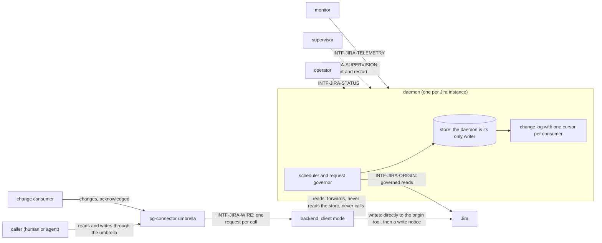
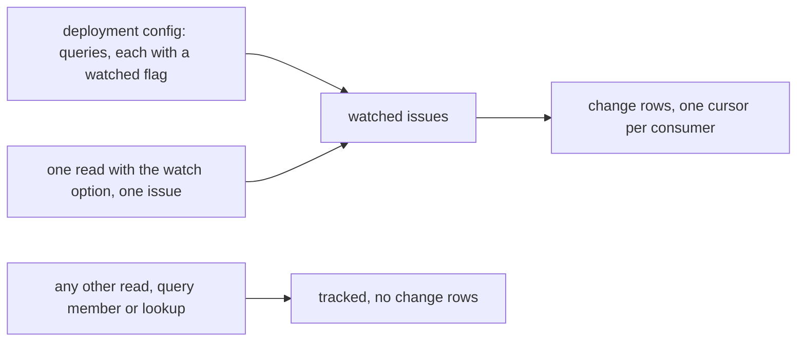

# pg-connector-issue-jira — behavior docs

`pg-connector-issue-jira` is the **daemon-backed Tier-2 backend** that answers the `issue`
capability of pg-connector for Jira. It keeps the issues its callers ask for fresh inside a small,
conservative request budget, answers their reads from a store it owns, and decides by itself what
changed, for the issues somebody has asked to watch.

This set follows the behavior-docs method
(`phillipgreenii-nix-agent-support · behavior-docs/docs/behavior`) and describes exactly one scope
(`INV-1`), **that backend's own intended behavior** and nothing below it (`INV-2`); the umbrella's
side of the same seam (forwarding, acknowledgement ordering, cache opt-out, ledger stamping, the
caller-facing `capabilities` verb and the watch option on `show`) is the parent set's
(`phillipgreenii-nix-agent-support · packages/pg-connector/docs/behavior`), which this set cites and
does not restate. It is a **sibling of the GitHub backend's set**
(`phillipgreenii-nix-agent-support · packages/pg-connector/docs/behavior/github`) and a **delta over it**: where this daemon behaves as the GitHub daemon
does (one daemon as the store's only writer, client mode, `unavailable` when it is down, a
persistent store, field groups, the settle rule, at-least-once delivery with explicit
acknowledgement, `sources_freshness[]`, `status` and `explain`), the rule is cited from that set and
only the difference is stated here.

Start here, then the [glossary](glossary.md); the rules are in [invariants](invariants.md), the
boundaries in [interfaces](interfaces.md), the actors in [actors](actors.md), and the stories, use
cases and journeys in [journeys](journeys.md).

## The model

The backend is a **Proxy** in front of an **Active Object** for reads, and a direct **Adapter** for
writes. The daemon owns a persistent **read-through cache** whose entries are refreshed ahead of
expiry by a priority-queue scheduler; its change log is a polled **Observer** feed with explicit
acknowledgement and one cursor per consumer; each field group is a **Strategy** with its own
freshness rule. These are the design patterns the rest of the set uses the words for.

Two independent properties of an issue organise the set. **Tracked** means the daemon keeps the
issue's content and keeps it fresh: every issue it retrieves, by any route, until it has been closed
for 24 hours. **Watched** means the daemon appends and delivers change rows for the issue: only an
issue in a query declared watched, or one a caller asked to watch, so the volume of events stays
small. Tracking alone never produces a change.

## Scope (extent + floor)

- **Extent (in)** — what a caller observes of an issue through the umbrella (reads from a store the
  daemon owns, live pass-through reads, writes that never depend on the daemon, and the freshness
  and age of each answer); how a change consumer polls and acknowledges the backend's own change
  feed; the rules that keep data fresh (field groups, revalidation, tracking until closed,
  retention, eviction, persistence across a restart); the watched flag and its stickiness; the
  baseline of a query and the late watch of an issue; the rules that bound spend (a request-rate
  cap, a concurrency cap, a pause with doubling after a refusal for rate); what a caller sees when
  the daemon is unreachable; the diagnostics an operator reads (`status` and `explain`); and the
  metric and alert catalogue.
- **Extent (out)** — the umbrella's own half of the seam (forwarding `changes` and `changes_ack`,
  flushing before acknowledging, passing annotations through, stamping the ledger, the
  caller-facing `capabilities` verb, `--no-ack`, `changes-ack` and the watch option on `show`),
  which is the parent set's; the numeric defaults of every window, cap, timeout, lease and bound,
  which are decision-doc material set from measurement; the shared daemon library, including what
  of it is generic and how the change feed and the watched-query shape are hoisted into it; the
  store's layout, engine and migrations; the socket framing, the supervisor wrapper per platform,
  registration of the backend in the umbrella's registry, and rollout, shadow runs and cutover of
  the consumers that read this backend; the consumers' own side of the feed (how a consumer hydrates,
  records or de-duplicates what it is told), which each consumer's own set states; the origin
  tool's own behavior and the figures Jira publishes for its limits, which this set does not assert;
  and the retirement of the stateless Jira backend this one supersedes.
- **Floor** (`INV-10`) — this set speaks in issues, field groups, queries, caches, the change log,
  consumer cursors, requests and budgets, and in the existing wire ops and the seven-value error
  taxonomy of the parent set. It names Jira only as the upstream the backend serves, and the origin
  tool only as the way every origin call is made; it names no Jira API shape, no storage engine, no
  process-manager product, and no source file or function.

## Realization gaps

This set's **realization-gap register** (method `INV-23`): intended behavior this set's
implementation has not built, one row per gap. The set states intended behavior only. The Jira
backend that exists today is **stateless**: a per-call process with no store and no daemon, so every
row below is open until the daemon is built. The umbrella's half of the seam is the parent set's
register.

| Element                                    | Intended                                                                                                         | Where the implementation stands                                                                                                                                                                                                            | Tracked by                 |
| ------------------------------------------ | ---------------------------------------------------------------------------------------------------------------- | ------------------------------------------------------------------------------------------------------------------------------------------------------------------------------------------------------------------------------------------ | -------------------------- |
| `INV-JIRA-PROC-1` to `INV-JIRA-PROC-3`     | one daemon per instance, client mode, `unavailable` when it is down, the application duties of the GitHub daemon | the Jira backend keeps no store and runs no daemon; every read goes to the origin                                                                                                                                                          | `pg2-2qyyh` (later phases) |
| `INV-JIRA-CHG-6` to `INV-JIRA-CHG-10`      | one cursor per consumer, rows selected by the stored watched flag, a store identity on every feed answer         | the shared daemon library keys a cursor by consumer, kind and query, selects by query membership, and carries no store identity; the feed and change engine are generic only inside the GitHub daemon, and hoisting them is a prerequisite | `pg2-qbu5b`                |
| `INV-JIRA-WRITE-1`, `INV-JIRA-WRITE-2`     | writes stay in client mode and send write notices                                                                | writes are performed directly, and nothing tells a daemon, because there is none                                                                                                                                                           | `pg2-2qyyh` (later phases) |
| `INV-JIRA-FRESH-1` to `INV-JIRA-FRESH-3`   | summary and detail groups, the update time as the revalidation token, a comment summary on the entity            | the backend decodes the update time but does not map it, and maps neither the description nor the comments                                                                                                                                 | `pg2-2qyyh` (later phases) |
| `INV-JIRA-TRACK-1`, `INV-JIRA-TRACK-2`     | tracking until closed for 24 hours, eviction at 7 days, tracked-set cost visible                                 | nothing is tracked; there is no closed-at time anywhere                                                                                                                                                                                    | `pg2-2qyyh` (later phases) |
| `INV-JIRA-WATCH-1` to `INV-JIRA-WATCH-7`   | the stored watched flag, stickiness, per-query baseline markers, first observation and late watch                | no query carries a watched value and no flag exists                                                                                                                                                                                        | `pg2-2qyyh` (later phases) |
| `INV-JIRA-CHG-1` to `INV-JIRA-CHG-5`       | change detection with the closed kind catalogue, the catch-all, and the one first-observation kind               | the stateless backend detects nothing; a consumer diffs listings itself                                                                                                                                                                    | `pg2-2qyyh` (later phases) |
| `INV-JIRA-BUDGET-1` to `INV-JIRA-BUDGET-3` | an internal request-rate cap and concurrency cap, a pause with doubling after a refusal for rate                 | the only signal the backend has is the refusal's status text; the origin tool surfaces no rate-limit report                                                                                                                                | `pg2-2qyyh` (later phases) |
| `INV-JIRA-DIAG-1`, `INV-JIRA-DIAG-2`       | `status` and `explain` for the daemon                                                                            | neither exists for this backend                                                                                                                                                                                                            | `pg2-2qyyh` (later phases) |
| `INV-JIRA-OBS-1` to `INV-JIRA-OBS-3`       | the metric catalogue and the alerts of this set                                                                  | only an event log and three alerts (authentication failing, unavailable, rate limited) exist, on the stateless backend's own log                                                                                                           | `pg2-2qyyh` (later phases) |
| `INV-JIRA-ERR-1`                           | every caller whose documentation or prompt treats `unavailable` as terminal retries instead                      | such callers exist today and have not been changed                                                                                                                                                                                         | `pg2-2qyyh` (later phases) |

## External references

Every element this set cites from outside it is declared here. The owner UUID is the authority; the
link is a convenience (`INV-3`).

| Name                 | What it is                                                                                                      | Owner set-path                                                                  | Owner UUID                                                                                                                                                     |
| -------------------- | --------------------------------------------------------------------------------------------------------------- | ------------------------------------------------------------------------------- | -------------------------------------------------------------------------------------------------------------------------------------------------------------- |
| `INV-1`              | a behavior docs set describes exactly one scope                                                                 | `phillipgreenii-nix-agent-support · behavior-docs/docs/behavior`                | [5f8e3cf8-aedc-4718-b1b9-986d4b10ae17](https://github.com/phillipgreenii/nix-agent-support/blob/main/behavior-docs/docs/behavior/invariants.md)                |
| `INV-2`              | a behavior doc describes intended behavior only, no _how_                                                       | `phillipgreenii-nix-agent-support · behavior-docs/docs/behavior`                | [015a5534-9f3c-4eeb-9c22-34397008b9c5](https://github.com/phillipgreenii/nix-agent-support/blob/main/behavior-docs/docs/behavior/invariants.md)                |
| `INV-3`              | typed name plus stable UUID identity convention                                                                 | `phillipgreenii-nix-agent-support · behavior-docs/docs/behavior`                | [c44b760f-9baf-471a-8424-49984eb94ac7](https://github.com/phillipgreenii/nix-agent-support/blob/main/behavior-docs/docs/behavior/invariants.md)                |
| `INV-8`              | an interface declares its counterparty's kind and participation, and owns its catalog                           | `phillipgreenii-nix-agent-support · behavior-docs/docs/behavior`                | [67a79e92-2f98-40a2-9392-034a697e457e](https://github.com/phillipgreenii/nix-agent-support/blob/main/behavior-docs/docs/behavior/invariants.md)                |
| `INV-10`             | a set speaks at its scope's floor (the substitution test)                                                       | `phillipgreenii-nix-agent-support · behavior-docs/docs/behavior`                | [75d9daaa-46f5-4645-949d-f9223bb4fafc](https://github.com/phillipgreenii/nix-agent-support/blob/main/behavior-docs/docs/behavior/invariants.md)                |
| `INV-11`             | a set's extent is exactly what its stories, use cases and journeys need                                         | `phillipgreenii-nix-agent-support · behavior-docs/docs/behavior`                | [f8174e40-806c-4c42-97da-996efd7c6e23](https://github.com/phillipgreenii/nix-agent-support/blob/main/behavior-docs/docs/behavior/invariants.md)                |
| `INV-13`             | a set makes its scope explicit and defines every actor and interface                                            | `phillipgreenii-nix-agent-support · behavior-docs/docs/behavior`                | [94285c70-da89-4402-8ae2-af27925008bd](https://github.com/phillipgreenii/nix-agent-support/blob/main/behavior-docs/docs/behavior/invariants.md)                |
| `INV-18`             | inter-consistency at every interface, reconciled by the counterparty's kind                                     | `phillipgreenii-nix-agent-support · behavior-docs/docs/behavior`                | [4c6a764b-02f5-4c85-afae-a082fe6c21cd](https://github.com/phillipgreenii/nix-agent-support/blob/main/behavior-docs/docs/behavior/invariants.md)                |
| `INV-20`             | at a reference seam a shared term is inherited or renamed, never silently redefined                             | `phillipgreenii-nix-agent-support · behavior-docs/docs/behavior`                | [bafdd784-81ed-46fe-88f0-1a8c5fc4caf0](https://github.com/phillipgreenii/nix-agent-support/blob/main/behavior-docs/docs/behavior/invariants.md)                |
| `INV-22`             | traceability is a per-element listing obligation                                                                | `phillipgreenii-nix-agent-support · behavior-docs/docs/behavior`                | [b2502527-1340-4a1f-858c-aaa80c601317](https://github.com/phillipgreenii/nix-agent-support/blob/main/behavior-docs/docs/behavior/invariants.md)                |
| `INV-23`             | the realization-gap register is set-level and never an element                                                  | `phillipgreenii-nix-agent-support · behavior-docs/docs/behavior`                | [f3bba3e7-440f-4109-a4de-9d37daa34bcf](https://github.com/phillipgreenii/nix-agent-support/blob/main/behavior-docs/docs/behavior/invariants.md)                |
| `INV-STATE-1`        | per-call policy comes from the request, except for a daemon-backed backend, which reads its own rendered config | `phillipgreenii-nix-agent-support · packages/pg-connector/docs/behavior`        | [4d8b2e91-7a3c-4f6d-9e1b-8c5a2d7f3b64](https://github.com/phillipgreenii/nix-agent-support/blob/main/packages/pg-connector/docs/behavior/invariants.md)        |
| `INV-CACHE-1`        | the umbrella-owned entity cache for a backend that does not own its cache and changes                           | `phillipgreenii-nix-agent-support · packages/pg-connector/docs/behavior`        | [892af663-9a46-4229-93d3-ac43d73f73c6](https://github.com/phillipgreenii/nix-agent-support/blob/main/packages/pg-connector/docs/behavior/invariants.md)        |
| `INV-CACHE-8`        | `--fresh` is forwarded to a backend that owns its cache, which decides how current its answer is                | `phillipgreenii-nix-agent-support · packages/pg-connector/docs/behavior`        | [eab5289c-7cb4-437c-abf4-42b2ee6b9889](https://github.com/phillipgreenii/nix-agent-support/blob/main/packages/pg-connector/docs/behavior/invariants.md)        |
| `INV-CACHE-9`        | the umbrella's obligations toward a backend that owns its cache and changes                                     | `phillipgreenii-nix-agent-support · packages/pg-connector/docs/behavior`        | [c9435bbd-8d45-4613-961d-84e719d85ccc](https://github.com/phillipgreenii/nix-agent-support/blob/main/packages/pg-connector/docs/behavior/invariants.md)        |
| `INV-LEDGER-FRESH-2` | a cache answer never advances a ledger key's refreshed_at                                                       | `phillipgreenii-nix-agent-support · packages/pg-connector/docs/behavior`        | [872fc219-5a0a-4d44-9fd3-03466805a948](https://github.com/phillipgreenii/nix-agent-support/blob/main/packages/pg-connector/docs/behavior/invariants.md)        |
| `INV-LEDGER-FRESH-5` | the umbrella stamps its ledger from the backend's `sources_freshness[]` and the consumer's last_seen            | `phillipgreenii-nix-agent-support · packages/pg-connector/docs/behavior`        | [9d4453e8-0447-48ef-b017-5cdfb10fc0d5](https://github.com/phillipgreenii/nix-agent-support/blob/main/packages/pg-connector/docs/behavior/invariants.md)        |
| `INV-ERR-1`          | the closed seven-value wire error taxonomy                                                                      | `phillipgreenii-nix-agent-support · packages/pg-connector/docs/behavior`        | [18167463-248b-4264-b08e-2dce05a601b9](https://github.com/phillipgreenii/nix-agent-support/blob/main/packages/pg-connector/docs/behavior/invariants.md)        |
| `INV-ERR-3`          | query_not_recognized for a query name the backend's config does not define                                      | `phillipgreenii-nix-agent-support · packages/pg-connector/docs/behavior`        | [7b4f2a91-6c3d-4e8a-9f10-2d5e8a3c6b17](https://github.com/phillipgreenii/nix-agent-support/blob/main/packages/pg-connector/docs/behavior/invariants.md)        |
| `INV-EXIT-1`         | the umbrella's own exit-code schemes, the source of a health command's 0, 2 and 3                               | `phillipgreenii-nix-agent-support · packages/pg-connector/docs/behavior`        | [e804ff39-e941-4a3f-b754-d16a114eea9d](https://github.com/phillipgreenii/nix-agent-support/blob/main/packages/pg-connector/docs/behavior/invariants.md)        |
| `INTF-WIRE`          | the umbrella to backend wire protocol this backend implements                                                   | `phillipgreenii-nix-agent-support · packages/pg-connector/docs/behavior`        | [17ee2995-d5b6-4a06-8324-9f95ba0e5322](https://github.com/phillipgreenii/nix-agent-support/blob/main/packages/pg-connector/docs/behavior/interfaces.md)        |
| `INTF-WIRE-CAPS-1`   | the caller-facing `capabilities` verb, extended with each configured query's watched value                      | `phillipgreenii-nix-agent-support · packages/pg-connector/docs/behavior`        | [eeabb0e5-bf16-434b-818a-887ead9159d3](https://github.com/phillipgreenii/nix-agent-support/blob/main/packages/pg-connector/docs/behavior/interfaces.md)        |
| `INTF-WIRE-WATCH-1`  | the `--watch` option on `issue show`, a one-off watch of one entity                                             | `phillipgreenii-nix-agent-support · packages/pg-connector/docs/behavior`        | [e812a808-4466-4101-bf98-f184dee46f57](https://github.com/phillipgreenii/nix-agent-support/blob/main/packages/pg-connector/docs/behavior/interfaces.md)        |
| `ACTOR-BACKEND`      | the Tier-2 backend actor, which a daemon-backed backend extends with `status`                                   | `phillipgreenii-nix-agent-support · packages/pg-connector/docs/behavior`        | [35459b50-8ead-48b1-85c3-5b70fad85129](https://github.com/phillipgreenii/nix-agent-support/blob/main/packages/pg-connector/docs/behavior/actors.md)            |
| `INV-GH-PROC-2`      | an unreachable daemon is answered `unavailable` with the socket and restart hint; `capabilities` never needs it | `phillipgreenii-nix-agent-support · packages/pg-connector/docs/behavior/github` | [354a199c-b3f3-4313-942d-9d95e4a17fb3](https://github.com/phillipgreenii/nix-agent-support/blob/main/packages/pg-connector/docs/behavior/github/invariants.md) |
| `INV-GH-PROC-3`      | the application does everything but restart itself, and takes every setting from one rendered file              | `phillipgreenii-nix-agent-support · packages/pg-connector/docs/behavior/github` | [9985e59b-1134-4c08-a0ef-9c6838aa3df8](https://github.com/phillipgreenii/nix-agent-support/blob/main/packages/pg-connector/docs/behavior/github/invariants.md) |
| `INV-GH-PROC-4`      | start, migration, downgrade refusal and store move-aside                                                        | `phillipgreenii-nix-agent-support · packages/pg-connector/docs/behavior/github` | [ee521e3d-627b-487b-a315-f3e09b47f723](https://github.com/phillipgreenii/nix-agent-support/blob/main/packages/pg-connector/docs/behavior/github/invariants.md) |
| `INV-GH-FRESH-2`     | an entity read is a local hit when every group is fresh, otherwise stale groups are fetched at once             | `phillipgreenii-nix-agent-support · packages/pg-connector/docs/behavior/github` | [3c15f744-e205-425e-adc0-6299a8165782](https://github.com/phillipgreenii/nix-agent-support/blob/main/packages/pg-connector/docs/behavior/github/invariants.md) |
| `INV-GH-FRESH-8`     | every read answer carries served_from, stale, age_seconds and groups[]                                          | `phillipgreenii-nix-agent-support · packages/pg-connector/docs/behavior/github` | [0236db7d-ba4b-433f-8fec-91f4acbf5930](https://github.com/phillipgreenii/nix-agent-support/blob/main/packages/pg-connector/docs/behavior/github/invariants.md) |
| `INV-GH-CHG-3`       | the settle rule: a change that queues dependent groups is held as a durable pending row                         | `phillipgreenii-nix-agent-support · packages/pg-connector/docs/behavior/github` | [59efd12d-10f7-4b1e-a0ac-1573749f1eb4](https://github.com/phillipgreenii/nix-agent-support/blob/main/packages/pg-connector/docs/behavior/github/invariants.md) |
| `INV-GH-CHG-6`       | at-least-once delivery with explicit acknowledgement                                                            | `phillipgreenii-nix-agent-support · packages/pg-connector/docs/behavior/github` | [d5bf79c4-044c-4542-ac08-d6c6e4fff06f](https://github.com/phillipgreenii/nix-agent-support/blob/main/packages/pg-connector/docs/behavior/github/invariants.md) |
| `INV-GH-CHG-7`       | the first poll of a new key starts at the tail of the log                                                       | `phillipgreenii-nix-agent-support · packages/pg-connector/docs/behavior/github` | [248c0b20-cf19-41b8-a0b6-77bcc82e0942](https://github.com/phillipgreenii/nix-agent-support/blob/main/packages/pg-connector/docs/behavior/github/invariants.md) |
| `INV-GH-CHG-8`       | retention, `cursor_expired:`, and the same answer to every key after a move-aside                               | `phillipgreenii-nix-agent-support · packages/pg-connector/docs/behavior/github` | [d1e96af5-03e8-4990-bb63-d07f7976b00c](https://github.com/phillipgreenii/nix-agent-support/blob/main/packages/pg-connector/docs/behavior/github/invariants.md) |
| `INV-GH-CHG-11`      | per-query last whole-query origin answer and last error, returned as `sources_freshness[]`                      | `phillipgreenii-nix-agent-support · packages/pg-connector/docs/behavior/github` | [ea2d1e2e-e07d-4936-868d-d65580032c61](https://github.com/phillipgreenii/nix-agent-support/blob/main/packages/pg-connector/docs/behavior/github/invariants.md) |
| `INV-GH-BUDGET-1`    | every origin call passes through the governor and each bucket cap is hard for every class of work               | `phillipgreenii-nix-agent-support · packages/pg-connector/docs/behavior/github` | [f5335c40-d98a-4b27-8895-d9926c6349a6](https://github.com/phillipgreenii/nix-agent-support/blob/main/packages/pg-connector/docs/behavior/github/invariants.md) |
| `INV-GH-BUDGET-2`    | each task carries a due time and one of five priority classes, highest first                                    | `phillipgreenii-nix-agent-support · packages/pg-connector/docs/behavior/github` | [8f25cfbd-5f24-43e6-a0ff-8e4375dcae36](https://github.com/phillipgreenii/nix-agent-support/blob/main/packages/pg-connector/docs/behavior/github/invariants.md) |
| `INV-GH-BUDGET-3`    | background classes stop at the background share of each cap                                                     | `phillipgreenii-nix-agent-support · packages/pg-connector/docs/behavior/github` | [3d9c2d1d-7fc1-4a92-b786-ecd42ebfb6e8](https://github.com/phillipgreenii/nix-agent-support/blob/main/packages/pg-connector/docs/behavior/github/invariants.md) |
| `INV-GH-DIAG-1`      | `status` is offered, reports with the daemon down, and follows `INV-EXIT-1`                                     | `phillipgreenii-nix-agent-support · packages/pg-connector/docs/behavior/github` | [aa40c5a9-849d-4e52-b478-f68f013c6d4e](https://github.com/phillipgreenii/nix-agent-support/blob/main/packages/pg-connector/docs/behavior/github/invariants.md) |
| `INV-GH-DIAG-2`      | `explain` answers why an entity is stale, per group, reading the store only                                     | `phillipgreenii-nix-agent-support · packages/pg-connector/docs/behavior/github` | [74d55235-019d-44ad-babd-91f3de1ac04f](https://github.com/phillipgreenii/nix-agent-support/blob/main/packages/pg-connector/docs/behavior/github/invariants.md) |

## Documents

- **[README](README.md)** · **[glossary](glossary.md)** · **[actors](actors.md)** ·
  **[interfaces](interfaces.md)** · **[invariants](invariants.md)** ·
  **[stories, use cases & journeys](journeys.md)**
