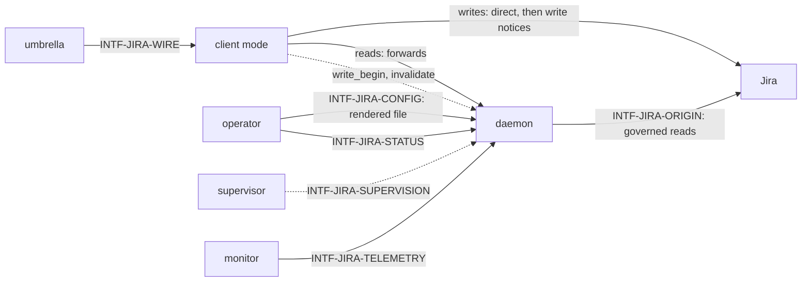

# Interfaces — pg-connector-issue-jira

This file follows the interface convention of the behavior-docs method
(`phillipgreenii-nix-agent-support · behavior-docs/docs/behavior`, `INV-8`): an **interface** is a
boundary described by **what crosses it** and **what must hold**, never _how_ it is implemented. See
the [glossary](glossary.md) for terms, [actors](actors.md) for who sits on each side,
[invariants](invariants.md) for the rules, and [journeys](journeys.md) for the flows that exercise
these interfaces. The backend has six interfaces, each classified on both axes the method asks for
(the counterparty's kind, and essential versus optional participation):

| Interface               | Boundary                                                      | Counterparty (kind)                            | Participation | Initiator  |
| ----------------------- | ------------------------------------------------------------- | ---------------------------------------------- | ------------- | ---------- |
| `INTF-JIRA-WIRE`        | one op request in; one result or taxonomy-coded error out     | `ACTOR-JIRA-UMBRELLA` umbrella (**owner**)     | essential     | umbrella   |
| `INTF-JIRA-ORIGIN`      | metered reads out, writes out; origin answers and refusals in | `ACTOR-JIRA-ORIGIN` origin (**actor**, system) | essential     | daemon     |
| `INTF-JIRA-CONFIG`      | one rendered settings file in                                 | `ACTOR-JIRA-OPERATOR` operator (**actor**)     | essential     | operator   |
| `INTF-JIRA-STATUS`      | a health report out, even with the daemon down                | `ACTOR-JIRA-OPERATOR` operator (**actor**)     | optional      | operator   |
| `INTF-JIRA-SUPERVISION` | start and restart of the daemon                               | `ACTOR-JIRA-SUPERVISOR` supervisor (**actor**) | optional      | supervisor |
| `INTF-JIRA-TELEMETRY`   | metrics and an event log out; alerts evaluated over them      | `ACTOR-JIRA-MONITOR` monitor (**actor**)       | optional      | monitor    |

## `INTF-JIRA-WIRE` — the umbrella to backend wire protocol, for this backend <!-- uuid: 54ddbd8a-b0f4-405e-9c99-188d40d3c423 -->

- **Counterparty:** `ACTOR-JIRA-UMBRELLA`, kind **owner**: the parent set's `INTF-WIRE` is the
  contract this backend implements. This section **cites** it and states only this backend's own
  obligations, reconciled by the umbrella's conformance expectations rather than a peer cross-check
  (`INV-18`). **Participation:** essential. **Initiator:** the umbrella, always. The backend answers
  the `issue` capability, one name per configured instance in the registry.
- **What does not change.** The wire envelope, its two version numbers and the closed seven-value
  error taxonomy (`INV-ERR-1`) are the parent's. This backend adds no error code. Result shapes gain
  the optional fields below. The caller-facing `capabilities` verb (`INTF-WIRE-CAPS-1`) and the
  watch option on `show` (`INTF-WIRE-WATCH-1`) are the parent's contract; this section states what
  the backend does with them.
- **Declarations.** The backend declares `owns_changes` and `cache_opt_out` in its `capabilities`
  answer, and answers `capabilities` without contacting its daemon (`INV-JIRA-PROC-2`). The first
  makes the umbrella forward `changes` and `changes_ack`; the second turns off the umbrella-owned
  entity cache (`INV-CACHE-1`) for this backend, so that the backend alone decides how current an
  answer is. Each configured query appears in the answer with its watched value.

### Op catalog

An op's **groups** are the field groups it needs; a read whose groups are all inside their freshness
window is a local hit (`INV-JIRA-FRESH-2`).

| Op              | Served from                                | Groups read     | Note                                                       |
| --------------- | ------------------------------------------ | --------------- | ---------------------------------------------------------- |
| `show`          | store, read-through                        | summary, detail | accepts the watch option (`INV-JIRA-WATCH-1`)              |
| `list`          | query cache and store                      | summary         | a configured query name is required (`INV-JIRA-ERR-1`)     |
| `children`      | metered pass-through                       |                 | the children group is never held (`INV-JIRA-FRESH-2`)      |
| `search`        | metered pass-through                       |                 | live, not stored                                           |
| `list_activity` | metered pass-through                       |                 | live, not stored                                           |
| `create`        | the origin, performed by the client        |                 | a write; never needs the daemon (`INV-JIRA-WRITE-1`)       |
| `comment`       | the origin, performed by the client        |                 | a write                                                    |
| `transition`    | the origin, performed by the client        |                 | a write                                                    |
| `update`        | the origin, performed by the client        |                 | a write                                                    |
| `close`         | the origin, performed by the client        |                 | a write                                                    |
| `changes`       | change log                                 |                 | the feed (`INV-JIRA-CHG-6`)                                |
| `changes_ack`   | change log                                 |                 | moves a consumer's one position (`INV-JIRA-CHG-7`)         |
| `explain`       | store                                      |                 | `INV-JIRA-DIAG-2`                                          |
| `capabilities`  | the client, without the daemon             |                 | `INV-JIRA-PROC-2`                                          |
| `auth_status`   | the daemon                                 |                 | reports the acting identity and any authentication failure |
| `status`        | the daemon; a local report when it is down |                 | `INTF-JIRA-STATUS`                                         |

### Write handling

A write is performed by the calling process, directly against the origin tool, under the caller's
own identity; it does not cross the daemon (`INV-JIRA-WRITE-1`). Around it the client sends the
daemon two **write notices**, `write_begin` and `invalidate`, each with a short delivery timeout
(`INV-JIRA-WRITE-2`). The notices pass between the backend's own two halves and are not part of the
umbrella's contract: the umbrella sees one write call and one answer, whether or not a notice was
delivered. A `create` names the instance in its first notice because it has no issue id yet.

### Read answers

Every read answer carries the parent's `served_from`, `stale` and `age_seconds`, plus an optional
`groups[]` with one entry per group served: `{group, fetched_at, fresh_until, last_error}`
(`INV-JIRA-FRESH-2`). `age_seconds` is the age of the oldest `fetched_at` among the groups served.
The issue entity carries the comment summary, a count and the time of the latest comment
(`INV-JIRA-FRESH-3`).

### Change feed fields

- Each change carries `seq`, `kinds`, `fields` (each field with its before and after value) and the
  change cause (`origin`) in addition to the parent's `{change, source, entity}`. `change` maps from
  the kinds: `added` gives `added`; `removed` gives `removed`; anything else gives `changed`.
  `entity` is the summary-level entity with `version` set to **the row's own** value
  (`INV-JIRA-CHG-1`).
- A feed read carries `--consumer` and MAY carry `--query` as a filter; the answer's `next_seq` is
  the log position scanned up to, which can be past the last returned row because rows of other
  issues are skipped (`INV-JIRA-CHG-6`).
- Every feed answer carries the daemon's **store identity** (`INV-JIRA-CHG-9`) and
  `sources_freshness[]`, one entry per configured query: the time of the last whole-query origin
  answer and the last error (`INV-JIRA-CHG-10`).
- Membership information (`entered_query`, `left_query`) MAY accompany the rows and is never a row
  (`INV-JIRA-CHG-5`).
- `changes_ack` carries `{consumer, next_seq}`: the one position of that consumer, whatever filter
  the poll used (`INV-JIRA-CHG-6`).

### Change kinds (catalog)

The closed set of kinds a change row carries (`INV-JIRA-CHG-2`): `closed`, `reopened`,
`status_changed`, `assignee_changed`, `priority_changed`, `labels_changed`, `parent_changed`,
`title_changed`, `description_changed`, `comments_changed`, `renamed`, `removed`, the catch-all
`fields_changed`, and the one first-observation kind `added`. There is no `opened` kind: the word
already means a state moving to open, so a first observation is `added`, and `entered_query` and
`left_query` are membership information, not kinds of a row.

### Failure catalog

Every failure is answered from the parent's seven-value taxonomy (`INV-JIRA-ERR-1`):

| Failure                                  | Answer                                                                                                                                                      |
| ---------------------------------------- | ----------------------------------------------------------------------------------------------------------------------------------------------------------- |
| origin error or timeout                  | the group stays stale and records its last error; an interactive read gets stale content inside expiry, otherwise `unavailable`                             |
| origin refuses a request for rate        | background work pauses for the stated or configured time; interactive reads are served stale (`INV-JIRA-BUDGET-2`)                                          |
| authentication failure                   | fetches answer `unauthenticated`; cached reads are still served with their age; `auth_status` reports the failure                                           |
| daemon unreachable                       | `unavailable` naming the socket path and the supervisor's restart hint; a write is not affected (`INV-JIRA-PROC-2`)                                         |
| daemon migrating its store               | `unavailable` whose message starts with `migrating:`                                                                                                        |
| store corrupt, or its migration fails    | the store is moved aside with a timestamp, the daemon starts empty, flags and baselines are lost and an alert fires (`INV-JIRA-PROC-3`, `INV-JIRA-WATCH-7`) |
| store newer than the binary              | the daemon refuses to start and alerts; it never moves the store aside                                                                                      |
| protocol version outside supported range | `version_mismatch`                                                                                                                                          |
| query name the config does not define    | `query_not_recognized` (`INV-ERR-3`)                                                                                                                        |
| consumer position outside retention      | `invalid_argument` whose message starts with `cursor_expired:` (`INV-JIRA-CHG-8`)                                                                           |
| issue deleted or inaccessible            | a `removed` row when the issue is watched (`INV-JIRA-CHG-4`)                                                                                                |

- **What must hold.** Each op and answer above, under the invariants named against it. The backend
  MUST NOT answer an op from the umbrella's own state, and MUST NOT depend on the umbrella's cache or
  ledger for any answer (`INV-CACHE-9`).
- **How agreement is confirmed.** The umbrella's half of each exchange is the parent set's
  (`INV-CACHE-9`, `INV-LEDGER-FRESH-5`). This backend's half is confirmed by a conformance suite
  that runs each op of the catalog against a throwaway store and a faked origin, and runs each write
  with the daemon down.

## `INTF-JIRA-ORIGIN` — the daemon and the client to the upstream <!-- uuid: 3373a213-9f4c-41ea-8017-d79666871d73 -->

- **Counterparty:** `ACTOR-JIRA-ORIGIN`, kind **actor** (a system the backend drives; the interface
  definition itself is the agreement, since the origin keeps no behavior docs set).
  **Participation:** essential. **Initiator:** the daemon for every read, and the calling process
  for a write.
- **What crosses (out).** Full query runs for the summary group, per-issue reads for the detail
  group, the three pass-through reads, and the five writes. Every read is made by the daemon, under
  the governor, through the origin tool. A write is made by the calling process, through the same
  tool, under that caller's identity.
- **What crosses (in).** Content, a refusal for rate with its stated retry delay when it states one,
  and authentication failures. The origin's own rate-limit report is an input only when the origin
  tool surfaces it (`INV-JIRA-BUDGET-3`).
- **What must hold.** No daemon call is made outside the governor (`INV-JIRA-BUDGET-1`); the
  credential stays with the origin tool and never enters the store or the daemon; the daemon's
  budget is internal (`INV-JIRA-BUDGET-1`); a failed call leaves the previous content in place
  (`INV-JIRA-FRESH-2`).
- **How agreement is confirmed.** A faked origin in the conformance suite, and a measurement of the
  per-call cost of each group that sets the cost-dependent defaults.

## `INTF-JIRA-CONFIG` — the rendered settings file <!-- uuid: f7cfb01c-076b-462d-b08c-1ab321fc816b -->

- **Counterparty:** `ACTOR-JIRA-OPERATOR`, kind **actor** (the party that authors the settings; a
  deployment renders them). **Participation:** essential. **Initiator:** the operator.
- **What crosses.** One rendered file, named on the backend's command line together with the
  instance, that carries every setting the daemon and its client need: the origin tool's path, the
  state and socket paths, the configured queries each with its `watched` value (default false), each
  group's freshness window, the settle timeout, the request-rate cap, the concurrency cap, the
  default pause, the write notices' delivery timeout and lease, the tracked-set size an alert fires
  above, and the retention intervals of change rows and of a consumer cursor.
- **What must hold.** Nothing the daemon or the client needs comes from the environment
  (`INV-JIRA-PROC-3`, `INV-STATE-1`), so a daemon started by hand with an empty environment
  behaves as it does under its supervisor. The file hard-codes no user, team, project or
  organisation. A change takes effect by restarting the daemon. The queries and the registry entry
  are rendered from one source. Numeric defaults are decision-doc material and are not fixed here.
- **How agreement is confirmed.** The conformance suite starts the daemon from a rendered file under
  an empty environment, and asserts the unknown-query and config-hash answers.

## `INTF-JIRA-STATUS` — the health report <!-- uuid: 97df29b4-1aa0-4675-a4a0-1e5966316ec1 -->

- **Counterparty:** `ACTOR-JIRA-OPERATOR`, kind **actor**. **Participation:** optional (a deployment
  that never asks is valid). **Initiator:** the operator, by the backend's own `status` command or
  through the umbrella's `auth status` and `config validate`, which show it as rows.
- **What crosses (out).** Version and build id, uptime, store path, size and identity, the request
  counter and any pause with its reason and end time, queue depth and the oldest overdue task by
  class, per-query last whole-query success and last error, authentication state and the acting
  identity, the change log's head position, pending settle rows and settle timeouts in the last
  hour, per-consumer positions, the tracked count by class and the watched count, and the
  supervisor. A `--json` form carries the same values. It carries counts, never issue content.
- **What must hold.** The report is produced even with the daemon down (`INV-JIRA-DIAG-1`). Its exit
  code follows the parent's `INV-EXIT-1`: 0 healthy, 2 degraded, 3 down.
- **How agreement is confirmed.** Actor: the definition is the agreement; the conformance suite
  asserts the down-daemon report.

## `INTF-JIRA-SUPERVISION` — starting and restarting the daemon <!-- uuid: 97181e45-b77c-4182-8b3e-6d233b0422ba -->

- **Counterparty:** `ACTOR-JIRA-SUPERVISOR`, kind **actor**. **Participation:** optional (the daemon
  runs when an operator starts it by hand). **Initiator:** the supervisor.
- **What crosses.** A start at login with the config file and the instance named, a restart when the
  daemon exits, and a shutdown signal. The daemon answers a shutdown signal by refusing new
  connections, finishing in-flight work, appending every pending change row, and releasing its
  single-instance lock.
- **What must hold.** The supervisor has no logic of its own: the application does everything except
  restart itself (`INV-JIRA-PROC-3`). Where no supervisor exists, `unavailable` names the command
  that starts the daemon in the background, never one that would block the caller's shell.
- **How agreement is confirmed.** Actor: the definition is the agreement; the conformance suite
  restarts the daemon and asserts the shutdown answer and the durable pending rows.

## `INTF-JIRA-TELEMETRY` — metrics, event log and alerts <!-- uuid: 6047c6b6-8486-4856-b8f8-93db9ead36cf -->

- **Counterparty:** `ACTOR-JIRA-MONITOR`, kind **actor** (the observability stack, which keeps no
  behavior docs set of its own for this daemon). **Participation:** optional. **Initiator:** the
  monitor, which collects what the daemon exposes and evaluates the alert rules over it.
- **What crosses (out).** The metric catalogue and an event log with one entry per origin call,
  whose failure class tells authentication failure, unavailability and rate limiting apart
  (`INV-JIRA-OBS-1`). The alerts of `INV-JIRA-OBS-2` are evaluated by the monitor over these.
- **What must hold.** The daemon emits its own telemetry (`INV-JIRA-PROC-3`); a metric of the
  catalogue is present while the daemon runs; an alert is never active while the daemon is not
  deployed (`INV-JIRA-OBS-2`); the telemetry carries no credential.
- **How agreement is confirmed.** Actor: the definition is the agreement; every alert has an
  automated rule test with a positive and a negative case.
